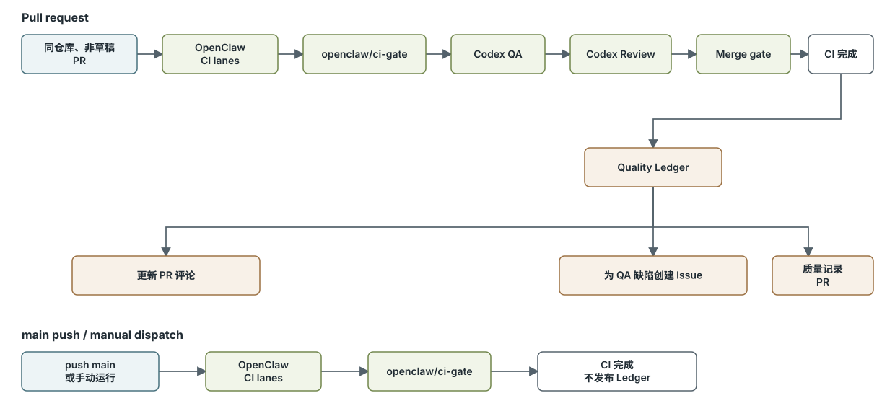

# GitHub Actions 工作流说明

本文说明 Codex QA、Review、Merge gate 和 Quality Ledger 如何接入 OpenClaw 现有 CI。
现有 lanes、命令和 runner 选择以 [`ci.yml`](ci.yml) 及 `package.json` 为准，本文只记录
新增流程的稳定契约。

## 整体关系

| 文件                                       | 职责                                              | 触发方式                            |
| ------------------------------------------ | ------------------------------------------------- | ----------------------------------- |
| [`ci.yml`](ci.yml)                         | OpenClaw CI 总调度、`openclaw/ci-gate` 和新增门禁 | `main` push、指定 PR 事件、手动运行 |
| [`codex-qa.yml`](codex-qa.yml)             | 按主 Issue 的 Acceptance Criteria 验收行为        | 由 CI 调用                          |
| [`codex-review.yml`](codex-review.yml)     | 独立检查 diff、规格和安全问题                     | QA 成功后由 CI 调用                 |
| [`quality-ledger.yml`](quality-ledger.yml) | 发布评论、Bug Issue 和质量记录 PR                 | 默认分支上的 CI 完成后触发          |



[Mermaid 源码](ci-flow.mmd)

同仓库、非草稿 PR 的新增链路为：

```text
openclaw/ci-gate -> Codex QA -> Codex Review -> Merge gate
```

推送 `main` 或手动运行只走 OpenClaw 原有 CI。Quality Ledger 监听所有 `CI` 完成事件，
但发布 job 只处理来源仍为本仓库的 PR。

## CI 入口和 Merge gate

`ci.yml` 的触发条件为：

```yaml
on:
  workflow_dispatch:
  push:
    branches: [main]
    paths-ignore:
      - "**/*.md"
      - "docs/**"
  pull_request:
    types: [opened, reopened, synchronize, ready_for_review, converted_to_draft]
```

编辑 PR 标题或正文不会自动创建一次 `edited` 运行。关联 Issue、Issue 评论或 PR 描述变化后，
需要在 Actions 或 PR checks 中手动重新运行 CI。创建或更新草稿 PR 仍可能启动原有 CI lanes，
但 `openclaw/ci-gate` 和三个新增门禁都会跳过。

OpenClaw 原有 CI 根据变更范围、runner profile 和仓库配置选择 lanes，最后由
`openclaw/ci-gate` 验证所有被选中的 job 成功。新增流程不复制或替代其构建、lint、类型检查、
单元测试、集成测试和 E2E 调度。

`codex-qa` 仅在以下条件全部满足时运行：

- 事件是 `pull_request`；
- PR 不是草稿；
- head branch 属于当前仓库；
- `openclaw/ci-gate` 成功。

`codex-review` 在 QA 成功后运行。`Merge gate` 使用 `if: always()` 汇总
`openclaw/ci-gate`、Codex QA 和 Codex Review；三个结果都必须为 `success`。

Merge gate 只产生检查结果。默认分支 Ruleset 必须把 `Merge gate` 配置为必需检查，才会
真正阻止合并。建议保留现有 `openclaw/ci-gate` 必需检查，以维持原有治理和可见性。

## Codex QA

[`codex-qa.yml`](codex-qa.yml) 是 `workflow_call` 工作流，不独立监听 push 或 PR。它要求：

- Secret `OPENAI_API_KEY` 非空；
- Variable `OPENAI_RESPONSES_API_ENDPOINT` 非空，且值是完整的 Responses endpoint；
- PR 来自当前仓库。

QA 检出准确的 PR head SHA，使用仓库的 `setup-node-env` composite action 配置 Node 24、pnpm
和冻结锁文件依赖，再由 [`context.cjs`](../scripts/context.cjs) 读取主 Issue、全部 Issue 评论、
PR 评论和审查讨论。

上下文加载要求 PR 通过 `Closes #123`、`Fixes #123` 等形式关联恰好一个主 Issue。Issue
必须包含 Type、Problem、User Outcome、Scope、Non-goals、Acceptance Criteria、References、
Dependencies、Risk、Owner 和 `AI Ready`，其中 `AI Ready=Yes`，每项 AC 使用唯一编号。

Codex QA 使用 `workspace-write` 沙箱按 AC 执行适用的真实测试和异常路径检查，输出
`evidence/qa.json`。[`report.cjs`](../scripts/report.cjs) 校验 Schema、Issue/PR/commit 对应关系、
AC 覆盖和结论一致性。通过结论不能包含失败 AC、Bug、回归或空测试记录。

无论成功或失败，工作流都会尝试上传 `codex-qa` artifact，默认保留 30 天。QA 可以产生临时
测试与证据，但永久回归测试仍须由修复 PR 提交。

## Codex Review

[`codex-review.yml`](codex-review.yml) 重新检出同一 PR head SHA 并加载完整 Issue/PR 上下文。
它不读取 QA 结论或 artifact，因此审查内容独立；调度上仍位于 QA 之后，QA 失败时不会运行。

Review 使用 `read-only` Codex 沙箱检查正确性、回归、安全、兼容性、测试覆盖和规格一致性，
输出 `evidence/review.json`。校验脚本会拒绝带有 blocking finding 或 security failure 的通过
结论。证据上传为 `codex-review` artifact，默认保留 30 天。

QA 安装项目依赖以便运行测试；Review 只配置 Node/pnpm，不安装项目依赖。两者都通过
`responses-api-endpoint` 把请求发往仓库变量指定的 Responses endpoint。

## Quality Ledger

[`quality-ledger.yml`](quality-ledger.yml) 使用：

```yaml
on:
  workflow_run:
    workflows: [CI]
    types: [completed]
```

该工作流必须先存在于默认分支。发布 job 只接受原始事件为 `pull_request` 且 head repository
与当前仓库一致的运行，因此 `main` push、手动运行和 fork PR 不会发布。

发布 job 拥有 `actions: read`、`contents: write`、`issues: write` 和 `pull-requests: write`。
它通过 `github.workflow_sha` 检出触发器使用的受信任默认分支版本，不执行 PR 修改后的发布脚本。
下载步骤仅寻找 `codex-qa`、`codex-review` artifact，限制压缩包和 JSON 大小，并只把根目录的
`qa.json`、`review.json` 当作数据读取。

发布前，[`ledger.cjs`](../scripts/ledger.cjs) 重新验证：

- 上游运行对应一个同仓库 PR；
- PR 当前 head SHA 仍等于报告 commit；
- PR 仍关联恰好一个主 Issue；
- 报告中的 Issue、PR 和 commit 与 GitHub 元数据一致。

过期运行不会覆盖新提交的结果。有效结果会更新带隐藏标记的 PR 汇总评论；缺失报告标记为
`not completed` / `[AI-BLOCKED]`，不会当作通过。只有 QA 报告中的可复现缺陷会创建带
`needs-triage`、`AI Ready=No` 的 Bug Issue，Review findings 只进入汇总等待监督者分诊。

长期记录写入：

```text
docs/quality/reports/PR-<n>.md
docs/quality/bugs/BUG-<n>.md
```

脚本创建或更新 `quality-ledger/pr-<n>` 分支及独立 PR，不自动合并、关闭产品 Issue 或绕过
保护规则。`GITHUB_TOKEN` 创建的 PR 不会再次触发普通 PR 工作流，因此纯证据 PR 需要明确的
人工例外或经批准的 GitHub App。Ledger 发布失败不会改变已经完成的 Merge gate 结果。

## 验证和仓库设置

本地修改自动化脚本后运行：

```bash
node --test .github/scripts/automation.test.cjs
git diff --check
```

完整工作流验证必须使用一个同仓库、非草稿 PR，并关联满足 Contract 的主 Issue。首次成功产生
`Merge gate` 后，再把它加入默认分支 Ruleset。仓库还必须允许 GitHub Actions 使用读写权限并
创建 Pull Request，否则 Quality Ledger 的发布阶段会失败。
