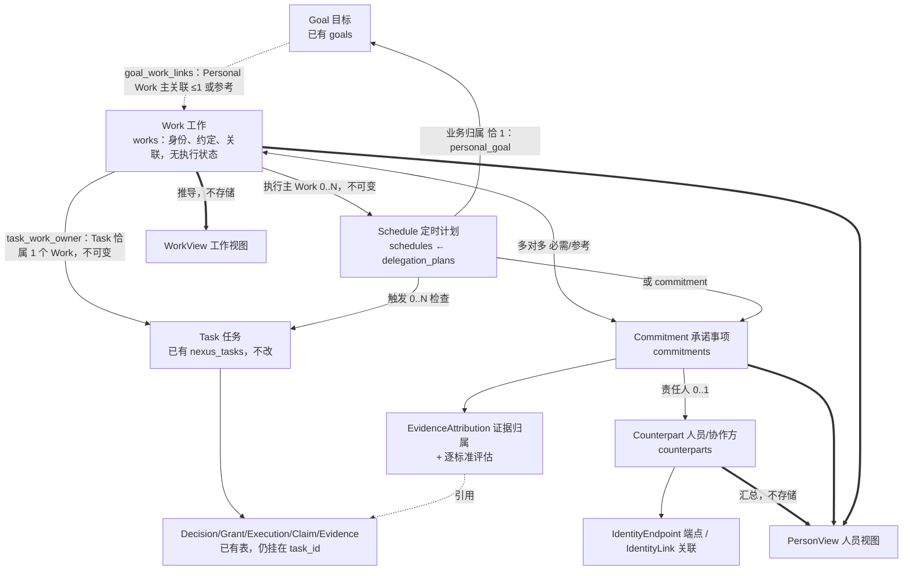
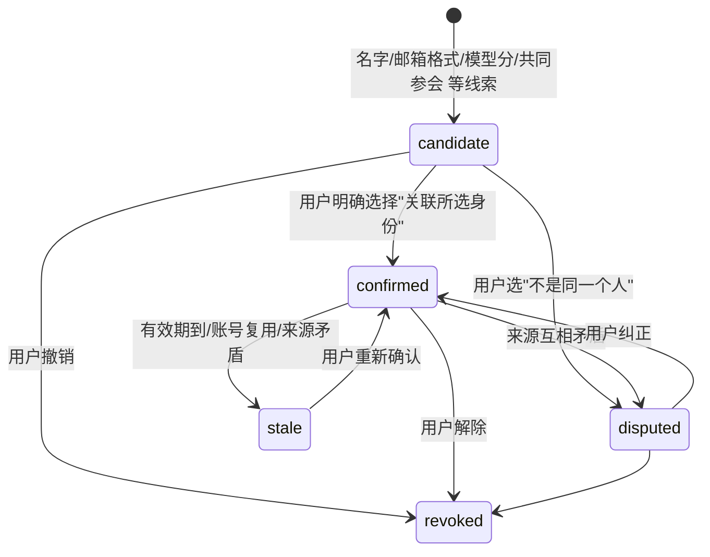
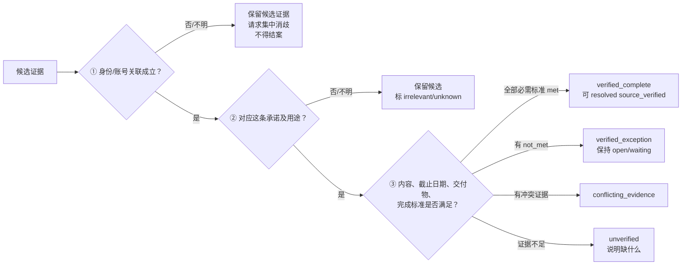

# Nexus Agent Core：按 PRD 落地的对象模型与开发设计（Work / Counterpart / Commitment / Schedule）

| 项目                             | 内容                                                                                                                                                                                                                                                                                                                                                                                                                                                                                                                                                 |
| -------------------------------- | ---------------------------------------------------------------------------------------------------------------------------------------------------------------------------------------------------------------------------------------------------------------------------------------------------------------------------------------------------------------------------------------------------------------------------------------------------------------------------------------------------------------------------------------------------- |
| 文档位置                         | `extensions/nexus-agent-core/docs/implement/`（此后的实现类文档都放这里；已有文档不迁移）                                                                                                                                                                                                                                                                                                                                                                                                                                                            |
| 依据                             | `extensions/nexus-agent-core/docs/prd/NEXUS_AI_PRD.md` **v1.95**（2026-11-01；含 §0.6 本批范围总表 R-01–R-35、附录 D 数据模型规范与附录 E 的不变量 INV-01–INV-34）；另对照了 `docs/prd/design/` 下五个 HTML 原型（工作、人员、目标、资料库、状态）。起草基线是 v1.57（2026-10-28），到 v1.86、再到 v1.95 的逐项对齐记录见 `extensions/nexus-agent-core/docs/prd/NEXUS_AI_PRD_CHANGE_LOG.md`（该文件只是本地对照用，不进 git）。重点是 §3.1 核心对象及归属，另读了 §0.4 术语、§4.1 导航与 WK / PV、NX-03 / NX-04 / NX-05 / NX-14、§8.1、§10.2 / §10.3 |
| 前提                             | 之前在插件里完成的是没有 PRD 时按大体功能做的版本（事项、决策授权、声明证据、偏好、回检、文件柜、目标）；本文把它们对齐到 PRD 的对象模型，并新增 Work、Counterpart、Commitment、Schedule                                                                                                                                                                                                                                                                                                                                                             |
| 日期                             | 2026-10-28 起草；2026-11-02 先对齐 PRD v1.86，再对齐 PRD v1.95；同日按原型重做目标、资料库、状态三页的界面设计（§11.5b – §11.8）                                                                                                                                                                                                                                                                                                                                                                                                                     |
| 状态                             | 设计稿，待评审；未开始写代码。**正文已对齐 PRD v1.95，是当前的实现方案**；PRD 已答复附录 E 原有的大部分问题，仍待需求方确认的只剩 §14 与附录 E.1 列出的几项                                                                                                                                                                                                                                                                                                                                                                                          |
| 已确认的决定（2026-10-28，用户） | ① 现有事项保留为 Task，上面新增 Work；② 首批范围含 Work + 工作视图、Counterpart + 人员视图、Commitment、Schedule；③ Commitment 的完成判定把"来源自动核验"整套写全（第一版实现里没有外部来源，见 §8）                                                                                                                                                                                                                                                                                                                                                 |

## 目录

- [0. 先读这一节](#0-先读这一节)
  - [0.0 本文的状态与阅读方式](#00-本文的状态与阅读方式)
  - [0.1 一句话](#01-一句话)
  - [0.2 现有实现和 PRD 最大的差别](#02-现有实现和-prd-最大的差别)
  - [0.3 本文做什么、不做什么](#03-本文做什么不做什么)
  - [0.4 最重要的十条设计规则](#04-最重要的十条设计规则)
  - [0.5 本批范围与降级（PRD §0.6，R-01–R-35）](#05-本批范围与降级prd-06r-01r-35)
- [1. 整体结构：谁依赖谁](#1-整体结构谁依赖谁)
- [2. PRD 对象与现有实现的映射](#2-prd-对象与现有实现的映射)
- [3. 命名与分层纪律（在现有纪律上增补）](#3-命名与分层纪律在现有纪律上增补)
- [4. 数据模型](#4-数据模型)
  - [4.1 通用约定](#41-通用约定)
  - [4.2 Work 组（stage7-0001）](#42-work-组stage7-0001)
    - [4.2.1 works 与 work_versions](#421-works-与-work_versions)
    - [4.2.2 task_work_owner 与 work_links（WorkObjectLink）](#422-task_work_owner-与-work_linksworkobjectlink)
    - [4.2.3 Goal 关联：goal_work_links 与 goal_links 影子](#423-goal-关联goal_work_links-与-goal_links-影子)
    - [4.2.4 work_events 与 work_lineage](#424-work_events-与-work_lineage)
    - [4.2.5 work_outcome_events（结果达成事实，INV-19、INV-32）](#425-work_outcome_events结果达成事实inv-19inv-32)
    - [4.2.6 work_terminal_events（结果级结束事实，INV-20）](#426-work_terminal_events结果级结束事实inv-20)
    - [4.2.7 work_prerequisites（工作前置事实，INV-17）](#427-work_prerequisites工作前置事实inv-17)
    - [4.2.8 work_controls（WK-04 工作级控制，INV-22）](#428-work_controlswk-04-工作级控制inv-22)
    - [4.2.9 task_ext（Task 的补充标记）](#429-task_exttask-的补充标记)
    - [4.2.10 context_scopes（最小范围记录，R-08）](#4210-context_scopes最小范围记录r-08)
    - [4.2.11 task_adoptions（版本采用记录，R-06 最小版）](#4211-task_adoptions版本采用记录r-06-最小版)
    - [4.2.12 completion_presentations 与 window_evaluation_requests（R-04 / R-05）](#4212-completion_presentations-与-window_evaluation_requestsr-04--r-05)
  - [4.3 Counterpart 组（stage7-0002）](#43-counterpart-组stage7-0002)
    - [4.3.1 counterparts](#431-counterparts)
    - [4.3.2 名称、关系、角色](#432-名称关系角色)
    - [4.3.3 counterpart_endpoints（IdentityEndpoint）](#433-counterpart_endpointsidentityendpoint)
    - [4.3.4 identity_links（IdentityLink：端点 ⇄ 人员）](#434-identity_linksidentitylink端点--人员)
    - [4.3.5 unresolved_mentions（待确认人员的提及，R-31）](#435-unresolved_mentions待确认人员的提及r-31)
  - [4.4 Commitment 组（stage7-0003）](#44-commitment-组stage7-0003)
    - [4.4.1 commitments](#441-commitments)
    - [4.4.2 commitment_events](#442-commitment_events)
    - [4.4.3 最小版结果约定与逐标准评估](#443-最小版结果约定与逐标准评估)
    - [4.4.4 evidence_attributions（EvidenceAttribution）](#444-evidence_attributionsevidenceattribution)
  - [4.5 Schedule 组（stage7-0004）](#45-schedule-组stage7-0004)
    - [4.5.1 delegation_plans（跟进方案）](#451-delegation_plans跟进方案)
    - [4.5.2 schedules](#452-schedules)
    - [4.5.3 schedule_triggers（触发记录、去重与派发槽）](#453-schedule_triggers触发记录去重与派发槽)
    - [4.5.4 goal_briefing_policies（目标信策略，最小版）](#454-goal_briefing_policies目标信策略最小版)
  - [4.6 其他](#46-其他)
  - [4.7 数值基线（limit_policy_version = launch-1，R-16）](#47-数值基线limit_policy_version--launch-1r-16)
- [5. 工作视图（WorkView）与状态推导](#5-工作视图workview与状态推导)
  - [5.1 Task 状态映射：taskPhase()](#51-task-状态映射taskphase)
  - [5.2 deriveWorkState()：WK-02 逐条落地（6 行）](#52-deriveworkstatewk-02-逐条落地6-行)
  - [5.3 展示字段：我要的结果 / 当前进展 / 下一步](#53-展示字段我要的结果--当前进展--下一步)
  - [5.4 计数：RT-02 五类互斥](#54-计数rt-02-五类互斥)
  - [5.5 查询与性能](#55-查询与性能)
- [6. 承诺事项（Commitment）规则](#6-承诺事项commitment规则)
  - [6.1 四条独立的线](#61-四条独立的线)
  - [6.2 生命周期转换表](#62-生命周期转换表)
  - [6.3 Agent 能做什么 / 不能做什么](#63-agent-能做什么--不能做什么)
  - [6.4 副作用：承诺结束后的方案收尾（CD-04 有界收尾）](#64-副作用承诺结束后的方案收尾cd-04-有界收尾)
  - [6.5 多 Work 引用与解除关联](#65-多-work-引用与解除关联)
  - [6.6 级联矩阵（WK-04，INV-33）](#66-级联矩阵wk-04inv-33)
  - [6.7 周期性义务（R-28）](#67-周期性义务r-28)
  - [6.8 多人责任（R-10）](#68-多人责任r-10)
- [7. 人员 / 协作方（Counterpart）与身份](#7-人员--协作方counterpart与身份)
  - [7.1 一句话规则](#71-一句话规则)
  - [7.2 一个人是怎么进来的](#72-一个人是怎么进来的)
  - [7.3 名称解析（resolveName()）](#73-名称解析resolvename)
  - [7.4 身份关联的生命周期（对应 ER-01–ER-05）](#74-身份关联的生命周期对应-er-01er-05)
  - [7.5 停用、合并与拆分的保护（R-32）](#75-停用合并与拆分的保护r-32)
  - [7.6 更正身份、"这不是一个人"与类型更正（2026-11-02，对应原型人员页「···」菜单）](#76-更正身份这不是一个人与类型更正2026-11-02对应原型人员页菜单)
  - [7.7 待确认人员与提及消歧（R-31）](#77-待确认人员与提及消歧r-31)
  - [7.8 本人配对与决定渠道（R-13 / R-15）](#78-本人配对与决定渠道r-13--r-15)
- [8. 来源自动核验（NX-14 / ER-04 / OC-03）](#8-来源自动核验nx-14--er-04--oc-03)
  - [8.1 三步，缺一不可](#81-三步缺一不可)
  - [8.2 引擎入口与函数](#82-引擎入口与函数)
  - [8.3 重评估与幂等](#83-重评估与幂等)
  - [8.4 来源适配器接口（第一版只实现手动来源）](#84-来源适配器接口第一版只实现手动来源)
  - [8.5 失败与降级](#85-失败与降级)
- [9. 人员视图（PersonView，PV-01 – PV-03）](#9-人员视图personviewpv-01--pv-03)
  - [9.1 它是什么](#91-它是什么)
  - [9.2 列表（PV-01）](#92-列表pv-01)
  - [9.3 详情（PV-02）](#93-详情pv-02)
  - [9.4 从人员推进工作（PV-03）](#94-从人员推进工作pv-03)
  - [9.5 跟进承载解析与统一审阅面板（PRD 附录 D.4；对应原型人员页，2026-10-30）](#95-跟进承载解析与统一审阅面板prd-附录-d4对应原型人员页2026-10-30)
- [10. 接口：RPC、Agent 工具与权限](#10-接口rpcagent-工具与权限)
  - [10.1 总原则](#101-总原则)
  - [10.2 控制台 RPC（nexus.*）](#102-控制台-rpcnexus)
  - [10.3 Agent 工具](#103-agent-工具)
  - [10.4 工作级控制（WK-04）：动作对应表](#104-工作级控制wk-04动作对应表)
- [11. 控制台（Control UI）改动](#11-控制台control-ui改动)
  - [11.1 导航与路由](#111-导航与路由)
  - [11.2 工作页（首页）](#112-工作页首页)
  - [11.3 工作详情](#113-工作详情)
  - [11.4 人员页](#114-人员页)
  - [11.5 组件与文件落点](#115-组件与文件落点)
  - [11.5a 资料库与状态页的本批边界（只列和本文对象有关的）](#115a-资料库与状态页的本批边界只列和本文对象有关的)
  - [11.5b 统一页面骨架与视觉规范（对齐 `docs/prd/design/*.html`，2026-11-02）](#115b-统一页面骨架与视觉规范对齐-docsprddesignhtml2026-11-02)
  - [11.6 目标页（按 PRD NX-03 和 `nexus-goals.html` 重新设计，2026-11-02）](#116-目标页按-prd-nx-03-和-nexus-goalshtml-重新设计2026-11-02)
  - [11.7 资料库页（按 PRD NX-08 / R-22 / R-23、`nexus-library.html` 和已实现的个人文件柜改造，2026-11-02）](#117-资料库页按-prd-nx-08--r-22--r-23nexus-libraryhtml-和已实现的个人文件柜改造2026-11-02)
  - [11.8 状态页（Status，按 PRD R-24 / R-25 / R-17 / IR-01 和 `nexus-status.html` 重做，2026-11-02）](#118-状态页status按-prd-r-24--r-25--r-17--ir-01-和-nexus-statushtml-重做2026-11-02)
- [12. 迁移、兼容与开关](#12-迁移兼容与开关)
  - [12.1 迁移顺序](#121-迁移顺序)
  - [12.2 回填：backfillWorks()（幂等，可中断重跑）](#122-回填backfillworks幂等可中断重跑)
  - [12.3 Task 创建路径改动](#123-task-创建路径改动)
  - [12.4 开关与依赖](#124-开关与依赖)
  - [12.5 删除、清除与导出的接入](#125-删除清除与导出的接入)
  - [12.6 对账与自检：nexus.work.integrity](#126-对账与自检nexusworkintegrity)
  - [12.7 兼容性清单](#127-兼容性清单)
- [13. 分期、测试与验收](#13-分期测试与验收)
  - [13.1 切片](#131-切片)
  - [13.2 测试分层](#132-测试分层)
  - [13.3 验收场景（对应 PRD AT）](#133-验收场景对应-prd-at)
- [14. 待决问题（建议的默认值已写在括号里，评审时请确认或改）](#14-待决问题建议的默认值已写在括号里评审时请确认或改)
- [附录 A. PRD 追溯（对照 PRD v1.95）](#附录-a-prd-追溯对照-prd-v195)
- [附录 B. 关系图（ER）](#附录-b-关系图er)
- [附录 C. 走一遍例子：「帮我盯住李明周三交报价表」](#附录-c-走一遍例子帮我盯住李明周三交报价表)
- [附录 D. PRD 变更总结（v1.57 → v1.86 → v1.95）](#附录-d-prd-变更总结v157--v186--v195)
- [附录 E. 需与需求方确认、澄清的问题（对照 PRD v1.95，2026-11-02）](#附录-e-需与需求方确认澄清的问题对照-prd-v1952026-11-02)
  - [E.0 怎么用这份清单](#e0-怎么用这份清单)
  - [E.1 原问题 R-01 – R-41 在 PRD v1.95 里的答案](#e1-原问题-r-01--r-41-在-prd-v195-里的答案)
  - [E.2 仍待需求方确认的问题](#e2-仍待需求方确认的问题)
  - [E.3 研发自决项（不需要问需求方，按默认做）](#e3-研发自决项不需要问需求方按默认做)
  - [E.4 需要在别的设计文档里跟进的 PRD 变化](#e4-需要在别的设计文档里跟进的-prd-变化)
  - [E.5 原型（docs/prd/design/*.html）自身的不一致](#e5-原型docsprddesignhtml自身的不一致)
  - [E.6 PRD 要求、但原型没有覆盖的界面](#e6-prd-要求但原型没有覆盖的界面)
  - [E.7 开发步骤与剩余待确认问题的关系](#e7-开发步骤与剩余待确认问题的关系)
  - [E.8 原型更新（nexus update html，2026-10-30）逐页变化与本文的关系](#e8-原型更新nexus-update-html2026-10-30逐页变化与本文的关系)
  - [E.9 五个原型页面的功能与本文覆盖度（2026-11-02，按 PRD v1.95 更新）](#e9-五个原型页面的功能与本文覆盖度2026-11-02按-prd-v195-更新)
  - [E.10 评审发现的研发修订项（2026-11-02，已并入正文）](#e10-评审发现的研发修订项2026-11-02已并入正文)
  - [E.11 开发确认记录与待确认（不阻塞开工，先按默认做）](#e11-开发确认记录与待确认不阻塞开工先按默认做)

## 0. 先读这一节

### 0.0 本文的状态与阅读方式

本文以 PRD v1.95 为准。起草时的基线是 v1.57，两者之间的差异已经逐条并入正文相应章节，变更记录单独放在与 PRD 同目录的 `docs/prd/NEXUS_AI_PRD_CHANGE_LOG.md`（本文不再保留“差异附录”；该变更记录只供本地查看，不进 git）。几点说明：

- **PRD v1.95 的 §0.6 已经把“本批做什么、推迟什么、明确不支持什么”写成唯一总表（R-01–R-35）**，本文附录 E 原来的大部分问题由它回答；总表在本文的落点见 §0.5。
- **待决事项**集中在两处：§14（需要需求方在写代码前拍板的 Q-1…Q-n，每条带建议默认值）和附录 E（PRD v1.95 之后仍没有答案的少数问题，编号沿用 R-xx，新增的接续 R-42 起；R-45 – R-47 是三页界面改版带出的界面层问题）。带“待 R-xx”的地方，意思是按括号里的默认值先做，需求方改了再调。
- **“用户验收”现在是 PRD 概念**：v1.95 的 OC-03 / R-03 用 `criterion_source = user_confirmation`（用户确认标准）表达，本文原来自造的 `user_accept` 已全部改为它，不再有“待 R-03”。
- **HTML 原型**（`docs/prd/design/`）的逐页对照记录在附录 E.5 / E.6 / E.8 / E.9；原型与 PRD 字面不一致的地方，本文默认取原型的交互、PRD 的数据语义，并在对应 R-xx 里写明。

### 0.1 一句话

PRD 把"用户要的一件事"拆成四层：**Work**（要什么结果）→ **Task**（助手执行的一次限定请求）→ Run / Action（一次尝试、一步操作），旁边还有两条独立的线：**Commitment**（某个人答应交付什么，带标准、期限、证据）和 **Schedule**（已确认的定时检查）。**Counterpart（人员 / 协作方）** 是被委派、负责或参与的真实的人。前台只有两个入口：**工作**按"事"看，**人员**按"人"看，两者读的是同一批记录。

### 0.2 现有实现和 PRD 最大的差别

我们现在的"事项"（`nexus_tasks`，界面上的"任务"页）其实是 PRD 里 **Work 和 Task 的合体**：它跨会话、有标题和目标、给用户看，决策、授权、声明、回检都挂在它下面。PRD 要求把它们分开：Work 不拥有执行状态，只保存"委托的结果、约定和关联"；它的状态由 Task、Commitment、Schedule 推导出来，并且"Task 全部完成不等于 Work 完成"。

处理办法（已确认）：**`nexus_tasks` 保留为 PRD 的 Task，一行不改；在它上面新增 `works`**。老事项迁移时每个自动包一个 Work。界面上的"事项"页改成"工作"页，列的是 Work；Task 的详情（步骤、决策、声明）放进工作详情里。这样决策、授权、声明、回检这些已发布、已验收的表都不动。

### 0.3 本文做什么、不做什么

做：对象清单与映射（§2）、新旧命名（§3）、全部新表与约束（§4）、Work 状态推导（§5）、Commitment（§6）、Counterpart 与身份（§7）、来源自动核验（§8）、人员视图（§9）、接口（§10）、控制台（§11）、迁移与兼容（§12）、分期与验收（§13）、待决问题（§14）。

不做：PRD 里和对象模型无关的大块（连接器与来源准入 EA、文档理解 DU、批次审批 AP、邮件操作 OP、Channel 等）。本文只写它们和这几个对象的**接口**，实现另立文档。

### 0.4 最重要的十条设计规则

1. **Work 是实体，不是状态机。** 没有可手动赋值的"执行状态"字段；展示状态是纯函数 `deriveWorkState()` 的输出（§5）。
2. **Task 恰属一个创建后不变的 Work，Commitment 与 Work 多对多，Schedule 有一个创建后不变的执行主 Work 和一个业务归属（Goal / Commitment / Work）。** 主归属只写在 `task_work_owner`，`work_links` 里没有主归属；同一 Commitment 至多一个 accepted 方案。由写入层的唯一索引和事务内校验强制，不靠前台（§4.2）。
3. **完成不跨层赋值。** Task completed、Commitment resolved、Schedule ended 互相不改写；手动结案不等于核验完成（`resolution_basis`）。
4. **人员不是通讯录。** `counterpart_id` 是稳定主键，姓名、邮箱、IM 只是带来源的关联；同名不合并；没有确认的关联不参与自动归属（§7）。
5. **Commitment 的责任人不是 Task 的执行者。** "帮我盯住李明周三交报价表"：Work = 跟进这次交付；李明 = Counterpart；交报价表 = Commitment；检查邮件 / 发提醒 = Task。不把人的待办记成 PA 的 Task，也不把"提醒已发"当对方完成。
6. **关系不授权。** 岗位、下属、counterpart 关联都不产生访问权、收件人权限或发送授权；外发仍走现有决策 / 授权（Stage 2）。
7. **查看人员 = 按人汇总同一批记录。** 不建员工账号、共享看板或绩效系统；"由其负责"和"与其相关"分开；同一 Commitment 被多个 Work 引用只算一次。
8. **所有写入带 `owner_id`、版本号，向前兼容。** 已发布表不改，只新增表（沿用现有纪律）；新表全部 `STRICT`。
9. **Agent 能写的只有"记录用户说的话"。** Agent 不能确认身份、不能把委派写成"对方已接受"（除非给出依据）、不能结案或取消承诺、不能暂停或停止工作——这些是用户在控制台（或用户明确说出后由服务端审计）才能做的事。
10. **每个新能力一个独立开关，默认关。** `worksEnabled`、`counterpartsEnabled`、`commitmentsEnabled`、`schedulesEnabled`，依赖关系见 §12.4。

### 0.5 本批范围与降级（PRD §0.6，R-01–R-35）

PRD v1.95 §0.6 说明：本批是**单用户 / 自部署插件**批次，采用最小方案——**本批无规则自动批准；版本化只做最小版；查询与清理用现有受控机制适配；CP（成功指标）只交付事件字段**。正文、数据模型和不变量仍保留完整产品契约，只有总表明确列出的能力降级。下表是总表对本文的影响（R 编号沿用 PRD；“落点”指本文哪里已经按它写）。

| R                              | 本批做什么 / 不做什么（摘要）                                                                                                                                                          | 本文落点                     |
| ------------------------------ | -------------------------------------------------------------------------------------------------------------------------------------------------------------------------------------- | ---------------------------- |
| R-01 / R-17                    | 逐项审批、动作幂等照做；批次批准、规则自动批准暂缓，旧规则只保留历史并隐藏额度 UI                                                                                                      | §2 决策行；§6.3；INV-24 说明 |
| R-02                           | 四个启用模板（`meeting_arranged` / `requested_delivery_received` / `usable_file_delivered` / `user_confirmed_delivery`）；预订、签署两个键只登记不启用；`legacy_task_success` 只读历史 | §4.4.3                       |
| R-03 / R-09 / R-26             | 用户确认标准（`user_confirmation`）可用但不能代替必需来源证据；`accepted + user_report` 受接受依据策略约束；进展与核验分维                                                             | §4.4.3；§5.2；§9             |
| R-04 / R-05                    | 硬窗口持久评估（60 秒内开始、5 分钟有界收尾）；呈现事实 `completion_presentations`；不做控制台已读埋点                                                                                 | §4.2.12；§5.2；§6.4          |
| R-06                           | 业务 Work 修订：整个 Work 置“待采用”，用后继 Task 继续；只存最小采用记录；同 Task 改版、逐字段兼容、跨工作接手不支持                                                                   | §4.2.1；§4.2.11              |
| R-07 / R-16                    | 受控请求（问答 / 清理 / 窗口评估）+ 持久尝试，不建独立 Job 表；数值上限见 §4.7                                                                                                         | §4.2.12；§4.7                |
| R-08 / R-20                    | 稳定 `scope_id` + 语义版本（最小范围记录）；迁移默认 `legacy_default` 待核对，不虚填达成事实                                                                                           | §4.2.10；§12.2               |
| R-10 / R-32                    | 多人分责 = 一名负责人或多条独立承诺；停用 / 合并 / 纠错 / 遗忘级联                                                                                                                     | §6.8；§7.5                   |
| R-11 / R-21 / R-34             | 阻塞原因码、次级标识、五类状态文案                                                                                                                                                     | §5.2                         |
| R-12 / R-29 / R-30             | 人员列表按范围过滤；三列枚举；阶段顺序                                                                                                                                                 | §9                           |
| R-13 / R-14 / R-31             | 本人配对、身份映射不得升级为 `source_verified`、提及消歧                                                                                                                               | §4.3.4；§4.3.5；§7.7；§7.8   |
| R-15 / R-18 / R-27             | IM 私聊决定矩阵；导航映射；多决定可找回                                                                                                                                                | §10；§11                     |
| R-19 / R-22–R-25 / R-33 / R-35 | CP 字段、资料库分享关闭、Status 只显示真实记录、主机配置、目标进展采用、模拟标记                                                                                                       | §4.2.1；§11；§14             |
| R-28                           | 周期义务最多 12 期，每期一条独立承诺，检查不产生义务                                                                                                                                   | §4.4.1；§6.7                 |

读法：表里“暂缓”的能力，**入口和派发保持关闭，数据结构仍按完整契约留位**（例如 `rules` 不建表，但 AP 逐项审批的字段照常存在）。任何暂缓项不得因原型画了、枚举里有而被默认启用。

## 1. 整体结构：谁依赖谁



读法：实线是"归属 / 关联"，虚线是"引用"，粗线是"只读推导"。**WorkView 和 PersonView 都不落表**（第一版）：每次从权威记录算出来。已有的决策、授权、执行、声明、证据全部仍挂在 `task_id` 上，不改一个字。

三条依赖方向（防止循环）：

- 下层不认识上层：`nexus_tasks` 及它下面的表不知道 Work、Commitment、Schedule 的存在；关联全部放在新表里。
- `works` 不存状态；`commitments` 不存"工作是否完成"；`schedules` 不存"承诺是否履行"。
- 新代码读已有代码只经过各自的 ledger 接口（`task-query`、`claim-ledger`、`watch-ledger`、`goal-read-ledger`），不直接 SQL 读别人的表。

## 2. PRD 对象与现有实现的映射

"处理"一列只用四个词：**保留**（不改，直接复用）、**新增**（新表和新模块）、**适配**（旧表不改，加视图或转换函数）、**暂缓**（本批不做，留接口）。

| PRD 对象（§3.1 / §10.2）                  | 现有实现                                                                                         | 差距                                                                                                              | 处理                                                                                                                                                                                                                                                                                                             |
| ----------------------------------------- | ------------------------------------------------------------------------------------------------ | ----------------------------------------------------------------------------------------------------------------- | ---------------------------------------------------------------------------------------------------------------------------------------------------------------------------------------------------------------------------------------------------------------------------------------------------------------- |
| Work                                      | 没有；`nexus_tasks` 同时承担"一件事"和"一次执行"                                                 | 缺稳定的结果身份、约定版本、关联、达成 / 结束事实、前置、拆合沿袭、工作级控制                                     | **新增** `works` + `work_versions` + `task_work_owner` + `work_links` + `work_events` + `work_lineage` + `work_outcome_events` + `work_terminal_events` + `work_prerequisites` + `work_controls`；老事项按 1:1 自动包一个 Work（§12.2）                                                                          |
| WorkView                                  | 任务列表里的 `status` 过滤                                                                       | 缺 WK-02 五类主状态、"其他步骤进行中"、尚未安排跟进等推导                                                         | **新增** `deriveWorkState()`（纯函数）+ `work-view` 查询（§5）                                                                                                                                                                                                                                                   |
| Context                                   | `nexus_tasks.entities_json`、会话 key；没有模式 / 客户 / 项目标签                                | 缺 Personal / Executive 与客户项目标签；v1.95 要求稳定 `scope_id` 与语义版本（R-08）                              | **适配（最小版）**：新增 `context_scopes`（scope_id、context_mode、scope_kind、parent、label、semantic_version、active / archived，§4.2.10）；`works` / `work_versions` / `commitments` 引用 scope，名称不是身份；完整 ContextProfile 服务 **暂缓**（INV-04）                                                    |
| Goal                                      | `goals`、`goal_entries`、`goal_links`（kind=task / vault_file / preference / watch）、指标、回看 | Goal→Task 是直接关联，PRD 是 Goal→Work（`GoalWorkLink`，Personal 专属）                                           | **适配**：`goal_work_links` 为唯一写源；`goal_links(kind=task)` 退化为兼容影子（§4.2.3）；`goals` 已满足一层子目标、无 `paused`（INV-06）                                                                                                                                                                        |
| Decision（用户确认的选择）                | 无同名对象；`decisions` 表是**审批决定**（动作授权）                                             | 名字相同、含义不同                                                                                                | 审批 `decisions` **保留**；PRD 的 Decision / DecisionObjectLink：v1.95 §0.6 既没列入也没排除，**默认仍暂缓**（`commitments.decision_ref` 留空位），见 §14 Q4 与附录 E 的 R-43                                                                                                                                    |
| Counterpart                               | 没有；`entities_json` 里有零散人名                                                               | 缺稳定 ID、自身份、端点、关联、参与人角色、关系；v1.95 增加状态（active / inactive / merged）、本人配对、提及消歧 | **新增** `counterparts`（`lifecycle` 含 `inactive`、停用原因与墓碑）+ `owner_identity` + `counterpart_names` / `relations` / `endpoints` / `identity_links` + 两张参与人链接表 + `unresolved_mentions`（§4.3、§7）                                                                                               |
| Commitment                                | 没有；`claims`（声明）是"某个事实是否成立"，不是"某人答应交付"                                   | 缺责任人、责任版本、标准、期限、沟通与接受、生命周期、独立核验、证据归属                                          | **新增** `commitments` + 责任版本快照 + 事件 + 合同 / 评估 + 证据归属（§4.4、§6）；`claims` 保留，只作为 Task 内部的完成门槛                                                                                                                                                                                     |
| Task                                      | `nexus_tasks` + `nexus_task_steps` + `nexus_task_sessions`                                       | 缺主 Work 关联、PRD §8.1 十个执行状态、来源 Schedule / 触发键                                                     | **保留** 并 **适配**：`taskPhase()` 把现有 11 个 status 映射成 §8.1 状态（§5.1）；主 Work 走 `task_work_owner`；`task_ext` 补"部分完成 / 阻塞 / 后继"标记                                                                                                                                                        |
| Run                                       | 没有独立表；`action_executions`、`run_triggers` 近似                                             | 缺"每次尝试"的统一记录                                                                                            | **适配**：Run 视为 `run_triggers` + `action_executions` 的组合读取；本批不新建表                                                                                                                                                                                                                                 |
| Schedule                                  | `watches`（只服务 Task / claim 的回检）+ 宿主 cron job；Goal 回看周期是 `goal_review_plans`      | 缺方案、执行主 Work 与业务归属、`once`、占槽、覆盖状态                                                            | **新增** `schedules` + `schedule_triggers` + `delegation_plans` + `goal_briefing_policies`；`watches` 作为其执行器保留（§4.5）；Goal 回看提醒 **保留**，不并入                                                                                                                                                   |
| Specialist subtask                        | 无                                                                                               | —                                                                                                                 | **暂缓**                                                                                                                                                                                                                                                                                                         |
| Deliverable                               | `vault_files` / `vault_versions` / `vault_links`                                                 | 缺"验证后"标记与 Work 关联                                                                                        | **适配**：Work 经 `work_links(target_kind='artifact')` 引用文件版本；验证标记沿用现有 `vault_*` 的 kind / 状态；Deliverable 表本身 **暂缓**                                                                                                                                                                      |
| OutcomeContract                           | `nexus_task_completion_claims`（完成门槛）+ `goal_json`                                          | 缺模板、版本、逐标准评估；v1.95 固定六个模板键（启用四个）、`criterion_source` 三类、窗口字段                     | **新增（最小版）**：`outcome_contract_versions`（Work 与 Commitment 各自引用，含 `window_end_at` / `window_policy` / `accepted_basis_policy`）+ `criterion_assessments`；引用 Commitment 的标准用 `criterion_source = commitment_verification` 复用其唯一当前 `commitment_assessments`；模板写在代码里（§4.4.3） |
| EvidenceAttribution                       | `evidence`、`claim_evidence_links`                                                               | 缺主体 / 端点 / 映射版本 / 三步判定                                                                               | **新增** `evidence_attributions`，引用已有 `evidence.id`（§8）                                                                                                                                                                                                                                                   |
| AttentionItem（待处理）                   | 无统一模型；各页自己算                                                                           | v1.95 R-27 要求多个决定可找回、按优先级排序、各自独立消费                                                         | **暂缓**统一表：工作页“待你处理”由 WorkView 直接给出**列表**（每条带 `decision_request_id`），不做一键批次批准（§11.2）                                                                                                                                                                                          |
| DelegationPlan                            | 无                                                                                               | 缺跟进方案草案、接受 / 终止规则、有界收尾                                                                         | **新增** `delegation_plans`（`plan_owner_type` = commitment / goal / work；draft → accepted → ended / revoked；同一 Commitment 至多一个 accepted；CD-03 交接、CD-04 有界收尾字段，§4.5、§6.4）                                                                                                                   |
| TaskControl                               | 无；`nexus_task_update` 可直接改状态                                                             | 缺暂停 / 恢复 / 停止的范围化、可叠加控制                                                                          | **新增** `work_controls`（§4.2.8）                                                                                                                                                                                                                                                                               |
| PersonView                                | 无                                                                                               | —                                                                                                                 | **新增** 查询（§9），不落表                                                                                                                                                                                                                                                                                      |
| ContextScope（范围记录）                  | 无                                                                                               | 见上 Context 行                                                                                                   | **新增** `context_scopes`（§4.2.10）                                                                                                                                                                                                                                                                             |
| TaskAdoption（采用记录）                  | 无                                                                                               | R-06：业务 Work 修订后需要“整个 Work 待采用 + 后继 Task”的最小记录                                                | **新增** `task_adoptions`（§4.2.11），不建 `TaskPlanVersion` / 逐字段兼容表                                                                                                                                                                                                                                      |
| CompletionPresentation / WindowEvaluation | 无                                                                                               | R-04 / R-05：呈现事实与硬窗口的持久评估请求                                                                       | **新增** `completion_presentations`、`window_evaluation_requests`（§4.2.12）                                                                                                                                                                                                                                     |
| SystemJob（SJ-01 – SJ-03）                | 宿主 cron、各自的清理脚本                                                                        | R-07：本批只要“受控请求 + 持久尝试”，不要独立 Job 表                                                              | **适配**：问答 / 清理 / 窗口评估三类受控请求沿用现有受控机制，记录 `request_id` / `job_type`；回填、目标信、记忆整理、共享观察 **关闭**                                                                                                                                                                          |
| UnresolvedMention                         | 无                                                                                               | R-31：文档 / 会议里只有名字、没有账号的提及                                                                       | **新增** `unresolved_mentions`（§4.3.5）                                                                                                                                                                                                                                                                         |

## 3. 命名与分层纪律（在现有纪律上增补）

沿用：已发布的表只加不改；新表全部 `STRICT`；所有表带 `owner_id`（目前恒为 `"local"` 占位）；写入走 ledger，ledger 在一个事务里完成"校验 + 写入 + 事件"。

新增约定：

1. **表名。** 属于 Task 聚合的表以 `nexus_task` 开头（已有）；本批新表不带 `nexus_` 前缀，按"一个概念一组前缀"：`work*`、`counterpart*`、`identity_*`、`commitment*`、`schedule*`。没有 `work_` 前缀的例外：`task_work_owner`、`goal_work_links`（属 Goal 侧）、`evidence_attributions`、`criterion_assessments`、`outcome_contract_versions`、`delegation_plans`、`task_ext`、`store_flags`、`context_scopes`、`task_adoptions`、`completion_presentations`、`window_evaluation_requests`、`unresolved_mentions`、`migration_snapshots`。
2. **目录。** 代码按概念分目录：`src/work/`（service、derive、view、backfill）、`src/commitment/`、`src/counterpart/`、`src/schedule/`；存储层放 `src/store/` 下 `work-ledger.ts`、`commitment-ledger.ts`、`counterpart-ledger.ts`、`schedule-ledger.ts`（沿用 `*-ledger.ts`）；RPC 在 `src/*-rpc.ts`；工具在 `src/tools/`。
3. **接口命名。** RPC：`nexus.work.*`、`nexus.person.*`（人员视图）、`nexus.counterpart.*`、`nexus.commitment.*`、`nexus.schedule.*`、`nexus.delegation.*`。Agent 工具：`nexus_work_*`、`nexus_commitment_*`、`nexus_counterpart_*`、`nexus_schedule_*`，与目标工具一样登记为 `catalogMode: "direct-only"`（它们是直接工具，不出现在 exec / 代码模式里，提示里要说明，见 G4 试用教训）。
4. **模型可见文字全英文**，界面文字走 `i18n.ts` 中英两套（沿用 `i18n.test.ts` 的检查）。"工作 / 人员 / 承诺事项 / 跟进"为中文界面的固定词；英文界面用 Work / People / Commitment / Follow-up。
5. **权威来源只有一个。** 每个事实只存一处：Task 的主归属只在 `task_work_owner`，Goal 与 Work 的关联只在 `goal_work_links`（`goal_links` 里的 Task 行是兼容影子，须对账）；Commitment 的责任人只在 `commitments.responsible_counterpart_id`，参与人表里没有责任人副本。影子数据必须有“以谁为准”的声明和对账检查（§4.2.3、§12.6）。
6. **删除与清理。** 新表要接入现有 purge 协议（`purge_runs` / 目标的 `goal_purge_*`）：删除 Task 时处理其 Work 链接；删除 Work 时先处置活动 Task / Schedule（WK-04）；删除 Counterpart 前列出受影响承诺（PV-03）。具体清单见 §12.5。

## 4. 数据模型

### 4.1 通用约定

- 主键 `(owner_id, id)`，与目标表一致；`id` 由内核 `newId()` 生成，带类型前缀便于排查（`w_` Work、`cp_` Counterpart、`cm_` Commitment、`sc_` Schedule 等，实际前缀以编码时与内核统一为准）。
- 带 `revision INTEGER NOT NULL`（乐观并发）；有对外可见变化的表另带 `*_events` 追加表，历史永不改写。
- 时间一律 UTC 毫秒整数；需要"约定的本地时间"的字段另存 IANA 时区（`due_tz`、`tz`）。
- 新表指向已发布表（`nexus_tasks`、`watches`、`evidence` 等）的列**不加外键**，改为"无外键 + 写入时校验"。理由与 `goal_links` 一致：已发布表不能改，且工作 / 目标要能比任务活得久。凡这类指针列，ledger 都在同一事务内校验目标存在且同 `owner_id`，并有对账检查（§12.6）。新表之间的引用（如 `work_links.work_id → works`）照常用外键。
- 状态列用 `CHECK (... IN (...))`；"互相蕴含"的约束（如 `status='ended'` 必须有 `ended_at`）也写成 `CHECK`，避免靠前台。
- 迁移文件：`stage7-0001-works`、`stage7-0002-counterparts`、`stage7-0003-commitments`、`stage7-0004-schedules`（SQL 常量写在 `src/store/schema.ts` 末尾，并入 `MIGRATIONS`）。回填是代码任务不是 SQL（§12.2）。

### 4.2 Work 组（stage7-0001）

#### 4.2.1 `works` 与 `work_versions`

```sql
CREATE TABLE works (
  owner_id TEXT NOT NULL, id TEXT NOT NULL,
  title TEXT NOT NULL,                  -- 用户语言的短标题
  request_text TEXT,                    -- 用户的原话（"我要的结果"）；迁移的老事项取 goal_json 里的目标文字
  outcome_text TEXT,                    -- 当前约定的结果一句话；改动产生新的 work_versions 行并记 work_events
  original_result_id TEXT NOT NULL,     -- 原请求结果的稳定 ID：CP 指标分母去重；拆合 / 接手后仍指向原结果（INV-32）
  context_mode TEXT NOT NULL,           -- personal|executive：每个 Work 恰有一个主用途（INV-04）；Executive Work 不得有任何 Goal 边（INV-05）
  primary_context_id TEXT NOT NULL,     -- 主用途所在范围 context_scopes.id（R-08）；名称不是身份，不复制可独立修改的 label；不授权
  context_semantic_version INTEGER NOT NULL DEFAULT 1,   -- 绑定的范围语义版本；改变模式 / 客户归属 = 语义修订，走 R-06
  context_origin TEXT NOT NULL DEFAULT 'explicit',       -- explicit|inherited|legacy_default（R-20：迁移时没有可靠模式字段）
  context_review TEXT NOT NULL DEFAULT 'none',           -- none|pending|confirmed：legacy_default 为 pending，首次新的执行 / 披露前就地确认
  entry_kind TEXT NOT NULL DEFAULT 'user_request',       -- CP 字段（R-19）：入口类别 user_request|schedule_check|escalated|migrated
  accepted_at INTEGER,                  -- CP：原请求被接受为 Work 的时间
  escalation_ref TEXT,                  -- CP：由哪个即时问答 / 请求升级而来
  exclusion_reason TEXT,                -- CP：不计入原请求分母的理由（只记录，不据此删除）
  migrated_outcome TEXT,                -- 仅迁移历史：旧事项的终局 succeeded|failed|cancelled；只读，不等于达成事实（R-42）
  current_work_version INTEGER NOT NULL DEFAULT 1,   -- 指向 work_versions 的当前版本，版本检查更新
  origin TEXT NOT NULL,                 -- migrated|user|agent
  request_ref TEXT,                     -- 去重：来源消息 id / 分句哈希（WK-01 重投不重复创建）
  lifecycle TEXT NOT NULL DEFAULT 'live',   -- live|archived|deleted|purging
  hidden INTEGER NOT NULL DEFAULT 0,    -- 仅改变可见性，不暂停任何后台工作（WK-04）
  revision INTEGER NOT NULL,
  created_at INTEGER NOT NULL, updated_at INTEGER NOT NULL,
  archived_at INTEGER, deleted_at INTEGER,
  PRIMARY KEY (owner_id, id),
  CHECK (context_mode IN ('personal','executive')),
  CHECK (context_origin IN ('explicit','inherited','legacy_default')),
  CHECK (context_review IN ('none','pending','confirmed')),
  CHECK (context_origin <> 'legacy_default' OR context_review <> 'none'),
  CHECK (migrated_outcome IS NULL OR migrated_outcome IN ('succeeded','failed','cancelled')),
  CHECK (migrated_outcome IS NULL OR origin = 'migrated'),
  CHECK (origin IN ('migrated','user','agent')),
  CHECK (lifecycle IN ('live','archived','deleted','purging')),
  CHECK (hidden IN (0,1)),
  CHECK ((lifecycle = 'archived') = (archived_at IS NOT NULL) OR lifecycle IN ('deleted','purging')),
  CHECK ((lifecycle IN ('deleted','purging')) = (deleted_at IS NOT NULL))
) STRICT;
CREATE UNIQUE INDEX works_request ON works(owner_id, request_ref) WHERE request_ref IS NOT NULL;
CREATE INDEX works_list ON works(owner_id, lifecycle, updated_at DESC);

CREATE TABLE work_versions (            -- 不可变修订：只追加，不改写（INV-04、INV-21）
  owner_id TEXT NOT NULL, work_id TEXT NOT NULL, work_version INTEGER NOT NULL,
  context_mode TEXT NOT NULL,           -- 本版本的主用途；必须与 TaskPlanVersion 绑定的一致
  context_scope_id TEXT NOT NULL,       -- 本版本的范围（R-08）
  context_semantic_version INTEGER NOT NULL DEFAULT 1,
  contract_version INTEGER NOT NULL,    -- 结果约定版本（outcome_contract_versions）
  outcome_text TEXT,
  diff_json TEXT,                       -- 与上一版本的差异
  accepted_basis TEXT NOT NULL,         -- 谁、依据什么接受了这次修订（用户原话 / 决策引用）
  created_at INTEGER NOT NULL,
  PRIMARY KEY (owner_id, work_id, work_version),
  CHECK (context_mode IN ('personal','executive')),
  FOREIGN KEY (owner_id, work_id) REFERENCES works(owner_id, id)
) STRICT;
```

**没有任何执行状态列，也没有 `primary_goal_id`。** `lifecycle` 只管 Work 这条记录本身的可见性；Work 的 Goal 关联只存在于 `goal_work_links`（§4.2.3），`works` 里没有 `goal_id`，页面上的"所属目标"是读取时的只读投影（INV-05）。

**版本化只做最小版（PRD R-06 已确认）**：`work_versions` 记录每次对结果、结果约定或主用途的修订；`TaskPlanVersion` 和 `WorkTaskCompatibility` **本批不建表**。规则如下：

- **标题 / 展示元数据修订**（OC-04 场景 1）：直接记 `work_versions`，不重跑、不改执行 / 标准 / 停止依据。
- **任何业务修订**（期限、标准、来源、执行范围、主用途）：该 Work **所有未终结 Task** 的“版本采用资格”整体置 `pending`，隔离新的业务执行与外部提交；本批**不判断哪些未变字段可以继续**。`pending` 只是采用资格，由 `task_adoptions`（§4.2.11）表达，对 Task 编排按现有投影当作 blocked，**不新增 Task 生命周期，不改写旧 Run / 回执**；已提交或未知效果保留原动作和原版本，只允许原有的有界核对。
- **用户明确接受当前版本后**：安全终止 / 隔离旧 Task，创建 `successor_task_id` 与新的不可变执行快照（`task_adoptions` 一行），**不在原 `task_id` 上换计划版本续跑**；并发再次修订会让资格重新 `pending`，旧确认不能清除新阻塞；新动作仍需独立批准。范围内未修订的失败重试可沿用同 Task 的新 Run。
- **已终态 Task / Run** 保留原范围历史，不写逐标准 compatible / incompatible；复用旧成果时按整份成果版本和当前用途做有界核对并留下采用依据，无法证明新版标准满足就重新核验 / 生成。
- **已知不支持**（要给用户明确说明，不宣称完整 OC-04）：细粒度迁移（期限 / 金额只影响部分依赖）、原 Task 改版续跑、活动执行跨用途迁移、已提交 / 未知动作与既有成果 / 责任 / 计划的协同改版、跨工作活跃接手；5.8 的“运行中改期 / 跨工作接手”全链路不在本批。
- `deriveWorkState()` 里原来的“待确认兼容”（`compat_pending`）改称 `adoption_pending`（§5.2）；`work_events` 仍写一条 `version_changed`，payload 列出被置 pending 的 Task。

#### 4.2.2 `task_work_owner` 与 `work_links`（WorkObjectLink）

**Task 的主归属是唯一写源，创建后不变**（INV-02、INV-07）。`nexus_tasks` 本身一行不改，主归属放在一张一对一的新表里：

```sql
CREATE TABLE task_work_owner (          -- 每个 Task 恰一行；创建事务写入，之后不允许 UPDATE / DELETE（purge 除外）
  owner_id TEXT NOT NULL, task_id TEXT NOT NULL, work_id TEXT NOT NULL,
  created_at INTEGER NOT NULL,
  PRIMARY KEY (owner_id, task_id),
  FOREIGN KEY (owner_id, work_id) REFERENCES works(owner_id, id)
) STRICT;
CREATE INDEX task_work_owner_work ON task_work_owner(owner_id, work_id);
-- BEFORE UPDATE / BEFORE DELETE 触发器：RAISE(ABORT, 'INV-02 task owner immutable')，purge 事务通过专用标志放行
```

- Task 没有父子树；拆分与合并 Work 靠**后继 Task**（`task_ext.supersedes_task_id`）和下面的输出依赖引用，不转移主归属。
- "Work 的主归属 Task 有哪些"= 读 `task_work_owner`；`work_links` 里**不再有** `primary` 角色，也不存主归属。
- 创建 Task 的事务必须同时写 `task_work_owner`（"至少一条"由事务保证，"至多一条"由主键保证）。

```sql
CREATE TABLE work_links (               -- WorkObjectLink：Work 与其他对象的类型化关联
  owner_id TEXT NOT NULL, id TEXT NOT NULL, work_id TEXT NOT NULL,
  role TEXT NOT NULL,                   -- required|reference|coordination|handoff_result|output_dependency
  target_kind TEXT NOT NULL,            -- work|commitment|task_output|artifact
  target_id TEXT NOT NULL,              -- Work / Commitment / Task / 成果版本（本批 artifact 即 vault 文件版本）
  task_plan_version INTEGER,            -- output_dependency：固定所依赖的计划版本
  output_ref TEXT,                      -- output_dependency：固定具体输出及版本
  original_result_id TEXT,              -- handoff_result：被接手的原结果（CP 分母去重）
  standard_scope_json TEXT,             -- 承接 / 消费的标准范围
  purpose TEXT,                         -- 引用的限定用途（一句话）
  artifact_file_id TEXT,                -- target_kind='artifact' 时：该版本所属的文件 ID（一个文件最多一个所属工作，INV-30，见 §11.7.4）
  artifact_version_seq INTEGER,         -- target_kind='artifact' 时：固定的版号（vault_versions.seq）；target_id 写成 '<file_id>#<seq>'
  accept_tx_ref TEXT,                   -- 接受这条关联的事务 / 请求引用
  link_version INTEGER NOT NULL DEFAULT 1,
  created_at INTEGER NOT NULL, ended_at INTEGER, end_basis TEXT,    -- 解除只设 ended_at，不删行
  PRIMARY KEY (owner_id, id),
  CHECK (role IN ('required','reference','coordination','handoff_result','output_dependency')),
  CHECK (target_kind IN ('work','commitment','task_output','artifact')),
  CHECK (role NOT IN ('coordination','handoff_result') OR target_kind = 'work'),
  CHECK (role <> 'output_dependency' OR (target_kind = 'task_output' AND task_plan_version IS NOT NULL AND output_ref IS NOT NULL)),
  CHECK (role NOT IN ('required','reference') OR target_kind IN ('commitment','artifact')),
  CHECK (role <> 'handoff_result' OR original_result_id IS NOT NULL),
  CHECK (target_kind <> 'work' OR target_id <> work_id),
  CHECK (target_kind <> 'artifact' OR (artifact_file_id IS NOT NULL AND artifact_version_seq IS NOT NULL)),
  FOREIGN KEY (owner_id, work_id) REFERENCES works(owner_id, id)
) STRICT;
-- 一个文件最多一个所属工作：只对“采用为成果”的关联生效；别的工作要用它只能建 reference 关联（§11.7.4）
CREATE UNIQUE INDEX work_links_owner_file ON work_links(owner_id, artifact_file_id)
  WHERE target_kind = 'artifact' AND role = 'required' AND purpose = 'adopted_deliverable' AND ended_at IS NULL;
-- 同一 Work 对同一目标、同一角色至多一条未解除的关联
CREATE UNIQUE INDEX work_links_pair ON work_links(owner_id, work_id, role, target_kind, target_id) WHERE ended_at IS NULL;
CREATE INDEX work_links_target ON work_links(owner_id, target_kind, target_id) WHERE ended_at IS NULL;
```

**替换会删掉被工作采用的版本时，必须先让用户决定（评审发现，INV-30；开发确认 2026-11-02）**：已实现的 `vault-ledger.appendVersion` 每次写入新版本，都会删除“最近 5 个”之外的旧版本（`VAULT_KEEP_VERSIONS`），不看版本有没有被引用；而采用成果要固定版号、版本不可变。处理办法**不是**永久保留，而是替换前先查：文件库直接查 `work_links` 里 `(artifact_file_id, artifact_version_seq)` 命中本次将被删除版本的未解除关联（同库，文件库代码读 Work 的表）。没有命中就照常删；命中就**不能静默删除**，要用户二选一：

- **复制为新文件再删**：把这个版本的内容登记成一个新文件（同一个 `object_id`，不复制字节），命中的 `work_links` 在同一事务里改指向新文件的第 1 版（原关联 `ended_at` 并写 `end_basis='version_copied'`，新建的关联保持原角色和用途；新文件的所属工作 = 原来采用它的工作）。
- **直接删除**：版本被删，命中的关联在同一事务里解除（`end_basis='version_deleted'`），按 §6.5 的提交边界先出影响预览，Work 的状态由推导重新计算（“成果已交付”标准可能不再满足）。

替换请求必须带这个选择，否则服务端拒绝并返回受影响清单。替换只有用户在控制台能做（Agent 没有替换工具，`nexus_file_*` 只有搜索、读取、附加），所以不存在无人值守的情况。细节见 §11.7.4 规则 6 与 §11.7.6。

各关联的合法组合（写入层按此校验）：

| 关联                        | `role`                                             | 数量规则                                       | 谁能写                                                         |
| --------------------------- | -------------------------------------------------- | ---------------------------------------------- | -------------------------------------------------------------- |
| Work→Commitment             | `required`（本结果必需）或 `reference`（仅供参考） | 多对多，一条 Commitment 可被多个 Work 引用     | 创建 Commitment 时的 Work、用户                                |
| Work→成果版本               | `required` 或 `reference`                          | 不限                                           | 用户或 Agent（沿用 `goal_links` 的文件校验）                   |
| Work→另一件 Work            | `coordination`（协同）或 `handoff_result`（接手）  | 接手另存 `original_result_id` 和承接的标准范围 | 接手事务（CD-03）、用户                                        |
| Work→其他 Work 的 Task 输出 | `output_dependency`                                | 固定 `task_plan_version` 与 `output_ref`       | 用户或 Agent（只能建依赖，不能转移任何 Task 的主归属，INV-09） |

- **引用不迁移所有权，也不迁移控制**（INV-09）。引用方失去覆盖时，由 `deriveWorkState()` 在读取时发现缺口，不暗中保活或接管（§10.4）。
- **解除最后一条必要关联前，必须已先停止或替换依赖**（INV-11、INV-33）：`work_links` 与 `goal_work_links` 的解除写入都要先调 §6.5 的级联检查；拒绝时返回受影响的计划和检查，取消解除则保持原计划。
- 偏好不再作为 `work_links` 的目标（PRD 的 WorkObjectLink 没有这一类）；工作详情里的"偏好"区块按上下文标签读取现有偏好库，不存关联。

#### 4.2.3 Goal 关联：`goal_work_links` 与 `goal_links` 影子

**Goal 与 Work 的关联只有一个写源：`goal_work_links`**（INV-05、INV-06）。

```sql
CREATE TABLE goal_work_links (
  owner_id TEXT NOT NULL, id TEXT NOT NULL, goal_id TEXT NOT NULL, work_id TEXT NOT NULL,
  role TEXT NOT NULL,                   -- primary|reference
  work_version INTEGER NOT NULL,        -- 建立关联时的有效 Work 版本
  created_at INTEGER NOT NULL, ended_at INTEGER, end_basis TEXT,     -- 解除依据；历史保留
  PRIMARY KEY (owner_id, id),
  CHECK (role IN ('primary','reference')),
  FOREIGN KEY (owner_id, goal_id) REFERENCES goals(owner_id, id),
  FOREIGN KEY (owner_id, work_id) REFERENCES works(owner_id, id)
) STRICT;
-- Personal Work 至多一个未解除的 primary
CREATE UNIQUE INDEX goal_work_primary_once ON goal_work_links(owner_id, work_id) WHERE role = 'primary' AND ended_at IS NULL;
CREATE UNIQUE INDEX goal_work_pair ON goal_work_links(owner_id, goal_id, work_id) WHERE ended_at IS NULL;
```

- **写入校验（事务内）**：`works.context_mode` 必须是 `personal`，Executive Work 不得有任何 Goal 边；Goal 必须未删除；解除前走级联检查（§6.5、§10.4）。
- **`goals` 的现有实现满足 INV-06**：只有 `active / completed`（`proposed` 另计）、没有 `paused`；子目标只嵌套一层，子目标下不能再有；父子无环。新表不改这些约束。
- **以谁为准**：`goal_work_links` 是权威，`Work` 的 `goal_id` 只是读取时投影。现有 `goal_links(kind='task')` 的"一个 Task 至多属于一个 Goal"唯一索引保留，变成**兼容影子**：`worksEnabled` 打开后，把 Task 挂到目标实际是"给这个 Task 的主归属 Work 建 / 换一条 `primary` 的 `goal_work_links`"，同一事务里同步写 / 删 `goal_links` 影子行，供没升级的读取方（目标指标、目标详情）继续用。
- 一个 Work 有多个 Task 时，影子只写每个 Task 一行；Goal 页的"关联事项数"改读 Work 数（`goal_work_links` 的 `primary` 去重），避免一个 Work 三个 Task 被数成三件事。
- 对账检查：`goal_links(kind='task')` 的 `(goal_id, task 的主归属 Work 的 primary Goal)` 必须一致，不一致由 `work.integrity` 报告（§12.6），不自动修。
- Goal 完成或停止追求时的处理见 §6.5 级联矩阵（NX-03）：Work 不因目标完成而改变；只有"已接受的停止条件明确包含此目标事件"的计划才按约结束，其余只提示、由用户选。Goal 的指标（G2）里"关联任务数 / 已完成数"的口径改为"关联 Work 数 / 已完成 Work 数"，在 W6 同步（§13）。

#### 4.2.4 `work_events` 与 `work_lineage`

```sql
CREATE TABLE work_events (             -- 追加的时间线；历史不改写。结果达成与结束的权威事实在 4.2.5、4.2.6，这里只记引用
  owner_id TEXT NOT NULL, id TEXT NOT NULL, work_id TEXT NOT NULL, seq INTEGER NOT NULL,
  kind TEXT NOT NULL,
  actor TEXT NOT NULL,                 -- user|agent|system
  payload_json TEXT NOT NULL,          -- 小而结构化；不放原文大段内容
  created_at INTEGER NOT NULL,
  PRIMARY KEY (owner_id, id), UNIQUE (owner_id, work_id, seq),
  CHECK (actor IN ('user','agent','system')),
  CHECK (kind IN (
    'created','retitled','outcome_changed','version_changed','goal_set','goal_cleared',
    'link_added','link_ended','archived','unarchived','deleted',
    'control_applied','control_released',
    'outcome_recorded',                -- 引用 work_outcome_events 的一条
    'terminal_recorded',               -- 引用 work_terminal_events 的一条
    'prerequisite_changed',            -- 引用 work_prerequisites
    'handoff_out','handoff_in',        -- 接手（CD-03）的两端
    'merged_into','split_from',
    'incident_reported','incident_closed'))   -- 状态页“出了问题”与结案（§11.8.6），引用 incident_reports
  , FOREIGN KEY (owner_id, work_id) REFERENCES works(owner_id, id)
) STRICT;

CREATE TABLE work_lineage (            -- 拆合 / 接手沿袭：保留原请求分母，不丢历史
  owner_id TEXT NOT NULL, id TEXT NOT NULL,
  from_work_id TEXT NOT NULL, to_work_id TEXT NOT NULL,
  kind TEXT NOT NULL,                  -- merge|split|alias|handoff
  original_result_id TEXT NOT NULL,    -- 被承接的原结果；CP 分母只计一次
  carried_in_usage_json TEXT,          -- 沿袭的额度与 carried_in_usage：只记一次（INV-23、INV-26）
  reason TEXT, created_at INTEGER NOT NULL,
  PRIMARY KEY (owner_id, id),
  CHECK (kind IN ('merge','split','alias','handoff')), CHECK (from_work_id <> to_work_id)
) STRICT;
```

`work_lineage` 只描述 **Work 之间**的沿袭，不改任何 Task 的主归属（INV-02）：Task 的拆合靠后继 Task，接手靠 `handoff_result` 关联。`stopped_before_completion` 等结束原因不再放在 `work_events`，见 4.2.6。

#### 4.2.5 `work_outcome_events`（结果达成事实，INV-19、INV-32）

"已完成"必须有有效的 `achieved` / `reinstated` 事件；评估变化、撤回都追加新事件，不改写旧事件。

```sql
CREATE TABLE work_outcome_events (
  owner_id TEXT NOT NULL, id TEXT NOT NULL,       -- id 由 (original_result_id, work_id, 约定 / 执行范围, 转移序号) 确定性生成
  work_id TEXT NOT NULL, original_result_id TEXT NOT NULL,
  work_version INTEGER NOT NULL, contract_version INTEGER NOT NULL, scope_ref TEXT,    -- 约定与执行范围
  event_type TEXT NOT NULL,            -- achieved|withdrawn|reinstated|superseded
  basis TEXT NOT NULL,                 -- source_verified|user_report|mixed（PRD WorkOutcomeEvent.basis；R-09：仅 user_report 时受 accepted_basis_policy 约束，不冒充来源核验）
  provenance TEXT NOT NULL DEFAULT 'live',       -- live|legacy_backfill（用户对迁移历史的明确补记，保存变更来源与时间；CP 指标排除，不伪造旧完成时间，R-42）
  assessment_refs_json TEXT NOT NULL,  -- 所引 Assessment ID / 版本及逐标准结论；只存引用和最小快照，不复制履约裁决
  previous_event_id TEXT,              -- 前一有效事件；compare-and-set
  reason TEXT, recorded_at INTEGER NOT NULL,
  business_fulfilled_at INTEGER,       -- 可证的业务履约时间；CP 首次达成耗时据此，不取"客户端第一次看见"
  notify_key TEXT, outbox_ref TEXT,    -- 达成通知去重键；与事件同一事务写 Outbox
  stat_correction_ref TEXT,
  PRIMARY KEY (owner_id, id),
  CHECK (event_type IN ('achieved','withdrawn','reinstated','superseded')),
  CHECK (basis IN ('source_verified','user_report','mixed')),
  CHECK (provenance IN ('live','legacy_backfill')),
  CHECK (previous_event_id IS NOT NULL OR event_type = 'achieved'),     -- 只有链上第一条可以没有前驱，且必须是 achieved
  FOREIGN KEY (owner_id, work_id) REFERENCES works(owner_id, id)
) STRICT;
CREATE UNIQUE INDEX work_outcome_chain ON work_outcome_events(owner_id, work_id, original_result_id, COALESCE(previous_event_id,''));
CREATE UNIQUE INDEX work_outcome_notify ON work_outcome_events(owner_id, notify_key) WHERE notify_key IS NOT NULL;
```

- **有效事件指针、`first_achieved_at`、`current_completed_at` 都从事件链投影**：`first_achieved_at` 固定为第一次 `achieved` 的 `recorded_at`；撤回（`withdrawn` / `superseded`）后 `current_completed_at` 立即清空，`reinstated` 再设。链上"前一有效事件"的唯一索引保证并发时只有一个后继胜出，输家重读后重试。
- **依据类型（R-03 / R-09 / R-26）**：`basis` 按各必要标准的 `criterion_source` 汇总——全部来自独立证据或承诺核验为 `source_verified`；全部来自用户确认为 `user_report`；混合为 `mixed`。用户报告可以让个人行动、用户明确要求验收的成果达成，**不能替代必需的来源证据**（标准里要求 `independent_evidence` 的，用户确认补不上），也不改变 CP 里“核验成功”与“用户确认完成”分开报告的口径。进展（Task 数、Schedule 次数、参考项）不进入必要标准分母。
- **达成与结果通知同一事务**：写 `achieved` / `reinstated` 事件时，在同一事务里写 Outbox 行（`notify_key` 去重）；通知不重复、也不丢。
- Work 的停止快照优先：Work 已有未被 `reopen` 的 `work_terminal_events` 时，达成事件只能限定在停止前已可达成的范围（`scope_ref`），不能把已停止的 Work 显示为后来完成（INV-20）。

#### 4.2.6 `work_terminal_events`（结果级结束事实，INV-20）

```sql
CREATE TABLE work_terminal_events (
  owner_id TEXT NOT NULL, id TEXT NOT NULL, work_id TEXT NOT NULL,
  work_version INTEGER NOT NULL, contract_version INTEGER NOT NULL,
  criteria_snapshot_json TEXT NOT NULL,          -- 结束时的逐标准结论快照
  evidence_snapshot_json TEXT NOT NULL,          -- 结束时的证据引用快照
  result_at_close TEXT NOT NULL,       -- met_all|partial|not_met|stopped_before_completion|unknown
  reason TEXT NOT NULL,                -- stop|accept_partial|window_ended|unrecoverable
  decision_ref TEXT,                   -- 明确的用户决定或已审方案依据（reason 为 stop / accept_partial 时必填）
  stop_scope_json TEXT,                -- 所选停止范围（Task / Schedule / 方案）与继续分支检查
  inherit_scope_json TEXT,             -- 兼容后续版本时继承的范围
  recorded_at INTEGER NOT NULL,
  window_evaluation_id TEXT,           -- reason='window_ended' 时必填：对应 window_evaluation_requests.id（R-04）
  close_deadline_at INTEGER,           -- 有界收尾的截止时间（硬窗口 5 分钟或更短的执行安全界限）；之后仍未知的外部效果保留 unknown 标识
  reopened_at INTEGER, reopen_basis TEXT, new_boundary_id TEXT,   -- reopen：明确依据和新执行边界；只允许从 NULL 设置一次
  PRIMARY KEY (owner_id, id),
  CHECK (result_at_close IN ('met_all','partial','not_met','stopped_before_completion','unknown')),
  CHECK (reason IN ('stop','accept_partial','window_ended','unrecoverable')),
  CHECK (reason NOT IN ('stop','accept_partial') OR decision_ref IS NOT NULL),
  CHECK (reason <> 'window_ended' OR window_evaluation_id IS NOT NULL),
  CHECK ((reopened_at IS NULL) = (reopen_basis IS NULL)),
  FOREIGN KEY (owner_id, work_id) REFERENCES works(owner_id, id)
) STRICT;
CREATE INDEX work_terminal_open ON work_terminal_events(owner_id, work_id) WHERE reopened_at IS NULL;
```

- **没有"直接设置 Work 展示状态"的接口。**结束只能由上表的事件表达；无关元数据升版（`work_versions` 新行）不能消除原停止。
- **只停 Task，或对 Commitment 手动结案，不自动生成整件 Work 的终止事实**；用户明确选择"停止工作"或"以部分结果结束"才写。
- **停止快照优先**：另一件 Work 让共享 Commitment 后来履行，不推翻 W1 的停止，也不恢复旧任务和计划；W1 最多显示"后来履行"这一事实，快照不改。
- `reopen` 不作废旧行，而是给旧行设 `reopened_at` / `reopen_basis` / `new_boundary_id`，新的执行从新边界开始；有效终止事实 = 最近一条 `reopened_at IS NULL` 的行。

#### 4.2.7 `work_prerequisites`（工作前置事实，INV-17）

Work 自身可以有待补输入或系统前置，不必为此虚建 Task。

```sql
CREATE TABLE work_prerequisites (
  owner_id TEXT NOT NULL, id TEXT NOT NULL, work_id TEXT NOT NULL, work_version INTEGER NOT NULL,
  kind TEXT NOT NULL,                  -- input|result_confirmation|system|permission|source|reconnect_source
  reason TEXT NOT NULL,
  actor TEXT NOT NULL,                 -- user|system：谁能处理；用户可处理的前置才会让 Work 进入"待你处理"
  request_text TEXT,                   -- 准确请求；有效版本 / 有效期
  valid_until INTEGER,
  state TEXT NOT NULL DEFAULT 'pending',   -- pending|satisfied|withdrawn
  resolution_basis TEXT, resolved_at INTEGER,
  first_plan_request_id TEXT, queue_ref TEXT, lease_until INTEGER, window_json TEXT, budget_ref TEXT,   -- 首次规划的持久派发凭据，无 Task 时也可存在
  created_at INTEGER NOT NULL,
  PRIMARY KEY (owner_id, id),
  CHECK (kind IN ('input','result_confirmation','system','permission','source','reconnect_source')),
  CHECK (actor IN ('user','system')),
  CHECK (state IN ('pending','satisfied','withdrawn')),
  CHECK ((state = 'pending') = (resolved_at IS NULL)),
  FOREIGN KEY (owner_id, work_id) REFERENCES works(owner_id, id)
) STRICT;
CREATE INDEX work_prereq_open ON work_prerequisites(owner_id, work_id) WHERE state = 'pending';
```

字段确认只更新前置，**不授予任何工具权限**；待处理页的 AttentionItem 以此为权威来源，但 Work 的主状态仍只由 `deriveWorkState()` 给出，不另存。

#### 4.2.8 `work_controls`（WK-04 工作级控制，INV-22）

```sql
CREATE TABLE work_controls (
  owner_id TEXT NOT NULL, id TEXT NOT NULL, work_id TEXT NOT NULL,
  scope_kind TEXT NOT NULL,            -- work|task|run|schedule
  scope_id TEXT,                       -- scope_kind='work' 时为空
  state TEXT NOT NULL,                 -- pause_requested|paused|released
  reason TEXT, initiated_by TEXT NOT NULL,       -- user|system
  reconcile_only INTEGER NOT NULL DEFAULT 0,     -- 1：只对原 Action 做有界只读核对，不推进执行
  control_version INTEGER NOT NULL DEFAULT 1,
  created_at INTEGER NOT NULL, released_at INTEGER,
  PRIMARY KEY (owner_id, id),
  CHECK (scope_kind IN ('work','task','run','schedule')),
  CHECK (state IN ('pause_requested','paused','released')),
  CHECK (reconcile_only IN (0,1)),
  CHECK ((scope_kind = 'work') = (scope_id IS NULL)),
  CHECK ((state = 'released') = (released_at IS NOT NULL)),
  FOREIGN KEY (owner_id, work_id) REFERENCES works(owner_id, id)
) STRICT;
-- 控制可叠加：同一范围可有多条原因不同的控制；唯一性只限同一范围、同一原因
CREATE UNIQUE INDEX work_controls_open ON work_controls(owner_id, work_id, scope_kind, COALESCE(scope_id,''), COALESCE(reason,''))
  WHERE state <> 'released';
```

控制语义（WK-04 逐条落地，见 §10.4）：控制**叠加**；恢复**只解除用户所选的那条**，其余叠加的控制仍然有效。Task 层面的"挂起"通过这张表让 `nexus_task_*` 的执行入口（`before_tool_call` 门）拒绝推进，不改 `nexus_tasks.status`；`reconcile_only` 的控制只允许对原 Action 做有界只读核对。**停止跟进**不写控制行，而是按 CD-04 结束选定的方案和 Schedule（§4.5）。**停止工作**预览后：结束主归属 Schedule 和方案、对主归属 Task 调现有取消路径、写 `work_terminal_events(reason=stop)`，**不碰** Commitment。

#### 4.2.9 `task_ext`（Task 的补充标记）

```sql
CREATE TABLE task_ext (
  owner_id TEXT NOT NULL, task_id TEXT NOT NULL,
  end_kind TEXT,                       -- NULL|partial：以部分结果结束（PRD §8.1 partial）
  end_reason TEXT, ended_by TEXT,      -- user|agent|system
  blocked_reason TEXT, blocked_since INTEGER,   -- 非空即 blocked（PRD §8.1 blocked）
  supersedes_task_id TEXT,             -- 后继 Task：拆合 / 接手靠它，Task 没有父子树
  revision INTEGER NOT NULL, updated_at INTEGER NOT NULL,
  PRIMARY KEY (owner_id, task_id),
  CHECK (end_kind IS NULL OR end_kind = 'partial')
) STRICT;
```

#### 4.2.10 `context_scopes`（最小范围记录，R-08）

PRD 的 Context 在本批只要“稳定 ID + 语义版本”的最小记录，不做完整 ContextProfile 服务。

```sql
CREATE TABLE context_scopes (
  owner_id TEXT NOT NULL, id TEXT NOT NULL,          -- id 即 scope_id：同一所有者内稳定、不透明；同名标签可各有不同 ID
  context_mode TEXT NOT NULL,                        -- personal|executive
  scope_kind TEXT NOT NULL,                          -- mode（每个模式的默认根）|project|client
  parent_scope_id TEXT,                              -- project / client 归属某个模式根（或其下的 client）
  label TEXT NOT NULL,                               -- 用户语言标签；不是身份、不要求唯一；改名保持 ID
  semantic_version INTEGER NOT NULL DEFAULT 1,       -- 改变模式或客户归属才 +1，走 CR / R-06；改名、归档不 +1
  status TEXT NOT NULL DEFAULT 'active',             -- active|archived：归档不扩大可见性
  created_at INTEGER NOT NULL, updated_at INTEGER NOT NULL, archived_at INTEGER,
  PRIMARY KEY (owner_id, id),
  CHECK (context_mode IN ('personal','executive')),
  CHECK (scope_kind IN ('mode','project','client')),
  CHECK ((scope_kind = 'mode') = (parent_scope_id IS NULL)),
  CHECK (status IN ('active','archived')),
  CHECK ((status = 'archived') = (archived_at IS NOT NULL))
) STRICT;
CREATE UNIQUE INDEX context_scope_root ON context_scopes(owner_id, context_mode) WHERE scope_kind = 'mode';
```

- **每个模式一个默认根范围**（`scope_kind='mode'`），在 `worksEnabled` 的迁移里建好；项目 / 客户挂在对应模式下。用户输入新标签只产生**候选**，选择已有范围才复用 ID，**不能按同名静默合并**。
- `works.primary_context_id` / `work_versions.context_scope_id` / `commitments.context_scope_id` 引用它；Task 与 Work 的继承仍按 INV-04；其他表**不复制可独立改的 label**（原来的 `works.context_label` 取消，列表上的客户 / 项目标签从 scope 读）。
- 改变模式或客户归属是**语义修订**：Work 走 R-06（停旧用途、明确接受新用途、必要时另建 Work），旧授权不迁移。

#### 4.2.11 `task_adoptions`（版本采用记录，R-06 最小版）

```sql
CREATE TABLE task_adoptions (
  owner_id TEXT NOT NULL, id TEXT NOT NULL,
  work_id TEXT NOT NULL, work_version INTEGER NOT NULL, contract_version INTEGER NOT NULL,
  task_id TEXT NOT NULL,                  -- 这条记录对应的 Task（首次执行前必须已有一行）
  predecessor_task_id TEXT,               -- 修订后的后继链：successor 指回被取代的 Task
  snapshot_hash TEXT NOT NULL,            -- 不可变执行快照的哈希（计划、范围、资源上限）
  dependency_versions_json TEXT NOT NULL, -- 当时采用的依赖版本：责任版本、标准版本、范围语义版本等
  accept_request_id TEXT, accepted_at INTEGER,   -- 用户接受当前版本的请求与时间；确认只是接受依据，不替代权限 / 批准 / 预留
  isolation_generation INTEGER NOT NULL,  -- 隔离代次：每次修订 +1，旧代次的派发与外部提交被拒
  adoption_check TEXT NOT NULL,           -- passed|failed|stale（派发和外部提交前重新比较当前版本）
  state TEXT NOT NULL,                    -- pending|adopted|quarantined|superseded
  created_at INTEGER NOT NULL, updated_at INTEGER NOT NULL,
  PRIMARY KEY (owner_id, id), UNIQUE (owner_id, task_id),
  CHECK (adoption_check IN ('passed','failed','stale')),
  CHECK (state IN ('pending','adopted','quarantined','superseded')),
  CHECK (state <> 'adopted' OR (accept_request_id IS NOT NULL AND accepted_at IS NOT NULL AND adoption_check = 'passed')),
  FOREIGN KEY (owner_id, work_id) REFERENCES works(owner_id, id)
) STRICT;
CREATE INDEX task_adoptions_work ON task_adoptions(owner_id, work_id, work_version);
```

- **只存 Task 级一行，不存逐字段兼容**。Work 修订后：未终结 Task 的 `state` 置 `pending`（或其 `work_version` 落后当前版本即视为 pending）；用户在“工作级修订卡”上接受后，旧 Task 隔离 / 终止，后继 Task 创建时同事务写新行 `state='adopted'`，`predecessor_task_id` 指向旧 Task。
- **派发与外部提交前**比较当前 `works.current_work_version` / 约定版本 / 隔离代次，不一致则拒绝并把行置 `stale`；并发再次修订把后继行回到 `pending`，旧确认无效。
- 这张表**不是 Task 生命周期**：`nexus_tasks` 一行不改；Task 的编排投影（`taskPhase()`）读它，把 `pending` 当作 blocked（reason `dependency_version_pending`）。
- Commitment 产生 C.v2（改期、换人、改标准）时同理：所有直接依赖旧责任版本的当前方案 / 计划整体标 `dependency_version_pending`（不允许未变字段继续）；用户接受新范围后安全结束旧方案 / 计划并按新版本创建后继，沿既有“同一 Commitment 至多一个 accepted 方案”规则，不开双份跟进（§6.6）。

#### 4.2.12 `completion_presentations` 与 `window_evaluation_requests`（R-04 / R-05）

```sql
CREATE TABLE completion_presentations (   -- 完成结论已呈现给用户的事实（1 个 achieved / reinstated 事件可有 N 条）
  owner_id TEXT NOT NULL, id TEXT NOT NULL,
  outcome_event_id TEXT NOT NULL, work_version INTEGER NOT NULL, contract_version INTEGER NOT NULL,
  presentation_kind TEXT NOT NULL,        -- channel_submitted（渠道取得 submitted 回执）|chat_published（聊天回复已持久化并可对用户获取）
  channel TEXT, channel_message_id TEXT, outbox_ref TEXT,
  delivery_state TEXT NOT NULL,           -- submitted|delivered|failed|unknown
  occurred_at INTEGER NOT NULL,
  dedupe_key TEXT NOT NULL,
  correction_state TEXT NOT NULL DEFAULT 'none',   -- none|required|sent|retrying：事件被撤回时置 required；迟到的 submitted 也触发
  correction_outbox_ref TEXT,
  PRIMARY KEY (owner_id, id), UNIQUE (owner_id, dedupe_key),
  CHECK (presentation_kind IN ('channel_submitted','chat_published')),
  CHECK (delivery_state IN ('submitted','delivered','failed','unknown')),
  CHECK (correction_state IN ('none','required','sent','retrying'))
) STRICT;

CREATE TABLE window_evaluation_requests ( -- 硬窗口的持久评估请求（job_type=window_evaluation，R-07 受控请求）
  owner_id TEXT NOT NULL, id TEXT NOT NULL,         -- request_id
  job_type TEXT NOT NULL DEFAULT 'window_evaluation',
  work_id TEXT NOT NULL, contract_version INTEGER NOT NULL,
  window_end_at INTEGER NOT NULL, window_tz TEXT NOT NULL,
  state TEXT NOT NULL,                              -- pending|wrapping_up|done|superseded|failed
  attempt_id TEXT, attempts INTEGER NOT NULL DEFAULT 0,
  started_at INTEGER, close_deadline_at INTEGER,    -- close_deadline_at = 开始时间 + min(5 分钟, 执行安全界限)，持久保存
  result TEXT,                                      -- achieved|window_ended|superseded_noop
  outcome_event_id TEXT, terminal_event_id TEXT,    -- 二选一，由同一 CAS 写入
  created_at INTEGER NOT NULL, updated_at INTEGER NOT NULL,
  PRIMARY KEY (owner_id, id), UNIQUE (owner_id, work_id, contract_version, window_end_at),
  CHECK (job_type = 'window_evaluation'),
  CHECK (state IN ('pending','wrapping_up','done','superseded','failed')),
  CHECK (result IS NULL OR result IN ('achieved','window_ended','superseded_noop')),
  CHECK (NOT (outcome_event_id IS NOT NULL AND terminal_event_id IS NOT NULL)),
  FOREIGN KEY (owner_id, work_id) REFERENCES works(owner_id, id)
) STRICT;
CREATE INDEX window_eval_due ON window_evaluation_requests(owner_id, state, window_end_at) WHERE state IN ('pending','wrapping_up');
```

- **呈现事实（R-05）**：渠道取得 `submitted` 回执即算“可能已呈现”（不等于已读）；聊天里明确说“完成”的回复在持久化并可被用户取到时记 `chat_published`，服务端草稿不算。**只要有任何一条记录，事件被 `withdrawn` 时必须创建一次更正事项并通知**；派发与撤回的竞态用同一个 `outcome_event_id` 和 Outbox 顺序校验，迟到的 `submitted` 同样触发（`correction_state='required'`）。更正通知失败可重试、持续可见（`retrying`），不能清掉更正义务。
- **本批不做控制台浏览埋点**：没有记录不能证明用户没在控制台看到。因此只要完成事实曾对用户可查询，就按保守口径创建更正事项；只有在事务内被纠正、从未对外可读也未派发的结论才可以和最新结果合并。
- **窗口来源（R-04）**：唯一业务来源是 Work 当前 `outcome_contract_versions` 上的 `window_end_at` / `window_tz` / `window_policy`（§4.4.3）；`works` 上如果缓存同名字段只能是可重建索引。`Commitment.due_at`、`DelegationPlan.review_or_end_at` 只约束自己，**不能自动成为 Work 窗口**。
- **登记与执行**：接受 `end_at_window` 时，**原子**写一行 `window_evaluation_requests`（以 work / 约定版本 / 窗口去重），由服务端持久定时队列执行（可共用调度时钟但不建业务 Schedule，不依赖页面读取或任何 Schedule tick）。正常服务下到期后 **60 秒内开始**；重启恢复所有未处理到期项，故障期间显示“窗口已过，等待核对”，不伪造已结束。
- **到期评估**：先校验当前版本、停止快照与权威标准；已达成就提交 `achieved`；否则隔离该窗口下未来执行，给已提交的尝试**最多 5 分钟**有界收尾（执行安全界限更短取更短，持久写 `close_deadline_at`）。没有活动尝试则立即评估；到界限仍未知的外部效果保留 unknown 标识和独立核对，**不无限延期、不重发**。最后用唯一结果评估服务以 CAS 原子写 `work_terminal_events(reason='window_ended', window_evaluation_id=…)`，与 `achieved` **互斥**；定时重复、重启或用户同时停止不会产生冲突终态。普通业务失败或 Schedule `ended` 不代写这个事件；窗口之后新交付不自动翻转已结束的 Work（窗口关闭前可证已履行的迟到证据走显式复核）。

### 4.3 Counterpart 组（stage7-0002）

#### 4.3.1 `counterparts`

```sql
CREATE TABLE counterparts (
  owner_id TEXT NOT NULL, id TEXT NOT NULL,          -- id 即 PRD 的稳定 counterpart_id
  kind TEXT NOT NULL,                  -- person|organization|team（组织 / 团队不得伪装成自然人；共享邮箱不是 Counterpart，是端点类型，见 4.3.3，INV-34）
  display_name TEXT NOT NULL,          -- 用户通常怎么称呼；不是主键，不要求唯一
  confirmation TEXT NOT NULL,          -- stated|confirmed|proposed
  origin TEXT NOT NULL,                -- user|agent|review_batch|system（system 仅用于自身份行）
  lifecycle TEXT NOT NULL DEFAULT 'live',   -- live|inactive|merged|deleted：对应 PRD 的 active / inactive / merged（R-32）；deleted 只表示遗忘后的最小墓碑
  inactive_reason TEXT,                -- lifecycle='inactive' 时必填：用户选择停用的原因（不是遗忘）
  merged_into TEXT,                    -- lifecycle='merged' 时指向保留者
  merge_tx_id TEXT,                    -- 合并事务 ID：别名历史、影响清单与回滚依据
  context_json TEXT,                   -- {label?: 客户 / 项目标签}；不授权
  revision INTEGER NOT NULL,
  created_at INTEGER NOT NULL, updated_at INTEGER NOT NULL, inactive_at INTEGER, merged_at INTEGER,
  PRIMARY KEY (owner_id, id),
  CHECK (kind IN ('person','organization','team')),
  CHECK (confirmation IN ('stated','confirmed','proposed')),
  CHECK (origin IN ('user','agent','review_batch','system')),
  CHECK (lifecycle IN ('live','inactive','merged','deleted')),
  CHECK ((lifecycle = 'inactive') = (inactive_at IS NOT NULL AND inactive_reason IS NOT NULL)),
  CHECK ((lifecycle = 'merged') = (merged_into IS NOT NULL AND merged_at IS NOT NULL)),
  CHECK (origin <> 'agent' OR confirmation <> 'confirmed')      -- Agent 不能自己把人员标为"已确认"
) STRICT;
CREATE INDEX counterparts_list ON counterparts(owner_id, lifecycle, display_name);

CREATE TABLE owner_identity (          -- 自身份：每个所有者恰有一条 person 自身份（INV-01）
  owner_id TEXT NOT NULL PRIMARY KEY,
  self_counterpart_id TEXT NOT NULL UNIQUE,      -- 同一 Counterpart 至多被一个所有者作为自身份
  created_at INTEGER NOT NULL,
  FOREIGN KEY (owner_id, self_counterpart_id) REFERENCES counterparts(owner_id, id)
) STRICT;
```

**状态（R-32）。** `lifecycle` 的 `live / inactive / merged` 就是 PRD 的 active / inactive / merged。**自身份不能停用或合并**（写入层拒绝：该 `id` 出现在 `owner_identity` 里时，任何改成 `inactive` / `merged` / `deleted` 的写入都失败）。停用 = 普通界面的“停用人员档案”，**不是遗忘**：保留原 ID 和最小墓碑，退出可选联系人列表，撤销当前身份复用 / 收件资格，隔离相关未来动作；详见 §7.5。

**自身份。** 初始化时（`counterpartsEnabled` 打开的迁移里）为所有者建一条 `kind='person'`、`confirmation='confirmed'`、`origin='system'` 的 Counterpart，并写入 `owner_identity`；校验 `kind='person'`。"由我负责"的 Commitment 用自身份 ID 作责任人，**不得**用 `owner_id` 代替（INV-01、INV-08）；"由我负责"与"由其负责"用同一条查询规则。自身份不出现在"待确认人员"，不能被删除或合并。

`confirmation` 三值（自身份行恒为 `confirmed`）：`stated`——用户在对话里明确点了这个人（"帮我盯住李明"），由 Agent 记录并带上原话引用，可参与列表和承诺归属，但**不等于身份已确认**；`confirmed`——用户在控制台确认过这个人；`proposed`——Agent 或来源推测出的候选人，**不进入人员列表**，只在"待确认人员"分组里出现（PV-01）。身份端点另有自己的关联状态（§4.3.4），两层状态互不替代。

#### 4.3.2 名称、关系、角色

```sql
CREATE TABLE counterpart_names (       -- 称呼 / 别名；同名不合并，姓名不是主键
  owner_id TEXT NOT NULL, id TEXT NOT NULL, counterpart_id TEXT NOT NULL,
  name TEXT NOT NULL, name_kind TEXT NOT NULL,       -- display|alias|raw_mention
  source TEXT NOT NULL,                -- user_statement|review_batch|connector:<provider>
  created_at INTEGER NOT NULL, revoked_at INTEGER,
  PRIMARY KEY (owner_id, id),
  CHECK (name_kind IN ('display','alias','raw_mention')),
  FOREIGN KEY (owner_id, counterpart_id) REFERENCES counterparts(owner_id, id)
) STRICT;
CREATE INDEX counterpart_names_lookup ON counterpart_names(owner_id, name) WHERE revoked_at IS NULL;

CREATE TABLE counterpart_relations (   -- "下属 / 同事 / 客户 / 供应商"：只来自用户明确陈述或获准来源，不由往来频率推断
  owner_id TEXT NOT NULL, id TEXT NOT NULL, counterpart_id TEXT NOT NULL,
  relation TEXT NOT NULL,              -- direct_report|colleague|client|supplier|other
  scope_label TEXT,                    -- 适用的客户 / 项目；NULL 表示所有者范围内通用
  basis_text TEXT NOT NULL,            -- 用户原话或来源引用，必填
  status TEXT NOT NULL,                -- stated|revoked
  valid_from INTEGER, valid_to INTEGER,
  created_at INTEGER NOT NULL,
  PRIMARY KEY (owner_id, id),
  CHECK (relation IN ('direct_report','colleague','client','supplier','other')),
  CHECK (status IN ('stated','revoked')),
  FOREIGN KEY (owner_id, counterpart_id) REFERENCES counterparts(owner_id, id)
) STRICT;

CREATE TABLE work_participant_links (   -- 人员在某件 Work 里的角色（INV-08）
  owner_id TEXT NOT NULL, id TEXT NOT NULL, work_id TEXT NOT NULL, counterpart_id TEXT NOT NULL,
  role TEXT NOT NULL,                  -- coordinator|participant|approver|recipient
  work_version INTEGER NOT NULL,       -- 对应的 Work 版本；无关升版按差异显式延续，不复制边也不无故丢角色
  purpose TEXT, basis_text TEXT NOT NULL,        -- 用途 / 来源 / 确认依据
  status TEXT NOT NULL,                -- stated|confirmed|revoked
  valid_from INTEGER, valid_to INTEGER, created_at INTEGER NOT NULL, revoked_at INTEGER,
  PRIMARY KEY (owner_id, id),
  CHECK (role IN ('coordinator','participant','approver','recipient')),
  CHECK (status IN ('stated','confirmed','revoked')),
  FOREIGN KEY (owner_id, work_id) REFERENCES works(owner_id, id),
  FOREIGN KEY (owner_id, counterpart_id) REFERENCES counterparts(owner_id, id)
) STRICT;
CREATE UNIQUE INDEX work_participant_once ON work_participant_links(owner_id, work_id, counterpart_id, role) WHERE status <> 'revoked';

CREATE TABLE commitment_participant_links (   -- 人员在某条 Commitment 里的非责任角色
  owner_id TEXT NOT NULL, id TEXT NOT NULL, commitment_id TEXT NOT NULL, counterpart_id TEXT NOT NULL,
  role TEXT NOT NULL,                  -- participant|approver|recipient；不允许 responsible / assignee 副本
  responsibility_version INTEGER NOT NULL,
  purpose TEXT, basis_text TEXT NOT NULL,
  status TEXT NOT NULL,                -- stated|confirmed|revoked
  valid_from INTEGER, valid_to INTEGER, created_at INTEGER NOT NULL, revoked_at INTEGER,
  PRIMARY KEY (owner_id, id),
  CHECK (role IN ('participant','approver','recipient')),
  CHECK (status IN ('stated','confirmed','revoked')),
  FOREIGN KEY (owner_id, counterpart_id) REFERENCES counterparts(owner_id, id)
) STRICT;
CREATE UNIQUE INDEX commitment_participant_once ON commitment_participant_links(owner_id, commitment_id, counterpart_id, role) WHERE status <> 'revoked';
```

当前责任人一律从 `commitments.responsible_counterpart_id` 投影（§4.4.1），**不在参与人表里存副本**。审批人是业务角色，不是 PA 的批准主体；收件人不是发送授权。

角色与关系**不授权**：这些表里的任何值都不能出现在 `action_grants` / `standing_grants` 的判定里；收件人角色只是"这件事的收件人是谁"的记录，外发仍要现有决策（规则 6）。

#### 4.3.3 `counterpart_endpoints`（IdentityEndpoint）

```sql
CREATE TABLE counterpart_endpoints (
  owner_id TEXT NOT NULL, id TEXT NOT NULL,
  endpoint_type TEXT NOT NULL,         -- email|shared_mailbox|calendar|doc_account|im|telegram_user|whatsapp_jid|phone|manual|other（共享邮箱是端点类型，INV-34；telegram_user / whatsapp_jid 是 R-13 的本人配对端点）
  provider TEXT NOT NULL,              -- email|gmail|calendar|notion|jira|manual|…
  connector_account TEXT,              -- 所有者的哪个连接账号看到的
  workspace TEXT,                      -- 租户 / 工作区；不同工作区的同一服务商主体不得混同
  provider_subject_id TEXT,            -- 服务商稳定主体 ID；没有时为 NULL，并标 weak
  handle TEXT,                         -- 地址 / 句柄（邮箱、@用户名）
  id_strength TEXT NOT NULL,           -- strong|weak（NULL subject id ⇒ weak）
  observed_at INTEGER NOT NULL,
  visible_scope_ids_json TEXT NOT NULL DEFAULT '[]', scope_set_version INTEGER NOT NULL DEFAULT 1,   -- R-12：端点可见的 scope_id 集合与版本；一个技术端点可有多条明确用途关联，不由一条确认推导其他用途
  valid_from INTEGER, valid_to INTEGER,
  source_ref TEXT,
  created_at INTEGER NOT NULL,
  PRIMARY KEY (owner_id, id),
  CHECK (endpoint_type IN ('email','shared_mailbox','calendar','doc_account','im','telegram_user','whatsapp_jid','phone','manual','other')),
  CHECK (id_strength IN ('strong','weak')),
  CHECK (id_strength = 'weak' OR provider_subject_id IS NOT NULL)
) STRICT;
CREATE UNIQUE INDEX endpoints_subject ON counterpart_endpoints
  (owner_id, provider, COALESCE(connector_account,''), COALESCE(workspace,''), provider_subject_id)
  WHERE provider_subject_id IS NOT NULL;
CREATE INDEX endpoints_handle ON counterpart_endpoints(owner_id, provider, handle) WHERE handle IS NOT NULL;
```

端点**不属于**某个人员：它只是"某账号里看到的一个主体"。与人员的联系全部在 `identity_links`。同一个邮箱地址如果被两个人先后使用，是两条 `valid_from / valid_to` 不重叠的 link，端点本身不变（ER-05：不把新持有人追溯成旧承诺的责任人）。

#### 4.3.4 `identity_links`（IdentityLink：端点 ⇄ 人员）

```sql
CREATE TABLE identity_links (
  owner_id TEXT NOT NULL, id TEXT NOT NULL,
  counterpart_id TEXT NOT NULL, endpoint_id TEXT NOT NULL,
  status TEXT NOT NULL,                -- candidate|confirmed|source_verified|disputed|stale|revoked（ER-02）
  basis_kind TEXT NOT NULL,            -- owner_pairing|user_confirmed|user_statement|adapter_directory|calendar_participant|doc_mention_id|name_similarity|email_pattern|domain_match|voice_match|model_score
  basis_json TEXT NOT NULL,            -- 可回查依据：来源记录 ID、适配器名与版本、用户确认的原话 / 时间
  scope_kind TEXT NOT NULL,            -- task|project|account：复用范围（ER-03 默认只绑定当前批次 / 任务）
  scope_ref TEXT,                      -- scope_kind='task' 时为 task_id / commitment_id；'project' 时为 context_scopes.id（不再用标签文字）
  pairing_event_id TEXT, binding_version INTEGER,   -- basis_kind='owner_pairing' 时必填（R-13）：配对事件与绑定版本；账号与主体 ID 在端点上，确认时间在 confirmed_at
  purpose_scope TEXT,                  -- 用途范围（如 owner_decision_channel）；不扩大到其他用途
  visible_scope_ids_json TEXT NOT NULL DEFAULT '[]', scope_set_version INTEGER NOT NULL DEFAULT 1,   -- R-12：这条关联在哪些范围可见（与端点的可见范围分别绑定）
  confirmed_by TEXT, confirmed_at INTEGER,
  valid_from INTEGER NOT NULL, valid_to INTEGER,
  version INTEGER NOT NULL,            -- 每次变更 +1；承诺 / 证据归属引用"当时使用的映射版本"
  supersedes_id TEXT,
  created_at INTEGER NOT NULL, updated_at INTEGER NOT NULL,
  PRIMARY KEY (owner_id, id),
  CHECK (status IN ('candidate','confirmed','source_verified','disputed','stale','revoked')),
  CHECK (basis_kind IN ('owner_pairing','user_confirmed','user_statement','adapter_directory','calendar_participant','doc_mention_id','name_similarity','email_pattern','domain_match','voice_match','model_score')),
  CHECK (scope_kind IN ('task','project','account')),
  -- 姓名 / 邮箱格式 / 域名 / 声音 / 模型分只能产生候选（ER-02）
  CHECK (basis_kind NOT IN ('name_similarity','email_pattern','domain_match','voice_match','model_score') OR status IN ('candidate','disputed','stale','revoked')),
  -- confirmed 必须有确认人和时间；source_verified 必须来自适配器目录映射
  CHECK (status <> 'confirmed' OR (confirmed_by IS NOT NULL AND confirmed_at IS NOT NULL)),
  CHECK (status <> 'source_verified' OR basis_kind = 'adapter_directory'),   -- 枚举保留，但 R-14：本批没有任何写入路径可把身份映射提升到 source_verified
  CHECK (basis_kind <> 'owner_pairing' OR (pairing_event_id IS NOT NULL AND binding_version IS NOT NULL AND purpose_scope IS NOT NULL)),
  FOREIGN KEY (owner_id, counterpart_id) REFERENCES counterparts(owner_id, id),
  FOREIGN KEY (owner_id, endpoint_id) REFERENCES counterpart_endpoints(owner_id, id)
) STRICT;
CREATE INDEX identity_links_cp ON identity_links(owner_id, counterpart_id, status);
CREATE INDEX identity_links_ep ON identity_links(owner_id, endpoint_id, status);
```

- **R-14（身份映射的核验上限）**：本批新建 / 更新的跨来源 link 只允许 `candidate / confirmed / disputed / stale / revoked`；`source_verified` 保留枚举但**没有可调用的提升路径**，适配器或模型自称权威也不行（测试：伪造提升被拒绝）；旧导入值无可验证依据就降为待核对。这只限制**身份映射**，不关闭 Commitment / Work 的 `source_verified` **业务证据**核验——它们仍用有效的 `confirmed` 映射加真实来源证据按 ER-04 / OC-03 判定，身份确认不等于履约。
- **R-13（本人配对）**：只有已认证的 Nexus 所有者完成挑战 / 配对、且适配器给出准确的平台发送主体，才写一条 `endpoint_type ∈ {telegram_user, whatsapp_jid}` 的端点，并连到 `owner_identity.self_counterpart_id`，link 为 `confirmed` / `basis_kind='owner_pairing'`，保存 `pairing_event_id`、绑定版本、账号与主体 ID、确认时间、用途范围。重复配对幂等，不另建一个“我”；Telegram bot ID 是投递代理、WhatsApp 的关联设备 / 服务号码若属于运行代理，**都不能当作所有者本人**；证明不了就保持待确认，**不接收敏感决定**（§7.8）。
- **只有 `confirmed` / `source_verified`、未过期、未被矛盾、用途匹配的 link 参与自动归属**（ER-02）；`candidate / disputed / stale / revoked` 永远不参与，也不用于自动选收件人。
- link 的任何变更（确认、纠正、解除、过期）都 `version + 1` 并新建一行（旧行置 `superseded` 语义由 `supersedes_id` 表达，旧行状态改为 `stale` 或 `revoked`），旧版本行保留，因为证据归属引用的是"当时的映射版本"。
- "关联同一 `counterpart_id` 不会扩大 AP-03 的端点白名单"：外发规则代码一律按**准确地址**匹配，不查 identity_links；测试里加一条"identity_links 变更不改变任何 grant 的可用性"。
- 合并 / 拆分 Counterpart（ER-05）：不改旧 link 行；合并 = 把被合并者的 link 以新版本指向保留者，被合并者 `lifecycle='merged'`；拆分 = 用户选定端点 / 承诺迁往新人员，各自写新版本。两者先产出"影响清单"（受影响端点、承诺、依赖这些映射的草稿 / 收件人批准），用户确认后在一个事务里执行，并使依赖的批准和自动核验失效（§7.4）。

#### 4.3.5 `unresolved_mentions`（待确认人员的提及，R-31）

文档、会议纪要、邮件里只有名字、没有账号的“小王”，先落成**提及**，不立刻变成人员。

```sql
CREATE TABLE unresolved_mentions (
  owner_id TEXT NOT NULL, id TEXT NOT NULL,           -- id 即 mention_id，持久
  scope_id TEXT NOT NULL,                             -- context_scopes.id：提及出现的范围
  source_record_id TEXT NOT NULL, source_version TEXT NOT NULL,   -- 来源记录及其版本
  fragment_locator TEXT NOT NULL,                     -- 提及片段在来源里的位置
  raw_name TEXT NOT NULL,                             -- 原称呼
  group_key TEXT,                                     -- 同一来源内确属同一提及的重复展示可分组；不同会议的同名默认不同组
  candidates_json TEXT,                               -- [{counterpart_id, basis:'endpoint_exact'|'scoped_link'|'name_guess'}]：只来自当前获准可见的已有人员与有效范围关联
  state TEXT NOT NULL DEFAULT 'open',                 -- open|resolved|dismissed|stale
  resolved_counterpart_id TEXT, resolve_scope TEXT,   -- resolve_scope：this_time_only（默认）|this_scope|account
  resolved_link_id TEXT,                              -- 解析时写入的 identity_links.id（scope_kind 与 resolve_scope 对应）
  created_at INTEGER NOT NULL, resolved_at INTEGER,
  PRIMARY KEY (owner_id, id),
  UNIQUE (owner_id, scope_id, source_record_id, source_version, fragment_locator),
  CHECK (state IN ('open','resolved','dismissed','stale')),
  CHECK (resolve_scope IS NULL OR resolve_scope IN ('this_time_only','this_scope','account')),
  CHECK ((state = 'resolved') = (resolved_counterpart_id IS NOT NULL AND resolve_scope IS NOT NULL))
) STRICT;
```

- 候选**只来自当前获准可见的已有人员**及有效范围关联；姓名相似只显示“仅按名字推测”，已有准确端点依据的另列；**不读取未经授权的通讯录**来补候选。
- 确认默认是“仅本次”（`this_time_only`）：只写一条 `scope_kind='task'` 的 link，**不会**让同名的另一场会议自动归到这个人；要扩大到本范围 / 账号，用户必须明确选择。
- 来源版本变了（`source_version` 不再是当前版）→ 未决提及置 `stale`，重新提取后按 `fragment_locator` 对不上的不复用旧确认。

### 4.4 Commitment 组（stage7-0003）

#### 4.4.1 `commitments`

```sql
CREATE TABLE commitments (
  owner_id TEXT NOT NULL, id TEXT NOT NULL,
  requirement_text TEXT NOT NULL,        -- 要交付什么（用户语言，一句话）
  responsible_counterpart_id TEXT,       -- 当前责任人，0..1（INV-08）；未解析时为空。"本人负责"用自身份 ID，不用 owner_id（INV-01）
  responsible_raw TEXT,                  -- 原始称呼（"小王""李明"）；责任人为空时必填
  mapping_ref_json TEXT,                 -- 解析时用到的 identity_links [{id,version}]；可空
  ambiguity_json TEXT,                   -- 未解决的歧义（候选人、原因）；解决后清空并记 commitment_events
  responsibility_version INTEGER NOT NULL DEFAULT 1,   -- 当前责任版本：更换责任人或实质修改范围 / 期限时 +1；旧版本快照进 4.4.2
  context_mode TEXT NOT NULL,            -- personal|executive：Commitment 自有主用途（INV-04）
  context_scope_id TEXT NOT NULL,        -- context_scopes.id（R-08）
  context_semantic_version INTEGER NOT NULL DEFAULT 1,
  period_request_id TEXT, period_key TEXT, period_index INTEGER,   -- R-28：周期性义务的逐期 Commitment；一次请求最多 12 期，request_id + period_key 幂等
  period_start INTEGER, period_end INTEGER, period_tz TEXT,        -- 该期的起止（UTC 毫秒）与 IANA 时区；due_at 仍是该期的交付期限
  origin_kind TEXT NOT NULL,             -- task_run|system_job_run|native_record：创建来源三选一（INV-27）
  origin_ref_id TEXT NOT NULL,           -- 准确 ID；native_record 为用户陈述 / 审阅行 / 连接器记录的 ID
  origin_source_json TEXT,               -- 来源片段与审阅 / 原件版本、创建 / 确认依据；创建后不变（触发器禁止 UPDATE）
  decision_ref TEXT,                     -- 预留：PRD Decision 记录（暂缓，见 §14 Q4）
  due_state TEXT NOT NULL,               -- known|pending|none：日期待定是用户明确选择，不是缺失
  due_at INTEGER, due_tz TEXT,           -- UTC 毫秒 + IANA 时区；known 时必填
  depends_json TEXT,                     -- 依赖（commitment_id / 描述）
  standard_json TEXT,                    -- 完成标准（当前约定版本的快照，权威在 outcome_contract_versions）
  contract_version INTEGER NOT NULL DEFAULT 1,
  -- 沟通与接受是两件事，都只对当前责任版本有效（NX-04）
  communication_state TEXT NOT NULL DEFAULT 'draft',   -- draft|submitted|confirmed|unknown|failed
  communication_action_ref TEXT,         -- 指定的委派通知动作；催办和其他消息保留自己的 Action 回执，不覆盖这里
  communication_receipt_level TEXT,      -- 实际 provider 回执层级；confirmed 不等于已读
  communication_at INTEGER,
  acceptance_state TEXT NOT NULL DEFAULT 'unknown',    -- unknown|accepted|declined|needs_clarification
  acceptance_basis_kind TEXT,            -- counterpart_source|user_report：用户报告单独标，不冒充对方来源核验
  acceptance_basis TEXT,                 -- 用户原话 / 来源记录引用
  acceptance_at INTEGER,
  lifecycle TEXT NOT NULL DEFAULT 'open',        -- open|waiting|resolved|cancelled
  verification TEXT NOT NULL DEFAULT 'unverified',  -- unverified|verified_complete|verified_exception|conflicting_evidence
  current_assessment_id TEXT,            -- 唯一的当前履约 Assessment（4.4.3），绑定责任 / 标准 / 证据版本
  verification_commit_version INTEGER NOT NULL DEFAULT 0,   -- 核验提交的 compare-and-set 版本
  resolution_basis TEXT,                 -- source_verified|manual_override
  resolution_reason TEXT, resolved_at INTEGER,
  cancel_reason TEXT, cancelled_at INTEGER,
  next_step TEXT, escalation_json TEXT,
  created_by TEXT NOT NULL,              -- user|agent|review_batch：谁录入的（与 origin_kind 不同）
  revision INTEGER NOT NULL,
  created_at INTEGER NOT NULL, updated_at INTEGER NOT NULL,
  PRIMARY KEY (owner_id, id),
  CHECK (responsible_counterpart_id IS NOT NULL OR responsible_raw IS NOT NULL),
  CHECK (context_mode IN ('personal','executive')),
  CHECK (origin_kind IN ('task_run','system_job_run','native_record')),
  CHECK (due_state IN ('known','pending','none')),
  CHECK ((period_key IS NULL) = (period_request_id IS NULL)),
  CHECK (period_key IS NULL OR (period_index BETWEEN 1 AND 12 AND period_start IS NOT NULL AND period_end IS NOT NULL AND period_tz IS NOT NULL)),
  CHECK ((due_state = 'known') = (due_at IS NOT NULL AND due_tz IS NOT NULL)),
  CHECK (communication_state IN ('draft','submitted','confirmed','unknown','failed')),
  CHECK (acceptance_state IN ('unknown','accepted','declined','needs_clarification')),
  CHECK (acceptance_state <> 'accepted' OR (acceptance_basis_kind IS NOT NULL AND acceptance_basis IS NOT NULL AND acceptance_at IS NOT NULL)),
  CHECK (acceptance_basis_kind IS NULL OR acceptance_basis_kind IN ('counterpart_source','user_report')),
  CHECK (lifecycle IN ('open','waiting','resolved','cancelled')),
  CHECK (verification IN ('unverified','verified_complete','verified_exception','conflicting_evidence')),
  CHECK (resolution_basis IS NULL OR resolution_basis IN ('source_verified','manual_override')),
  CHECK ((lifecycle = 'resolved') = (resolution_basis IS NOT NULL AND resolved_at IS NOT NULL)),
  -- 来源核验履行：核验值、当前 Assessment 与已解决在同一次提交里一起出现（INV-18）
  CHECK (resolution_basis IS NOT 'source_verified' OR (verification = 'verified_complete' AND current_assessment_id IS NOT NULL)),
  CHECK (verification <> 'verified_complete' OR current_assessment_id IS NOT NULL),
  CHECK (resolution_basis IS NOT 'manual_override' OR resolution_reason IS NOT NULL),
  CHECK ((lifecycle = 'cancelled') = (cancelled_at IS NOT NULL)),
  CHECK (created_by IN ('user','agent','review_batch')),
  FOREIGN KEY (owner_id, responsible_counterpart_id) REFERENCES counterparts(owner_id, id)
) STRICT;
CREATE INDEX commitments_cp ON commitments(owner_id, responsible_counterpart_id, lifecycle) WHERE responsible_counterpart_id IS NOT NULL;
CREATE INDEX commitments_unresolved ON commitments(owner_id, responsible_raw) WHERE responsible_counterpart_id IS NULL;
CREATE INDEX commitments_due ON commitments(owner_id, lifecycle, due_at);
CREATE UNIQUE INDEX commitments_period ON commitments(owner_id, period_request_id, period_key) WHERE period_key IS NOT NULL;

CREATE TABLE commitment_responsibility_versions (   -- 旧责任版本的快照：旧的接受 / 沟通事实仍绑定旧版本，不当作新版已传达或已接受
  owner_id TEXT NOT NULL, commitment_id TEXT NOT NULL, responsibility_version INTEGER NOT NULL,
  responsible_counterpart_id TEXT, responsible_raw TEXT,
  requirement_text TEXT NOT NULL, due_state TEXT NOT NULL, due_at INTEGER, due_tz TEXT, contract_version INTEGER NOT NULL,
  communication_state TEXT NOT NULL, communication_action_ref TEXT, acceptance_state TEXT NOT NULL, acceptance_basis TEXT,
  superseded_at INTEGER NOT NULL, superseded_reason TEXT,
  PRIMARY KEY (owner_id, commitment_id, responsibility_version),
  FOREIGN KEY (owner_id, commitment_id) REFERENCES commitments(owner_id, id)
) STRICT;
```

关键点：

- **没有 `owner` 分支。**"由我负责"= `responsible_counterpart_id = 自身份 ID`（§4.3.1）；"待确认人员"= `responsible_counterpart_id IS NULL`（靠 `responsible_raw` 与 `ambiguity_json` 表达）。人员页"由我负责"与"由其负责"用同一条规则。
- **责任版本。** 更换责任人，或实质修改交付范围 / 期限，在同一事务里：把旧版本快照写入 `commitment_responsibility_versions`，`responsibility_version + 1`，`communication_state` 重置为 `draft`、`acceptance_state` 重置为 `unknown`（只改内部期限且未通知时同理）。原版已发送 / 已接受的事实留在旧快照里，**不当作新版已传达或已接受**；只说"改到周五"不证明对方同意。负责者没变就不重建角色和端点关联。
- **沟通与接受独立**：`communication_state` 只对应"当前责任版本的指定委派通知动作"，催办等其他消息保留自己的回执；`confirmed` 只表示达到实际可证明的送达层级，不是已读，多次 / 多端点通知逐项说明真实结果，存在未知项不能用"全部已送达"掩盖。`accepted` 必须带依据，**用户报告**（`user_report`）单独标注，不从同域、上下级、发送成功、已读、"收到"或沉默推断。拒绝或要求澄清保留证据，形成可处理的例外，不自动取消、解决或改期限。
- **`overdue` 不存**：`lifecycle IN ('open','waiting') AND due_state='known' AND due_at < now`，在查询里算；界面同时显示接受依据，不能把"拟议要求期限已过"说成"已接受承诺违约"。
- **`open` 与 `waiting`** 按真实下一步更新：`open` 表示仍待安排、补齐或用户决定，`waiting` 表示当前在等外部回复或交付；两者都不由 Task / Run 成败或有没有 Schedule 决定。
- **三条线互相独立**：对方"已接受"不改生命周期，"已解决"不改接受状态（NX-04）。`verified_exception` 不等于 resolved；`cancelled` 不等于履行；`manual_override` 解决时 `verification` 保持真实值，不强置 `verified_complete`。
- **核验提交是一次原子操作**：写 `current_assessment_id`、`verification`、`lifecycle/resolution_basis` 必须在同一事务里，且以 `verification_commit_version` 做 compare-and-set，防止两个评估并发各自提交（INV-18）。
- **`origin_*` 创建后不变**（INV-27）：`origin_kind='system_job_run'` 本批只留枚举，不建 SystemJob 表（Q-C 默认值）。`task_run` 的 `origin_ref_id` 是产生它的 Run；用户在控制台录入、会议纪要审阅、文档解析、连接器记录都是 `native_record`，细分写进 `origin_source_json.kind`。
- **Agent 的写入权限**见 §6.3；表本身不区分，由 ledger 的 `actor` 参数 + RPC / 工具的白名单控制。

#### 4.4.2 `commitment_events`

```sql
CREATE TABLE commitment_events (       -- 追加，不改写
  owner_id TEXT NOT NULL, id TEXT NOT NULL, commitment_id TEXT NOT NULL, seq INTEGER NOT NULL,
  kind TEXT NOT NULL,
  actor TEXT NOT NULL,                 -- user|agent|system|engine（engine = 自动核验）
  payload_json TEXT NOT NULL,          -- 变更前后、依据、涉及的 attribution / link 版本
  created_at INTEGER NOT NULL,
  PRIMARY KEY (owner_id, id), UNIQUE (owner_id, commitment_id, seq),
  CHECK (actor IN ('user','agent','system','engine')),
  CHECK (kind IN ('created','edited','responsible_resolved','responsible_changed','due_changed','standard_changed',
    'responsibility_versioned','communication_changed','acceptance_changed','lifecycle_changed','verification_changed',
    'assessment_committed',
    'resolved_source_verified','resolved_manual','cancelled','reopened',
    'evidence_attached','evidence_reassessed','linked_to_work','unlinked_from_work',
    'follow_up_started','follow_up_stopped')),
  FOREIGN KEY (owner_id, commitment_id) REFERENCES commitments(owner_id, id)
) STRICT;
```

#### 4.4.3 最小版结果约定与逐标准评估

```sql
CREATE TABLE outcome_contract_versions (   -- OC-01/02/04：不可变版本；新约定 = 新版本
  owner_id TEXT NOT NULL, id TEXT NOT NULL,
  subject_kind TEXT NOT NULL,          -- work|task|commitment
  subject_id TEXT NOT NULL, version INTEGER NOT NULL,
  template_id TEXT NOT NULL,           -- 六个注册键之一：meeting_arranged|requested_delivery_received|usable_file_delivered|user_confirmed_delivery（本批启用）|reservation_confirmed|approval_or_signature_obtained（只登记、不得用于新执行）；另有只读历史键 legacy_task_success（R-02）
  template_version INTEGER NOT NULL,
  params_json TEXT NOT NULL,           -- 用户特定参数：时间窗口、必要交付物、收件人等
  criteria_json TEXT NOT NULL,         -- [{id, text, required, kind, criterion_source, evidence_kinds, freshness_ms}]；criterion_source = independent_evidence|commitment_verification|user_confirmation（OC-03）
  window_end_at INTEGER, window_tz TEXT,          -- 结果窗口（R-04）：Work 窗口的唯一业务来源；IANA 时区
  window_policy TEXT NOT NULL DEFAULT 'none',     -- none（日期缺失）|remind_only（普通期望交付期限，默认）|end_at_window（明确接受“到此结束”才可用）
  accepted_basis_policy TEXT NOT NULL DEFAULT 'source_only',   -- source_only|user_report_allowed（R-09）：模板要求“责任方已接受”时，是否允许用户口头报告满足该标准；默认 source_only
  provenance TEXT NOT NULL,            -- user|agent_proposed|template_default|migration
  accepted_by_user INTEGER NOT NULL DEFAULT 0,
  created_at INTEGER NOT NULL, superseded_at INTEGER,
  PRIMARY KEY (owner_id, id), UNIQUE (owner_id, subject_kind, subject_id, version),
  CHECK (subject_kind IN ('work','task','commitment')),
  CHECK (provenance IN ('user','agent_proposed','template_default','migration')),
  CHECK (template_id IN ('meeting_arranged','requested_delivery_received','usable_file_delivered','user_confirmed_delivery','reservation_confirmed','approval_or_signature_obtained') OR (template_id = 'legacy_task_success' AND provenance = 'migration')),
  CHECK (window_policy IN ('none','remind_only','end_at_window')),
  CHECK ((window_policy = 'none') = (window_end_at IS NULL)),
  CHECK (window_end_at IS NULL OR window_tz IS NOT NULL),
  CHECK (accepted_basis_policy IN ('source_only','user_report_allowed')),
  CHECK (accepted_by_user IN (0,1))
) STRICT;

CREATE TABLE commitment_assessments (  -- 一次履约评估：唯一的"当前 Assessment"指针指向这里（INV-18）
  owner_id TEXT NOT NULL, id TEXT NOT NULL, commitment_id TEXT NOT NULL,
  assessment_version INTEGER NOT NULL,
  responsibility_version INTEGER NOT NULL,       -- 所核的责任版本
  contract_version INTEGER NOT NULL,             -- 所核的标准版本
  evidence_set_hash TEXT NOT NULL,               -- 所用证据 / 归属集合的哈希
  overall TEXT NOT NULL,               -- met|not_met|insufficient_evidence|conflicting_evidence
  assessed_at INTEGER NOT NULL, superseded_at INTEGER,
  PRIMARY KEY (owner_id, id), UNIQUE (owner_id, commitment_id, assessment_version),
  CHECK (overall IN ('met','not_met','insufficient_evidence','conflicting_evidence')),
  FOREIGN KEY (owner_id, commitment_id) REFERENCES commitments(owner_id, id)
) STRICT;
CREATE UNIQUE INDEX commitment_assessment_current ON commitment_assessments(owner_id, commitment_id) WHERE superseded_at IS NULL;

CREATE TABLE criterion_assessments (   -- OC-03：逐标准结论；追加
  owner_id TEXT NOT NULL, id TEXT NOT NULL,
  contract_id TEXT NOT NULL, criterion_id TEXT NOT NULL,
  assessment_id TEXT,                  -- 属于哪一次 commitment_assessments；Work 级标准引用 Commitment 时只复用它，不另判
  verdict TEXT NOT NULL,               -- met|not_met|insufficient_evidence|conflicting_evidence
  attribution_ids_json TEXT,           -- 用到的 evidence_attributions
  assessor TEXT NOT NULL,              -- engine|user|agent_proposal
  limits_text TEXT,                    -- 局限（来源保真、解析不确定等）
  user_override INTEGER NOT NULL DEFAULT 0,   -- 用户手动覆盖；不冒充来源核验
  override_reason TEXT,
  assessed_at INTEGER NOT NULL, superseded_at INTEGER,
  PRIMARY KEY (owner_id, id),
  CHECK (verdict IN ('met','not_met','insufficient_evidence','conflicting_evidence')),
  CHECK (assessor IN ('engine','user','agent_proposal')),
  CHECK (user_override = 0 OR override_reason IS NOT NULL),
  CHECK (assessor <> 'agent_proposal' OR verdict <> 'met' OR attribution_ids_json IS NOT NULL),
  FOREIGN KEY (owner_id, contract_id) REFERENCES outcome_contract_versions(owner_id, id)
) STRICT;
CREATE INDEX criterion_assessments_cur ON criterion_assessments(owner_id, contract_id, criterion_id) WHERE superseded_at IS NULL;
```

标准的 `kind` 取值（`criteria_json[].kind`）：

| kind                                                                | 含义                                                     | 由谁判定                                                                                                                                                                                    |
| ------------------------------------------------------------------- | -------------------------------------------------------- | ------------------------------------------------------------------------------------------------------------------------------------------------------------------------------------------- |
| `task_completed`                                                    | 指定主归属 Task 已 `completed` 且过完成门槛              | 推导函数（读 Task 事实）                                                                                                                                                                    |
| `commitment_verified`                                               | 指定必需 Commitment 为 `verified_complete`               | 复用该 Commitment 的唯一当前 Assessment，Work 不另判；`manual_override` 不满足                                                                                                              |
| `deliverable_ready`                                                 | 指定文件 / 交付物已生成并通过验证标记                    | 推导函数（读文件柜事实）                                                                                                                                                                    |
| `user_confirmation`（`criterion_source = user_confirmation`，R-03） | 用户明确确认当前成果满足约定；个人行动可由本人报告已完成 | 用户；以 `assessor='user'` 写入 `criterion_assessments`，保存确认人 / 请求 / 时间 / 标准版本 / 成果引用。**不能覆盖必需的来源证据标准**；用户沉默、已读、泛泛说“好的”、Agent 自述完成都不算 |
| `presence` / `field_match` / `text_contains` / `deadline`           | 证据层的客观检查（§8.2）                                 | 核验引擎                                                                                                                                                                                    |
| `needs_judgement`                                                   | 无法客观衡量，保留用户审阅                               | 用户                                                                                                                                                                                        |

模板登记为**代码常量**（`src/work/contract-templates.ts`），PRD 的合法注册键共**六个**（R-02），本批只启用其中四个：

| 模板键                           | 本批         | 典型场景                                                         | 说明                                                                                                                         |
| -------------------------------- | ------------ | ---------------------------------------------------------------- | ---------------------------------------------------------------------------------------------------------------------------- |
| `meeting_arranged`               | 启用         | 创建 / 更新日历事件                                              | 要求与会者接受或服务预约时另加证据标准；事件创建本身不能履行它们                                                             |
| `requested_delivery_received`    | 启用         | 跟进别人交付（原型的“李明交报价表”）                             | ER 归属 + 获准来源的消息 / 文件版本 + 内容核对；“收到”“会处理”、已发提醒都不算；明确要求用户验收或无法客观核验时仍须用户确认 |
| `usable_file_delivered`          | 启用         | 把可用文件交给指定接收者                                         | 已验证资产 / 版本 / 哈希 + 渲染 / 打开 / 公式检查；仅所有者请求可由资料库 / 聊天交付完成                                     |
| `user_confirmed_delivery`        | 启用（兜底） | 普通整理、草稿、基于用户材料的分析、个人事务、SC-04 纪念事项准备 | 默认必要标准是 `user_confirmation`；有成果时同时核对版本可用；**不能替代对外付款 / 预订 / 签署或他人履约证据**               |
| `reservation_confirmed`          | 只登记       | 订票、订房                                                       | 完整目标规范保留；本批不得用于新执行，不得声称来源核验完成                                                                   |
| `approval_or_signature_obtained` | 只登记       | 审批、签署                                                       | 同上；无法核验的预订 / 签署只能“准备材料”，须明确**原结果尚未完成**                                                          |
| `legacy_task_success`            | **只读历史** | 迁移出的老事项                                                   | 不创建新约定，**不据此产生新的达成事件**（§12.2）；AT-241 要求新建约定拒绝禁用 / 未知 / `legacy_task_success`                |

不能把原预订结果自动改名为 `user_confirmed_delivery` 来隐藏未履约标准；用户另行接受“准备预约材料”这一限定结果后，才按新约定评估。原型里的“模板 `commitment_deliverable`”对应 `requested_delivery_received`，原 `user_accept` 对应 `criterion_source = user_confirmation`。模板不含授权，不含执行步骤（OC-01）。完整模板库和用户自存模板属后续（OC-05），本批不做。

**窗口与接受依据（本批新增字段）**：`window_end_at / window_tz / window_policy` 是 Work 结果窗口的唯一业务来源（R-04）；`Commitment.due_at` 与 `DelegationPlan.review_or_end_at` 只约束自身。“提醒”“复核”“履约迟到”“结果硬结束”四件事要在“完成意味着……”里分别写清。`accepted_basis_policy` 默认 `source_only`；用户在约定时明确允许口头报告，才可用“你记录：对方已接受”满足**接受**标准——它不满足其他交付标准，也不改变 Commitment 的 `source_verified` 判定（R-09）。

#### 4.4.4 `evidence_attributions`（EvidenceAttribution）

```sql
CREATE TABLE evidence_attributions (
  owner_id TEXT NOT NULL, id TEXT NOT NULL, commitment_id TEXT NOT NULL,
  evidence_kind TEXT NOT NULL,         -- nexus_evidence|vault_file|external_record
  evidence_ref TEXT NOT NULL,          -- evidence.id / vault_files.id / 外部记录 id
  external_record_id TEXT,             -- 来源系统的稳定记录 id（邮件 message-id 等）
  endpoint_id TEXT,                    -- 来源字段里的发送者 / 作者端点；转发正文、引用、签名里的名字不算
  actor_role TEXT NOT NULL,            -- submitter|author|forwarded_mention|signature_mention|user_declared
  submitted_by_counterpart TEXT,       -- 实际提交人（代理交付时与责任人不同）
  event_at INTEGER NOT NULL,
  mapping_refs_json TEXT,              -- [{link_id, version}]：使用的映射版本
  identity_verdict TEXT NOT NULL,      -- matched|unmatched|ambiguous|unknown|user_declared
  relevance_verdict TEXT NOT NULL,     -- relevant|irrelevant|unknown
  content_summary_json TEXT,           -- 逐标准的内容判定摘要（真实数据在 criterion_assessments）
  authenticity_limits TEXT,
  assessed_at INTEGER NOT NULL, superseded_at INTEGER,
  PRIMARY KEY (owner_id, id),
  CHECK (evidence_kind IN ('nexus_evidence','vault_file','external_record')),
  CHECK (actor_role IN ('submitter','author','forwarded_mention','signature_mention','user_declared')),
  CHECK (identity_verdict IN ('matched','unmatched','ambiguous','unknown','user_declared')),
  CHECK (relevance_verdict IN ('relevant','irrelevant','unknown')),
  -- 转发正文 / 签名里的名字不能证明发送者身份（ER-04）
  CHECK (actor_role NOT IN ('forwarded_mention','signature_mention') OR identity_verdict IN ('unmatched','unknown')),
  FOREIGN KEY (owner_id, commitment_id) REFERENCES commitments(owner_id, id)
) STRICT;
CREATE UNIQUE INDEX attributions_once ON evidence_attributions(owner_id, commitment_id, evidence_kind, evidence_ref)
  WHERE superseded_at IS NULL;
```

### 4.5 Schedule 组（stage7-0004）

#### 4.5.1 `delegation_plans`（跟进方案）

```sql
CREATE TABLE delegation_plans (
  owner_id TEXT NOT NULL, id TEXT NOT NULL,
  work_id TEXT NOT NULL,               -- 唯一执行主 Work（承载这份方案的执行）；不另存"跟进 Work 指针"
  work_version INTEGER NOT NULL,       -- 绑定的 Work 版本；主上下文随版本
  plan_owner_type TEXT NOT NULL,       -- work|personal_goal|commitment：这份方案的业务归属（INV-10）
  plan_owner_id TEXT NOT NULL,         -- work_id / goal_id / commitment_id
  purpose TEXT NOT NULL,
  plan_version INTEGER NOT NULL DEFAULT 1,
  status TEXT NOT NULL,                -- draft|accepted|ended|revoked
  plan_json TEXT NOT NULL,             -- 已审范围、来源、检查策略、成功与停止条件（含 stop_conditions[]）、时区、review_or_end_at、不会做什么、覆盖限制
  gaps_json TEXT,                      -- 前置缺口（连接未就绪、身份未确认…）；非空时不得开始
  start_intent TEXT NOT NULL DEFAULT 'none',   -- none|when_ready|now
  accepted_responsibility_version INTEGER,     -- 接受时的 C 责任版本与标准版本（plan_owner_type='commitment'）
  accepted_contract_version INTEGER,
  replaces_plan_id TEXT,               -- 替换旧方案：被替换者按 CD-04 收尾
  handoff_from_work_id TEXT,           -- 接手（CD-03）：从哪件已停止的 Work 接过来，及隔离的进度
  handoff_tx_ref TEXT,
  end_requested_at INTEGER,            -- CD-04 有界收尾：已登记结束请求，但在途检查仍可在已审窗口内收尾
  end_reason TEXT, wrapup_until INTEGER,
  created_by TEXT NOT NULL,            -- user|agent
  created_at INTEGER NOT NULL, accepted_at INTEGER, ended_at INTEGER,
  PRIMARY KEY (owner_id, id),
  CHECK (plan_owner_type IN ('work','personal_goal','commitment')),
  CHECK (status IN ('draft','accepted','ended','revoked')),
  CHECK (start_intent IN ('none','when_ready','now')),
  CHECK (created_by IN ('user','agent')),
  CHECK ((status IN ('accepted','ended')) = (accepted_at IS NOT NULL)),
  CHECK ((status = 'ended') = (ended_at IS NOT NULL)),
  CHECK (plan_owner_type <> 'commitment' OR status = 'draft' OR accepted_responsibility_version IS NOT NULL),
  FOREIGN KEY (owner_id, work_id) REFERENCES works(owner_id, id)
) STRICT;
-- 同一 Commitment 最多一个 accepted 方案；暂停、阻塞、有界收尾期间仍占这个名额（INV-10）
CREATE UNIQUE INDEX plan_one_accepted_per_commitment ON delegation_plans(owner_id, plan_owner_id)
  WHERE plan_owner_type = 'commitment' AND status = 'accepted';
CREATE INDEX plan_by_work ON delegation_plans(owner_id, work_id, status);
```

- **未被接受的提议只存在这里（`draft`），不是 Schedule**（NX-05）。方案不隐含外部动作授权；"确认"只授权方案里列出的观察和私有输出（CD-04）。
- **接受事务**（`nexus.delegation.confirm`）必须在一个事务里同时：校验前置（`gaps_json` 为空）→ 把 `status` 置 `accepted` → 保存**至少一条**绑定它的 Schedule（§4.5.2）→ 写承载 Work 对该 Commitment / Goal 的有效引用（§4.2.2、§4.2.3）→ 回执。重复点击去重；少了任何一步整个事务回滚。
- **可恢复、可派发的前提**（INV-10、INV-11）：Goal 方案需要有效的 `goal_work_links`；Commitment 方案需要承载 Work 对该 C 有有效的结果引用（`work_links.role in ('required','reference')`）。前提失效时 Schedule 不能 `resume`、不能派发，显示真实缺口。
- **接手**（CD-03）：`handoff_from_work_id` 指向已停止的 W1；W1 的停止快照不变（INV-20），W2 接受准确的增补范围，接手失败不回滚 W1 的停止，也不恢复旧任务或旧计划。
- **同 C 的"当前方案"选择与替换**用 Commitment ID + 当前方案版本做原子并发校验，规则见 §9.5。
- 状态名对齐 PRD：`draft / accepted / ended / revoked`；旧的 `proposed / confirmed / superseded / rejected` 只在迁移时映射（`proposed→draft`、`confirmed→accepted`、`superseded→ended`、`rejected→revoked`）。

`plan_json.stop_conditions[]`（NX-03、CD-04）记录"这份方案什么时候该结束"，形如 `{kind:"goal_event", goal_id, events:["completed","deleted"]}`、`{kind:"commitment_resolved"}`、`{kind:"until", at}`。**完成 Goal 时，只有已接受的停止条件明确包含该目标事件的计划才按约结束，其余只提示、由用户选**（§6.6、§10.2 的 `nexus.goal.previewImpact`）。

#### 4.5.2 `schedules`

```sql
CREATE TABLE schedules (
  owner_id TEXT NOT NULL, id TEXT NOT NULL,
  work_id TEXT NOT NULL,                 -- 创建后不变的执行主 Work
  owner_type TEXT NOT NULL,              -- personal_goal|commitment|work|legacy_watch：业务归属，必须与所属方案一致
  owner_ref TEXT NOT NULL,               -- goal_id / commitment_id / work_id / watches.id
  plan_id TEXT, plan_version INTEGER,    -- 来自哪份已接受方案；固定，不随方案编辑漂移
  schedule_kind TEXT NOT NULL,           -- once|recurring：未来的单次检查用 once，触发前不建"延后 Task"（INV-12）
  purpose TEXT NOT NULL,
  expected_evidence_json TEXT,
  cadence_json TEXT NOT NULL,            -- {kind:'once', at} | {kind:'interval', minutes>=15} | {kind:'daily', times:[...], weekdays?:[..]} | …
  tz TEXT NOT NULL,                      -- IANA 时区
  next_due_at INTEGER,                   -- UTC
  dispatch_window_ms INTEGER,            -- 最晚派发 / 完成窗口
  stop_json TEXT,                        -- {until?: ms, on:['verified','commitment_cancelled'…]}
  notify_json TEXT,
  session_key TEXT,                      -- 目标会话
  executor_kind TEXT NOT NULL,           -- watch|check_task
  executor_ref TEXT,                     -- watches.id（executor_kind='watch'）
  status TEXT NOT NULL,                  -- active|paused|blocked|ended|cancelled
  pause_source TEXT,                     -- user|work_control|system
  block_reasons_json TEXT,               -- status='blocked' 时必填非空数组：[{code, ref, actor}]，code 见 §5.2 的 reason_code 表（R-11）
  last_manual_trigger_at INTEGER,        -- “运行一次”冷却：两次被接受的手动触发至少相隔 5 分钟（R-16）
  stop_reason TEXT, ended_at INTEGER,    -- ended / cancelled 才有
  coverage_state TEXT NOT NULL DEFAULT 'on_plan',  -- on_plan|degraded|unavailable（CS-04）；与 status 独立
  coverage_note TEXT,
  replaces_schedule_id TEXT,             -- 后继计划指向被取代的 ended / cancelled 计划
  created_via TEXT NOT NULL,             -- plan|migration
  revision INTEGER NOT NULL,
  created_at INTEGER NOT NULL, updated_at INTEGER NOT NULL,
  PRIMARY KEY (owner_id, id),
  CHECK (owner_type IN ('personal_goal','commitment','work','legacy_watch')),
  CHECK (owner_type <> 'legacy_watch' OR created_via = 'migration'),
  CHECK (owner_type = 'legacy_watch' OR (plan_id IS NOT NULL AND plan_version IS NOT NULL)),
  CHECK (schedule_kind IN ('once','recurring')),
  CHECK (status IN ('active','paused','blocked','ended','cancelled')),
  CHECK (executor_kind IN ('watch','check_task')),
  CHECK (executor_kind <> 'watch' OR executor_ref IS NOT NULL),
  CHECK (coverage_state IN ('on_plan','degraded','unavailable')),
  CHECK ((status IN ('ended','cancelled')) = (ended_at IS NOT NULL AND stop_reason IS NOT NULL)),
  CHECK (status <> 'paused' OR pause_source IS NOT NULL),
  CHECK (status <> 'blocked' OR (block_reasons_json IS NOT NULL AND json_array_length(block_reasons_json) > 0)),
  CHECK (created_via IN ('plan','migration')),
  FOREIGN KEY (owner_id, work_id) REFERENCES works(owner_id, id)
) STRICT;
CREATE INDEX schedules_due ON schedules(owner_id, status, next_due_at) WHERE status = 'active';
CREATE INDEX schedules_owner ON schedules(owner_id, owner_type, owner_ref);
CREATE INDEX schedules_work ON schedules(owner_id, work_id);
CREATE INDEX schedules_plan ON schedules(owner_id, plan_id);
```

- **Schedule 与方案的一致性**（INV-10）：写入时校验 `schedules.work_id = delegation_plans.work_id`，且 `owner_type / owner_ref` 与方案的 `plan_owner_type / plan_owner_id` 一致；`work_id` 创建后不可更新。"业务归属"（谁是为了什么而检查）与"执行主 Work"（谁承载这次执行）是两件事，查询不能混用。
- **只有"迁移来的旧回检"可以没有方案**（`legacy_watch`），用户给它挂上承诺后才升级为合规 Schedule（新建后继行，`replaces_schedule_id` 指向旧行，并走方案确认）。新建的计划必须有 `plan_id`，且 `owner_ref` 存在、同 `owner_id`、未取消或删除。
- 最小间隔 15 分钟在 `cadence_json` 校验（ledger 层，直接拒绝而不是静默提升，这样 CS-01 的"不虚设实时覆盖"可测）。`schedule_kind='once'` 的计划到点只触发一次，触发后进入 `ended`（`stop_reason='dispatched_once'`；超过最晚派发窗口则 `missed_window`，不自动改成即时任务，R-16），不伪造履行。
- `status` 与 `coverage_state` 分开：`active` 只表示"允许到期触发"，不证明观察成功。
- ended / cancelled 是终态：**不能回到 active**。需要继续只能新建后继行，并重新走方案确认（NX-05，INV-10）。
- **阻塞与暂停是两件事（R-11）**：`blocked` 同时存非空 `block_reasons_json` 与恢复前置，`paused` 是独立的暂停状态，`ended / cancelled` 是终态，不能泛化成 blocked；`DelegationPlan.status` 仍只有 draft / accepted / ended / revoked，**没有 blocked 生命周期**。原因事实由受影响对象 / `work_prerequisites` 保存，Work 和方案只聚合引用；恢复前重新检查权限、版本、时效和预算，不重放旧外部动作。
- 暂停：用户暂停写 `pause_source='user'`；工作级暂停写 `'work_control'`，恢复工作时只恢复由该控制创建的那些（WK-04）；系统不得因重连自动恢复手动暂停。

#### 4.5.3 `schedule_triggers`（触发记录、去重与派发槽）

```sql
CREATE TABLE schedule_triggers (
  owner_id TEXT NOT NULL, id TEXT NOT NULL, schedule_id TEXT NOT NULL, schedule_revision INTEGER NOT NULL,
  occurrence_key TEXT NOT NULL,          -- 稳定的逻辑时点键：由 (schedule_id, 计划触发时刻 UTC, 分片) 确定性生成；事件重投幂等
  plan_version INTEGER NOT NULL,         -- 触发采用的计划版本；指令升级不让同一时点重复领取 Task
  source TEXT NOT NULL,                  -- scheduled|manual|catch_up
  planned_at INTEGER NOT NULL,           -- scheduled_for
  outcome TEXT NOT NULL,                 -- created|skipped|merged|missed|quarantined
  skip_reason TEXT,
  merged_occurrence_keys_json TEXT,      -- 被合并的遗漏时点
  task_id TEXT,                          -- outcome='created' 时指向检查 Task（其主归属 Work 与 schedule.work_id 相同）
  slot_open INTEGER NOT NULL DEFAULT 0,  -- 1 = 这个 Task 还没到终态，占着该 Schedule 的派发槽
  fired_at INTEGER,
  coverage_after TEXT,
  created_at INTEGER NOT NULL,
  PRIMARY KEY (owner_id, id),
  UNIQUE (owner_id, schedule_id, occurrence_key),      -- 同一逻辑时点只建一次 Task
  CHECK (source IN ('scheduled','manual','catch_up')),
  CHECK (outcome IN ('created','skipped','merged','missed','quarantined')),
  CHECK (outcome <> 'created' OR task_id IS NOT NULL),
  CHECK (slot_open IN (0,1)),
  CHECK (slot_open = 0 OR outcome = 'created'),
  FOREIGN KEY (owner_id, schedule_id) REFERENCES schedules(owner_id, id)
) STRICT;
-- 每个 Schedule 同时最多一个未终结的已触发 Task 占派发槽（INV-12）
CREATE UNIQUE INDEX schedule_slot_once ON schedule_triggers(owner_id, schedule_id) WHERE slot_open = 1;
```

- 一次**实际触发**建唯一一个新的检查 Task（`task_work_owner` 指向 `schedules.work_id`）；事件重投复用已有记录，故障恢复只**新增 Run**（沿用现有 `run_triggers` 的新 `run_id`），不新建 Task、不重置额度。
- `slot_open` 由 Task 到达终态的同一代码路径清零（`schedule-ledger.releaseSlot`）；因为 `nexus_tasks` 不能改，`work.integrity`（§12.6）会对账"`slot_open=1` 但 Task 已终态"的行并报告，派发门在读到这种行时先按 Task 实际状态释放再决定。
- `catch_up` 来源只补**仍在窗口内**的一次，不回放每一个错过的时点；多个遗漏合并成一条 `merged`，保留被合并时点引用。改期时记录原触发"已替代 / 取消"，保留旧的已派发历史。
- `quarantined` 用于"承诺已 resolved / cancelled、方案已结束后迟到的触发"（NX-04）：记录下来但不建 Task。

**谁来启动检查 Task（评审发现；开工前须做宿主能力验证 S-H1）**

INV-12 要求每次触发**新建**一个检查 Task。现有 watcher 不是这样工作的：它由宿主定时任务唤醒**原会话**，复检的是**同一个 Task**。所以 `executor_kind='watch'`（沿用现有 watcher，不改行为）和 `executor_kind='check_task'`（本批新增）是两条不同的路径，后者目前**只有表结构，没有“谁在后台到点启动它”**。本文规定的接口如下，实现方式由 S-H1 的结果决定：

```ts
interface ScheduleDispatcher {
  arm(schedule): Promise<void>; // 为 active 的 Schedule 登记下一次触发（幂等，按 next_due_at）
  disarm(scheduleId): Promise<void>;
  // 到点回调：只允许经 schedule-ledger.fire(occurrenceKey) 建 schedule_triggers 行并建 Task；
  // 重复回调、进程重启后的补发都靠 (schedule_id, occurrence_key) 唯一约束去重
  onFire(scheduleId, occurrenceKey, plannedAt): Promise<void>;
}
```

两个候选实现：（A）宿主定时任务到点唤醒一个会话，由会话调用 `nexus_schedule_fire` 工具走 `onFire`；（B）插件在网关进程里自带定时器并持久化 `next_due_at`，进程重启时扫描到期行。两者都必须满足：去重靠数据库约束而不是靠定时器只触发一次；到点时进程不在，恢复后按 `catch_up` 规则处理（只补仍在窗口内的一次）。

**S-H1 宿主能力验证**（写第一行 W4 代码前做，结论写进状态文档；W0 的任务）：

- **定时触发**：宿主能否到点触发“新建一个 Task 并运行”（而不是唤醒已有会话）？触发时能否带稳定的 `occurrence_key`？网关重启、机器休眠后恢复，漏掉的触发会不会补发、补发几次？
- **后台运行入口**：谁调用 `createTaskWithWork`，新 Task 绑定哪个会话、工具白名单是什么，用户不在线时能否运行。
- **持久延时队列**：窗口评估请求（§4.2.12）能否在到点后 60 秒内被取出；宿主有无可持久的延时作业，还是插件自己轮询 `window_evaluation_requests`。
- **主动外发**：没有活动用户会话时，宿主能否向渠道发消息（完成通知、更正通知）；发送主体和渠道身份由谁提供（本人配对，R-13）；能否拿到 `submitted` 回执。状态文档此前写的是“外发 API 未核实”。
- **休眠与离线**：以上各项在网关停止、机器休眠、网络断开后的实际行为——这是 R-48 验收口径的依据。

**验证不通过时的降级（不虚设覆盖）**：没有可用的启动器时，新方案**不称活跃**：`schedules.status='blocked'`，`block_reasons_json` 写 `prerequisite_missing`（`ref` 指向 `host_capability:scheduled_dispatch`，不新增 reason_code，R-11 的九个码不变），Work 显示“跟进受阻：宿主暂不支持到点启动检查”；`watch` 路径和已有 legacy_watch 不受影响。窗口评估、完成 / 更正通知、IM 私聊决定、本人配对在对应能力验证通过前同样按“能力缺失”降级，页面不显示“已安排”“已通知”。

#### 4.5.4 `goal_briefing_policies`（目标信策略，最小版）

```sql
CREATE TABLE goal_briefing_policies (
  owner_id TEXT NOT NULL, goal_id TEXT NOT NULL,
  enabled INTEGER NOT NULL DEFAULT 0,
  cadence_json TEXT,                     -- 例：{kind:'weekly', weekday:0}
  version INTEGER NOT NULL DEFAULT 1,
  created_at INTEGER NOT NULL, updated_at INTEGER NOT NULL,
  PRIMARY KEY (owner_id, goal_id),
  CHECK (enabled IN (0,1)),
  FOREIGN KEY (owner_id, goal_id) REFERENCES goals(owner_id, id)
) STRICT;
```

NX-03 要求目标信策略有自己的存放处，生成由 SystemJob 完成（SJ-01–03）。**本批只建策略表，不跑生成作业**（待决问题 Q-C 的默认值）：用于目标页的"目标信设置"开关、删除或完成目标时的影响预览（§10.2 `nexus.goal.previewImpact`）。目标提示静音（休息）不暂停已确认的 Schedule，也不暂停目标信策略；完成目标不会自动关闭目标信策略，用户在设置里关。

### 4.6 其他

```sql
CREATE TABLE store_flags (            -- 一次性任务（回填、对账版本）的完成标记；不放业务数据
  owner_id TEXT NOT NULL, key TEXT NOT NULL, value TEXT NOT NULL, updated_at INTEGER NOT NULL,
  PRIMARY KEY (owner_id, key)
) STRICT;
```

```sql
CREATE TABLE migration_snapshots (    -- R-20：迁移先保存“版本化映射 + 来源快照”，再幂等回填
  owner_id TEXT NOT NULL, migration_key TEXT NOT NULL,     -- 如 'works_backfill_v1'
  mapping_version INTEGER NOT NULL,                        -- 映射规则版本（旧字段 → 新字段）
  source_hash TEXT NOT NULL,                               -- 迁移时来源数据的哈希（对账用）
  source_summary_json TEXT NOT NULL,                       -- 来源计数 / 范围；不复制正文
  created_at INTEGER NOT NULL,
  PRIMARY KEY (owner_id, migration_key, mapping_version)
) STRICT;
```

**状态页的 `incident_reports`**（stage7-0005，§11.8.7）：问题 / 事故记录的最小表，只保存稳定编号、用户原话、“你报告 / 已核实”分层的四问和影响引用；不复制业务正文，也不是完整的 IncidentRecord（PRD R-24 允许复用现有记录）。

**不落表的对象**：WorkView、PersonView、`overdue`、RT-02 计数、Task 的 §8.1 状态（`taskPhase()`）。第一版单用户本机数据量小，直接查询；如果工作页的首屏 P95 超过 RT-01 的 5 秒预算，再加 `work_view_cache`（带评估版本和来源对象版本，WK-03），这一步不改任何权威表。

### 4.7 数值基线（`limit_policy_version = launch-1`，R-16）

PRD 把此前“要求有上限但没写数”的项目补成了本批默认值。这些数字**集中放在服务端配置（`src/config/limits.ts`）**，计划 / 请求 / 账本保存实际采用的版本和上限，界面从同一配置读取，不得硬编码原型里的数字；产品硬限、服务商限制、来源授权和约定窗口同时适用，取最严格者；降低上限只停止新预留，不重置已耗或未知预留。

| 项目                               | 默认值                                                                                                                                                                                                                                 | 超限 / 迟到行为                                                               |
| ---------------------------------- | -------------------------------------------------------------------------------------------------------------------------------------------------------------------------------------------------------------------------------------- | ----------------------------------------------------------------------------- |
| 即时问答（interactive_query）      | 90 秒执行墙钟、读取 10 次、元数据 200 条、邮件正文 20 封、解析 30 页 / 10 张、模型 20,000 token，不生成独立文件                                                                                                                        | 停止新增读取，交付有用部分，提议升级 Work；用户接受才升级，已耗沿 INV-26 带入 |
| 小工作默认资源包（每 Work 含沿袭） | 读取 40 次、100 页、20 张、邮件正文 100 封、元数据 1,000 条、100,000 token、活动执行 30 分钟                                                                                                                                           | 各维度分别限制；预估超出时在同一计划里接受适配规模，不先跑到限                |
| 单 Work 可接受扩额硬上限           | 读取 400、1,000 页、200 张、邮件 1,000 封、元数据 10,000、1,000,000 token、活动执行 8 小时                                                                                                                                             | 超过提示缩小范围；不能靠拆分 / 接手换 ID 规避                                 |
| 账号每日硬限                       | 读取 1,000、2,000 页、400 张、邮件 2,000 封、元数据 20,000、2,000,000 token、活动执行 12 小时                                                                                                                                          | 原子预留；越过有效时间记漏查，不默认成功                                      |
| 并发与队列                         | 2 个业务执行槽 + 1 个独立保护通道槽（控制 / 清理 / 窗口评估；不占业务槽，不参与“今日资源”分母；同账号合计最多 3 个活动执行；控制入口令牌桶 60 次 / 分钟，突发 10）；同账号浏览器写操作最多 1 个；待派发队列 100 项；排队最多等 30 分钟 | 满队列记录未派发与时效缺口，不无限建 Task                                     |
| 同步轻量 CRUD                      | 令牌桶 120 次 / 分钟，突发 20；单请求最多 100 条、5 秒                                                                                                                                                                                 | 返回明确 retry_after；大批量改受控作业                                        |
| 方案收尾（CD-04）                  | 自 `end_requested_at` 起最多 30 分钟（更短取更短）；Work 硬窗口收尾最多 5 分钟                                                                                                                                                         | 到界隔离剩余业务执行并结束方案，未知效果保留                                  |
| 一次性最晚派发                     | 默认约定时刻后 1 小时，最多可延至 24 小时                                                                                                                                                                                              | 超窗 `missed_window`，不自动改即时任务                                        |
| 周期合并补跑有效期                 | min(相邻周期间隔, 24 小时)                                                                                                                                                                                                             | 多个漏跑合一个逻辑触发，超窗只留覆盖缺口                                      |
| 无期限“直到…”                      | 默认 30 天复核，单次最长 180 天                                                                                                                                                                                                        | 到期停止并复核，续期须明确接受新窗口                                          |
| 手动“运行一次”冷却                 | 两次被接受的触发至少 5 分钟（`last_manual_trigger_at`）                                                                                                                                                                                | 同 `trigger_id` 去重；仍受 15 分钟轮询下限约束                                |
| 日界                               | 账号 `quota_timezone`（缺失用 UTC 并显示），按该时区 00:00 – 次日 00:00，保存 UTC 边界 / `day_bucket_id`；改时区从当前桶关闭后生效                                                                                                     | 夏令时日 23 / 25 小时；冷却和时长按 UTC elapsed                               |

未启用的作业类型配额为 0，启用前必须采用这张表或显式修订的有界配置。计量口径：一次来源读取 = 一次适配器请求 / 分页调用 / 浏览器导航；重试也计；缓存命中不计来源请求但仍计实际解析的内容和模型用量；邮件按独立 message / version 计，附件另计页 / 张；模型 token 按服务端输入 + 输出实际量计，调用前预留输入和最大输出。

**单次执行 / 单个工作的上限由用户决定（2026-11-02 澄清）**：上表的“小工作默认资源包”（如 100 页）和“单 Work 可接受扩额硬上限”（如 1,000 页）是系统给的范围；一次具体执行的上限，由用户在接受计划时从这个范围里选定适配规模（预估超出默认包时，同一张计划卡里列出估算并让用户接受），保存在计划 / 请求 / 账本里。所以 `nexus-status.html` 里“核对 Q3 供应商合同 · 上限 450 页 · 开始时由你接受”的 450 是**这一次用户接受的值，不是配置值**，`limits.ts` 里不放 450；开发造数和验收可以用 450 作示例。服务端取“用户接受的值、产品硬上限、服务商限制、来源授权、约定窗口”中最严格者执行（本节开头已写）。

**“用量计量”和“上限”是两件事（2026-11-02 澄清）**：上限是“最多能用多少”——来自系统范围（上表，配置）和用户在开始时接受的适配规模；用量计量是记录“实际已经用了多少、预留了多少”。计量用在两处：一是执行前原子预留、执行中累计，越限就停——这是服务端底线，R-16 / R-24 要求不能因为界面没做就丢；二是状态页显示——执行记录里的“资源使用”（已用 / 已预留 / 剩余 / 估算）和概览里的“今日资源”。**概览里的“执行中 1/2、排队 N”不来自计量，是实时计数。** **目前设计里有上限、没有计量的存放表，代码里也没有**（`works.budget_ref` 只是一个引用字段）。建议的最小形态（待开发确认，E.11.2）：一张 `usage_ledger`，列为 `owner_id, id, scope_kind（run / work / account_day）, scope_id, day_bucket_id, dimension（reads / pages / images / mail_bodies / metadata / tokens / active_ms）, reserved, used, limit_value, limit_source（policy_default / user_accepted / provider / source_auth / commitment_window）, accepted_request_id, limit_policy_version, updated_at`；预留与结算在同一事务里改 `reserved` / `used`；`works.budget_ref` 指向该 Work 的 work 范围行；状态页只读它。“依据”里的“450 页 · 开始时由你接受”就来自 `limit_source=user_accepted` 加 `accepted_request_id` 对应的接受时间。

## 5. 工作视图（WorkView）与状态推导

### 5.1 Task 状态映射：`taskPhase()`

`nexus_tasks.status` 有 11 个旧值，PRD §8.1 有 10 个执行状态。映射是**读时函数**，不改表。输入：`nexus_tasks.status`、`task_ext`、是否有未决审批（`decisions` 里该 Task 的待决行）、该 Task 当前是否有 `work_controls` 暂停。

| `nexus_tasks.status`     | 附加条件                                                             | PRD §8.1 状态                  | 说明                                                                                                              |
| ------------------------ | -------------------------------------------------------------------- | ------------------------------ | ----------------------------------------------------------------------------------------------------------------- |
| `draft`                  | —                                                                    | `accepted`                     | 已接受、尚未规划                                                                                                  |
| `clarifying`             | —                                                                    | `waiting_input`                | 等用户补充                                                                                                        |
| `planning`               | —                                                                    | `queued`                       | 规划中；真正开始执行才算 `running`                                                                                |
| `executing`              | 无暂停                                                               | `running`                      |                                                                                                                   |
| `executing` / `planning` | 有生效的 `work_controls` 暂停                                        | `blocked`（原因=用户暂停）     | PRD 把暂停放在控制层，不是 Task 状态；对 WK-02 按"必需依赖 paused"处理                                            |
| `awaiting_decision`      | 有有效待决审批                                                       | `waiting_approval`             | 待决审批已过期 / 已撤销时不算（"旧批准不冒充当前有效决定"），降为 `blocked`                                       |
| `watching`               | 有生效的回检（`watches` 状态 pending_schedule / scheduled / firing） | `running`（标 `legacy_watch`） | 老事项的"盯着"其实是 Schedule 语义；迁移后由 `legacy_watch` Schedule 表达观察路径（§12.2），Task 本身按 `running` |
| `succeeded`              | —                                                                    | `completed`                    | 仍受现有完成门槛约束                                                                                              |
| `cancelled`              | `task_ext.end_kind='partial'`                                        | `partial`                      | 以部分结果结束                                                                                                    |
| `failed`                 | —                                                                    | `failed`                       |                                                                                                                   |
| `cancelled`              | `end_kind` 为空                                                      | `cancelled`                    |                                                                                                                   |
| `deleted` / `purging`    | —                                                                    | （不进入任何视图）             |                                                                                                                   |
| 任一非终态               | `task_ext.blocked_since` 非空                                        | `blocked`                      | 优先于上面的非终态映射                                                                                            |

> `partial` 的实现：**走现有取消路径结束执行**（`nexus_task_update status=cancelled`，会一并取消该 Task 的回检），同一事务再写 `task_ext(end_kind='partial', end_reason, ended_by)`。这样不绕过 `succeeded` 的完成门槛（"部分完成"不是"成功"），也不给 `nexus_tasks.status` 增加新枚举值。`blocked` 同理放在 `task_ext`。若评审认为应在旧表增加状态值，需破例（§14 Q6）。

### 5.2 `deriveWorkState()`：WK-02 逐条落地（6 行）

**签名**（纯函数，无 IO，放 `src/work/derive.ts`，可用表格驱动的单元测试覆盖 PRD 每一行）：

```ts
type WorkFacts = {
  work: { id: string; lifecycle: "live" | "archived"; currentVersion: number };
  contract: { version: number; criteria: Criterion[] }; // 当前版本；缺失 = 未知
  criteriaVerdicts: CriterionVerdict[]; // 引用 Commitment 的标准只复用它的唯一当前 Assessment，Work 不另判
  outcome?: { current?: OutcomeEvent; firstAchievedAt?: number }; // 有效 achieved / reinstated 事件（未被 withdrawn / superseded）
  terminal?: TerminalEvent; // 最近一条 reopened_at 为空的结束事实（含 result_at_close）
  prerequisites: PrereqFact[]; // 状态为 pending 的 work_prerequisites
  tasks: TaskFact[]; // 经 task_work_owner 的主归属 Task：phase、是否 required、有效待决审批、controlPaused、adoptionPending
  refTasks: TaskFact[]; // output_dependency 引用的别人的 Task 输出（仅 required 才进入判定）
  commitments: CommitmentFact[]; // 仅 role='required' 的；含 lifecycle / verification / resolutionBasis / dueAt / acceptance / currentAssessment
  schedules: ScheduleFact[]; // 执行主 Work 为本 Work 的 + 通过方案承载的：status / coverage / stopReason
  controls: ControlFact[]; // 生效中的 work_controls（可叠加）
  unknownEffects: UnknownEffect[]; // action_executions 结果未知等
  evaluatedAt: number;
};
type WorkState = {
  primary: "done" | "ended_incomplete" | "needs_you" | "blocked" | "in_progress";
  blockedKind?: "paused" | "reconciling" | "blocked_reason"; // R-34：第四类按真实首要原因细分显示，不得统称“需要用户处理”
  flags: Flag[]; // R-21 的四个次级标识：partial_result | unknown_effect | coverage(on_plan|degraded|unavailable) | other_branch_running；另有信息性标记 evidence_gap | manual_close | remediation_open | adoption_pending
  reasons: Reason[]; // 机器可读：{code, objectKind, objectId, actor}；阻塞类 code 取自 R-11 的 reason_code 表（见本节后面）
  nextStep: NextStep; // 机器可读，界面再翻译成人话
  evaluationVersion: number; // 评估规则版本（改规则时 +1，缓存按它失效）
};
```

**与事件的关系。** `deriveWorkState()` 不自己"算出"已完成或已结束——它**读** `work_outcome_events` 和 `work_terminal_events`。写这两类事件的是 `recordOutcome(workId)` / `recordTerminal(...)`：每当 Commitment 的当前 Assessment、Task 完成事实或合同变化后，由 ledger 重新评估各必要标准，若"所有必要标准 `met`"且还没有有效达成事件，就按 §4.2.5 追加 `achieved`；若已有有效事件而依据被推翻，追加 `withdrawn`。这样"首次达成时间""当前有效完成时间""撤回"才有事实可查（INV-19、INV-32）。

**判定顺序**（取首个满足项；"必需" = `work_links.role='required'` 且未解除）：

1. **done（已完成）**：存在有效的 `achieved` / `reinstated` 事件，**且**没有适用的、`result_at_close='stopped_before_completion'` 的结束快照（停止快照优先，INV-20）。
   - Task 全部 `completed` 只是"可能的证据"：只有合同含 `task_completed` 标准，且该标准被评估为 `met`，才会促成达成事件。
   - 手动结案（`resolution_basis='manual_override'`）的 Commitment **不满足** `commitment_verified` 标准；若用户希望"手动结案也算完成"，须在合同里加 `criterion_source = user_confirmation` 的标准并给出用户确认（规则 3：手动结案≠核验完成；PRD R-03 已确认这条路径，但用户确认**不能覆盖必需的来源证据**）。
   - 不相关的未解决义务（参考关联）不阻断。迁移出的老事项**不凭空算已完成**：它没有达成事件，显示为“历史已结束，原因未记录”（见 §12.2，待 R-42）；用户明确补记后才有 `provenance='legacy_backfill'` 的达成事件，CP 指标排除它。
2. **ended_incomplete（已结束，未完成）**：必要标准未满足，没有有效继续分支（见下），**并且**存在以下任一结果级终止事实：
   - 一条有效的 `work_terminal_events`（`stop` 用户停止工作 / `accept_partial` 以部分结果结束 / `unrecoverable` 已审不可恢复终止 / `window_ended` 约定的**硬窗口**结束且未满足——只由 §4.2.12 的窗口评估服务写入）；
   - 或必需 Task 全为终态、必需 Commitment 仍未解决、主归属 Schedule 因约定到期而 `ended`（`stop_reason ∈ {agreed_end, expired}`），且无其他继续分支——PRD 的“典型组合”把它直接判为已结束（未完成）。**注意 R-04 同时规定“Schedule ended 不代写 `window_ended`”**，两条放在一起，本文的做法是：这种情况**只在推导里读 Schedule 自己的结束事实**（reason `follow_up_ended`），**不写** `work_terminal_events`；真正的硬窗口走窗口评估服务。这两条的衔接 PRD 没说清，列为 R-44（§14）。
   - 展示：原因、`result_at_close`、可用部分、未解义务；不计入核验成功；未知外部效果仍醒目。
3. **needs_you（待你处理）**：未整体终止，且存在以下任一项：
   - **Work 自身**有 `pending` 且 `actor='user'` 的前置请求（必要输入、结果确认、`reconnect_source` 等），**即使没有任何 Task**；
   - 必需 Task 为 `waiting_input` / `waiting_approval`（审批有效）；
   - 必需依赖有**用户可处理的决定**（承诺责任人未解析且已有候选、证据归属 `ambiguous` 要集中消歧、证据与标准冲突要用户裁定、待确认的 `draft` 方案、`adoption_pending` 的 Task 要用户在“工作级修订卡”上接受当前版本、来源连接失效等**用户可操作的前置**）。
   - **R-34 / R-40：用户可操作的请求优先落第 3 类**。例如来源连接已失效，只有用户能重新授权——这是一个有 `actor='user'` 的前置请求（`kind='reconnect_source'`，reason `source_auth_expired`），按本行归“待你处理”，而不是第 4 行；同一个原因如果暂时没有用户动作（系统自愈中、邮件结果正在系统核对），才归第 4 行并显示“核对中 · 暂无需操作”，**不造审批按钮**。
     若同时有别的分支在运行，加 flag `other_branch_running`，**只阻塞对应分支，不把 Work 判为整体暂停**。
4. **blocked（阻塞／暂停／待核对）**：前三项都不满足，且任一为真：必需依赖 `blocked` / 暂停（Task 阻塞、**有效的工作级暂停**、Schedule `paused` / `blocked`）；Work 有 `pending` 且 `actor='system'` 的前置（系统、权限、来源未就绪，如 `permission` / `source`）；关键效果未知（`unknownEffects` 非空且影响必需标准）；只剩未解义务但没有可用执行或有效观察路径（"尚未安排跟进"）。
5. **in_progress（进行中）**：前四项都不满足，且存在可推进 / 已排队的有效执行、`active` 且覆盖不是 `unavailable` 的持续 Schedule，或**持有有效派发凭据的首次规划**（`first_plan_request_id` 租约未过期）。等待对方回复必须有对应的有效观察路径。
6. **兜底（blocked，reason=`no_branch`）**：Work 没有任何必需分支、前置或派发凭据（刚创建、尚未安排执行），归"阻塞／暂停／待核对"并写明"尚未安排执行"。需要用户补充时，先建立一条准确的前置请求，下一次评估就进入第 3 行；不虚报“继续中”或“已完成”。

**归档不参与推导。** `archived / hidden` 是独立的可见性属性，已归档的 Work 照样推导五类状态，列表上显示“已归档 + 当前状态”；归档不停止执行、不解决待处理、不让原请求从 CP 分母消失。

**状态文案（R-34）。** 五个主分类固定为：已完成、已结束（未完成）、待你处理、阻塞/暂停/待核对、继续中。第 4 类按真实首要原因显示“已暂停”“核对中”或“受阻：具体原因”（同色可细分），**不得统称“需要用户处理”**；“已结束”不能省略“未完成”，Task 执行完成不代替此状态。列表、详情、返回视图用同一文案和同一状态依据；颜色只作辅助。邮件结果正在系统核对而没有用户动作时显示“核对中 · 暂无需操作”。

**次级标识（R-21）。** 四个，独立组合，不改主状态，也不把完成数量 / 计划数量当覆盖：

| 标识                                          | 显示                                   | 出现条件                                       |
| --------------------------------------------- | -------------------------------------- | ---------------------------------------------- |
| `partial_result`                              | 已有部分成果                           | 仅存在可用的部分结果时                         |
| `unknown_effect`                              | 外部结果待核对                         | 仅存在未解决的关键效果未知时                   |
| `coverage = on_plan / degraded / unavailable` | 按计划检查 / 检查覆盖不足 / 暂无法检查 | 仅适用于已接受的持续检查                       |
| `other_branch_running`                        | 其他步骤进行中                         | 主状态**不是**继续中、但仍有其他真实运行的分支 |

**阻塞原因表（R-11）。** Work 不存 blocked 控制状态，按上面的规则推导；`reasons[].code` 取下表（`Schedule.block_reasons_json` 也用同一套码）。多个原因同时保留，**主原因顺序**：事故隔离 → 未知效果 → 用户暂停 → 权限 / 准入 → 版本 → 其他前置 / 资源；有效的用户决定按第 3 行优先显示。可处理者记录到具体请求，不统一写“管理员处理”。

| reason_code                      | 谁可处理                         | 用户文案与解除条件                                                                           |
| -------------------------------- | -------------------------------- | -------------------------------------------------------------------------------------------- |
| `source_auth_expired`            | 用户                             | “来源连接已失效，请重新连接”；验证原获准账号与范围后解除                                     |
| `permission_missing`             | 用户（组织限制时当前产品不支持） | “缺少此操作的授权”；取得有效许可或停止该路径，不提供绕过企业管控的方案                       |
| `browser_not_ready`              | 系统自愈，必要时用户             | “Agent 浏览器暂不可用”；恢复主机 / 会话；需要登录时由用户完成                                |
| `prerequisite_missing`           | 用户或系统，按具体前置指定       | “还缺少：{具体信息}”；该前置经验证满足                                                       |
| `dependency_version_pending`     | 系统；需要新范围时用户           | “要求已变化，需确认后续安排”；有效的采用或后继路径建立（§4.2.11）                            |
| `effect_unknown_needs_reconcile` | 系统核对；必要时用户 / 支持      | “操作结果待核对，暂不重复提交”；取得明确效果或受控补救依据                                   |
| `quota_exhausted`                | 用户或系统，按已披露的重置周期   | “本次额度已用完，已保留部分成果”；合法追加资源或周期额度恢复；生命周期额度不自动重置         |
| `paused_by_user`                 | 用户                             | “已暂停，等待你恢复”；显式恢复且前置仍有效。此码描述暂停控制，**不把 Schedule 写成 blocked** |
| `incident_hold`                  | 用户 / 支持处理，系统验证        | “相关操作已停止，正在处理异常”；事故解除依据生效后仍需有效执行授权                           |

方案层的聚合：accepted 方案的必要未来触发路径**全部**因前置受阻且没有可推进的收尾 Task，显示“跟进受阻”；部分受阻显示覆盖不足；全部 paused 显示已暂停；全部正常派发完毕显示正在收尾或按 CD-04 结束。**不能用“所有 Schedule 非 active”判 blocked。**

**有效继续分支** = 任一必需 Task 为 `running` / `queued` / `accepted`，任一主归属 Schedule 为 `active` 且覆盖不是 `unavailable`，或持有有效派发凭据的首次规划。

**缺失 / 失效数据一律当"未知"**：读不到合同、读不到 Task 状态、来源已撤销时，不得返回 `done`；返回 `blocked` + reason `unknown_input`。**绝不用陈旧缓存声称成功**（本版没有缓存，也就没有这个风险；将来加缓存必须带 `evaluationVersion` 与来源对象版本）。

**逐行验收矩阵**（直接对应 PRD 与 AT-227–AT-230，写成表格驱动测试 `derive.test.ts`）：

| 输入组合                                                                                     | 期望                                                                                                                                                                                |
| -------------------------------------------------------------------------------------------- | ----------------------------------------------------------------------------------------------------------------------------------------------------------------------------------- |
| 有有效 `achieved` 事件，无停止快照                                                           | done                                                                                                                                                                                |
| 有效 `achieved` 事件已被 `withdrawn`（例如 Commitment 核验被否定）                           | 不是 done；按 2–6 继续判，并显示需重新核验及原完成时间                                                                                                                              |
| 已有 `stopped_before_completion` 的结束快照，之后另一件 Work 让共享 Commitment 履行          | 仍是 ended_incomplete；最多显示"后来履行"，快照不改，也不恢复旧任务和计划                                                                                                           |
| 一个 Task `waiting_approval`，另一个 `running`                                               | needs_you + `other_branch_running`                                                                                                                                                  |
| Work 自身有待补输入，没有任何 Task                                                           | needs_you                                                                                                                                                                           |
| 所有 Task `completed`，必需 Commitment `waiting`，主 Schedule 因约定到期 `ended`，无其他分支 | ended_incomplete（`window_ended`）                                                                                                                                                  |
| 只读 Task 全部结束，从未安排跟进，也没有结束事实，必需 Commitment 未解决                     | blocked（reason `no_follow_up`，"尚未安排跟进"）                                                                                                                                    |
| 单次"检查并告知"，Task `completed`，合同要求"报告"                                           | done（参考的交付义务未解不阻断）                                                                                                                                                    |
| 同上，但合同要求"实际交付"                                                                   | 不是 done；按 3–6 继续判                                                                                                                                                            |
| 必需 Commitment 手动结案，合同无 `user_confirmation` 标准                                    | 不是 done；有 `accept_partial` 或 `stop` 终止事实且无继续分支 → ended_incomplete（带 `manual_close`）                                                                               |
| 检查 Task `completed`（无新回复），Schedule `active`，Commitment `waiting`                   | in_progress                                                                                                                                                                         |
| Schedule `paused`（用户），必需依赖                                                          | blocked（原因：你暂停了跟进）                                                                                                                                                       |
| 工作级暂停叠加了另一条控制，恢复其中一条                                                     | 仍 blocked，直到最后一条被解除（INV-22）                                                                                                                                            |
| 合同读取失败                                                                                 | blocked（reason `unknown_input`），不得 done                                                                                                                                        |
| 最近一条终止事实已 `reopened_at`                                                             | 忽略它，重新判                                                                                                                                                                      |
| Work 没有任何分支、前置、派发凭据                                                            | blocked（`no_branch`，"尚未安排执行"）                                                                                                                                              |
| 首次规划已持有有效派发凭据                                                                   | in_progress                                                                                                                                                                         |
| Work 已满足 done，另有一条待决的事故补救审批（原型：周报 v2 更正邮件）                       | 仍是 done，加信息性标记 `remediation_open`；补救决定进待处理；RT-02 计数按主状态仍计入“已完成”——**PRD v1.95 没有回答这个共存口径**，仍是 R-36                                       |
| Work 在 R-06 修订后，所有未终结 Task 的采用资格 `pending`                                    | 用户可处理（修订卡）→ needs_you，`adoption_pending`；用户已接受但后继 Task 尚未建立 → blocked（`dependency_version_pending`）                                                       |
| Work 有硬窗口，到点前未达成，窗口评估已写 `window_ended`                                     | ended_incomplete；评估已启动但还没写入时显示“窗口已过，等待核对”（blocked，核对中），不伪造已结束                                                                                   |
| 迁移出的老事项（`migrated_outcome='succeeded'`，无任何达成事件）                             | 不是 done；显示“历史已结束，原因未记录”，不计入已完成（待 R-42）                                                                                                                    |
| 必需依赖是已过期的来源连接，只有用户能重新授权                                               | needs_you（R-34 / R-40：用户可操作请求优先落第 3 类）：由 `source_auth_expired` 创建 `actor='user'`、`kind='reconnect_source'` 的前置请求；同一原因若暂时没有用户动作，才是 blocked |

### 5.3 展示字段：我要的结果 / 当前进展 / 下一步

- **我要的结果** = `works.outcome_text`（缺省取 `request_text`）。
- **当前进展**：从 `reasons` 与最近 `work_events` 合成一句话（"提醒已发出，方案还没到"这类），模板写在 `src/work/derive-text.ts`，输入只用机器可读 reason，输出走 i18n；不让模型生成这句话（不可审计）。
- **下一步** = `nextStep`：`decide`（打开某个决定）、`provide_input`、`wait_until(ts)`、`resolve_identity`、`schedule_follow_up`（"尚未安排跟进"时给"安排跟进"入口）、`review_result`、`none`。
- 记录 / 证据 / 历史按需展开：工作详情页下各区块（§11.3）。

### 5.4 计数：RT-02 五类互斥

`workCounts()` 对所有 `lifecycle='live'` 且未隐藏的 Work 调 `deriveWorkState`，按 `primary` 分五类各计一次，总数等于 Work 数。Task 完成数、Schedule 次数、手动结案数**不进入**"已完成"。关键风险（未知效果、证据缺口、覆盖降级）作为 flag 在列表上显示，不改变分类。计数接口同时返回每类的前 N 条，用于首页"先给成果、最重要决定及异常"。

### 5.5 查询与性能

批量读取：先一次取全部 live Work + 其未解除 `work_links`、`task_work_owner`、有效的达成 / 终止事件和待办前置，再批量取 Task / Commitment / Schedule 事实（每类一条 `IN (...)`），在内存里 `derive`。预估单用户 ≤ 数千 Work，每次工作页打开 < 50 ms；超过时再上缓存（§4.6）。`deriveWorkState` 不得在循环里发 SQL。

## 6. 承诺事项（Commitment）规则

### 6.1 四条独立的线

| 线       | 取值                                                                               | 谁能改                                                                                                                        | 说明                                                                                                                                                |
| -------- | ---------------------------------------------------------------------------------- | ----------------------------------------------------------------------------------------------------------------------------- | --------------------------------------------------------------------------------------------------------------------------------------------------- |
| 沟通     | `draft` / `submitted` / `confirmed` / `unknown` / `failed`                         | 用户；系统按实际回执层级写（只对应当前责任版本的指定委派通知动作）                                                            | `draft`=未发送，`submitted`=服务商受理，`confirmed`=达到可证明的送达层级（不等于已读），`unknown`=效果未知，`failed`=已核验失败；准备提醒不等于传达 |
| 接受     | `unknown` / `accepted` / `declined` / `needs_clarification`                        | 用户；Agent 只能在**有依据**时写（依据是用户转述或获准来源记录引用，用户转述标 `user_report`）；服务端拒绝无依据的 `accepted` | 只对当前责任版本有效；不从沉默、已读、"收到"、同域或上下级推断                                                                                      |
| 生命周期 | `open` / `waiting` / `resolved` / `cancelled`                                      | 见 §6.2                                                                                                                       | `open` = 待安排、补齐或用户决定；`waiting` = 在等外部回复 / 交付                                                                                    |
| 核验     | `unverified` / `verified_complete` / `verified_exception` / `conflicting_evidence` | 核验引擎、用户（经手动覆盖不改核验值）                                                                                        | 与生命周期独立；`verified_exception` ≠ resolved                                                                                                     |

**接受依据（R-09）**：`acceptance_state` 与履约核验独立。用户明确说“他口头答应了”，可以记 `accepted` + `acceptance_basis_kind='user_report'`，绑定当前责任版本；人员视图写“你记录：对方已接受”，只有存在有效的检查路径才进一步显示“正在检查交付”。若模板要求“责任方已接受”，须看合同的 `accepted_basis_policy`（默认 `source_only`；用户在约定时明确允许才是 `user_report_allowed`），口头报告只满足**接受**标准，不满足其他交付标准，也不改变 `source_verified`。责任 / 期限等实质版本变化不自动沿用旧接受依据。

四条线之间的 CHECK 只做必要的蕴含（§4.4.1）。**其余的耦合都由 ledger 的转换函数集中处理**，每个转换写一条 `commitment_events`。更换责任人或实质改范围 / 期限时，`responsibility_version + 1`，沟通与接受**随版本重置**（§4.4.1）。

### 6.2 生命周期转换表

| 从 → 到                                        | 触发                                           | 谁                                                       | 条件 / 副作用                                                                                                                                                                                   |
| ---------------------------------------------- | ---------------------------------------------- | -------------------------------------------------------- | ----------------------------------------------------------------------------------------------------------------------------------------------------------------------------------------------- |
| 创建 → `open`                                  | 用户陈述 / 审阅确认 / 决策拆出 / Task Run      | 用户；Agent（仅当来源是用户原话，`origin_*` 带来源引用） | 缺失字段显式保留（责任人为空、日期 `pending`），不编造；不创建任何 Task / Schedule                                                                                                              |
| `open` → `waiting`                             | 已向对方传达或进入约定等待期                   | 用户；系统（有依据的传达记录）                           | —                                                                                                                                                                                               |
| `open`/`waiting` → `resolved(source_verified)` | 核验引擎三步通过（§8）                         | **仅引擎**                                               | **原子提交**：`current_assessment_id`、`verification='verified_complete'`、`resolved` 在同一事务里，`verification_commit_version` 做 CAS；然后按 §6.4 收尾相关方案                              |
| `open`/`waiting` → `resolved(manual_override)` | 用户在控制台"注明原因结案"                     | **仅用户**                                               | 必须填原因；`verification` 保持真实值；展示影响（引用它的 Work 列表、将收尾的方案）后确认；所有引用按 `manual_override` 重评，不判履行成功                                                      |
| `open`/`waiting` → `cancelled`                 | 用户取消义务                                   | **仅用户**                                               | 展示影响；`cancelled` ≠ 履行；引用它的 Work 重评为未满足 / 取消原因，不自动取消 Work；普通同步 / 证据**不会**自动重开，需用户明确"恢复"                                                         |
| `resolved` → `open`/`waiting`                  | 出现新的矛盾证据，或映射被纠正后原核验不再成立 | 引擎 / 用户                                              | 记录原因；`verification` 改 `conflicting_evidence` 或 `unverified`；依当前标准和结果事件重评：已停止的 Work 不重开，已完成的 Work 必要时追加 `withdrawn`；**不自动复活**已结束的方案和 Schedule |
| `cancelled` → `open`                           | 用户明确恢复                                   | **仅用户**                                               | —                                                                                                                                                                                               |

`overdue`：查询时计算，不是生命周期值。`verified_exception`（已验到，但不合格：附件为空、版本不符、"只说会处理"）保持 `open`/`waiting`，并升级到 Work 的"待你处理 / 待核对"。

### 6.3 Agent 能做什么 / 不能做什么

| 动作                                         | Agent                                                                                                                                         | 用户（控制台） | 引擎 / 系统              |
| -------------------------------------------- | --------------------------------------------------------------------------------------------------------------------------------------------- | -------------- | ------------------------ |
| 记录一条承诺（来自用户明确陈述，带原话引用） | ✅ `nexus_commitment_record`，`created_by='agent'`                                                                                            | ✅             | —                        |
| 搜索 / 读取承诺                              | ✅                                                                                                                                            | ✅             | —                        |
| 补充已知事实（责任人称呼、期限、标准）       | ✅ 仅写入用户说过的内容；工具参数要求 `userStatementRef`                                                                                      | ✅             | —                        |
| 解析责任人为某个 `counterpart_id`            | 只能选**已存在且 `confirmation∈{stated,confirmed}`** 的人员并写入 `responsible_counterpart_id`，需 `userStatementRef`；歧义时必须留空并写歧义 | ✅ 含纠正      | —                        |
| 添加证据 / 附件                              | ✅ `nexus_commitment_evidence_add`（只写候选证据 + 触发评估）                                                                                 | ✅             | 引擎评估                 |
| 设置沟通状态                                 | 只能写有回执依据的 `submitted` / `confirmed` / `failed` / `unknown`；`draft` 由系统在责任版本变化时重置                                       | ✅             | 回执驱动                 |
| 设置 `acceptance_state='accepted'`           | ❌（无依据时服务端拒绝）；用户转述只能由用户写，标 `user_report`                                                                              | ✅             | —                        |
| 解决 / 手动结案 / 取消 / 恢复                | ❌                                                                                                                                            | ✅             | `source_verified` 仅引擎 |
| 提出跟进方案                                 | ✅ `nexus_schedule_propose`（只生成草案）                                                                                                     | ✅ 确认        | —                        |

### 6.4 副作用：承诺结束后的方案收尾（CD-04 有界收尾）

承诺进入 `resolved` 或 `cancelled`，按下面的顺序处理**业务归属是这条承诺**的方案（判据是方案的 `plan_owner_type='commitment' AND plan_owner_id=C`，**不是**"有没有别的 Work 引用同一 Schedule"）：

1. **登记结束请求**：在同一事务里给方案写 `end_requested_at` / `end_reason`（`commitment_resolved` 或 `commitment_cancelled`）和有界收尾窗口 `wrapup_until`（**自 `end_requested_at` 起最多 30 分钟**，已有步骤或执行窗口更短时取更短，R-16；Work 硬结果窗口的收尾是另一回事，最多 5 分钟，见 §4.2.12；不再给“含外发核对”的 24 小时占位）；方案**仍是 `accepted`**，继续占着 §4.5.1 的名额，界面显示"正在结束"。
2. **隔离未来派发**：同一事务里把属于该方案的 Schedule 的 `next_due_at` 之后的派发门关上；迟到的触发记 `schedule_triggers.outcome='quarantined'`，不建 Task。
3. **在途检查在已审窗口内收尾**：已派发且仍在窗口内的检查 Task 允许跑完，产出只读证据，不触发新的外发。
4. **置 ended**：窗口结束或在途检查全部终态后，方案置 `ended`（`end_reason` 保留），Schedule 置 `ended`（resolved，`stop_reason='commitment_resolved'`）或 `cancelled`（cancelled，`stop_reason='commitment_cancelled'`）。

不撤销已提交的外部效果，不影响其他仍有效的独立用途。**重开承诺不复活**已结束的方案和 Schedule；需要继续，只能新建后继方案并重新确认（INV-10）。

### 6.5 多 Work 引用与解除关联

一条 Commitment 可被多个 Work 引用（`work_links` 的 `commitment` 目标行）。改变其生命周期前，接口返回 `impact`：`{works: [...], plansToWrapUp: [...]}`，控制台确认后才执行；每个 Work 的 `role` 各自独立（A `required`、B `reference`），不复制义务状态。

**解除关联的提交边界**（INV-11、INV-33）：解除 `work_links` / `goal_work_links` 不是删除对象。若这条关联承担活跃或可恢复的调度前置：

1. 用户未选择"停止"或"替换"时，**保留原关联**并在同一面板说明影响，不悄悄停止；
2. 用户选择后，先**持久隔离相关派发**，再在一个事务里记录用户选定的停止 / 替换和关联失活（`end_basis='association_removed'`），依赖的方案须已取消或处于不可恢复的结束收尾，**不能只是暂时 blocked / paused**；
3. 方案按 §6.4 收尾；清理异步完成前显示"正在解除"；派发门持续检查 INV-11；
4. 已结束计划绑定的历史 `link_id` / 版本保留，它不算当前有效关联。

### 6.6 级联矩阵（WK-04，INV-33）

PRD 把所有跨对象的暂停、停止、结案、到期、删除、拆合收在**一张矩阵**里，各模块只保留业务校验，不另定义扩大范围的隐式级联。落地方式：每个事件对应一个 ledger 函数，**先在一个事务里原子提交直接对象的控制 / 生命周期事实和一条持久影响事件**；跨对象的取消和清理由可恢复的幂等任务完成，完成前显示"正在停止 / 清理"及剩余对象；网关据权威围栏立即阻止旧提交。主归属对象可控制自己剩余的执行，引用方只触发依赖重评，不取得控制权；外部取消 / 退款 / 撤回仍是新 Action，须准确授权；所有行保留已提交或未知的事实及额度占用。

| 事件及目标                                  | 直接对象先提交                                                             | 对其他对象的处理（读取时重评，除非写明）                                                                                                                                                                                                                                                                                                          |
| ------------------------------------------- | -------------------------------------------------------------------------- | ------------------------------------------------------------------------------------------------------------------------------------------------------------------------------------------------------------------------------------------------------------------------------------------------------------------------------------------------- |
| 暂停 / 恢复 Work W                          | `work_controls`（叠加；恢复只解除所选一条）                                | 按 WK-02 显示暂停或必要决定；恢复时重验前置                                                                                                                                                                                                                                                                                                       |
| 停止 Work W                                 | `work_terminal_events`（`result_at_close`、停止范围）                      | 结束 W 的主归属 Schedule 和方案（§6.4）、对主归属 Task 走取消路径；**不碰** Commitment；后续 C 履行不自动改为已完成                                                                                                                                                                                                                               |
| 停止 W1 并明确由 W2 接手（CD-03）           | W1 终止事实（快照保留）                                                    | W2 接受准确增补范围，写 `handoff_result` 关联和方案的 `handoff_from_work_id`；接手失败不恢复 W1                                                                                                                                                                                                                                                   |
| 仅暂停 / 恢复 / 取消 Task 或 Run            | 对应 `work_controls`（scope=task/run）或 Task 取消                         | 只重评本 Work 与实际输出依赖；不是整体工作控制                                                                                                                                                                                                                                                                                                    |
| Work 达成撤回 / C 核验被否定                | `work_outcome_events`（`withdrawn`）                                       | 清有效达成指针；按当前事实显示"需重新核验"及原完成时间；指标和通知按 CP-03 / WK-02 更正                                                                                                                                                                                                                                                           |
| 来源核验履行 C                              | C 的原子核验提交                                                           | 引用它的标准只复用唯一当前 Assessment；其他独立标准未满足则 Work 继续；业务归属为 C 的方案按 §6.4 收尾                                                                                                                                                                                                                                            |
| 手动结案 C                                  | C `resolved(manual_override)`                                              | 全部引用按 `manual_override` 重评，不判履行成功；业务归属为 C 的方案收尾                                                                                                                                                                                                                                                                          |
| 取消 C                                      | C `cancelled`                                                              | 全部引用重评为未满足 / 取消原因，不自动取消 Work；方案收尾                                                                                                                                                                                                                                                                                        |
| 单独暂停 / 恢复 Schedule S                  | `work_controls`（scope=schedule）或 S 状态                                 | 重评执行主 Work 与实际依赖覆盖，不改其他 Work 的控制                                                                                                                                                                                                                                                                                              |
| 停止 / 取消 Schedule S                      | S `cancelled`                                                              | 执行主 Work 和实际义务依赖显示覆盖变化                                                                                                                                                                                                                                                                                                            |
| Work 结果硬窗口到期                         | `window_evaluation_requests` 评估（§4.2.12）                               | 达成则写 `achieved`，否则隔离该窗口后续执行、有界收尾（≤5 分钟）后写 `window_ended`；保留未知效果标识，不伪造成功；**不因窗口到期解决 C**，引用方显示覆盖变化；其他独立用途的计划不隐式终止                                                                                                                                                       |
| Schedule 到期 / 一次性派发完成              | S `ended`（`stop_reason`：`dispatched_once` / `missed_window` / 到期原因） | 按原结果重评；可以显示已结束未完成（推导读取 Schedule 自己的结束事实，**不代写** `window_ended`，R-04；衔接见 R-44），不伪造履行；已派发的检查可在原有效窗口内完成                                                                                                                                                                                |
| 解除 Goal G—Work W 关联                     | `goal_work_links` 失活 + `end_basis`                                       | 工作不自动停止或完成；移除主身份但保留参考边须明确区分；依赖该关联的方案按 §6.5 处理                                                                                                                                                                                                                                                              |
| 解除 Work W—Commitment C 结果引用           | `work_links` 失活                                                          | 仅解除参考关系，不改结果；若属必要标准，须先接受结果范围修订或保留缺口，**不靠删边制造成功**                                                                                                                                                                                                                                                      |
| 停用 Counterpart（非自身份，R-32）          | `counterparts.lifecycle='inactive'` + 最小墓碑                             | 当前参与边失活（历史版本不改）；撤销当前身份复用 / 收件资格并隔离依赖它的未来执行；**未解决的 C 经新责任版本把 `responsible_counterpart_id` 置空**，保留前任历史和待确认原因，不宣称履行；已解决的 C 保留历史；依赖该责任 / 端点的计划按 `dependency_version_pending` 阻塞，换责任人须沿原接受流程，**不静默指派他人**；不自动删除（遗忘另走 FG） |
| 合并 Counterpart / 身份纠错（R-32）         | 合并事务（别名历史）/ `identity_links` 新版本                              | 只有同一真实主体才能合并；当前引用重定向，**独立 Commitment 不合并**，端点权限不取并集；原尝试 / 效果的身份版本不改；纠错则隔离相关证据并重评权威核验；受影响依赖阻塞，恢复须有效版本                                                                                                                                                             |
| 重开 C                                      | C 回到 `open/waiting`                                                      | 依当前标准和结果事件重评：已停止的 Work 不重开，已完成的 Work 必要时追加 `withdrawn`                                                                                                                                                                                                                                                              |
| 修订 C 的责任人 / 期限 / 标准               | `responsibility_version + 1` 或新 `contract_version`                       | 标记相关约定和采用待迁移（`adoptionPending`）；展示或通知"完成被撤回 / 标准被替代"的真实原因                                                                                                                                                                                                                                                      |
| 身份映射争议 / 撤销或端点变化               | `identity_links` 新版本（§7.4）                                            | 重评实际依赖和结果有效性（INV-34、INV-18、INV-19），不扩大到无关人员或结果                                                                                                                                                                                                                                                                        |
| 来源授权撤销 / 准入或许可范围变化（INV-16） | 来源状态                                                                   | `denied` / `revoked` / `review_required` / `unknown` 或新许可范围不再覆盖原用途时，立即阻断受影响能力，显示真实缺口和允许的下一步；没有权限本身不等于业务失败                                                                                                                                                                                     |
| Goal 完成 / 停止追求                        | `goals` 状态                                                               | 关联 Personal Work 不自动完成或停止；停止条件含该目标事件的已接受计划按约结束，其余只提示（§10.2 `nexus.goal.previewImpact`）                                                                                                                                                                                                                     |
| 删除 Work W                                 | `works.lifecycle='deleted'`                                                | 先处置活跃执行和计划，再按明确范围删除；保留必要沿袭和审计标记                                                                                                                                                                                                                                                                                    |
| 删除 C                                      | `commitments` 软删除                                                       | 先展示全部有效引用的影响；解除后标"依赖缺失"，**不能显示履行**                                                                                                                                                                                                                                                                                    |
| 删除 Goal G                                 | `goals.lifecycle='deleted'`                                                | 独立 Work 保留，解除 Goal 关联并重评覆盖；目标专属计划和目标信策略停止                                                                                                                                                                                                                                                                            |
| 删除 Task / Run / Schedule / 成果           | 对应对象                                                                   | 只重评实际依赖；删除执行记录前先停对应活跃执行                                                                                                                                                                                                                                                                                                    |
| 拆分 Work / Task                            | 后继 Task + `work_lineage`                                                 | 预览明确结果和字段，保存沿袭；预算沿用不重领                                                                                                                                                                                                                                                                                                      |
| 合并重复 Work / 兼容 Task                   | `work_lineage(merge)`                                                      | 仅同一结果 / 兼容用途，保留主 ID、别名、原请求；不合并不同结果                                                                                                                                                                                                                                                                                    |

每一行配一个事务边界和一正一反测试（§13.3 的 INV 映射表给出编号）：正例证明直接对象和影响事件原子出现，反例证明在跨对象清理未完成时，旧提交被围栏拦住、界面显示"正在处理"而不是已完成。

### 6.7 周期性义务（R-28）

“每周五交周报”表示**每期分别履行的责任**，不是一条 Commitment 被周期检查后反复 `resolved / open`。

- 用户接受**有限日期范围**及负责人 / 交付标准后，本批在**同一个 Work 内一次生成可审阅的逐期 Commitment**：每期独立 ID，各有 `due_at` / `period_tz` / `period_start` / `period_end` / `period_index` 与标准；**单次最多 12 期**。
- 创建用 `period_request_id + period_key` 幂等（`commitments_period` 唯一索引），重试不复制责任。
- 不得擅自截取“无限委托”的前 12 期并声称完整接受；超过范围时明确请求较短窗口。没有期限的请求提出有限期方案。
- 各期独立接受 / 核验 / 取消：某期交付不完成后续期次；同一文件只有明确满足多个期次的标准才被多期引用。
- 持续检查（Schedule）另经方案接受，受 §4.7 资源和时效约束；**检查本身不产生义务**。无限自动生期、未来期次自动迁移在本批已知不支持。

### 6.8 多人责任（R-10）

“小王和小李一起做报价”先在**同一张审阅卡**里确认各自的交付责任，然后只有两种合法形态：

1. 两人各承担一部分：**分别建 Commitment**，Work 里以 AND 必要标准分别引用各自的履约；
2. 用户明确一人为最终负责人、另一人为参与人（`commitment_participant_links`）：只有负责人承担该 Commitment。

未确认前保留草稿 / 责任歧义（`ambiguity_json`），不凭“共同”复制两份完整交付义务，也不生成多人虚拟身份。“任一人完成即可”的替代责任**本批已知不支持**，提示“请指定一位负责人，其他人可协助，或明确各自需要交付的部分”；不能静默改成两人都必须完成，也不能要求重复提交同一成果。

## 7. 人员 / 协作方（Counterpart）与身份

### 7.1 一句话规则

**人员回答"谁"，端点回答"通过哪个账号"，承诺回答"他答应什么"。** 三者各自存、各自有状态。名字、邮箱、别名都只是带来源的关联，不是主键；同名不自动合并；岗位或"下属"只来自用户的话。

### 7.2 一个人是怎么进来的

| 入口                                     | 谁写                                                  | 结果                                                                                                                                               |
| ---------------------------------------- | ----------------------------------------------------- | -------------------------------------------------------------------------------------------------------------------------------------------------- |
| 用户在对话里说"帮我盯住李明周三交报价表" | Agent 调 `nexus_counterpart_ensure`（带用户原话引用） | 先在**已有人员里按名字 / 别名找**；找到唯一一个就复用；找到多个返回候选让 Agent 追问用户；找不到才新建 `confirmation='stated'`（`origin='agent'`） |
| 用户在控制台"人员"页新增 / 确认          | 用户                                                  | `confirmation='confirmed'`，`origin='user'`                                                                                                        |
| 会议纪要 / 审阅批次里的责任人（后续 RV） | 审阅提交                                              | `origin='review_batch'`，随用户确认写入                                                                                                            |
| 来源（邮件、日历）里出现的参与者         | 不自动建                                              | 只在需要时作为 `proposed` 候选出现在"待确认人员"，不进人员列表                                                                                     |

Agent 永远不能写 `confirmation='confirmed'`（表 CHECK）；也不能创建 `identity_links` 的 `confirmed` / `source_verified`。

### 7.3 名称解析（`resolveName()`）

输入：称呼字符串 + 当前上下文标签。输出：`{ match: "one"|"many"|"none", candidates }`。

1. 精确匹配 `counterpart_names`（未撤销）和 `counterparts.display_name`，限于 `lifecycle='live'` 且 `confirmation IN (stated, confirmed)`。
2. 在当前上下文标签范围内优先；跨上下文候选保留标签但**不自动选择**。
3. 只匹配到一个 → `one`。匹配到多个（同名）→ `many`，调用方必须让用户选，**不得凭"最近用过"或"邮箱域名一致"自动选**。没有 → `none`，由调用方决定新建还是让责任人保持为空（待确认是谁）。
4. 模糊匹配（拼音、昵称、相似度）只产生**提示候选**（`hint: true`），不进入 `one`。

### 7.4 身份关联的生命周期（对应 ER-01–ER-05）

状态机：



要点：

- **没有 `source_verified` 节点（R-14）。** 枚举保留，但本批没有任何路径可以把身份映射提升到它；适配器目录映射最高也只是 `confirmed` 的依据之一（`basis_kind='adapter_directory'` 仍需用户确认）。本人配对见 §7.8。
- **范围。** 用户确认时默认 `scope_kind='task'`（只绑定当前承诺 / 批次）；用户选"在项目 A 中记住此关联"才写 `scope_kind='project'`（`scope_ref` 是 `context_scopes.id`，不是标签文字），卡片说明复用范围和可撤销性。
- **复用。** 自动归属只使用同时满足下列条件的 link：状态 `confirmed`/`source_verified`；`valid_from ≤ 事件时间 < valid_to`；`scope` 与当前上下文匹配；未被更新的 link 矛盾。新端点、冲突或过期只对受影响关联再确认。
- **变更触发重新校验（ER-05）。** 以下事件发生时，`identityRevalidate(linkId)` 在同一事务里：把受影响 link 标 `stale`（或 `revoked`）、使依赖它的 `evidence_attributions` 置 `superseded_at` 并重新评估、使依赖这些映射的草稿 / 收件人批准失效（调用 Stage 2 的批准失效接口）、暂停受影响的自动核验，并对已因这些归属 `resolved(source_verified)` 的承诺重开并写原因（`commitment_events.reopened`），不自动重发、不重新分配：
  改名 / 离职 / 地址或句柄变更 / 账号复用 / 共享账号 / 来源互相矛盾 / 用户纠正或撤销 / 连接断开。
- **时间有效性。** 证据按**事件发生时间**核对 link 的有效区间；今天某邮箱的新持有人不会被追溯成旧承诺的责任人。
- **连接断开 / 权限不足。** 对应来源的候选细节隐藏；承诺保留"来源不可访问"的核验缺口；不用其他来源绕过。
- **不授权。** 确认 link 不发消息、不改外部负责人、不增 OAuth 范围、不读新来源；外发规则只按准确地址匹配（§4.3.4）。
- **导出 / 遗忘 / 删除。** counterparts、names、roles、relations、endpoints、links 及使用历史纳入现有导出与遗忘范围（§12.5）。

### 7.5 停用、合并与拆分的保护（R-32）

停用、合并、拆分 Counterpart 前，接口先返回**影响清单**（`dryRun:true`），用户确认后在一个事务里执行，**不会静默扩大范围**：

`{ endpoints, openCommitments, verifiedCommitments, links, pendingOutbound, dependentApprovals, dependentRules, dependentSchedules }`

**普通界面的“删除人员”本批命名为“停用人员档案”**（PRD R-32 已确认；对应原型的删除弹窗和 PV-03"不静默删除未解义务"）：先显示受影响的端点、未解决责任、执行 / 批准和历史引用；**这不是遗忘**。停用的是人员档案和身份关联，不是事项或工作：

| 类别                   | 处理                                                                                                                                                                                                                                                                                                                                                                                                                                                                                          |
| ---------------------- | --------------------------------------------------------------------------------------------------------------------------------------------------------------------------------------------------------------------------------------------------------------------------------------------------------------------------------------------------------------------------------------------------------------------------------------------------------------------------------------------- |
| 会停止                 | 联系方式与别名不再可用于发送；待发给此人的消息失效，不会发出；此人当前的收件资格撤销（本批没有规则自动批准，旧规则只保留历史，新地址不继承）；依赖此人身份的检查与自动核验暂停                                                                                                                                                                                                                                                                                                                |
| 会留下，但不再当作此人 | 未解决事项（`open`/`waiting`）的 `responsible_counterpart_id` 置空、`responsible_raw` 取删除时的称呼，变为"待确认是谁"，写 `responsible_changed` 并使责任版本 +1（沟通、接受随版本重置），不删除、不改派；已解决的事项保留历史，**不无条件重写核验**（若事后确认认错了人，走 §7.6 的更正再重评）；相关计划按 `dependency_version_pending` 阻塞，停止旧方案或换责任人须沿原接受流程，**不静默指派其他人**；Work 的参与边失活，历史版本不改；已发出去或结果未知的消息只按原范围核对，不自动重发 |
| 不受影响               | 关联工作、事项原文、来源历史；其他人员的规则、检查和已交付内容                                                                                                                                                                                                                                                                                                                                                                                                                                |

- 停用：`lifecycle='inactive'`（写 `inactive_reason` / `inactive_at`），保留最小墓碑和原 `counterpart_id`，退出可选联系人列表；**已解决的历史事项仍指向原 `counterpart_id`**（显示"已停用的人员"），所以档案行不物理删除。`lifecycle='deleted'` 只在**遗忘**之后出现：彻底清除走遗忘流程，再按现有 purge 协议清理 names / endpoints / links / participant links / relations，承诺里的 `responsible_raw` 与快照按遗忘范围处理（§12.5）。
- 自身份（`owner_identity`）不能停用、删除，也不能合并。
- **合并**：**只有同一真实主体才能合并**；被合并者 `lifecycle='merged'`、`merged_into` / `merge_tx_id` 指向保留者；**两个人各自独立的 Commitment 不合并**，端点授权也不取并集；联系方式关联以新版本指向保留者（§4.3.4）；承诺的责任人改指保留者，因为是同一个人，**不升责任版本**，只写 `responsible_changed`；别名取并集；两边关系、同一事项重复出现、同一联系方式挂在两边等冲突，列在影响清单里由用户逐项选择，不自动取舍。合并不能静默撤销，回退靠拆分。
- **拆分**：见 §4.3.4 末条，用户选定端点和承诺迁往新档案。

### 7.6 更正身份、"这不是一个人"与类型更正（2026-11-02，对应原型人员页「···」菜单）

人员详情的「···」菜单有四个入口，语义不同，不能混用：

| 入口         | 什么时候用                                                                       | 做什么           | 先出影响清单？           |
| ------------ | -------------------------------------------------------------------------------- | ---------------- | ------------------------ |
| 更正身份     | 档案里记错了：称呼／机构／关系写错；某个联系方式挂错了人；类型错了；其实是两个人 | 见下面 (a)–(d)   | (a) 不需要；(b)–(d) 需要 |
| 合并重复人员 | 两个档案其实是同一个人                                                           | §7.5             | 需要                     |
| 这不是一个人 | 只出现在"待确认是谁"的人：这个称呼指的是组织／团队／共享邮箱，或不对应任何责任人 | 见下面           | 需要                     |
| 删除人员     | 不再需要这个档案                                                                 | §7.5（停用档案） | 需要                     |

**更正身份**（`nexus.counterpart.correct`，只有用户能调用，Agent 没有这个工具，沿用 §6.3 的"纠正身份只由用户做"）：

- **(a) 改资料**：称呼、别名、所属机构标签、关系。称呼和别名在 `counterpart_names` 里加新行、旧行写 `revoked_at`；关系在 `counterpart_relations` 里把旧行置 `revoked`、新增一行并记用户原话（`basis_text`）。只升 `counterparts.revision`，不动承诺、不动联系方式关联、不重评、不发消息，所以不需要影响清单，确认一次即可。
- **(b) 某个联系方式挂错了人**：对该端点的 `identity_links` 写新版本——旧行置 `revoked`（或 `disputed`），新行指向正确的人员或不再关联。默认**只向后生效**（`valid_from`＝更正时刻，历史证据仍按事件发生时间核对，§7.4）；只有用户明确说"一开始就错了"，才把旧行 `valid_to` 置为它的 `valid_from`，依赖它的 `evidence_attributions` 置 `superseded_at` 并重新评估。影响清单与 §7.5 相同，另加"已核验完成的承诺"一项；执行时调用 `identityRevalidate()`（§7.4），在同一事务里使依赖的草稿／收件人批准失效、暂停受影响的自动核验。
- **(c) 其实是两个人**：走拆分（§4.3.4 末条），用户选定端点和承诺迁往新档案，各自写新版本。
- **(d) 类型更正**（person ↔ organization／team／shared_mailbox）：改 `counterparts.kind`。改成非自然人时，已有的"下属／同事"类关系自动提示撤销（组织不能是某人的下属）；已确认的联系方式关联保留，但按 (b) 的口径出影响清单。

更正**不授权**任何事：不发消息、不改外部负责人、不扩大外发授权；外发规则仍按准确地址匹配（§4.3.4）。

**这不是一个人**（`nexus.counterpart.notPerson`）只作用于"待确认人员"分组里的一组——`responsible_counterpart_id IS NULL` 且 `responsible_raw` 归并后相同的承诺，或一个 `confirmation='proposed'` 的候选。用户**必须**为这一组选一个去向，没有默认值，也没有"一键忽略全部"：

1. **它是组织／团队／共享邮箱**：新建一条 `counterparts`（`kind` 取对应值、`confirmation='confirmed'`、`origin='user'`），组内承诺在同一事务里把 `responsible_counterpart_id` 解析到它，每条写 `commitment_events.responsible_changed` 并 `responsibility_version + 1`（沟通与接受状态按 §4.4.1 重置，旧版事实留在快照里）。
2. **这些事项其实是我负责**：组内承诺的 `responsible_counterpart_id` 改为自身份 ID（`owner_identity`，§4.3.1），同样写事件和责任版本；影响清单逐条列出事项，由用户确认。
3. **这个称呼不对应任何责任人**（例如"会场""待定"）：承诺的 `responsible_counterpart_id` 保持为空、在工作里继续显示"责任人待定"，但在该称呼上记一条忽略：新表 `counterpart_dismissals(owner_id, id, normalized_raw, scope_label, created_at, revoked_at)`，以后同一来源的同一称呼不再作为候选进入"待确认人员"分组；可撤销。对 `proposed` 候选点"不是"同理：候选置 `lifecycle='deleted'` 并写一条忽略记录，避免被再次提出。

三种去向都**不**创建 `identity_links`、不向任何地址发消息、也不把"没有这个人"当成承诺已完成或已取消。

**测试**：更正后历史归属不被追溯改写；拆分或迁移端点后任何 `action_grants` 的可用性不变（规则 6）；选去向 3 后同一称呼不再出现、撤销后恢复；组织类新档案不能带"下属"关系；两个标签页同时更正同一个人时，后到者因 `revision` 不符被拒绝并要求重看。

### 7.7 待确认人员与提及消歧（R-31）

来源里只有名字的提及落 `unresolved_mentions`（§4.3.5）。规则：

1. `mention_id` 绑定 `owner_id / scope_id / source_record_id / source_version / 片段位置 / 原称呼`；同一来源内确属同一提及的重复展示可分组，**不同会议里同名的“小王”默认不同组**，不能只按姓名或项目标签合一。
2. 候选只来自**当前获准可见的已有人员**及有效范围关联；姓名相似仅标“仅按名字推测”，已有准确端点依据的另列；不读未经授权的通讯录。
3. 用户确认默认“**仅本次**”：只写 `scope_kind='task'` 的 link；选“在本范围记住”才扩大，且卡片写明复用范围和可撤销性。
4. 未确认的提及不进入人员列表，也不参与自动归属；`proposed` 人员只出现在“待确认人员”分组。

### 7.8 本人配对与决定渠道（R-13 / R-15）

- **配对**：已认证的所有者完成挑战 / 配对 + 适配器给出准确发送主体，才建立 `telegram_user` / `whatsapp_jid` 端点并连到 `self_counterpart_id`（§4.3.4）；重复配对幂等；bot ID、运行代理的设备 / 号码不是所有者。
- **决定渠道（R-15）**：没配对成功的渠道**不接收敏感决定**。IM 里只在**私聊**接受：接受方案、`user_confirmation` 标准的确认等内部决定（带 `decision_request_id`，只消费该请求）；**AP 审批在 IM 里不被消费**——要批准外发等动作，仍需在控制台逐项走 AP 校验；群聊决定本批已知不支持。
- 解绑保留历史，不删除曾经的配对记录。

## 8. 来源自动核验（NX-14 / ER-04 / OC-03）

> 用户决定：设计里写全。第一版只有"手动证据"这一个来源，**引擎完整实现、适配器接口完整定义**，第一个真实来源（邮件）接入时不改引擎。

### 8.1 三步，缺一不可



**相同的人发来任意附件，不代表履约。** 即使映射成立，附件为空、版本不符、只说"会处理"，承诺仍未解决。"提醒已发出"、"收到回复"、"任务完成"都不是证据。

### 8.2 引擎入口与函数

```ts
// src/commitment/verify/engine.ts
type VerifyInput = {
  commitmentId: string;
  trigger: "evidence_added" | "scheduled_check" | "mapping_changed" | "manual_reassess";
};
async function verifyCommitment(input: VerifyInput, deps: VerifyDeps): Promise<VerifyOutcome>;
```

流程（一个事务边界内的读 + 评估，写回在末尾一次提交；外部适配器读取在事务外完成）：

1. **取候选证据。** 来自 `evidence_attributions` 中尚未 `superseded` 的行，加上本次触发新读到的 `SourceEvidence[]`（适配器返回，§8.4）。
2. **`resolveIdentity(evidence, commitment)`**——步骤①。
   - 取证据来源字段里的**发送者 / 作者端点**（`actor_role ∈ {submitter, author}`）；`forwarded_mention` / `signature_mention` / 正文提到的名字一律 `unmatched/unknown`（表 CHECK 兜底）。
   - 用 `counterpart_endpoints` 找端点，用 `identity_links` 取**事件时间有效**、`confirmed`（`source_verified` 枚举保留但本批无提升路径，R-14）、范围匹配的 link；链到 `commitment.counterpart_id` → `matched`；链到别人 → `unmatched`；多个并存或 link 冲突 → `ambiguous`；没有 link → `unknown`；用户在手动证据上声明 → `user_declared`。
   - 代理交付：若承诺标准允许代理人（`params.allow_proxy`），记录 `submitted_by_counterpart`，仍保留原责任人，不合并两个人。
3. **`assessRelevance(evidence, commitment)`**——步骤②。检查：证据所属上下文 / 项目与承诺一致；外部记录的线程 / 对象与方案里的预期来源引用一致；事件时间在 `[承诺创建时刻, 当前]` 且晚于任何已知的"旧版本"；不是同一外部记录的重复。输出 `relevant / irrelevant / unknown`。
4. **`assessCriteria(evidence, contract)`**——步骤③。对合同每条**必需**标准产生 `met / not_met / insufficient_evidence / conflicting_evidence`：
   - 标准 `kind` 决定判定方式：`presence`（有无某附件 / 文件）、`field_match`（文件名、类型、版本号、日期字段）、`text_contains`（文本含指定条目——只对已有可信文本的文件，如 `vault_text` 已提取的文本类文件）、`deadline`（事件时间 ≤ `due_at`）、`needs_judgement`（主观 / 无法客观测量，OC-02：**保留用户审阅要求，不静默变成自动核验**）。
   - 文件内容理解（NX-15 的版面、图片、PDF 表格等）**不在本批实现**：遇到非文本类附件，`content` 类标准一律 `insufficient_evidence`，限制说明写"尚无法读取该文件内容"。文件存在或 MIME 类型绝不代替内容。
   - Agent 可以**提议**某标准的结论（`assessor='agent_proposal'`，必须带 `attribution_ids_json` 引用证据，CHECK 兜底），但提议本身**不能**使承诺 `verified_complete`；只有引擎自己判定 `met`，或用户在控制台裁定，才算数。
5. **聚合**（承诺级）：
   - 全部必需标准 `met`，且步骤①②均通过（`matched` + `relevant`），无未决冲突 → `verified_complete`，提议 `resolved(source_verified)`；
   - 步骤①②通过但存在 `not_met` → `verified_exception`；
   - 有互相矛盾的证据（同一标准既有 `met` 又有 `conflicting_evidence`，或后到的更新版本推翻旧结论）→ `conflicting_evidence`；
   - 其他 → `unverified`（附"缺什么"：身份未确认 / 与本承诺的相关性不明 / 哪条标准证据不足）。
6. **写回**。在一个事务里：写 `evidence_attributions`（新行，旧行 `superseded_at`）、`criterion_assessments`（新行，旧行 `superseded_at`）、更新 `commitments.verification`、必要时 `lifecycle→resolved` + `resolution_basis='source_verified'`、写 `commitment_events`（actor=`engine`），并按 §6.4 停止仅为它服务的检查。**引擎只会向 `resolved(source_verified)` 推进，永远不会 cancel，也不会写 `manual_override`。**

### 8.3 重评估与幂等

- 触发：证据新增、定时检查读到新记录、映射变更（§7.4）、用户点"重新评估"。
- 幂等：`evidence_attributions` 在 `(commitment, evidence_kind, evidence_ref)` 上唯一（未被取代时）；同一输入重复评估不产生新行（对比 `mapping_refs_json` 与合同版本，相同则 no-op）。
- 已 `resolved(source_verified)` 的承诺出现新矛盾证据：引擎 `reopen`，写原因，`verification='conflicting_evidence'`，**保留旧 Run / 回执，不改写历史**；若承诺此前是 `manual_override` 结案，则引擎**不重开**，只在 `verification` 与 flag 上提示"手动结案后出现新证据"（用户的结案决定不被机器覆盖）。

### 8.4 来源适配器接口（第一版只实现手动来源）

```ts
// src/commitment/verify/source-adapter.ts
interface EvidenceSourceAdapter {
  readonly id: string; // "manual" | "gmail" | …
  readonly version: string; // 写入 mapping_refs / 依据，以便追溯
  /** 解析某个端点（按事件时间）。适配器返回的 directory 依据只能作为 `confirmed` link 的依据之一、仍需用户确认；**本批不产生 `source_verified` 的身份 link**（R-14），业务证据的 `source_verified`（Commitment 核验）不受此限。 */
  resolveEndpoint(q: {
    account: string;
    handle?: string;
    subjectId?: string;
  }): Promise<EndpointResolution>;
  /** 读取与某承诺相关的候选记录；只做该承诺所需的有界查询，不对整个组织搜人。 */
  fetchCandidates(q: {
    commitmentId: string;
    endpointIds: string[];
    since: number;
    until: number;
    bound: { maxRecords: number };
  }): Promise<SourceEvidence[]>;
  /** 来源是否仍可读（授权撤销时返回 unavailable，引擎写"来源不可访问"缺口）。 */
  status(): Promise<"available" | "unavailable" | "needs_reauth">;
}
type SourceEvidence = {
  externalRecordId: string;
  eventAt: number;
  author: {
    endpointRef?: string;
    role: "submitter" | "author" | "forwarded_mention" | "signature_mention";
  };
  context?: { thread?: string; project?: string };
  contentRef?: {
    kind: "vault_file" | "evidence" | "attachment";
    ref: string;
    mime?: string;
    sizeBytes?: number;
  };
  authenticityLimits?: string;
};
```

- **手动来源（`manual`，本批唯一）**：用户上传 / 粘贴的文件进入文件柜或现有 `evidence`；`actor_role='user_declared'`，`identity_verdict='user_declared'`。这类证据**永远不能**让引擎推进到 `resolved(source_verified)`（步骤①不是 `matched`）。引擎仍会算出相关性和逐标准结论，界面据此给用户一个"按此证据手动结案"的建议动作，用户点击后是 `manual_override`，保留真实 `verification`。
- **测试夹具适配器（`fixture`）**：仅测试代码可注册，覆盖"邮箱=李明 → matched → 附件含指定条目 → verified_complete"全链路，保证真实来源接入前，引擎的主路径、例外、冲突和重开都有测试（见 §13 W5 验收）。
- **真实连接器（邮件、日历、Jira…）**：属于 EA / OP 范围，另立文档；它们只需实现上面三个方法。适配器调用必须经现有网关 / 决策授权通路，**引擎不自己拿凭据**。

### 8.5 失败与降级

| 情形                                | 引擎行为                                                                                                                                                                          |
| ----------------------------------- | --------------------------------------------------------------------------------------------------------------------------------------------------------------------------------- |
| 来源 `unavailable` / `needs_reauth` | 不查询；`verification` 保持原值；写"来源不可访问"缺口（`commitment_events.evidence_reassessed` payload `gap: source_unavailable`）；Work 状态走 blocked / needs_you（用户可重连） |
| 适配器返回超出 `bound.maxRecords`   | 只评估前 N 条并标 `partial_coverage`，不声称"没有更多证据"                                                                                                                        |
| 证据无稳定外部 ID                   | 记 `authenticity_limits`，身份只能到 `weak`，不得 `matched` 到 strong 才允许的自动结案                                                                                            |
| 评估中途失败                        | 事务回滚，不写半个结论；下次触发重做                                                                                                                                              |
| 合同缺失                            | 视作 `insufficient_evidence`，不得 `verified_complete`                                                                                                                            |

## 9. 人员视图（PersonView，PV-01 – PV-03）

### 9.1 它是什么

按 `counterpart_id` 把同一批 Commitment / Work 重新汇总出来。**不存、不另设状态、不重建义务。**入口的读取接口 `nexus.person.list` / `nexus.person.get` 内部只调 commitment-ledger 与 work 查询。

### 9.2 列表（PV-01）

每行：显示名、`kind` 标识（组织 / 团队 / 共享邮箱不能伪装成自然人）、范围标签（读 `context_scopes.label`）和"明确关系"（来自 `counterpart_relations`，没有就不显示，不推断）、**由其负责**的三个数：未解决 / 已知逾期 / 待确认（`acceptance_state IN ('unknown','needs_clarification','declined')`，或 `verification IN ('verified_exception','conflicting_evidence')`）。沟通状态与接受状态分开显示，不合并成一个“已委派”。

- **范围过滤（R-12）**：一个人可同时有 Personal 和 Executive 的端点。列表**默认只取当前浏览范围内**的责任和关联角色；没有当前模式时用最近一次明确选择的模式，首次默认 Personal；界面给一个**临时的“显示其他模式”**筛选，它只改展示，**不授予任何跨域检索、发送或执行权限**。详情页不泄漏隐藏端点、别名、客户名称，也不显示其他模式的责任数量。
- **收录范围**：`lifecycle='live'`（已停用 / 已合并的人员不在可选列表，历史事项仍显示原档案名）、`confirmation IN (stated, confirmed)` 且存在至少一条未撤销的"获准关联"——指向其的 Commitment（任意生命周期），或 参与人链接表（`work_participant_links` / `commitment_participant_links`）（stated / confirmed）。不要求导入全量联系人。
- **筛选**：姓名 / 别名搜索；客户 / 项目标签；明确关系（下属 / 同事 / 客户 / 供应商）；责任状态（有逾期 / 有待确认 / 有证据缺口 / 全部）。
- **排序**：按"需要关注的责任"：先逾期数，再待确认数，再最早到期；不使用模型置信度，不做任何绩效排名。（现在的实现细节和与本节的出入见 §11.4a。）
- **"待确认人员"分组**：`responsible_counterpart_id IS NULL` 的承诺，按 `responsible_raw`（小写 / 去空白后）归并，每组显示数量并回到原承诺；`unresolved_mentions`（§4.3.5）也列在这里，显示来源称呼 / 上下文，明确“尚未绑定真实人员”，不能据此开放发送；`confirmation='proposed'` 的候选也在此分组下，**提供"确认 / 不是 / 暂不"入口**。不虚构联系人，不预勾合并。
- **同名未对齐者分开**：两个 `display_name` 相同的 counterpart 并列显示并带上下文标签。

### 9.3 详情（PV-02）

- 默认标签"由其负责"：`responsible_counterpart_id = X` 且 `lifecycle IN (open, waiting)`；次级标签"与其相关"（参与人链接表（`work_participant_links` / `commitment_participant_links`） 里 participant / approver / recipient，以及 Work 级角色）和"历史"（resolved / cancelled）。**由用户负责而此人仅为收件人 / 参与人的事项不混入"由其负责"。**
- 每项先展示：要交付什么（`requirement_text`）、绝对期限与时区（或"待定"/"无"）、沟通情况与接受情况（各带依据，用户报告单独标注）、生命周期 + 核验 + 证据缺口、当前跟进覆盖（关联 Schedule 的 `status` + `coverage_state`）、下一步；可展开来源与身份依据（"此人如何关联"，列出 link、端点和依据）；可打开关联 Work。
- **三列（R-29）**：每条责任同时显示沟通、接受、核验三列，**不用业务进展替代枚举**；只有确实不适用的维度可以写“不适用”，不能用“—”隐藏缺失事实。

| 维度 | 枚举与固定文案                                                                                                                                                                          |
| ---- | --------------------------------------------------------------------------------------------------------------------------------------------------------------------------------------- |
| 沟通 | `draft` 未发送；`submitted` 已受理，送达未确认；`confirmed` 渠道已确认（仅适配器确实证明送达时显示“已送达”，不等于已读）；`unknown` 发送结果未知；`failed` 发送失败                     |
| 接受 | `unknown` 尚未确认接受；`accepted` 已接受；`declined` 已拒绝；`needs_clarification` 需要澄清。`basis=user_report` 附“你记录”；本人明确承诺可显示“你已确认承担”并保依据                  |
| 核验 | `unverified` 未核验；`verified_complete` 已核验完成；`verified_exception` 已核验存在例外（展开具体结论）；`conflicting_evidence` 证据冲突。手动结案另列原因，不伪造 `verified_complete` |

“已接受新期限”必须展示该期限 / 责任版本及对应接受依据；旧版接受只在历史里显示。“已揽收 / 运输中 / 本周未交”等业务观察只有实际来源 / 时间支持时才另列，未观察到不等于未交。

- **阶段顺序（R-30）**：从当前生命周期 / 权威核验 / 真实决定推导，**按此顺序取第一个满足的**：已取消 → 有效已核验完成 → 手动结案（未核验完成）→ 有用户可处理请求：**等待你决定** → 尚需发送真实委派且未发送：**尚未发送委派** → 尚待责任方接受：**等待对方回应** → 有有效交付观察路径：**正在检查交付** → 其余：**待安排跟进 / 跟进受阻**（并说明原因）。`unknown / failed` 的发送结果在“尚未发送”等阶段仍保留；对本人责任不虚构“给本人发送委派”或“等待本人外部回应”；草稿等用户批准时，无论责任人是本人还是别人，阶段都是“等待你决定”。
- **“截止已过”是并存标识**，不盖住有效的用户决定；接受未知时写“要求截止已过，接受尚未确认”。已取消 / 已完成的行也不隐藏结果未知 / 证据冲突；核验撤回后按当前事实重新归类。人员阶段不覆盖 Work 主状态，也不能只靠一个阶段字段丢掉三列依据。
- **计数去重**：同一 Commitment 被多个 Work 引用，在本人员列表只算一次，并列出关联 Work。顶部分别说明"X 位同事 / Y 项义务 / Z 件工作"，三个数不互相代替。
- **隐私**：来源撤销或身份未确认的残留资料，不暴露姓名、正文或数量；局部覆盖说明只依据仍可披露的信息。

### 9.4 从人员推进工作（PV-03）

人员页上的操作全部**回写原记录**，不新建人员侧状态：查看证据 / 关联工作；补充已知事实；准备或请求发送限定催办（走现有决策与外发授权，**准备提醒不表示对方接受**）；提出跟进方案（产出 `delegation_plans` 草案）；纠正身份、合并、标记“这不是一个人”（走 §7.6）；手动结案 / 取消**具体某一项**。批量只对**明确勾选的承诺和动作清单**生效；不提供"一键完成此人所有事项"，也没有人员级泛化授权。更改关系不授予任何访问 / 收件权限。

**"交代一件事"入口（管理者最常用）。** 人员详情顶部提供"记录一项交代"：用户填"要他交什么 / 何时 / 怎样算完成"，系统在一个事务里建一条 `commitments`（`responsible_counterpart_id` = 此人、`communication_state='draft'`、`acceptance_state='unknown'`；用户说已经告诉他了，则 `communication_state` 记为用户报告的已传达并写依据，**不**写 `accepted`；`origin_kind='native_record'`）、必要时新建一个 Work（或挂到用户选的已有 Work 上，`work_links.role='required'`）。这一步**只记录**，不发消息、不建检查；"提醒他"和"持续跟进"是后续单独的动作（分别走外发授权和跟进方案）。工作详情里同样可以对一件 Work "加一项承诺"，两处写入同一个 ledger 函数 `recordCommitment()`。

### 9.5 跟进承载解析与统一审阅面板（PRD 附录 D.4；对应原型人员页，2026-10-30）

人员页的"催办""继续跟进""委派新工作"三个入口共用一个审阅面板（原型 `openFlow`）：先解析"由哪件工作承载"，再展示要批准的内容。**审阅前不创建任何 Work、方案、Schedule 或检查**，取消不留痕迹。

`resolveFollowUpCarrier(commitmentId)` 返回下列五种结果之一（PRD D.4 表）：

| 情形                                                              | 返回                                        | 面板行为                                                                                                                              |
| ----------------------------------------------------------------- | ------------------------------------------- | ------------------------------------------------------------------------------------------------------------------------------------- |
| 有 `confirmed` 且未结束的当前方案                                 | `{kind:"active"\|"paused", workId, planId}` | 打开该方案的执行主 Work；暂停时说明暂停时间，给"恢复／修改后恢复"；从引用 Work 进入也不新建、不复制方案                               |
| 无方案，`work_links` 里匹配该 Commitment 且可继续的 Work 恰有一件 | `{kind:"unique", workId}`                   | 同一面板写明"复用这件工作"，方案被接受后才绑定                                                                                        |
| 无方案，匹配的 Work 有多件                                        | `{kind:"multi", candidates[]}`              | 同一面板一次询问"继续哪件"；仅当当前对话或用户已明确选定且结果匹配时才预选；不按最近时间或列表顺序选；另给"新建一件工作"              |
| 无关联 Work，或只有结果不匹配的引用（会议记录、材料整理）         | `{kind:"none", proposedTitle}`              | 拟建工作用用户语言命名（如"跟进陈芳：提交 11 月差旅预算"）；接受时才原子创建 Work＋引用＋方案                                         |
| 原承载已结束／被删，或用户明确要换                                | `{kind:"replace", oldPlanId}`               | 不自动迁移或复活；说明旧覆盖和未知外部效果；接受后按 CD-03 接手，旧方案置 `revoked`，新方案引用它；未提交的旧检查隔离，预算沿袭不重置 |

候选须同所有者、主用途匹配该 Commitment、且有当前访问权；不匹配的引用 Work 只能消费结果，不承担这项义务的执行。选择／替换以 **Commitment ID＋当前方案版本**做 compare-and-set，跨端重复接受只产生一份承载，失败保留原方案，不出现双重跟进。

**三种面板各自要在服务端核对什么**（原型里是前端文案，实现时必须是服务端重新核对）：

- **催办**：负责人仍是此人，且是当前责任版本（原型显示"事项 v2"）；收件地址已验证，且属于这件事所在的项目；接受状态为"待确认"时邮件不写成"逾期"；当日是否已有同类提醒（原型"今天 09:00 已按规则自动发过一次"：**本批没有规则自动批准（R-01 / R-17），这条提示不出现**，只按实际已发 / 待发的动作去重）。催办是单次外发，批准后"不会开始持续跟进"，也不替换当前方案。
- **继续跟进**：方案必须同时写出"看什么／在哪看／多久看／何时结束／通知你"和"不会做什么"（不自动催办、不把没回复当成已接受或已交付），对应 `plan_json` 的来源、频率、结束、通知、不会做什么、覆盖限制；开始之前界面不显示"在跟进"。已有方案时只给"查看／修改／恢复"，不新建第二份。
- **委派新工作**：发送是一个需要批准的外发动作，跟进方案是一个需要接受的方案，两者同屏确认、可分开选择（原型"只发送这一封"）；新委派不使用自动提醒规则；不把没有回复当成已接受。**两个决定的先后和失败回退——PRD v1.95 没有回答，仍是 R-37；默认：两个决定独立，发送失败不影响方案接受，方案接受失败不撤回已批准的发送。**

## 10. 接口：RPC、Agent 工具与权限

### 10.1 总原则

1. **控制台 RPC 是用户的手**，Agent 工具是助手的手。凡"确认身份、结案、取消、暂停、停止、批准方案"只在 RPC 里有，Agent 工具里没有；服务端按调用来源（沿用现有 `principal.ts` 的区分）拒绝越权调用。
2. 所有写操作带 `expectedRevision`（乐观并发），冲突返回当前版本让前台提示；创建类带 `idempotencyKey` 或 `request_ref`（WK-01 重投不重复创建）。
3. 所有读接口按 `owner_id` 与 `lifecycle` 过滤，不返回已删除 / 清除中的对象。
4. 新接口全部受独立开关控制（§12.4），开关关闭时 RPC 返回统一的"功能未启用"，工具不注册。
5. **渠道决定矩阵（R-15）**：用户的内部决定（接受方案、确认 `user_confirmation` 标准、确认人员、选择修订后的采用）可以在 **IM 私聊**里做，必须带 `decision_request_id`，一次只消费该请求；**AP 审批（外发、写入外部系统）在 IM 里不被消费**，必须回控制台逐项走 AP 校验；群聊里的决定、没有完成本人配对（§7.8）的渠道发来的决定，本批一律不接收。
6. **受控请求（R-07）**：即时问答、遗忘 / 删除、到期清理、窗口评估执行前登记持久 `request_id / job_type`，保存范围、预算、`attempt_id`、幂等键和状态；聊天只是入口，不允许裸工具调用或事后补审计。

### 10.2 控制台 RPC（`nexus.*`）

| 方法                                                                                                                 | 作用                                                                                                                                                                                                             | 说明                                                                                                                                                                                                            |
| -------------------------------------------------------------------------------------------------------------------- | ---------------------------------------------------------------------------------------------------------------------------------------------------------------------------------------------------------------- | --------------------------------------------------------------------------------------------------------------------------------------------------------------------------------------------------------------- |
| `nexus.work.list` / `.get`                                                                                           | 工作列表 / 详情（含 WorkView、关联对象摘要、最近事件）                                                                                                                                                           | 过滤：主状态、上下文、目标、关键字、是否隐藏                                                                                                                                                                    |
| `nexus.work.counts`                                                                                                  | RT-02 五类计数 + 各类前 N 条                                                                                                                                                                                     | 工作页顶部、导航角标                                                                                                                                                                                            |
| `nexus.work.create`                                                                                                  | 手动新建 Work（用户在工作页"新建工作"）                                                                                                                                                                          | 去重 `request_ref`；不创建 Task                                                                                                                                                                                 |
| `nexus.work.update`                                                                                                  | 改标题 / 结果文字 / 所属范围（`context_scopes`，语义变化走修订）/ 隐藏 / 归档                                                                                                                                    | 隐藏与归档**只改可见性**，不动后台工作                                                                                                                                                                          |
| `nexus.work.setGoal`                                                                                                 | 设主 Goal / 清除 / 增删参考 Goal                                                                                                                                                                                 | 唯一写源是 `goal_work_links`，并同步 `goal_links` 影子（§4.2.3）；Executive Work 一律拒绝                                                                                                                       |
| `nexus.work.link` / `.unlink`                                                                                        | 关联 / 解除 Commitment、Task 输出引用、文件                                                                                                                                                                      | 角色 `required` / `reference` / `coordination` / `handoff_result` / `output_dependency`；解除可能让 Work 失去必要依赖，按 §6.5 的提交边界先出预览；Task 主归属不可转移（`task_work_owner` 不变），只能拆合      |
| `nexus.work.control`                                                                                                 | `pause` / `resume` / `stop_follow_up` / `stop_work` / `end_partial` / `close_with_reason`（作用于选定 Commitment） / `reopen`                                                                                    | 先 `dryRun:true` 取影响预览，再确认；对应 WK-04 逐条（§6.6、§10.4）                                                                                                                                             |
| `nexus.work.merge` / `.split`                                                                                        | TI-04 的合并 / 拆分                                                                                                                                                                                              | 预览 → 确认；写 `work_lineage` 与事件；**Task 的主归属不转移**，新 Work 通过 `work_links` 引用原 Task 输出；不丢历史、不改 `original_result_id` 的语义（INV-32）                                                |
| `nexus.work.delete`                                                                                                  | 删除 Work                                                                                                                                                                                                        | 先处置活动 Task / Schedule；披露共享引用影响；接入 purge（§12.5）                                                                                                                                               |
| `nexus.counterpart.*`                                                                                                | `list/get/create/update/deactivate/reactivate/merge/split`（界面的“删除”= `deactivate` 停用档案，§7.5；遗忘另走 FG 流程），`name.*`、`relation.*`、`role.*`、`endpoint.*`、`link.*`（候选 / 确认 / 纠正 / 解除） | `link.confirm` 带范围选项；变更先 `dryRun` 影响清单（含 `nexus.goal.previewImpact` 之外的承诺、待发消息、依赖的审批 / 规则 / 计划）                                                                             |
| `nexus.counterpart.correct` / `.notPerson`                                                                           | 更正身份（改资料／联系方式挂错／类型更正）；“这不是一个人”选去向（组织／我负责／忽略称呼）                                                                                                                       | 仅用户；`dryRun:true` 先取影响清单；`revision` 并发校验（§7.6）                                                                                                                                                 |
| `nexus.scope.list` / `.create` / `.rename` / `.archive`                                                              | 范围记录（R-08，§4.2.10）                                                                                                                                                                                        | 新标签只给候选，不按同名合并；改名保持 ID；改模式 / 客户归属 = 语义修订                                                                                                                                         |
| `nexus.work.contract.accept`                                                                                         | 接受结果约定（含 `window_policy`、`accepted_basis_policy`）                                                                                                                                                      | `end_at_window` 时**同事务**登记 `window_evaluation_requests`（§4.2.12）；带 `expectedRevision`                                                                                                                 |
| `nexus.work.contract.confirmCriterion`                                                                               | 用户确认某条 `user_confirmation` 标准（R-03）                                                                                                                                                                    | 保存确认人 / 请求 / 时间 / 标准版本 / 成果引用；不能覆盖来源证据标准；可在 IM 私聊用 `decision_request_id` 完成                                                                                                 |
| `nexus.work.acceptRevision`                                                                                          | 工作级修订卡：接受当前版本（R-06）                                                                                                                                                                               | 一个事务里：隔离旧 Task、建后继 Task + `task_adoptions`；并发再次修订则失败重读；卡片列出保留成果、未完成范围、已提交 / 未知效果                                                                                |
| `nexus.commitment.generatePeriods`                                                                                   | 周期义务：一次生成最多 12 期的逐期 Commitment（R-28）                                                                                                                                                            | `request_id + period_key` 幂等；超出范围拒绝并提示缩短窗口                                                                                                                                                      |
| `nexus.mention.list` / `.resolve` / `.dismiss`                                                                       | 待确认人员的提及（R-31，§4.3.5）                                                                                                                                                                                 | 默认 `this_time_only`；候选只来自获准可见的已有人员                                                                                                                                                             |
| `nexus.identity.pairOwner` / `.unpair`                                                                               | 本人配对 / 解绑（R-13，§7.8）                                                                                                                                                                                    | 仅用户；重复配对幂等；解绑保留历史                                                                                                                                                                              |
| `nexus.person.list` / `.get`                                                                                         | 人员视图（PV-01 / PV-02）                                                                                                                                                                                        | 只读投影；默认当前范围，`includeOtherModes` 仅临时展示（R-12），不授予权限                                                                                                                                      |
| `nexus.commitment.list` / `.get` / `.create` / `.update`                                                             | 行动台账：按模式 / 上下文 / 对应人员 / 截止日期 / 核验筛选                                                                                                                                                       | 更新带变更说明；`update` 不能直接写 `lifecycle`                                                                                                                                                                 |
| `nexus.commitment.communication` / `.acceptance`                                                                     | 记录“已传达”（沟通）与“对方接受 / 拒绝 / 要求澄清”（接受，必带依据；用户报告单独标）                                                                                                                             | 两条线独立，只对当前责任版本有效；`accepted` 无依据被拒（§4.4.1）                                                                                                                                               |
| `nexus.commitment.resolve` / `.cancel` / `.restore` / `.reopen`                                                      | 手动结案（必填原因，`manual_override`）、取消、恢复、重开                                                                                                                                                        | 先 `dryRun` 取影响（引用它的 Work、将停止的检查）；`source_verified` 只能由核验引擎的原子提交写入（§6.2）                                                                                                       |
| `nexus.commitment.evidence.add` / `.reassess`                                                                        | 添加证据 / 重新评估                                                                                                                                                                                              | 触发 `verifyCommitment`                                                                                                                                                                                         |
| `nexus.delegation.propose` / `.confirm` / `.reject` / `.end` / `.resolveCarrier`                                     | 跟进方案：草案、**用户接受并开始**、拒绝、结束（含 CD-04 有界收尾）、解析由哪件工作承载（§9.5）                                                                                                                  | `confirm` 原子完成：校验前置 → 方案置 `accepted` → 建 Schedule（及执行器）→ 写承载关联 → 回执；Commitment ID + 当前方案版本 compare-and-set，重复点击去重                                                       |
| `nexus.schedule.list` / `.get` / `.update` / `.pause` / `.resume` / `.stop` / `.runOnce` / `.history`                | 查看 / 编辑 / 暂停 / 停止 / 单次运行 / 触发历史                                                                                                                                                                  | `.stop` 把状态置 `cancelled`；`.runOnce` 受 5 分钟冷却（`last_manual_trigger_at`）和 15 分钟轮询下限约束，同 `trigger_id` 去重；`.resume` 不能恢复 ended / cancelled；改频率 / 范围按方案变更重新接受（INV-10） |
| `nexus.goal.rest` / `.resumeNotify` / `.adoptEvidence` / `.previewImpact`（及扩展的 `.complete` / `.list` / `.get`） | 目标页（§11.6）：休息一段时间 / 恢复提醒、采用 Work 证据为进展（R-33）、完成与删除前的影响预览（NX-03）                                                                                                          | 数据与接口见 §11.6.8；写入走目标设计已有的写门，Agent 不直接写“来源事实”                                                                                                                                        |
| `nexus.vault.adoptDeliverable` / `.setScope`（及扩展的 `.list` / `.get` / `.stats`）                                 | 资料库页（§11.7）：把文件明确采用为某工作的成果、设置范围；列表带 `origin`、`draft`、`limits`                                                                                                                    | 数据与接口见 §11.7.6；一个文件最多一个所属工作；`restoreVersion` 页面不再调用（R-46）                                                                                                                           |
| `nexus.status.list` / `.counts` / `.get` / `.overview`、`nexus.incident.report` / `.close`                           | 状态页（§11.8）：聚合执行、批准、检查、系统处理、问题记录；报告问题与结案                                                                                                                                        | 只读投影 + 两个写入；见 §11.8.7；浏览器端不再自己拼 `decision.list` / `execution.list` / `task.purgeReceipts`                                                                                                   |

### 10.3 Agent 工具

| 工具                                   | 作用                                        | 限制                                                                                                                                                                                                     |
| -------------------------------------- | ------------------------------------------- | -------------------------------------------------------------------------------------------------------------------------------------------------------------------------------------------------------- |
| `nexus_task_create`（已有）            | 新增可选参数 `workId`                       | 缺省时同一事务自动新建一个 Work 并写 `task_work_owner`（`origin='agent'`，`request_ref` 取消息引用；`context_mode` 随会话上下文）。给定 `workId` 时，主归属一经写入不可改。`worksEnabled` 关闭时行为不变 |
| `nexus_work_search` / `nexus_work_get` | 找 / 读工作及其 WorkView 摘要               | 只读；模型看到的是机器可读 reason 加固定短文本，不包含用户标注为敏感的细节                                                                                                                               |
| `nexus_work_update`                    | 改标题 / 结果文字 / 加备注（`work_events`） | 不能改状态、不能归档 / 删除、不能控制                                                                                                                                                                    |
| `nexus_work_link`                      | 把 Commitment / 文件**引用**到 Work         | 只能建 `reference`，不能转移 Task 主归属                                                                                                                                                                 |
| `nexus_commitment_record`              | 记录一条承诺（用户明确说出的）              | 必带 `userStatementRef`；`created_by='agent'`、`origin_kind='native_record'`；缺的字段留 `pending` / 责任人为空，不编造；**不能写 `accepted`、`resolved`、`cancelled`**（§6.3）                          |
| `nexus_commitment_get` / `_search`     | 读承诺                                      | 只读                                                                                                                                                                                                     |
| `nexus_commitment_evidence_add`        | 为承诺添加候选证据并触发评估                | 只写候选，不能决定结论                                                                                                                                                                                   |
| `nexus_counterpart_search` / `_ensure` | 找人员 / 按用户原话"找到或新建"             | `ensure` 只创建 `stated` 人员；多个同名返回候选，不自动选                                                                                                                                                |
| `nexus_schedule_propose`               | 生成跟进方案草案（`delegation_plans`）      | 只草案；不创建 Schedule，不授权任何外发                                                                                                                                                                  |
| `nexus_schedule_get`                   | 读计划与覆盖状态                            | 只读                                                                                                                                                                                                     |
| 现有 `nexus_watch_*`                   | 继续可用                                    | `worksEnabled` 开启后，`nexus_watch_create` 同事务补一条 `legacy_watch` Schedule（§12.2）；新跟进一律走 `nexus_schedule_propose`                                                                         |

提示词（模型可见，英文）增加一段 "Nexus: work" 协议，风格与目标协议一致：Work 是用户要的一个结果，Task 是你执行的一次请求；承诺是**某个人**答应的事，不是你的待办；不要把提醒已发当成对方完成；你不能确认身份、结案、取消、暂停；创建 Schedule 前先给方案并让用户在工作详情里确认；"关系"不授权外发。具体措辞在实现时写入 `src/work/work-prompt.ts` 并配 `work-skills`（技能文档，参照 G4）——是否做技能见 §14 Q7。

### 10.4 工作级控制（WK-04）：动作对应表

完整的"事件 → 直接对象 → 对其他对象的处理"矩阵在 §6.6，这里只给用户动作到 ledger 函数的对应。所有动作都先 `dryRun` 出预览，确认后在**一个事务**里写直接对象和影响事件。

| 用户动作                        | 实现（直接对象）                                                                                                                                                                                                              | 不做什么                                                                          |
| ------------------------------- | ----------------------------------------------------------------------------------------------------------------------------------------------------------------------------------------------------------------------------- | --------------------------------------------------------------------------------- |
| 暂停工作                        | 写 `work_controls(scope=work, paused)`（可叠加）；该 Work 主归属 Task 的执行门拒绝推进；主归属 Schedule 置 `paused(pause_source=work_control)`                                                                                | 不暂停无关 Work；不改 Commitment；不暂停别的 Work 引用的东西                      |
| 恢复工作                        | 只解除所选的一条控制；重验前置（连接、授权、审批有效性）；仅恢复 `pause_source=work_control` 且由该控制创建的挂起；仍有别的控制则继续显示暂停（INV-22）                                                                       | 不恢复用户手动暂停的计划；不自动批准任何东西                                      |
| 仅暂停一个 Task / 一个 Schedule | `work_controls(scope=task 或 schedule)` / Schedule `paused(user)`                                                                                                                                                             | 不影响其他分支                                                                    |
| 停止跟进                        | 选定 Schedule 置 `cancelled`；其方案按 CD-04 有界收尾（§6.4）                                                                                                                                                                 | 不取消执行中的其他 Task，不结清义务                                               |
| 停止工作                        | 预览：将取消的 Task、将结束的 Schedule 和方案、将保留的 Commitment 与已提交的外部效果；确认后写 `work_terminal_events(reason=stop, result_at_close=stopped_before_completion)`，再取消主归属 Task、结束主归属 Schedule 和方案 | 不撤销已提交效果；**不取消 Commitment**；不恢复旧任务                             |
| 以部分结果结束                  | 写 `work_terminal_events(reason=accept_partial, result_at_close=partial)`，选定 Task 走取消路径 + `task_ext(partial)`；说明未满足标准                                                                                         | 不计核验成功                                                                      |
| 注明原因结案（某个 Commitment） | 仅对用户选定的 Commitment 做 `resolved(manual_override)`；若合同因此仍未满足，Work 保持未完成，用户可再选“以部分结果结束”                                                                                                     | 不等于核验完成；不自动写整件 Work 的终止事实                                      |
| 重开已结束的 Work               | 给旧 `work_terminal_events` 行设 `reopened_at` / `reopen_basis` / `new_boundary_id`，新执行从新边界开始                                                                                                                       | 不删旧行；不恢复旧 Task 和旧计划                                                  |
| 删除 Work                       | 见 §12.5                                                                                                                                                                                                                      | 不提供"一键 Done / 删除级联"                                                      |
| 隐藏 / 归档                     | 只改 `hidden` / `lifecycle`                                                                                                                                                                                                   | **不能暗停后台工作**：若仍有活动 Schedule，隐藏的 Work 在“后台工作中”计数里仍可见 |

**共享 Task 的控制边界**（PRD §3.1）：被多个 Work 引用的 Task 只由其主 Work 控制；消费方 Work 只能**解除自己的引用**。主 Work 暂停 / 停止时，**不跨 Work 写事件**；引用方在下一次评估（读取）时通过 `work_links(output_dependency)` 发现依赖缺口，并显示“依赖的步骤已被暂停 / 停止”。需要全局控制时，预览里逐项列出全部受影响的 Work，由用户明确勾选后，对每个 Work 各自走一次本表的动作。

## 11. 控制台（Control UI）改动

### 11.1 导航与路由

| 项              | 现在                                    | 改后                                                                                                                                                                                        |
| --------------- | --------------------------------------- | ------------------------------------------------------------------------------------------------------------------------------------------------------------------------------------------- |
| 一级入口        | 任务（事项）· 偏好 · 回执 · 文件 · 目标 | **工作** · **人员** · 目标 · **资料库**（原“文件”）· **状态**（原“回执”，底部、无角标）· 设置（原“偏好”，底部）；导航形式见 §11.5b                                                          |
| 默认落地页      | `tasks`                                 | `works`（`worksEnabled` 关闭时仍为 `tasks`，保持原样）                                                                                                                                      |
| 路由            | `view=tasks` / `view=task&task=ID`      | 新增 `view=works` / `view=work&work=ID` / `view=people` / `view=person&person=ID`；`view=task&task=ID` **保留**并重定向到所属 Work 的详情（定位到该 Task 区块），老书签、老回执链接继续有效 |
| 页面标题 / 文案 | "事项""任务"                            | 全部用"工作"；Task 在详情内称"步骤"或"任务"（见 §11.3）；按钮用"暂停工作""停止工作"（WK-01）；`i18n.ts` 增 `work.*` 键，保留旧键避免回归                                                    |

**R-18 导航决定**：本批**不新建 Nexus Chat 页面**，“Chat”入口跳到已配置的 OpenClaw 宿主聊天，携带经校验的**工作引用而非敏感正文**；宿主不支持深链时打开聊天并给一个可复制的工作引用。控制台默认路由是 `works`，**返回视图和“待你处理”都完整放在工作首页**；宿主聊天只通过回复 / 卡片 / 控制台链接呈现同一个问题，不要求改造宿主首页。旧页面映射：事项 → **工作**，文件 → **资料库**，目标 → **目标**，偏好 → **设置**，回执 → **状态**（Status）。旧路由继续有效（`view=tasks` / `view=task` 重定向；旧 `view=receipts` 重定向到状态页的“系统处理”）。**目标、资料库、状态三页按原型的“列表栏 + 详情栏”双栏重做，页面风格与 `docs/prd/design/*.html` 一致**（§11.5b – §11.8）；工作页、人员页随 W1 – W3 沿用同一骨架；任务详情和偏好页暂时保持现样式。PRD 对 Status 的验收要求是“列表→详情、能返回原筛选、访问准确详情”，双栏满足它。

`route.ts` 的 `NexusRoute` 联合类型增加四个成员，`parseRoute` / `toParams` / URL 路径解析各加一支；`route.test.ts` 补测试。

### 11.2 工作页（首页）

自上而下：

1. **计数条（RT-02）**：已完成 · 已结束（未完成） · 待你处理 · 阻塞/暂停/待核对 · 继续中，五类互斥合计 = 工作总数；点击切换筛选。
2. **"待你处理"（R-27）**：`primary=needs_you` 的工作，按等待最久排序（实现现为最近更新在前，见 §11.4a）；每条一行：我要的结果、当前进展一句话、下一步按钮（打开决定 / 补充 / 选择责任人 / 安排跟进）。若同时有"其他步骤进行中"，行内显示小标记。**同一个 Work 有多个待决定时，都要能找回**（每个带自己的 `decision_request_id`，按优先级排序，各自独立消费）；**本批没有“一键批次批准”**。AttentionItem 不建表，这个列表由 WorkView 直接给出。
3. **其他分组**：阻塞 / 暂停 / 待核对，继续中，已结束，已完成（后两组默认折叠，列表分页）。
4. **筛选与搜索**：范围（项目 / 客户，读 `context_scopes`）、目标、关键字；隐藏的工作默认不显示，但页脚提示"有 N 件隐藏的工作仍在后台运行"。
5. 空状态：说明"直接在对话里说你要的事，不需要先建工作"。

### 11.3 工作详情

头部三行："我要的结果 / 当前进展 / 下一步"，主状态徽标（文案按 R-34，§5.2），次级标识（R-21：已有部分成果、外部结果待核对、按计划检查 / 检查覆盖不足 / 暂无法检查、其他步骤进行中；另有证据缺口、手动结案等信息性标记）。**“完成意味着……”**一行写清完成标准，并把提醒、复核、履约迟到、结果硬结束分开说明（OC-02）。下面按需展开的区块：

- **步骤（Task）**：沿用现有任务详情的全部内容（步骤、决策、执行回执、声明与证据、观察），作为"步骤"区块的每个 Task 一节，不重做。
- **承诺事项**：该 Work 关联的 Commitment 台账（必需 / 仅参考分开）；每项：谁负责、交付什么、期限、沟通 / 接受（分开显示）、生命周期+核验、证据缺口、跟进覆盖；操作：补充事实、添加证据、结案、取消、纠正责任人。
- **跟进**：关联 Schedule：状态、下次检查、覆盖状态、停止条件、触发历史；待确认的方案（`delegation_plans.status='draft'`）以"开始 / 修改 / 暂不"面板呈现；入口与承载解析见 §9.5。
- **关联**：主目标 / 参考目标（`goal_work_links`）、文件、引用的其他 Work 的 Task 输出（`output_dependency`）。偏好不作为 Work 的关联对象（PRD 无此关联）。
- **历史**：`work_events` 时间线 + 控制记录。
- **修订卡（R-06）**：业务修订后顶部出现一张工作级卡：“原执行已暂停提交；确认后按新要求重新安排”，列出保留成果、未完成范围、已提交 / 未知效果；确认调 `nexus.work.acceptRevision`。
- **控制**：暂停工作 · 停止跟进 · 停止工作 · 以部分结果结束 · 删除；每个先弹影响预览。

### 11.4 人员页

列表与详情严格按 §9。列表顶部有"待确认人员 N"分组入口。详情页的"由其负责"清单每项展示的字段与工作详情的承诺台账**同一个组件**（`commitment-card`），保证两处实时一致（AT-19）。

### 11.4a 列表排序规则（已实现，2026-11-05 记录；以后要改先改这一节）

下面写的是**代码现在的行为**，不是目标。与前文设计有出入的地方单独标出。

**Work 列表**（`nexus.work.list`，页面传 `order: "state"`；`src/store/work-ledger.ts`）

1. 先按状态分组，组的顺序固定：**待你处理 → 阻塞/暂停/待核对 → 继续中 → 已完成 → 已结束（未完成）**。
2. 同一状态内：**最近更新在前**（`works.updated_at` 倒序），时间相同按编号倒序。
3. 选了某个状态筛选时只剩这一组，组内仍是最近更新在前。不传 `order` 时（接口默认）整个列表就是最近更新在前，不分组。
4. 搜索、范围、目标过滤只缩小范围，不改规则。服务端最多取 2000 条再分组、分页（页面每页 50，往下滚自动加载）。搜索时分段数字（全部 / 待你处理 / ……）也只数搜到的（`nexus.work.counts` 带 `keyword`，与列表同一份搜索规则），各类相加等于总数；页面标题下“有 N 件待你处理”仍说整个账号。
5. **与 §11.2 的出入**：设计写“待你处理”按**等待最久**排序，实现是按**最近更新**排。要改成等待最久，需要有“开始等待的时间”这个字段，目前没有。

**人员列表**（`nexus.counterpart.list`；`src/store/counterpart-read-ledger.ts`）

1. 先比**已知逾期的承诺数**，多的在前。
2. 再比**待确认的承诺数**，多的在前。这里“待确认”的实现是 `acceptance_state <> 'accepted'`（对方还没接受），**没有**包含 §9.2 写的“核验有例外 / 证据冲突”。
3. 再比**最早的截止时间**，早的在前，没有截止时间的排最后。
4. 全部打平时按**姓名拼音**。
5. 统计只算这个人**名下未结案**（`open` / `waiting`）的承诺，已结案和已取消的不算。所以：改人员自己的资料（名字、关系、联系方式）**不会**改变顺序；他名下承诺的接受状态、截止时间、结案情况变了，顺序就会变。
6. 不看人员的更新时间。没有承诺的人之间只按拼音，刚编辑过的人不会浮上来。（如果要改成“打平时最近更新在前”，只动第 4 条，后端排序一处。）
7. 分段：“有效（没停用的人）/ 需要关注 / 待确认人员 / 已停用”。前三个里“有效、需要关注、已停用”的数字**跟着搜索走**（`counts: {all, attention, inactive}` 只统计名字或别名含搜索词的人，不随 `lifecycle` 变；`lifecycle` 只决定 `items` 是有效的还是已停用的）；页面顶部的“有 N 位需要你关注”仍说整个账号。“需要关注”= 有逾期或有待确认。搜索按姓名和别名，结果顺序仍按上面的规则。
8. 分页：服务端先算好全部统计并排序，再按 `limit/offset` 切页（页面每页 50）。

**人员页里的其他排序**

- 某个人名下的承诺（进行中 / 已结案）：**最近更新在前**，同时间按编号。已结案最多取 50 条。
- “相关的工作”：最近更新在前，最多 50 条。
- “待确认人员”（还没指向人的名字）：先比逾期数，再比未结案数，再按称呼拼音。

### 11.5 组件与文件落点

`browser/` 下新增：`works-view.ts`、`work-detail-view.ts`、`commitment-card.ts`、`people-view.ts`、`person-detail-view.ts`、`schedule-panel.ts`、`work-dialogs.ts`、`revision-card.ts`（R-06 修订卡）、`mention-resolver.ts`（R-31）；沿用 `dialog.ts`、`filters.ts`、`sanitize.ts`；`page.ts` 的导航表增加两项；`style.ts` 增样式。共用组件与样式按 §11.5b（`--nx-*` 令牌、`ui-kit.ts`、`style-tokens.ts` / `style-shell.ts`）；目标页在现有 `goals-view.ts` 等文件上改造（§11.6），资料库页在 `files-view.ts` 等文件上改造（§11.7），状态页新增 `status-view.ts` / `status-dialogs.ts` / `status-data.ts`（§11.8.7）。每个视图配 `*.test.ts`（沿用 `goals-view.test.ts` 的 DOM 测试风格）。

### 11.5a 资料库与状态页的本批边界（只列和本文对象有关的）

本批这三页的完整界面设计在 §11.5b – §11.8；本节只保留与对象模型有关的边界。

- **资料库（R-22 / R-23）**：分享能力**整体关闭**——没有分享弹窗、公开链接、分享记录表；所有者在已认证的控制台打开 / 下载准确版本可用，宿主聊天可引用受认证的资产入口（不是可外传的链接）。迁移环境里若有有效旧公开链接，必须先撤销或保留真实的到期 / 撤销能力直到失效。因此原 R-38（发给指定客户的披露语义）本批不适用。`inbox` 在资料库里是“待整理输入”集合，不是 Attention Inbox；敏感标记及其模型读取限制必须保留。
- **状态（R-24 / R-25）**：Status 只显示**真实记录**——执行、批准、检查、清理、问题、资源；不显示虚构的批准记录或公开链接；主机配置显示实际配置和最后观测，不宣称“休眠中持续执行”或“无外部监测的实时离线通知”。容量数字来自 §4.7 的集中配置，不能用原型数字。
- **目标（R-33）**：目标进展来自用户**明确采用**的获准 Work 证据；Goal 不直接读外部来源，不按关联 Work 的完成比例判达成（NX-03）。

### 11.5b 统一页面骨架与视觉规范（对齐 `docs/prd/design/*.html`，2026-11-02）

五个原型页（`nexus-work / people / goals / library / status.html`）用同一套骨架和样式。本批按 R-18 **不强制整体替换**现有控制台，但**目标、资料库、Status 三页按本节重做**（§11.6 – §11.8），工作页和人员页随各自切片（W1 – W3）沿用同一骨架，任务详情和偏好页暂时保持现样式。

原型是**版式和样式**的依据，不是能力和数据的依据：原型画了、PRD 本批不做的东西（分享、规则额度、历史回填、目标信生成、版本“设为当前”等）按各页“不做”清单去掉，不为凑版式保留空壳（R-22、R-17、R-07、R-23）。

**骨架**（原型：`.app` 三列网格）：

```text
┌ rail 72px ┬ 列表栏 380px ───────────┬ 详情栏（自适应）──────────────────┐
│ logo      │ 标题 + 一句说明 + 主按钮  │ 顶栏：面包屑 · 操作按钮 · ···       │
│ 导航图标  │ 搜索框                   │ 标题块：图标块 + 名称 + 状态        │
│           │ 分段筛选（药丸按钮）      │ 内容列 max-width 860px、居中        │
│ ……底部    │ 分组列表（独立滚动）      │ 区块：sec > h4 + box > li           │
│ Status    │                          │ 弹窗：遮罩 + 圆角 20 的 modal        │
│ Settings  │                          │                                     │
└───────────┴──────────────────────────┴─────────────────────────────────────┘
```

| 项               | 值                                                                                                                                    |
| ---------------- | ------------------------------------------------------------------------------------------------------------------------------------- |
| 宽屏（> 1200px） | 列 `72px 380px 1fr`；详情内边距 `40px 48px 80px`                                                                                      |
| 中屏（≤ 1200px） | 列 `64px 320px 1fr`；详情内边距 `32px 28px 60px`；hero 的两栏改单栏                                                                   |
| 窄屏（≤ 860px）  | 单栏：先列表，点一项进详情，详情顶栏左侧出现“‹ 返回”；rail 收成顶部横排图标条（宿主给的容器窄时同样处理）                             |
| 列表和详情的滚动 | 各自独立滚动；点列表项后详情回到顶部；筛选 / 搜索变化后若当前项不在结果里，自动选第一项（原型的 `ensureSel`）                         |
| 选中状态与 URL   | 选中项写进页面参数（`view=goals&goal=ID`、`view=files&file=ID`、`view=status&record=ID`），刷新和后退不丢；与现有 `route.ts` 同一机制 |

**rail（左侧导航）**取代现有页面顶部的文字导航 `nav`（宿主自己的侧栏仍在宿主，rail 只是 Nexus 模块内部的导航）。图标 21px，悬停出黑底提示。入口按原型顺序，但落点按 R-18 调整：

| 入口             | 落点                                     | 角标                                                                             |
| ---------------- | ---------------------------------------- | -------------------------------------------------------------------------------- |
| Chat             | 跳宿主聊天，带工作引用（R-18）           | **无**。原型的红点没有落点（E.5 第 11 项）                                       |
| 工作             | `view=works`（默认首页）                 | 红点 = “待你处理”不为 0（R-27）                                                  |
| 目标             | `view=goals`                             | 红点 = 有到期回看的目标（沿用现有“目标 (n)”的数字，改成红点 + 悬停显示数量）     |
| 人员             | `view=people`                            | 无                                                                               |
| 资料库           | `view=files`                             | 无                                                                               |
| Status（底部）   | `view=status`；旧 `view=receipts` 重定向 | **无任何角标**：它的定位是“日常无需查看”。有未处理的问题时，工作页和聊天已经提醒 |
| Settings（底部） | 现有偏好页（R-18：Settings = 偏好）      | 无                                                                               |

现有顶部导航里的“刷新”按钮挪到列表栏标题行右侧，做成小图标按钮；事件驱动的自动刷新（`CHANGE_EVENTS`）不变。

**样式变量**（挂在 `.nexus-page` 上，前缀 `--nx-`；取值照原型 `:root`，浅色为默认）：

| 变量                                   | 浅色                              | 用途                                          |
| -------------------------------------- | --------------------------------- | --------------------------------------------- |
| `--nx-bg` / `--nx-panel`               | `#f7f7f8` / `#ffffff`             | 页面底色 / 面板（rail、列表栏、卡片、弹窗）   |
| `--nx-line` / `--nx-soft`              | `#ececef` / `#f3f3f5`             | 分隔线、卡片边 / 悬停底、搜索框底、callout 底 |
| `--nx-text` / `--nx-sub` / `--nx-mute` | `#18181b` / `#63636e` / `#a1a1aa` | 正文 / 次要文字 / 辅助文字                    |
| `--nx-accent` + `-soft`                | `#5b5bd6` / `#f0f0fd`             | 当前导航项、链接、选中行底                    |
| `--nx-blue` + `-soft`                  | `#3e63dd` / `#edf2fe`             | 进行中、正在执行                              |
| `--nx-green` + `-soft`                 | `#30a46c` / `#e9f7ef`             | 已完成、已达成、来源事实、✓                   |
| `--nx-amber` + `-soft`                 | `#d97706` / `#fef6e7`             | 待你处理、需注意、覆盖降级、!                 |
| `--nx-rose` + `-soft`                  | `#e5484d` / `#fdeeee`             | 危险按钮、问题、✕                             |
| `--nx-gray` + `-soft`                  | `#8b8d98` / `#f1f1f3`             | 已停止 / 不再追求、排队中                     |

字体沿用原型：`-apple-system, BlinkMacSystemFont, "SF Pro Text", "PingFang SC", "Hiragino Sans GB", "Microsoft YaHei", sans-serif`，正文 14px / 1.6。字号：列表栏标题 22 / 650，详情标题 28 / 650（Status 为 26），区块标题 13 / 600（`--nx-sub`），状态药丸 12.5 / 600，元信息 12 – 12.5（`--nx-mute`）。圆角：药丸 999，图标块 11（大号 15），按钮 9 – 10，卡片 16 – 18，下拉 12，弹窗 20。阴影只用在下拉（`0 12px 32px rgba(0,0,0,.1)`）和弹窗（`0 24px 64px rgba(0,0,0,.18)`），遮罩 `rgba(24,24,27,.32)` 加 3px 模糊。

**分类色和类型色**（图标块用）：

| 目标分类（七类，R-20）   | 字  | 前景 / 底色           |
| ------------------------ | --- | --------------------- |
| 兴趣 / 学习 `interests`  | 学  | `#5b5bd6` / `#f0f0fd` |
| 个人财务 `finance`       | 财  | `#b7791f` / `#fdf5e3` |
| 健康习惯 `health`        | 健  | `#2f9e74` / `#e8f6ef` |
| 职业成长 `career`        | 职  | `#3e63dd` / `#edf2fe` |
| 人际关系 `relationships` | 亲  | `#d6577a` / `#fdeef3` |
| 个人效率 `productivity`  | 效  | `#0e8aa6` / `#e6f5f8` |
| 其他 `something_else`    | 他  | `#71717a` / `#f1f1f3` |

原型只画了六类（把“其他”并进“个人效率”，E.5 第 8 项），PRD R-20 要求七类全部保留，所以“个人效率”改用青色，“其他”用灰色。**这个配色是研发补的**，设计方可以改。

| 文件类型  | 前景 / 底色           | 文件类型   | 前景 / 底色           |
| --------- | --------------------- | ---------- | --------------------- |
| docx      | `#3e63dd` / `#edf2fe` | png / 图片 | `#8e4ec6` / `#f7f0fd` |
| xlsx      | `#2f9e74` / `#e8f6ef` | m4a / 音频 | `#d97706` / `#fef6e7` |
| pdf       | `#e5484d` / `#fdeeee` | zip        | `#71717a` / `#f1f1f3` |
| md / 文本 | `#18181b` / `#f1f1f3` | pptx       | `#c2410c` / `#ffece3` |

Status 的记录类型图标：执行 = 蓝，批准 = 绿，检查 = 紫（accent），系统处理 = 灰，问题 = 红，概览 = 黑底白图标。

**颜色模式**：原型只有浅色。宿主有三种颜色模式——跟随系统、浅色、深色（宿主设置里的 `themeMode`），宿主把结果解析成浅色或深色，写在根元素的 `data-theme-mode="light"` / `"dark"` 上（`ui/src/app/bootstrap-theme.ts`，同时设置 `color-scheme`）。Nexus 页面**只读这个属性**：`dark` 用下面这套深色变量，其余用原型的浅色；“跟随系统”由宿主去解析，Nexus 不再自己判断 `prefers-color-scheme`，也不改宿主 `ui/`。宿主另有主题家族（claw / knot / dash / 自定义，在 `data-theme` 上）：**本批不跟家族，只跟模式**，强调色仍用 `--nx-accent`。现有页面靠 `currentColor` 跟随宿主，新骨架改用上面的变量，所以必须补这一套深色。研发先按下面的值做，**设计方确认**：`--nx-bg #111113`、`--nx-panel #1a1a1d`、`--nx-line #2a2a2f`、`--nx-soft #222226`、`--nx-text #ececef`、`--nx-sub #a1a1ab`、`--nx-mute #6f6f7a`；各色相不变，前景提亮一档、`-soft` 底色改成同色 14% 透明度叠在 panel 上。

**共用组件**（DOM 构造函数，放在新文件 `browser/ui-kit.ts`，各页复用；现有 `dialog.ts` 保留并改用同一套变量）：

| 组件                  | 原型类名                                | 说明                                                                              |
| --------------------- | --------------------------------------- | --------------------------------------------------------------------------------- |
| `rail()`              | `.rail .nav .logo`                      | 导航、角标红点、悬停提示                                                          |
| `listPane()`          | `.list .lh .search .seg .rows .row .gl` | 标题 + 说明 + 主按钮 + 搜索 + 分段筛选 + 分组列表；分段按钮带计数                 |
| `detailPane()`        | `.detail .dw .top .title`               | 顶栏（面包屑 + 按钮 + `···` 菜单）+ 标题块；内容列居中                            |
| `chip()` / `tile()`   | `.chip .tile .ft .ki`                   | 状态药丸（前面一个实心圆点）/ 图标块（分类字、文件类型缩写、记录类型图标）        |
| `hero()`              | `.hero .hero-main .stats`               | 两栏要点 + 三格统计                                                               |
| `callout()`           | `.callout`                              | 底色提示条，可带右侧链接 / 按钮；`amber` / `rose` 变体                            |
| `section()` / `box()` | `.sec h4 .box .li`                      | 区块标题（右侧可放“+ 添加”链接）+ 圆角容器 + 行；行可点击，右侧箭头               |
| `timeline()`          | `.ev` / `.tl`                           | 日期列 + 内容 + 来源小标签（进展用 `.ev`，Status 的“经过”用 `.tl`）               |
| `kv()`                | `.kv`                                   | 两列键值（“依据”“来源”）                                                          |
| `modal()`             | `.mask .modal .opts .imp .acts`         | 弹窗；`opts` 是二选一大按钮；`imp` 是影响清单；`acts` 是底部按钮行                |
| `impactList()`        | `.imp li i`                             | ✓ 绿 = 保留 / 不受影响，✕ 红 = 将停止 / 删除 / 失效，! 琥珀 = 需要注意 / 结果未知 |
| `menu()`              | `.menu .dd`                             | `···` 下拉；点外面关闭                                                            |

**共用行为**：

1. **影响清单只由服务端 `dryRun` 的真实对象生成**，前端不猜。清单里每一条都能点到那个对象；没有对象就不写这一行（不写“没有……”的空话，除非 PRD 要求明确告知，例如“没有启用的目标信策略”）。
2. 弹窗标题用具体动词（“完成『…』”“把『…』移到回收站？”），主按钮用同一个动词，危险操作的主按钮是红色；弹窗左下角用一行小字说明不可逆的部分（“重新打开不会恢复已结束的计划”）。
3. 状态一律用自然语言，不暴露枚举值（“正在执行”“等待你决定”，不写 `running` / `needs_you`）。时间显示 `MM-DD`、`今天 HH:mm`，悬停显示含时区的绝对时间（PV-02）。 新增页面文字一律进 `i18n` 目录，不在视图里写死中文：目标页已有 `i18n-goals.ts`，资料库、状态页各新增 `i18n-library.ts`、`i18n-status.ts`（`[中文, 英文]` 成对）。
4. 只读连接（没有写权限）时，所有写按钮隐藏而不是置灰，沿用现有 `actions` 选项。
5. 空状态各页统一用一句话：“当前筛选下没有 X”，并给出下一步（例如目标页：“在聊天中说出你想达成的事就可以新建”）。
6. 列表项、详情区块的数字都来自服务端，页面不写死任何示例数据（R-24、R-16）。
7. 键盘与无障碍：列表项是可聚焦的按钮；`Esc` 关闭弹窗；弹窗打开时焦点困在弹窗内，关闭后回到触发它的按钮；状态药丸除颜色外一定有文字。

**与现有样式的衔接**：`style.ts` 拆成 `style-tokens.ts`（变量、深浅两套）、`style-shell.ts`（骨架与组件）、`style.ts`（入口，拼接前两者再接现有规则）。现有 `.gl-*`、`.nx-*` 类名在三页重写完成前保留，**重写某页时同一个提交里改掉它的测试**（`goals-view.test.ts`、`files-view.test.ts` 的 DOM 查询按新类名）。新骨架的颜色全部走变量，不再依赖 `currentColor`；还没重写的页面继续用旧规则，两套都限定在 `.nexus-page` 作用域里，互不污染宿主。

### 11.6 目标页（按 PRD NX-03 和 `nexus-goals.html` 重新设计，2026-11-02）

目标页是个人长期目标的入口，不是项目目录（PRD §4.1）。目标自己不是执行主体，也不是证据；页面只是把“目标 + 进展 + 它名下的关联工作和后台安排”放在一处，让用户看清楚，并在完成和删除之前看到真实影响（NX-03、WK-04）。

下面的设计**取代**现有（G1 – G3a）目标页的版式：圆形完成框 + 弹层详情改为“列表栏 + 详情栏”。G1 – G3a 已实现的能力全部保留，只换位置（见 11.6.8 的对照）。

#### 11.6.1 列表栏

- **标题行**：“目标”，说明“你想长期坚持和达成的个人事情”，右侧主按钮“在聊天中新建”，其后是小图标“刷新”和 `···`。
- **“在聊天中新建”**：点开后是一个小浮层，列出七个分类（`interests / finance / health / career / relationships / productivity / something_else`）和一个“先聊聊再说”。选了分类就带着分类开始创建对话（沿用 G1 的 `startCreation`，Agent 在聊天里问，不是页面表单，聊完直接建在“进行中”）；“先聊聊再说”不带分类，由 Agent 判断。**七个分类全放开**（R-20），原先只放行三类的写入口改成七类（目标设计文档同步，11.6.8）。健康习惯只支持用户自述的目标和进展，不做监测（NX-03），这条写进创建对话的技能规则。
- **搜索框**：匹配目标标题、“我想达到”、“现在情况”、进展文字，**也匹配子目标**（标题和进展）。子目标命中时，列表行的副标题改显示“子目标『…』”，点这行直接打开那个子目标（原型 `preferChild`）。
- **分段筛选**：`进行中 n`、`已完成 n`，以及仅在有候选时出现的 `待确认 n`（PRD R-20：Agent 提出、用户还没确认的目标，前台叫“待确认”，不算正式目标，也不带提醒、计划和目标信）。计数随搜索变化。
- **列表**：只列一级目标，子目标收在父目标的详情里。每行：分类图标块、标题、最近进展日期、副标题、元信息（分类名、子目标数；已完成的显示“已达成 · 日期”等）。副标题优先级：搜索命中的子目标 > 休息中（前缀“休息中 · ”）+ 最近进展 > 最近进展 > 现状 > “还没有进展记录”。`···` 菜单里可切换副标题显示“最近进展 / 现状 / 不显示”（沿用现有 `goal-prefs.ts` 的开关，选项改了）和“手动排序”。到期回看的目标，标题后面带琥珀色“该回看了”小标签。
- **排序**：默认按手动序号（现有 `sort_order`），其次最近进展；关闭“手动排序”后按最近进展。上移 / 下移放在详情 `···` 菜单里，仅手动排序开启时出现（v1 仍不做拖拽）。
- **原来的圆形完成框取消**：完成必须选“已达成 / 不再追求”（R-20），一键勾选没有地方放这个选择，所以完成统一走详情里的“完成目标”（见 R-47，默认这样做）。
- **“已完成”分段**取代原来的“已完成的目标”弹层；按完成月份分组，行末显示原因（已达成 / 不再追求 / 历史已结束·原因未记录）。

#### 11.6.2 详情栏：统一模板

所有目标（含子目标）用同一个模板、同一个渲染函数；字段为空的区块隐藏或显示一句空状态。子目标的顶栏面包屑是“父目标 › 子目标”，且**没有“子目标”区块**（只嵌套一层，INV-06）。

| 区块                 | 显示什么                                                                                                                                                                                                                                                           | 数据来源                                                                                              | 为空时                                                     |
| -------------------- | ------------------------------------------------------------------------------------------------------------------------------------------------------------------------------------------------------------------------------------------------------------------ | ----------------------------------------------------------------------------------------------------- | ---------------------------------------------------------- |
| 顶栏                 | 面包屑（分类 · 创建于 日期 / 父目标 › 子目标）；按钮“在聊天中讨论”“完成目标”（已完成则“重新打开”）；`···` 菜单                                                                                                                                                     | `goals`                                                                                               | —                                                          |
| 标题块               | 分类图标块（大号）、标题、状态药丸、“最近进展 日期”/“完成于 日期”                                                                                                                                                                                                  | `goals.title / status / completed_at`、最近进展                                                       | —                                                          |
| 待确认横幅（仅候选） | “这是 Nexus 根据对话提出的目标，确认后才会生效”，按钮“确认”“不要”；横幅出现时隐藏完成、记录进展、安排等写操作                                                                                                                                                      | `goals.status='proposed'`；`nexus.goal.confirm / reject`                                              | 非候选不显示                                               |
| hero                 | 左“我想达到”（`summary`，空则显示用户原话）、右“现在情况”（`current_state`）；下面三格统计：进展条数、子目标数、关联工作数                                                                                                                                         | `goals.summary / current_state / user_words`；计数由服务端给                                          | 字段空显示“还没写，可以在聊天里补充”                       |
| 提示条               | **休息中**：“休息中，已关闭这个目标的主动提示（自 日期）”+“恢复提示”；**该回看了**：“已回看”“稍后（2 天）”两个按钮                                                                                                                                                 | `goal_entries.kind='break'`（R-20：只在用户明确记录过休息进展后显示）；`goal_review_plans`            | 都没有则不显示                                             |
| 目标信               | 已有的系统目标信（日期、标题、正文、“根据你记录的目标与进展整理”）；页脚链接“查看往期”                                                                                                                                                                             | 已有合法信件（R-20：本批不新生成）                                                                    | **整块不显示**，也不显示“目标信设置”，除非存在目标信策略行 |
| 衡量（度量）         | 现有 G2 的度量：名称、当前值 / 目标值、进度条、“自述 / 已被证据支持 / 已核验”标签；区块标题右侧“+ 添加度量”                                                                                                                                                        | `goal_metrics`                                                                                        | 没有度量就不显示区块，“添加度量”放进 `···` 菜单            |
| 子目标               | 每行：标题、最近进展、状态药丸；区块标题右侧“+ 在聊天中添加”（带 `parentId` 开创建对话）                                                                                                                                                                           | `goals.parent_id`                                                                                     | “没有子目标也没关系；需要拆分时在聊天中说一声即可”         |
| 进展                 | 顶部输入框“记录一条进展，说说最近发生了什么”+“记录”（仅进行中）；下面按日期倒序的条目，每条带来源小标签：**你记录**（灰）/ **来源事实**（绿，附“来自 …”和跳转）/ **休息**（琥珀）                                                                                  | `goal_entries`（见 11.6.4 的来源映射）                                                                | “还没有进展”                                               |
| 关联工作             | 每行：工作标题、下一步一句话、**主状态药丸（五类，R-34）**、次级标识；“主要 / 参考”分两组；行点击进工作页（`#workId`）；行末“把结果记为进展…”                                                                                                                      | `goal_work_links` + WorkView 摘要（§4.2.3、§5）                                                       | 不显示区块                                                 |
| 提醒与后台安排       | 三类行：①**定期回看**（周期下拉：不提醒 / 每周 / 每两周 / 每月，下次时间，上次回看，说明“只在你打开控制台或开始聊天时提醒”）；②**业务归属为本目标的计划**（名称、执行它的工作、下次检查、覆盖状态，只读，点击进工作页）；③**目标信策略**（仅存在时显示开关和周期） | `goal_review_plans`；`schedules`（`business_owner=goal`，§4.5.2）；`goal_briefing_policies`（§4.5.4） | 都没有则整块不显示                                         |
| 资料与提醒           | 关联的文件（点击进资料库对应文件）、偏好、监视；区块标题右侧“+ 添加关联”                                                                                                                                                                                           | `goal_links`（`vault_file / preference / watch`；`task` 类不再单列，见下）                            | 不显示区块                                                 |

“关联工作”和“资料与提醒”的分工：**Task 不再直接出现在目标页**。`goal_links(kind='task')` 已经是 `goal_work_links` 的兼容影子（§4.2.3），用户看到的是“工作”，不是“任务”；文件、偏好、监视仍是目标自己的轻量关联。

#### 11.6.3 状态词

| 数据                                         | 药丸文字               | 色调  |
| -------------------------------------------- | ---------------------- | ----- |
| `status='proposed'`                          | 待确认                 | amber |
| `status='active'`                            | 进行中                 | blue  |
| `completed` + `completion_reason='achieved'` | 已达成                 | green |
| `completed` + `completion_reason='stopped'`  | 不再追求               | gray  |
| `completed` + `legacy_unknown`（迁移历史）   | 历史已结束，原因未记录 | gray  |

旧 `completed` 缺原因的一律显示最后一行，不默认当成“已达成”、不计入已达成数量；详情顶栏有链接“补记原因”，弹窗选“已达成 / 不再追求”，保存变更来源和时间，**不改动原来的完成时间**（R-20）。关联工作的主状态药丸用五类（待你处理 / 继续中 / 阻塞或暂停 / 已结束 / 已完成，文案按 R-34，§5.2），解决原型只有三种词、受阻和已结束的工作无法显示的问题（E.5 第 7 项）。

#### 11.6.4 进展的来源（R-33）

三种来源，用同一个条目列表显示：

| 标签     | 含义                                                               | 存储                                                                                    |
| -------- | ------------------------------------------------------------------ | --------------------------------------------------------------------------------------- |
| 你记录   | 用户或经用户同意由 Agent 记下的自述                                | `goal_entries.kind IN ('note','milestone','review','system')`                           |
| 休息     | 用户明确记录的休息（含发生时间和可选的结束）                       | `goal_entries.kind='break'`                                                             |
| 来源事实 | 用户**明确采用**的、已获准 Work 的证据；保存证据 / 工作 / 范围版本 | `goal_entries.kind='note'`（`author='user'`）+ 附表 `goal_entry_adoptions`（见 11.6.8） |

**目标自己不读外部来源**，也不会把工作完成度当进展。“采用”的入口有两个：关联工作行末的“把结果记为进展…”，和进展区标题右侧的“+ 采用工作成果”（仅当关联工作里有可采用的证据时出现）。弹窗列出该工作可采用的证据（名称、来源、日期、核验状态），用户勾选后可改写一句进展文字再保存；保存的条目显示“来源事实 · 来自『…』”并带回到工作的链接。证据后来被撤回或被否定时，条目旁的标签随之变化，条目文字不改（延续 G1 对关联声明的做法）。

#### 11.6.5 动作与弹窗

| 动作                      | 入口                              | 做什么                                                                                                                                                                                                     |
| ------------------------- | --------------------------------- | ---------------------------------------------------------------------------------------------------------------------------------------------------------------------------------------------------------- |
| 完成目标                  | 顶栏深色按钮                      | 弹窗（宽）：先选**已达成 / 不再追求**；再列“还在进行的子目标”供勾选一起完成；“将按约结束”“默认继续”“关联工作”“目标信”四段影响清单（来自 `previewImpact`）；提交 `nexus.goal.complete`（G1 已有，本批扩展） |
| 重新打开                  | 已完成目标的顶栏按钮              | 回到进行中；回看计时重新开始（G3a 已有）；**不复活**已结束的计划，**不自动改**工作和承诺（NX-03）                                                                                                          |
| 补记完成原因              | 历史已结束目标的顶栏链接          | 二选一弹窗，见 11.6.3                                                                                                                                                                                      |
| 休息一段时间              | `···`（进行中、未休息时才有）     | 弹窗：可选一句备注、可选预计结束日；说明 ✓ 记一条“休息”进展 ✓ 关闭这个目标的主动提示（回看提醒、通知）；! 已确认的计划**不会**暂停；✕ 不会把目标标成“暂停”（没有这个状态）。提交 `nexus.goal.rest`         |
| 恢复提示                  | “休息中”提示条上的链接            | 恢复休息前的提示设置，并给休息进展补一条结束事实；`nexus.goal.resumeNotify`                                                                                                                                |
| 重命名                    | `···`                             | 沿用现有；只改 `title`，不动用户原话                                                                                                                                                                       |
| 添加子目标                | 子目标区标题右侧 / `···`          | 带 `parentId` 开创建对话                                                                                                                                                                                   |
| 上移 / 下移               | `···`（手动排序时）               | 沿用现有的排序写入（`nexus.goal.update` 的序号）                                                                                                                                                           |
| 删除目标                  | `···`（红色）                     | 弹窗（宽）：“如果只是不再追求，建议选『完成目标 › 不再追求』，可以保留历史”；三段清单“将删除”“将停止的后台处理”“会保留，只解除关联”；提交 `nexus.goal.delete`（软删除，沿用 G1）                           |
| 永久清除                  | `···` → 删除后的目标 / 已完成列表 | 沿用 G1 的清除：二次确认、写回执；弹窗改用新样式                                                                                                                                                           |
| 添加 / 编辑度量、添加关联 | 区块标题右侧链接                  | 沿用 G2 / G2.2 的小弹窗，改用新样式                                                                                                                                                                        |
| 回看周期、已回看、稍后    | “提醒与后台安排”区 / 提示条       | 沿用 G3a：`nexus.goal.review.set / act`                                                                                                                                                                    |

**影响预览** `nexus.goal.previewImpact`（读接口，就是 §10.2 提到的 `nexus.goal.previewImpact`）一次返回完成和删除两个弹窗需要的全部清单，前端不拼：

```text
previewImpact { goalId, action: "complete" | "delete", reason? } → {
  activeChildren:   [{ id, title }],                         // complete：可选一起完成；delete：将一并删除
  endingSchedules:  [{ id, title, hostWorkId, hostWorkTitle, nextAt?, inFlightCheck? }],   // 停止条件含本目标事件，将按约结束 / 删除时将停止
  keepSchedules:    [{ id, title, hostWorkTitle, nextAt }],  // 停止条件不含本目标：默认继续，可勾选停止（仅 complete）
  works:            [{ workId, title, primary: boolean, hostOfGoalSchedule: boolean, state }],  // 关联工作：只解除关联，不自动结束
  coverageGaps:     [{ workId, reason }],                    // 解除后其他消费方会出现的覆盖缺口
  briefing:         { policy: "enabled" | "disabled" | "none", nextAt?, letterTitle? },
  counts:           { progress, children, letters }          // delete：将删除的数量
}
```

完成弹窗里“将按约结束”红色 ✕ 列出 `endingSchedules`（含“由『…』执行 · 下次 … · 正在汇总……”）；“默认继续”是可勾选的 `keepSchedules`（勾上就在提交时一并停止）；“关联工作”琥珀 ! 列出每件工作为什么不自动结束（“独立工作，继续进行；它自己的计划不因本目标完成而取消”或“执行工作留下，专用计划按停止条件结束后这里会显示覆盖缺口”）；目标信段落：有策略则琥珀 ! “目标信策略仍启用，完成不会自动关闭”，没有则绿 ✓。删除弹窗把“没有业务归属为本目标的计划”这种空话保留为一行绿 ✓（这是 NX-03 要求明确告知的范围），没有 `inFlightCheck` 时显示琥珀 ! “当前没有仅服务本目标的在途检查”。

#### 11.6.6 与 Work 的衔接（原 11.6）

目标详情里“关联事项”区块改称“关联工作”，列的是 `goal_work_links` 里 `role='primary'` 且未解除的 Work 及其主状态；`reference` 角色的“参考的工作”另列一组。解除关联先出影响预览（§6.5）。目标页不显示 Work 完成比例，也不据此改目标状态（NX-03）。Goal 的指标（G2）里“关联任务数 / 已完成数”的口径已改为“关联 Work 数 / 已完成 Work 数”（§4.2.3），目标详情的统计格“关联工作数”同一口径。

#### 11.6.7 现有能力对照（G1 – G3a → 新页面）

| 已实现的能力                      | 新页面里的位置                                 |
| --------------------------------- | ---------------------------------------------- |
| 类别选择页 + 创建对话             | 列表栏“在聊天中新建”浮层（七类）               |
| 待确认分组 + 批准按钮             | “待确认”分段 + 详情顶部横幅                    |
| 圆形完成框、“标为未完成”          | 取消；改为“完成目标 / 重新打开”                |
| 副标题开关、手动排序、上移 / 下移 | 列表栏 `···`、详情 `···`                       |
| 已完成的目标弹层（按月分组）      | “已完成”分段                                   |
| 详情弹窗（原地更新、焦点保持）    | 详情栏（天然原地更新；保持选中和滚动位置）     |
| 度量、关联、定期回看、静音        | “衡量”“资料与提醒”“提醒与后台安排”区块、“休息” |
| 删除（软）与永久清除              | 删除弹窗 + `···` 里的永久清除                  |
| 活动时间线（按天分组）            | “进展”区（按日期倒序，来源小标签）             |

#### 11.6.8 需要的数据与接口变化（落在《目标设计》，这里只列页面要用的）

| 变化                            | 内容                                                                                                                                                                                                                                               |
| ------------------------------- | -------------------------------------------------------------------------------------------------------------------------------------------------------------------------------------------------------------------------------------------------- |
| 七类分类放开                    | 表的 `CHECK` 已经是七个值；只改写入口（原来只放行 `finance / interests / something_else`）和各类的技能规则。`health` 只支持自述；`finance` 沿用“不给投资建议”                                                                                      |
| `goals.completion_reason`       | 新增列 `achieved / stopped / legacy_unknown`，`completed` 时必填；迁移把已有 `completed` 回填成 `legacy_unknown`（R-20）；`nexus.goal.complete` 加必填参数 `reason`                                                                                |
| 来源事实                        | 新增附表 `goal_entry_adoptions(owner_id, entry_id, work_id, evidence_ref, work_version, scope_version, adopted_by, adopted_at)`；不改已发布的 `goal_entries`（它的 `kind` 的 `CHECK` 不能原地放宽，重建表风险大）；新增 `nexus.goal.adoptEvidence` |
| 休息                            | 沿用 `goal_entries.kind='break'`；新增 `nexus.goal.rest { goalId, note?, endsAt? }` 与 `nexus.goal.resumeNotify`；休息前的 `notify_policy` 记在该条目的结构化字段里，恢复时还原                                                                    |
| `nexus.goal.previewImpact`      | 新增读接口，返回见 11.6.5；与 `nexus.goal.complete / delete` 共用同一段计算，保证“预览看到的”和“提交时做的”一致                                                                                                                                    |
| `nexus.goal.complete` 扩展      | 参数 `reason`、`completeChildIds[]`、`stopScheduleIds[]`、`expectedRevision`；同一事务内完成目标、完成所选子目标、按停止条件结束计划                                                                                                               |
| `nexus.goal.list` / `.get` 扩展 | 列表行带 `lastProgressAt`、`childCount`、`matchedChild`（搜索命中的子目标）、`reviewDue`；`list` 接受 `q`；`get` 带关联工作摘要、业务归属为本目标的计划、目标信 / 策略状态                                                                         |

#### 11.6.9 本批不做，以及页面验收

不做：新生成目标信（只显示已有信件；没有信件时不显示“目标信”块和“目标信设置”）、目标信的编辑和重新生成、势头评估（G 设计 6.3）、目标直接读外部来源（R-33）、按关联工作完成比例判达成（NX-03）、拖拽排序。

页面验收（浏览器侧 DOM 测试，沿用 `goals-view.test.ts` 的写法）：

1. 搜索命中子目标时，列表行显示“子目标『…』”，点击直接选中该子目标，详情的面包屑是“父目标 › 子目标”。
2. 完成弹窗：不选原因不能提交；勾选的子目标和计划与服务端返回一致；只读连接看不到“完成目标”按钮。
3. 旧 `completed` 且 `legacy_unknown` 的目标显示“历史已结束，原因未记录”，不出现在“已达成”计数里；补记后写入变更来源，原完成时间不变。
4. “休息中”提示条只在存在休息进展时出现；只有 `notify_policy='off'` 而没有休息进展的旧目标**不**显示休息中。
5. 关联工作的药丸能显示五类状态，受阻 / 已结束的工作不会被显示成“进行中”。
6. 目标信：没有信件时整块不出现；有信件时只能看、不能重新生成。
7. 删除弹窗里的清单与 `previewImpact` 返回逐项一致；点“删除目标”后没有残留的目标专属计划（服务端测试，见 §13.2 的级联用例）。
8. 深浅两套主题下，七个分类的图标块、五种状态药丸都有足够对比度（人工看一遍）。

### 11.7 资料库页（按 PRD NX-08 / R-22 / R-23、`nexus-library.html` 和已实现的个人文件柜改造，2026-11-02）

资料库回答一个问题：**“Nexus 替我做出了什么、我给过 Nexus 什么”**。它列两类东西——工作产出的**成果**和用户上传的**输入资料**——并让用户打开、下载准确的版本。输入不因为放进资料库就变成已核验的成果（PRD §4.1）。

底层仍是《文件库设计》（F1 – F3，已实现）的 `vault_*`：按 owner 隔离、同内容去重、写入四阶段、敏感分级、全文检索、清除回执都不动。本节只改**页面和页面需要的少量数据**。

#### 11.7.1 保留什么，去掉什么

| 项目                                                                         | 处理                                                                                                                                                    |
| ---------------------------------------------------------------------------- | ------------------------------------------------------------------------------------------------------------------------------------------------------- |
| 上传（16 MiB 内走 RPC，更大走分块 HTTP）、从本机路径导入、拖入 / 选择        | **保留**，合并进一个“上传”弹窗；上限改为按类型由服务端给（11.7.5）                                                                                      |
| 列表 / 网格、排序、搜索（名称 + 文件内容）、分页、类型 / 敏感筛选            | **保留**，换成新列表栏                                                                                                                                  |
| 固定                                                                         | **保留**；R-23 规定“收藏映射固定”，所以页面上只有“固定”一个概念，写 `favorite`；旧的置顶 `pinned_at` 视同固定，取消固定时两个一起清                     |
| 重命名、移动到文件夹、下载、替换内容、敏感标注、复制聊天引用码（`#VF…`）     | **保留**，进详情 `···` 菜单                                                                                                                             |
| 收件 / 库 / 产出三类集合                                                     | **保留为筛选元数据**（R-23）：`inbox` 显示为“待整理”，它不是 Attention Inbox，不产生“待你处理”，也不出角标                                              |
| 回收站（30 天）、永久清除、清除回执                                          | **保留**；删除弹窗按 FG 披露真实保留类别、用途和到期日（11.7.5）                                                                                        |
| 版本列表与下载某个版本                                                       | **保留**                                                                                                                                                |
| 版本“恢复为此版本”                                                           | **页面不再出现**：R-23 本批不开放“设为当前版本”，它在效果上就是把旧版本设为当前（见 R-46，默认隐藏按钮，`nexus.vault.restoreVersion` 只留给操作员脚本） |
| **分享**（发给指定客户 / 私有链接 / 临时公开链接）、发件邮箱、收件人披露许可 | **整体不做**（R-22）：没有分享弹窗、公开链接、复制链接、撤销链接；顶栏主按钮是“下载”，不是“分享”。原 R-38 不适用                                        |
| 版本“删除此版本”                                                             | **不做**（R-23）；删除只到整个文件                                                                                                                      |
| Markdown / 演示稿在线编辑                                                    | **本批不做**（R-45，默认）；要改内容用“替换内容”或请 Agent 改                                                                                           |
| docx / xlsx / 音频 / zip 的内嵌预览                                          | **本批不做**：原型里这些预览是示意。见 11.7.3 的预览清单                                                                                                |

#### 11.7.2 列表栏

- **标题行**：“资料库”，说明“工作产出的成果与你提供的资料”，主按钮“上传”，其后是小图标“刷新”。
- **搜索框**：占位“搜索文件名、内容或范围”。同时匹配文件名、范围名、所属工作名和已提取的文字（用户可以搜内容；Agent 搜不到正文，F2 的规则不变）。只靠内容命中的行，在元信息后加“命中文件内容”。搜索结果底部若有文件还没建立文字索引（待处理、失败、不支持），显示“还有 N 个文件没有建立文字索引，没搜到不代表没有”（AR-01 的覆盖说明，沿用 F2）。
- **分段筛选**（带计数）：`全部`、`成果`、`我上传的`、`待整理`、`已固定`、`回收站`。回收站的计数是回收站里的文件数，其余只数未删除的。
- **工具行**：范围下拉（读 `context_scopes`，“全部范围 / 各客户 / 个人”，R-08）、类型下拉（文本 / 图片 / PDF / 办公文档 / 其他，沿用现有 `qkind`）、排序（最近更新 / 名称）、列表 ↔ 网格切换；“更多筛选”浮层放“仅敏感 / 仅非敏感”。
- **列表行**：文件类型方块（36×40，按类型着色，写类型缩写）、名称、元信息（范围 · 更新日期 · 大小；回收站里的显示“N 天后永久删除”）、行末的固定星标；名称后可带小标签：`草稿`（琥珀）、`敏感`（灰）、`提取中`（蓝）。网格视图两列卡片，卡片上方是类型色块和几行示意线，下方名称和元信息。
- **分页**沿用现有每页 20 / 50 / 100，放在列表底部；切换标签页再回来，筛选和页码保持（沿用 F 设计 13.3 的记忆规则）。

#### 11.7.3 详情栏：统一模板

所有文件用同一个模板；预览区按文件类型选渲染器，其余区块完全一致。

| 区块         | 显示什么                                                                                                                                                                                                                                                   | 数据来源                                                                                                 |
| ------------ | ---------------------------------------------------------------------------------------------------------------------------------------------------------------------------------------------------------------------------------------------------------- | -------------------------------------------------------------------------------------------------------- |
| 顶栏         | 范围 · 类型 · 大小；按钮“在聊天中讨论”“下载”（深色主按钮）；`···` 菜单                                                                                                                                                                                     | `vault_files`                                                                                            |
| 标题块       | 类型方块（大号）、文件名、徽标行：`成果` 来自「工作名」（可点）/ `你上传的` 作为输入资料使用 / `草稿 · 未核验` / `在回收站`；“更新于 日期”                                                                                                                 | 11.7.4 的来源推导                                                                                        |
| 提示条       | 回收站：“将在 N 天后永久删除。恢复后仍是私有文件”；敏感：“已标为敏感：不提取文字、不进搜索，Nexus 的文件工具读不到它”；损坏（`damaged`）：红色说明                                                                                                         | `vault_files.state / sensitivity / trashed_at`                                                           |
| 预览         | 按类型渲染，见下表；左上小标签“预览”                                                                                                                                                                                                                       | `nexus.vault.read`（分块，沿用现有）                                                                     |
| 版本         | 每行：版号药丸、来源（“『工作名』生成”/“你上传”/“你替换”）、时间、备注、`当前` 标记、“下载此版本”；被工作采用或引用的版本多一个“被『工作名』采用”标记；替换时如果要删掉它，会先问你怎么处理（11.7.4 规则 6）。**没有**“设为当前”“删除此版本”“恢复为此版本” | `nexus.vault.versions`                                                                                   |
| 使用它的工作 | 每行：工作标题、角色（主要成果 / 参考资料 / 输入资料）、右箭头进工作页                                                                                                                                                                                     | `nexus.vault.links`（证据挂载）+ `work_links(target_kind='artifact')` + Task → Work（`task_work_owner`） |
| 关联的目标   | 每行：目标标题，进目标页                                                                                                                                                                                                                                   | `nexus.goal.forFile`（目标是唯一所有者，F 设计 6）                                                       |
| 来源         | 键值表：范围、上传来源与时间（“Mac 客户端 / Web / 聊天 / 邮件…”）、原件（“完整保留，处理后的版本不覆盖原件”）、用途（“作为输入使用，未采用为成果”）、文字处理（已提取 / 提取中 / 不支持 / 失败原因 + “重试提取”）、文件夹、引用码                          | `vault_files`、`nexus.vault.get` 的 `extraction`                                                         |

预览清单（**只做现在能真实渲染的**，其余显示类型卡 + “暂不支持预览，可下载查看” + 文字处理状态）：

| 类型                                   | 本批预览                                                                                        |
| -------------------------------------- | ----------------------------------------------------------------------------------------------- |
| 文本、Markdown、CSV、JSON、HTML、源码  | 文本预览前 `PREVIEW_MAX_BYTES`，等宽字体；Markdown 先按文本显示（不渲染）；超出显示“仅显示开头” |
| 图片（png / jpg / webp / gif）         | 通过 `nexus.vault.read` 取字节后用 blob URL 显示，8 MB 以内；更大的只给下载                     |
| PDF、docx、xlsx、pptx、音频、视频、zip | 类型卡 + 下载；PDF 第一页缩略图列入后续（需要 `derived/` 页图，F 设计 9.1 的 `derive` 阶段）    |

#### 11.7.4 “成果”和“输入”怎么区分（R-23、INV-30）

页面上的 `origin = deliverable | upload` **不新增存储列**，由服务端读取时推导：

| 情形                                                                                                                                         | 页面显示                     |
| -------------------------------------------------------------------------------------------------------------------------------------------- | ---------------------------- |
| `source='task_output'`，且 `source_ref` 指向的 Task 在 `task_work_owner` 里有主归属 Work                                                     | **成果**，所属工作 = 该 Work |
| 用户在“用作某件工作的成果…”里采用过：存在一条 `work_links(role='required', target_kind='artifact', purpose='adopted_deliverable')`，且未解除 | **成果**，所属工作 = 该 Work |
| 其他全部（包括迁移来的、来源不明的旧文件）                                                                                                   | **你上传的**（输入）         |

规则：

1. **一个文件最多一个所属工作**（INV-30 的“固定 `owner_work_id`”）：`adopted_deliverable` 这种关联用 `work_links.artifact_file_id` 列加部分唯一索引 `work_links_owner_file`（§4.2.2）；别的工作要用它，只能建 `reference` 关联，**不能静默转移归属**。
2. **旧文件按 `upload` 回填**（R-23）：只有 `source='task_output'` 且 `source_ref` 能解析到 Work 的，才恢复成果归属；不为统一字段捏造所属工作。
3. **版本不可变，采用要固定版号**：采用关联记录 `target_id` = 文件版本（`work_links.target_id` 本来就是“成果版本”，§4.2.2）；之后“替换内容”产生的新版本是**新版本**，不会自动变成该工作的当前采用版（INV-30：最新草稿不覆盖当前已验证版）。
4. **草稿 / 核验标记**：成果的某一版在所属工作的 `deliverable_ready` 标准（§4.4.3）满足之前显示`草稿 · 未核验`；满足后显示`已核验`。尚未形成可打开版本的生成中内容只在工作详情里显示，不进资料库（R-23）。列出不等于可交付，草稿旁不出现任何“已就绪”字样。
5. **输入不因为在资料库里就变成成果**：采用必须是用户明确动作（`nexus.vault.adoptDeliverable`），采用时不改写这个文件在别的工作里的用途。
6. **替换要删掉被工作采用的版本时，先问用户**：“替换内容”仍只保留最近 5 个版本；但如果要被删除的版本有未解除的 `work_links(target_kind='artifact')` 命中（采用为成果，或被别的工作引用），文件库直接查 `work_links` 发现后，不静默删除。页面在用户点“替换内容…”时先调 `nexus.vault.replacePreview`，有命中就先弹窗（见 11.7.5），让用户选“复制为新文件”或“直接删除”；服务端在提交事务里再核对一次，选择过期就拒绝并重新询问。只有“采用后又连续替换了 5 次”才会触发，平时看不到这个弹窗；内容没有变化（与当前版字节相同）时不产生新版本，也不触发。

文件的“范围”（原型的“上下文”，客户 A / 客户 B / 个人）：成果继承所属工作的范围（读取时推导，不存）；输入资料在 `vault_files` 增加可空列 `scope_id`（指向 `context_scopes`，服务端校验，空 = “未指定范围”，R-20 的保守默认），由上传时的筛选或用户在详情里指定（`nexus.vault.setScope`）。

#### 11.7.5 动作与弹窗

| 动作                 | 入口                                 | 内容                                                                                                                                                                                                                                                                                                                                                                                                                                                                                                                                                           |
| -------------------- | ------------------------------------ | -------------------------------------------------------------------------------------------------------------------------------------------------------------------------------------------------------------------------------------------------------------------------------------------------------------------------------------------------------------------------------------------------------------------------------------------------------------------------------------------------------------------------------------------------------------- |
| 上传                 | 列表栏主按钮                         | 弹窗两个页签：“上传文件”（拖入 / 选择；可选范围；可勾“先放进待整理”）和“从本机路径导入”（操作员，沿用 F1 的规则）。显示**服务端给的**上限；超限的错误给可操作的建议（见下）                                                                                                                                                                                                                                                                                                                                                                                    |
| 用作某件工作的成果…  | `···`（仅 `upload`、且尚无所属工作） | 选一件工作（可搜索）；清单：✓ 记下它是『工作』的成果，固定在当前版本；✓ 原件保留；! 它在其他工作里的用途不变；✕ 不会改变这件工作的完成状态（完成仍按结果约定核验）。提交 `nexus.vault.adoptDeliverable`                                                                                                                                                                                                                                                                                                                                                        |
| 替换内容…            | `···`                                | 沿用 F 设计 14.8 的替换（≤ 16 MiB）；成果被替换后新版本显示`草稿 · 未核验`，工作侧的采用版不变；**若这次替换会删掉被工作采用 / 引用的旧版本**，先弹“替换后会删掉一个已被工作采用的旧版本”：列出第 N 版和用到它的工作（角色：主要成果 / 参考）；两个大选项——『复制为新文件并保留』（✓ 内容保存在新文件『原名（第 N 版）』；✓ 工作『X』的成果改为指向新文件并归它所有；! 原文件不再属于该工作）、『直接删除』（✕ 该版本内容永久删除，不可恢复；✕ 工作『X』失去已采用的成果，“成果已交付”重新评估，可能不再显示已完成）；必须选一项，没有默认项；按钮“取消”“替换” |
| 重命名 / 移动 / 固定 | `···`                                | 沿用                                                                                                                                                                                                                                                                                                                                                                                                                                                                                                                                                           |
| 标为敏感 / 取消敏感  | `···`                                | 沿用；弹窗说明实际处理限制（不提取、不进搜索、不进引用码、Nexus 文件工具读不到）。**不写“对 Agent 不可见”**（S8 未解，F 设计 13.4 第 10 项）                                                                                                                                                                                                                                                                                                                                                                                                                   |
| 保留到资料库 / 丢弃  | `···`（仅待整理）                    | 沿用 `keep / discard`                                                                                                                                                                                                                                                                                                                                                                                                                                                                                                                                          |
| 复制聊天引用码       | `···`                                | 复制 `#VF…`；引用码不是授权，也不是可外传的链接                                                                                                                                                                                                                                                                                                                                                                                                                                                                                                                |
| 移到回收站           | `···`（红色）                        | 弹窗：“30 天内可以恢复，之后永久删除”。清单：! 引用它的工作里会显示该资料不可用（逐个列出工作和角色）；✓ 不会删除或结束任何工作；! 备份、云同步或快照里的副本不在 Nexus 控制范围；保留说明一行：“回收站保留 30 天，到期自动永久清除，只留一条不含名称的回执”（FG：真实保留类别、用途、到期日）                                                                                                                                                                                                                                                                 |
| 恢复 / 永久清除      | 回收站里的文件顶栏                   | 恢复后仍是私有、不自动重新发布（NX-08）；永久清除沿用二次确认（勾选 + 重复文件编号）和回执                                                                                                                                                                                                                                                                                                                                                                                                                                                                     |

**上传超限的错误**（NX-08、DU-01）：**现状（已核对代码）是一个全局上限，不是按类型**：单个文件上限 `vaultMaxFileBytes`，默认 100 MiB（`VAULT_DEFAULT_MAX_FILE_BYTES`，插件配置里可改，范围 1 KiB – 4 GiB）；单次 RPC 上传最多 16 MiB（`VAULT_UPLOAD_MAX_BYTES`，更大的走分块 HTTP，仍受单个文件上限约束）；账号文件库总容量默认 5 GiB（`vaultOwnerQuotaBytes`）；一次读取最多 4 MiB。PRD 初始上限里“按媒体类型”的数字（普通文件 25 MB、视频 100 MB、粘贴图片 8 MB、音频 250 MB 且 120 分钟内）**本批不实现**，页面只展示服务端实际的全局上限，按类型限制列入后续（E.3）。页面从 `nexus.vault.stats` 的 `limits` 读（`maxFileBytes`、`rpcUploadMaxBytes`、`ownerQuotaBytes`），不写死。错误弹条写明原因和下一步，例如“『报价.pdf』120 MB，超过单个文件 100 MB 的上限。可以：压缩后再传；PDF 按页分批上传；文件夹请先压缩为 ZIP”。压缩包会被安全解压，不执行里面的任何内容；解析页数 / 像素超限时同样给出“按页选择或分批”的选项。

**旧公开链接（R-22）**：文件库从来没有做过分享，正常环境没有；迁移检查（§12.2）若在别处发现有效的旧公开链接，资料库详情顶部显示红色提示条“这份文件有一个仍然有效的公开链接（到期 …）”和“立即撤销”，撤销前不得隐藏入口留下无人管理的公开访问。

#### 11.7.6 需要的数据与接口变化

| 变化                                                                      | 内容                                                                                                                                                                                                                                                                                                                       |
| ------------------------------------------------------------------------- | -------------------------------------------------------------------------------------------------------------------------------------------------------------------------------------------------------------------------------------------------------------------------------------------------------------------------- |
| `nexus.vault.list` / `.get` 扩展                                          | 每行带 `origin`、`ownerWork {id, title}`、`draft`（成果且未核验）、`scope {id, label}`、`pinned`（= `favorite`）、`matchedBy`（name / content）；接受 `origin`、`scopeId`、`q`（名称 + 内容）                                                                                                                              |
| `nexus.vault.get` 的版本与使用方                                          | 版本带来源归因（生成它的 Task / 工作，或“你上传 / 你替换”）；`usedBy[]` 合并证据挂载、`work_links` 和 Task → Work；`goals[]` 来自 `goal.forFile`                                                                                                                                                                           |
| `nexus.vault.adoptDeliverable`                                            | 新增写接口 `{ fileId, version, workId, expectedRevision }`；写 `work_links` 采用关联，部分唯一索引保证一个文件一个所属工作；`dryRun` 返回上面的清单                                                                                                                                                                        |
| `nexus.vault.setScope`                                                    | 新增；`vault_files.scope_id` 为新增可空列（`ADD COLUMN`，迁移只追加）                                                                                                                                                                                                                                                      |
| `nexus.vault.replacePreview`（新增）、`.replace` / `.restoreVersion` 扩展 | `replacePreview {fileId}` 返回这次替换会删掉的、被工作使用的版本：`affected[] {seq, works[{id,title,role}]}`；`replace` / `restoreVersion` 新增参数 `onAdoptedVersion: "copy" / "delete"`，有受影响版本却没带时返回 `adopted_version_in_use`；复制或解除关联与追加版本在同一事务；字节相同不产生新版本时不执行任何一个选择 |
| `nexus.vault.stats` 扩展                                                  | 返回 `limits`（`maxFileBytes`、`rpcUploadMaxBytes`、`ownerQuotaBytes`，都是现有配置的原值）、未索引文件计数、`legacyShares`（迁移发现的有效旧公开链接数，正常为 0）                                                                                                                                                        |
| 页面不再调用                                                              | `nexus.vault.restoreVersion`（保留给操作员脚本）                                                                                                                                                                                                                                                                           |

#### 11.7.7 本批不做，以及页面验收

不做：分享的一切（R-22）、版本设为当前 / 删除单个版本（R-23）、Markdown 在线编辑（R-45）、docx / xlsx / 音频 / zip 内嵌预览、PDF 页图（后续 `derive`）、文件夹树视图、手机上传（F 设计远期项）、HTTP 独立页面的“文件”标签（F 设计 13.3 暂缓项仍暂缓）。

页面验收（沿用 `files-view.test.ts` 的 DOM 测试写法）：

1. 页面上任何位置都找不到“分享”“公开链接”“复制链接”“设为当前”“删除此版本”字样；`nexus.vault.restoreVersion` 没有页面入口。
2. `origin` 推导：`task_output` 且能解析到 Work 的 → 成果；采用过的 → 成果；其余（含迁移来的）→ 你上传的；一个文件第二次采用被拒绝（部分唯一索引），换工作用 `reference`。
3. 成果的新版本显示`草稿 · 未核验`，且所属工作的采用版不变；核验标准满足后变`已核验`。
4. “待整理”筛选只是一个筛选，不出角标、不进“待你处理”。
5. 敏感文件：列表有标记，详情有“不提取、不进搜索”的实际限制说明，页面文字里没有“Agent 看不到”这类承诺。
6. 删除弹窗逐个列出引用它的工作；回收站里的文件顶栏是“恢复 / 永久清除”，没有“下载以外的写操作”。
7. 超限上传的提示包含文件大小、当前上限和至少一条下一步；上限数字来自 `limits`，不是前端常量。
8. 图片预览不超过 8 MB；超过显示类型卡和下载，不整个读进内存（沿用 256 MiB 下载上限，F 设计 14.8）。
9. 替换时的采用版本询问：采用第 1 版后连续替换 5 次都不弹窗；第 6 次替换前 `replacePreview` 返回第 1 版和采用它的工作，页面先弹窗；选“复制为新文件”后新文件存在、`work_links` 指向它、工作的成果仍可打开，原文件保留最近 5 版；选“直接删除”后关联被解除、工作按 §6.5 重新推导状态；不带选择直接调 `replace` 被拒绝；字节相同的替换不触发；引用它的是 `reference` 角色的工作时同样弹窗。

### 11.8 状态页（Status，按 PRD R-24 / R-25 / R-17 / IR-01 和 `nexus-status.html` 重做，2026-11-02）

状态页是**执行、批准与检查的记录**，用来事后查证“Nexus 到底做了什么、停在哪、为什么”。**日常无需查看**：导航里它在最底部、**没有任何角标**，需要你处理的事（待批准、登录过期、更正邮件）由工作页的“待你处理”和聊天提醒，不靠这一页催。

它取代现有“回执”页（PRD 导航：回执 → Status）。本节只定义**页面如何把已有的真实记录投影出来**，不新增决定入口：批准、暂停、恢复、重试都回到原来的工作或聊天里做。

#### 11.8.1 原则

- **只显示真实记录**（R-24）：每一行都能指到一条已存在的数据。没有数据的区块**整块隐藏**，不拿原型数字填充，也不写“暂无 0 项”的占位。
- **只读投影**：页面不保存自己的状态，也不新增写操作，唯一例外是“出了问题”（报告）和“结案”（11.8.6）。
- **未启用的能力不出现**（R-07 / R-17）：规则自动批准与额度卡、邮件历史回填、目标信作业、共享读取、查看规则按钮，本批全部隐藏。旧规则产生过的批准只作为**历史记录**显示，且不带额度。
- **不用合成百分比**（R-16）：原型的“今日执行容量 62%”这种把各维度压成一个数的做法不用，改为分维度显示“已用 / 上限”。
- **主机配置只讲实际**（R-25）：显示实际主机类型和最后一次观测时间，不写“休眠时仍在执行”“离线实时通知”之类没有依据的承诺。
- **页面风格**：沿用 11.5b 的骨架和 `--nx-*` 令牌，三栏 `72px 380px 1fr`；详情只有 **RecordView 一个模板**，执行、批准、检查、系统处理、问题共用，区块为空就不显示。

#### 11.8.2 列表栏

| 部分   | 内容                                                                                                                                                                                                                                                                                                                                                    |
| ------ | ------------------------------------------------------------------------------------------------------------------------------------------------------------------------------------------------------------------------------------------------------------------------------------------------------------------------------------------------------- |
| 标题   | “状态”，副标题“执行、批准与检查的记录 · 日常无需查看”                                                                                                                                                                                                                                                                                                   |
| 搜索   | 按标题、所属工作名、范围名过滤当前已加载的记录；不搜正文                                                                                                                                                                                                                                                                                                |
| 分段   | 全部 · 执行 · 批准 · 检查 · 系统处理 · 问题，每段带条数；某一类当前一条也没有时**仍显示该段**，计 0，选中后给出空状态说明                                                                                                                                                                                                                               |
| 第一行 | “容量与运行环境”（概览入口，仅在“全部”且未搜索时出现）；右侧只在有未恢复的异常时显示一个琥珀药丸，如“2 项异常”，**不是**待处理计数，点开只是看                                                                                                                                                                                                          |
| 分组   | 整个列表按“记录最近一次变化的时间”从新到旧排（与原型一致），时间相同按编号倒序，翻页用 `(at, id)` 复合游标。**首屏只显示最近两天**（今天、昨天，按 `quota_timezone` 的日界，缺失时 UTC）；更早的全部归到列表底部的一行“更多 · N 条”，点开按 50 条一页继续加载（仍按同一排序，不再按日分段）。搜索时在全部记录里查，结果同样先显示最近两天，其余归“更多” |
| 每一行 | 类型图标块（执行蓝、批准绿、检查紫、系统灰、问题红）+ 标题 + “所属工作 · 时间” + 状态药丸（文字 + 色调）                                                                                                                                                                                                                                                |
| 空状态 | “当前筛选下没有记录”；全库为空时写“还没有执行过任何事。你在聊天里交代的事开始执行后，记录会出现在这里”                                                                                                                                                                                                                                                  |

记录保留期：执行、批准、检查记录跟随各自来源表的保留规则，页面不自己定期清理，也不展示一个原型里的“运行日志到期清理”作业——**除非**该作业在服务端真实存在并写了回执。

#### 11.8.3 概览（容量与运行环境）

概览是第一行点开后的详情，由总体一句话、账号容量（“执行槽与排队”和“今日资源”两部分）、连接与运行环境组成，**任何一块没有真实数据就整块不画**。

| 区块           | 内容                                                                                                                                                                                                                                                                                                                                                                                                                                                                         | 来源                                                                                                                                                                                          |
| -------------- | ---------------------------------------------------------------------------------------------------------------------------------------------------------------------------------------------------------------------------------------------------------------------------------------------------------------------------------------------------------------------------------------------------------------------------------------------------------------------------- | --------------------------------------------------------------------------------------------------------------------------------------------------------------------------------------------- |
| 总体一句话     | 绿点“一切正常”；有异常时琥珀点“N 件事需要留意”+ 每件一句 + “查看”跳到对应记录。**这是汇总，不是新的待办**                                                                                                                                                                                                                                                                                                                                                                    | 11.8.4 里“需要留意”的记录（等待浏览器、结果待确认、覆盖降级、未结案的问题）                                                                                                                   |
| 执行槽与排队   | **“执行中 1/2、排队 N”**：业务槽 `执行中 x / 2`（Task Run、系统作业运行、独立并行专业执行共同占用；等待输入 / 批准 / 外部回执时释放计算槽，但不释放计划占槽和未知效果的预留）；`排队 N`（队列上限 100，最多等 30 分钟，超时显示“已让出队列，将在原有效窗内重评”，预计等待不确定就写“未知”）；**保护通道**单独一行 `1 个独立槽`：显示“空闲”或“正在处理：控制 / 清理 / 窗口评估”，**不占 2 个业务槽，也不进“今日资源”的分母**；账号合计 `活动执行 x / 3`；浏览器写操作 `x / 1` | 实时状态：运行中的 Task Run、派发队列、保护通道作业的当前计数，放在网关进程内存、重启后从 `nexus_tasks` 运行态和派发队列重建，不建表（PRD R-16 的“保护通道与容量准入”）；**不依赖用量计量表** |
| 今日资源       | **分维度、带明确单位**：`今日来源读取 X / 1,000`、解析页数、图片张数、邮件正文、模型 token、活动执行时长（保护通道不计入）；每行 `已用 / 今日上限` + 进度条 + “明天 00:00 重置”（按 `quota_timezone` 的日界，缺失时显示 UTC）。百分比必须绑定一个单位和当前上限，**不把瞬时并发率叫作“今日已耗”**；80% 预警只在完成存在风险时按预算版本提示一次，多个维度合并成一项说明                                                                                                      | 上限来自 §4.7 的 `limits.ts`；已用来自用量计量（`scope_kind=account_day`）；无计量数据则这一行整块隐藏                                                                                        |
| 连接与运行环境 | 每个连接器一行：名称、状态（正常 / 需要重新登录 / 不可用）、最后观测时间；Agent 主机一行：类型（云端主机 / 本机）、最后响应时间。不写服务商配额百分比（我们拿不到的数字不画）                                                                                                                                                                                                                                                                                                | 来源适配器 `status()`（§8.4：available / unavailable / needs_reauth）和 `HostProfile`（只读投影，无新表）                                                                                     |

> **已知缺口（需要在《资源与限额》设计里补，见附录 E.4）**：“执行槽与排队”来自实时计数，不受影响；“今日资源”和执行记录里的“资源使用”依赖用量计量，而**本设计没有定义用量计量的存放表**（§4.7 末尾有最小建议）。所以这两处按“计量接口有数据才画”实现：`nexus.status.overview` 的 `capacity.today.available=false` 时只隐藏“今日资源”，**不退回去画上限本身**，执行槽照常显示。服务端的预留与硬限不受影响（R-24：不能因为 UI 缺失而丢掉服务端底线）。

**“连接与运行环境”这一块是什么**：它列出 Nexus 依赖的外部东西现在是否可用，一行一个——Agent 主机的浏览器是否在线、邮箱 / 日历这类**连接器**（Nexus 连到外部服务的授权连接）是否正常、某个网站的登录是否过期。每行只有名称、状态（正常 / 需要重新登录 / 不可用）和最后观测时间。目前插件没有真实的邮件、日历连接器（来源适配器只有手动来源），所以第一版**只显示 Agent 主机和浏览器就绪状态**；以后接入真实适配器，每个适配器的 `status()` 自动多出一行。

**“宿主配置”（HostProfile，R-25）指什么**：不是打包参数，而是“Nexus 的 Agent 实际跑在哪台机器上”的记录——部署类型（`local_mac` 这台 Mac / `cloud_host` 云主机 / `dedicated_physical` 独立物理机）、用户读得懂的位置、最近一次心跳时间、网关 / 浏览器 / 会话各自的状态和观测时间。它决定页面怎么写：`local_mac` 显示“这台 Mac · 最近响应 HH:mm；休眠、关机或断网期间无法检查”，只有独立主机才能写“关闭聊天设备不影响在线 Agent 主机”。来源（开发已确认，§12.4）：部署类型和位置由插件配置给出——新增两个可选配置项 `hostDeployment`（默认 `local_mac`）和 `hostLabel`；Mac 安装包的预设写 `local_mac`，云端部署（部署方案文档）写 `cloud_host`，所以它和打包预设有关，但只是填一个值；心跳取网关自己的运行时间；浏览器状态取宿主的浏览器能力（能否读到待 S-H1 验证，读不到就整行不显示）。不新增表。

**去掉的原型区块**：“今日执行容量 62%”（R-16：含义不明的百分比不用，改为上面的“执行中 1/2、排队 N”和分维度的今日资源）；“自动批准 · 账号今日 7 / 20 次”和“按工作累计的自动批准额度”（R-17：规则与额度执行关闭，额度 UI 隐藏）。

#### 11.8.4 详情栏：RecordView 统一模板

| 区块       | 内容与来源                                                                                                                                                                                                                                                 | 为空时                     |
| ---------- | ---------------------------------------------------------------------------------------------------------------------------------------------------------------------------------------------------------------------------------------------------------- | -------------------------- |
| 顶栏       | 面包屑“类型 · 范围”；右侧“打开工作”（有所属工作时）、记录自己的控制（见 11.8.6）、`···`：在聊天中讨论 / 复制记录编号 / 出了问题（仅执行、批准、检查记录）                                                                                                  | 无所属工作不显示“打开工作” |
| 标题块     | 类型图标（大号）、标题、状态药丸、“属于「工作名」”（可点）或“系统处理，不属于任何工作”、时间                                                                                                                                                               | —                          |
| 一句话结论 | 一个浅色提示块：这条记录**当前**意味着什么；需要你时用琥珀 / 玫红                                                                                                                                                                                          | 必有                       |
| 四问       | 只用于问题记录：发生了什么 / 已停止什么 / 还可能发生什么 / 下一步。每句标注依据：**你报告**（怀疑）或**已核实**                                                                                                                                            | 非问题不显示               |
| 资源使用   | 每个有上限的维度一行：`已用 / 上限 单位` + 双色进度条（已用、已预留）+ “剩余”“估算”；排队等待说明“在原预算内的等待不需要你确认”；“依据”里的“上限”一行写来源：“开始时由你接受”（用户接受计划时选定的适配规模）/ “系统默认资源包” / “受服务商或来源授权限制” | 无计量不显示               |
| 逐项结果   | 批准记录的每个动作；系统处理的“交给了谁”；每项带圆点色和结果词                                                                                                                                                                                             | 无则不显示                 |
| 经过       | 时间线：时间列 + 事件，圆点色表示正常 / 注意 / 问题                                                                                                                                                                                                        | 无则不显示                 |
| 依据       | 键值表：为什么是这个状态（计划、频率、范围、批准方式、命中的历史规则名等）                                                                                                                                                                                 | 必有                       |

时间显示 `今天 HH:mm`、`MM-DD`，悬停显示含时区的绝对时间。所有“依据”都是**记录里已有的字段**，不由页面编写。

**状态词**（统一用自然语言，不暴露枚举；由读时函数 `statusWord(record)` 产生**词条键和参数**，如 `status.word.run.queued`；文字放在新增的 `src/i18n-status.ts`，沿用 `i18n-goals.ts` 的做法——`[中文, 英文]` 成对、并入 `i18n.ts` 的目录，浏览器用 `tr(lang, key, vars)` 渲染；测试覆盖每一行，且中英文都齐全）：

| 类型     | 来源                                                                                                      | 状态词（色调）                                                                                                                                                                                                                        |
| -------- | --------------------------------------------------------------------------------------------------------- | ------------------------------------------------------------------------------------------------------------------------------------------------------------------------------------------------------------------------------------- |
| 执行     | `nexus_tasks` + `run_triggers`，Work 由 `task_work_owner` 取；状态用 §5.1 的 `taskPhase()`                | 排队中（灰）· 正在执行（蓝）· 等待浏览器 / 等待登录（琥珀）· 等你批准（琥珀）· 已完成（绿）· 未完成（灰）· 失败（玫红）· 已取消（灰）；排队是“账号容量被占满”的常态，**不记失败**                                                     |
| 批准     | `decisions` + `decision_actions` + `action_executions`；旧规则用 `grant_uses` + `standing_grants`（只读） | 等你批准（琥珀）· 你批准了 N 项（绿）· 你拒绝了（玫红）· 已过期（灰）· 已被新请求取代（灰）· 批准已记录，应用失败（琥珀）· **结果待确认**（琥珀，执行 `state='unknown'`，写“下次核对 HH:mm”）· 按旧规则批准（灰，历史；无“查看规则”） |
| 检查     | `schedules` + `schedule_triggers`（含 `legacy_watch` 行）                                                 | 按计划（绿）· 覆盖降级（琥珀）· 暂时无法检查（琥珀）· 已暂停（灰）· 受阻（琥珀，写阻塞原因）· 已结束 / 已取消（灰）。`status` 与 `coverage_state` 分开（§4.5.2）；“未检查”写成“未检查”，**绝不写成“没有变化”**（CS-05）               |
| 系统处理 | 清除回执（`purge_receipts`、偏好 / 文件 / 目标的清除回执）、`vault_jobs`（文件提取）、真实存在的到期清理  | 处理中（蓝）· 已完成（绿）· 部分完成（琥珀）· 失败待重试（琥珀）。**清除回执只出现在这里，不伪装成批准记录**（PRD 导航规定）                                                                                                          |
| 问题     | `incident_reports`（11.8.7）                                                                              | 处理中（玫红）· 已结案（灰）· 已结案，残余风险已接受（灰，带琥珀小点）。结案**不写成“影响已消除”**（IR-02）                                                                                                                           |

“需要留意”的定义（用于概览一句话和列表第一行的药丸）：等待浏览器 / 等待登录、结果待确认、覆盖降级且空档未补上、处理中的问题、应用失败的批准。**等你批准不算**——它已经在工作页的“待你处理”里。

#### 11.8.5 各类记录的具体内容

- **执行**：标题取任务标题；“经过”取 `nexus_task_steps` 的关键节点和 `run_triggers` 的触发 / 重试；因账号容量排队的写成“排队等待，已自动继续”，不进失败计数。资源块按 R-16 逐维度；“依据”里的“上限”写来源，如“450 页 · 开始时由你接受”——那是用户在接受计划时选定的适配规模，不是全局配置（§4.7）。一次任务多次运行时，每次运行是“经过”里的一组，不拆成多条记录。
- **批准**：一条记录对应**一次批准决定**，里面逐项列出被批准或拒绝的动作，每项一个结果词：已执行 / 未执行 / 结果待确认。**“已核验”只在有对应证据或 claim 通过时才写**（见 §8），否则只写“已执行”。手动逐项批准不消耗任何额度，所以“依据”里没有额度行。旧规则历史只显示“按旧规则批准 · 历史”与当时的规则名，不给任何跳转。
- **检查**：“经过”来自 `schedule_triggers`：`created` → “已检查 · 结果”（取检查 Task 的结论）；`skipped` / `missed` → “未检查 · 原因”；`merged` → “漏掉的 N 次已合并为一次补查”；`quarantined` → “已忽略（承诺已结束）”。恢复后只补一次，页面写明“恢复后先检查一次，不补跑错过的每一次”（`catch_up` 规则）。“共用同一次读取”那一行本批隐藏（共享读取关闭，R-07）。
- **系统处理**：原“回执”页的内容原样并入——每次清除一条记录，“逐项结果”列出已清除的类别和保留的审计元数据，“依据”给出范围和保留期。文件提取作业只在失败或重试时才作为记录出现，成功的提取不刷屏。
- **问题**：见 11.8.6。

#### 11.8.6 控制与“出了问题”

页面上**只有这些控制**，全部是真实可用的；其余用“打开工作”回到原处理处。

| 控制                    | 出现在                         | 行为                                                                                                                                                                      |
| ----------------------- | ------------------------------ | ------------------------------------------------------------------------------------------------------------------------------------------------------------------------- |
| 打开工作                | 有所属工作的记录               | 跳到工作详情并定位到对应步骤 / 批准 / 检查区块；批准、暂停、恢复、重试都在那里做                                                                                          |
| 取消（作业）            | 仍在处理的系统处理记录         | 只用于**能取消的真实作业**（文件提取重试、尚未开始的清除）；弹窗列出影响（✕ 停止什么 · ! 已完成的部分保留 · ✓ 不影响什么）。邮件回填的“继续 / 取消”本批没有对应作业，不画 |
| 出了问题                | `···` 菜单（执行、批准、检查） | 打开报告弹窗（下）                                                                                                                                                        |
| 结案                    | 处理中的问题记录               | 弹窗要求选“已处理”或“接受残余风险”并**必填原因**；列出尚未核实的影响（如“可能已被阅读 / 转发的邮件”），文案写明“结案不代表影响已消除”                                     |
| 在聊天中讨论 / 复制编号 | `···`                          | 在聊天中带记录引用（不带正文）；编号是记录的稳定编号（IR-… 或原任务 / 决定编号）                                                                                          |

**“出了问题”弹窗**（对应 IR-01）：一个文本框，提示“用一句话说明即可，比如‘邮件发错客户了’”；下方影响清单：

- “立即暂停相关工作的后续外发，已提交的不受影响”
- “先核实事实，再给出可行的补救选项”
- “不会自动发送更正或申请退款”

提交后：写一条 `incident_reports`（稳定编号，如 `IR-1029-02`），关联到来源的任务 / 动作 / 决定 / 工作；若有所属工作，同事务写一条 `work_controls`（`scope_kind='work'`，`reason='incident_hold'`，`initiated_by='user'`，状态 `paused`）和一条 `work_events`（`incident_reported`）。**暂停只针对后续外发**；解除由用户在工作页做（WK-04“恢复”只解除所选的那一条控制）。四问先由服务端用已有记录确定性地填：已发出的外发（`action_executions`、`outbox`）列入“可能还会发生什么”，标 **你报告**；Agent 之后只能通过 `nexus_incident_note` 工具补充 **已核实** 的事实和下一步，**不能结案**，也不能因为读了一封邮件就写“对方已读”（IR-01：报告不推定所有邮件已读）。补救动作如果有副作用（例如发更正邮件），照常走逐项批准，不继承原授权（IR-02）。

“事故补救”和“工作成果”是两件事（呼应附录 E 的 R-36）：问题处理中时，工作可以同时显示“已完成”，状态页的问题记录不改写工作的完成状态。

#### 11.8.7 需要的数据与接口变化

**新增一张小表**（stage7-0005，未发布迁移，可直接定义）。PRD 允许复用现有记录而不建完整 IncidentRecord，但需要一个稳定编号和“怀疑 vs 已核实”的分层，所以只建最小版：

```sql
CREATE TABLE incident_reports (
  owner_id TEXT NOT NULL, id TEXT NOT NULL,
  code TEXT NOT NULL,                  -- 稳定展示编号，IR-MMDD-nn，同一 owner 内唯一
  source_kind TEXT NOT NULL,           -- execution|decision|task|schedule_trigger|work
  source_id TEXT NOT NULL,
  work_id TEXT,                        -- 有所属工作时填；用于 incident_hold 和 work_events
  task_id TEXT,
  report_text TEXT NOT NULL,           -- 用户原话，写入后不改
  story_json TEXT NOT NULL,            -- {happened,stopped,maybe,next}，每项 {text, basis:'user_report'|'verified'}
  effects_json TEXT NOT NULL,          -- 受影响的执行 / 外发引用：[{kind, id, effect, verified}]，verified=false 即“未核实”
  status TEXT NOT NULL,                -- open|closed
  close_kind TEXT, close_reason TEXT,  -- resolved|risk_accepted；结案必填原因
  revision INTEGER NOT NULL DEFAULT 1,
  created_at INTEGER NOT NULL, closed_at INTEGER,
  PRIMARY KEY (owner_id, id),
  UNIQUE (owner_id, code),
  CHECK (source_kind IN ('execution','decision','task','schedule_trigger','work')),
  CHECK (status IN ('open','closed')),
  CHECK ((status = 'closed') = (closed_at IS NOT NULL)),
  CHECK (close_kind IS NULL OR close_kind IN ('resolved','risk_accepted')),
  CHECK (status <> 'closed' OR (close_kind IS NOT NULL AND close_reason IS NOT NULL))
) STRICT;
CREATE INDEX incident_by_status ON incident_reports(owner_id, status, created_at);
```

`work_events.kind` 的固定列表（§4.2.4）增加 `incident_reported`、`incident_closed`；`work_controls.reason` 约定值增加 `incident_hold`（§5.2 的阻塞原因表已有该行）。

**RPC**（页面只调这一组聚合接口，浏览器端不再自己拼 `decision.list`、`execution.list`、`task.purgeReceipts`）：

| 方法                             | 作用                                                                                                                                                                                                                                                                                              | 说明                                                                                                                                 |
| -------------------------------- | ------------------------------------------------------------------------------------------------------------------------------------------------------------------------------------------------------------------------------------------------------------------------------------------------- | ------------------------------------------------------------------------------------------------------------------------------------ |
| `nexus.status.list`              | 记录摘要列表：`{id, kind, title, workId?, workTitle?, contextLabel?, stateWord, tone, at, group}`；参数 `kind?`、`q?`、`days`（默认 2，只返回最近两天；0 表示不限）、`before?`（`(at, id)` 游标）、`limit`（默认 50）；返回 `{items, more:{count, cursor?}}`，`more` 是更早记录的条数与下一页游标 | 服务端合并六类来源并按时间排序；`id` 形如 `run:ID`、`approval:ID`、`check:ID`、`job:ID`、`incident:ID`，浏览器只当不透明串用         |
| `nexus.status.counts`            | 各分段条数（只算最近两天内的，与首屏一致；“更多”另给总条数） + “需要留意”的条数与摘要                                                                                                                                                                                                             | 只给列表栏用，**不进导航角标**                                                                                                       |
| `nexus.status.get`               | 一条记录的 RecordView：`{header, summary, story?, ledger?, items?, timeline?, facts, controls}`                                                                                                                                                                                                   | 服务端只给词条键和参数（`statusWord`、各区块的 `*Key`），中英文文字在 `src/i18n-status.ts`，页面用 `tr()` 渲染，不在视图里拼业务语句 |
| `nexus.status.overview`          | 概览：`{health, capacity:{slots:{business:{active,max}, queued, protected:{active,max}, accountActive, accountMax, browserWrite:{active,max}}, today:{available, dimensions[]}}, environment:[{name, state, observedAt}]}`                                                                        | `capacity.today.available=false` 时页面只隐藏“今日资源”，执行槽照常显示；环境来自适配器 `status()` 与 `HostProfile`                  |
| `nexus.incident.report`          | 报告问题：`{sourceKind, sourceId, text, requestId}`                                                                                                                                                                                                                                               | `requestId` 幂等；同一来源重复报告返回已有的未结案记录并追加一条用户补充，而不是新建                                                 |
| `nexus.incident.close`           | 结案：`{id, kind, reason, expectedRevision}`                                                                                                                                                                                                                                                      | 仅用户；先列出未核实影响；`revision` 并发校验                                                                                        |
| Agent 工具 `nexus_incident_note` | 补充已核实事实 / 下一步                                                                                                                                                                                                                                                                           | 只能写 `basis:'verified'` 的条目和 `next`；不能结案、不能改 `report_text`                                                            |

现有 `nexus.decision.*`、`nexus.execution.*`、`nexus.task.purgeReceipts` 等**保持不变**，继续服务聊天内审批和工作详情；`nexus.status.*` 只是读它们。

**路由**：`view=status`（可带 `kind=`、`q=`、`record=ID`）；旧 `view=receipts` 重定向到 `view=status&kind=job`，保留原深链。`NexusRoute` 联合类型增 `{ view: "status", kind?, q?, record? }`，`route.test.ts` 补测试。

**文件落点**：`browser/status-view.ts`（列表栏 + 概览 + RecordView 渲染）、`browser/status-dialogs.ts`（出了问题 / 结案 / 取消作业）、`browser/status-data.ts`（`nexus.status.*` 的请求与类型）；原 `renderReceipts`（`src/ui-render.ts`）的清除回执渲染迁入 `status-view.ts` 的“系统处理”分支后再删除旧入口，**保留旧的 DOM 测试断言并改写成 RecordView 版本**，确保清除回执仍能逐项核对。

#### 11.8.8 和原型的差别

| 原型                                  | 本批                                                | 原因                                |
| ------------------------------------- | --------------------------------------------------- | ----------------------------------- |
| 概览：今日执行容量 62%                | 分维度已用 / 上限；无计量时隐藏                     | R-16 不合成百分比；计量表是已知缺口 |
| 概览：自动批准 7 / 20、按工作累计额度 | 整块隐藏                                            | R-17                                |
| 批准记录“按规则批准”+“查看规则”       | 只作为“按旧规则批准 · 历史”，无跳转、无额度         | R-17                                |
| 邮件历史回填（暂停 / 继续 / 取消）    | 不出现                                              | R-07                                |
| 目标信作业记录                        | 不出现；目标信相关记录待 R-07 放开后再接            | R-07                                |
| 共享读取记录、“共用同一次读取”        | 不出现                                              | R-07                                |
| 运行日志到期清理                      | 仅当服务端真实有该作业并写回执时才出现              | R-24                                |
| 服务商配额“已用 18%”                  | 不画                                                | 拿不到真实数字                      |
| 检查记录“去重新登录”按钮              | 只写“需要在 Agent 主机的浏览器里重新登录”，不放按钮 | 没有宿主深链；不假装有一键操作      |
| 事故记录里“查看更正邮件”              | 改为“打开工作”                                      | 更正邮件是工作里的一个草稿          |
| 记录编号“IR-1029-02”                  | 保留                                                | `incident_reports.code`             |

#### 11.8.9 本批不做，以及页面验收

不做：规则管理与额度、回填、目标信 / 共享读取记录、跨账号视图、导出、对记录的任何批量操作、在状态页里批准 / 拒绝 / 重试、实时推送（页面打开时每 30 秒刷新一次计数即可）。

页面验收（DOM 测试写法沿用现有 `page.test.ts`）：

1. 导航中的“状态”**没有角标**；有异常时只在列表第一行出现“N 项异常”药丸。
2. 页面任何位置都找不到“自动批准额度”“查看规则”“邮件回填”“分享”“62%”这类字样或数字；所有数字都来自接口返回值，用空接口渲染时对应区块整块消失。
3. 六种类型都能渲染同一个 RecordView，空区块不留标题；状态词来自 `statusWord` 的词条键，页面源码里找不到 `running`、`unknown` 等枚举字面量，也没有写死的中文；中英文两套文案都齐全（缺任一语言的词条键会让测试失败）。
4. 结果待确认的批准：药丸是“结果待确认”，写出下次核对时间，**不写“已核验”**；有证据通过的才写“已核验”。
5. 检查降级：空档写成“未检查”，页面文字里没有“没有变化”这类结论；恢复后说明只补一次。
6. 旧 `view=receipts` 链接打开后落在“系统处理”分段，清除回执能逐项核对已清除和保留的内容；回执不出现在“批准”分段里。
7. “出了问题”：提交后记录里能看到“你报告”和“已核实”两类依据；相关工作出现 `incident_hold` 暂停；重复提交只追加补充；结案必须填原因，且文案不含“影响已消除”。
8. 排队中的执行不计入“需要留意”，也不出现失败色；等你批准的不计入“需要留意”。
9. 概览的“账号容量”写“执行中 x / 2、排队 N”，保护通道单独一行且不计入 2 个业务槽，账号合计不超过 3；页面上没有“今日执行容量”字样；“今日资源”的每个百分比旁都有单位和当前上限，没有计量数据时只隐藏这一部分。
10. 列表首屏只含今天和昨天的记录，其余归底部“更多 · N 条”；点开后按同一排序（时间、编号倒序）每页 50 条继续加载，翻页不重复、不漏；分段条数只算最近两天；搜索命中更早的记录时显示在“更多”里。

## 12. 迁移、兼容与开关

### 12.1 迁移顺序

1. 发布 `stage7-0001` … `0004` 四个纯加表的迁移（含索引；`context_scopes`、`task_adoptions`、`completion_presentations`、`window_evaluation_requests`、`unresolved_mentions`、`migration_snapshots` 按所属组并入这四个迁移，不再另起编号）。老版本代码遇到它们不受影响（只加表）。三页界面改版另外需要 `stage7-0005`（状态页的 `incident_reports`，§11.8.7）和目标、文件库各自的“追加列”迁移（§11.6.8、§11.7.6），同样只加不改。
2. 新代码启动，`worksEnabled=false` 时与现在行为**完全相同**。
3. 用户打开 `worksEnabled` → 触发一次**回填**（§12.2）→ 之后新任务自动带 Work。**这是发布后的行为；开发阶段改为手动命令，见下面。**
4. 其余三个开关按依赖逐个打开（§12.4）。

**开发阶段（尚未正式发布）的数据处理（2026-11-02，开发确认）**：本批还没发布，库里只有开发数据，不存在“老用户升级”，所以：

- stage7 的迁移文件在发布前可以直接改，不写“修补迁移”。已经跑过旧版 stage7 的开发库，`schema_migrations` 里有同名 id 但表结构不同，**必须清库重建**。
- **不在启动时自动回填**。插件新增一个命令组（用 `api.registerCli` 注册，写法参照 google-meet 扩展），**停掉网关后、运行前手动执行**（命令名为建议）：
  - `openclaw nexus data backfill-works [--dry-run]`：对现有开发库跑 §12.2 的回填（幂等，可重复跑）；`--dry-run` 只打印将建多少 Work、多少个隐藏、多少个历史成功。
  - `openclaw nexus data reset [--yes]`：清空 Nexus 的全部开发数据，即 `<stateDir>/plugins/nexus-agent-core/` 下的 `nexus.sqlite`（含 `-wal` / `-shm`）、`vault/` 目录和同目录下的证据文件存储。执行前打印要删的路径并要求 `--yes`；网关在运行时拒绝执行。
  - `openclaw nexus data status`：打印已应用的 `schema_migrations` id 和各主要表的行数，用来判断要回填还是要清库。
- 这些命令只在网关停止时使用，不进入网关的运行路径。**正式发布前**改成启动时自动迁移 + 打开 `worksEnabled` 时回填，那时 R-42 必须已有答案。

### 12.2 回填：`backfillWorks()`（幂等，可中断重跑）

放 `src/work/backfill.ts`。开发阶段由手动命令 `openclaw nexus data backfill-works` 调用（§12.1），发布后才在打开 `worksEnabled` 时自动调用。**先写 `migration_snapshots`**（映射规则版本 + 来源哈希，R-20），再回填；完成后在 `store_flags` 写 `works_backfill_v1`。**每个 live Task 都回填一件 Work**——INV-02 要求每个 Task 有主 Work，验收按 Task 数 = Work 数。WK-01 说的“并非每个请求都是业务工作”不靠少建 Work 来体现，而靠可见性：没有任务语义的老事项，其 Work 以 `hidden=1` 建立（仍可在“隐藏的工作”里找到，工作页页脚提示数量，隐藏不暂停任何后台工作）。判据 `trivialTaskRule v1`（规则版本写进 `migration_snapshots.mapping_version`）：**同时满足**才隐藏——处于终态（`succeeded` / `failed` / `cancelled`）；没有关联的步骤、决策、声明、证据、监控；没有 `goal_links`；没有以它为来源的文件产出。任一条不满足，一律可见。判据只看这些已有的行，不看标题或正文内容。内部以"每个 Task 一个事务"推进，崩溃后重跑只处理仍缺主关联的 Task。

对每个 `nexus_tasks`（`status` 不在 `deleted` / `purging`，且无 `task_work_owner` 行）：

1. `work_id = "w_" + task.id`（**确定性**，重跑不会重复建）；`title = task.title`；`request_text` 取 `goal_json` 中的目标文字；`outcome_text` 同；`origin='migrated'`；`hidden` 按上面的 `trivialTaskRule v1`；`context_mode='personal'`、`primary_context_id` = Personal 的默认根范围、`context_origin='legacy_default'`、`context_review='pending'`（R-20：这是保守的存储默认，**不声称内容确属个人**，不新增跨来源权限，不自动重启后台工作；用户在**首次新的执行 / 披露前**就地确认用途，历史浏览不逐条弹窗；若有可靠的旧上下文字段则保留准确范围、`context_origin='explicit'`）；`original_result_id = "r_" + work_id`；`created_at / updated_at` 取 Task 的；同时写 `work_versions` 第 1 版和一行 `outcome_contract_versions(template_id='legacy_task_success', provenance='migration')`（**只读历史**，R-02：不据此产生新的达成事件）；同时按旧 Task 的终局写 `works.migrated_outcome`。
2. 写 `task_work_owner(task_id → work_id)`（创建后不变，INV-02）。老事项不带 `work_links` 主关联行。
3. 若 `goal_links(kind='task', ref_id=task.id)` 存在 → 写 `goal_work_links(role='primary')`（`work_version=1`），`goal_links` 行保留作影子。
4. 若该 Task 有活动 `watches`（状态 `pending_schedule/scheduled/firing`）→ 为每个建一行 `schedules(owner_type='legacy_watch', owner_ref=watch.id, executor_kind='watch', executor_ref=watch.id, created_via='migration', schedule_kind 取自 watch 是否循环, status=active, cadence_json 取自 watch 的 expect/下次检查, work_id=上面的 Work)`，不要求方案（INV-10 的 `legacy_watch` 例外）；已 `satisfied/exhausted/cancelled` 的 watch 建 `ended/cancelled` 的 Schedule（`stop_reason` 取 `satisfied/exhausted/cancelled`）以保留历史。
5. **已完成的老事项**（`status='succeeded'` 且完成门槛通过）：**不写达成事件**，只设 `works.migrated_outcome='succeeded'`。工作页显示“历史已结束，原因未记录”，不计入“已完成”、不计 CP——与目标侧 `legacy_unknown` 同口径（R-20）。原因：PRD 规定 `legacy_task_success` “不据此产生新的达成事件”，而 INV-19 又要求“已完成”必须有有效达成事件；两者合起来的保守解读就是**迁移历史不冒充核验过的完成**。用户可以明确**补记**“已完成”：追加 `work_outcome_events(basis='user_report', provenance='legacy_backfill')`，保存变更来源与时间，**不伪造旧完成时间**；这类事件 CP 排除。这个默认做法是本文自己的解读，PRD 没有直接说，待 R-42 确认（若需求方要求迁移的成功直接显示“已完成”，改成写 `provenance='legacy_backfill'` 的达成事件即可，表结构不用动）。
6. 已结束但未成功的老事项（`failed` / `cancelled` 且用户已看过）：不凭空写结束事实；它们按 §5.2 第 4–6 行自然落在“阻塞 / 已结束”之一，由用户决定是否写 `work_terminal_events`。
7. 写 `work_events(created, actor=system, payload.migrated=true)`。

**验收（回填）**：Task 数 = 迁移出的 Work 数（隐藏的也算）；`hidden=1` 的恰为判据命中的行，且都能在“隐藏的工作”里找到；每个 live Task 恰一行 `task_work_owner`；已有的决策、授权、声明、证据、回检**行数与内容零变化**（对账脚本比较前后哈希）；再跑一遍不产生新行；回填中途杀进程再起能继续。

### 12.3 Task 创建路径改动

`worksEnabled` 开启后，`nexus_task_create`（工具）与现有 RPC 创建 Task 的事务里增加：解析 `workId`（给定则校验同 `owner_id` 且 `lifecycle='live'`，并写 `task_work_owner`）或新建一个 Work 并写 `task_work_owner`。**所有创建 Task 的路径**（工具、RPC、watch 触发的检查 Task、测试夹具）都必须经同一个 `createTaskWithWork()` 入口；加一条 lint 式测试：除该入口外，源码里不得出现对 `nexus_tasks` 的直接 INSERT。

### 12.4 开关与依赖

> 2026-11 更新：`commitmentsEnabled` 不再单独存在，承诺层（Commitment 与行动台账、`nexus_commitment_*` 工具）跟随 `worksEnabled`；下表中它的行和“`worksEnabled` + `commitmentsEnabled`”这类依赖按 `worksEnabled` 理解。后续新增能力的参数也优先复用 `worksEnabled`。

| 开关（`openclaw.plugin.json` 的 `configSchema`） | 前置                                                      | 打开后                                                                                                                           |
| ------------------------------------------------ | --------------------------------------------------------- | -------------------------------------------------------------------------------------------------------------------------------- |
| `worksEnabled`                                   | `tasksEnabled`                                            | Work 表可写、回填、工作页 / 路由、`nexus_work_*` 工具、Task 创建自动带 Work                                                      |
| `commitmentsEnabled`                             | `worksEnabled`                                            | Commitment 与行动台账、核验引擎（手动来源）、`nexus_commitment_*` 工具                                                           |
| `counterpartsEnabled`                            | `worksEnabled`                                            | 人员、端点、关联、人员页、`nexus_counterpart_*` 工具。未同时打开 `commitmentsEnabled` 时人员页只显示 Work 级角色（无"由其负责"） |
| `schedulesEnabled`                               | `worksEnabled` + `commitmentsEnabled` + `watchersEnabled` | 跟进方案、Schedule、触发记录、`nexus_schedule_*`。Schedule 的 Goal 主归属还需 `goalsEnabled`                                     |

关闭任一开关：对应入口隐藏、工具不注册、RPC 返回"未启用"，**数据保留、后台执行器按各自开关处理**（关闭 `schedulesEnabled` 时 `active` 的 Schedule 暂停触发，但不改状态，重新打开后按"遗漏触发合并补跑一次"恢复）。默认全部 `false`。manifest 的 `description` 与 `configSchema` 同步更新，`manifest.test.ts` 的开关清单测试补四项。

**宿主配置项（HostProfile，开发确认 2026-11-02）**：`openclaw.plugin.json` 的 `configSchema` 增加两个可选项，不依赖任何开关，由状态页读取：

- `hostDeployment`：`local_mac` / `cloud_host` / `dedicated_physical`，默认 `local_mac`。
- `hostLabel`：用户读得懂的位置，如“这台 Mac”“东京云主机”；可空，默认按部署类型给文案。

安装预设：Mac 安装包（`openclawInstaller`）写 `hostDeployment=local_mac`，云端部署（部署方案文档）写 `cloud_host`；改预设要把 Mac 预设版本号 +1（W6）。`nexus.status.overview` 的 `environment` 由这两项，加上网关心跳（网关自己的运行时间）和浏览器就绪状态拼成，读不到的行不显示；不新增表。

### 12.5 删除、清除与导出的接入

| 对象                    | 现有机制                                         | 新增处理                                                                                                                                                                                                                                                                                                                                                         |
| ----------------------- | ------------------------------------------------ | ---------------------------------------------------------------------------------------------------------------------------------------------------------------------------------------------------------------------------------------------------------------------------------------------------------------------------------------------------------------- |
| 删除 / 清除 Task        | `purge_runs` 协议（`purging` → 逐项清理 → 回执） | 清除步骤增加：该 Task 作为输出被引用的 `work_links(output_dependency)` 标 `ended`（引用方下次评估显示依赖缺口，不在这里跨 Work 写事件）；`task_work_owner` 行保留审计标记；若其主 Work 因此既无 Task 又无必需 Commitment / Schedule，则 Work 自动归档（不自动删，避免用户重要记录消失）；`task_ext` 行随 Task 清理；`schedule_triggers.task_id` 置空保留触发记录 |
| 删除 Work               | 无                                               | 新增 `work-purge`：先要求处置活动 Task / Schedule；披露被引用情况；独占的 Task 走 Task 清除；共享的 Commitment / 文件只解除关联；写回执                                                                                                                                                                                                                          |
| 清除 Goal               | `goal_purge_*`                                   | 增一步：该 Goal 的 `goal_work_links` 全部置 `ended_at`（`end_basis='goal_deleted'`）；目标专属方案和目标信策略（`goal_briefing_policies`）停止；独立 Work 保留并重评覆盖（§6.6）                                                                                                                                                                                 |
| 停用 / 删除 Counterpart | 无                                               | 见 §7.5：日常“删除”是**停用档案**（R-32，不是遗忘）（先出影响清单，自身份不可删）；只有按遗忘范围发起清除时，names / endpoints / links / 参与人链接 / relations 才物理清理，承诺里的 `responsible_raw` 与责任版本快照按遗忘范围决定是否脱敏                                                                                                                      |
| 导出 / 遗忘             | 现有导出清单                                     | 清单增加：works、work_links、work_events、context_scopes、task_adoptions、completion_presentations、commitments 及事件 / 证据归属 / 评估、counterparts 及其附属表（含 unresolved_mentions）、schedules / triggers / delegation_plans；遗忘按 FG 范围**使用阻止**先生效                                                                                           |
| 敏感度                  | Goal 有 `sensitivity`                            | Work / Commitment 继承所属 Goal 的敏感度时，Agent 工具只返回标题（沿用目标做法）；单独的敏感度标记 Work 本批不加                                                                                                                                                                                                                                                 |

### 12.6 对账与自检：`nexus.work.integrity`

只读诊断 RPC（也在测试里调用），报告：Task 无主 Work / 多个主 Work；Schedule 无主 Work；`goal_links(task)` 影子与 `goal_work_links` 的 primary 不一致；`work_links` 指向不存在对象；`commitments.responsible_counterpart_id` 指向已停用的人员却仍有 open 承诺；同一 Commitment 出现两个 accepted 方案；Schedule 的 `work_id` 与所属方案不一致；一个 Commitment 有多于一个当前 Assessment；`work_outcome_events` 链出现分叉；承诺 `resolved(source_verified)` 却没有任何有效 attribution；`identity_links` 作为依据但已 `stale/revoked` 的有效 attribution。**只报告，不自动修**（自动修会掩盖写入层 bug）。；v1.95 增加：`window_evaluation_requests` 到期未处理或 `wrapping_up` 超过 `close_deadline_at`；`completion_presentations` 指向不存在的事件或事件已撤回却 `correction_state='none'`；未终结 Task 没有 `task_adoptions` 行，或 `adopted` 行的 `work_version` 落后于当前版本；`unresolved_mentions` 的来源版本已过期仍为 `open`；`counterparts.lifecycle='inactive'` 却仍有当前有效的 `confirmed` link 或 accepted 方案；周期 Commitment 同一 `period_request_id` 超过 12 期

### 12.7 兼容性清单

| 现有项                                                        | 兼容策略                                                                               |
| ------------------------------------------------------------- | -------------------------------------------------------------------------------------- |
| `nexus_task_*` 工具、`nexus.task.*` RPC、回执、`task_id` 链接 | 签名不变；新增可选参数向后兼容                                                         |
| Goal 的 `nexus_goal_link kind=task`                           | 开关打开后语义变为"设该 Task 主 Work 的主 Goal"，返回值增加 `workId`；关闭时与原来相同 |
| 目标指标（G2）里的"关联任务"                                  | 开关打开后改口径为 Work（W6 同步；之前保持任务口径，避免数字跳变）                     |
| Control UI 老路由                                             | `view=task&task=ID` 重定向到 Work 详情                                                 |
| Mac 预设版本                                                  | 新增工具要放行，`scripts/build-mac-installer.sh` 的预设版本号需 +1（沿用 G4 遗留项）   |
| 老 watch 的 cron job                                          | 不动；`legacy_watch` Schedule 只是它的统一视图                                         |

## 13. 分期、测试与验收

### 13.1 切片

每片独立可合入、可回退（新表只增不改，开关默认关）。"规模"是相对大小：S ≈ 半天到一天，M ≈ 两三天，L ≈ 一周左右（含测试与文档，仅供排期参考）。

| 片                            | 内容                                                                                                                                                                                                                                                                                                                                                                                                                                                                                                                                                                                                                                                                                                                                                                                                   | 规模  | 前置                                                     |
| ----------------------------- | ------------------------------------------------------------------------------------------------------------------------------------------------------------------------------------------------------------------------------------------------------------------------------------------------------------------------------------------------------------------------------------------------------------------------------------------------------------------------------------------------------------------------------------------------------------------------------------------------------------------------------------------------------------------------------------------------------------------------------------------------------------------------------------------------------ | ----- | -------------------------------------------------------- |
| **W0 准备**                   | 确定 ID 前缀与 `newId` 约定；`createTaskWithWork()` 入口梳理（找出所有 Task 创建点）；`derive` 的类型与测试骨架；配置开关与 manifest 文案；本文评审通过；**宿主能力验证 S-H1**（§4.5.3，W4、窗口评估、通知与 IM 决定的前置）                                                                                                                                                                                                                                                                                                                                                                                                                                                                                                                                                                           | S     | —                                                        |
| **W1 Work 核心 + 工作视图**   | stage7-0001 迁移（`works` / `work_versions` / `task_work_owner` / `work_links` / `goal_work_links` / 结果达成与结束事实 / `work_prerequisites` / `work_controls`）；`work-ledger`（创建 / 更新 / 关联 / 事件 / 控制 / 合并拆分 / 软删除）；`taskPhase()`；`deriveWorkState()`（6 行）+ 表格测试；`backfillWorks()` 与手动命令 `nexus data backfill-works` / `reset` / `status`（§12.1）（先写 `migration_snapshots`；迁移完成的老事项不写达成事件，设 `migrated_outcome`，待 R-42）；`context_scopes`（两个默认根）、`task_adoptions`、`completion_presentations`、`window_evaluation_requests` 四张表及其账本函数（窗口评估服务可晚于 W4 接入，但表和登记在 W1 就位）；`nexus.work.*` RPC；`nexus_task_create` 自动带 Work；工作页 + 工作详情（嵌入现有任务详情）；路由重定向；`nexus.work.integrity` | **L** | W0                                                       |
| **W2 Commitment + 行动台账**  | stage7-0002 与 stage7-0003 迁移一并发布（承诺的外键指向 `counterparts` / 自身份，迁移编号顺序固定；0002 的表在 W2 只建表、写自身份，业务逻辑留给 W3）：stage7-0003（commitments / 责任版本 / events / 最小合同 / `commitment_assessments` / 证据归属表建好，引擎先不接）；`commitment-ledger`（转换函数、影响预览、副作用 §6.4）；`nexus.commitment.*`；`nexus_commitment_*` 工具；工作详情"承诺事项"区块；WK-02 里接入承诺事实                                                                                                                                                                                                                                                                                                                                                                        | **L** | W1                                                       |
| **W3 人员 + 身份 + 人员视图** | 0002 的表已随 W2 建好（含自身份 `owner_identity`、两张参与人链接表）；`counterpart-ledger`（人员 / 名称 / 关系 / 端点 / link 状态机 / 更正身份 / 合并拆分 / 停用档案的影响清单）；`resolveName()`；`nexus.counterpart.*` / `nexus.person.*`；`nexus_counterpart_*` 工具；人员页（列表 + 详情 + 待确认人员 + 记录一项交代；R-12 范围过滤、R-29 三列、R-30 阶段顺序）；`unresolved_mentions` 与消歧卡（R-31）；停用 / 合并（R-32）；本人配对（R-13）；承诺责任人解析与"待确认人员"                                                                                                                                                                                                                                                                                                                       | **L** | W2                                                       |
| **W4 Schedule + 跟进方案**    | stage7-0004 迁移；`schedule-ledger`（状态机、触发键去重、15 分钟下限、时区 / 夏令时）；`legacy_watch` 回填；执行器适配（`check_task` 的启动器受 S-H1 约束，见 §4.5.3；`executor_kind='watch'` 复用现有 watcher 与 `run_triggers`）；`delegation_plans`（接受事务、承载解析 §9.5、CD-03 接手、CD-04 有界收尾）与 `nexus.delegation.*`；`goal_briefing_policies`；`nexus_schedule_*`；工作详情"跟进"区块；WK-04 控制全套；承诺结束 → 停止仅为它服务的检查（§6.4）                                                                                                                                                                                                                                                                                                                                        | **L** | W2（承诺作主归属）；W1；S-H1                             |
| **W5 来源自动核验**           | `verifyCommitment()` 三步引擎；`resolveIdentity / assessRelevance / assessCriteria`；`EvidenceSourceAdapter` 接口、`manual` 来源与测试用 `fixture` 适配器；重评估 / 重开 / 映射变更失效（§7.4）；`evidence_attributions` 与 `criterion_assessments` 写入；Work 里的证据缺口 flag                                                                                                                                                                                                                                                                                                                                                                                                                                                                                                                       | **L** | W2、W3，W4（定时检查触发）                               |
| **W6 对齐与收尾**             | Goal 页"关联工作"、指标口径切换、`goal_links` 影子对账；Agent 协议提示 `work-prompt.ts`（及是否做技能，Q7）；评测场景文档（参照 G4 的 S1–S13）；Mac 预设版本号 +1（预设写入 `hostDeployment=local_mac`，§12.4）；安装与演示文档、状态文档、README 更新                                                                                                                                                                                                                                                                                                                                                                                                                                                                                                                                                 | M     | W1–W5                                                    |
| **U0 页面骨架与样式**         | `browser/ui-kit.ts`（rail / listPane / detailPane / chip / tile / callout / section / timeline / kv / modal / impactList / menu）；`style.ts` 拆成 `style-tokens.ts` + `style-shell.ts`；`--nx-*` 令牌与深色主题；顶部文字导航换成 rail；旧类名迁移；DOM 测试沿用现有写法（§11.5b）                                                                                                                                                                                                                                                                                                                                                                                                                                                                                                                    | **M** | —                                                        |
| **U1 目标页改版**             | §11.6：列表栏 / 详情模板 / 状态词 / 完成与删除弹窗 / 休息与采用来源；七类开放、`goals.completion_reason`、`goal_entry_adoptions`、`nexus.goal.rest` / `resumeNotify` / `adoptEvidence` / `previewImpact`；取消列表上的一键完成框（R-47）；“关联工作”区块随 W6 接入                                                                                                                                                                                                                                                                                                                                                                                                                                                                                                                                     | **L** | U0；关联工作区块依赖 W1、W6                              |
| **U2 资料库页改版**           | §11.7：来源推导（成果 / 我上传的）、`adoptDeliverable`、`work_links.artifact_file_id`、`setScope`、`limits` 与超限提示、旧公开链接提示条；去掉分享与版本“设为当前”                                                                                                                                                                                                                                                                                                                                                                                                                                                                                                                                                                                                                                     | **M** | U0；成果采用依赖 W1                                      |
| **U3 状态页**                 | §11.8：`nexus.status.*` 聚合、RecordView、概览、`incident_reports` 与 `nexus.incident.*`、旧回执并入“系统处理”并保留逐项核对                                                                                                                                                                                                                                                                                                                                                                                                                                                                                                                                                                                                                                                                           | **L** | U0；工作归属依赖 W1，检查记录依赖 W4；容量块等用量计量表 |
| **W7 暂缓项（另立文档）**     | PRD Decision 记录；RV 批量审阅；NX-15 文档内容理解；真实连接器适配器（邮件 / 日历）；通知出口与完整定时回看；Context 管理；Specialist subtask；待处理（IN）统一收件箱                                                                                                                                                                                                                                                                                                                                                                                                                                                                                                                                                                                                                                  | —     | —                                                        |

界面改版 U0 – U3 可以与 W 系列并行：先做 U0（骨架），U1 / U2 的大部分不依赖 Work，U3 的检查记录要等 W4。

建议先做 **W1 → W2 → W3**：这三片合起来用户就能得到"工作 + 人员"两个入口和承诺台账（"交代给某人的事做完没有"），这是你最关心的价值；W4 / W5 再补"自动盯着"和"自动核验"。

### 13.2 测试分层

1. **约束测试（每个迁移一份）**：对每条 `CHECK` / 唯一索引写"应拒绝"和"应接受"两类用例，如：同一 Task 第二条 `primary` 被拒；`resolved` 无 `resolution_basis` 被拒；`source_verified` 但 `verification!='verified_complete'` 被拒；`candidate` 的名字相似 link 不能直接写 `confirmed`；Schedule `ended` 无 `stop_reason` 被拒；`active` 间隔 < 15 分钟被 ledger 拒。
2. **推导测试**：`derive.test.ts` 表格驱动，逐行覆盖 §5.2 的验收矩阵；另加属性测试——"同一组事实任意打乱顺序结果相同""任何输入都返回五类之一""缺失数据永不返回 done"。
3. **回填测试**：构造含各种状态 Task / watch / goal_links 的库，回填，断言 §12.2 验收；中断重跑；对账脚本比较旧表哈希。
4. **服务 / RPC 流程测试**（沿用 `*-flow.test.ts` 风格）：创建→关联→暂停→恢复→停止；承诺录入→证据→核验→结案；人员合并 / 拆分的影响清单；方案草案→确认→触发→去重→承诺结案后迟到触发被 `quarantined`。
5. **权限测试**：对 §6.3 的表，逐行用 Agent 主体调用，断言越权动作被拒，且被拒时无任何写入。
6. **不授权测试**：改变任意 `identity_links` / 参与人链接表（`work_participant_links` / `commitment_participant_links`） / `relations` 不改变任何 grant 的可用性；`counterpart_id` 相同的新端点不进入外发白名单。
7. **UI 测试**：路由解析、工作页五类分组与计数、详情区块、人员页分组与去重计数、重定向；沿用 DOM 测试。
8. **回归**：开关全关时现有测试套件全部通过且无新增行为；`i18n.test.ts`（模型可见英文）；`manifest.test.ts`（开关清单）；purge 流程测试增加新表。
9. **真机试用**：W1 / W3 / W5 完成后各跑一轮人工场景（见 §13.3），结果记入评测文档，方式与 G4 的 S1–S13 相同。

**INV → 测试映射（PRD 附录 E，每条至少一个正例和一个反例；覆盖写入、并发、重试、投影重建）**。失败返回约束 ID 与安全原因（不含对象内容）。“暂缓”指本批只留接口，不写测试。

| INV                                   | 落点                                | 正例                                                                                                         | 反例                                                                                                                                                                                    |
| ------------------------------------- | ----------------------------------- | ------------------------------------------------------------------------------------------------------------ | --------------------------------------------------------------------------------------------------------------------------------------------------------------------------------------- |
| 01 所有者与自身份                     | §4.3.1 `owner_identity`             | 每个所有者恰一个 person 自身份；重复本人配对幂等                                                             | 第二个自身份被拒；自身份不可停用 / 删除 / 合并；bot ID 当本人被拒（R-13）                                                                                                               |
| 02 Task 主归属                        | §4.2.2 `task_work_owner`            | 创建 Task 同事务写归属                                                                                       | 改归属被触发器拒；Task 无归属不能提交                                                                                                                                                   |
| 03 计划与尝试绑定                     | §4.2.11 `task_adoptions`            | 每个 Task 最多一个已激活不可变快照；实质修改建后继 Task；Run 固定创建时的 Task 与快照                        | **本批最小版**：原地改 Run 计划、绑定别的 Task 的快照、并发有效 Run 被拒；完整 `TaskPlanVersion` 暂缓                                                                                   |
| 04 主上下文                           | §4.2.10 `context_scopes` + 语义版本 | Work 版本与 Commitment 各绑定一个 `scope_id`；改名保持 ID                                                    | 两个主用途；Task 与其 Work 版本用途不一致；同名标签被静默合并                                                                                                                           |
| 05 Goal 关联范围                      | §4.2.3 `goal_work_links`            | Personal Work 至多一个 primary                                                                               | Executive Work 建 Goal 边被拒；第二个 primary 被拒                                                                                                                                      |
| 06 Goal 层级与状态                    | 现有 `goals`                        | 一层子目标、无环                                                                                             | 孙目标 / 环被拒；`paused` 不存在                                                                                                                                                        |
| 07 关联唯一写源                       | §4.2.2、§4.3.2                      | 投影可由唯一源重建                                                                                           | 绕过唯一源写投影被拒；`work.integrity` 报不一致                                                                                                                                         |
| 08 责任人与参与人                     | §4.4.1、§4.3.2                      | 责任人 0..1、可为空                                                                                          | 参与人表写 responsible 副本被拒；协调人改派承诺被拒                                                                                                                                     |
| 09 引用不授控制                       | §4.2.2 `work_links`、§6.6           | 多 Work 引用同一 C / Task 输出                                                                               | 引用方控制被引用的 Task 被拒；`output_dependency` 成环被拒                                                                                                                              |
| 10 跟进资格与业务归属                 | §4.5.1 / §4.5.2                     | 接受事务同时保存至少一条绑定 Schedule                                                                        | 同 C 第二个 accepted 方案被拒（含暂停 / 收尾中）；Schedule 的 Work 或归属与方案不一致被拒                                                                                               |
| 11 活跃计划关联完整性                 | §4.5.1                              | 有有效 `goal_work_links` / 结果引用时可派发                                                                  | 关联被解除后不能再派发、只能收尾                                                                                                                                                        |
| 12 触发与任务幂等                     | §4.5.3 `slot_open`                  | 同次重投复用 Task                                                                                            | 同 Schedule 第二个未终结 Task 被拒；once 触发前不建延后 Task                                                                                                                            |
| 13–14 稳定动作 / 审批批次             | 现有 `action_executions`            | 逐项审批、动作幂等                                                                                           | 本批批次对象 / 批准关闭：拒绝批量消费（INV-14 说明）；IM 消费 AP 批准被拒（R-15）                                                                                                       |
| 15 权限网关不可替代                   | 沿用决策 / 授权（Stage 2）          | 外发走既有审批                                                                                               | 改变 link / 关系 / 参与人不改变任何 grant 可用性                                                                                                                                        |
| 16 撤销与准入变化                     | §6.6、§8                            | 来源撤销后立即阻断读取                                                                                       | 连接恢复不自动清手动控制或证明覆盖恢复                                                                                                                                                  |
| 17 状态维度独立                       | §5.2                                | 事实打乱顺序结果相同                                                                                         | Task completed 不写 Commitment；无“设置展示状态”接口                                                                                                                                    |
| 18 唯一履约判定                       | §4.4.1、§4.4.3                      | 核验、当前 Assessment、resolved 同一事务                                                                     | 并发两个评估只一个提交成功（`verification_commit_version`）；`source_verified` 无 Assessment 被拒                                                                                       |
| 19 结果达成与时间                     | §4.2.5、§4.2.12                     | `achieved` → 撤回清 `current_completed_at`；`basis` 按标准来源区分                                           | 无有效事件不能显示“已完成”；`first_achieved_at` 不被改写；通知同一事务写 Outbox 且幂等；用户确认不能替代必需来源标准；窗口评估与 `achieved` 互斥（CAS）；已呈现的完成被撤回必有更正事项 |
| 20 停止快照优先                       | §4.2.6                              | 停止后另一 Work 让共享 C 履行，仍是已结束未完成                                                              | 无关升版不清停止；接手失败不回滚原停止                                                                                                                                                  |
| 21 版本采用与迟到回执                 | §4.2.1、§4.2.11                     | 旧回执固定原版本；Work 修订后所有未终结 Task 整体 `pending`，接受后建后继 Task                               | **本批最小版（R-06）**：无采用依据提交旧日期效果、原地改旧计划被拒；并发再次修订令旧确认失效；不要求逐标准兼容记录                                                                      |
| 22 控制叠加                           | §4.2.8                              | 两条控制叠加，解除其一仍暂停                                                                                 | 解除时误解除另一条被拒                                                                                                                                                                  |
| 23–24 资源 / 自动批准额度             | §4.7；INV-24 说明                   | 资源上限原子预留                                                                                             | **本批规则与额度执行关闭**：启用 / 消费历史规则被拒；方案沿袭字段保留                                                                                                                   |
| 25 系统作业                           | §4.2.12；Q14                        | 受控 request / attempt 作为逻辑 Job / Run，类型限问答、遗忘 / 删除、到期清理、窗口评估；同时最多一个有效尝试 | 并发有效 JobRun、裸工具调用、Job 外发被拒；`origin_kind='system_job_run'` 仍只保留枚举                                                                                                  |
| 26 问答升级承接                       | 暂缓                                | —                                                                                                            | 暂缓                                                                                                                                                                                    |
| 27 承诺创建来源                       | §4.4.1                              | 三选一并固定来源                                                                                             | 创建后改 `origin_*` 被触发器拒；重复提取不改来源                                                                                                                                        |
| 28–31 会话 / 待处理 / 成果 / 删除保留 | 暂缓（31 的删除部分见 §12.5）       | —                                                                                                            | 暂缓；删除按 §12.5 测                                                                                                                                                                   |
| 32 结果指标与更正                     | §4.2.1 CP 字段、§4.2.5              | 接手 / 重试不新生原请求；有效达成 / 撤回 / 恢复链与时间可取                                                  | `provenance='legacy_backfill'` 的事件排除出 CP；原分母不消失；聚合报表本批未实施，不记通过                                                                                              |
| 33 解除与级联                         | §6.6                                | 每行矩阵：直接对象与影响事件原子出现                                                                         | 跨对象清理未完成时旧提交被围栏拦住，界面显示“正在处理”，不伪造完成                                                                                                                      |
| 34 身份与端点                         | §4.3                                | 共享邮箱是端点；confirmed 且用途匹配才用于归属                                                               | 姓名 / 域名 / 声音只能是候选；`kind='shared_mailbox'` 的 Counterpart 被拒；**R-14：伪造把身份映射提升到 `source_verified` 被拒**                                                        |

### 13.3 验收场景（对应 PRD AT）

| 编号 | 场景                                  | 通过标准                                                                                                                                                                                       | 对应 PRD                               |
| ---- | ------------------------------------- | ---------------------------------------------------------------------------------------------------------------------------------------------------------------------------------------------- | -------------------------------------- |
| V1   | 老用户升级                            | 打开 `worksEnabled` 后，所有老事项各成一件工作（无任务语义的默认隐藏），详情里原步骤 / 决策 / 证据一字不少；老链接可打开                                                                       | AT-149–AT-154（前台命名与对象）；§12.2 |
| V2   | "帮我盯住李明周三交报价表"            | 一件 Work + 一个人员（李明，`stated`）+ 一条 Commitment（责任人李明、周三 17:00 带时区、标准含"指定项目"）；**没有**因此建任何 Task 或 Schedule；人员页能看到这一条                            | AT-81–AT-86；§3.1 示例                 |
| V3   | 同名两个"小王"                        | 人员列表并列显示，不自动合并；承诺保持"待确认人员"直到用户选择                                                                                                                                 | PV-01；ER-02                           |
| V4   | 用户停止工作                          | 预览列出将取消的 Task / Schedule 和**保留**的 Commitment；确认后 Work 为"已结束（未完成）"，承诺仍 waiting                                                                                     | WK-04；AT-24                           |
| V5   | 提醒已发、方案没到                    | Work 仍 in_progress（有 active Schedule）或 needs_you，不是 done；Commitment 仍 waiting                                                                                                        | §3.1 示例；AT-24                       |
| V6   | 手动结案                              | 注明原因；`resolution_basis=manual_override`，`verification` 不变；Work 不显示"已完成"                                                                                                         | NX-04；AT-161–AT-166                   |
| V7   | 两小时后返回，十件工作                | 五类计数互斥合计 10；"待你处理"置顶；组合同 AT-227–AT-230                                                                                                                                      | RT-02；WK-02                           |
| V8   | 夹具适配器：邮箱=李明，附件含指定条目 | 引擎 `verified_complete` → `resolved(source_verified)`；同邮箱发空附件 → `verified_exception` 且不结案；同名但无 link → 保留候选、请求消歧                                                     | ER-04；AT-81–AT-86                     |
| V9   | 改邮箱 link（账号复用）               | 受影响 attribution 重评估；此前因它结案的承诺重开并写原因；依赖该映射的草稿批准失效；不自动重发                                                                                                | ER-05                                  |
| V10  | 承诺被另一件 Work 引用                | 结案前展示影响；人员列表只计一次；两处状态一致                                                                                                                                                 | AT-19；PV-02                           |
| V11  | Schedule 到期                         | `ended` + `stop_reason`；Commitment 不变；Work 按 §5.2 变"已结束（未完成）"或"尚未安排跟进"；不自动复活                                                                                        | NX-05；AT-23/24                        |
| V12  | Agent 越权尝试                        | 让 Agent 确认身份 / 结案 / 取消 / 暂停被拒，且给出用户可见的"请在工作详情里操作"                                                                                                               | §6.3；规则 9                           |
| V13  | 新建约定与模板                        | 只接受四个启用键；`reservation_confirmed` / `approval_or_signature_obtained` / 未知键 / `legacy_task_success` 新建被拒；假供应商预约不得产生真实核验完成；普通整理走 `user_confirmed_delivery` | R-02；AT-241                           |
| V14  | 用户确认标准                          | `user_confirmation` 可让个人行动 / 用户验收的成果达成，`basis=user_report`；必需来源证据标准未满足时用户确认不能让 Work 完成；撤回有记录                                                       | R-03；AT-242–243                       |
| V15  | 硬窗口到期                            | 到期 60 秒内开始评估；已达成则 `achieved`，否则 ≤5 分钟收尾后 `window_ended`，二者互斥；重启后补评估；故障期间显示“窗口已过，等待核对”                                                         | R-04；AT-244–245                       |
| V16  | 完成后被撤回                          | 曾向用户呈现（渠道 submitted / 聊天已发布）则必有一次更正事项并通知；迟到的 submitted 也触发；未曾外露的事务内纠正才可合并                                                                     | R-05；AT-246                           |
| V17  | 口头接受与多人责任                    | “他口头答应了”记 `accepted + user_report`，显示“你记录”；`source_only` 下不满足接受标准；“小王和小李一起做”要求分责或指定负责人，“任一人完成即可”被提示不支持                                  | R-09 / R-10；AT-247–248                |
| V18  | 阻塞原因                              | 九个 reason_code 各有谁可处理与解除条件；Schedule `paused` 不写成 `blocked`；用户可操作的请求落“待你处理”；系统核对中显示“核对中 · 暂无需操作”，不造审批按钮                                   | R-11 / R-21 / R-34；AT-249–250、AT-282 |
| V19  | 业务修订（最小版本化）                | 修订后该 Work 所有未终结 Task 整体 `pending`，旧 Run 不被改写；用户接受后建后继 Task + `task_adoptions`；并发再次修订令旧确认失效；原 Task 原地换计划被拒                                      | R-06；AT-256–258                       |
| V20  | 范围与迁移                            | 同名标签不合并；迁移重跑不重复；无模式的老事项标 `legacy_default` + `pending` 且不重启执行；改 Executive 先解除活动 Goal 边；老事项完成显示“历史已结束，原因未记录”（待 R-42）                 | R-08 / R-20；AT-259、AT-265–267        |
| V21  | 本人配对与身份映射                    | 配对成功才能在 IM 私聊做内部决定；bot 号不当本人；`source_verified` 提升被拒；IM 不消费 AP 批准；群聊决定不接收                                                                                | R-13–R-15；AT-261–263                  |
| V22  | 周期义务                              | “每周五交周报”在同一 Work 内生成 ≤12 期独立 Commitment，重试不重复；超范围要求缩短窗口；某期交付不完成后续期                                                                                   | R-28；AT-270                           |
| V23  | 停用 / 合并 / 提及                    | 停用后未解 C 经新责任版本置空、相关计划 `dependency_version_pending`、不静默改派；自身份不可停用；合并只限同一主体且独立 C 不合并；不同会议的同名“小王”不自动同组，确认默认仅本次              | R-31 / R-32；AT-271–272、AT-280        |
| V24  | 人员页三列与阶段                      | 沟通 / 接受 / 核验三列固定文案；阶段按 R-30 顺序；“截止已过”并存不盖住“等待你决定”；默认当前范围，“显示其他模式”不授予权限                                                                     | R-12 / R-29 / R-30；AT-260、AT-278–279 |
| V25  | 替换时的采用版本询问                  | 采用后连续替换 5 次不弹窗；第 6 次先弹窗；选复制则关联改指向新文件；选删除则关联解除、工作重新推导；不带选择被拒绝；字节相同不触发                                                             | AT-268、AT-274                         |
| V26  | 回填的可见性                          | Task 数 = Work 数；无任务语义的老事项 Work 为 `hidden=1`，可在“隐藏的工作”找到；有步骤 / 决策 / 证据 / 监控的一律可见                                                                          | AT-149                                 |

## 14. 待决问题（建议的默认值已写在括号里，评审时请确认或改）

PRD v1.95 回答了本文原来大部分问题。下表是 Q1–Q15 的当前状态；**仍待需求方确认的只剩 R-36、R-37、R-42、R-43、R-44**（见下表后的清单与附录 E.2），另有三页界面改版带出的 R-45、R-46、R-47（只影响页面入口与交互，不影响表结构），以及评审新增的 R-48（休眠 / 离线时的验收口径），其余是研发自决项。

| 编号 | 问题                                 | 当前状态（对照 PRD v1.95）                                                                                                                        |
| ---- | ------------------------------------ | ------------------------------------------------------------------------------------------------------------------------------------------------- |
| Q1   | 没有任何分支的新 Work 算哪一类       | **已回答**：WK-02 第 6 行兜底（阻塞 / 暂停 / 待核对，“尚未安排执行”）；需要用户补充时先建前置请求，下次评估进第 3 行                              |
| Q2   | "以部分结果结束"的实现               | **研发自决**：`accept_partial` 是独立的 `work_terminal_events` 原因；Task 走取消路径，`task_ext.partial` 只作展示字段                             |
| Q3   | 手动结案是否默认算工作完成           | **已回答（R-03）**：不算；合同要有 `criterion_source = user_confirmation` 的标准，且用户确认不能覆盖必需来源证据                                  |
| Q4   | PRD "决策（Decision）"记录何时做     | **仍待确认 → R-43**：§0.6 既没列入也没排除；默认不做，`commitments.decision_ref` 留位                                                             |
| Q5   | 跟进方案的确认入口                   | **已回答（R-15）**：IM 私聊可做内部决定（接受方案、`user_confirmation`），带 `decision_request_id`；AP 审批不在 IM 消费；需先完成本人配对（§7.8） |
| Q6   | 能否给 `nexus_tasks.status` 加枚举值 | **研发自决**：不加；PRD 也说 Task 不新增 scheduled / delayed 状态                                                                                 |
| Q7   | 要不要做 Agent 技能                  | **研发自决**：W6 先写协议提示，试用后再看                                                                                                         |
| Q8   | 现有"进行中事项"提示列表             | **研发自决**：按 Work 聚合，限定条数与长度                                                                                                        |
| Q9   | 多用户                               | **仍有效**：本批是单用户 / 自部署，`owner_id="local"` 占位                                                                                        |
| Q10  | "首页"指什么                         | **已回答（R-18）**：默认路由 `works`，待你处理与返回视图都在工作首页；不新建 Chat 页                                                              |
| Q11  | `entities_json` 里的人名             | **研发自决**：不回填；ER-02 也禁止凭姓名推定身份                                                                                                  |
| Q12  | 版本化做到哪一步                     | **已回答（R-06）**：最小版，整个 Work 待采用 + 后继 Task + `task_adoptions`（§4.2.11）                                                            |
| Q13  | 结果达成 / 结束事实是否本批必做      | **已回答（R-04 / R-19）**：必做；窗口由合同字段 + 持久评估请求写入                                                                                |
| Q14  | SystemJob 本批做不做                 | **已回答（R-07）**：不建独立表，用受控 request / attempt；回填、目标信、记忆整理、共享观察关闭                                                    |
| Q15  | Context 的最小做法                   | **已回答（R-08）**：`context_scopes` 最小范围记录（§4.2.10）                                                                                      |

**仍待需求方确认的问题**（详见附录 E.2）：

1. **R-36 完成之后又出现“事故补救”决定**：主状态、计数和待处理列表怎么放？默认：主状态保持“已完成”，加信息性标记 `remediation_open`，补救决定进待处理列表，计数仍按主状态。
2. **R-37 催办 / 继续跟进 / 委派合并面板**里“发送催办”（AP 审批）和“接受跟进方案”（CD 接受）两个决定的先后与失败回退。默认：两个决定独立；发送失败不影响方案接受，方案接受失败不撤回已批准的发送。
3. **R-42 迁移出的“已成功”老事项算不算“已完成”**：PRD 说 `legacy_task_success` “不据此产生新的达成事件”，但“已完成”又必须有达成事件。默认：不写事件，显示“历史已结束，原因未记录”，用户可补记。
4. **R-43 PRD Decision 记录是否在本批范围**。默认：不在。
5. **R-44 Schedule 因约定到期 ended，是否直接等于“已结束（未完成）”**：WK-02 典型组合说是，R-04 又说 Schedule ended 不代写 `window_ended`。默认：只在推导里读 Schedule 自己的结束事实，不写终止事件。
6. **R-45 资料库要不要在线编辑 Markdown / 演示稿**（原型有，PRD 没有这项要求）。默认：本批不做，改内容用“替换内容”或请 Agent 改。
7. **R-46 资料库版本的“恢复为此版本”要不要保留**（R-23 不开放“设为当前”，而恢复在效果上是把旧内容变成最新版）。默认：页面不出现，`nexus.vault.restoreVersion` 只留给操作员脚本。
8. **R-47 目标列表上的“一键完成”勾选要不要取消**（R-20 要求完成必须选“已达成 / 不再追求”）。默认：取消，完成统一走详情里的“完成目标”。
9. **R-48 本地电脑休眠或离线时的验收口径**：AT-244 – AT-246 要求窗口到期 60 秒内评估、撤回完成要发更正通知，但本机休眠时什么都发不出去。默认：“正常服务”= 网关在运行且宿主能力可用；休眠期间到期的，恢复后立即补评估并标“延迟”，验收按恢复后 60 秒判。

> **对照 PRD v1.95 的状态**：附录 E 的原有问题 R-01–R-41 中，R-01–R-35、R-39–R-41 已由 PRD 回答（R-38 因分享关闭不再适用），R-36、R-37 仍待确认；本轮新增 R-42–R-44；三页界面改版新增界面层的 R-45–R-47；评审新增 R-48。

## 附录 A. PRD 追溯（对照 PRD v1.95）

“状态”列：**覆盖** = 本文有对应的表 / 规则 / 测试；**部分** = 只做最小版或只留接口；**暂缓** = 本批不做，已留外键位置。

| PRD 条款                                                                                                          | 本文位置                                | 状态                                                                                                                                 |
| ----------------------------------------------------------------------------------------------------------------- | --------------------------------------- | ------------------------------------------------------------------------------------------------------------------------------------ |
| §0.6 本批范围总表 R-01–R-35                                                                                       | §0.5、§4.7 及各章                       | 覆盖（暂缓项入口关闭、字段留位）                                                                                                     |
| §3.1 对象表、数量规则、持久化边界                                                                                 | §2、§4.2、§4.5、§5                      | 覆盖（Context 为最小范围记录；Specialist subtask、Deliverable 验证标记按 §2 暂缓 / 适配）                                            |
| §10.1 记录规范（owner、版本、UTC + IANA）                                                                         | §4.1                                    | 覆盖（`tenant_id` 暂以 `owner_id` 占位，Q9）                                                                                         |
| PRD 附录 D.3 Work / WorkVersion / WorkObjectLink / GoalWorkLink / WorkPrerequisite                                | §4.2.1–§4.2.3、§4.2.7、§4.2.10、§4.2.11 | 覆盖；版本化为 R-06 最小版（整体 pending + 后继 Task + `task_adoptions`）                                                            |
| PRD 附录 D.3 WorkOutcomeEvent / WorkTerminalEvent / CompletionPresentation / 窗口评估                             | §4.2.5、§4.2.6、§4.2.12、§5.2           | 覆盖（basis = source_verified / user_report / mixed；窗口 60 秒 / 5 分钟）                                                           |
| PRD 附录 D.3 Counterpart / IdentityEndpoint / IdentityLink / 参与人链接 / EvidenceAttribution / UnresolvedMention | §4.3、§4.4.4、§7、§8                    | 覆盖（active / inactive / merged；owner_pairing；身份映射不提升 source_verified）                                                    |
| PRD 附录 D.3 Commitment（责任版本、沟通 / 接受、origin、当前 Assessment、周期字段） / OutcomeContract             | §4.4、§6                                | 覆盖（六个模板键、启用四个；`criterion_source` 三类）                                                                                |
| PRD 附录 D.3 Schedule / DelegationPlan / ScheduleTrigger / TaskControl                                            | §4.5、§4.2.8、§10.4                     | 覆盖                                                                                                                                 |
| PRD 附录 D.4 跟进承载解析、动作与账本协议                                                                         | §9.5、§10.2                             | 覆盖                                                                                                                                 |
| 控制台页面：NX-03 目标、NX-08 资料库、R-17 / R-22 – R-25 / IR-01 Status（目标、资料库、状态三页）                 | §11.5b – §11.8                          | 覆盖（界面与页面所需数据 / 接口）；Status 的用量计量表为已知缺口（E.4）                                                              |
| §10.2 PersonView                                                                                                  | §9                                      | 覆盖                                                                                                                                 |
| §10.3 服务约定                                                                                                    | §10                                     | 覆盖；“上下文初始化”“批次批准”“网关动作”不在本批                                                                                     |
| WK-01                                                                                                             | §10.3 `nexus_task_create`、§12.3、§11.2 | 覆盖（TI 意图识别、多归属消歧由 Agent 协议 + 对话处理，W6）                                                                          |
| WK-02（6 行）                                                                                                     | §5.2、§5.4                              | 覆盖，逐行验收矩阵                                                                                                                   |
| WK-03                                                                                                             | §4.6、§5.5                              | 覆盖（第一版不缓存，缓存规则已写）                                                                                                   |
| WK-04 与级联矩阵（INV-33）                                                                                        | §6.6、§10.4                             | 覆盖                                                                                                                                 |
| RT-01 / RT-02                                                                                                     | §5.4、§11.2                             | RT-02 覆盖；RT-01 的“离开期间”摘要不在本批                                                                                           |
| PV-01 – PV-03、R-10 / R-12 / R-29 / R-30                                                                          | §6.8、§7.5–§7.8、§9                     | 覆盖（含更正身份、停用档案、承载解析、范围过滤、三列与阶段顺序）                                                                     |
| NX-03（目标与目标信）                                                                                             | §4.2.3、§4.5.4、§11.6                   | 覆盖 Goal / Work 关系与目标信策略存放；简报与回看沿用现有                                                                            |
| NX-04                                                                                                             | §4.4、§6                                | 覆盖 Commitment 生命周期、沟通 / 接受分离、核验、手动结案、行动台账；RV-01 – RV-04 批量审阅与 Decision 暂缓                          |
| NX-05 / CD-01 – CD-05                                                                                             | §4.5、§6.4、§10.2                       | Schedule 状态机、方案、占槽、15 分钟下限、时区、CD-03 接手、CD-04 有界收尾；CS-01 – CS-05 覆盖降级仅记录状态与原因，完整策略档位暂缓 |
| NX-14 / ER-01 – ER-05                                                                                             | §4.3、§7、§8                            | 覆盖                                                                                                                                 |
| OC-01 – OC-05                                                                                                     | §4.4.3                                  | 最小版（版本、逐标准评估、手动覆盖标记）；模板库与用户存模板暂缓                                                                     |
| SJ-01 – SJ-03（系统作业，INV-25）                                                                                 | §4.2.12、§10.1、§4.4.1 `origin_kind`    | 部分：受控 request / attempt（R-07），不建独立表；`system_job_run` 仍只留枚举                                                        |
| 周期性义务 NX-04 / R-28                                                                                           | §4.4.1、§6.7                            | 覆盖（≤12 期，逐期独立 Commitment）                                                                                                  |
| §8.1 Task 状态                                                                                                    | §5.1                                    | 以映射函数覆盖                                                                                                                       |
| 附录 E INV-01 – INV-34                                                                                            | §13.2 映射表                            | 见映射表；INV-14 / 24 本批规则与批次关闭，INV-23 / 26 / 28–30 暂缓                                                                   |
| AT-241 – AT-282（本批新增验收）                                                                                   | §13.3 V13–V24                           | 按组对应；具体编号以 PRD 附录为准                                                                                                    |
| AT-19 / 23 / 24 / 81–86 / 161–166 / 227–230                                                                       | §13.3                                   | 对应验收场景                                                                                                                         |

## 附录 B. 关系图（ER）

```mermaid
erDiagram
    goals ||--o{ goal_work_links : "primary 至多1 / reference"
    works ||--o{ goal_work_links : ""
    works ||--o{ work_versions : ""
    works ||--o{ task_work_owner : "主归属 不可变"
    nexus_tasks ||--|| task_work_owner : "恰1"
    works ||--o{ work_links : "required/reference/coordination/handoff_result/output_dependency"
    works ||--o{ work_events : ""
    works ||--o{ work_controls : "可叠加"
    works ||--o{ work_lineage : "from/to"
    works ||--o{ work_outcome_events : "达成链"
    works ||--o{ work_terminal_events : "结束事实"
    works ||--o{ work_prerequisites : ""
    works ||--o{ schedules : "执行主 Work"
    works ||--o{ delegation_plans : "承载"
    work_links }o--|| commitments : "必需/参考 多对多"
    work_links }o--|| nexus_tasks : "output_dependency"
    nexus_tasks ||--o| task_ext : ""
    nexus_tasks ||--o{ schedule_triggers : "检查 Task"
    schedules ||--o{ schedule_triggers : "slot_open 至多1"
    delegation_plans ||--o{ schedules : "plan_id 固定"
    delegation_plans }o--o| commitments : "plan_owner_type=commitment 至多1 accepted"
    delegation_plans }o--o| goals : "plan_owner_type=personal_goal"
    goals ||--o{ goal_briefing_policies : ""
    schedules }o--o| watches : "executor"
    commitments }o--o| counterparts : "responsible 0..1（本人=自身份）"
    counterparts ||--o| owner_identity : "自身份"
    commitments ||--o{ commitment_responsibility_versions : "旧责任版本快照"
    commitments ||--o{ commitment_events : ""
    commitments ||--o{ commitment_assessments : "唯一当前"
    commitments ||--o{ evidence_attributions : ""
    commitments ||--o{ outcome_contract_versions : "subject"
    outcome_contract_versions ||--o{ criterion_assessments : ""
    commitment_assessments ||--o{ criterion_assessments : ""
    commitments ||--o{ commitment_participant_links : "非责任参与人"
    works ||--o{ work_participant_links : ""
    counterparts ||--o{ work_participant_links : ""
    counterparts ||--o{ commitment_participant_links : ""
    evidence_attributions }o--o| counterpart_endpoints : "作者端点"
    counterparts ||--o{ counterpart_names : ""
    counterparts ||--o{ counterpart_relations : ""
    counterparts ||--o{ identity_links : ""
    counterpart_endpoints ||--o{ identity_links : ""
    nexus_tasks ||--o{ claims : "已有，不改"
    claims ||--o{ evidence : "已有，不改"
    evidence_attributions }o--o| evidence : "引用 nexus_evidence"
```



## 附录 C. 走一遍例子：「帮我盯住李明周三交报价表」

假设今天周一，已启用全部开关，用户在对话里说上面这句话，并补充"周三下午五点前，要含 A、B 两个项目，我一般早上九点看"。

1. **助手理解意图**：这是一个新的、可交付的委托结果 → 创建 Work（`request_ref` 为该消息 id）。此时**没有**任何执行授权，也没有 Task。
   - `works`：`w_…`，标题"跟进李明交报价表"，`request_text` 为用户原话，`origin=agent`，`context_mode=personal`；同事务写 `work_versions` 第 1 版和合同第 1 版。
2. **找人**：`nexus_counterpart_ensure("李明", 用户原话引用)` → 库里没有 → 新建 `counterparts(kind=person, confirmation=stated, origin=agent)` + `counterpart_names(display, source=user_statement)`。
3. **记承诺**：`nexus_commitment_record`：`requirement_text="提交含 A、B 两个项目的报价表"`；`responsible_counterpart_id=李明`；`due_state=known`，`due_at=周三 17:00（用户时区）`，`due_tz`；两条必需标准（`presence: 报价表附件`、`text_contains: 项目 A、项目 B`）；`communication_state=draft`、`acceptance_state=unknown`（用户没说已经告诉李明）；`lifecycle=open`，`verification=unverified`；`origin_kind=native_record`（用户陈述），`created_by=agent`。写 `commitment_events(created)`；`work_links(commitment, role=required)`。
4. **此时 WorkView**：必需 Commitment `open`，没有任何 Task / Schedule → 第 4 行，reason `no_follow_up`，"尚未安排跟进"，下一步 `schedule_follow_up`。**人员页**：李明，由其负责 1 项未解决，0 逾期，1 待确认（对方尚未接受，且尚未传达）。
5. **助手给方案**：`nexus_schedule_propose` → `delegation_plans(draft, plan_owner_type=commitment)`：周一至周三每天 09:00 检查指定邮箱线程，至匹配交付或周三 18:00 后一天；通知规则；"不会自动催他"；缺口：未接入邮件来源（`gaps_json`）。承载 Work 由 §9.5 的解析给出（这里是新建的那件）。
6. **用户点"开始"**：`nexus.delegation.confirm` 校验缺口 → 邮件来源未就绪，**不称活跃**：方案保持 `draft`，面板写明缺什么；Work 仍是 blocked。用户改选"手动收件"（`executor_kind=check_task`，由用户在收到后上传文件）或稍后接入邮件。
7. **周二李明发来一个空附件**（用户上传到文件柜，并在 Commitment 上添加证据）：`evidence_attributions(actor_role=user_declared, identity=user_declared)`；引擎算出 `presence` 满足但 `text_contains` 无法读取内容 → `insufficient_evidence`；承诺 `verification=unverified`；Work 仍 blocked / needs_you（"证据不足，请确认内容"）。
8. **周三 16:30 用户确认内容齐全**，点"按此证据手动结案"并写原因 → Commitment `resolved(manual_override)`，`verification` 保持 `unverified`（真实值）；此时**不会**自动写整件 Work 的终止事实。Work 因合同无 `user_confirmation` 标准，仍不是 done；只要没有别的继续分支，它显示"阻塞 / 待核对：已手动结案，未经来源核验"，用户可再选"以部分结果结束"→ 写 `work_terminal_events(accept_partial)` → "已结束（未完成）"。如果用户本来就想让"自己确认"算完成，应在建 Work 时（或此刻）给合同加 `user_accept` 并点验收 → `work_outcome_events(achieved)` → done。这是 Q3 / R-03 要确认的点。
9. **如果有邮件来源（夹具模拟）**：李明的邮箱经 `identity_links(confirmed, scope=project)` 对应到他；邮件含附件且文本含 A、B → 步骤①②③全过 → 一次原子核验提交：当前 Assessment、`verified_complete`、`resolved(source_verified)` 同时出现；业务归属为这条承诺的方案按 CD-04 收尾（已派发且仍在窗口内的检查先收尾，期间方案仍占名额），然后 Schedule 置 `ended(commitment_resolved)`；Work 追加 `achieved` 事件 → done。

## 附录 D. PRD 变更总结（v1.57 → v1.86 → v1.95）

起草本文时依据的是 PRD v1.57，先按 v1.86 改写正文，再按 v1.95（2026-11-01）更新。下表只列影响实现的主要变化和它们落在本文哪里；逐条记录见与 PRD 同目录的 `NEXUS_AI_PRD_CHANGE_LOG.md`（仅本地查看，不进 git）。

**v1.57 → v1.86**

| PRD 的主要变化                                                                           | 对实现的影响                                                   | 本文位置             |
| ---------------------------------------------------------------------------------------- | -------------------------------------------------------------- | -------------------- |
| 新增数据模型规范和 34 条可测试的不变量（INV），以不变量为唯一规范                        | 每条不变量要有正例和反例测试                                   | §13.2                |
| 工作状态判定由 5 行变 6 行，并要有“结果达成”和“结束”两类不可改写的事实记录               | “已完成”“已结束”不能凭当前状态算出，必须有事件；新增两张事件表 | §4.2.5、§4.2.6、§5.2 |
| 任务的所属工作创建后不能改；目标与工作的关联只写在关联表                                 | 拆分、合并、接手靠后继任务和引用，不转移归属                   | §4.2.2、§4.2.3       |
| 承诺的“已告知”和“对方已接受”分成两件事，按责任版本各自记录；核验结论唯一并与结案同时提交 | 承诺表拆字段、加责任版本快照和当前核验记录                     | §4.4、§6             |
| 每个用户有一个“自己”的人员档案；共享邮箱是联系方式类型而不是人员类型                     | “由我负责”和“由他负责”用同一条规则；删除人员改为停用档案       | §4.3、§7.5           |
| 跟进方案状态改为四种；同一承诺同时最多一个已接受方案；停止采用有界收尾                   | 方案、计划、触发记录加约束；承诺结束后检查不再被直接掐断       | §4.5、§6.4           |
| 新增跨对象级联矩阵（暂停、停止、结案、删除、拆合等逐行规定）                             | 每个动作对应一个事务和一正一反测试                             | §6.6、§10.4          |
| 个人长期目标与目标信、系统作业等新概念                                                   | 目标信策略留最小表；系统作业本批只留枚举                       | §4.5.4、§14          |

**v1.86 → v1.95**

| PRD 的主要变化                                                                                                                                      | 对实现的影响                                                                                                 | 本文位置                |
| --------------------------------------------------------------------------------------------------------------------------------------------------- | ------------------------------------------------------------------------------------------------------------ | ----------------------- |
| 新增 §0.6 “R-01–R-35 唯一本批范围总表”：单用户 / 自部署批次，无规则自动批准，版本化最小版，受控请求代替 SystemJob 表，CP 只交付字段                 | 暂缓项入口关闭、字段留位；本文附录 E 原有问题大部分有了答案                                                  | §0.5、§14、附录 E       |
| 结果约定：六个模板键（启用四个）、`criterion_source` 三类（独立证据 / 承诺核验 / 用户确认）、窗口字段、接受依据策略                                 | 本文自造的 `user_accept` 改为 `user_confirmation`；合同表加窗口与策略列                                      | §4.4.3、§5.2            |
| WorkOutcomeEvent 的 `basis` = 来源核验 / 用户报告 / 混合；呈现事实 CompletionPresentation；硬窗口的持久评估请求                                     | 新增 `completion_presentations`、`window_evaluation_requests`；`basis` 取值改；`window_ended` 只由评估服务写 | §4.2.5、§4.2.6、§4.2.12 |
| 阻塞原因表与 Schedule `blocked` 的写源；五类状态文案；四个次级标识；用户可操作请求优先落“待你处理”                                                  | `block_reasons_json`；推导加原因码与文案规则                                                                 | §4.5.2、§5.2            |
| R-06 最小版本化：整个 Work 待采用 + 后继 Task + 最小采用记录；已知不支持清单                                                                        | 新增 `task_adoptions`；`compat_pending` 改 `adoption_pending`                                                | §4.2.1、§4.2.11         |
| R-08 最小范围记录；R-20 迁移默认 `legacy_default` + 待核对                                                                                          | 新增 `context_scopes`；`works` 取消 `context_label`                                                          | §4.2.10、§12.2          |
| 人员：状态 active / inactive / merged、“停用人员档案”、合并规则、本人配对、身份映射不得提升 `source_verified`、待确认提及、范围过滤、三列与阶段顺序 | 人员表改状态与列；新增 `unresolved_mentions`；端点 / 关联新增列                                              | §4.3、§7.4–§7.8、§9     |
| 多人责任（一名负责人或多条独立承诺）；周期义务（≤12 期，逐期独立 Commitment）                                                                       | 新增周期列与唯一索引；新规则小节                                                                             | §4.4.1、§6.7、§6.8      |
| R-16 数值基线（`limit_policy_version = launch-1`）                                                                                                  | 新增集中配置与数值表                                                                                         | §4.7                    |
| R-15 渠道决定矩阵、R-18 导航、R-22 分享关闭、R-24 / R-25 Status 与主机、R-27 多决定、R-33 目标进展采用                                              | 新增 RPC 与界面说明；资料库、状态、目标页另立文档处理                                                        | §10、§11                |
| 级联矩阵新增三行：Work 硬窗口到期、停用 Counterpart、合并 Counterpart / 身份纠错                                                                    | 每行一个事务和一正一反测试                                                                                   | §6.6                    |
| 不变量只改说明，不增减条数：INV-03、06、14、19、21、24、25、32、34                                                                                  | 测试映射表对应更新                                                                                           | §13.2                   |
| 验收新增 AT-241 – AT-282                                                                                                                            | 新增验收场景 V13 – V24                                                                                       | §13.3                   |

## 附录 E. 需与需求方确认、澄清的问题（对照 PRD v1.95，2026-11-02）

### E.0 怎么用这份清单

本附录原来列了 R-01–R-41 共 41 个需要需求方答复的问题。PRD v1.95（2026-11-01）的 §0.6 “唯一本批范围总表”和相关章节**已经回答了其中绝大部分**，所以这里不再逐条展开原来的提问和备选，只做三件事：

1. **E.1** 列出每个原问题现在的答案和落点（已答 / 不再适用 / 仍待确认）；
2. **E.2** 详细写**仍待需求方确认**的问题（R-36、R-37，本轮新发现的 R-42、R-43、R-44，三页界面改版新增的 R-45 – R-47，以及评审新增的 R-48），每条给默认做法和不回答时的后果；
3. **E.3 – E.5** 记录研发自决项、需要在别的设计文档里跟进的变化、原型自身的问题。原型自身的不一致、未覆盖的界面、逐页变化和覆盖度保留在 E.5、E.6、E.8、E.9。

优先级沿用：P0 = 不定就不能开写相关表；P1 = 不定会返工；P2 = 可边做边定。

### E.1 原问题 R-01 – R-41 在 PRD v1.95 里的答案

“已答”表示 PRD 给出了明确做法，本文已按它落地，不需要再问；“本文落点”指改在哪一节。

| 编号 | 原问题                     | PRD v1.95 的答案                                                                                    | 本文落点                             |
| ---- | -------------------------- | --------------------------------------------------------------------------------------------------- | ------------------------------------ |
| R-01 | 暂缓对象的底线行为         | 已答：逐项审批、动作幂等、原子资源限制、清理与回执必做；批次批准、完整独立对象表可暂缓              | §0.5；§13.2 INV-13/14                |
| R-02 | 结果约定模板覆盖面         | 已答：六个键，启用四个；预订 / 签署暂缓；`legacy_task_success` 只读；兜底 `user_confirmed_delivery` | §4.4.3                               |
| R-03 | 用户确认能否算完成         | 已答：`user_confirmation` 标准可用，但不能覆盖必需的来源证据；`user_accept` 取消                    | §4.4.3；§5.2                         |
| R-04 | 约定窗口谁写               | 已答：合同上的窗口字段；持久评估请求；60 秒内开始，5 分钟有界收尾；与 `achieved` 互斥               | §4.2.12                              |
| R-05 | 如何判定“已呈现完成”       | 已答：呈现事实表；渠道 submitted 即算；无控制台埋点则保守更正                                       | §4.2.12                              |
| R-06 | 版本化范围                 | 已答：最小版；已知不支持清单                                                                        | §4.2.1；§4.2.11                      |
| R-07 | SystemJob 范围             | 已答：受控 request / attempt，不建表；回填、目标信、记忆整理、共享观察关闭                          | §4.2.12；§10.1                       |
| R-08 | Context 最小做法           | 已答：最小范围记录                                                                                  | §4.2.10                              |
| R-09 | `user_report` 接受依据     | 已答：可记 accepted + user_report；`accepted_basis_policy` 默认 source_only                         | §4.4.3；§6.1                         |
| R-10 | 多人共同负责               | 已答：分责或指定一名负责人；“任一人完成即可”不支持                                                  | §6.8                                 |
| R-11 | 阻塞原因表与写源           | 已答：九个原因码；Schedule 可存 blocked；方案无 blocked                                             | §4.5.2；§5.2                         |
| R-12 | 跨模式展示                 | 已答：默认按当前范围，临时“显示其他模式”                                                            | §9.2；§4.3.3–4.3.4                   |
| R-13 | 渠道账号与自身份           | 已答：owner_pairing；bot / 代理号不算本人                                                           | §4.3.4；§7.8                         |
| R-14 | `source_verified` 可达性   | 已答：身份映射不可提升；业务证据核验不受限                                                          | §4.3.4；§7.4                         |
| R-15 | IM 里哪些决定可做          | 已答：私聊内部决定可；AP 审批与群聊不可                                                             | §10.1；§7.8                          |
| R-16 | 数值与窗口                 | 已答：`launch-1` 数值表                                                                             | §4.7                                 |
| R-17 | 自动批准额度               | 已答：规则与额度执行关闭，历史规则只保留                                                            | §0.5                                 |
| R-18 | 导航与首页                 | 已答：works 为首页；Chat 跳宿主；不新建 Chat 页                                                     | §11.1                                |
| R-19 | CP 产出                    | 已答：只交付字段，不做聚合                                                                          | §4.2.1；§4.2.5                       |
| R-20 | 旧数据迁移口径             | 已答：`legacy_default` + 待核对；`legacy_unknown`；proposed 候选                                    | §12.2；目标侧见 E.4                  |
| R-21 | 次级标识集合               | 已答：四个                                                                                          | §5.2                                 |
| R-22 | 资料库分享                 | 已答：本批关闭                                                                                      | §11.5a                               |
| R-23 | 成果 / 输入边界与版本操作  | 已答：输入 / 成果 / 持久草稿；手动设当前、删除单个版本不支持                                        | §11.5a；文件库设计见 E.4             |
| R-24 | Status 页范围              | 已答：只显示真实记录                                                                                | §11.5a；Status 设计见 E.4            |
| R-25 | 云端主机 vs 本机           | 已答：显示实际主机配置与最后观测                                                                    | §11.5a                               |
| R-26 | 完成标准展示 vs 评估结论   | 已答：核验与进展分维，必要标准分母                                                                  | §4.2.5；§5.2                         |
| R-27 | 多个待决定                 | 已答：都可找回，按优先级，独立消费                                                                  | §11.2                                |
| R-28 | 周期性承诺                 | 已答：≤12 期逐期独立 Commitment                                                                     | §6.7                                 |
| R-29 | 沟通 / 接受 / 核验展示值   | 已答：固定三列枚举文案                                                                              | §9.3                                 |
| R-30 | 人员阶段优先级             | 已答：固定顺序，逾期并存                                                                            | §9.3                                 |
| R-31 | 待确认人员分组与范围       | 已答：mention_id；默认仅本次                                                                        | §4.3.5；§7.7                         |
| R-32 | 删除 / 合并后果            | 已答：停用人员档案；合并规则；级联                                                                  | §7.5；§6.6                           |
| R-33 | 目标“来源事实”谁写         | 已答：用户明确采用获准 Work 证据                                                                    | §11.5a；目标设计见 E.4               |
| R-34 | 状态文案                   | 已答：五类固定文案，第四类按原因细分                                                                | §5.2                                 |
| R-35 | 原型示例依赖的真实能力     | 已答：模拟标记、真实能力清单、准备 / 不可用口径                                                     | 属界面与评测文档，不影响本文数据模型 |
| R-36 | 补救决定与“已完成”并存     | **仍待确认**                                                                                        | E.2                                  |
| R-37 | 合并面板的先后与失败回退   | **仍待确认**                                                                                        | E.2                                  |
| R-38 | 发给指定客户的披露语义     | 不再适用：分享关闭（R-22）                                                                          | —                                    |
| R-39 | 目标完成 / 删除弹窗范围    | 已答：NX-03 规定完成 / 删除时展示的范围                                                             | §4.5.4；§10.2                        |
| R-40 | 连接过期算待你处理还是阻塞 | 已答：用户可操作请求优先落第 3 类                                                                   | §5.2                                 |
| R-41 | 更正身份与“这不是一个人”   | 基本已答（R-32 / ER-05）；§7.6 的默认做法保持                                                       | §7.6                                 |

### E.2 仍待需求方确认的问题

#### R-36 完成之后又出现“事故补救”决定（P1，共同）

- **问题**：一件工作已经满足“已完成”（有效 `achieved` 事件），后来发现需要补救（例如已发出的周报有误，需要发一封更正邮件，要用户批准）。主状态、RT-02 计数、“待你处理”列表分别怎么放？PRD v1.95 的 R-34 只规定第 3 / 4 类之间的取舍，没有回答“已完成 + 待决补救”。
- **为什么要问**：WK-02 第 1 行（已完成）排在第 3 行（待你处理）前面，按字面这件工作只能是“已完成”，补救决定看不到；但原型把它放进待处理。
- **默认**：主状态保持“已完成”，加信息性标记 `remediation_open`；补救决定作为独立待决定进“待你处理”列表（R-27 的多决定列表），RT-02 计数仍按主状态。若是“完成被撤回”则走 `withdrawn` + 更正，不属这一条。
- **不回答的后果**：只影响列表展示与计数口径，不影响表结构。

#### R-37 催办 / 继续跟进 / 委派合并面板的服务端语义（P1，共同）

- **问题**：合并面板里“发送催办 / 委派”（需要 AP 批准）和“接受跟进方案”（CD 接受）是两个决定。谁先谁后？一个失败另一个怎么办？§9.5 已列出各面板服务端必须核对的内容，但 PRD 没规定这两个决定的顺序和失败回退。
- **默认**：两个决定**独立**——发送失败不影响方案接受，方案接受失败不撤回已批准的发送；开始跟进之前界面不显示“在跟进”；已有方案时只给“查看 / 修改 / 恢复”。
- **不回答的后果**：只影响人员页面板的交互文案和失败提示。

#### R-42 迁移出的“已成功”老事项算不算“已完成”（P1，需求方）

- **问题**：老事项里 `status='succeeded'` 的，迁移后算“已完成”吗？本文原来的做法是写一条 `basis='migration'` 的达成事件，工作页显示“已完成”，CP 排除。但 PRD v1.95 的 OC 小节规定 `legacy_task_success` “仅可读取迁移历史，不创建新约定、不据此产生新的达成事件”，目标侧又规定旧 completed 缺原因时填 `legacy_unknown`，“不默认 achieved、不计已达成”；而 INV-19 要求“已完成”必须有有效达成事件。
- **默认（本文已按此写，§12.2）**：**不写达成事件**，设 `works.migrated_outcome='succeeded'`，显示“历史已结束，原因未记录”，不计入“已完成”、不进 CP；用户可明确**补记**已完成（追加 `provenance='legacy_backfill'` 的 `user_report` 达成事件，保存变更来源和时间，不伪造旧完成时间）。
- **备选**：迁移时直接写 `legacy_backfill` 达成事件并显示“已完成”（CP 排除）。表结构不用改，只改回填步骤。
- **不回答的后果**：升级后老用户会看到一批“历史已结束”而不是“已完成”；需求方若不接受，改备选即可。**影响面比这一句大**：升级后老用户所有历史成功的事项都不再算“已完成”，也不进完成指标、CP 和目标进展的来源，“历史成功数”会显示为空。需求方必须明确：接受这个体验，还是改用备选（迁移时补写 `provenance='legacy_backfill'` 的达成事件）。 **2026-11-02 开发确认**：本批尚未发布，库里只有开发数据，没有“老用户升级”，所以 R-42 **暂不阻塞开发**——开发库用手动命令回填或清库重来（§12.1）；正式发布前需求方必须回答。

#### R-43 PRD 的 Decision / DecisionObjectLink 是否在本批范围（P1，需求方）

- **问题**：PRD 附录 D.3 有 DecisionRecord 和 DecisionObjectLink 的完整字段，端到端示例（5.8）里“改成周五 17 点”也用 Decision 替代旧 Decision 的期限字段；但 §0.6 的 R-01–R-35 既没把它列入本批，也没明确暂缓。
- **默认**：本批不做；`commitments.decision_ref` 留位；本批需要的“用户确认”事实都存在各自的记录上（`task_adoptions.accept_request_id`、`criterion_assessments` 的确认人 / 时间、`work_versions.accepted_basis`）。
- **不回答的后果**：如果需求方要求本批就有 Decision，需要新增 `decision_records`、`decision_object_links` 两张表，并让 R-06 的修订确认、改期确认引用它；§14 Q4。

#### R-44 Schedule 因约定到期 `ended`，是否直接等于“已结束（未完成）”（P1，共同）

- **问题**：WK-02 的“典型组合”写：所有 Task completed、必需 Commitment waiting、Schedule 因约定到期 ended 且无其他分支 → 已结束（未完成）。但第 2 行要求“有适用于当前范围的结果级终止事件”，R-04 又规定“普通业务失败或 Schedule ended 不代写 `window_ended`”。三处合起来，没有硬窗口的 Work 在 Schedule 到期后到底靠什么判“已结束”，PRD 没说清。
- **默认（本文 §5.2 已按此写）**：推导时读 Schedule 自己的结束事实（`stop_reason ∈ {agreed_end, expired}`，reason `follow_up_ended`）判“已结束（未完成）”，**不写** `work_terminal_events`；有硬窗口的 Work 走窗口评估服务。
- **备选**：Schedule 到期时由唯一结果评估服务写一条 `work_terminal_events`（`reason` 新增 `agreed_end`），推导只读事件。
- **不回答的后果**：只影响“已结束”在无硬窗口情形下的事实来源，对用户可见行为相同。

#### R-45 资料库要不要在线编辑 Markdown / 演示稿（P2，设计方）

- **问题**：原型资料库对 Markdown 和演示稿有“编辑”入口；PRD 4.1 / NX-08 没有“在线编辑成果”的要求，R-23 只规定成果的新内容是新版本。
- **默认（§11.7.3、§11.7.7 已按此写）**：本批不做；要改内容用“替换内容”（上传新版本），或在聊天里请 Agent 修改。
- **备选**：做一个纯文本编辑器，保存即产生新版本；该版本按 R-23 是“草稿 · 未核验”，不自动成为所属工作的采用版。需另写保存冲突和敏感文件的处理。
- **不回答的后果**：页面少一个按钮，数据模型不受影响。

#### R-46 资料库版本的“恢复为此版本”要不要保留（P2，共同）

- **问题**：已实现的文件库有 `nexus.vault.restoreVersion`（把旧版本内容恢复为最新版本，保留最近 5 个版本）。R-23 说“手动设当前”不支持，而恢复旧版本在效果上就是把旧内容变成最新版，对成果文件会制造一个新的“草稿 · 未核验”。
- **默认（§11.7.3 已按此写）**：页面不出现该按钮，RPC 保留给操作员脚本；版本列表只读，可下载仍保留的历史版本（最近 5 个）。
- **备选**：只对“你上传的”输入文件保留恢复，对成果文件隐藏。
- **不回答的后果**：用户想回到旧内容时只能下载旧版再“替换内容”。

#### R-47 目标列表上的“一键完成”勾选要不要取消（P1，设计方）

- **问题**：现有目标页的圆形勾选一点就完成；R-20 要求完成时必须选“已达成 / 不再追求”（`completion_reason`），勾选没有地方放这个选择。原型的目标列表也没有勾选。
- **默认（§11.6.1 已按此写）**：取消勾选，完成统一走详情里的“完成目标”弹窗（同一个弹窗展示 NX-03 规定的影响预览）。
- **备选**：保留勾选，点击后弹出同一个“已达成 / 不再追求”选择；多一步点击，但列表上能直接完成。
- **不回答的后果**：只影响列表交互，不影响数据。

#### R-48 本地电脑休眠或离线时的验收口径（P1，需求方）

- **问题**：PRD 的 AT-244 – AT-246 要求硬窗口到期后“60 秒内开始评估”，完成被撤回必须发更正通知。本批是单用户 / 自部署，状态文档自己写“机器休眠时任何渠道都发不出去”。设计只写了“正常服务下”，没有定义“正常服务”。
- **默认（本文按此写）**：“正常服务”= 网关进程在运行且宿主定时 / 外发能力可用（以 S-H1 验证为准，§4.5.3）。进程停止、机器休眠或离线期间到期的窗口：恢复后**立即**补评估，评估请求、触发记录和通知都标“延迟”并保留原计划时间；验收按“恢复后 60 秒内开始评估 / 发出通知”判，**不**按到期时刻判。休眠期间“没有检查”按覆盖缺口显示，不写成“没有变化”（CS-05）。
- **备选**：只在“独立在线的 Agent 主机”部署形态下承诺原口径（BR-04），本机部署形态下 AT-244 – AT-246 标为“依赖机器在线”。
- **不回答的后果**：测试用例无法写 AT-244 – AT-246 的休眠场景；不影响表结构。

### E.3 研发自决项（不需要问需求方，按默认做）

| 项                                                                  | 默认做法                                                                                                                                                                             |
| ------------------------------------------------------------------- | ------------------------------------------------------------------------------------------------------------------------------------------------------------------------------------ |
| “以部分结果结束”的 Task 侧实现（Q2）                                | `accept_partial` 终止事件 + Task 取消路径；`task_ext.partial` 作展示字段                                                                                                             |
| 不给 `nexus_tasks.status` 加枚举（Q6）                              | 阻塞 / 部分完成放 `task_ext` 和 `task_adoptions`                                                                                                                                     |
| Agent 技能（Q7）、进行中事项提示（Q8）、`entities_json` 人名（Q11） | W6 先写协议提示；按 Work 聚合；不回填                                                                                                                                                |
| “核验提交中”过渡态                                                  | WK-02 第 1 行说满足标准但事件未提交时先显示“核验提交中”：作为第 4 类（核对中 · 暂无需操作）的瞬时 reason，不写事件前不显示“已完成”                                                   |
| 老事项是否都包成 Work                                               | 每个 live Task 都包成 Work（INV-02）；无任务语义的以 `hidden=1` 建立，判据 `trivialTaskRule v1` 写进 `migration_snapshots`（§12.2）                                                  |
| 数值配置的存放                                                      | 集中在 `src/config/limits.ts`，`limit_policy_version` 随计划 / 请求保存                                                                                                              |
| 上传大小上限（§11.7.5）                                             | 本批沿用现有全局上限：单文件默认 100 MiB（配置 `vaultMaxFileBytes`，可改）、单次 RPC 16 MiB、账号 5 GiB；PRD 的按类型上限（25 MB / 视频 100 MB / 粘贴图 8 MB / 音频 250 MB）暂不实现 |
| 三页的深色主题与新增分类色（§11.5b）                                | 原型只有浅色、只有六种分类色；按 §11.5b 的提议值做，设计方可以替换变量，不改结构                                                                                                     |
| Status 页的刷新节奏（§11.8.9）                                      | 打开时每 30 秒刷新一次计数，不做实时推送                                                                                                                                             |

### E.4 需要在别的设计文档里跟进的 PRD 变化

本文只管 Work / Counterpart / Commitment / Schedule。以下变化落在其他设计文档，需要各自更新：

| 文档                           | 需要跟进的 PRD 决定                                                                                                                                                                                                                                                                                                                                       |
| ------------------------------ | --------------------------------------------------------------------------------------------------------------------------------------------------------------------------------------------------------------------------------------------------------------------------------------------------------------------------------------------------------- |
| 目标设计（G1–G4 已实现）       | R-20：`completion_reason`（achieved / stopped；迁移历史 `legacy_unknown`）、proposed 候选、七个分类、休息进展；R-33：进展 `kind = report / rest / source_fact` 与“用户明确采用 Work 证据”；R-39 / NX-03：完成 / 删除前的影响预览；目标信本批不生成；**三页改版带来的具体数据与接口变化已列在本文 §11.6.8，目标设计按它同步**                              |
| 文件库设计（F1–F3 已实现）     | R-22：分享整体关闭，旧公开链接先撤销；R-23：输入 / 成果 / 持久草稿、固定 / 敏感 / 集合保留，单版本删除与手动设当前不支持，旧文件按 upload 回填；**三页改版带来的具体变化已列在本文 §11.7.6，文件库设计按它同步**；另需修改 `appendVersion`：替换要删掉被 Work 关联的版本时先查 `work_links`，让用户选“复制为新文件”或“直接删除”（§4.2.2、§11.7.4 规则 6） |
| Status 页（本文 §11.8 已设计） | 页面、RecordView 和 `incident_reports` 在本文 §11.8；**仍缺：用量计量的存放与对外接口**（§4.7 只有上限与预留规则，没有“已用量”的表）。需要在《资源与限额》设计里补，补齐前状态页的容量块与执行记录里的资源块整块隐藏                                                                                                                                      |
| 渠道与通知                     | R-13 / R-15：配对、IM 私聊决定矩阵；R-05：呈现事实与更正通知；**S-H1 的验证结论（定时启动、主动外发、发送主体）要写回状态文档**（§4.5.3）                                                                                                                                                                                                                 |

### E.5 原型（`docs/prd/design/*.html`）自身的不一致

这些是原型内部或原型与 PRD 示例数据之间的矛盾，请设计方确认是笔误还是有意。不影响对象模型，但会影响验收用例的造数。

| #   | 位置                      | 矛盾                                                                                                                                                                         |
| --- | ------------------------- | ---------------------------------------------------------------------------------------------------------------------------------------------------------------------------- |
| 1   | 工作页 vs Status 页       | Status 记录归属的"11-02 上海出差机票"在工作页**没有这件工作**；工作页的是"深圳出差机票与酒店"（11-03、东航 MU5331 ¥1,860），Status 里是"11-02 上海"（MU5102 ¥1,460、¥1,280） |
| 2   | 工作页 vs Status 页       | Status 的"按工作累计额度"里叫"会前准备""改期通知"，工作页的标题是"客户会前准备""周会改期通知"                                                                                |
| 3   | 工作页 w10 vs Status 事故 | 周报"发现数据错误、撤回完成"工作页写 14:00，Status 事故写"17:55 你报告：交付数据有误"                                                                                        |
| 4   | 人员页 vs Status 页       | 李明的邮箱：人员页是 `liming@nexus-consult.com`（同事），Status 的批准记录是 `li.ming@a-corp.com`（命中"收件人在规则名单内"）。是同一个人的两个端点，还是两个人？            |
| 5   | 人员页李明                | "已接受新期限"的依据是李明回复"周五前交"，而显示的期限是"今天 17:00"。"周五前"不能证明接受了 17:00，按 NX-04"只说改到周五不证明同意"的口径，依据偏弱                         |
| 6   | Status 目标信 vs 目标页   | 目标信策略写"每周日生成"，记录时间是 10-27（周二）；目标页目标信日期也是 10-27                                                                                               |
| 7   | 目标页                    | 关联工作的状态词表只有"待你处理／进行中／已完成"三个，工作有五个状态，受阻或已结束的关联工作无法显示                                                                         |
| 8   | 目标页                    | 分类只有 6 个，把"其他"并进了"个人效率"；PRD 和现有插件都是 7 类（含 something_else）                                                                                        |
| 9   | 人员页                    | 顺丰速运是组织，与自然人同列，头像用首字；PV-01 要求组织明确标识；列表的分组（同事与下属／客户／供应商）把"关系"当成了"类型"                                                 |
| 10  | 人员页                    | "我"的承诺"回复王总关于预算的问题"阶段为"正在检查交付"，下一步却是"等你确认后发送草稿"（见 R-30）                                                                            |
| 11  | 各页导航栏                | Chat 与 Settings 按钮在五个页面里都没有对应页面；Chat 带红点但没有"待你处理"的落点                                                                                           |

**2026-10-30 晚重核（对照 `8d8983a58c3`）**：第 3 项已修正——工作页 w10 现在也写"17:55 你报告：v1 数据有误""18:40 重新核验"，与 Status 事故一致。第 1、2 项没改，而且 Status 现在用 `#w5`／`#w7`／`#w8` 深链到工作页，把名称不一致显性化（"11-02 上海出差机票"会跳到「深圳出差机票与酒店」）。第 4 项没改，并且人员页新增的规则备注写明"收件人名单含 liming@nexus-consult.com · 新地址不会继承这条规则"，而 Status 里的提醒邮件发给了 li.ming@a-corp.com，两者现在是直接矛盾。第 5–11 项未改。

**PRD v1.95 之后的状态**：第 8 项（目标分类）由 R-20 确认七类全部保留；第 10 项由 R-30 的阶段顺序回答（草稿等用户批准时阶段是“等待你决定”）；第 11 项由 R-18 回答（Chat 跳宿主、Settings 即偏好）；第 9 项仍需设计方在列表上明确标识组织；第 7 项需要目标页的关联工作状态词表扩到五类。第 1、2、4、5、6 项是原型示例数据的矛盾，不影响对象模型，仍需设计方确认。

### E.6 PRD 要求、但原型没有覆盖的界面

这些界面没有原型，开发时要么先按现有控制台样式做、要么先请设计方补稿。2026-10-30 晚按新原型重核：已补上的在每条末尾标"已补"，详见 E.9。

- **工作页**：PRD WK-04 的"停止跟进""以部分结果结束""注明原因结案""隐藏／归档／删除"（原型只有暂停、停止、交给其他工作继续）；工作页内的跟进方案"开始／修改／暂不"确认面板（CD-02/03；人员页的"继续跟进"面板已有）；一件工作多个待决定时的列表；"其他步骤进行中"标识；手动结案、证据冲突、证据缺口的显示。**已补**：跟进的"覆盖局限"说明（`followups[].limit`）、事故补救决定卡。
- **人员页**：更正身份、合并重复人员、"这不是一个人"（仍只有按钮没有弹窗；流程已按 §7.6 设计，弹窗版式待补）；批量选择；期限的时区显示（PV-02 要"绝对期限/时区"，原型只写"今天 17:00"）。**已补**：催办、继续跟进、委派新工作的审阅面板，删除人员的影响范围。
- **目标页**：目标创建／添加子目标（"以带当前 Goal 的聊天请求开始"，只有入口文字）；目标信设置与往期列表。**已补**：完成目标的"将按约结束／默认继续"清单，删除目标的"将停止的后台处理／会保留"清单。 **2026-11-02 补充**：完成时选择“已达成 / 不再追求”、休息、采用来源、状态词表已在 §11.6 设计，版式请设计方确认。
- **资料库**：上传失败／超限的可操作错误（NX-08、DU-01 的按页选择或分批）；删除与永久删除时按 FG 披露"真实保留类别、用途、到期日"（原型只写"无法恢复"）；重命名、固定、"用作成果"的选择 Work 面板。**已补**：发送／分享面板（发件邮箱、收件人身份、披露许可、记入工作）。 **2026-11-02 补充**：上传超限的可操作提示、删除披露、“采用为成果”的选择工作面板已在 §11.7 设计，版式请设计方确认。
- **Status**：规则管理不做（R-17）。**已由本文设计（§11.8）**：分维度的容量与排队、“出了问题”弹窗与结案。仍待补稿：事故补救卡的完整版式（工作页已有一张补救决定卡，见 R-36）。
- **未画的一级入口**：Chat（含 IN-01 的"待你处理"首页、即时问答 interactive_query 的呈现）、Settings（渠道配对、来源连接、权限/规则、数据控制、通知路由）；首次使用的背景导入（CB）；"一句话忘掉"的确认卡（FG）。
- **整体**：深色主题，以及目标分类 `productivity`、`something_else` 的颜色，原型都没有；§11.5b 给了开发提议值，请设计方确认或替换。

**PRD v1.95 对上面几条的影响**：资料库的“发送 / 分享面板”不再需要（R-22 关闭分享）；Status 的“规则管理”不需要（R-17 规则暂缓）；Chat 与 Settings 的落点由 R-18 回答（Chat 跳宿主聊天，Settings = 偏好）；“更正身份 / 合并 / 这不是一个人”弹窗仍待设计方补稿。

### E.7 开发步骤与剩余待确认问题的关系

| 开发步骤                      | 被哪个问题卡住   | 不回答时的默认做法                                                                       |
| ----------------------------- | ---------------- | ---------------------------------------------------------------------------------------- |
| 迁移脚本（回填）              | R-42             | 老事项成功 = “历史已结束，原因未记录”，用户可补记；开发阶段用手动命令，暂不阻塞（§12.1） |
| `deriveWorkState()`           | R-36、R-44       | 补救并存 = 主状态不变 + `remediation_open`；Schedule 结束只在推导里读                    |
| 人员页合并面板                | R-37             | 两个决定独立                                                                             |
| 行动台账 / 修订确认           | R-43             | 不做 Decision 记录，用各自记录上的确认字段                                               |
| 三页界面（U1 – U3）           | R-45、R-46、R-47 | 不做在线编辑；隐藏版本恢复；目标只能从详情里完成                                         |
| 窗口评估 / 通知 / IM 决定验收 | R-48、S-H1       | 休眠后恢复即补评估并标“延迟”；宿主能力未验证前按“能力缺失”降级（§4.5.3）                 |

其余开发步骤**不再被需求方问题卡住**，可以按 §13.1 的切片顺序（W1 → W2 → W3）开工。建议先在评审会上过一遍 R-42 和 R-44（影响迁移与推导），R-36、R-37 可以边做边定。

### E.8 原型更新（`nexus update html`，2026-10-30）逐页变化与本文的关系

（历史记录；表里写的 R-xx 当时的状态以 E.1 为准。）

对比基线是提交 `902d48a1108`（上一版原型）与 `8d8983a58c3`（更新后），忽略格式化造成的空白差异，五个页面共约 640 行新增、90 行删除。

| 页面   | 变化                                                                                                                                                                                      | 对本文的影响                                                                                                                          | 处理                   |
| ------ | ----------------------------------------------------------------------------------------------------------------------------------------------------------------------------------------- | ------------------------------------------------------------------------------------------------------------------------------------- | ---------------------- |
| 工作   | 周报 w10 变成"已完成 + 事故补救决定卡"，带"补救未完成"标签；w7 由"受阻"改为"待你处理"；跟进多了"覆盖局限"一行；首页件数按 `state==="action"` 计；搜索匹配 attention 标题；`#工作id` 深链  | `deriveWorkState` 需要 flag `remediation_open` 和 `connection_expired` 前置请求；跟进"覆盖局限"来自 `plan_json`；路由要支持 `#workId` | R-36、R-40、§5.2       |
| 人员   | 催办／继续跟进／委派合并成审阅面板；按承载解析；事项显示责任版本（v1/v2）；人员带 `rules`；跟进方案带暂停信息；"删除人员"弹窗列出停止／留下／不受影响；手动记录的承诺显示"没有工作在跟进" | 新增 §9.5、§9.5；R-32 的建议改为采用原型做法；R-37 新增服务端语义问题                                                                 | §9.5、§9.5、R-32、R-37 |
| 目标   | 数据多了 `briefing` 和 `schedules`；完成弹窗列出将按约结束的计划、默认继续的计划、关联工作、目标信策略；删除弹窗列出将停止的后台处理；搜索也匹配子目标与进展，并在列表显示命中的子目标    | 需要 `stop_conditions[]`、`goal_briefing_policies` 和 `nexus.goal.previewImpact`                                                      | §4.5.4、R-39           |
| 资料库 | 分享弹窗改为三种：发给指定客户／私有链接／临时公开链接；发件邮箱按上下文选；收件人区分"身份已验证"与"来源允许披露"；可在弹窗内确认身份                                                    | R-22 重写；新增 R-38                                                                                                                  | R-22、R-38             |
| Status | 事故卡拆成"工作成果""事故补救"两行；工作链接改为按工作 id 深链                                                                                                                            | R-24、R-36                                                                                                                            | R-24 补充、R-36        |

**对 §11（控制台）的实现提示**：工作页路由支持 `#workId` 并在筛选后保持选中（原型的 `ensureSel`）；列表搜索覆盖标题、上下文、摘要和 attention 标题；目标页搜索命中子目标或进展时，列表行显示命中的子目标而不是最新进展；人员页搜索覆盖姓名、组织、别名和承诺标题；各页"当前筛选下没有 X"的空状态统一。

### E.9 五个原型页面的功能与本文覆盖度（2026-11-02，按 PRD v1.95 更新）

“本文”指本设计文档；目标页和资料库的底层分别由《目标设计》和《文件库设计》负责，Status 页的设计在本文 §11.8，目标页和资料库页的界面在 §11.6、§11.7。覆盖度分四档：**已覆盖**、**部分**（有，但缺关键点）、**缺**（没有设计）、**不做**（PRD 已明确本批不做）。

| 页面   | 功能                                                                  | 覆盖                                | 说明                                                      |
| ------ | --------------------------------------------------------------------- | ----------------------------------- | --------------------------------------------------------- |
| 工作   | 五分组列表、件数、搜索、状态筛选                                      | 已覆盖                              | §11.2；文案 R-34（§5.2）                                  |
| 工作   | “你离开期间”摘要与动态里的离开标记                                    | 缺                                  | RT-01 摘要未覆盖；需要“上次查看”水位，事件按水位标记      |
| 工作   | 一张待办卡（决定 / 补充 / 处理 / 事故补救），带准确条款、预览和有效期 | 部分                                | 多决定见 R-27（§11.2）；补救卡见 R-36（待确认）           |
| 工作   | 完成标准与进度环                                                      | 已覆盖                              | §4.4.3、§5.3；核验与进展分维（R-26）                      |
| 工作   | 持续跟进（跟进什么 / 怎么检查 / 下次 / 覆盖局限）                     | 已覆盖                              | §4.5、§11.3                                               |
| 工作   | 暂停、停止（先看影响）、交给其他工作继续                              | 已覆盖                              | §10.4；承接规则见 §9.5                                    |
| 工作   | 业务修订卡（接受当前版本）                                            | 已覆盖                              | §4.2.11、§11.3（原型未画，先按现有样式做）                |
| 人员   | 列表分组、待确认人员、确认“是此人”                                    | 已覆盖                              | §9.2、§7.7                                                |
| 人员   | 关系、联系方式、负责内容、关联工作、来源依据                          | 已覆盖                              | §4.3、§9.3                                                |
| 人员   | 更正身份、这不是一个人                                                | 已覆盖                              | §7.6                                                      |
| 人员   | 合并重复人员                                                          | 已覆盖                              | §7.5（R-32：只限同一主体，独立 Commitment 不合并）        |
| 人员   | 停用人员（原型“删除人员”）                                            | 已覆盖                              | §7.5（R-32）                                              |
| 人员   | 委派新工作、催办、继续跟进                                            | 已覆盖                              | §9.5；先后与失败回退待 R-37                               |
| 人员   | 三列与阶段                                                            | 已覆盖                              | §9.3（R-29 / R-30）                                       |
| 目标   | 一级子目标、进展记录、重命名、重新打开                                | 已覆盖                              | 《目标设计》已实现                                        |
| 目标   | 完成原因“已达成 / 不再追求”                                           | 已定，待目标设计跟进                | R-20：`completion_reason`                                 |
| 目标   | 休息一段时间、进展来源（你记录 / 来源事实 / 休息）                    | 已定，待目标设计跟进                | R-20、R-33                                                |
| 目标   | 目标信（生成、往期、设置）                                            | 不做（本批不生成）                  | R-07、R-20；本文只留最小策略表 §4.5.4                     |
| 目标   | 完成与删除前的影响预览                                                | 已覆盖                              | §4.5.4、§10.2 `nexus.goal.previewImpact`                  |
| 资料库 | 列表 / 网格、排序、搜索、固定、重命名、下载、回收站                   | 已覆盖                              | 《文件库设计》                                            |
| 资料库 | 版本“设为当前”“删除此版本”                                            | 不做                                | R-23                                                      |
| 资料库 | “用作某件工作的成果”                                                  | 已定，待文件库设计跟进              | R-23                                                      |
| 目标   | 列表上的一键完成勾选                                                  | 不做（取消）                        | R-47：完成统一走详情弹窗（§11.6.1）                       |
| 资料库 | Markdown / 演示稿在线编辑                                             | 不做                                | R-45                                                      |
| 资料库 | 版本“恢复为此版本”                                                    | 不做（页面隐藏）                    | R-46                                                      |
| 资料库 | 分享（指定客户 / 私有 / 临时公开链接 / 撤销）                         | 不做                                | R-22：整体关闭                                            |
| Status | 检查记录与“覆盖降级”时间线                                            | 已覆盖                              | §11.8.5；§4.5.3；“未检查不等于没变”写进状态词             |
| Status | 批准记录与自动批准额度                                                | 不做（规则 / 额度）                 | R-17：规则暂缓，隐藏额度 UI；历史批准只读（§11.8.8）      |
| Status | 账号执行容量、排队、资源使用                                          | 已覆盖（计量表是缺口）              | §11.8.3；R-16 / R-24：分维度，数字来自 §4.7，无计量则隐藏 |
| Status | 运行环境与连接健康                                                    | 已覆盖                              | §11.8.3；R-25                                             |
| Status | 系统处理（共享读取、清理、回填、目标信）                              | 清除回执 / 文件提取已覆盖；其余不做 | §11.8.5；回填 / 目标信 / 共享读取关闭（R-07）             |
| Status | 问题记录“四问”与“出了问题”                                            | 已覆盖                              | §11.8.6、§11.8.7；补救并存待 R-36                         |

**结论**：工作页和人员页的数据模型已经够用，且 PRD v1.95 回答了此前的大部分阻塞问题；目标页、资料库、Status 三页的界面已在 §11.5b – §11.8 设计；剩下的缺口是各自底层设计文档要同步的数据变化（E.4）、Status 的用量计量表，以及 R-45 – R-47 三个界面层问题。

### E.10 评审发现的研发修订项（2026-11-02，已并入正文）

下面三条是对照现有实现评审出的、**研发要先改**的问题，修订已写进正文，这里记录来由和落点。

| #   | 问题                                                                                                                                                                                                                                         | 修订                                                                                                                                                                                   | 落点                                            |
| --- | -------------------------------------------------------------------------------------------------------------------------------------------------------------------------------------------------------------------------------------------- | -------------------------------------------------------------------------------------------------------------------------------------------------------------------------------------- | ----------------------------------------------- |
| 1   | 新跟进检查靠谁在后台启动没有写：现有 watcher 是宿主定时任务唤醒原会话、复检同一个 Task，而 INV-12 要求每次触发新建检查 Task；`executor_kind='check_task'` 只有表结构。窗口评估的持久队列、完成 / 更正通知、IM 私聊决定、本人配对都落在这一层 | 定义 `ScheduleDispatcher` 接口和两个候选实现；增加宿主能力验证 **S-H1** 作为 W4 的前置；验证不通过时新方案不称活跃（`prerequisite_missing`，ref 为宿主能力）                           | §4.5.3、§13.1（W0、W4）、E.4、E.7               |
| 2   | 资料库会误删被采用的成果版本：`appendVersion` 每次写入都删掉最近 5 个之外的旧版本，而采用成果要固定版号且版本不可变（INV-30），`work_links` 会指向不存在的版本                                                                               | `work_links` 增 `artifact_version_seq`；替换前文件库直接查 `work_links`，命中将被删的版本时弹窗让用户选“复制为新文件”或“直接删除”（同事务处理关联）；新增 `nexus.vault.replacePreview` | §4.2.2、§11.7.3、§11.7.4 规则 6、§13.3 V25、E.4 |
| 3   | 回填规则与自己的验收矛盾：§12.2 说纯记录 / 问答型老事项不强制回填，但验收写“Task 数 = Work 数”、V1 写“所有老事项各成一件工作”、INV-02 要求每个 Task 都有主 Work；“确有任务语义”没有判据                                                      | 全部回填；无任务语义的以 `hidden=1` 建立，判据 `trivialTaskRule v1`（终态且无步骤 / 决策 / 声明 / 证据 / 监控 / 目标链接 / 文件产出）                                                  | §12.2、§13.3 V1 / V26、E.3                      |

### E.11 开发确认记录与待确认（不阻塞开工，先按默认做）

#### E.11.1 已确认（2026-11-02，开发）

| #   | 项目                         | 结论                                                                                                                                                                                             | 落点                   |
| --- | ---------------------------- | ------------------------------------------------------------------------------------------------------------------------------------------------------------------------------------------------ | ---------------------- |
| 1   | 状态词的多语言               | 参考现有 i18n：服务端给词条键 + 参数，文字放 `src/i18n-status.ts`（`[中文, 英文]` 成对），浏览器 `tr()` 渲染；资料库同理 `i18n-library.ts`                                                       | §11.5b、§11.8.4        |
| 2   | 状态页排序                   | 按记录最近一次变化的时间从新到旧（与 `nexus-status.html` 一致），今天 / 昨天 / 更早只是分段；`(at, id)` 游标                                                                                     | §11.8.2                |
| 3   | 问题结案后的暂停             | 不自动解除；工作页继续显示暂停原因，由用户在 WK-04 里恢复                                                                                                                                        | §11.8.6                |
| 4   | 文件上传上限                 | 核对代码：单一全局上限（默认 100 MiB，配置 `vaultMaxFileBytes`；单次 RPC 16 MiB；账号 5 GiB），**不是按类型**；PRD 的按类型上限本批不做                                                          | §11.7.5                |
| 5   | 颜色模式                     | 只考虑宿主的三种模式（跟随系统 / 浅色 / 深色），读根元素 `data-theme-mode`；不跟主题家族；深色色值仍待设计方确认                                                                                 | §11.5b                 |
| 6   | 开发阶段的数据               | 尚未发布：不自动回填，提供手动命令 `nexus data backfill-works / reset / status`，停网关后运行前执行；R-42 暂不阻塞                                                                               | §12.1                  |
| 7   | 单次执行 / 单个工作的上限    | **由用户在接受计划时决定**（原型“上限 450 页 · 开始时由你接受”），保存在计划 / 请求 / 账本里；450 是示例数据，不是配置值；`limits.ts` 只放系统范围（默认资源包 100 页、可接受硬上限 1,000 页等） | §4.7、§11.8.5          |
| 8   | 替换时遇到被工作采用的旧版本 | 文件库直接查 `work_links`；命中则弹窗让用户选“复制为新文件”或“直接删除”，不静默删除、不永久保留；不设“每文件固定上限”                                                                            | §4.2.2、§11.7.4 规则 6 |
| 9   | 状态页“连接与运行环境”第一版 | 只显示 Agent 主机和浏览器就绪状态；以后有日历等授权连接再逐个加行                                                                                                                                | §11.8.3                |
| 10  | 宿主配置（HostProfile）      | 按建议：插件配置 `hostDeployment`（默认 `local_mac`）、`hostLabel`；安装预设填值；心跳取网关运行时间；浏览器状态读不到就不显示                                                                   | §11.8.3、§12.4         |
| 11  | 执行槽与排队的实时计数       | 放网关进程内存（重启后从 `nexus_tasks` 运行态和派发队列重建），字段很少，**不建表**；保护通道的“正在处理”读控制 / 清理 / 窗口评估作业的当前状态；状态页只读                                      | §11.8.3                |
| 12  | “复制为新文件”的细节         | 新文件名『原名（第 N 版）』、集合 `vault`、来源标记 `copy`；多个工作引用同一版本时，关联都改指向新文件；原采用它的工作成为新文件的所属工作                                                       | §4.2.2、§11.7.4 规则 6 |
| 13  | 影响预览的命名               | RPC 用 `nexus.goal.previewImpact`，内部函数同名；§4.5.4、§10.2 等处的 `previewGoalImpact` 已全部改成它                                                                                           | §4.5.4、§10.2、§11.6.5 |
| 14  | 状态页六类来源合并分页       | 先直接 UNION 查询；排序按时间和编号倒序，`(at, id)` 复合游标；首屏只显示最近两天，其余归“更多”按 50 条一页加载；首屏 P95 超过 1 秒再建投影视图（不改权威表）                                     | §11.8.2、§11.8.7       |

#### E.11.2 仍待确认

| #   | 问题                                                                                                                                                                                                                                                                     | 默认做法                                                                                                                          | 最晚确认  |
| --- | ------------------------------------------------------------------------------------------------------------------------------------------------------------------------------------------------------------------------------------------------------------------------ | --------------------------------------------------------------------------------------------------------------------------------- | --------- |
| 1   | **用量计量的存放**：要不要按 §4.7 末尾的建议建 `usage_ledger`（含 `limit_source` / `accepted_request_id`，记录用户接受的上限），建在哪个切片。上限是“最多能用多少”，计量是“实际用了多少”，目前设计和代码里都没有计量表；概览的“执行中 x / 2、排队 N”是实时计数，不依赖它 | 建议的最小形态放进 stage7-0005，状态页只读；执行侧的预留 / 结算接入点另评估；没有计量数据时状态页隐藏“今日资源”和执行记录的资源块 | U3 开始前 |
| 2   | 旧“回执”页的 DOM 测试迁移                                                                                                                                                                                                                                                | 把断言改写成“系统处理”RecordView 版本，保留逐项核对的覆盖                                                                         | U3        |
| 3   | `trivialTaskRule v1` 各条件对应的实际列（步骤、决策、声明、证据、监控、文件来源各自的 task 关联列）                                                                                                                                                                      | 开发读 schema 后调整字段名，语义不变                                                                                              | W1 开始前 |
| 4   | 手动命令组的名字和注册写法（`nexus data …`、`api.registerCli`），以及 `reset` 要清的目录是否包含证据文件存储                                                                                                                                                             | 按 §12.1 的建议；`reset` 以实际代码里的状态目录为准                                                                               | W1 开始前 |
| 5   | 按类型的上传上限要不要在后续做（PRD 初始上限与现有全局上限不一致）                                                                                                                                                                                                       | 本批不做，页面只显示全局上限                                                                                                      | 发布前    |
