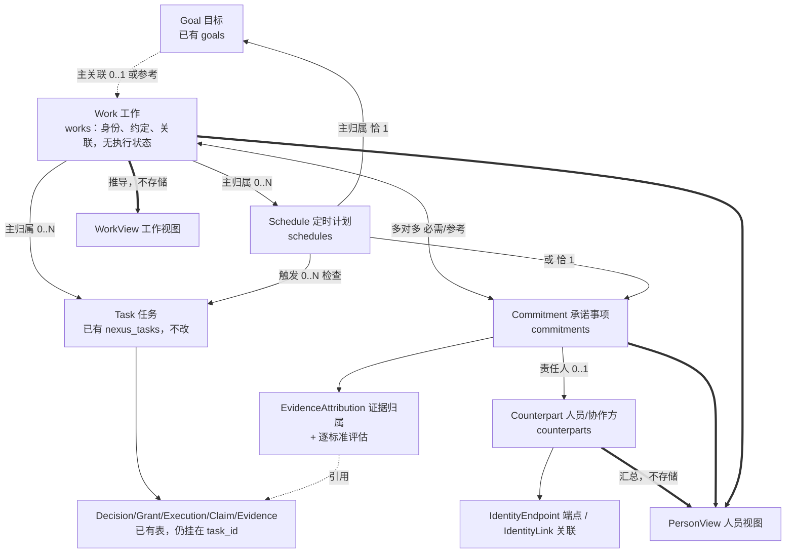
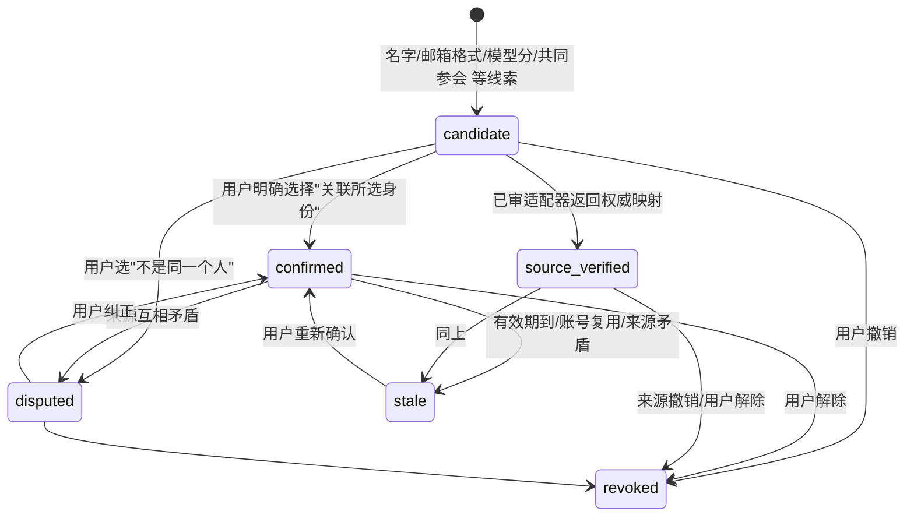
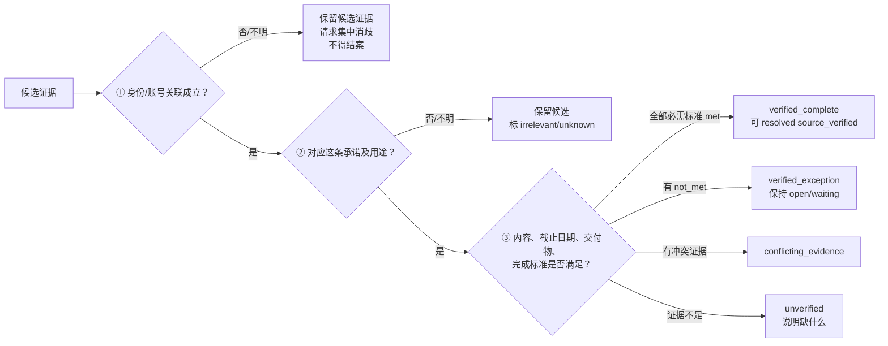
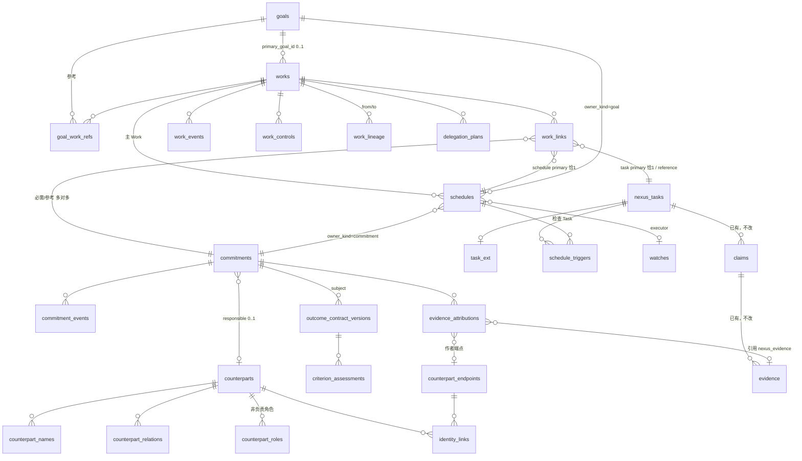

# Nexus Agent Core：按 PRD 落地的对象模型与开发设计（Work / Counterpart / Commitment / Schedule）

| 项目                             | 内容                                                                                                                                                                                                                                                                                                           |
| -------------------------------- | -------------------------------------------------------------------------------------------------------------------------------------------------------------------------------------------------------------------------------------------------------------------------------------------------------------- |
| 文档位置                         | `extensions/nexus-agent-core/docs/implement/`（此后的实现类文档都放这里；已有文档不迁移）                                                                                                                                                                                                                      |
| 依据                             | `extensions/nexus-agent-core/docs/prd/NEXUS_AI_PRD.md` v1.57（2026-10-28，起草基线；2026-10-29 已对照 v1.86，差异与对齐计划见**附录 D**，待需求方澄清的问题见**附录 E**，正文尚未对齐），重点是 §3.1 核心对象及归属，另读了 §0.4 术语、§4.1 导航与 WK / PV、NX-03 / NX-04 / NX-05 / NX-14、§8.1、§10.2 / §10.3 |
| 前提                             | 之前在插件里完成的是没有 PRD 时按大体功能做的版本（事项、决策授权、声明证据、偏好、回检、文件柜、目标）；本文把它们对齐到 PRD 的对象模型，并新增 Work、Counterpart、Commitment、Schedule                                                                                                                       |
| 日期                             | 2026-10-28                                                                                                                                                                                                                                                                                                     |
| 状态                             | 设计稿，待评审；未开始写代码。**依据是 PRD v1.57，与 v1.86 的差异见附录 D（P0 项会改 DDL，写代码前必须先对齐），需求方待确认项见附录 E**                                                                                                                                                                       |
| 已确认的决定（2026-10-28，用户） | ① 现有事项保留为 Task，上面新增 Work；② 首批范围含 Work + 工作视图、Counterpart + 人员视图、Commitment、Schedule；③ Commitment 的完成判定把"来源自动核验"整套写全（第一版实现里没有外部来源，见 §8）                                                                                                           |

## 0. 先读这一节

### 0.1 一句话

PRD 把"用户要的一件事"拆成四层：**Work**（要什么结果）→ **Task**（助手执行的一次限定请求）→ Run / Action（一次尝试、一步操作），旁边还有两条独立的线：**Commitment**（某个人答应交付什么，带标准、期限、证据）和 **Schedule**（已确认的定时检查）。**Counterpart（人员 / 协作方）** 是被委派、负责或参与的真实的人。前台只有两个入口：**工作**按"事"看，**人员**按"人"看，两者读的是同一批记录。

### 0.2 现有实现和 PRD 最大的差别

我们现在的"事项"（`nexus_tasks`，界面上的"任务"页）其实是 PRD 里 **Work 和 Task 的合体**：它跨会话、有标题和目标、给用户看，决策、授权、声明、回检都挂在它下面。PRD 要求把它们分开：Work 不拥有执行状态，只保存"委托的结果、约定和关联"；它的状态由 Task、Commitment、Schedule 推导出来，并且"Task 全部完成不等于 Work 完成"。

处理办法（已确认）：**`nexus_tasks` 保留为 PRD 的 Task，一行不改；在它上面新增 `works`**。老事项迁移时每个自动包一个 Work。界面上的"事项"页改成"工作"页，列的是 Work；Task 的详情（步骤、决策、声明）放进工作详情里。这样决策、授权、声明、回检这些已发布、已验收的表都不动。

### 0.3 本文做什么、不做什么

做：对象清单与映射（§2）、新旧命名（§3）、全部新表与约束（§4）、Work 状态推导（§5）、Commitment（§6）、Counterpart 与身份（§7）、来源自动核验（§8）、人员视图（§9）、接口（§10）、控制台（§11）、迁移与兼容（§12）、分期与验收（§13）、待决问题（§14）。

不做：PRD 里和对象模型无关的大块（连接器与来源准入 EA、文档理解 DU、批次审批 AP、邮件操作 OP、Channel 等）。本文只写它们和这几个对象的**接口**，实现另立文档。

### 0.4 最重要的十条设计规则

1. **Work 是实体，不是状态机。** 没有可手动赋值的"执行状态"字段；展示状态是纯函数 `deriveWorkState()` 的输出（§5）。
2. **Task 恰有一个主 Work，Commitment 多对多，Schedule 恰有一个主 Work 和一个主 Goal 或 Commitment。** 由写入层的唯一索引和事务内校验强制，不靠前台（§4.2）。
3. **完成不跨层赋值。** Task completed、Commitment resolved、Schedule ended 互相不改写；手动结案不等于核验完成（`resolution_basis`）。
4. **人员不是通讯录。** `counterpart_id` 是稳定主键，姓名、邮箱、IM 只是带来源的关联；同名不合并；没有确认的关联不参与自动归属（§7）。
5. **Commitment 的责任人不是 Task 的执行者。** "帮我盯住李明周三交报价表"：Work = 跟进这次交付；李明 = Counterpart；交报价表 = Commitment；检查邮件 / 发提醒 = Task。不把人的待办记成 PA 的 Task，也不把"提醒已发"当对方完成。
6. **关系不授权。** 岗位、下属、counterpart 关联都不产生访问权、收件人权限或发送授权；外发仍走现有决策 / 授权（Stage 2）。
7. **查看人员 = 按人汇总同一批记录。** 不建员工账号、共享看板或绩效系统；"由其负责"和"与其相关"分开；同一 Commitment 被多个 Work 引用只算一次。
8. **所有写入带 `owner_id`、版本号，向前兼容。** 已发布表不改，只新增表（沿用现有纪律）；新表全部 `STRICT`。
9. **Agent 能写的只有"记录用户说的话"。** Agent 不能确认身份、不能把委派写成"对方已接受"（除非给出依据）、不能结案或取消承诺、不能暂停或停止工作——这些是用户在控制台（或用户明确说出后由服务端审计）才能做的事。
10. **每个新能力一个独立开关，默认关。** `worksEnabled`、`counterpartsEnabled`、`commitmentsEnabled`、`schedulesEnabled`，依赖关系见 §12.4。

## 1. 整体结构：谁依赖谁



读法：实线是"归属 / 关联"，虚线是"引用"，粗线是"只读推导"。**WorkView 和 PersonView 都不落表**（第一版）：每次从权威记录算出来。已有的决策、授权、执行、声明、证据全部仍挂在 `task_id` 上，不改一个字。

三条依赖方向（防止循环）：

- 下层不认识上层：`nexus_tasks` 及它下面的表不知道 Work、Commitment、Schedule 的存在；关联全部放在新表里。
- `works` 不存状态；`commitments` 不存"工作是否完成"；`schedules` 不存"承诺是否履行"。
- 新代码读已有代码只经过各自的 ledger 接口（`task-query`、`claim-ledger`、`watch-ledger`、`goal-read-ledger`），不直接 SQL 读别人的表。

## 2. PRD 对象与现有实现的映射

"处理"一列只用四个词：**保留**（不改，直接复用）、**新增**（新表和新模块）、**适配**（旧表不改，加视图或转换函数）、**暂缓**（本批不做，留接口）。

| PRD 对象（§3.1 / §10.2）   | 现有实现                                                                                         | 差距                                                                 | 处理                                                                                                                                                  |
| -------------------------- | ------------------------------------------------------------------------------------------------ | -------------------------------------------------------------------- | ----------------------------------------------------------------------------------------------------------------------------------------------------- |
| Work                       | 没有；`nexus_tasks` 同时承担"一件事"和"一次执行"                                                 | 缺稳定的结果身份、约定、关联、拆合沿袭、工作级控制                   | **新增** `works` + `work_links` + `work_events` + `work_lineage` + `work_controls`；老事项按 1:1 自动包一个 Work（§12.2）                             |
| WorkView                   | 任务列表里的 `status` 过滤                                                                       | 缺 WK-02 五类主状态、"其他步骤进行中"、尚未安排跟进等推导            | **新增** `deriveWorkState()`（纯函数）+ `work-view` 查询（§5）                                                                                        |
| Context                    | `nexus_tasks.entities_json`、会话 key；没有模式 / 客户 / 项目标签                                | 缺 Personal / Executive 与客户项目标签                               | **暂缓**：Work 只存 `context_json` 占位，不做上下文管理；PV 的"客户 / 项目筛选"先用 `context_json.label`                                              |
| Goal                       | `goals`、`goal_entries`、`goal_links`（kind=task / vault_file / preference / watch）、指标、回看 | Goal→Task 是直接关联，PRD 是 Goal→Work；PRD 允许参考关联             | **适配**：`works.primary_goal_id` 为权威；`goal_links(kind=task)` 退化为兼容影子（§4.2.3）；新增 `goal_work_refs` 存参考关联                          |
| Decision（用户确认的选择） | 无同名对象；`decisions` 表是**审批决定**（动作授权）                                             | 名字相同、含义不同                                                   | 审批 `decisions` **保留**；PRD Decision 记录 **暂缓**（`commitments.decision_ref` 留空位，§14 Q4）                                                    |
| Counterpart                | 没有；`entities_json` 里有零散人名                                                               | 缺稳定 ID、端点、关联、角色、关系                                    | **新增** `counterparts` 等六张表（§4.3、§7）                                                                                                          |
| Commitment                 | 没有；`claims`（声明）是"某个事实是否成立"，不是"某人答应交付"                                   | 缺责任人、标准、期限、委派接受、生命周期、独立核验、证据归属         | **新增** `commitments` 等五张表（§4.4、§6）；`claims` 保留，只作为 Task 内部的完成门槛                                                                |
| Task                       | `nexus_tasks` + `nexus_task_steps` + `nexus_task_sessions`                                       | 缺主 Work 关联、PRD §8.1 十个执行状态、来源 Schedule / 触发键        | **保留** 并 **适配**：`taskPhase()` 把现有 11 个 status 映射成 §8.1 状态（§5.1）；主 Work 走 `work_links`；`task_ext` 补"部分完成 / 阻塞"两个终态标记 |
| Run                        | 没有独立表；`action_executions`、`run_triggers` 近似                                             | 缺"每次尝试"的统一记录                                               | **适配**：Run 视为 `run_triggers` + `action_executions` 的组合读取；本批不新建表                                                                      |
| Schedule                   | `watches`（只服务 Task / claim 的回检）+ 宿主 cron job；Goal 回看周期是 `goal_review_plans`      | 缺唯一主 Work + 主 Goal / Commitment、状态五值、触发键去重、覆盖状态 | **新增** `schedules` + `schedule_triggers` + `delegation_plans`；`watches` 作为其执行器保留（§4.5）；Goal 回看提醒 **保留**，不并入                   |
| Specialist subtask         | 无                                                                                               | —                                                                    | **暂缓**                                                                                                                                              |
| Deliverable                | `vault_files` / `vault_versions` / `vault_links`                                                 | 缺"验证后"标记与 Work 关联                                           | **适配**：Work 经 `work_links(object_kind='vault_file')` 引用文件；验证标记沿用现有 `vault_*` 的 kind / 状态                                          |
| OutcomeContract            | `nexus_task_completion_claims`（完成门槛）+ `goal_json`                                          | 缺模板、版本、逐标准评估                                             | **新增（最小版）**：`outcome_contract_versions` + `criterion_assessments`（§4.4）；模板写在代码里                                                     |
| EvidenceAttribution        | `evidence`、`claim_evidence_links`                                                               | 缺主体 / 端点 / 映射版本 / 三步判定                                  | **新增** `evidence_attributions`，引用已有 `evidence.id`（§8）                                                                                        |
| AttentionItem（待处理）    | 无统一模型；各页自己算                                                                           | —                                                                    | **暂缓**：工作页的"待你处理"由 WorkView 直接给出                                                                                                      |
| DelegationPlan             | 无                                                                                               | 缺跟进方案草案                                                       | **新增** `delegation_plans`（§4.5）                                                                                                                   |
| TaskControl                | 无；`nexus_task_update` 可直接改状态                                                             | 缺暂停 / 恢复 / 停止的范围化控制                                     | **新增** `work_controls`（§4.2.5）                                                                                                                    |
| PersonView                 | 无                                                                                               | —                                                                    | **新增** 查询（§9），不落表                                                                                                                           |

## 3. 命名与分层纪律（在现有纪律上增补）

沿用：已发布的表只加不改；新表全部 `STRICT`；所有表带 `owner_id`（目前恒为 `"local"` 占位）；写入走 ledger，ledger 在一个事务里完成"校验 + 写入 + 事件"。

新增约定：

1. **表名。** 属于 Task 聚合的表以 `nexus_task` 开头（已有）；本批新表不带 `nexus_` 前缀，按"一个概念一组前缀"：`work*`、`counterpart*`、`identity_*`、`commitment*`、`schedule*`。没有 `work_` 前缀的例外：`goal_work_refs`（属 Goal 侧）、`evidence_attributions`、`criterion_assessments`、`outcome_contract_versions`、`delegation_plans`、`task_ext`、`store_flags`。
2. **目录。** 代码按概念分目录：`src/work/`（service、derive、view、backfill）、`src/commitment/`、`src/counterpart/`、`src/schedule/`；存储层放 `src/store/` 下 `work-ledger.ts`、`commitment-ledger.ts`、`counterpart-ledger.ts`、`schedule-ledger.ts`（沿用 `*-ledger.ts`）；RPC 在 `src/*-rpc.ts`；工具在 `src/tools/`。
3. **接口命名。** RPC：`nexus.work.*`、`nexus.person.*`（人员视图）、`nexus.counterpart.*`、`nexus.commitment.*`、`nexus.schedule.*`、`nexus.delegation.*`。Agent 工具：`nexus_work_*`、`nexus_commitment_*`、`nexus_counterpart_*`、`nexus_schedule_*`，与目标工具一样登记为 `catalogMode: "direct-only"`（它们是直接工具，不出现在 exec / 代码模式里，提示里要说明，见 G4 试用教训）。
4. **模型可见文字全英文**，界面文字走 `i18n.ts` 中英两套（沿用 `i18n.test.ts` 的检查）。"工作 / 人员 / 承诺事项 / 跟进"为中文界面的固定词；英文界面用 Work / People / Commitment / Follow-up。
5. **权威来源只有一个。** 每个事实只存一处：Task 归属只在 `work_links`，不再在 `goal_links` 里表达 Work 关系；责任人只在 `commitments.counterpart_id`，不在 `counterpart_roles` 里重复。影子数据（如 `goal_links(kind=task)`）必须有"以谁为准"的声明和对账检查（§4.2.3）。
6. **删除与清理。** 新表要接入现有 purge 协议（`purge_runs` / 目标的 `goal_purge_*`）：删除 Task 时处理其 Work 链接；删除 Work 时先处置活动 Task / Schedule（WK-04）；删除 Counterpart 前列出受影响承诺（PV-03）。具体清单见 §12.5。

## 4. 数据模型

### 4.1 通用约定

- 主键 `(owner_id, id)`，与目标表一致；`id` 由内核 `newId()` 生成，带类型前缀便于排查（`w_` Work、`cp_` Counterpart、`cm_` Commitment、`sc_` Schedule 等，实际前缀以编码时与内核统一为准）。
- 带 `revision INTEGER NOT NULL`（乐观并发）；有对外可见变化的表另带 `*_events` 追加表，历史永不改写。
- 时间一律 UTC 毫秒整数；需要"约定的本地时间"的字段另存 IANA 时区（`due_tz`、`tz`）。
- 新表指向已发布表（`nexus_tasks`、`watches`、`evidence` 等）的列**不加外键**，改为"无外键 + 写入时校验"。理由与 `goal_links` 一致：已发布表不能改，且工作 / 目标要能比任务活得久。凡这类指针列，ledger 都在同一事务内校验目标存在且同 `owner_id`，并有对账检查（§12.6）。新表之间的引用（如 `work_links.work_id → works`）照常用外键。
- 状态列用 `CHECK (... IN (...))`；"互相蕴含"的约束（如 `status='ended'` 必须有 `ended_at`）也写成 `CHECK`，避免靠前台。
- 迁移文件：`stage7-0001-works`、`stage7-0002-counterparts`、`stage7-0003-commitments`、`stage7-0004-schedules`（SQL 常量写在 `src/store/schema.ts` 末尾，并入 `MIGRATIONS`）。回填是代码任务不是 SQL（§12.2）。

### 4.2 Work 组（stage7-0001）

#### 4.2.1 `works`

```sql
CREATE TABLE works (
  owner_id TEXT NOT NULL, id TEXT NOT NULL,
  title TEXT NOT NULL,                  -- 用户语言的短标题
  request_text TEXT,                    -- 用户的原话（"我要的结果"）；迁移的老事项取 goal_json 里的目标文字
  outcome_text TEXT,                    -- 当前约定的结果一句话；可由用户改，改动记 work_events
  context_json TEXT,                    -- {mode?: 'personal'|'executive', label?: string}；占位，不授权
  contract_version INTEGER NOT NULL DEFAULT 1,   -- 当前结果约定（outcome_contract_versions）版本
  primary_goal_id TEXT,                 -- 0..1；权威来源（goal_links 的 task 影子见 4.2.3）
  origin TEXT NOT NULL,                 -- migrated|user|agent
  request_ref TEXT,                     -- 去重：来源消息 id / 分句哈希（WK-01 重投不重复创建）
  lifecycle TEXT NOT NULL DEFAULT 'live',   -- live|archived|deleted|purging
  hidden INTEGER NOT NULL DEFAULT 0,    -- 仅改变可见性，不暂停任何后台工作（WK-04）
  revision INTEGER NOT NULL,
  created_at INTEGER NOT NULL, updated_at INTEGER NOT NULL,
  archived_at INTEGER, deleted_at INTEGER,
  PRIMARY KEY (owner_id, id),
  CHECK (origin IN ('migrated','user','agent')),
  CHECK (lifecycle IN ('live','archived','deleted','purging')),
  CHECK (hidden IN (0,1)),
  CHECK ((lifecycle = 'archived') = (archived_at IS NOT NULL) OR lifecycle IN ('deleted','purging')),
  CHECK ((lifecycle IN ('deleted','purging')) = (deleted_at IS NOT NULL)),
  FOREIGN KEY (owner_id, primary_goal_id) REFERENCES goals(owner_id, id)
) STRICT;
CREATE UNIQUE INDEX works_request ON works(owner_id, request_ref) WHERE request_ref IS NOT NULL;
CREATE INDEX works_list ON works(owner_id, lifecycle, updated_at DESC);
CREATE INDEX works_goal ON works(owner_id, primary_goal_id) WHERE primary_goal_id IS NOT NULL;
```

**没有任何执行状态列。** `lifecycle` 只管 Work 这条记录本身的可见性（正常 / 归档 / 删除中），不表示结果进展；这是 PRD 允许的"正常创建、修改、归档和删除生命周期"。

`goal` 外键注意：`goals` 的 `lifecycle='deleted'` 是软删除，Work 仍保留 `primary_goal_id`（Goal 删除不级联 Work，PRD §3.1）；Goal 被真正清除（purge）时，目标清除流程需把 `works.primary_goal_id` 置空（`goal-purge-ledger` 增一步，§12.5）。

#### 4.2.2 `work_links`（WorkObjectLink：Work 与其他对象的关联）

```sql
CREATE TABLE work_links (
  owner_id TEXT NOT NULL, id TEXT NOT NULL, work_id TEXT NOT NULL,
  object_kind TEXT NOT NULL,            -- task|commitment|schedule|vault_file|preference
  object_id TEXT NOT NULL,
  role TEXT NOT NULL,                   -- primary|reference
  dependency TEXT NOT NULL DEFAULT 'reference',   -- required|reference：本结果是否必需（WK-02 只看 required）
  purpose TEXT,                         -- 引用的限定用途（一句话）
  link_version INTEGER NOT NULL DEFAULT 1,
  created_at INTEGER NOT NULL, ended_at INTEGER,    -- 解除关联只设 ended_at，不删行
  PRIMARY KEY (owner_id, id),
  CHECK (object_kind IN ('task','commitment','schedule','vault_file','preference')),
  CHECK (role IN ('primary','reference')),
  CHECK (dependency IN ('required','reference')),
  CHECK (role <> 'primary' OR object_kind IN ('task','schedule')),     -- 只有 Task 和 Schedule 有"主归属"
  CHECK (role <> 'primary' OR dependency = 'required'),                 -- 主归属的 Task / Schedule 总是必需的
  FOREIGN KEY (owner_id, work_id) REFERENCES works(owner_id, id)
) STRICT;
-- Task 恰有一个主 Work；Schedule 恰有一个主 Work（同一时刻，未解除的关联）
CREATE UNIQUE INDEX work_links_primary_once ON work_links(owner_id, object_kind, object_id)
  WHERE role = 'primary' AND ended_at IS NULL;
-- 同一 Work 对同一对象至多一条未解除的关联
CREATE UNIQUE INDEX work_links_pair ON work_links(owner_id, work_id, object_kind, object_id)
  WHERE ended_at IS NULL;
CREATE INDEX work_links_object ON work_links(owner_id, object_kind, object_id) WHERE ended_at IS NULL;
```

各关联的合法组合（写入层按此校验，表约束覆盖不了的部分）：

| 关联            | 合法的 `role` / `dependency`                                                               | 数量规则                                                                   | 谁能写                                                                               |
| --------------- | ------------------------------------------------------------------------------------------ | -------------------------------------------------------------------------- | ------------------------------------------------------------------------------------ |
| Work→Task       | `primary`+`required`（主归属）；`reference`+`required`/`reference`（引用别人 Task 的输出） | 每个 Task 恰一条 `primary`（索引保证"至多"，创建事务保证"至少"）；引用不限 | Task 创建事务（系统）；引用关联由用户或 Agent 发起（Agent 只能引用，不能转移主归属） |
| Work↔Commitment | `reference`+`required`（本结果必需）或 `reference`+`reference`（仅供参考）                 | 多对多，一条 Commitment 可被多个 Work 引用                                 | 创建 Commitment 时的 Work、用户                                                      |
| Work→Schedule   | `primary`+`required`；其他 Work 的引用为 `reference`                                       | 每个 Schedule 恰一条 `primary`                                             | Schedule 创建事务                                                                    |
| Work→vault_file | `reference`                                                                                | 不限                                                                       | 用户或 Agent（沿用 `goal_links` 的文件校验）                                         |

主归属转移（拆合 Work）不改旧行，而是：旧关联设 `ended_at` + 新建一条 `primary`，同一事务，并在 `work_lineage`、`work_events` 里记原因（§4.2.4）。

#### 4.2.3 与 Goal 的关联：`goal_work_refs` 与 `goal_links` 影子

```sql
CREATE TABLE goal_work_refs (          -- 其他 Goal 对 Work 的参考关联（不是父级，不复制计数）
  owner_id TEXT NOT NULL, goal_id TEXT NOT NULL, work_id TEXT NOT NULL,
  created_at INTEGER NOT NULL, ended_at INTEGER,
  PRIMARY KEY (owner_id, goal_id, work_id),
  FOREIGN KEY (owner_id, goal_id) REFERENCES goals(owner_id, id),
  FOREIGN KEY (owner_id, work_id) REFERENCES works(owner_id, id)
) STRICT;
```

- **以谁为准：** `works.primary_goal_id` 是 Goal→Work 的权威。现有 `goal_links(kind='task')` 的"一个 Task 至多属于一个 Goal"唯一索引保留，变成**兼容影子**：`worksEnabled` 打开后，把 Task 挂到目标（`nexus_goal_link kind=task`、目标详情页里"关联事项"）实际是"给这个 Task 的主 Work 设 `primary_goal_id`"，并在同一事务里同步写 / 删 `goal_links` 影子行，给还没升级的读取方（目标指标、目标详情）继续用。
- 一个 Work 有多个 Task 时，影子只写**每个 Task 一行**（都指向同一 Goal）；Goal 页的"关联事项数"改读 Work 数（`works.primary_goal_id = goal.id`），避免一个 Work 三个 Task 被数成三件事。
- 对账检查：`goal_links(kind='task')` 的 `(goal_id, task 的主 Work.primary_goal_id)` 必须一致，不一致由 `work.integrity` 报告（§12.6），不自动修。
- Goal 完成 / 删除不改 Work；Work 全部完成不改 Goal（PRD §3.1、NX-03）。Goal 的指标（G2）里"关联任务数 / 已完成数"的口径改为"关联 Work 数 / 已完成 Work 数"，需在 W6 同步（§13）。

#### 4.2.4 `work_events` 与 `work_lineage`

```sql
CREATE TABLE work_events (             -- 追加；历史不改写
  owner_id TEXT NOT NULL, id TEXT NOT NULL, work_id TEXT NOT NULL, seq INTEGER NOT NULL,
  kind TEXT NOT NULL,
  actor TEXT NOT NULL,                 -- user|agent|system
  payload_json TEXT NOT NULL,          -- 小而结构化；不放原文大段内容
  created_at INTEGER NOT NULL,
  PRIMARY KEY (owner_id, id), UNIQUE (owner_id, work_id, seq),
  CHECK (actor IN ('user','agent','system')),
  CHECK (kind IN (
    'created','retitled','outcome_changed','contract_changed','goal_set','goal_cleared',
    'link_added','link_ended','archived','unarchived','deleted',
    'control_applied','control_released',
    'closed_incomplete',               -- 已结束（未完成）的显式标记，见 §5.2；payload.reason 为枚举
    'accepted_done',                   -- 用户明确验收（contract 含 user_accept 标准时）
    'merged_into','split_from','reopened'))
  , FOREIGN KEY (owner_id, work_id) REFERENCES works(owner_id, id)
) STRICT;

CREATE TABLE work_lineage (            -- 拆合沿袭：保留原请求分母，不丢历史
  owner_id TEXT NOT NULL, id TEXT NOT NULL,
  from_work_id TEXT NOT NULL, to_work_id TEXT NOT NULL,
  kind TEXT NOT NULL,                  -- merge|split|alias
  reason TEXT, created_at INTEGER NOT NULL,
  PRIMARY KEY (owner_id, id),
  CHECK (kind IN ('merge','split','alias')), CHECK (from_work_id <> to_work_id)
) STRICT;
```

`closed_incomplete.payload.reason` 枚举：`user_stop`（用户停止工作）、`partial_accepted`（以部分结果结束）、`manual_close`（注明原因结案，列出被结案的 Commitment）、`irrecoverable`（已审的不可恢复终止）、`follow_up_expired`（跟进到期，由 Schedule 结束事件触发后系统写入）。`reopened` 作废之前的 `closed_incomplete`（见 §5.2）。

#### 4.2.5 `work_controls`（WK-04 工作级控制）

```sql
CREATE TABLE work_controls (
  owner_id TEXT NOT NULL, id TEXT NOT NULL, work_id TEXT NOT NULL,
  scope_kind TEXT NOT NULL,            -- work|task|schedule
  scope_id TEXT,                       -- scope_kind='work' 时为空
  state TEXT NOT NULL,                 -- pause_requested|paused|released
  reason TEXT, initiated_by TEXT NOT NULL,       -- user|system
  created_at INTEGER NOT NULL, released_at INTEGER,
  PRIMARY KEY (owner_id, id),
  CHECK (scope_kind IN ('work','task','schedule')),
  CHECK (state IN ('pause_requested','paused','released')),
  CHECK ((scope_kind = 'work') = (scope_id IS NULL)),
  CHECK ((state = 'released') = (released_at IS NOT NULL)),
  FOREIGN KEY (owner_id, work_id) REFERENCES works(owner_id, id)
) STRICT;
CREATE UNIQUE INDEX work_controls_open ON work_controls(owner_id, work_id, scope_kind, COALESCE(scope_id,''))
  WHERE state <> 'released';
```

控制语义（WK-04 逐条落地，见 §10.4 的动作表）：**暂停**写一条 `paused`，恢复只 `released` 这一条（"仅解除该次控制创建的挂起"）；Task 层面的"挂起"通过这张表让 `nexus_task_*` 的执行入口（`before_tool_call` 门）拒绝推进，不改 `nexus_tasks.status`。**停止跟进**不写控制行，而是把选定 Schedule 置 `cancelled`（§4.5）。**停止工作**预览后：置所有主归属 Schedule `cancelled`、对主归属 Task 调现有取消路径（`nexus_task_update status=cancelled`）、写 `closed_incomplete(user_stop)`，**不碰** Commitment。

#### 4.2.6 `task_ext`（Task 的两个补充标记）

```sql
CREATE TABLE task_ext (
  owner_id TEXT NOT NULL, task_id TEXT NOT NULL,
  end_kind TEXT,                       -- NULL|partial：以部分结果结束（PRD §8.1 partial）
  end_reason TEXT, ended_by TEXT,      -- user|agent|system
  blocked_reason TEXT, blocked_since INTEGER,   -- 非空即 blocked（PRD §8.1 blocked）
  revision INTEGER NOT NULL, updated_at INTEGER NOT NULL,
  PRIMARY KEY (owner_id, task_id),
  CHECK (end_kind IS NULL OR end_kind = 'partial')
) STRICT;
```

`nexus_tasks.status` 没有 `CHECK`（只有注释里的枚举），但为了遵守"已发布表不动、不加新枚举值"，`partial` 和 `blocked` 放在这里，`taskPhase()` 把两者合起来（§5.1）。表不记 `nexus_tasks.status` 的副本，只记旧状态表达不了的两件事。

### 4.3 Counterpart 组（stage7-0002）

#### 4.3.1 `counterparts`

```sql
CREATE TABLE counterparts (
  owner_id TEXT NOT NULL, id TEXT NOT NULL,          -- id 即 PRD 的稳定 counterpart_id
  kind TEXT NOT NULL,                  -- person|organization|team|shared_mailbox（组织 / 团队 / 共享邮箱不得伪装成自然人）
  display_name TEXT NOT NULL,          -- 用户通常怎么称呼；不是主键，不要求唯一
  confirmation TEXT NOT NULL,          -- stated|confirmed|proposed
  origin TEXT NOT NULL,                -- user|agent|review_batch
  lifecycle TEXT NOT NULL DEFAULT 'live',   -- live|archived|merged|deleted
  merged_into TEXT,                    -- lifecycle='merged' 时指向保留者
  context_json TEXT,                   -- {label?: 客户 / 项目标签}；不授权
  revision INTEGER NOT NULL,
  created_at INTEGER NOT NULL, updated_at INTEGER NOT NULL, archived_at INTEGER,
  PRIMARY KEY (owner_id, id),
  CHECK (kind IN ('person','organization','team','shared_mailbox')),
  CHECK (confirmation IN ('stated','confirmed','proposed')),
  CHECK (origin IN ('user','agent','review_batch')),
  CHECK (lifecycle IN ('live','archived','merged','deleted')),
  CHECK ((lifecycle = 'merged') = (merged_into IS NOT NULL)),
  CHECK (origin <> 'agent' OR confirmation <> 'confirmed')      -- Agent 不能自己把人员标为"已确认"
) STRICT;
CREATE INDEX counterparts_list ON counterparts(owner_id, lifecycle, display_name);
```

`confirmation` 三值：`stated`——用户在对话里明确点了这个人（"帮我盯住李明"），由 Agent 记录并带上原话引用，可参与列表和承诺归属，但**不等于身份已确认**；`confirmed`——用户在控制台确认过这个人；`proposed`——Agent 或来源推测出的候选人，**不进入人员列表**，只在"待确认人员"分组里出现（PV-01）。身份端点另有自己的关联状态（§4.3.4），两层状态互不替代。

#### 4.3.2 名称、关系、角色

```sql
CREATE TABLE counterpart_names (       -- 称呼 / 别名；同名不合并，姓名不是主键
  owner_id TEXT NOT NULL, id TEXT NOT NULL, counterpart_id TEXT NOT NULL,
  name TEXT NOT NULL, name_kind TEXT NOT NULL,       -- display|alias|raw_mention
  source TEXT NOT NULL,                -- user_statement|review_batch|connector:<provider>
  created_at INTEGER NOT NULL, revoked_at INTEGER,
  PRIMARY KEY (owner_id, id),
  CHECK (name_kind IN ('display','alias','raw_mention')),
  FOREIGN KEY (owner_id, counterpart_id) REFERENCES counterparts(owner_id, id)
) STRICT;
CREATE INDEX counterpart_names_lookup ON counterpart_names(owner_id, name) WHERE revoked_at IS NULL;

CREATE TABLE counterpart_relations (   -- "下属 / 同事 / 客户 / 供应商"：只来自用户明确陈述或获准来源，不由往来频率推断
  owner_id TEXT NOT NULL, id TEXT NOT NULL, counterpart_id TEXT NOT NULL,
  relation TEXT NOT NULL,              -- direct_report|colleague|client|supplier|other
  scope_label TEXT,                    -- 适用的客户 / 项目；NULL 表示所有者范围内通用
  basis_text TEXT NOT NULL,            -- 用户原话或来源引用，必填
  status TEXT NOT NULL,                -- stated|revoked
  valid_from INTEGER, valid_to INTEGER,
  created_at INTEGER NOT NULL,
  PRIMARY KEY (owner_id, id),
  CHECK (relation IN ('direct_report','colleague','client','supplier','other')),
  CHECK (status IN ('stated','revoked')),
  FOREIGN KEY (owner_id, counterpart_id) REFERENCES counterparts(owner_id, id)
) STRICT;

CREATE TABLE counterpart_roles (       -- 人员在某件 Work / Commitment 里的非"负责"角色；负责人在 commitments.counterpart_id
  owner_id TEXT NOT NULL, id TEXT NOT NULL, counterpart_id TEXT NOT NULL,
  object_kind TEXT NOT NULL,           -- work|commitment
  object_id TEXT NOT NULL,
  role TEXT NOT NULL,                  -- responsible|participant|approver|recipient（responsible 仅用于 Work 级"责任方"）
  basis_text TEXT NOT NULL,
  status TEXT NOT NULL,                -- stated|confirmed|revoked
  valid_from INTEGER, valid_to INTEGER,
  created_at INTEGER NOT NULL,
  PRIMARY KEY (owner_id, id),
  CHECK (object_kind IN ('work','commitment')),
  CHECK (role IN ('responsible','participant','approver','recipient')),
  CHECK (status IN ('stated','confirmed','revoked')),
  CHECK (object_kind = 'work' OR role <> 'responsible'),   -- Commitment 的负责人只存在 commitments 表
  FOREIGN KEY (owner_id, counterpart_id) REFERENCES counterparts(owner_id, id)
) STRICT;
CREATE UNIQUE INDEX counterpart_roles_once ON counterpart_roles(owner_id, counterpart_id, object_kind, object_id, role)
  WHERE status <> 'revoked';
```

角色与关系**不授权**：这些表里的任何值都不能出现在 `action_grants` / `standing_grants` 的判定里；收件人角色只是"这件事的收件人是谁"的记录，外发仍要现有决策（规则 6）。

#### 4.3.3 `counterpart_endpoints`（IdentityEndpoint）

```sql
CREATE TABLE counterpart_endpoints (
  owner_id TEXT NOT NULL, id TEXT NOT NULL,
  provider TEXT NOT NULL,              -- email|gmail|calendar|notion|jira|manual|…
  connector_account TEXT,              -- 所有者的哪个连接账号看到的
  workspace TEXT,                      -- 租户 / 工作区；不同工作区的同一服务商主体不得混同
  provider_subject_id TEXT,            -- 服务商稳定主体 ID；没有时为 NULL，并标 weak
  handle TEXT,                         -- 地址 / 句柄（邮箱、@用户名）
  id_strength TEXT NOT NULL,           -- strong|weak（NULL subject id ⇒ weak）
  observed_at INTEGER NOT NULL,
  valid_from INTEGER, valid_to INTEGER,
  source_ref TEXT,
  created_at INTEGER NOT NULL,
  PRIMARY KEY (owner_id, id),
  CHECK (id_strength IN ('strong','weak')),
  CHECK (id_strength = 'weak' OR provider_subject_id IS NOT NULL)
) STRICT;
CREATE UNIQUE INDEX endpoints_subject ON counterpart_endpoints
  (owner_id, provider, COALESCE(connector_account,''), COALESCE(workspace,''), provider_subject_id)
  WHERE provider_subject_id IS NOT NULL;
CREATE INDEX endpoints_handle ON counterpart_endpoints(owner_id, provider, handle) WHERE handle IS NOT NULL;
```

端点**不属于**某个人员：它只是"某账号里看到的一个主体"。与人员的联系全部在 `identity_links`。同一个邮箱地址如果被两个人先后使用，是两条 `valid_from / valid_to` 不重叠的 link，端点本身不变（ER-05：不把新持有人追溯成旧承诺的责任人）。

#### 4.3.4 `identity_links`（IdentityLink：端点 ⇄ 人员）

```sql
CREATE TABLE identity_links (
  owner_id TEXT NOT NULL, id TEXT NOT NULL,
  counterpart_id TEXT NOT NULL, endpoint_id TEXT NOT NULL,
  status TEXT NOT NULL,                -- candidate|confirmed|source_verified|disputed|stale|revoked（ER-02）
  basis_kind TEXT NOT NULL,            -- user_confirmed|user_statement|adapter_directory|calendar_participant|doc_mention_id|name_similarity|email_pattern|model_score
  basis_json TEXT NOT NULL,            -- 可回查依据：来源记录 ID、适配器名与版本、用户确认的原话 / 时间
  scope_kind TEXT NOT NULL,            -- task|project|account：复用范围（ER-03 默认只绑定当前批次 / 任务）
  scope_ref TEXT,                      -- scope_kind='task' 时为 task_id / commitment_id；'project' 时为项目标签
  confirmed_by TEXT, confirmed_at INTEGER,
  valid_from INTEGER NOT NULL, valid_to INTEGER,
  version INTEGER NOT NULL,            -- 每次变更 +1；承诺 / 证据归属引用"当时使用的映射版本"
  supersedes_id TEXT,
  created_at INTEGER NOT NULL, updated_at INTEGER NOT NULL,
  PRIMARY KEY (owner_id, id),
  CHECK (status IN ('candidate','confirmed','source_verified','disputed','stale','revoked')),
  CHECK (basis_kind IN ('user_confirmed','user_statement','adapter_directory','calendar_participant','doc_mention_id','name_similarity','email_pattern','model_score')),
  CHECK (scope_kind IN ('task','project','account')),
  -- 名字 / 邮箱格式 / 模型分只能产生候选（ER-02）
  CHECK (basis_kind NOT IN ('name_similarity','email_pattern','model_score') OR status IN ('candidate','disputed','stale','revoked')),
  -- confirmed 必须有确认人和时间；source_verified 必须来自适配器目录映射
  CHECK (status <> 'confirmed' OR (confirmed_by IS NOT NULL AND confirmed_at IS NOT NULL)),
  CHECK (status <> 'source_verified' OR basis_kind = 'adapter_directory'),
  FOREIGN KEY (owner_id, counterpart_id) REFERENCES counterparts(owner_id, id),
  FOREIGN KEY (owner_id, endpoint_id) REFERENCES counterpart_endpoints(owner_id, id)
) STRICT;
CREATE INDEX identity_links_cp ON identity_links(owner_id, counterpart_id, status);
CREATE INDEX identity_links_ep ON identity_links(owner_id, endpoint_id, status);
```

- **只有 `confirmed` / `source_verified`、未过期、未被矛盾、用途匹配的 link 参与自动归属**（ER-02）；`candidate / disputed / stale / revoked` 永远不参与，也不用于自动选收件人。
- link 的任何变更（确认、纠正、解除、过期）都 `version + 1` 并新建一行（旧行置 `superseded` 语义由 `supersedes_id` 表达，旧行状态改为 `stale` 或 `revoked`），旧版本行保留，因为证据归属引用的是"当时的映射版本"。
- "关联同一 `counterpart_id` 不会扩大 AP-03 的端点白名单"：外发规则代码一律按**准确地址**匹配，不查 identity_links；测试里加一条"identity_links 变更不改变任何 grant 的可用性"。
- 合并 / 拆分 Counterpart（ER-05）：不改旧 link 行；合并 = 把被合并者的 link 以新版本指向保留者，被合并者 `lifecycle='merged'`；拆分 = 用户选定端点 / 承诺迁往新人员，各自写新版本。两者先产出"影响清单"（受影响端点、承诺、依赖这些映射的草稿 / 收件人批准），用户确认后在一个事务里执行，并使依赖的批准和自动核验失效（§7.4）。

### 4.4 Commitment 组（stage7-0003）

#### 4.4.1 `commitments`

```sql
CREATE TABLE commitments (
  owner_id TEXT NOT NULL, id TEXT NOT NULL,
  requirement_text TEXT NOT NULL,        -- 要交付什么（用户语言，一句话）
  responsible_kind TEXT NOT NULL,        -- owner|counterpart|unresolved
  responsible_raw TEXT,                  -- 原始称呼（"小王""李明"）；unresolved 时必填
  counterpart_id TEXT,                   -- 已解析的责任人；responsible_kind='counterpart' 时必填
  mapping_ref_json TEXT,                 -- 解析时用到的 identity_links [{id,version}]；可空
  ambiguity_json TEXT,                   -- 未解决的歧义（候选人、原因）；解决后清空并记 commitment_events
  source_kind TEXT NOT NULL,             -- user_statement|decision|document|review_batch|connector
  source_ref TEXT,                       -- 消息 id / 来源片段 / 决策引用
  decision_ref TEXT,                     -- 预留：PRD Decision 记录（暂缓，见 §14 Q4）
  context_json TEXT,
  due_state TEXT NOT NULL,               -- known|pending|none：日期待定是用户明确选择，不是缺失
  due_at INTEGER, due_tz TEXT,           -- UTC 毫秒 + IANA 时区；known 时必填
  depends_json TEXT,                     -- 依赖（commitment_id / 描述）
  standard_json TEXT,                    -- 完成标准（当前约定版本的快照，权威在 outcome_contract_versions）
  contract_version INTEGER NOT NULL DEFAULT 1,
  delegation TEXT NOT NULL DEFAULT 'proposed',   -- proposed|communicated|accepted|acceptance_unknown
  delegation_basis TEXT,                 -- 依据：用户原话 / 对方回复引用；accepted 时必填
  delegation_at INTEGER,
  lifecycle TEXT NOT NULL DEFAULT 'open',        -- open|waiting|resolved|cancelled
  verification TEXT NOT NULL DEFAULT 'unverified',  -- unverified|verified_complete|verified_exception|conflicting_evidence
  resolution_basis TEXT,                 -- source_verified|manual_override
  resolution_reason TEXT, resolved_at INTEGER,
  cancel_reason TEXT, cancelled_at INTEGER,
  next_step TEXT, escalation_json TEXT,
  origin TEXT NOT NULL,                  -- user|agent|review_batch
  revision INTEGER NOT NULL,
  created_at INTEGER NOT NULL, updated_at INTEGER NOT NULL,
  PRIMARY KEY (owner_id, id),
  CHECK (responsible_kind IN ('owner','counterpart','unresolved')),
  CHECK (responsible_kind <> 'counterpart' OR counterpart_id IS NOT NULL),
  CHECK (responsible_kind <> 'unresolved' OR (counterpart_id IS NULL AND responsible_raw IS NOT NULL)),
  CHECK (responsible_kind <> 'owner' OR counterpart_id IS NULL),
  CHECK (source_kind IN ('user_statement','decision','document','review_batch','connector')),
  CHECK (due_state IN ('known','pending','none')),
  CHECK ((due_state = 'known') = (due_at IS NOT NULL AND due_tz IS NOT NULL)),
  CHECK (delegation IN ('proposed','communicated','accepted','acceptance_unknown')),
  CHECK (delegation <> 'accepted' OR (delegation_basis IS NOT NULL AND delegation_at IS NOT NULL)),
  CHECK (lifecycle IN ('open','waiting','resolved','cancelled')),
  CHECK (verification IN ('unverified','verified_complete','verified_exception','conflicting_evidence')),
  CHECK (resolution_basis IS NULL OR resolution_basis IN ('source_verified','manual_override')),
  CHECK ((lifecycle = 'resolved') = (resolution_basis IS NOT NULL AND resolved_at IS NOT NULL)),
  CHECK (resolution_basis IS NOT 'source_verified' OR verification = 'verified_complete'),
  CHECK (resolution_basis IS NOT 'manual_override' OR resolution_reason IS NOT NULL),
  CHECK ((lifecycle = 'cancelled') = (cancelled_at IS NOT NULL)),
  CHECK (origin IN ('user','agent','review_batch')),
  FOREIGN KEY (owner_id, counterpart_id) REFERENCES counterparts(owner_id, id)
) STRICT;
CREATE INDEX commitments_cp ON commitments(owner_id, counterpart_id, lifecycle) WHERE counterpart_id IS NOT NULL;
CREATE INDEX commitments_unresolved ON commitments(owner_id, responsible_raw) WHERE responsible_kind = 'unresolved';
CREATE INDEX commitments_due ON commitments(owner_id, lifecycle, due_at);
```

关键点：

- **`overdue` 不存**：`lifecycle IN ('open','waiting') AND due_state='known' AND due_at < now`，在查询里算。
- **`delegation` 与 `lifecycle` / `verification` 三条线互相独立**：对方"已接受"不改生命周期，"已解决"不改接受状态（PRD NX-04）。`accepted` 必须带依据（CHECK）。对方尚未接受时仍可跟踪，但界面不得显示"已承诺 / 已履行"。
- **`verified_exception` 不等于 resolved**；`cancelled` 不等于履行；`manual_override` 解决时 `verification` 保持真实值，不强置 `verified_complete`（CHECK 只在反方向约束：`source_verified ⇒ verified_complete`）。
- **Agent 的写入权限**见 §6.3；表本身不区分，由 ledger 的 `actor` 参数 + RPC / 工具的白名单控制。

#### 4.4.2 `commitment_events`

```sql
CREATE TABLE commitment_events (       -- 追加，不改写
  owner_id TEXT NOT NULL, id TEXT NOT NULL, commitment_id TEXT NOT NULL, seq INTEGER NOT NULL,
  kind TEXT NOT NULL,
  actor TEXT NOT NULL,                 -- user|agent|system|engine（engine = 自动核验）
  payload_json TEXT NOT NULL,          -- 变更前后、依据、涉及的 attribution / link 版本
  created_at INTEGER NOT NULL,
  PRIMARY KEY (owner_id, id), UNIQUE (owner_id, commitment_id, seq),
  CHECK (actor IN ('user','agent','system','engine')),
  CHECK (kind IN ('created','edited','responsible_resolved','responsible_changed','due_changed','standard_changed',
    'delegation_changed','lifecycle_changed','verification_changed',
    'resolved_source_verified','resolved_manual','cancelled','reopened',
    'evidence_attached','evidence_reassessed','linked_to_work','unlinked_from_work',
    'follow_up_started','follow_up_stopped')),
  FOREIGN KEY (owner_id, commitment_id) REFERENCES commitments(owner_id, id)
) STRICT;
```

#### 4.4.3 最小版结果约定与逐标准评估

```sql
CREATE TABLE outcome_contract_versions (   -- OC-01/02/04：不可变版本；新约定 = 新版本
  owner_id TEXT NOT NULL, id TEXT NOT NULL,
  subject_kind TEXT NOT NULL,          -- work|task|commitment
  subject_id TEXT NOT NULL, version INTEGER NOT NULL,
  template_id TEXT NOT NULL,           -- 代码内模板 id，如 'legacy_task_success'、'commitment_deliverable'、'user_accept'
  template_version INTEGER NOT NULL,
  params_json TEXT NOT NULL,           -- 用户特定参数：时间窗口、必要交付物、收件人等
  criteria_json TEXT NOT NULL,         -- [{id, text, required, kind, evidence_kinds, freshness_ms}]
  provenance TEXT NOT NULL,            -- user|agent_proposed|template_default|migration
  accepted_by_user INTEGER NOT NULL DEFAULT 0,
  created_at INTEGER NOT NULL, superseded_at INTEGER,
  PRIMARY KEY (owner_id, id), UNIQUE (owner_id, subject_kind, subject_id, version),
  CHECK (subject_kind IN ('work','task','commitment')),
  CHECK (provenance IN ('user','agent_proposed','template_default','migration')),
  CHECK (accepted_by_user IN (0,1))
) STRICT;

CREATE TABLE criterion_assessments (   -- OC-03：逐标准结论；追加
  owner_id TEXT NOT NULL, id TEXT NOT NULL,
  contract_id TEXT NOT NULL, criterion_id TEXT NOT NULL,
  verdict TEXT NOT NULL,               -- met|not_met|insufficient_evidence|conflicting_evidence
  attribution_ids_json TEXT,           -- 用到的 evidence_attributions
  assessor TEXT NOT NULL,              -- engine|user|agent_proposal
  limits_text TEXT,                    -- 局限（来源保真、解析不确定等）
  user_override INTEGER NOT NULL DEFAULT 0,   -- 用户手动覆盖；不冒充来源核验
  override_reason TEXT,
  assessed_at INTEGER NOT NULL, superseded_at INTEGER,
  PRIMARY KEY (owner_id, id),
  CHECK (verdict IN ('met','not_met','insufficient_evidence','conflicting_evidence')),
  CHECK (assessor IN ('engine','user','agent_proposal')),
  CHECK (user_override = 0 OR override_reason IS NOT NULL),
  CHECK (assessor <> 'agent_proposal' OR verdict <> 'met' OR attribution_ids_json IS NOT NULL),
  FOREIGN KEY (owner_id, contract_id) REFERENCES outcome_contract_versions(owner_id, id)
) STRICT;
CREATE INDEX criterion_assessments_cur ON criterion_assessments(owner_id, contract_id, criterion_id) WHERE superseded_at IS NULL;
```

标准的 `kind` 取值（`criteria_json[].kind`）：

| kind                                                      | 含义                                        | 由谁判定                                                 |
| --------------------------------------------------------- | ------------------------------------------- | -------------------------------------------------------- |
| `task_completed`                                          | 指定主归属 Task 已 `completed` 且过完成门槛 | 推导函数（读 Task 事实）                                 |
| `commitment_verified`                                     | 指定必需 Commitment 为 `verified_complete`  | 推导函数（读 Commitment 事实）；`manual_override` 不满足 |
| `deliverable_ready`                                       | 指定文件 / 交付物已生成并通过验证标记       | 推导函数（读文件柜事实）                                 |
| `user_accept`                                             | 用户明确验收                                | 用户（`work_events.accepted_done`）                      |
| `presence` / `field_match` / `text_contains` / `deadline` | 证据层的客观检查（§8.2）                    | 核验引擎                                                 |
| `needs_judgement`                                         | 无法客观衡量，保留用户审阅                  | 用户                                                     |

模板登记为**代码常量**（`src/work/contract-templates.ts`），首批三个：`legacy_task_success`（迁移用：Task 达到 `succeeded` 且现有完成门槛通过）、`commitment_deliverable`（责任人在期限内交付满足指定标准的物品）、`user_accept`（用户明确验收）。模板不含授权，不含执行步骤（OC-01）。完整模板库和用户自存模板属后续（OC-05），本批不做。

#### 4.4.4 `evidence_attributions`（EvidenceAttribution）

```sql
CREATE TABLE evidence_attributions (
  owner_id TEXT NOT NULL, id TEXT NOT NULL, commitment_id TEXT NOT NULL,
  evidence_kind TEXT NOT NULL,         -- nexus_evidence|vault_file|external_record
  evidence_ref TEXT NOT NULL,          -- evidence.id / vault_files.id / 外部记录 id
  external_record_id TEXT,             -- 来源系统的稳定记录 id（邮件 message-id 等）
  endpoint_id TEXT,                    -- 来源字段里的发送者 / 作者端点；转发正文、引用、签名里的名字不算
  actor_role TEXT NOT NULL,            -- submitter|author|forwarded_mention|signature_mention|user_declared
  submitted_by_counterpart TEXT,       -- 实际提交人（代理交付时与责任人不同）
  event_at INTEGER NOT NULL,
  mapping_refs_json TEXT,              -- [{link_id, version}]：使用的映射版本
  identity_verdict TEXT NOT NULL,      -- matched|unmatched|ambiguous|unknown|user_declared
  relevance_verdict TEXT NOT NULL,     -- relevant|irrelevant|unknown
  content_summary_json TEXT,           -- 逐标准的内容判定摘要（真实数据在 criterion_assessments）
  authenticity_limits TEXT,
  assessed_at INTEGER NOT NULL, superseded_at INTEGER,
  PRIMARY KEY (owner_id, id),
  CHECK (evidence_kind IN ('nexus_evidence','vault_file','external_record')),
  CHECK (actor_role IN ('submitter','author','forwarded_mention','signature_mention','user_declared')),
  CHECK (identity_verdict IN ('matched','unmatched','ambiguous','unknown','user_declared')),
  CHECK (relevance_verdict IN ('relevant','irrelevant','unknown')),
  -- 转发正文 / 签名里的名字不能证明发送者身份（ER-04）
  CHECK (actor_role NOT IN ('forwarded_mention','signature_mention') OR identity_verdict IN ('unmatched','unknown')),
  FOREIGN KEY (owner_id, commitment_id) REFERENCES commitments(owner_id, id)
) STRICT;
CREATE UNIQUE INDEX attributions_once ON evidence_attributions(owner_id, commitment_id, evidence_kind, evidence_ref)
  WHERE superseded_at IS NULL;
```

### 4.5 Schedule 组（stage7-0004）

#### 4.5.1 `delegation_plans`（跟进方案草案）

```sql
CREATE TABLE delegation_plans (
  owner_id TEXT NOT NULL, id TEXT NOT NULL, work_id TEXT NOT NULL,
  intended_owner_kind TEXT NOT NULL,   -- goal|commitment
  intended_owner_ref TEXT NOT NULL,
  purpose TEXT NOT NULL,
  version INTEGER NOT NULL,
  state TEXT NOT NULL,                 -- proposed|confirmed|superseded|rejected
  plan_json TEXT NOT NULL,             -- 来源、频率、时区、预期证据、通知、结束 / 复核日、不会做什么、覆盖限制
  gaps_json TEXT,                      -- 前置缺口（连接未就绪、身份未确认…）；非空时不得开始
  start_intent TEXT NOT NULL DEFAULT 'none',   -- none|when_ready|now
  schedule_id TEXT,                    -- 确认并启动后指向 schedules
  created_by TEXT NOT NULL,            -- user|agent
  created_at INTEGER NOT NULL, decided_at INTEGER,
  PRIMARY KEY (owner_id, id),
  CHECK (intended_owner_kind IN ('goal','commitment')),
  CHECK (state IN ('proposed','confirmed','superseded','rejected')),
  CHECK (start_intent IN ('none','when_ready','now')),
  CHECK (created_by IN ('user','agent')),
  FOREIGN KEY (owner_id, work_id) REFERENCES works(owner_id, id)
) STRICT;
```

未被接受的提议只存在这里，不是 Schedule（NX-05）。方案不隐含外部动作授权；"确认"只授权方案里列出的**观察 / 私有输出**（CD-04）。

#### 4.5.2 `schedules`

```sql
CREATE TABLE schedules (
  owner_id TEXT NOT NULL, id TEXT NOT NULL,
  work_id TEXT NOT NULL,                 -- 唯一主 Work（另在 work_links 记 primary 以便统一查询与唯一索引）
  owner_kind TEXT NOT NULL,              -- goal|commitment|legacy_watch
  owner_ref TEXT NOT NULL,               -- goal_id / commitment_id / watches.id
  plan_id TEXT, plan_version INTEGER,    -- 来自哪份已确认方案
  purpose TEXT NOT NULL,
  expected_evidence_json TEXT,
  cadence_json TEXT NOT NULL,            -- {kind:'interval', minutes>=15} | {kind:'daily', times:[...], weekdays?:[..]} | …
  tz TEXT NOT NULL,                      -- IANA 时区
  next_due_at INTEGER,                   -- UTC
  stop_json TEXT,                        -- {until?: ms, on:['verified','commitment_cancelled'…]}
  notify_json TEXT,
  session_key TEXT,                      -- 目标会话
  executor_kind TEXT NOT NULL,           -- watch|check_task
  executor_ref TEXT,                     -- watches.id（executor_kind='watch'）
  status TEXT NOT NULL,                  -- active|paused|blocked|ended|cancelled
  pause_source TEXT,                     -- user|work_control|system
  block_reason TEXT,
  stop_reason TEXT, ended_at INTEGER,    -- ended / cancelled 才有
  coverage_state TEXT NOT NULL DEFAULT 'on_plan',  -- on_plan|degraded|unavailable（CS-04）；与 status 独立
  coverage_note TEXT,
  predecessor_id TEXT,                   -- 后继计划指向被取代的 ended / cancelled 计划
  created_via TEXT NOT NULL,             -- plan|migration
  revision INTEGER NOT NULL,
  created_at INTEGER NOT NULL, updated_at INTEGER NOT NULL,
  PRIMARY KEY (owner_id, id),
  CHECK (owner_kind IN ('goal','commitment','legacy_watch')),
  CHECK (owner_kind <> 'legacy_watch' OR created_via = 'migration'),
  CHECK (status IN ('active','paused','blocked','ended','cancelled')),
  CHECK (executor_kind IN ('watch','check_task')),
  CHECK (executor_kind <> 'watch' OR executor_ref IS NOT NULL),
  CHECK (coverage_state IN ('on_plan','degraded','unavailable')),
  CHECK ((status IN ('ended','cancelled')) = (ended_at IS NOT NULL AND stop_reason IS NOT NULL)),
  CHECK (status <> 'paused' OR pause_source IS NOT NULL),
  CHECK (status <> 'blocked' OR block_reason IS NOT NULL),
  CHECK (created_via IN ('plan','migration')),
  FOREIGN KEY (owner_id, work_id) REFERENCES works(owner_id, id)
) STRICT;
CREATE INDEX schedules_due ON schedules(owner_id, status, next_due_at) WHERE status = 'active';
CREATE INDEX schedules_owner ON schedules(owner_id, owner_kind, owner_ref);
CREATE INDEX schedules_work ON schedules(owner_id, work_id);
```

- **只有"迁移来的旧回检"可以没有 Goal / Commitment 主归属**（`legacy_watch`），用户给它挂上承诺后才升级为合规 Schedule（新建后继行，`predecessor_id` 指向旧行）。新建的计划必须指定 `goal` 或 `commitment`（CHECK + ledger 校验），且 `owner_ref` 存在、同 `owner_id`、未 `cancelled / deleted`。
- 最小间隔 15 分钟在 `cadence_json` 校验（ledger 层，`Math.max(15, …)` 之外直接拒绝而不是静默提升，这样 CS-01 的"不虚设实时覆盖"可测）。
- `status` 与 `coverage_state` 分开：`active` 只表示"允许到期触发"，不证明观察成功。
- ended / cancelled 是终态：**不能回到 active**。需要继续只能新建后继行（`predecessor_id`），并重新走 DelegationPlan 确认（NX-05）。
- 暂停：用户暂停写 `pause_source='user'`；工作级暂停写 `'work_control'`，恢复工作时只恢复 `pause_source='work_control'` 且由该控制创建的那些（WK-04）；系统不得因重连自动恢复手动暂停。

#### 4.5.3 `schedule_triggers`（触发记录与去重）

```sql
CREATE TABLE schedule_triggers (
  owner_id TEXT NOT NULL, id TEXT NOT NULL, schedule_id TEXT NOT NULL, schedule_revision INTEGER NOT NULL,
  trigger_key TEXT NOT NULL,             -- 由 (schedule_id, 计划触发时刻 UTC, 分片) 确定性生成
  planned_at INTEGER NOT NULL,
  outcome TEXT NOT NULL,                 -- created|skipped|merged|missed|quarantined
  skip_reason TEXT,
  task_id TEXT,                          -- outcome='created' 时指向检查 Task（其主 Work 与 schedule.work_id 相同）
  fired_at INTEGER,
  coverage_after TEXT,
  created_at INTEGER NOT NULL,
  PRIMARY KEY (owner_id, id),
  UNIQUE (owner_id, schedule_id, trigger_key),         -- 同触发键只建一次 Task
  CHECK (outcome IN ('created','skipped','merged','missed','quarantined')),
  CHECK (outcome <> 'created' OR task_id IS NOT NULL),
  FOREIGN KEY (owner_id, schedule_id) REFERENCES schedules(owner_id, id)
) STRICT;
```

`quarantined` 用于"承诺已 resolved / cancelled 后迟到的触发"（NX-04）：记录下来但不建 Task。重试新建 **Run**（沿用现有 `run_triggers` 的新 `run_id`），不新建 Task / Work、不重置额度（PRD §3.1）。

### 4.6 其他

```sql
CREATE TABLE store_flags (            -- 一次性任务（回填、对账版本）的完成标记；不放业务数据
  owner_id TEXT NOT NULL, key TEXT NOT NULL, value TEXT NOT NULL, updated_at INTEGER NOT NULL,
  PRIMARY KEY (owner_id, key)
) STRICT;
```

**不落表的对象**：WorkView、PersonView、`overdue`、RT-02 计数、Task 的 §8.1 状态（`taskPhase()`）。第一版单用户本机数据量小，直接查询；如果工作页的首屏 P95 超过 RT-01 的 5 秒预算，再加 `work_view_cache`（带评估版本和来源对象版本，WK-03），这一步不改任何权威表。

## 5. 工作视图（WorkView）与状态推导

### 5.1 Task 状态映射：`taskPhase()`

`nexus_tasks.status` 有 11 个旧值，PRD §8.1 有 10 个执行状态。映射是**读时函数**，不改表。输入：`nexus_tasks.status`、`task_ext`、是否有未决审批（`decisions` 里该 Task 的待决行）、该 Task 当前是否有 `work_controls` 暂停。

| `nexus_tasks.status`     | 附加条件                                                             | PRD §8.1 状态                  | 说明                                                                                                              |
| ------------------------ | -------------------------------------------------------------------- | ------------------------------ | ----------------------------------------------------------------------------------------------------------------- |
| `draft`                  | —                                                                    | `accepted`                     | 已接受、尚未规划                                                                                                  |
| `clarifying`             | —                                                                    | `waiting_input`                | 等用户补充                                                                                                        |
| `planning`               | —                                                                    | `queued`                       | 规划中；真正开始执行才算 `running`                                                                                |
| `executing`              | 无暂停                                                               | `running`                      |                                                                                                                   |
| `executing` / `planning` | 有生效的 `work_controls` 暂停                                        | `blocked`（原因=用户暂停）     | PRD 把暂停放在控制层，不是 Task 状态；对 WK-02 按"必需依赖 paused"处理                                            |
| `awaiting_decision`      | 有有效待决审批                                                       | `waiting_approval`             | 待决审批已过期 / 已撤销时不算（"旧批准不冒充当前有效决定"），降为 `blocked`                                       |
| `watching`               | 有生效的回检（`watches` 状态 pending_schedule / scheduled / firing） | `running`（标 `legacy_watch`） | 老事项的"盯着"其实是 Schedule 语义；迁移后由 `legacy_watch` Schedule 表达观察路径（§12.2），Task 本身按 `running` |
| `succeeded`              | —                                                                    | `completed`                    | 仍受现有完成门槛约束                                                                                              |
| `cancelled`              | `task_ext.end_kind='partial'`                                        | `partial`                      | 以部分结果结束                                                                                                    |
| `failed`                 | —                                                                    | `failed`                       |                                                                                                                   |
| `cancelled`              | `end_kind` 为空                                                      | `cancelled`                    |                                                                                                                   |
| `deleted` / `purging`    | —                                                                    | （不进入任何视图）             |                                                                                                                   |
| 任一非终态               | `task_ext.blocked_since` 非空                                        | `blocked`                      | 优先于上面的非终态映射                                                                                            |

> `partial` 的实现：**走现有取消路径结束执行**（`nexus_task_update status=cancelled`，会一并取消该 Task 的回检），同一事务再写 `task_ext(end_kind='partial', end_reason, ended_by)`。这样不绕过 `succeeded` 的完成门槛（"部分完成"不是"成功"），也不给 `nexus_tasks.status` 增加新枚举值。`blocked` 同理放在 `task_ext`。若评审认为应在旧表增加状态值，需破例（§14 Q6）。

### 5.2 `deriveWorkState()`：WK-02 逐条落地

**签名**（纯函数，无 IO，放 `src/work/derive.ts`，可用表格驱动的单元测试覆盖 PRD 每一行）：

```ts
type WorkFacts = {
  work: { id: string; lifecycle: "live" | "archived" };
  contract: { criteria: Criterion[]; assessments: Assessment[] }; // 当前版本；缺失 = 未知
  tasks: TaskFact[]; // 主归属 Task：phase、是否 required、是否有待决审批、controlPaused
  refTasks: TaskFact[]; // 引用别人的 Task 输出（仅 dependency=required 才进入判定）
  commitments: CommitmentFact[]; // 仅 dependency=required 的；含 lifecycle/verification/resolutionBasis/dueAt/ delegation
  schedules: ScheduleFact[]; // 主归属 + 引用的：status/coverage/stopReason
  controls: ControlFact[]; // 生效中的 work_controls
  closedMark?: { reason: ClosedReason; at: number }; // 最近一条未被 reopened 作废的 closed_incomplete
  acceptedDone?: boolean; // 最近的 accepted_done
  unknownEffects: UnknownEffect[]; // action_executions 结果未知等
  evaluatedAt: number;
};
type WorkState = {
  primary: "done" | "ended_incomplete" | "needs_you" | "blocked" | "in_progress";
  flags: Flag[]; // other_steps_running | partial_result | unknown_effect | coverage_degraded | evidence_gap | manual_close …
  reasons: Reason[]; // 机器可读：{code, objectKind, objectId}
  nextStep: NextStep; // 机器可读，界面再翻译成人话
  evaluationVersion: number; // 评估规则版本（改规则时 +1，缓存按它失效）
};
```

**判定顺序**（取首个满足项；"必需" = `work_links.dependency='required'` 且未解除）：

1. **done**：合同里**所有必需标准**为 `met`（含 `user_accept` 标准已有 `accepted_done`），且没有影响这些标准的 `conflicting_evidence` / `insufficient_evidence`。
   - Task 全部 `completed` 只是"可能的证据"：只有合同含 `task_completed` 标准，且该标准被评估为 `met` 才有用。
   - 手动结案（`resolution_basis='manual_override'`）的 Commitment **不满足** `commitment_verified` 标准；若用户希望"手动结案也算完成"，须在合同里加 `user_accept` 标准并给出 `accepted_done`（规则 3：手动结案≠核验完成）。
   - 不相关的未解决义务（参考关联）不阻断。
2. **ended_incomplete**：必要标准未满足，且**没有有效继续分支**（见下），并且存在以下任一"结果级终止事件"：
   - `closedMark` 存在（用户停止工作 / 以部分结果结束 / 注明原因结案 / 已审不可恢复终止 / 跟进到期）；
   - 隐式终止：所有必需 Task 为终态，必需 Commitment 仍未解决，主归属 Schedule 全部 `ended`（`stop_reason` ∈ {agreed_end, expired}，即约定到期，不是 `cancelled` 以外的异常），且无其他有效继续分支（PRD 典型组合）。
   - 展示：原因、可用部分、未解义务；不计入核验成功；未知外部效果仍醒目。
3. **needs_you**：未整体终止，且存在以下任一项——必需 Task 为 `waiting_input` / `waiting_approval`（审批有效）；或必需依赖有**用户可处理的决定**（承诺责任人 `unresolved` 且已有候选证据、证据归属 `ambiguous` 要集中消歧、证据与标准冲突要用户裁定、方案待确认的 `delegation_plans`）。若同时有别的分支在运行，加 flag `other_steps_running`，**只阻塞对应分支，不把 Work 判为整体暂停**。
4. **blocked**（阻塞 / 暂停 / 待核对）：前三项都不满足，且任一为真——必需依赖 `blocked`/暂停（Task 阻塞、工作级暂停、Schedule `paused` / `blocked`）；关键效果未知（`unknownEffects` 非空且影响必需标准）；只剩未解义务但没有可用执行 / 有效观察路径（"尚未安排跟进"）；Work 没有任何必需分支（刚创建、尚未规划）——此时 reason=`no_branch`，界面写"尚未安排执行"。
5. **in_progress**：前四项都不满足，存在可推进 / 已排队的有效执行，或 `active` 且 `coverage_state ≠ unavailable` 的持续 Schedule；等待对方回复必须有对应的有效观察路径。

**有效继续分支** = 任一必需 Task 为 `running` / `queued` / `accepted`，或任一主归属 Schedule 为 `active` 且覆盖不是 `unavailable`。

**缺失 / 失效数据一律当"未知"**：读不到合同、读不到 Task 状态、来源已撤销时，不得返回 `done`；返回 `blocked` + reason `unknown_input`（并写在 `reasons`）。**绝不用陈旧缓存声称成功**（本版没有缓存，也就没有这个风险；将来加缓存必须带 `evaluationVersion` 与来源对象版本）。

**逐行验收矩阵**（直接对应 PRD 与 AT-227–AT-230，写成表格驱动测试 `derive.test.ts`）：

| 输入组合                                                                                     | 期望                                                                                               |
| -------------------------------------------------------------------------------------------- | -------------------------------------------------------------------------------------------------- |
| 一个 Task `waiting_approval`，另一个 `running`                                               | needs_you + `other_steps_running`                                                                  |
| 所有 Task `completed`，必需 Commitment `waiting`，主 Schedule 因约定到期 `ended`，无其他分支 | ended_incomplete（原因 follow_up_expired）                                                         |
| 只读 Task 全部结束，从未安排跟进，也没有结束标记，必需 Commitment 未解决                     | blocked（reason `no_follow_up`，"尚未安排跟进"）                                                   |
| 单次"检查并告知"，Task `completed`，合同要求"报告"                                           | done（参考的交付义务未解不阻断）                                                                   |
| 同上，但合同要求"实际交付"                                                                   | 不是 done；按 3/4/5 继续判                                                                         |
| 必需 Commitment 手动结案，合同无 `user_accept`                                               | 不是 done；有 `closedMark(manual_close)` 且无继续分支 → ended_incomplete（带 `manual_close` flag） |
| 检查 Task `completed`（无新回复），Schedule `active`，Commitment `waiting`                   | in_progress                                                                                        |
| Schedule `paused`（用户），必需依赖                                                          | blocked（原因：你暂停了跟进）                                                                      |
| 合同读取失败                                                                                 | blocked（reason `unknown_input`），不得 done                                                       |
| `reopened` 在 `closed_incomplete` 之后                                                       | 忽略旧 `closedMark`，重新判                                                                        |

### 5.3 展示字段：我要的结果 / 当前进展 / 下一步

- **我要的结果** = `works.outcome_text`（缺省取 `request_text`）。
- **当前进展**：从 `reasons` 与最近 `work_events` 合成一句话（"提醒已发出，方案还没到"这类），模板写在 `src/work/derive-text.ts`，输入只用机器可读 reason，输出走 i18n；不让模型生成这句话（不可审计）。
- **下一步** = `nextStep`：`decide`（打开某个决定）、`provide_input`、`wait_until(ts)`、`resolve_identity`、`schedule_follow_up`（"尚未安排跟进"时给"安排跟进"入口）、`review_result`、`none`。
- 记录 / 证据 / 历史按需展开：工作详情页下各区块（§11.3）。

### 5.4 计数：RT-02 五类互斥

`workCounts()` 对所有 `lifecycle='live'` 且未隐藏的 Work 调 `deriveWorkState`，按 `primary` 分五类各计一次，总数等于 Work 数。Task 完成数、Schedule 次数、手动结案数**不进入**"已完成"。关键风险（未知效果、证据缺口、覆盖降级）作为 flag 在列表上显示，不改变分类。计数接口同时返回每类的前 N 条，用于首页"先给成果、最重要决定及异常"。

### 5.5 查询与性能

批量读取：先一次取全部 live Work + 其未解除 `work_links`，再按 object_kind 批量取 Task / Commitment / Schedule 事实（每类一条 `IN (...)`），在内存里 `derive`。预估单用户 ≤ 数千 Work，每次工作页打开 < 50 ms；超过时再上缓存（§4.6）。`deriveWorkState` 不得在循环里发 SQL。

## 6. 承诺事项（Commitment）规则

### 6.1 三条独立的线

| 线          | 取值                                                                               | 谁能改                                                                                                                                               | 说明                                                               |
| ----------- | ---------------------------------------------------------------------------------- | ---------------------------------------------------------------------------------------------------------------------------------------------------- | ------------------------------------------------------------------ |
| 委派 / 接受 | `proposed` / `communicated` / `accepted` / `acceptance_unknown`                    | 用户；Agent 只能在**有依据**时写 `communicated` / `accepted`（依据是用户转述或来源记录引用，写入 `delegation_basis`）；服务端拒绝无依据的 `accepted` | "已传达"指 Nexus 之外或经批准发出的消息已传达；准备提醒不等于传达  |
| 生命周期    | `open` / `waiting` / `resolved` / `cancelled`                                      | 见 §6.2                                                                                                                                              | `open` = 还没开始跟进或无依赖等待；`waiting` = 已在等对方 / 等期限 |
| 核验        | `unverified` / `verified_complete` / `verified_exception` / `conflicting_evidence` | 核验引擎、用户（经手动覆盖不改核验值）                                                                                                               | 与生命周期独立；`verified_exception` ≠ resolved                    |

三条线之间的 CHECK 只做必要的蕴含（§4.4.1）。**其余的耦合都由 ledger 的转换函数集中处理**，每个转换写一条 `commitment_events`。

### 6.2 生命周期转换表

| 从 → 到                                        | 触发                                           | 谁                                                 | 条件 / 副作用                                                                                                                  |
| ---------------------------------------------- | ---------------------------------------------- | -------------------------------------------------- | ------------------------------------------------------------------------------------------------------------------------------ |
| 创建 → `open`                                  | 用户陈述 / 审阅确认 / 决策拆出                 | 用户；Agent（仅当来源是用户原话，带 `source_ref`） | 缺失字段显式保留（责任人 `unresolved`、日期 `pending`），不编造；不创建任何 Task / Schedule                                    |
| `open` → `waiting`                             | 已向对方传达或进入约定等待期                   | 用户；系统（有依据的传达记录）                     | —                                                                                                                              |
| `open`/`waiting` → `resolved(source_verified)` | 核验引擎三步通过（§8）                         | **仅引擎**                                         | 同时 `verification='verified_complete'`；停止仅为该义务服务的未来检查（§6.4）                                                  |
| `open`/`waiting` → `resolved(manual_override)` | 用户在控制台"注明原因结案"                     | **仅用户**                                         | 必须填原因；`verification` 保持真实值；展示影响（引用它的 Work 列表、将停止的检查）后确认；不等于核验完成                      |
| `open`/`waiting` → `cancelled`                 | 用户取消义务                                   | **仅用户**                                         | 展示影响；停止仅为该义务服务的检查；`cancelled` ≠ 履行；普通同步 / 证据**不会**自动重开，需用户明确"恢复"                      |
| `resolved` → `open`/`waiting`                  | 出现新的矛盾证据，或映射被纠正后原核验不再成立 | 引擎 / 用户                                        | 记录原因；`verification` 改 `conflicting_evidence` 或 `unverified`；**不自动复活**已 ended / cancelled 的 Schedule（需新确认） |
| `cancelled` → `open`                           | 用户明确恢复                                   | **仅用户**                                         | —                                                                                                                              |

`overdue`：查询时计算，不是生命周期值。`verified_exception`（已验到，但不合格：附件为空、版本不符、"只说会处理"）保持 `open`/`waiting`，并升级到 Work 的"待你处理 / 待核对"。

### 6.3 Agent 能做什么 / 不能做什么

| 动作                                         | Agent                                                                                                                                                 | 用户（控制台） | 引擎 / 系统              |
| -------------------------------------------- | ----------------------------------------------------------------------------------------------------------------------------------------------------- | -------------- | ------------------------ |
| 记录一条承诺（来自用户明确陈述，带原话引用） | ✅ `nexus_commitment_record`，`origin='agent'`                                                                                                        | ✅             | —                        |
| 搜索 / 读取承诺                              | ✅                                                                                                                                                    | ✅             | —                        |
| 补充已知事实（责任人称呼、期限、标准）       | ✅ 仅写入用户说过的内容；工具参数要求 `userStatementRef`                                                                                              | ✅             | —                        |
| 解析责任人为某个 `counterpart_id`            | 只能选**已存在且 `confirmation∈{stated,confirmed}`** 的人员，并标 `responsible_kind='counterpart'` 时需 `userStatementRef`；歧义时必须留 `unresolved` | ✅ 含纠正      | —                        |
| 添加证据 / 附件                              | ✅ `nexus_commitment_evidence_add`（只写候选证据 + 触发评估）                                                                                         | ✅             | 引擎评估                 |
| 设置 `delegation='accepted'`                 | ❌（无依据时服务端拒绝）；有来源依据可写 `communicated`                                                                                               | ✅             | —                        |
| 解决 / 手动结案 / 取消 / 恢复                | ❌                                                                                                                                                    | ✅             | `source_verified` 仅引擎 |
| 提出跟进方案                                 | ✅ `nexus_schedule_propose`（只生成草案）                                                                                                             | ✅ 确认        | —                        |

### 6.4 副作用：承诺结束后的检查

承诺进入 `resolved` 或 `cancelled`：在同一事务内，对 `schedules(owner_kind='commitment', owner_ref=本承诺, status IN (active,paused,blocked))`：若该 Schedule **只**为这条承诺服务（它的 `work_id` 下没有其他必需承诺引用同一 Schedule）则置 `ended`（resolved，`stop_reason='commitment_resolved'`）或 `cancelled`（cancelled，`stop_reason='commitment_cancelled'`）；之后到点的触发记 `schedule_triggers.outcome='quarantined'` 而不建 Task。不撤销已提交的外部效果，不影响其他仍有效的独立用途。**重开承诺不复活已终结的 Schedule。**

### 6.5 多 Work 引用

一条 Commitment 可被多个 Work 引用（`work_links` 的 `commitment` 行）。改变其生命周期前，接口返回 `impact`：`{works: [...], schedulesToStop: [...]}`，控制台确认后才执行；每个 Work 的 `dependency` 各自独立（A 必需、B 仅参考），不复制义务状态。

## 7. 人员 / 协作方（Counterpart）与身份

### 7.1 一句话规则

**人员回答"谁"，端点回答"通过哪个账号"，承诺回答"他答应什么"。** 三者各自存、各自有状态。名字、邮箱、别名都只是带来源的关联，不是主键；同名不自动合并；岗位或"下属"只来自用户的话。

### 7.2 一个人是怎么进来的

| 入口                                     | 谁写                                                  | 结果                                                                                                                                               |
| ---------------------------------------- | ----------------------------------------------------- | -------------------------------------------------------------------------------------------------------------------------------------------------- |
| 用户在对话里说"帮我盯住李明周三交报价表" | Agent 调 `nexus_counterpart_ensure`（带用户原话引用） | 先在**已有人员里按名字 / 别名找**；找到唯一一个就复用；找到多个返回候选让 Agent 追问用户；找不到才新建 `confirmation='stated'`（`origin='agent'`） |
| 用户在控制台"人员"页新增 / 确认          | 用户                                                  | `confirmation='confirmed'`，`origin='user'`                                                                                                        |
| 会议纪要 / 审阅批次里的责任人（后续 RV） | 审阅提交                                              | `origin='review_batch'`，随用户确认写入                                                                                                            |
| 来源（邮件、日历）里出现的参与者         | 不自动建                                              | 只在需要时作为 `proposed` 候选出现在"待确认人员"，不进人员列表                                                                                     |

Agent 永远不能写 `confirmation='confirmed'`（表 CHECK）；也不能创建 `identity_links` 的 `confirmed` / `source_verified`。

### 7.3 名称解析（`resolveName()`）

输入：称呼字符串 + 当前上下文标签。输出：`{ match: "one"|"many"|"none", candidates }`。

1. 精确匹配 `counterpart_names`（未撤销）和 `counterparts.display_name`，限于 `lifecycle='live'` 且 `confirmation IN (stated, confirmed)`。
2. 在当前上下文标签范围内优先；跨上下文候选保留标签但**不自动选择**。
3. 只匹配到一个 → `one`。匹配到多个（同名）→ `many`，调用方必须让用户选，**不得凭"最近用过"或"邮箱域名一致"自动选**。没有 → `none`，由调用方决定新建还是保持 `unresolved`。
4. 模糊匹配（拼音、昵称、相似度）只产生**提示候选**（`hint: true`），不进入 `one`。

### 7.4 身份关联的生命周期（对应 ER-01–ER-05）

状态机：



要点：

- **范围。** 用户确认时默认 `scope_kind='task'`（只绑定当前承诺 / 批次）；用户选"在项目 A 中记住此关联"才写 `scope_kind='project'`，卡片说明复用范围和可撤销性。
- **复用。** 自动归属只使用同时满足下列条件的 link：状态 `confirmed`/`source_verified`；`valid_from ≤ 事件时间 < valid_to`；`scope` 与当前上下文匹配；未被更新的 link 矛盾。新端点、冲突或过期只对受影响关联再确认。
- **变更触发重新校验（ER-05）。** 以下事件发生时，`identityRevalidate(linkId)` 在同一事务里：把受影响 link 标 `stale`（或 `revoked`）、使依赖它的 `evidence_attributions` 置 `superseded_at` 并重新评估、使依赖这些映射的草稿 / 收件人批准失效（调用 Stage 2 的批准失效接口）、暂停受影响的自动核验，并对已因这些归属 `resolved(source_verified)` 的承诺重开并写原因（`commitment_events.reopened`），不自动重发、不重新分配：
  改名 / 离职 / 地址或句柄变更 / 账号复用 / 共享账号 / 来源互相矛盾 / 用户纠正或撤销 / 连接断开。
- **时间有效性。** 证据按**事件发生时间**核对 link 的有效区间；今天某邮箱的新持有人不会被追溯成旧承诺的责任人。
- **连接断开 / 权限不足。** 对应来源的候选细节隐藏；承诺保留"来源不可访问"的核验缺口；不用其他来源绕过。
- **不授权。** 确认 link 不发消息、不改外部负责人、不增 OAuth 范围、不读新来源；外发规则只按准确地址匹配（§4.3.4）。
- **导出 / 遗忘 / 删除。** counterparts、names、roles、relations、endpoints、links 及使用历史纳入现有导出与遗忘范围（§12.5）。

### 7.5 删除、合并与拆分的保护

- 删除 / 合并 / 拆分 Counterpart 前，接口先返回影响清单：`{endpoints, openCommitments, links, dependentApprovals, dependentSchedules}`；用户确认后执行。
- **不静默删除未解决义务。** 有 `open`/`waiting` 承诺指向该人员时，"删除人员"被拒绝，提示先转移或取消这些承诺；"合并"自动把承诺的 `counterpart_id` 改指保留者并写 `commitment_events.responsible_changed`。
- 软删除：`lifecycle='deleted'`，名称和端点对界面隐藏，历史承诺里的 `responsible_raw` 与已解析快照保留；进入遗忘流程时再按现有 purge 协议清除。

## 8. 来源自动核验（NX-14 / ER-04 / OC-03）

> 用户决定：设计里写全。第一版只有"手动证据"这一个来源，**引擎完整实现、适配器接口完整定义**，第一个真实来源（邮件）接入时不改引擎。

### 8.1 三步，缺一不可



**相同的人发来任意附件，不代表履约。** 即使映射成立，附件为空、版本不符、只说"会处理"，承诺仍未解决。"提醒已发出"、"收到回复"、"任务完成"都不是证据。

### 8.2 引擎入口与函数

```ts
// src/commitment/verify/engine.ts
type VerifyInput = {
  commitmentId: string;
  trigger: "evidence_added" | "scheduled_check" | "mapping_changed" | "manual_reassess";
};
async function verifyCommitment(input: VerifyInput, deps: VerifyDeps): Promise<VerifyOutcome>;
```

流程（一个事务边界内的读 + 评估，写回在末尾一次提交；外部适配器读取在事务外完成）：

1. **取候选证据。** 来自 `evidence_attributions` 中尚未 `superseded` 的行，加上本次触发新读到的 `SourceEvidence[]`（适配器返回，§8.4）。
2. **`resolveIdentity(evidence, commitment)`**——步骤①。
   - 取证据来源字段里的**发送者 / 作者端点**（`actor_role ∈ {submitter, author}`）；`forwarded_mention` / `signature_mention` / 正文提到的名字一律 `unmatched/unknown`（表 CHECK 兜底）。
   - 用 `counterpart_endpoints` 找端点，用 `identity_links` 取**事件时间有效**、`confirmed/source_verified`、范围匹配的 link；链到 `commitment.counterpart_id` → `matched`；链到别人 → `unmatched`；多个并存或 link 冲突 → `ambiguous`；没有 link → `unknown`；用户在手动证据上声明 → `user_declared`。
   - 代理交付：若承诺标准允许代理人（`params.allow_proxy`），记录 `submitted_by_counterpart`，仍保留原责任人，不合并两个人。
3. **`assessRelevance(evidence, commitment)`**——步骤②。检查：证据所属上下文 / 项目与承诺一致；外部记录的线程 / 对象与方案里的预期来源引用一致；事件时间在 `[承诺创建时刻, 当前]` 且晚于任何已知的"旧版本"；不是同一外部记录的重复。输出 `relevant / irrelevant / unknown`。
4. **`assessCriteria(evidence, contract)`**——步骤③。对合同每条**必需**标准产生 `met / not_met / insufficient_evidence / conflicting_evidence`：
   - 标准 `kind` 决定判定方式：`presence`（有无某附件 / 文件）、`field_match`（文件名、类型、版本号、日期字段）、`text_contains`（文本含指定条目——只对已有可信文本的文件，如 `vault_text` 已提取的文本类文件）、`deadline`（事件时间 ≤ `due_at`）、`needs_judgement`（主观 / 无法客观测量，OC-02：**保留用户审阅要求，不静默变成自动核验**）。
   - 文件内容理解（NX-15 的版面、图片、PDF 表格等）**不在本批实现**：遇到非文本类附件，`content` 类标准一律 `insufficient_evidence`，限制说明写"尚无法读取该文件内容"。文件存在或 MIME 类型绝不代替内容。
   - Agent 可以**提议**某标准的结论（`assessor='agent_proposal'`，必须带 `attribution_ids_json` 引用证据，CHECK 兜底），但提议本身**不能**使承诺 `verified_complete`；只有引擎自己判定 `met`，或用户在控制台裁定，才算数。
5. **聚合**（承诺级）：
   - 全部必需标准 `met`，且步骤①②均通过（`matched` + `relevant`），无未决冲突 → `verified_complete`，提议 `resolved(source_verified)`；
   - 步骤①②通过但存在 `not_met` → `verified_exception`；
   - 有互相矛盾的证据（同一标准既有 `met` 又有 `conflicting_evidence`，或后到的更新版本推翻旧结论）→ `conflicting_evidence`；
   - 其他 → `unverified`（附"缺什么"：身份未确认 / 与本承诺的相关性不明 / 哪条标准证据不足）。
6. **写回**。在一个事务里：写 `evidence_attributions`（新行，旧行 `superseded_at`）、`criterion_assessments`（新行，旧行 `superseded_at`）、更新 `commitments.verification`、必要时 `lifecycle→resolved` + `resolution_basis='source_verified'`、写 `commitment_events`（actor=`engine`），并按 §6.4 停止仅为它服务的检查。**引擎只会向 `resolved(source_verified)` 推进，永远不会 cancel，也不会写 `manual_override`。**

### 8.3 重评估与幂等

- 触发：证据新增、定时检查读到新记录、映射变更（§7.4）、用户点"重新评估"。
- 幂等：`evidence_attributions` 在 `(commitment, evidence_kind, evidence_ref)` 上唯一（未被取代时）；同一输入重复评估不产生新行（对比 `mapping_refs_json` 与合同版本，相同则 no-op）。
- 已 `resolved(source_verified)` 的承诺出现新矛盾证据：引擎 `reopen`，写原因，`verification='conflicting_evidence'`，**保留旧 Run / 回执，不改写历史**；若承诺此前是 `manual_override` 结案，则引擎**不重开**，只在 `verification` 与 flag 上提示"手动结案后出现新证据"（用户的结案决定不被机器覆盖）。

### 8.4 来源适配器接口（第一版只实现手动来源）

```ts
// src/commitment/verify/source-adapter.ts
interface EvidenceSourceAdapter {
  readonly id: string; // "manual" | "gmail" | …
  readonly version: string; // 写入 mapping_refs / 依据，以便追溯
  /** 解析某个端点（按事件时间）。适配器说"权威映射"时返回 directory 依据，引擎才可能产生 source_verified link。 */
  resolveEndpoint(q: {
    account: string;
    handle?: string;
    subjectId?: string;
  }): Promise<EndpointResolution>;
  /** 读取与某承诺相关的候选记录；只做该承诺所需的有界查询，不对整个组织搜人。 */
  fetchCandidates(q: {
    commitmentId: string;
    endpointIds: string[];
    since: number;
    until: number;
    bound: { maxRecords: number };
  }): Promise<SourceEvidence[]>;
  /** 来源是否仍可读（授权撤销时返回 unavailable，引擎写"来源不可访问"缺口）。 */
  status(): Promise<"available" | "unavailable" | "needs_reauth">;
}
type SourceEvidence = {
  externalRecordId: string;
  eventAt: number;
  author: {
    endpointRef?: string;
    role: "submitter" | "author" | "forwarded_mention" | "signature_mention";
  };
  context?: { thread?: string; project?: string };
  contentRef?: {
    kind: "vault_file" | "evidence" | "attachment";
    ref: string;
    mime?: string;
    sizeBytes?: number;
  };
  authenticityLimits?: string;
};
```

- **手动来源（`manual`，本批唯一）**：用户上传 / 粘贴的文件进入文件柜或现有 `evidence`；`actor_role='user_declared'`，`identity_verdict='user_declared'`。这类证据**永远不能**让引擎推进到 `resolved(source_verified)`（步骤①不是 `matched`）。引擎仍会算出相关性和逐标准结论，界面据此给用户一个"按此证据手动结案"的建议动作，用户点击后是 `manual_override`，保留真实 `verification`。
- **测试夹具适配器（`fixture`）**：仅测试代码可注册，覆盖"邮箱=李明 → matched → 附件含指定条目 → verified_complete"全链路，保证真实来源接入前，引擎的主路径、例外、冲突和重开都有测试（见 §13 W5 验收）。
- **真实连接器（邮件、日历、Jira…）**：属于 EA / OP 范围，另立文档；它们只需实现上面三个方法。适配器调用必须经现有网关 / 决策授权通路，**引擎不自己拿凭据**。

### 8.5 失败与降级

| 情形                                | 引擎行为                                                                                                                                                                          |
| ----------------------------------- | --------------------------------------------------------------------------------------------------------------------------------------------------------------------------------- |
| 来源 `unavailable` / `needs_reauth` | 不查询；`verification` 保持原值；写"来源不可访问"缺口（`commitment_events.evidence_reassessed` payload `gap: source_unavailable`）；Work 状态走 blocked / needs_you（用户可重连） |
| 适配器返回超出 `bound.maxRecords`   | 只评估前 N 条并标 `partial_coverage`，不声称"没有更多证据"                                                                                                                        |
| 证据无稳定外部 ID                   | 记 `authenticity_limits`，身份只能到 `weak`，不得 `matched` 到 strong 才允许的自动结案                                                                                            |
| 评估中途失败                        | 事务回滚，不写半个结论；下次触发重做                                                                                                                                              |
| 合同缺失                            | 视作 `insufficient_evidence`，不得 `verified_complete`                                                                                                                            |

## 9. 人员视图（PersonView，PV-01 – PV-03）

### 9.1 它是什么

按 `counterpart_id` 把同一批 Commitment / Work 重新汇总出来。**不存、不另设状态、不重建义务。**入口的读取接口 `nexus.person.list` / `nexus.person.get` 内部只调 commitment-ledger 与 work 查询。

### 9.2 列表（PV-01）

每行：显示名、`kind` 标识（组织 / 团队 / 共享邮箱不能伪装成自然人）、上下文标签和"明确关系"（来自 `counterpart_relations`，没有就不显示，不推断）、**由其负责**的三个数：未解决 / 已知逾期 / 待确认（`delegation IN (proposed, communicated, acceptance_unknown)` 或 `verification` 异常的）。

- **收录范围**：`confirmation IN (stated, confirmed)` 且存在至少一条未撤销的"获准关联"——指向其的 Commitment（任意生命周期），或 `counterpart_roles`（stated / confirmed）。不要求导入全量联系人。
- **筛选**：姓名 / 别名搜索；客户 / 项目标签；明确关系（下属 / 同事 / 客户 / 供应商）；责任状态（有逾期 / 有待确认 / 有证据缺口 / 全部）。
- **排序**：按"需要关注的责任"：先逾期数，再待确认数，再最早到期；不使用模型置信度，不做任何绩效排名。
- **"待确认人员"分组**：`responsible_kind='unresolved'` 的承诺，按 `responsible_raw`（小写 / 去空白后）归并，每组显示数量并回到原承诺；`confirmation='proposed'` 的候选也在此分组下，**提供"确认 / 不是 / 暂不"入口**。不虚构联系人，不预勾合并。
- **同名未对齐者分开**：两个 `display_name` 相同的 counterpart 并列显示并带上下文标签。

### 9.3 详情（PV-02）

- 默认标签"由其负责"：`counterpart_id = X` 且 `lifecycle IN (open, waiting)`；次级标签"与其相关"（`counterpart_roles` 里 participant / approver / recipient，以及 Work 级角色）和"历史"（resolved / cancelled）。**由用户负责而此人仅为收件人 / 参与人的事项不混入"由其负责"。**
- 每项先展示：要交付什么（`requirement_text`）、绝对期限与时区（或"待定"/"无"）、委派 / 接受情况、生命周期 + 核验 + 证据缺口、当前跟进覆盖（关联 Schedule 的 `status` + `coverage_state`）、下一步；可展开来源与身份依据（"此人如何关联"，列出 link、端点和依据）；可打开关联 Work。
- **计数去重**：同一 Commitment 被多个 Work 引用，在本人员列表只算一次，并列出关联 Work。顶部分别说明"X 位同事 / Y 项义务 / Z 件工作"，三个数不互相代替。
- **隐私**：来源撤销或身份未确认的残留资料，不暴露姓名、正文或数量；局部覆盖说明只依据仍可披露的信息。

### 9.4 从人员推进工作（PV-03）

人员页上的操作全部**回写原记录**，不新建人员侧状态：查看证据 / 关联工作；补充已知事实；准备或请求发送限定催办（走现有决策与外发授权，**准备提醒不表示对方接受**）；提出跟进方案（产出 `delegation_plans` 草案）；纠正身份（走 §7.4）；手动结案 / 取消**具体某一项**。批量只对**明确勾选的承诺和动作清单**生效；不提供"一键完成此人所有事项"，也没有人员级泛化授权。更改关系不授予任何访问 / 收件权限。

**"交代一件事"入口（管理者最常用）。** 人员详情顶部提供"记录一项交代"：用户填"要他交什么 / 何时 / 怎样算完成"，系统在一个事务里建一条 `commitments`（`responsible_kind='counterpart'`、`delegation='proposed'`，用户说已经告诉他了则 `communicated` 并写依据）、必要时新建一个 Work（或挂到用户选的已有 Work 上，`dependency='required'`）。这一步**只记录**，不发消息、不建检查；"提醒他"和"持续跟进"是后续单独的动作（分别走外发授权和跟进方案）。工作详情里同样可以对一件 Work "加一项承诺"，两处写入同一个 ledger 函数 `recordCommitment()`。

## 10. 接口：RPC、Agent 工具与权限

### 10.1 总原则

1. **控制台 RPC 是用户的手**，Agent 工具是助手的手。凡"确认身份、结案、取消、暂停、停止、批准方案"只在 RPC 里有，Agent 工具里没有；服务端按调用来源（沿用现有 `principal.ts` 的区分）拒绝越权调用。
2. 所有写操作带 `expectedRevision`（乐观并发），冲突返回当前版本让前台提示；创建类带 `idempotencyKey` 或 `request_ref`（WK-01 重投不重复创建）。
3. 所有读接口按 `owner_id` 与 `lifecycle` 过滤，不返回已删除 / 清除中的对象。
4. 新接口全部受独立开关控制（§12.4），开关关闭时 RPC 返回统一的"功能未启用"，工具不注册。

### 10.2 控制台 RPC（`nexus.*`）

| 方法                                                                                                  | 作用                                                                                                                                       | 说明                                                                                      |
| ----------------------------------------------------------------------------------------------------- | ------------------------------------------------------------------------------------------------------------------------------------------ | ----------------------------------------------------------------------------------------- |
| `nexus.work.list` / `.get`                                                                            | 工作列表 / 详情（含 WorkView、关联对象摘要、最近事件）                                                                                     | 过滤：主状态、上下文、目标、关键字、是否隐藏                                              |
| `nexus.work.counts`                                                                                   | RT-02 五类计数 + 各类前 N 条                                                                                                               | 工作页顶部、导航角标                                                                      |
| `nexus.work.create`                                                                                   | 手动新建 Work（用户在工作页"新建工作"）                                                                                                    | 去重 `request_ref`；不创建 Task                                                           |
| `nexus.work.update`                                                                                   | 改标题 / 结果文字 / 上下文标签 / 隐藏 / 归档                                                                                               | 隐藏与归档**只改可见性**，不动后台工作                                                    |
| `nexus.work.setGoal`                                                                                  | 设主 Goal / 清除 / 增删参考 Goal                                                                                                           | 同步 `goal_links` 影子（§4.2.3）                                                          |
| `nexus.work.link` / `.unlink`                                                                         | 关联 / 解除 Commitment、Task 引用、文件                                                                                                    | Task 的主归属转移走 `.merge` / `.split`                                                   |
| `nexus.work.control`                                                                                  | `pause` / `resume` / `stop_follow_up` / `stop_work` / `end_partial` / `close_with_reason`（作用于选定 Commitment） / `reopen`              | 先 `dryRun:true` 取影响预览，再确认；对应 WK-04 逐条（§10.4）                             |
| `nexus.work.merge` / `.split`                                                                         | TI-04 的合并 / 拆分                                                                                                                        | 预览 → 确认；写 `work_lineage` 与事件；不丢历史                                           |
| `nexus.work.delete`                                                                                   | 删除 Work                                                                                                                                  | 先处置活动 Task / Schedule；披露共享引用影响；接入 purge（§12.5）                         |
| `nexus.counterpart.*`                                                                                 | `list/get/create/update/archive/merge/split/delete`，`name.*`、`relation.*`、`role.*`、`endpoint.*`、`link.*`（候选 / 确认 / 纠正 / 解除） | `link.confirm` 带范围选项；变更先 `dryRun` 影响清单                                       |
| `nexus.person.list` / `.get`                                                                          | 人员视图（PV-01 / PV-02）                                                                                                                  | 只读投影                                                                                  |
| `nexus.commitment.list` / `.get` / `.create` / `.update`                                              | 行动台账：按模式 / 上下文 / 对应人员 / 截止日期 / 核验筛选                                                                                 | 更新带变更说明；`update` 不能直接写 `lifecycle`                                           |
| `nexus.commitment.delegation`                                                                         | 设置委派 / 接受情况和依据                                                                                                                  |                                                                                           |
| `nexus.commitment.resolve` / `.cancel` / `.restore` / `.reopen`                                       | 手动结案（必填原因）、取消、恢复、重开                                                                                                     | 先 `dryRun` 取影响（引用它的 Work、将停止的检查）                                         |
| `nexus.commitment.evidence.add` / `.reassess`                                                         | 添加证据 / 重新评估                                                                                                                        | 触发 `verifyCommitment`                                                                   |
| `nexus.delegation.propose` / `.confirm` / `.reject`                                                   | 跟进方案：草案、**用户确认并开始**、拒绝                                                                                                   | `confirm` 原子完成：校验前置 → 建 Schedule（及执行器）→ 写主归属关联 → 回执；重复点击去重 |
| `nexus.schedule.list` / `.get` / `.update` / `.pause` / `.resume` / `.stop` / `.runOnce` / `.history` | 查看 / 编辑 / 暂停 / 停止 / 单次运行 / 触发历史                                                                                            | `.stop` 把状态置 `cancelled`；`.resume` 不能恢复 ended / cancelled                        |

### 10.3 Agent 工具

| 工具                                   | 作用                                        | 限制                                                                                                                             |
| -------------------------------------- | ------------------------------------------- | -------------------------------------------------------------------------------------------------------------------------------- |
| `nexus_task_create`（已有）            | 新增可选参数 `workId`                       | 缺省时同一事务自动新建一个 Work 并建 `primary` 关联（`origin='agent'`，`request_ref` 取消息引用）。`worksEnabled` 关闭时行为不变 |
| `nexus_work_search` / `nexus_work_get` | 找 / 读工作及其 WorkView 摘要               | 只读；模型看到的是机器可读 reason 加固定短文本，不包含用户标注为敏感的细节                                                       |
| `nexus_work_update`                    | 改标题 / 结果文字 / 加备注（`work_events`） | 不能改状态、不能归档 / 删除、不能控制                                                                                            |
| `nexus_work_link`                      | 把 Commitment / 文件**引用**到 Work         | 只能建 `reference`，不能转移 Task 主归属                                                                                         |
| `nexus_commitment_record`              | 记录一条承诺（用户明确说出的）              | 必带 `userStatementRef`；`origin='agent'`；缺的字段留 `pending` / `unresolved`，不编造                                           |
| `nexus_commitment_get` / `_search`     | 读承诺                                      | 只读                                                                                                                             |
| `nexus_commitment_evidence_add`        | 为承诺添加候选证据并触发评估                | 只写候选，不能决定结论                                                                                                           |
| `nexus_counterpart_search` / `_ensure` | 找人员 / 按用户原话"找到或新建"             | `ensure` 只创建 `stated` 人员；多个同名返回候选，不自动选                                                                        |
| `nexus_schedule_propose`               | 生成跟进方案草案（`delegation_plans`）      | 只草案；不创建 Schedule，不授权任何外发                                                                                          |
| `nexus_schedule_get`                   | 读计划与覆盖状态                            | 只读                                                                                                                             |
| 现有 `nexus_watch_*`                   | 继续可用                                    | `worksEnabled` 开启后，`nexus_watch_create` 同事务补一条 `legacy_watch` Schedule（§12.2）；新跟进一律走 `nexus_schedule_propose` |

提示词（模型可见，英文）增加一段 "Nexus: work" 协议，风格与目标协议一致：Work 是用户要的一个结果，Task 是你执行的一次请求；承诺是**某个人**答应的事，不是你的待办；不要把提醒已发当成对方完成；你不能确认身份、结案、取消、暂停；创建 Schedule 前先给方案并让用户在工作详情里确认；"关系"不授权外发。具体措辞在实现时写入 `src/work/work-prompt.ts` 并配 `work-skills`（技能文档，参照 G4）——是否做技能见 §14 Q7。

### 10.4 工作级控制（WK-04）：动作对应表

| 用户动作                        | 实现                                                                                                                                                              | 不做什么                                                                               |
| ------------------------------- | ----------------------------------------------------------------------------------------------------------------------------------------------------------------- | -------------------------------------------------------------------------------------- |
| 暂停工作                        | 写 `work_controls(scope=work, paused)`；该 Work 主归属 Task 的执行门拒绝推进；主归属 Schedule 置 `paused(pause_source=work_control)`                              | 不暂停无关 Work；不改 Commitment；不暂停被**别人**引用而非主归属的 Schedule 以外的东西 |
| 恢复工作                        | 释放对应控制行；重验前置（连接、授权、审批有效性）后，仅恢复 `pause_source=work_control` 且由该控制创建的挂起                                                     | 不恢复用户手动暂停的计划；不自动批准任何东西                                           |
| 仅暂停一个 Task / 一个 Schedule | `scope_kind=task                                                                                                                                                  | schedule`的控制行 / Schedule`paused(user)`                                             | 不影响其他分支 |
| 停止跟进                        | 选定 Schedule 置 `cancelled`                                                                                                                                      | 不取消执行中的其他 Task，不结清义务                                                    |
| 停止工作                        | 预览：将取消的 Task、将取消的 Schedule、将保留的 Commitment 与已提交的外部效果；确认后：Schedule→`cancelled`，主归属 Task→取消，写 `closed_incomplete(user_stop)` | 不撤销已提交效果；**不取消 Commitment**                                                |
| 以部分结果结束                  | 选定 Task 走取消路径 + `task_ext(partial)`；写 `closed_incomplete(partial_accepted)`，说明未满足标准                                                              | 不计核验成功                                                                           |
| 注明原因结案                    | 仅对用户选定的 Commitment 做 `resolved(manual_override)`；列出被结案项并写 `closed_incomplete(manual_close)`（若合同未被满足）                                    | 不等于核验完成                                                                         |
| 删除 Work                       | 见 §12.5                                                                                                                                                          | 不提供"一键 Done / 删除级联"                                                           |
| 隐藏 / 归档                     | 只改 `hidden` / `lifecycle`                                                                                                                                       | **不能暗停后台工作**：若仍有活动 Schedule，隐藏的 Work 在"后台工作中"计数里仍可见      |

**共享 Task 的控制边界**（PRD §3.1）：被多个 Work 引用的 Task 只由其主 Work 控制；消费方 Work 只能**解除自己的引用**。主 Work 暂停 / 停止时，系统给引用方 Work 写 `work_events(control_applied, payload: {dependentGap})` 并让其 `deriveWorkState` 在下一次评估时看到"依赖缺口"；确需全局控制必须在预览里逐项列出全部受影响的 Work 并由用户明确勾选。

## 11. 控制台（Control UI）改动

### 11.1 导航与路由

| 项              | 现在                                    | 改后                                                                                                                                                                                        |
| --------------- | --------------------------------------- | ------------------------------------------------------------------------------------------------------------------------------------------------------------------------------------------- |
| 一级入口        | 任务（事项）· 偏好 · 回执 · 文件 · 目标 | **工作** · **人员** · 目标 · 偏好 · 回执 · 文件                                                                                                                                             |
| 默认落地页      | `tasks`                                 | `works`（`worksEnabled` 关闭时仍为 `tasks`，保持原样）                                                                                                                                      |
| 路由            | `view=tasks` / `view=task&task=ID`      | 新增 `view=works` / `view=work&work=ID` / `view=people` / `view=person&person=ID`；`view=task&task=ID` **保留**并重定向到所属 Work 的详情（定位到该 Task 区块），老书签、老回执链接继续有效 |
| 页面标题 / 文案 | "事项""任务"                            | 全部用"工作"；Task 在详情内称"步骤"或"任务"（见 §11.3）；按钮用"暂停工作""停止工作"（WK-01）；`i18n.ts` 增 `work.*` 键，保留旧键避免回归                                                    |

`route.ts` 的 `NexusRoute` 联合类型增加四个成员，`parseRoute` / `toParams` / URL 路径解析各加一支；`route.test.ts` 补测试。

### 11.2 工作页（首页）

自上而下：

1. **计数条（RT-02）**：已完成 · 已结束（未完成） · 待你处理 · 阻塞/暂停/待核对 · 继续中，五类互斥合计 = 工作总数；点击切换筛选。
2. **"待你处理"**：`primary=needs_you` 的工作，按等待最久排序；每条一行：我要的结果、当前进展一句话、下一步按钮（打开决定 / 补充 / 选择责任人 / 安排跟进）。若同时有"其他步骤进行中"，行内显示小标记。
3. **其他分组**：阻塞 / 暂停 / 待核对，继续中，已结束，已完成（后两组默认折叠，列表分页）。
4. **筛选与搜索**：上下文标签、目标、关键字；隐藏的工作默认不显示，但页脚提示"有 N 件隐藏的工作仍在后台运行"。
5. 空状态：说明"直接在对话里说你要的事，不需要先建工作"。

### 11.3 工作详情

头部三行："我要的结果 / 当前进展 / 下一步"，主状态徽标，flag（其他步骤进行中、未知外部效果、证据缺口、覆盖降级、手动结案）。下面按需展开的区块：

- **步骤（Task）**：沿用现有任务详情的全部内容（步骤、决策、执行回执、声明与证据、观察），作为"步骤"区块的每个 Task 一节，不重做。
- **承诺事项**：该 Work 关联的 Commitment 台账（必需 / 仅参考分开）；每项：谁负责、交付什么、期限、委派/接受、生命周期+核验、证据缺口、跟进覆盖；操作：补充事实、添加证据、结案、取消、纠正责任人。
- **跟进**：关联 Schedule：状态、下次检查、覆盖状态、停止条件、触发历史；待确认的方案（`delegation_plans`）以"开始 / 修改 / 暂不"面板呈现。
- **关联**：主目标 / 参考目标、文件、偏好、引用的其他 Work 的 Task 输出。
- **历史**：`work_events` 时间线 + 控制记录。
- **控制**：暂停工作 · 停止跟进 · 停止工作 · 以部分结果结束 · 删除；每个先弹影响预览。

### 11.4 人员页

列表与详情严格按 §9。列表顶部有"待确认人员 N"分组入口。详情页的"由其负责"清单每项展示的字段与工作详情的承诺台账**同一个组件**（`commitment-card`），保证两处实时一致（AT-19）。

### 11.5 组件与文件落点

`browser/` 下新增：`works-view.ts`、`work-detail-view.ts`、`commitment-card.ts`、`people-view.ts`、`person-detail-view.ts`、`schedule-panel.ts`、`work-dialogs.ts`；沿用 `dialog.ts`、`filters.ts`、`sanitize.ts`；`page.ts` 的导航表增加两项；`style.ts` 增样式。样式沿用现有变量。每个视图配 `*.test.ts`（沿用 `goals-view.test.ts` 的 DOM 测试风格）。

### 11.6 与现有"目标"页的衔接

目标详情里"关联事项"区块改称"关联工作"，列的是 `primary_goal_id = 本目标` 的 Work 及其主状态；"参考的工作"另列。目标页不显示 Work 完成比例，也不据此改目标状态（NX-03）。

## 12. 迁移、兼容与开关

### 12.1 迁移顺序

1. 发布 `stage7-0001` … `0004` 四个纯加表的迁移（含索引）。老版本代码遇到它们不受影响（只加表）。
2. 新代码启动，`worksEnabled=false` 时与现在行为**完全相同**。
3. 用户打开 `worksEnabled` → 触发一次**回填**（§12.2）→ 之后新任务自动带 Work。
4. 其余三个开关按依赖逐个打开（§12.4）。

### 12.2 回填：`backfillWorks()`（幂等，可中断重跑）

放 `src/work/backfill.ts`；完成后在 `store_flags` 写 `works_backfill_v1`。内部以"每个 Task 一个事务"推进，崩溃后重跑只处理仍缺主关联的 Task。

对每个 `nexus_tasks`（`status` 不在 `deleted` / `purging`，且无未解除的 `work_links(primary)`）：

1. `work_id = "w_" + task.id`（**确定性**，重跑不会重复建）；`title = task.title`；`request_text` 取 `goal_json` 中的目标文字；`outcome_text` 同；`origin='migrated'`；`created_at / updated_at` 取 Task 的；`contract_version=1`，同时写一行 `outcome_contract_versions(template='legacy_task_success', provenance='migration')`。
2. `work_links(primary, required)` 指向该 Task。
3. 若 `goal_links(kind='task', ref_id=task.id)` 存在 → `works.primary_goal_id = goal_id`。
4. 若该 Task 有活动 `watches`（状态 `pending_schedule/scheduled/firing`）→ 为每个建一行 `schedules(owner_kind='legacy_watch', owner_ref=watch.id, executor_kind='watch', executor_ref=watch.id, created_via='migration', status=active, cadence_json 取自 watch 的 expect/下次检查, work_id=上面的 Work)` 并写 `work_links(schedule, primary)`；已 `satisfied/exhausted/cancelled` 的 watch 建 `ended/cancelled` 的 Schedule（`stop_reason` 取 `satisfied/exhausted/cancelled`）以保留历史。
5. 写 `work_events(created, actor=system, payload.migrated=true)`。

**验收（回填）**：Task 数 = 迁移出的 Work 数；每个 live Task 恰一条主关联；已有的决策、授权、声明、证据、回检**行数与内容零变化**（对账脚本比较前后哈希）；再跑一遍不产生新行；回填中途杀进程再起能继续。

### 12.3 Task 创建路径改动

`worksEnabled` 开启后，`nexus_task_create`（工具）与现有 RPC 创建 Task 的事务里增加：解析 `workId`（给定则校验同 `owner_id` 且 `lifecycle='live'`，并写 `primary` 关联）或新建一个 Work 并写 `primary` 关联。**所有创建 Task 的路径**（工具、RPC、watch 触发的检查 Task、测试夹具）都必须经同一个 `createTaskWithWork()` 入口；加一条 lint 式测试：除该入口外，源码里不得出现对 `nexus_tasks` 的直接 INSERT。

### 12.4 开关与依赖

| 开关（`openclaw.plugin.json` 的 `configSchema`） | 前置                                                      | 打开后                                                                                                                           |
| ------------------------------------------------ | --------------------------------------------------------- | -------------------------------------------------------------------------------------------------------------------------------- |
| `worksEnabled`                                   | `tasksEnabled`                                            | Work 表可写、回填、工作页 / 路由、`nexus_work_*` 工具、Task 创建自动带 Work                                                      |
| `commitmentsEnabled`                             | `worksEnabled`                                            | Commitment 与行动台账、核验引擎（手动来源）、`nexus_commitment_*` 工具                                                           |
| `counterpartsEnabled`                            | `worksEnabled`                                            | 人员、端点、关联、人员页、`nexus_counterpart_*` 工具。未同时打开 `commitmentsEnabled` 时人员页只显示 Work 级角色（无"由其负责"） |
| `schedulesEnabled`                               | `worksEnabled` + `commitmentsEnabled` + `watchersEnabled` | 跟进方案、Schedule、触发记录、`nexus_schedule_*`。Schedule 的 Goal 主归属还需 `goalsEnabled`                                     |

关闭任一开关：对应入口隐藏、工具不注册、RPC 返回"未启用"，**数据保留、后台执行器按各自开关处理**（关闭 `schedulesEnabled` 时 `active` 的 Schedule 暂停触发，但不改状态，重新打开后按"遗漏触发合并补跑一次"恢复）。默认全部 `false`。manifest 的 `description` 与 `configSchema` 同步更新，`manifest.test.ts` 的开关清单测试补四项。

### 12.5 删除、清除与导出的接入

| 对象             | 现有机制                                         | 新增处理                                                                                                                                                                                                                                  |
| ---------------- | ------------------------------------------------ | ----------------------------------------------------------------------------------------------------------------------------------------------------------------------------------------------------------------------------------------- |
| 删除 / 清除 Task | `purge_runs` 协议（`purging` → 逐项清理 → 回执） | 清除步骤增加：该 Task 的 `work_links` 行标 `ended`；若其主 Work 因此既无 Task 又无必需 Commitment / Schedule，则 Work 自动归档（不自动删，避免用户重要记录消失）；`task_ext` 行随 Task 清理；`schedule_triggers.task_id` 置空保留触发记录 |
| 删除 Work        | 无                                               | 新增 `work-purge`：先要求处置活动 Task / Schedule；披露被引用情况；独占的 Task 走 Task 清除；共享的 Commitment / 文件只解除关联；写回执                                                                                                   |
| 清除 Goal        | `goal_purge_*`                                   | 增一步：`works.primary_goal_id` 置空、`goal_work_refs` 清理                                                                                                                                                                               |
| 删除 Counterpart | 无                                               | 见 §7.5；清除时 names / endpoints / links / roles / relations 全部清理，承诺里的 `responsible_raw` 与快照按遗忘范围决定是否脱敏                                                                                                           |
| 导出 / 遗忘      | 现有导出清单                                     | 清单增加：works、work_links、work_events、commitments 及事件 / 证据归属 / 评估、counterparts 及其附属表、schedules / triggers / delegation_plans；遗忘按 FG 范围**使用阻止**先生效                                                        |
| 敏感度           | Goal 有 `sensitivity`                            | Work / Commitment 继承所属 Goal 的敏感度时，Agent 工具只返回标题（沿用目标做法）；单独的敏感度标记 Work 本批不加                                                                                                                          |

### 12.6 对账与自检：`nexus.work.integrity`

只读诊断 RPC（也在测试里调用），报告：Task 无主 Work / 多个主 Work；Schedule 无主 Work；`goal_links(task)` 影子与 `works.primary_goal_id` 不一致；`work_links` 指向不存在对象；`commitments.counterpart_id` 指向已删除的人员；承诺 `resolved(source_verified)` 却没有任何有效 attribution；`identity_links` 作为依据但已 `stale/revoked` 的有效 attribution。**只报告，不自动修**（自动修会掩盖写入层 bug）。

### 12.7 兼容性清单

| 现有项                                                        | 兼容策略                                                                               |
| ------------------------------------------------------------- | -------------------------------------------------------------------------------------- |
| `nexus_task_*` 工具、`nexus.task.*` RPC、回执、`task_id` 链接 | 签名不变；新增可选参数向后兼容                                                         |
| Goal 的 `nexus_goal_link kind=task`                           | 开关打开后语义变为"设该 Task 主 Work 的主 Goal"，返回值增加 `workId`；关闭时与原来相同 |
| 目标指标（G2）里的"关联任务"                                  | 开关打开后改口径为 Work（W6 同步；之前保持任务口径，避免数字跳变）                     |
| Control UI 老路由                                             | `view=task&task=ID` 重定向到 Work 详情                                                 |
| Mac 预设版本                                                  | 新增工具要放行，`scripts/build-mac-installer.sh` 的预设版本号需 +1（沿用 G4 遗留项）   |
| 老 watch 的 cron job                                          | 不动；`legacy_watch` Schedule 只是它的统一视图                                         |

## 13. 分期、测试与验收

### 13.1 切片

每片独立可合入、可回退（新表只增不改，开关默认关）。"规模"是相对大小：S ≈ 半天到一天，M ≈ 两三天，L ≈ 一周左右（含测试与文档，仅供排期参考）。

| 片                            | 内容                                                                                                                                                                                                                                                                                                                              | 规模  | 前置                       |
| ----------------------------- | --------------------------------------------------------------------------------------------------------------------------------------------------------------------------------------------------------------------------------------------------------------------------------------------------------------------------------- | ----- | -------------------------- |
| **W0 准备**                   | 确定 ID 前缀与 `newId` 约定；`createTaskWithWork()` 入口梳理（找出所有 Task 创建点）；`derive` 的类型与测试骨架；配置开关与 manifest 文案；本文评审通过                                                                                                                                                                           | S     | —                          |
| **W1 Work 核心 + 工作视图**   | stage7-0001 迁移；`work-ledger`（创建 / 更新 / 关联 / 事件 / 控制 / 合并拆分 / 软删除）；`taskPhase()`；`deriveWorkState()` + 表格测试；`backfillWorks()`；`nexus.work.*` RPC；`nexus_task_create` 自动带 Work；工作页 + 工作详情（嵌入现有任务详情）；路由重定向；`nexus.work.integrity`                                         | **L** | W0                         |
| **W2 Commitment + 行动台账**  | stage7-0003 迁移（commitments / events / 最小合同 / 评估 / 证据归属表建好，引擎先不接）；`commitment-ledger`（转换函数、影响预览、副作用 §6.4）；`nexus.commitment.*`；`nexus_commitment_*` 工具；工作详情"承诺事项"区块；WK-02 里接入承诺事实                                                                                    | **L** | W1                         |
| **W3 人员 + 身份 + 人员视图** | stage7-0002 迁移；`counterpart-ledger`（人员 / 名称 / 关系 / 角色 / 端点 / link 状态机 / 合并拆分影响）；`resolveName()`；`nexus.counterpart.*` / `nexus.person.*`；`nexus_counterpart_*` 工具；人员页（列表 + 详情 + 待确认人员 + 记录一项交代）；承诺责任人解析与"待确认人员"                                                   | **L** | W2                         |
| **W4 Schedule + 跟进方案**    | stage7-0004 迁移；`schedule-ledger`（状态机、触发键去重、15 分钟下限、时区 / 夏令时）；`legacy_watch` 回填；执行器适配（`executor_kind='watch'` 复用现有 watcher 与 `run_triggers`）；`delegation_plans` 与 `nexus.delegation.*`；`nexus_schedule_*`；工作详情"跟进"区块；WK-04 控制全套；承诺结束 → 停止仅为它服务的检查（§6.4） | **L** | W2（承诺作主归属）；W1     |
| **W5 来源自动核验**           | `verifyCommitment()` 三步引擎；`resolveIdentity / assessRelevance / assessCriteria`；`EvidenceSourceAdapter` 接口、`manual` 来源与测试用 `fixture` 适配器；重评估 / 重开 / 映射变更失效（§7.4）；`evidence_attributions` 与 `criterion_assessments` 写入；Work 里的证据缺口 flag                                                  | **L** | W2、W3，W4（定时检查触发） |
| **W6 对齐与收尾**             | Goal 页"关联工作"、指标口径切换、`goal_links` 影子对账；Agent 协议提示 `work-prompt.ts`（及是否做技能，Q7）；评测场景文档（参照 G4 的 S1–S13）；Mac 预设版本号 +1；安装与演示文档、状态文档、README 更新                                                                                                                          | M     | W1–W5                      |
| **W7 暂缓项（另立文档）**     | PRD Decision 记录；RV 批量审阅；NX-15 文档内容理解；真实连接器适配器（邮件 / 日历）；通知出口与完整定时回看；Context 管理；Specialist subtask；待处理（IN）统一收件箱                                                                                                                                                             | —     | —                          |

建议先做 **W1 → W2 → W3**：这三片合起来用户就能得到"工作 + 人员"两个入口和承诺台账（"交代给某人的事做完没有"），这是你最关心的价值；W4 / W5 再补"自动盯着"和"自动核验"。

### 13.2 测试分层

1. **约束测试（每个迁移一份）**：对每条 `CHECK` / 唯一索引写"应拒绝"和"应接受"两类用例，如：同一 Task 第二条 `primary` 被拒；`resolved` 无 `resolution_basis` 被拒；`source_verified` 但 `verification!='verified_complete'` 被拒；`candidate` 的名字相似 link 不能直接写 `confirmed`；Schedule `ended` 无 `stop_reason` 被拒；`active` 间隔 < 15 分钟被 ledger 拒。
2. **推导测试**：`derive.test.ts` 表格驱动，逐行覆盖 §5.2 的验收矩阵；另加属性测试——"同一组事实任意打乱顺序结果相同""任何输入都返回五类之一""缺失数据永不返回 done"。
3. **回填测试**：构造含各种状态 Task / watch / goal_links 的库，回填，断言 §12.2 验收；中断重跑；对账脚本比较旧表哈希。
4. **服务 / RPC 流程测试**（沿用 `*-flow.test.ts` 风格）：创建→关联→暂停→恢复→停止；承诺录入→证据→核验→结案；人员合并 / 拆分的影响清单；方案草案→确认→触发→去重→承诺结案后迟到触发被 `quarantined`。
5. **权限测试**：对 §6.3 的表，逐行用 Agent 主体调用，断言越权动作被拒，且被拒时无任何写入。
6. **不授权测试**：改变任意 `identity_links` / `counterpart_roles` / `relations` 不改变任何 grant 的可用性；`counterpart_id` 相同的新端点不进入外发白名单。
7. **UI 测试**：路由解析、工作页五类分组与计数、详情区块、人员页分组与去重计数、重定向；沿用 DOM 测试。
8. **回归**：开关全关时现有测试套件全部通过且无新增行为；`i18n.test.ts`（模型可见英文）；`manifest.test.ts`（开关清单）；purge 流程测试增加新表。
9. **真机试用**：W1 / W3 / W5 完成后各跑一轮人工场景（见 §13.3），结果记入评测文档，方式与 G4 的 S1–S13 相同。

### 13.3 验收场景（对应 PRD AT）

| 编号 | 场景                                  | 通过标准                                                                                                                                                            | 对应 PRD                               |
| ---- | ------------------------------------- | ------------------------------------------------------------------------------------------------------------------------------------------------------------------- | -------------------------------------- |
| V1   | 老用户升级                            | 打开 `worksEnabled` 后，所有老事项各成一件工作，详情里原步骤 / 决策 / 证据一字不少；老链接可打开                                                                    | AT-149–AT-154（前台命名与对象）；§12.2 |
| V2   | "帮我盯住李明周三交报价表"            | 一件 Work + 一个人员（李明，`stated`）+ 一条 Commitment（责任人李明、周三 17:00 带时区、标准含"指定项目"）；**没有**因此建任何 Task 或 Schedule；人员页能看到这一条 | AT-81–AT-86；§3.1 示例                 |
| V3   | 同名两个"小王"                        | 人员列表并列显示，不自动合并；承诺保持"待确认人员"直到用户选择                                                                                                      | PV-01；ER-02                           |
| V4   | 用户停止工作                          | 预览列出将取消的 Task / Schedule 和**保留**的 Commitment；确认后 Work 为"已结束（未完成）"，承诺仍 waiting                                                          | WK-04；AT-24                           |
| V5   | 提醒已发、方案没到                    | Work 仍 in_progress（有 active Schedule）或 needs_you，不是 done；Commitment 仍 waiting                                                                             | §3.1 示例；AT-24                       |
| V6   | 手动结案                              | 注明原因；`resolution_basis=manual_override`，`verification` 不变；Work 不显示"已完成"                                                                              | NX-04；AT-161–AT-166                   |
| V7   | 两小时后返回，十件工作                | 五类计数互斥合计 10；"待你处理"置顶；组合同 AT-227–AT-230                                                                                                           | RT-02；WK-02                           |
| V8   | 夹具适配器：邮箱=李明，附件含指定条目 | 引擎 `verified_complete` → `resolved(source_verified)`；同邮箱发空附件 → `verified_exception` 且不结案；同名但无 link → 保留候选、请求消歧                          | ER-04；AT-81–AT-86                     |
| V9   | 改邮箱 link（账号复用）               | 受影响 attribution 重评估；此前因它结案的承诺重开并写原因；依赖该映射的草稿批准失效；不自动重发                                                                     | ER-05                                  |
| V10  | 承诺被另一件 Work 引用                | 结案前展示影响；人员列表只计一次；两处状态一致                                                                                                                      | AT-19；PV-02                           |
| V11  | Schedule 到期                         | `ended` + `stop_reason`；Commitment 不变；Work 按 §5.2 变"已结束（未完成）"或"尚未安排跟进"；不自动复活                                                             | NX-05；AT-23/24                        |
| V12  | Agent 越权尝试                        | 让 Agent 确认身份 / 结案 / 取消 / 暂停被拒，且给出用户可见的"请在工作详情里操作"                                                                                    | §6.3；规则 9                           |

## 14. 待决问题（建议的默认值已写在括号里，评审时请确认或改）

Q1. **没有任何分支的新 Work 算哪一类？**（默认：阻塞，原因"尚未安排执行"；备选：待你处理。）PRD WK-01 允许 Work 先于 Task 存在，但 WK-02 的五行没有直接覆盖这种情况。
Q2. **"以部分结果结束"的实现。**（默认：Task 走取消路径 + `task_ext.partial`；备选：给 `nexus_tasks.status` 增加 `partial` 值，需要破例改"已发布表不加枚举"的纪律，见 Q6。）
Q3. **手动结案是否可以默认算工作完成。**（默认：不算，合同要加 `user_accept` 标准才行；个人事务类 Work 是否默认带 `user_accept`，等 W1 试用后看。）
Q4. **PRD "决策（Decision）" 记录何时做。**（默认：本批不做；界面用语上把现有"审批决定"称为"批准"，避免与未来的"决策"重名；`commitments.decision_ref` 留空位。）
Q5. **跟进方案的确认入口。**（默认：只在工作详情的方案面板 / 现有决定面板；备选：允许在聊天里通过 `ask_user` 卡片确认，由服务端核对消息引用——体验更顺，但要先验证宿主能给出不可伪造的"用户点击"信号。）
Q6. **能否给 `nexus_tasks.status` 增加枚举值。**（默认：不加；`partial` / `blocked` 放 `task_ext`。）
Q7. **要不要像目标那样做 Agent 技能（work / follow-up）。**（默认：W6 先写协议提示，试用后看是否需要技能；G4 教训：创建类对话不要让模型读技能，直接给引导。）
Q8. **现有"进行中事项"提示列表。**（默认：保留，但按 Work 聚合——提示里列的是"待你处理 / 继续中"的 Work 标题和其下 Task 的 id，限定条数与长度；避免一件 Work 的三个 Task 占三行。）
Q9. **多用户。**（默认：仍用 `owner_id="local"` 占位，PRD 的 `tenant_id` 在引入真实账号时统一替换；新表已全部带 `owner_id`。）
Q10. **"首页"指什么。**（默认：控制台的"工作"页就是首页，"人员"与之并列；是否还需要把两者聚合在一个更靠前的总览页，等 W1 / W3 试用后再定。）
Q11. **Counterpart 与现有 `entities_json` 里的人名。**（默认：不回填，不猜测；老事项里零散的人名保持原样，用户在需要时手动建人员。）

> **2026-10-29 补充**：以上 Q1–Q11 是按 v1.57 起草的，对照 v1.86 后的状态见**附录 E.3**；新发现、需要和需求方讨论的问题见**附录 E**（R-01–R-21）。

## 附录 A. PRD 追溯

| PRD 条款                                                                                              | 本文位置                                | 状态                                                                                                           |
| ----------------------------------------------------------------------------------------------------- | --------------------------------------- | -------------------------------------------------------------------------------------------------------------- |
| §3.1 对象表、数量规则、持久化边界                                                                     | §2、§4.2、§4.5、§5                      | 全部覆盖（Context、Specialist subtask、Deliverable 验证标记按 §2 暂缓 / 适配）                                 |
| §10.1 记录规范（owner、版本、UTC + IANA）                                                             | §4.1                                    | 覆盖（`tenant_id` 暂以 `owner_id` 占位，Q9）                                                                   |
| §10.2 Work / WorkObjectLink / WorkView                                                                | §4.2、§5                                | 覆盖                                                                                                           |
| §10.2 Counterpart / IdentityEndpoint / IdentityLink / EvidenceAttribution                             | §4.3、§4.4.4、§7、§8                    | 覆盖                                                                                                           |
| §10.2 Commitment / OutcomeContract                                                                    | §4.4、§6                                | 覆盖（模板库最小版）                                                                                           |
| §10.2 Schedule / DelegationPlan / TaskControl                                                         | §4.5、§4.2.5、§10.4                     | 覆盖                                                                                                           |
| §10.2 PersonView                                                                                      | §9                                      | 覆盖                                                                                                           |
| §10.3 服务约定（创建 / 修改 / 拆合工作、查询 / 控制工作、人员视图、身份关联、承诺核验、定时计划变更） | §10                                     | 覆盖；"上下文初始化""批次批准""网关动作"等不在本批                                                             |
| WK-01                                                                                                 | §10.3 `nexus_task_create`、§12.3、§11.2 | 覆盖（TI 意图识别、多归属消歧由 Agent 协议 + 对话处理，W6）                                                    |
| WK-02                                                                                                 | §5.2、§5.4                              | 覆盖，逐行矩阵                                                                                                 |
| WK-03                                                                                                 | §4.6、§5.5                              | 覆盖（第一版不缓存，缓存规则已写）                                                                             |
| WK-04                                                                                                 | §4.2.5、§10.4                           | 覆盖                                                                                                           |
| RT-01 / RT-02                                                                                         | §5.4、§11.2                             | RT-02 覆盖；RT-01 的"离开期间"摘要不在本批                                                                     |
| PV-01 – PV-03                                                                                         | §9                                      | 覆盖                                                                                                           |
| NX-03                                                                                                 | §4.2.3、§11.6                           | 覆盖 Goal / Work 关系；简报与回看沿用现有                                                                      |
| NX-04                                                                                                 | §4.4、§6                                | 覆盖 Commitment 生命周期、委派、核验、手动结案、行动台账；RV-01 – RV-04 批量审阅与 Decision 暂缓               |
| NX-05 / CD-01 – CD-05                                                                                 | §4.5、§10.2                             | Schedule 状态机、方案、去重、15 分钟下限、时区覆盖；CS-01 – CS-05 的覆盖降级仅记录状态与原因，完整策略档位暂缓 |
| NX-14 / ER-01 – ER-05                                                                                 | §4.3、§7、§8                            | 覆盖                                                                                                           |
| OC-01 – OC-05                                                                                         | §4.4.3                                  | 最小版（版本、逐标准评估、手动覆盖标记）；模板库与用户存模板暂缓                                               |
| §8.1 Task 状态                                                                                        | §5.1                                    | 以映射函数覆盖                                                                                                 |
| AT-19 / 23 / 24 / 81–86 / 161–166 / 227–230                                                           | §13.3                                   | 对应验收场景                                                                                                   |

## 附录 B. 关系图（ER）



## 附录 C. 走一遍例子：「帮我盯住李明周三交报价表」

假设今天周一，已启用全部开关，用户在对话里说上面这句话，并补充"周三下午五点前，要含 A、B 两个项目，我一般早上九点看"。

1. **助手理解意图**：这是一个新的、可交付的委托结果 → 创建 Work（`nexus_task_create` 带不上 Task 时用 `nexus_work_*` 的创建路径，`request_ref` 为该消息 id）。此时**没有**任何执行授权。
   - `works`：`w_…`，标题"跟进李明交报价表"，`request_text` 为用户原话，`origin=agent`。
2. **找人**：`nexus_counterpart_ensure("李明", 用户原话引用)` → 库里没有 → 新建 `counterparts(kind=person, confirmation=stated, origin=agent)` + `counterpart_names(display, source=user_statement)`。
3. **记承诺**：`nexus_commitment_record`：`requirement_text="提交含 A、B 两个项目的报价表"`；`responsible_kind=counterpart`，`counterpart_id=李明`；`due_state=known`，`due_at=周三 17:00（用户时区）`，`due_tz`；`standard_json` 两条必需标准（`presence: 报价表附件`、`text_contains: 项目 A、项目 B`）；`delegation=proposed`（用户没说已经告诉李明）；`lifecycle=open`，`verification=unverified`；`source_kind=user_statement`。写 `commitment_events(created)`；`work_links(commitment, required)`。
4. **此时 WorkView**：必需 Commitment `open`，没有任何 Task / Schedule → 规则 4，reason `no_follow_up`，"尚未安排跟进"，下一步 `schedule_follow_up`。**人员页**：李明，由其负责 1 项未解决，0 逾期，1 待确认（委派未传达）。
5. **助手给方案**：`nexus_schedule_propose` → `delegation_plans(proposed)`：周一至周三每天 09:00 检查指定邮箱线程，至匹配交付或周三 18:00 后一天；通知规则；"不会自动催他"；缺口：未接入邮件来源（`gaps_json`）。工作详情出现方案面板。
6. **用户点"开始"**：`nexus.delegation.confirm` 校验缺口 → 邮件来源未就绪，**不称活跃**：方案保持 `proposed`，面板写明缺什么；Work 仍是 blocked。用户改选"手动收件"（`executor_kind=check_task`，由用户在收到后上传文件）或稍后接入邮件。
7. **周二李明发来一个空附件**（用户上传到文件柜，并在 Commitment 上添加证据）：`evidence_attributions(actor_role=user_declared, identity=user_declared)`；引擎算出 `presence` 满足但 `text_contains` 无法读取内容 → `insufficient_evidence`；承诺 `verification=unverified`；Work 仍 blocked/needs_you（"证据不足，请确认内容"）。
8. **周三 16:30 用户确认内容齐全**，点"按此证据手动结案"并写原因 → `resolved(manual_override)`，`verification` 保持 `unverified`（真实值）；Work 因合同无 `user_accept`，且无继续分支、有 `closed_incomplete(manual_close)` → "已结束（未完成）：已按你的确认手动结案，未经来源核验"。如果用户本来就想让"自己确认"算完成，应在建 Work 时（或此刻）给合同加 `user_accept` 并点验收 → done。这是 Q3 要确认的点。
9. **如果有邮件来源（夹具模拟）**：李明的邮箱经 `identity_links(confirmed, scope=project)` 对应到他；邮件含附件且文本含 A、B → 步骤①②③全过 → `verified_complete` + `resolved(source_verified)`；同时关联的、只为这条承诺服务的 Schedule 置 `ended(commitment_resolved)`；Work → done。

## 附录 D. 与 PRD v1.86 的差异与对齐计划（2026-10-29）

本文起草时的 PRD 是 v1.57。`NEXUS_AI_PRD.md` 现已更新为 v1.86（原 `NEXUS_AI_PRD.1.md`）。逐词核对结果：下面这些实体和规则在 v1.57 里**一个都没有**，是 v1.86 新增的，因此本文的数据模型（§2、§4）、状态推导（§5）、验收（§13）需要补一轮，**正文尚未改**，先按下表记录，作为后续对齐提交的任务清单。

**v1.86 的结构性变化**：新增 PRD 附录 D「研发数据模型规范」（PRD D.1 关系导航、D.2 ER 图、D.3 实体字段契约、D.4 关联/动作/账本协议）和 PRD 附录 E「可测试的不变量清单」INV-01–INV-34（不变量以 INV 编号为唯一规范）；新增 §3.3.1 系统作业（SJ）、§5.8 端到端对象推演；NX-03 改为「个人长期目标与目标信」；§3.1 改为「设计阅读层」。

### D.1 仍然成立、不用改的

- Work 不拥有执行状态，展示状态由事实推导（INV-17）；Task 完成不等于 Work 完成。
- Commitment 的生命周期、核验、委派接受三条线互相独立；手动结案不等于核验履行（INV-18）。
- Schedule 终态不能复活，需要继续只能新建后继（INV-10）。
- 关系不授权；引用不迁移所有权/控制（INV-09）。
- 本文 §14 Q1「没有任何分支的新 Work 算哪一类」已被 v1.86 回答：WK-02 新增第 6 行兜底，归「阻塞/暂停/待核对」，说明「尚未安排执行」，与本文默认值一致。

### D.2 必须改的（与 v1.86 冲突，或缺口会影响表结构）

按"改动代价"从高到低排，P0 项会改变 DDL，必须在写代码前定。

| #    | v1.86 要求（INV / 条款）                                                                                                                                                                                                                                                                                                                                                                                                                                                                                                        | 本文现状                                                                                                                                   | 对齐动作                                                                                                                                                                                                                               | 优先级 |
| ---- | ------------------------------------------------------------------------------------------------------------------------------------------------------------------------------------------------------------------------------------------------------------------------------------------------------------------------------------------------------------------------------------------------------------------------------------------------------------------------------------------------------------------------------- | ------------------------------------------------------------------------------------------------------------------------------------------ | -------------------------------------------------------------------------------------------------------------------------------------------------------------------------------------------------------------------------------------- | ------ |
| D-1  | **Task 主归属不可变，且是唯一写源**：Task 恰属一个创建后不变的 Work，无父子树，拆合/接手用后继 Task 和输出引用；`WorkObjectLink` 里的主归属只是只读投影（INV-02、INV-07）                                                                                                                                                                                                                                                                                                                                                       | §3 规则 5 和 §4.2.2 把主归属放在 `work_links(role='primary')` 并允许"拆合 Work 时转移主归属"（旧行设 `ended_at`、新建 `primary`）          | 取消"主归属转移"。新增一对一表（如 `task_work_owner(task_id PK, work_id NOT NULL)`，创建后不可更新；`nexus_tasks` 本身仍不改），`work_links` 对应内容改为只读投影；拆合改为建后继 Task + 输出引用，并改写 §4.2.4 `work_lineage` 的语义 | P0     |
| D-2  | **Goal 关联的唯一写源是 GoalWorkLink**；Goal 只限 Personal，Personal Work 至多一个 primary，`Work.goal_id` 只是投影，Executive Work 不得有任何 Goal 边（INV-05）；Goal 最多一层子目标、无环、无 `paused`（INV-06）                                                                                                                                                                                                                                                                                                              | §4.2.1 以 `works.primary_goal_id` 为权威，`goal_work_refs` 存参考（方向反了）                                                              | 新 `goal_work_links(goal_id, work_id, role primary/reference, 有效版本/解除依据)` 为唯一写源；`works.primary_goal_id` 删除或改成只读投影；加"Executive Work 不得挂 Goal"的写入校验；核对现有 `goals` 实现是否满足 INV-06               | P0     |
| D-3  | **自身份与责任人**：每个 User 恰有一个同所有者的 person 自身份（`User.self_counterpart_id`）；Commitment 的 `responsible_counterpart_id` 为 0..1（未知可空），"本人负责"使用自身份 ID，**不得**用 `owner_user_id` 当责任人（INV-01、INV-08）；"由我负责"与"由其负责"同一规则                                                                                                                                                                                                                                                    | §4.4.1 用 `responsible_kind owner/counterpart/unresolved`，`owner` 时 `counterpart_id` 为空；§9 人员视图按此实现                           | 引入自身份 Counterpart 行（`self_counterpart_id`）；`commitments.responsible_counterpart_id` 可空，去掉 `owner` 分支；`responsible_raw` + `ambiguity_json` 保留作"未解析"的表达；同步改 §7.1、§9.2 的筛选规则与反例测试                | P0     |
| D-4  | **Counterpart 类型与端点**：`counterpart_type` 只有 person/organization/team，共享邮箱是 `IdentityEndpoint` 的类型而不是 Counterpart（INV-34）；`IdentityLink` 状态 candidate/confirmed/source_verified/disputed/stale/revoked，姓名/域名/声音只能是候选                                                                                                                                                                                                                                                                        | §4.3.1 `kind` 含 `shared_mailbox`；§4.3.4 `identity_links` 状态集合需逐项对照                                                              | `shared_mailbox` 移到 `counterpart_endpoints.endpoint_type`；对照并补齐 `identity_links` 的状态集合与用途范围/有效区间/版本字段                                                                                                        | P0     |
| D-5  | **Commitment 字段拆分**：`communication_state`（按当前责任版本独立，改期未通知为 draft，不继承旧发送事实）与 `acceptance_state`（对应责任版本、依据类型含 `user_report`、时间）是两件事；`origin_ref` 三选一（task_run / system_job_run / native_record）并固定来源与审阅/原件版本、创建后不变（INV-27）；当前 `Assessment` 指针唯一且绑定责任/标准/证据版本，`verified_complete`/`source_verified` 与 `resolved` 原子提交（INV-18）                                                                                            | §4.4.1 单个 `delegation` 四值把沟通与接受合在一起；`source_kind/source_ref` 是 5 种来源；`criterion_assessments` 无"当前指针/原子提交版本" | 拆为两个字段组并带责任版本；`origin_ref` 改为三选一的复合引用（`system_job_run` 本批只预留枚举，见 D-12）；`commitments` 增 `responsibility_version`；Assessment 加当前指针与提交事务约束；改 §6.2 转换表                              | P0     |
| D-6  | **WK-02 由 5 行变 6 行，且输入变了**：第 1 行要求有效 `achieved/reinstated` WorkOutcomeEvent 且无适用的 `stopped_before_completion` 结束快照；第 2 行要求 WorkTerminalEvent（或约定窗口结束且未满足）；第 3 行含 **Work 自身**的必要输入/结果确认前置请求（可无 Task）；第 4 行含系统/权限/来源前置未就绪与有效工作级暂停；第 5 行含"有持久派发凭据的首次规划"；第 6 行兜底（见 D.1）。引用 Commitment 的标准**只复用** OC-03 的唯一 Assessment，不能由 Work 另判；缺失/失效数据按未知处理                                      | §5.2 `WorkFacts` 用 `closedMark` / `acceptedDone` / `no_branch`，没有结果事件、结束快照、前置、版本采用依据；"有效继续分支"定义也要扩展    | 重写 §5.2 的输入类型、判定顺序、逐行验收矩阵；`closed_incomplete` / `accepted_done` / `reopened` 三类 `work_events` 语义由 D-7、D-8 的新事件取代                                                                                       | P0     |
| D-7  | **结果达成事件 WorkOutcomeEvent**：不可变的 achieved / withdrawn / reinstated / superseded；`first_achieved_at` 固定、`current_completed_at` 撤回即清空；达成与结果通知 Outbox 同一事务；事件 ID 由原结果、Work、约定/执行范围和转移序号确定，按前一有效事件做 compare-and-set（INV-19、INV-32）                                                                                                                                                                                                                                | 没有；§5.2 直接由当前评估得出 `done`                                                                                                       | 新表 `work_outcome_events` + 有效指针/时间的投影；完成通知接入现有 Outbox/通知路径；CP 指标（首次达成耗时、当前有效完成耗时）按此取值，不再取"客户端第一次看见/缓存更新时间"                                                           | P0     |
| D-8  | **结束事实 WorkTerminalEvent**：固定适用 work_version/约定版本、结束时标准与证据快照、`result_at_close`（含 `stopped_before_completion`）、停止原因/范围、明确 reopen 依据；停止快照优先——另一件 Work 让共享 Commitment 后来履行，不推翻原停止，也不恢复旧任务/计划（INV-20）；只停 Task 或 Commitment 手动结案**不**自动生成整件 Work 的终止事实                                                                                                                                                                               | §5.2 的 `closedMark` 只含 reason/at；`reopened` 简单作废旧标记                                                                             | 新表 `work_terminal_events`；`stop`/`accept_partial`/`unrecoverable`/`window_ended` 原因枚举；`reopen` 另建执行边界而不是作废；§6.4 副作用与 §12.7 兼容性清单同步                                                                      | P0     |
| D-9  | **版本化**：`WorkVersion`（不可变修订，含主 Context 与结果约定版本）、`TaskPlanVersion`（不可变计划，绑定 `bound_work_version`）、`WorkTaskCompatibility`（当前采用依据，compatible/incompatible/pending）；旧 Run/回执固定原版本；新计划首次执行前必须有当前采用依据（INV-03、INV-04、INV-21）                                                                                                                                                                                                                                 | `works.contract_version` 单列 + `outcome_contract_versions`；Task 的计划不版本化；没有采用依据                                             | **需要产品决定**（见 D.4 Q-A）：完整引入三张表，或先做最小版（`work_versions` 记录修订，Task 现有计划不动，仅在 Work 修订时对未终止 Task 标记 pending 兼容）                                                                           | P1     |
| D-10 | **前置事实 WorkPrerequisite**：Work 自身可存在待补输入/系统前置，不必虚建 Task；"字段确认只更新前置，不授予工具权限"；AttentionItem 以此为权威来源                                                                                                                                                                                                                                                                                                                                                                              | 没有；§5.2 把"新 Work 无分支"归 `no_branch`                                                                                                | 新表 `work_prerequisites`（pending/satisfied/withdrawn、可处理者、有效期、首次规划派发凭据 ID/租约/时间窗）                                                                                                                            | P1     |
| D-11 | **DelegationPlan / Schedule 归属**：`owner_type` 为 work / personal_goal / commitment（本文只有 goal / commitment / legacy_watch）；方案状态 draft / accepted / ended / revoked（本文是 proposed / confirmed / superseded / rejected）；**同一 Commitment 最多一个 accepted 方案**，暂停/阻塞/有界收尾仍占资格；接受事务必须同时保存至少一条绑定 Schedule；Schedule 固定 `plan_id` 和执行 Work，且与方案的 owner_type/owner_id 一致；可恢复/派发的方案需要有效 GoalWorkLink 或承载 Work 对该 C 的有效结果引用（INV-10、INV-11） | §4.5.1、§4.5.2                                                                                                                             | 补 `owner_type='work'`；状态集合和迁移图重命名并加 `end_requested_at`/有界收尾窗口；加"同 C 至多一个 accepted"部分唯一索引；接受事务校验；`replaces_plan_id` / `handoff_from_work_id`（接手，D-13）                                    | P1     |
| D-12 | **ScheduleTrigger 与派发槽**：`occurrence_key`、来源 scheduled/manual/catch_up；**每个 Schedule 同时最多一个未终结的已触发 Task 占派发槽**；一次实际触发建唯一新检查 Task，重投复用、恢复只加 Run；未来单次检查用 `once` Schedule，触发前不建"延后 Task"（INV-12）                                                                                                                                                                                                                                                              | §4.5.3 `trigger_key` 已近似，缺占槽约束、来源枚举与 `once`                                                                                 | 加"占槽"部分唯一索引与来源枚举；`cadence_json` 增 `once`；补验收矩阵                                                                                                                                                                   | P1     |
| D-13 | **接手与沿袭**：WorkObjectLink 的 `role` 为 required / reference / coordination / handoff_result / output_dependency，目标类型含 Work、Commitment、Task 输出、成果版本；接手保存 `original_result_id` 和承接标准范围；沿袭约束（额度、`carried_in_usage`）只记一次（INV-09、INV-23、INV-26、INV-32）                                                                                                                                                                                                                            | `work_links.role` 只有 primary/reference，目标无 Work/成果版本；无 `original_result_id`                                                    | 扩 `work_links` 的目标类型与 `role`，加 `original_result_id`（CP 指标分母去重）；接手事务与 §4.2.4 `work_lineage` 合并设计                                                                                                             | P1     |
| D-14 | **主 Context**：每个 Work 版本恰有一个 Personal / Executive 主 Context，TaskPlan 与其 `bound_work_version` 一致，Commitment 自有主 Context；跨用途只通过受限来源引用（INV-04）                                                                                                                                                                                                                                                                                                                                                  | §2「Context」暂缓，仅 `context_json` 占位                                                                                                  | 至少把 `context_mode`（personal / executive，NOT NULL）和语义版本做成 Work 修订、Commitment 的必填字段；`ContextProfile` 表本身仍可暂缓                                                                                                | P1     |
| D-15 | **参与人角色**：`WorkParticipantLink`（coordinator / participant / approver / recipient，带 Work 版本）和 `CommitmentParticipantLink`（participant / approver / recipient，**不得**含 responsible/assignee 副本）；审批人是业务角色，收件人不是发送授权                                                                                                                                                                                                                                                                         | §4.3.2 `counterpart_roles` 一张表                                                                                                          | 拆成两张链接表，加版本与撤回；改 §7、§9                                                                                                                                                                                                | P2     |
| D-16 | **控制叠加**：TaskControl 以 target_type（work/task/run/schedule）、版本、原因叠加，**仅解除所选控制**；`reconcile_only` 只对原 Action 做有界只读核对（INV-22）                                                                                                                                                                                                                                                                                                                                                                 | §4.2.5 `work_controls` 近似                                                                                                                | 目标类型扩到 task/run/schedule，加叠加语义与测试                                                                                                                                                                                       | P2     |
| D-17 | **SystemJob**（SJ-01–03、INV-25）：无主 Work、独立预算与 `SystemJobRun`、同时最多一个有效尝试；Commitment 可由 `system_job_run` 创建                                                                                                                                                                                                                                                                                                                                                                                            | 无                                                                                                                                         | 本批**不建表**，只在 D-5 的 `origin_ref` 枚举里预留；是否实现见 D.4 Q-C                                                                                                                                                                | P2     |
| D-18 | **验收口径**：不变量以 INV-01–34 为唯一规范，每条要有正例和反例，覆盖写入/并发/重试/投影重建；失败返回约束 ID 与安全原因；AT 编号区间已调整                                                                                                                                                                                                                                                                                                                                                                                     | §13.3 按 AT 编号；附录 A 的 PRD 追溯引用旧条款                                                                                             | §13 增"INV → 测试"映射表；附录 A 按 v1.86 条款重做                                                                                                                                                                                     | P1     |

### D.3 v1.86 里本文仍标"暂缓"、但对本文外键有影响的对象

Deliverable / DeliverableVersion（INV-30）、ApprovalBundle 与 Action / ActionAttempt（INV-13、INV-14，现有 `action_executions` 近似 ActionAttempt）、DeliveryDestination 与 Conversation 关联（INV-28）、AttentionItem（INV-29）、资源与自动批准额度账本（INV-23、INV-24：30 天、每个 Work 及沿袭累计 10 项、账号每日 20 项）、删除与保留（INV-31）。本批继续**暂缓**，但新表的外键与命名要给它们留位置，避免以后改表。

### D.4 需要你决定的问题

- **Q-A（D-9）** 版本化做到哪一步？完整引入 WorkVersion + TaskPlanVersion + WorkTaskCompatibility，还是先做最小版（只记 Work 修订，Task 计划不动）？默认建议：**最小版**——现有 Task 计划不版本化，等真实 Provider 接入前再补。
- **Q-B（D-7、D-8）** WorkOutcomeEvent / WorkTerminalEvent 是否本批必做？v1.86 的 WK-02 第 1、2 行已经依赖它们，且 CP 指标（首次达成、撤回）要靠它们，默认建议：**必做**。
- **Q-C（D-17）** SystemJob 本批做不做？默认建议：不做，只预留 `origin_ref` 枚举。
- **Q-D（D-14）** Context 最小做法是否接受"`context_mode` 必填 + 语义版本，ContextProfile 表暂缓"？

Q-A 到 Q-D 已并入**附录 E**：Q-A→R-06，Q-B→R-03/R-04（事件必做与否取决于完成语义和窗口来源），Q-C→R-07，Q-D→R-08。讨论时以附录 E 为准。

### D.5 建议的对齐顺序

1. **第一次提交（现在）**：按现状提交 v1.57 基线 + 本附录，让 git 先管起来，后续的对齐都以 diff 的方式留痕。
2. **第二次提交**：P0 项（D-1 到 D-8）。这些会改 DDL、状态推导和关键规则，在写任何代码前必须定。
3. **第三次提交**：P1 项（D-9 到 D-14、D-18）；其中 D-9 取决于 Q-A。
4. **第四次提交**：P2 项与 §14 待决问题清理；附录 A 重做。

## 附录 E. 需与需求方确认、澄清的问题（对照 PRD v1.86，2026-10-29）

### E.0 怎么用这份清单

附录 D 回答"**我们的设计落后 PRD 多少**"，那是研发自己对齐的事；本附录回答"**PRD 本身还没说清、或者说了但落到表结构/规则时会出现多种做法**"，这些要请需求方拍板或澄清。每条都写了：

- **PRD 依据**：条款或不变量编号，方便对着原文讨论；
- **问题**：PRD 没定的是什么；
- **影响**：不定会卡住哪张表、哪条规则或哪个验收；
- **候选与研发建议**：给出 2–3 个选项，并标出研发倾向的默认值（需求方不表态时按它走，进入评审记录）；
- **谁定**：需求方（产品语义）、研发（实现方式）、共同。

编号 R-nn。**优先级**：P0＝不定就不能开始改 DDL 或写关键规则；P1＝能先按建议默认写，但上线前必须确认；P2＝可后置，不影响本批。

PRD 里显式写 TBD 的只有 CP-01 能力矩阵中的**具名获准供应商**（航空/旅行/接送、预约/排期服务商、财务只读适配器，PRD 称"明确能力缺口"），那是商务与集成范围问题，与对象模型无关，本附录不展开。下面都是**阅读后推断出的**空缺，如与 PRD 作者意图不符，以需求方口径为准。

### E.1 汇总表

| 编号 | 主题                                                               | PRD 依据                         | 优先级 | 谁定   | 关联             |
| ---- | ------------------------------------------------------------------ | -------------------------------- | ------ | ------ | ---------------- |
| R-01 | 本批范围：暂缓对象（审批包、额度账本、关注项、删除保留）的底线行为 | D.3、INV-13/14/23/24/28/29/30/31 | P0     | 需求方 | D.3              |
| R-02 | 结果约定模板的覆盖面与"无模板"兜底                                 | OC-01/02                         | P0     | 需求方 | D-6、D-9         |
| R-03 | 用户能否"我确认办完了"算完成（手动结案与 met 的关系）              | WK-02、OC-03、WK-04              | P0     | 需求方 | 旧 Q3、D-6       |
| R-04 | "约定窗口"来源，谁在何时写 WorkTerminalEvent                       | WK-02 行 2、CD-04、SJ-01         | P0     | 共同   | D-8、Q-B         |
| R-05 | "已向用户呈现过完成结论"如何判定                                   | WK-02 完成/撤回通知、INV-19      | P1     | 共同   | D-7              |
| R-06 | 版本化范围                                                         | OC-04、INV-03/21                 | P0     | 需求方 | Q-A（D.4）       |
| R-07 | SystemJob 范围，及不做时"清理/遗忘"由谁执行                        | SJ-01–03、FG、INV-25/31          | P1     | 需求方 | Q-C（D.4）       |
| R-08 | Context 的最小做法与"项目"范围键                                   | CR、ER-03、INV-04                | P1     | 共同   | Q-D（D.4）、R-12 |
| R-09 | `user_report` 类接受依据的地位                                     | NX-04、PV-02                     | P1     | 需求方 | D-5              |
| R-10 | 多人共同负责怎么表达                                               | NX-04、INV-08                    | P1     | 需求方 | D-3、D-15        |
| R-11 | 阻塞原因代码表与"blocked"挂在哪一层                                | WK-02 行 4/6、NX-05、OC-04       | P1     | 共同   | D-6、D-11        |
| R-12 | 一个人跨"个人/事务"模式的端点与展示                                | ER-01、PV-01、CR                 | P1     | 需求方 | D-4              |
| R-13 | 渠道（Telegram/WhatsApp）账号与自身份端点                          | ER-01、CH-02–04                  | P1     | 共同   | D-3、部署文档    |
| R-14 | `source_verified` 本批可达性                                       | ER-02                            | P2     | 需求方 | D-4              |
| R-15 | 哪些"决定"可以在 IM 里完成                                         | CD-02/03、AP、4.1 Chat           | P1     | 需求方 | 旧 Q5            |
| R-16 | 未给出数值的上限与窗口（一张表）                                   | WK-01、SJ-02、NX-05、CD-02/04    | P1     | 需求方 | —                |
| R-17 | 自动批准额度本批是否生效                                           | INV-24、CD-03                    | P1     | 需求方 | R-01             |
| R-18 | 主页、人员入口的位置与首页含义                                     | 4.1 导航、PV                     | P2     | 需求方 | 旧 Q10           |
| R-19 | 指标（CP）本批产出到哪一步                                         | CP-02–05、AT-155–160             | P2     | 需求方 | D-7              |
| R-20 | 旧数据与现有目标的迁移口径                                         | NX-03、INV-05/06                 | P1     | 共同   | D-2、§12         |
| R-21 | WK-02 "其他运行标识"的集合与文案                                   | WK-02 首段、CS-04                | P2     | 需求方 | D-6              |

### E.2 逐条说明

#### A. 范围与分期（先定，决定"做不做"）

**R-01 暂缓对象的底线行为（P0，需求方）**

- _PRD 依据_：PRD 附录 D.3 列出 Deliverable/DeliverableVersion、ApprovalBundle、Action/ActionAttempt、DeliveryDestination、AttentionItem、资源与自动批准额度账本、删除与保留；INV-13/14/23/24/28/29/30/31 规定它们的约束。本设计把这些标为"暂缓"，但 PRD 把"审批、额度、删除"当作 P0 底线，而不是可选项。
- _问题_：暂缓不等于没有要求。哪些底线要在本批用**现有机制**满足？
- _影响_：决定 `work_links` 等新表要给哪些对象留外键、命名；决定验收 AT 里哪些场景可以降级。
- _候选_：(a) 本批不开放任何"规则自动批准"，所有外发/修改/付款都走现有逐项审批 → INV-24 额度不用实现；沿用 `action_executions` 作 ActionAttempt 近似；删除/清除沿用现有路径。(b) 同时实现简化额度账本（Work 上的计数器）。(c) 完整实现。
- _研发建议_：(a)。并要求需求方明确确认"本批无规则自动批准"。

**R-06 版本化范围（P0，需求方）**：即 D.4 的 **Q-A**。补充说明：PRD OC-04 的大表（展示变化／期限变化／影响执行中任务／影响已终态任务／增减标准／主上下文变化／已提交动作）每一行都依赖 TaskPlanVersion 和 WorkTaskCompatibility；最小版只能覆盖第 1、4、5 行，其余行需要额外规则（见 E.2 D 组）。需求方需要知道"最小版"意味着**哪些 OC-04 场景本批会被标为已知不支持**，建议在验收里把这些行明确写成"已知不支持"。

**R-07 SystemJob 范围（P1，需求方）**：即 D.4 的 **Q-C**。补充：即使不建 SystemJob 表，PRD 仍要求"遗忘/删除/到期清理"有执行主体和回执（SJ-01 表第 5 行、SJ-03 末段"强制到期清理不能用通用暂停绕过期限"），以及"交互式只读问答"需要有受控主体（WK-01：不存在裸工具读取）。需求方需确认：本批这两类是**沿用现有路径**（聊天内直接执行，记在现有审计里）可接受，还是必须有 `system_job` 记录。建议：沿用现有路径，但在审计里补 `request_id` 与 `job_type` 字段，为以后迁入 SystemJob 留位置。

**R-19 指标（CP）本批产出到哪一步（P2，需求方）**

- _PRD 依据_：CP-02–05、AT-155–160：首次达成耗时 vs 当前有效耗时、撤回扣原周分子、北极星用户数、每子配置 ≥100 真请求、95% 区间、`report_as_of` 去重与发布快照。
- _问题_：这些是**上线运营口径**，需要真实用户队列和报表。本插件当前是单用户/自部署，既无队列也无报表。
- _候选_：(a) 只保证**事件字段可取**（`first_achieved_at`、`current_completed_at`、原请求去重键、入口类别、升级/排除理由），不做任何聚合与报表；(b) 提供一个本地只读导出脚本。
- _研发建议_：(a)，(b) 视需要。

#### B. 对象语义（PRD 说了边界，没说怎么落）

**R-02 结果约定模板的覆盖面与"无模板"兜底（P0，需求方）**

- _PRD 依据_：OC-01/02 只定义了 5 个模板：`meeting_arranged`、`requested_delivery_received`、`usable_file_delivered`、`reservation_confirmed`、`approval_or_signature_obtained`。它们对应的场景是 SC-01–SC-03、SC-05–SC-08（模板表的场景列）。**SC-04（关系/偏好、纪念事项准备）没有对应模板**。
- _问题_：(1) 本批要实现几个模板？`reservation_confirmed` 依赖具名供应商，PRD 自己标了 TBD（CP-01）。(2) 不属于这 5 类的普通工作（调研、整理、写草稿）用什么约定？PRD WK-02 第 6 行提到"结果约定不完整但尚无有效补充请求"会落到"阻塞/待核对"，但没说**有没有一个通用兜底模板**。
- _影响_：决定 `outcome_contract_versions.template` 的合法值，决定这类 Work 能不能走到"已完成"。设计里现在写的 `legacy_task_success` 只是迁移用。
- _候选_：(a) 本批实现 3 个（`usable_file_delivered`、`requested_delivery_received`、`meeting_arranged`），其余不实现；无模板的 Work 最高只能到"已交付报告/待你确认"，不能自动"已完成"。(b) 再加一个通用 `user_confirmed_delivery`（用户确认交付）模板作兜底，与 R-03 联动。(c) 先全部不做自动完成，仅靠 R-03 的用户确认。
- _研发建议_：(a)+(b)。

**R-03 "我确认办完了"算不算完成（P0，需求方）** _（旧 §14 Q3 的升级）_

- _PRD 依据_：OC-03：手动覆盖要记录原因/时间/未决标准，"不冒充来源核验完成"，CP 与证据核验成功分开报告；NX-04（PV-03 表末行）：手动结案须记录原因及未满足标准，"cancelled 不等于履行"；WK-02 第 1 行要求**全部必要标准 met** 才显示已完成；"需用户验收时仍等待该决定"。
- _问题_：按字面，用户手动结案**永远到不了"已完成"**，只能到第 2 行"已结束（未完成）"。那么对没有外部证据可核的事务（例如"帮我想想周末安排""提醒我给妈妈打电话"），用户亲自确认"办完了"，算不算 met？PRD 里**没有名为 `user_accept` 的标准类型**，那是本设计起的名字；"需用户验收"只作为某些约定的前置出现，没有说明何时由模板自动加上。
- _影响_：决定 `criterion_assessments.verifier_type` 的取值、WK-02 第 1 行的输入、WorkOutcomeEvent 的 `basis`、以及个人事务类 Work 是否永远显示"已结束（未完成）"。
- _候选_：(a) 引入明确标准类型"用户确认"（`criterion_source=user_confirmation`），由用户点击产生，met 的依据标 `user_report`，在完成回执里醒目标注"由你确认，未经来源核验"，指标里单列（与 OC-03 的"手动覆盖单列"一致）。(b) 不引入：个人事务一律停在"待核对/已结束（未完成）"。
- _研发建议_：(a)；并请需求方确认哪些模板默认带该标准（建议：兜底模板与个人事务类带，对外交付类不带）。

**R-04 "约定窗口"来源，谁在何时写 WorkTerminalEvent（P0，共同）**

- _PRD 依据_：WK-02 第 2 行把"约定窗口结束且结果未满足"列为 Work 已结束的一种原因；CD-04 规定方案在"约定截止/复核日"到达时进入有界收尾并置 ended；SJ-01 表里**没有**"窗口到期评估"这一类作业。
- _问题_：(1) "约定窗口"是 Work 自己的期限、Commitment 的期限、还是 DelegationPlan 的 `review_or_end_at`？三者可以不同。(2) 窗口到了，方案结束（CD-04 已明确）并不等于 Work 结束，PRD 没写**窗口到达后由谁、何时追加 WorkTerminalEvent**：是定时扫描、是下一次读取时懒判定、还是必须用户确认。
- _影响_：决定是否需要一个窗口到期的定时器、`works` 是否要存 `window_end_at`；决定"期限已过"的 Work 在没有人打开前显示什么。
- _候选_：(a) 窗口＝Work 结果约定里的期限（OC-02 的"时间窗口/时区"），没有期限则无窗口；到期由 Schedule tick 内的轻量检查写 `window_ended`，若同时有未终结的 Task 则等其收尾后再写（与 CD-04 的有界收尾一致）。(b) 读取时懒判定，不写事件，只显示"窗口已过，待核对"。(c) 到期只提醒，写事件必须用户确认。
- _研发建议_：(a)。需求方只需确认"窗口＝结果约定的期限"这一点。

**R-05 "已向用户呈现过完成结论"如何判定（P1，共同）**

- _PRD 依据_：WK-02 完成/撤回通知段："只要已向用户呈现或派发过被撤回的完成结论，立即保存同一结果的更正事项并通知；未曾呈现的短暂事务纠正可合并最新结果，仍保留事件。"
- _问题_：什么算"呈现过"？用户在控制台里看到了、完成通知发到了 Telegram/WhatsApp、还是聊天里 agent 说过"办好了"？目前没有任何"已看到"回执。
- _影响_：决定撤回时是否必须发更正通知；决定是否要记录"呈现事实"（新字段或表）。
- _候选_：(a) 以**通知派发**为准：完成 Outbox 消息发出且渠道回执达到 submitted，即视为已呈现；(b) 加上聊天内由 agent 明确回复"已完成"也算（需要记录）；(c) 再加控制台打开 WorkView 的上报（需要前端埋点）。
- _研发建议_：(a)+(b)，不做 (c)。

**R-09 `user_report` 类接受依据的地位（P1，需求方）**

- _PRD 依据_：NX-04（委派沟通与接受统一语义）：`acceptance_state` 为 unknown/accepted/declined/needs_clarification；用户明确记录的接受依据可标 accepted，但"用户报告单独标为 user_report，不能冒充服务商/对方来源核验"；PV-02 要求界面区分"等待对方回应"与"正在检查交付"。
- _问题_：用户说"他口头答应了"后，该条在人员视图里属于"已接受"还是仍属"等待对方回应"？它能否满足模板里要求"责任方已接受"的标准？
- _候选_：(a) 算 accepted（依据标 `user_report`），人员视图显示"你记录：对方已接受"，不进入 `source_verified`，也不满足要求来源证据的标准；(b) 仍留在"等待对方回应"，只在详情里注明用户的说法。
- _研发建议_：(a)。

**R-10 多人共同负责怎么表达（P1，需求方）**

- _PRD 依据_：INV-08、ER-04：`responsible_counterpart_id` 唯一（可为空）；NX-04："多人各自独立交付时分别记录责任"；对"共同交付/任一人完成即可"没有表述。
- _问题_：用户说"小王和小李一起把报价做完"，是一条还是两条 Commitment？"两人中任意一人交付即满足"怎么记？
- _候选_：(a) 一律拆成每人一条（各有各的期限、核验），"共同"只体现在 Work 层把两条都引用为必要标准；(b) 允许一条 + 参与人，责任人为空并标"多人"（与 INV-08 冲突，不建议）；(c) "任一人交付即可"本批不支持，提示用户拆开。
- _研发建议_：(a)，(c) 作为已知限制写入用户文案。

**R-11 阻塞原因代码表，以及"blocked"挂在哪一层（P1，共同）**

- _PRD 依据_：WK-02 第 4/6 行（系统/权限/来源前置未就绪、暂停、关键效果未知）；NX-05 的 Schedule 状态 `blocked`（"前置缺失"）；OC-04 的"受影响计划 blocked（依赖版本待迁移）"；CD-03/CD-04：方案可 "accepted+blocked"，但 DelegationPlan.status 只有 draft/accepted/ended/revoked。
- _问题_：(1) "blocked"是 Schedule 的状态、Work 的控制、还是由前置**推导**出来的展示？PRD 的各处写法并不一致。(2) 没有给出原因代码表，界面却要"说明具体原因及谁可处理"。
- _影响_：决定 `schedules.status` 的取值（是否存 blocked）、是否另设 `block_reason`、`work_prerequisites` 的类型。
- _候选/建议_：Schedule 存 `blocked` 并带 `block_reason`；方案状态不存 blocked，展示时由"方案 accepted + 其 Schedule 全部非 active"推导。原因代码草案（请需求方增删）：`source_auth_expired`、`permission_missing`、`browser_not_ready`、`prerequisite_missing`、`dependency_version_pending`、`effect_unknown_needs_reconcile`、`quota_exhausted`、`paused_by_user`、`incident_hold`。每个码要配"谁能处理（用户/管理员/系统自愈）"和一句用户文案。

**R-21 WK-02 的"其他运行标识"（P2，需求方）**：WK-02 首段要求"仅一个主状态及必要的部分／未知／覆盖／其他分支运行标识"。建议的标识集合：`partial`、`unknown_effect`、`coverage=on_plan|degraded|unavailable`（CS-04 已给）、`other_branch_running`。请需求方确认文案与是否再加。

#### C. 数值与阈值（PRD 要求"有上限"，但没写数）

**R-16 未给出数值的上限与窗口（P1，需求方）**

PRD 多处写"须定义上限""无上限不启用""明确类型上限"，但没有给数。设计需要常量，下表列出缺口及研发的**起点建议**（只是为了让讨论有靶子，不是推荐定论）：

| 项                                                   | PRD 依据     | PRD 已给                                                          | 缺口                                   | 研发起点建议                                                |
| ---------------------------------------------------- | ------------ | ----------------------------------------------------------------- | -------------------------------------- | ----------------------------------------------------------- |
| 即时问答 interactive_query 每次范围/读取量/时长/资源 | WK-01、SJ-02 | 不得累积成无期限后台工作                                          | 具体上限                               | 单次 ≤90 秒、≤10 次来源读取、不产生文件；超限提示升级为工作 |
| 各类 SystemJob 每次与账号每日上限                    | SJ-02        | "无上限不启用"；失败恢复合计最多 2 次；运行日志 30 天、审计 90 天 | 每类型数值                             | 若 R-07 选"不做"则无需                                      |
| 有界收尾窗口                                         | CD-04        | "不无限延长收尾"                                                  | 时长                                   | 单次检查类 30 分钟；含外发核对类 24 小时                    |
| 一次性计划的最晚派发窗口                             | NX-05、CD-02 | 须确认"迟到处理"                                                  | 默认值                                 | 约定时刻后 1 小时；超窗记为 `missed_window`                 |
| 周期检查补跑                                         | NX-05        | 至多一次有界合并补跑                                              | 补跑有效期                             | 与该周期的间隔相同，最长 24 小时                            |
| 无期限"直到…"的默认复核期                            | CD-02        | 无期限建议先 30 天后续期；"不无限直到"                            | 用户坚持更长时的上限                   | 最长 180 天，须再次确认续期                                 |
| 手动"运行一次"的冷却                                 | NX-05        | 守配额/冷却                                                       | 冷却时长                               | 同一 Schedule 5 分钟                                        |
| 同步轻量 CRUD 的账号限额                             | SJ-02        | 要有"账号服务限额"                                                | 数值                                   | 沿用现有网关限流                                            |
| 通知预算（完成/更正/逾期）                           | ES、NX-06    | "沿用通知预算"                                                    | 未在本次对照范围内阅读，**需单独核对** | —                                                           |

**R-17 自动批准额度本批是否生效（P1，需求方）**：INV-24 规定默认规则期 30 天、每个 Work 及其沿袭累计 10 项、账号每日 20 项；CD-03 说明接手时额度**按 `action_id` 去重记账，不相加**；query→Work 升级时只承接**资源消耗**（`carried_in_usage`），问答本身是只读，不含批准次数。若采纳 R-01 的 (a)（本批无规则自动批准），这一整块可以整体后置。需求方只需回答：**是否认可本批没有任何"规则自动批准"？**

#### D. 版本化最小版带来的已知缺口（取决于 R-06 的答案）

若 R-06 选"最小版"，以下 PRD 场景无法完整实现，请需求方确认可以作为已知限制，并在验收（§13.3）里写明：

- OC-04 表第 3 行"影响未开始/进行中的 Task 参数、成功标准、顺序、来源或动作"：只能"终止旧 Task，建后继 Task"，不能在同一 `task_id` 下换计划版本；
- OC-04 表第 4 行及"更严格约定使旧已完成运行按原范围保留历史完成"：能保留历史，但不会逐标准记录 compatible/incompatible；
- 责任改期（C.v2）使"受影响计划 blocked（依赖版本待迁移）"：只能整体标 `dependency_version_pending`，不能"未变字段继续"；
- INV-21（新计划首次执行前必须有当前采用依据）：最小版以"Work 修订时对未终结 Task 一律标 pending，由用户确认后继续"代替。

#### E. 身份、渠道与上下文

**R-08 Context 的最小做法与"项目"范围键（P1，共同）** _（Q-D 的补充）_：ER-03 允许用户选"在项目 A 中记住此关联"，CR 与 INV-04 的"主用途"也以项目/客户为单位，但本批如果不建 ContextProfile 表，"项目 A"就没有稳定的键。候选：范围＝`(context_mode, project_label)`，`project_label` 是用户输入的文字，将来建 ContextProfile 时按 label 迁移并让用户合并重名；或本批只支持 `context_mode` 一层（个人/事务），不支持项目。研发建议前者。

**R-12 一个人跨"个人/事务"模式的端点与展示（P1，需求方）**

- _PRD 依据_：ER-01：稳定 `counterpart_id`、"一个人可以有多个客户/项目角色，角色不授权跨客户访问"、"默认只复用当前模式/客户/项目已确认的关联；跨上下文关联及其可见范围须经用户明确选择"；PV-03："同一人员的不同客户/项目端点不能互相替代"。
- _问题_：同一 `counterpart_id` 能否同时有个人（Personal）和事务（Executive）两种模式下的端点？人员列表默认是按当前模式过滤，还是显示全部？
- _候选/建议_：允许；链接与端点各自带范围，人员列表默认只显示**当前模式**可见的责任，另设"显示其他模式"开关，且每次跨模式显示需要用户明确选择，选择可撤销。

**R-13 渠道账号与自身份端点（P1，共同）**

- _PRD 依据_：ER-01：每个 User 恰有一个自身份，"导入本人端点不建第二个'我'"；CH-02–CH-04：Telegram、WhatsApp 的身份绑定（配对）是 P0。
- _问题_：用户通过配对绑定的 Telegram 账号、WhatsApp 号码，是否**自动**成为自身份的已确认端点？这对"由我负责"的筛选、对"收件人是我自己"的判断都有影响。部署文档里（Linux 方案的 Telegram bot、WhatsApp 关联设备）都会产生这类绑定。
- _候选/建议_：配对完成即写入自身份端点，`endpoint_type=telegram_user|whatsapp_jid`，状态 confirmed，依据＝配对事件；解绑即标 revoked，不删除历史。

**R-14 `source_verified` 本批可达性（P2，需求方）**：ER-02 要求 `source_verified` 只能来自"已审查适配器返回的权威同主体映射"。目前没有任何已审查适配器声明过这类映射，所以本批所有跨来源关联最多到 `confirmed`。建议在文档里明写"本批只预留枚举"，验收里不测 `source_verified` 的正例。

**R-15 哪些"决定"可以在 IM 里完成（P1，需求方）** _（旧 Q5 的扩展）_

- _PRD 依据_：CD-02："同决定面板可开始/修改/暂不"；4.1 导航 Chat 入口"查看当前工作/结果及所需决定"，未说明是否能在 Chat 里**确认**；Telegram/WhatsApp 作为 P0 渠道（CH-01–CH-04），部署文档也提到某些批准"出于安全原因不能直接点按钮"。
- _问题_：接受跟进方案（CD-03）、确认用户验收（R-03）、记录用户报告的接受（R-09）、AP 批准，分别能否在 Telegram/WhatsApp 里完成？
- _候选/建议_：按风险分三档：①只读/内部记录类（接受跟进方案、用户验收、记录接受情况）可在 IM 里用按钮或明确回复完成，服务端核对消息引用；②外发类（发送委派、催办）需要审批，IM 里只显示摘要并给带登录的网页链接；③付款/删除/公开分享不在 IM 里完成。请需求方确认这个分档。

**R-18 首页与人员入口的位置（P2，需求方）** _（旧 Q10）_：PRD 4.1 导航把"工作""目标""人员"并列为一级入口，没有"首页"一词。建议沿用 Q10 默认：控制台的"工作"页即首页，其余并列。

**R-20 旧数据与现有目标的迁移口径（P1，共同）**

- _PRD 依据_：NX-03（个人长期目标与目标信）、INV-05（Goal 只限 Personal；Executive Work 不得有 Goal 边）、INV-06（最多一层子目标、无环、无 paused）。
- _已核对_：现有目标代码中只看到 `parentId`（子目标），**没有发现 `paused` 状态**；子目标层数限制与无环校验的存在性还需要在 Mac 上对源码确认。
- _问题_：(1) 已有事项（Task）回填为 Work 后，哪些该判为 Executive、哪些 Personal？已有 Task 没有"模式"字段。(2) 已有 Task 挂了目标的，在 Executive Work 上是否保留这条关联。
- _候选/建议_：回填默认全部 Personal；有目标关联的保持 `primary`；需求方确认"没有模式字段的旧事项默认归个人"是否可接受。

### E.3 旧版 §14 待决问题 Q1–Q11 对照 v1.86 的状态

| 旧编号                                | 状态                  | 说明                                                                                                                     |
| ------------------------------------- | --------------------- | ------------------------------------------------------------------------------------------------------------------------ |
| Q1 无分支新 Work 算哪类               | **已回答**            | WK-02 第 6 行兜底，与本文默认一致                                                                                        |
| Q2 "以部分结果结束"的实现             | **部分回答，转 D-8**  | WK-02 第 2 行有 `accept_partial` 终止事件，已是独立事实，不再用"取消路径"；`task_ext.partial` 可能仍有用，但作为展示字段 |
| Q3 手动结案算不算完成                 | **转 R-03**，需求方定 | PRD 倾向"不算 met"，但未说明有无用户确认路径                                                                             |
| Q4 PRD 决策（Decision）               | **需重新评估**        | v1.86 中 DecisionRecord 与 DecisionObjectLink 已有完整字段（D.3）；是否本批做仍待定，归 R-01                             |
| Q5 跟进方案确认入口                   | **转 R-15**           |                                                                                                                          |
| Q6 能否给 `nexus_tasks.status` 加枚举 | **研发自决**          | 仍建议不加；PRD 说 Task 不新增 scheduled/delayed 状态（NX-05 表），与此一致                                              |
| Q7 要不要做 Agent 技能                | **研发自决**          |                                                                                                                          |
| Q8 进行中事项提示列表                 | **研发自决**          |                                                                                                                          |
| Q9 多用户 `owner_id` 占位             | **仍有效**            | PRD 用 User/所有者；部署文档的多租户方案是"一个用户一个实例"，两者可兼容                                                 |
| Q10 首页含义                          | **转 R-18**           |                                                                                                                          |
| Q11 `entities_json` 里的人名          | **研发自决**          | 仍建议不回填；PRD ER-02 也禁止凭姓名推定身份                                                                             |

### E.4 建议的讨论顺序

1. **先定范围（30 分钟）**：R-01、R-06、R-07、R-19；这四条决定后面其他条目哪些需要讨论。
2. **再定完成语义（45 分钟）**：R-03、R-02、R-04、R-05——这四条决定 WorkOutcomeEvent、WorkTerminalEvent 能否开工。
3. **然后是身份与委派（30 分钟）**：R-09、R-10、R-12、R-13。
4. **最后过数值与分档（30 分钟）**：R-16、R-15、R-11 的代码表。
5. 其余 P2 项（R-14、R-18）会上过一遍即可；R-20 需要研发先在 Mac 上核对源码后再带去。

讨论结论按编号回写到本附录，并在 D.2 对应 D-n 行的"对齐动作"里更新；已定的项在汇总表加一列"结论/日期"。
