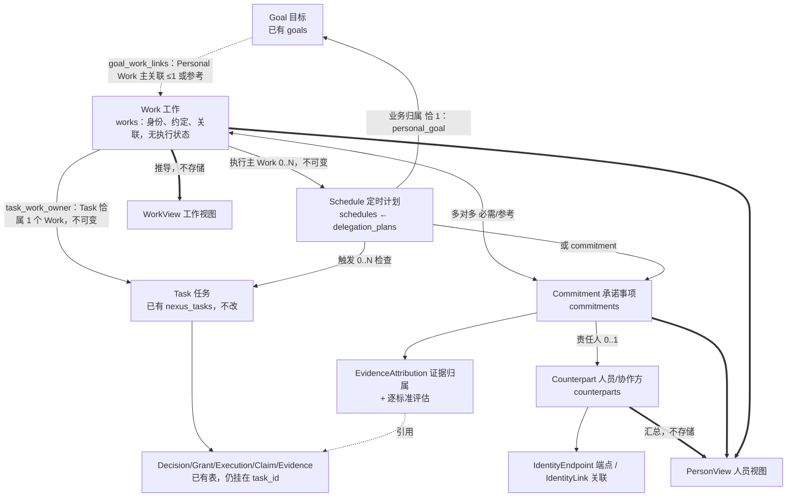
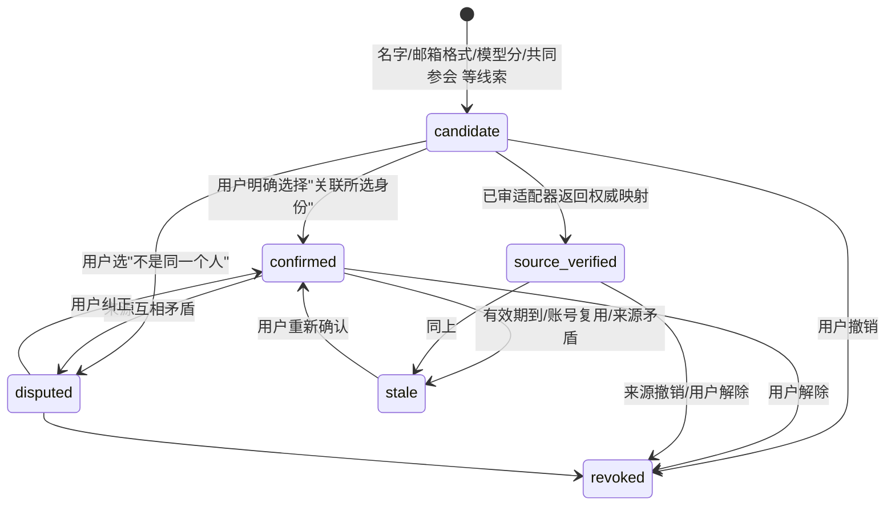
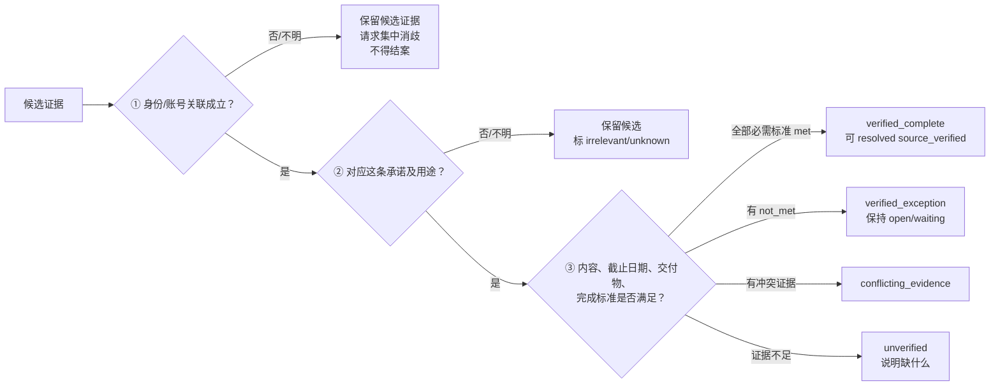

# Nexus Agent Core：按 PRD 落地的对象模型与开发设计（Work / Counterpart / Commitment / Schedule）

| 项目                             | 内容                                                                                                                                                                                                                                                                                                                                                                                                                                                    |
| -------------------------------- | ------------------------------------------------------------------------------------------------------------------------------------------------------------------------------------------------------------------------------------------------------------------------------------------------------------------------------------------------------------------------------------------------------------------------------------------------------- |
| 文档位置                         | `extensions/nexus-agent-core/docs/implement/`（此后的实现类文档都放这里；已有文档不迁移）                                                                                                                                                                                                                                                                                                                                                               |
| 依据                             | `extensions/nexus-agent-core/docs/prd/NEXUS_AI_PRD.md` **v1.86**（正文与数据模型附录 D / E 的不变量 INV-01–INV-34）；另对照了 `docs/prd/design/` 下五个 HTML 原型（工作、人员、目标、资料库、状态）。起草基线是 v1.57（2026-10-28），到 v1.86 的逐项对齐记录见 `extensions/nexus-agent-core/docs/prd/NEXUS_AI_PRD_CHANGE_LOG.md`。重点是 §3.1 核心对象及归属，另读了 §0.4 术语、§4.1 导航与 WK / PV、NX-03 / NX-04 / NX-05 / NX-14、§8.1、§10.2 / §10.3 |
| 前提                             | 之前在插件里完成的是没有 PRD 时按大体功能做的版本（事项、决策授权、声明证据、偏好、回检、文件柜、目标）；本文把它们对齐到 PRD 的对象模型，并新增 Work、Counterpart、Commitment、Schedule                                                                                                                                                                                                                                                                |
| 日期                             | 2026-10-28 起草；2026-11-02 对齐到 PRD v1.86                                                                                                                                                                                                                                                                                                                                                                                                            |
| 状态                             | 设计稿，待评审；未开始写代码。**正文已对齐 PRD v1.86，是当前的实现方案**；仍待需求方拍板的问题见 §14 与附录 E                                                                                                                                                                                                                                                                                                                                           |
| 已确认的决定（2026-10-28，用户） | ① 现有事项保留为 Task，上面新增 Work；② 首批范围含 Work + 工作视图、Counterpart + 人员视图、Commitment、Schedule；③ Commitment 的完成判定把"来源自动核验"整套写全（第一版实现里没有外部来源，见 §8）                                                                                                                                                                                                                                                    |

## 0. 先读这一节

### 0.0 本文的状态与阅读方式

本文以 PRD v1.86 为准。起草时的基线是 v1.57，两者之间的差异已经逐条并入正文相应章节，变更记录单独放在与 PRD 同目录的 `docs/prd/NEXUS_AI_PRD_CHANGE_LOG.md`（本文不再保留“差异附录”）。几点说明：

- **待决事项**集中在两处：§14（需要需求方在写代码前拍板的 Q-1…Q-n，每条带建议默认值）和附录 E（对照 PRD 与 HTML 原型发现的、需要需求方澄清的问题 R-xx）。带“待 R-xx”的地方，意思是按括号里的默认值先做，需求方改了再调。
- **`user_accept`（用户验收）是本文自造的标准类型，不是 PRD 概念**，PRD 只在某些约定里说“需用户验收时等待该决定”。它在 §4.4、§5.2、§6、§13 和附录 C 里出现，是否保留取决于附录 E 的 R-03。
- **HTML 原型**（`docs/prd/design/`）的逐页对照记录在附录 E.5 / E.6 / E.9 / E.10；原型与 PRD 字面不一致的地方，本文默认取原型的交互、PRD 的数据语义，并在对应 R-xx 里写明。

### 0.1 一句话

PRD 把"用户要的一件事"拆成四层：**Work**（要什么结果）→ **Task**（助手执行的一次限定请求）→ Run / Action（一次尝试、一步操作），旁边还有两条独立的线：**Commitment**（某个人答应交付什么，带标准、期限、证据）和 **Schedule**（已确认的定时检查）。**Counterpart（人员 / 协作方）** 是被委派、负责或参与的真实的人。前台只有两个入口：**工作**按"事"看，**人员**按"人"看，两者读的是同一批记录。

### 0.2 现有实现和 PRD 最大的差别

我们现在的"事项"（`nexus_tasks`，界面上的"任务"页）其实是 PRD 里 **Work 和 Task 的合体**：它跨会话、有标题和目标、给用户看，决策、授权、声明、回检都挂在它下面。PRD 要求把它们分开：Work 不拥有执行状态，只保存"委托的结果、约定和关联"；它的状态由 Task、Commitment、Schedule 推导出来，并且"Task 全部完成不等于 Work 完成"。

处理办法（已确认）：**`nexus_tasks` 保留为 PRD 的 Task，一行不改；在它上面新增 `works`**。老事项迁移时每个自动包一个 Work。界面上的"事项"页改成"工作"页，列的是 Work；Task 的详情（步骤、决策、声明）放进工作详情里。这样决策、授权、声明、回检这些已发布、已验收的表都不动。

### 0.3 本文做什么、不做什么

做：对象清单与映射（§2）、新旧命名（§3）、全部新表与约束（§4）、Work 状态推导（§5）、Commitment（§6）、Counterpart 与身份（§7）、来源自动核验（§8）、人员视图（§9）、接口（§10）、控制台（§11）、迁移与兼容（§12）、分期与验收（§13）、待决问题（§14）。

不做：PRD 里和对象模型无关的大块（连接器与来源准入 EA、文档理解 DU、批次审批 AP、邮件操作 OP、Channel 等）。本文只写它们和这几个对象的**接口**，实现另立文档。

### 0.4 最重要的十条设计规则

1. **Work 是实体，不是状态机。** 没有可手动赋值的"执行状态"字段；展示状态是纯函数 `deriveWorkState()` 的输出（§5）。
2. **Task 恰属一个创建后不变的 Work，Commitment 与 Work 多对多，Schedule 有一个创建后不变的执行主 Work 和一个业务归属（Goal / Commitment / Work）。** 主归属只写在 `task_work_owner`，`work_links` 里没有主归属；同一 Commitment 至多一个 accepted 方案。由写入层的唯一索引和事务内校验强制，不靠前台（§4.2）。
3. **完成不跨层赋值。** Task completed、Commitment resolved、Schedule ended 互相不改写；手动结案不等于核验完成（`resolution_basis`）。
4. **人员不是通讯录。** `counterpart_id` 是稳定主键，姓名、邮箱、IM 只是带来源的关联；同名不合并；没有确认的关联不参与自动归属（§7）。
5. **Commitment 的责任人不是 Task 的执行者。** "帮我盯住李明周三交报价表"：Work = 跟进这次交付；李明 = Counterpart；交报价表 = Commitment；检查邮件 / 发提醒 = Task。不把人的待办记成 PA 的 Task，也不把"提醒已发"当对方完成。
6. **关系不授权。** 岗位、下属、counterpart 关联都不产生访问权、收件人权限或发送授权；外发仍走现有决策 / 授权（Stage 2）。
7. **查看人员 = 按人汇总同一批记录。** 不建员工账号、共享看板或绩效系统；"由其负责"和"与其相关"分开；同一 Commitment 被多个 Work 引用只算一次。
8. **所有写入带 `owner_id`、版本号，向前兼容。** 已发布表不改，只新增表（沿用现有纪律）；新表全部 `STRICT`。
9. **Agent 能写的只有"记录用户说的话"。** Agent 不能确认身份、不能把委派写成"对方已接受"（除非给出依据）、不能结案或取消承诺、不能暂停或停止工作——这些是用户在控制台（或用户明确说出后由服务端审计）才能做的事。
10. **每个新能力一个独立开关，默认关。** `worksEnabled`、`counterpartsEnabled`、`commitmentsEnabled`、`schedulesEnabled`，依赖关系见 §12.4。

## 1. 整体结构：谁依赖谁



读法：实线是"归属 / 关联"，虚线是"引用"，粗线是"只读推导"。**WorkView 和 PersonView 都不落表**（第一版）：每次从权威记录算出来。已有的决策、授权、执行、声明、证据全部仍挂在 `task_id` 上，不改一个字。

三条依赖方向（防止循环）：

- 下层不认识上层：`nexus_tasks` 及它下面的表不知道 Work、Commitment、Schedule 的存在；关联全部放在新表里。
- `works` 不存状态；`commitments` 不存"工作是否完成"；`schedules` 不存"承诺是否履行"。
- 新代码读已有代码只经过各自的 ledger 接口（`task-query`、`claim-ledger`、`watch-ledger`、`goal-read-ledger`），不直接 SQL 读别人的表。

## 2. PRD 对象与现有实现的映射

"处理"一列只用四个词：**保留**（不改，直接复用）、**新增**（新表和新模块）、**适配**（旧表不改，加视图或转换函数）、**暂缓**（本批不做，留接口）。

| PRD 对象（§3.1 / §10.2）   | 现有实现                                                                                         | 差距                                                                          | 处理                                                                                                                                                                                                                                    |
| -------------------------- | ------------------------------------------------------------------------------------------------ | ----------------------------------------------------------------------------- | --------------------------------------------------------------------------------------------------------------------------------------------------------------------------------------------------------------------------------------- |
| Work                       | 没有；`nexus_tasks` 同时承担"一件事"和"一次执行"                                                 | 缺稳定的结果身份、约定版本、关联、达成 / 结束事实、前置、拆合沿袭、工作级控制 | **新增** `works` + `work_versions` + `task_work_owner` + `work_links` + `work_events` + `work_lineage` + `work_outcome_events` + `work_terminal_events` + `work_prerequisites` + `work_controls`；老事项按 1:1 自动包一个 Work（§12.2） |
| WorkView                   | 任务列表里的 `status` 过滤                                                                       | 缺 WK-02 五类主状态、"其他步骤进行中"、尚未安排跟进等推导                     | **新增** `deriveWorkState()`（纯函数）+ `work-view` 查询（§5）                                                                                                                                                                          |
| Context                    | `nexus_tasks.entities_json`、会话 key；没有模式 / 客户 / 项目标签                                | 缺 Personal / Executive 与客户项目标签                                        | **暂缓** ContextProfile 表：`works` / `work_versions` / `commitments` 各存必填的 `context_mode` 与语义版本，客户 / 项目标签先用 `context_label`（INV-04）                                                                               |
| Goal                       | `goals`、`goal_entries`、`goal_links`（kind=task / vault_file / preference / watch）、指标、回看 | Goal→Task 是直接关联，PRD 是 Goal→Work（`GoalWorkLink`，Personal 专属）       | **适配**：`goal_work_links` 为唯一写源；`goal_links(kind=task)` 退化为兼容影子（§4.2.3）；`goals` 已满足一层子目标、无 `paused`（INV-06）                                                                                               |
| Decision（用户确认的选择） | 无同名对象；`decisions` 表是**审批决定**（动作授权）                                             | 名字相同、含义不同                                                            | 审批 `decisions` **保留**；PRD Decision 记录 **暂缓**（`commitments.decision_ref` 留空位，§14 Q4）                                                                                                                                      |
| Counterpart                | 没有；`entities_json` 里有零散人名                                                               | 缺稳定 ID、自身份、端点、关联、参与人角色、关系                               | **新增** `counterparts` + `owner_identity` + `counterpart_names` / `relations` / `endpoints` / `identity_links` + 两张参与人链接表（§4.3、§7）                                                                                          |
| Commitment                 | 没有；`claims`（声明）是"某个事实是否成立"，不是"某人答应交付"                                   | 缺责任人、责任版本、标准、期限、沟通与接受、生命周期、独立核验、证据归属      | **新增** `commitments` + 责任版本快照 + 事件 + 合同 / 评估 + 证据归属（§4.4、§6）；`claims` 保留，只作为 Task 内部的完成门槛                                                                                                            |
| Task                       | `nexus_tasks` + `nexus_task_steps` + `nexus_task_sessions`                                       | 缺主 Work 关联、PRD §8.1 十个执行状态、来源 Schedule / 触发键                 | **保留** 并 **适配**：`taskPhase()` 把现有 11 个 status 映射成 §8.1 状态（§5.1）；主 Work 走 `task_work_owner`；`task_ext` 补"部分完成 / 阻塞 / 后继"标记                                                                               |
| Run                        | 没有独立表；`action_executions`、`run_triggers` 近似                                             | 缺"每次尝试"的统一记录                                                        | **适配**：Run 视为 `run_triggers` + `action_executions` 的组合读取；本批不新建表                                                                                                                                                        |
| Schedule                   | `watches`（只服务 Task / claim 的回检）+ 宿主 cron job；Goal 回看周期是 `goal_review_plans`      | 缺方案、执行主 Work 与业务归属、`once`、占槽、覆盖状态                        | **新增** `schedules` + `schedule_triggers` + `delegation_plans` + `goal_briefing_policies`；`watches` 作为其执行器保留（§4.5）；Goal 回看提醒 **保留**，不并入                                                                          |
| Specialist subtask         | 无                                                                                               | —                                                                             | **暂缓**                                                                                                                                                                                                                                |
| Deliverable                | `vault_files` / `vault_versions` / `vault_links`                                                 | 缺"验证后"标记与 Work 关联                                                    | **适配**：Work 经 `work_links(target_kind='artifact')` 引用文件版本；验证标记沿用现有 `vault_*` 的 kind / 状态；Deliverable 表本身 **暂缓**                                                                                             |
| OutcomeContract            | `nexus_task_completion_claims`（完成门槛）+ `goal_json`                                          | 缺模板、版本、逐标准评估                                                      | **新增（最小版）**：`outcome_contract_versions`（Work 与 Commitment 各自引用）+ `criterion_assessments`；引用 Commitment 的标准复用其唯一当前 `commitment_assessments`，Work 不另判（§4.4）；模板写在代码里                             |
| EvidenceAttribution        | `evidence`、`claim_evidence_links`                                                               | 缺主体 / 端点 / 映射版本 / 三步判定                                           | **新增** `evidence_attributions`，引用已有 `evidence.id`（§8）                                                                                                                                                                          |
| AttentionItem（待处理）    | 无统一模型；各页自己算                                                                           | —                                                                             | **暂缓**：工作页的"待你处理"由 WorkView 直接给出                                                                                                                                                                                        |
| DelegationPlan             | 无                                                                                               | 缺跟进方案草案、接受 / 终止规则、有界收尾                                     | **新增** `delegation_plans`（`plan_owner_type` = commitment / goal / work；draft → accepted → ended / revoked；同一 Commitment 至多一个 accepted；CD-03 交接、CD-04 有界收尾字段，§4.5、§6.4）                                          |
| TaskControl                | 无；`nexus_task_update` 可直接改状态                                                             | 缺暂停 / 恢复 / 停止的范围化、可叠加控制                                      | **新增** `work_controls`（§4.2.8）                                                                                                                                                                                                      |
| PersonView                 | 无                                                                                               | —                                                                             | **新增** 查询（§9），不落表                                                                                                                                                                                                             |

## 3. 命名与分层纪律（在现有纪律上增补）

沿用：已发布的表只加不改；新表全部 `STRICT`；所有表带 `owner_id`（目前恒为 `"local"` 占位）；写入走 ledger，ledger 在一个事务里完成"校验 + 写入 + 事件"。

新增约定：

1. **表名。** 属于 Task 聚合的表以 `nexus_task` 开头（已有）；本批新表不带 `nexus_` 前缀，按"一个概念一组前缀"：`work*`、`counterpart*`、`identity_*`、`commitment*`、`schedule*`。没有 `work_` 前缀的例外：`task_work_owner`、`goal_work_links`（属 Goal 侧）、`evidence_attributions`、`criterion_assessments`、`outcome_contract_versions`、`delegation_plans`、`task_ext`、`store_flags`。
2. **目录。** 代码按概念分目录：`src/work/`（service、derive、view、backfill）、`src/commitment/`、`src/counterpart/`、`src/schedule/`；存储层放 `src/store/` 下 `work-ledger.ts`、`commitment-ledger.ts`、`counterpart-ledger.ts`、`schedule-ledger.ts`（沿用 `*-ledger.ts`）；RPC 在 `src/*-rpc.ts`；工具在 `src/tools/`。
3. **接口命名。** RPC：`nexus.work.*`、`nexus.person.*`（人员视图）、`nexus.counterpart.*`、`nexus.commitment.*`、`nexus.schedule.*`、`nexus.delegation.*`。Agent 工具：`nexus_work_*`、`nexus_commitment_*`、`nexus_counterpart_*`、`nexus_schedule_*`，与目标工具一样登记为 `catalogMode: "direct-only"`（它们是直接工具，不出现在 exec / 代码模式里，提示里要说明，见 G4 试用教训）。
4. **模型可见文字全英文**，界面文字走 `i18n.ts` 中英两套（沿用 `i18n.test.ts` 的检查）。"工作 / 人员 / 承诺事项 / 跟进"为中文界面的固定词；英文界面用 Work / People / Commitment / Follow-up。
5. **权威来源只有一个。** 每个事实只存一处：Task 的主归属只在 `task_work_owner`，Goal 与 Work 的关联只在 `goal_work_links`（`goal_links` 里的 Task 行是兼容影子，须对账）；Commitment 的责任人只在 `commitments.responsible_counterpart_id`，参与人表里没有责任人副本。影子数据必须有“以谁为准”的声明和对账检查（§4.2.3、§12.6）。
6. **删除与清理。** 新表要接入现有 purge 协议（`purge_runs` / 目标的 `goal_purge_*`）：删除 Task 时处理其 Work 链接；删除 Work 时先处置活动 Task / Schedule（WK-04）；删除 Counterpart 前列出受影响承诺（PV-03）。具体清单见 §12.5。

## 4. 数据模型

### 4.1 通用约定

- 主键 `(owner_id, id)`，与目标表一致；`id` 由内核 `newId()` 生成，带类型前缀便于排查（`w_` Work、`cp_` Counterpart、`cm_` Commitment、`sc_` Schedule 等，实际前缀以编码时与内核统一为准）。
- 带 `revision INTEGER NOT NULL`（乐观并发）；有对外可见变化的表另带 `*_events` 追加表，历史永不改写。
- 时间一律 UTC 毫秒整数；需要"约定的本地时间"的字段另存 IANA 时区（`due_tz`、`tz`）。
- 新表指向已发布表（`nexus_tasks`、`watches`、`evidence` 等）的列**不加外键**，改为"无外键 + 写入时校验"。理由与 `goal_links` 一致：已发布表不能改，且工作 / 目标要能比任务活得久。凡这类指针列，ledger 都在同一事务内校验目标存在且同 `owner_id`，并有对账检查（§12.6）。新表之间的引用（如 `work_links.work_id → works`）照常用外键。
- 状态列用 `CHECK (... IN (...))`；"互相蕴含"的约束（如 `status='ended'` 必须有 `ended_at`）也写成 `CHECK`，避免靠前台。
- 迁移文件：`stage7-0001-works`、`stage7-0002-counterparts`、`stage7-0003-commitments`、`stage7-0004-schedules`（SQL 常量写在 `src/store/schema.ts` 末尾，并入 `MIGRATIONS`）。回填是代码任务不是 SQL（§12.2）。

### 4.2 Work 组（stage7-0001）

#### 4.2.1 `works` 与 `work_versions`

```sql
CREATE TABLE works (
  owner_id TEXT NOT NULL, id TEXT NOT NULL,
  title TEXT NOT NULL,                  -- 用户语言的短标题
  request_text TEXT,                    -- 用户的原话（"我要的结果"）；迁移的老事项取 goal_json 里的目标文字
  outcome_text TEXT,                    -- 当前约定的结果一句话；改动产生新的 work_versions 行并记 work_events
  original_result_id TEXT NOT NULL,     -- 原请求结果的稳定 ID：CP 指标分母去重；拆合 / 接手后仍指向原结果（INV-32）
  context_mode TEXT NOT NULL,           -- personal|executive：每个 Work 恰有一个主用途（INV-04）；Executive Work 不得有任何 Goal 边（INV-05）
  context_label TEXT,                   -- 客户 / 项目标签，仅用于筛选；不授权
  current_work_version INTEGER NOT NULL DEFAULT 1,   -- 指向 work_versions 的当前版本，版本检查更新
  origin TEXT NOT NULL,                 -- migrated|user|agent
  request_ref TEXT,                     -- 去重：来源消息 id / 分句哈希（WK-01 重投不重复创建）
  lifecycle TEXT NOT NULL DEFAULT 'live',   -- live|archived|deleted|purging
  hidden INTEGER NOT NULL DEFAULT 0,    -- 仅改变可见性，不暂停任何后台工作（WK-04）
  revision INTEGER NOT NULL,
  created_at INTEGER NOT NULL, updated_at INTEGER NOT NULL,
  archived_at INTEGER, deleted_at INTEGER,
  PRIMARY KEY (owner_id, id),
  CHECK (context_mode IN ('personal','executive')),
  CHECK (origin IN ('migrated','user','agent')),
  CHECK (lifecycle IN ('live','archived','deleted','purging')),
  CHECK (hidden IN (0,1)),
  CHECK ((lifecycle = 'archived') = (archived_at IS NOT NULL) OR lifecycle IN ('deleted','purging')),
  CHECK ((lifecycle IN ('deleted','purging')) = (deleted_at IS NOT NULL))
) STRICT;
CREATE UNIQUE INDEX works_request ON works(owner_id, request_ref) WHERE request_ref IS NOT NULL;
CREATE INDEX works_list ON works(owner_id, lifecycle, updated_at DESC);

CREATE TABLE work_versions (            -- 不可变修订：只追加，不改写（INV-04、INV-21）
  owner_id TEXT NOT NULL, work_id TEXT NOT NULL, work_version INTEGER NOT NULL,
  context_mode TEXT NOT NULL,           -- 本版本的主用途；必须与 TaskPlanVersion 绑定的一致
  context_semantic_version INTEGER NOT NULL DEFAULT 1,
  contract_version INTEGER NOT NULL,    -- 结果约定版本（outcome_contract_versions）
  outcome_text TEXT,
  diff_json TEXT,                       -- 与上一版本的差异
  accepted_basis TEXT NOT NULL,         -- 谁、依据什么接受了这次修订（用户原话 / 决策引用）
  created_at INTEGER NOT NULL,
  PRIMARY KEY (owner_id, work_id, work_version),
  CHECK (context_mode IN ('personal','executive')),
  FOREIGN KEY (owner_id, work_id) REFERENCES works(owner_id, id)
) STRICT;
```

**没有任何执行状态列，也没有 `primary_goal_id`。** `lifecycle` 只管 Work 这条记录本身的可见性；Work 的 Goal 关联只存在于 `goal_work_links`（§4.2.3），`works` 里没有 `goal_id`，页面上的"所属目标"是读取时的只读投影（INV-05）。

**版本化只做最小版**（待决问题 Q-A 的默认值）：`work_versions` 记录每次对结果、结果约定或主用途的修订；`TaskPlanVersion` 和 `WorkTaskCompatibility` **本批不建表**，Task 现有计划不版本化。Work 修订时，对所有未终止的主归属 Task 在 `work_events` 里写一条 `version_changed`（payload 列出受影响 Task），由 `deriveWorkState()` 把这些 Task 视为"待确认兼容"（§5.2 的 `compat_pending`）；旧 Run 和回执仍绑定它们产生时的版本，不被改写。真实 Provider 接入前再补完整的三张表，补的时候只加表、不改 `work_versions` 的列。

#### 4.2.2 `task_work_owner` 与 `work_links`（WorkObjectLink）

**Task 的主归属是唯一写源，创建后不变**（INV-02、INV-07）。`nexus_tasks` 本身一行不改，主归属放在一张一对一的新表里：

```sql
CREATE TABLE task_work_owner (          -- 每个 Task 恰一行；创建事务写入，之后不允许 UPDATE / DELETE（purge 除外）
  owner_id TEXT NOT NULL, task_id TEXT NOT NULL, work_id TEXT NOT NULL,
  created_at INTEGER NOT NULL,
  PRIMARY KEY (owner_id, task_id),
  FOREIGN KEY (owner_id, work_id) REFERENCES works(owner_id, id)
) STRICT;
CREATE INDEX task_work_owner_work ON task_work_owner(owner_id, work_id);
-- BEFORE UPDATE / BEFORE DELETE 触发器：RAISE(ABORT, 'INV-02 task owner immutable')，purge 事务通过专用标志放行
```

- Task 没有父子树；拆分与合并 Work 靠**后继 Task**（`task_ext.supersedes_task_id`）和下面的输出依赖引用，不转移主归属。
- "Work 的主归属 Task 有哪些"= 读 `task_work_owner`；`work_links` 里**不再有** `primary` 角色，也不存主归属。
- 创建 Task 的事务必须同时写 `task_work_owner`（"至少一条"由事务保证，"至多一条"由主键保证）。

```sql
CREATE TABLE work_links (               -- WorkObjectLink：Work 与其他对象的类型化关联
  owner_id TEXT NOT NULL, id TEXT NOT NULL, work_id TEXT NOT NULL,
  role TEXT NOT NULL,                   -- required|reference|coordination|handoff_result|output_dependency
  target_kind TEXT NOT NULL,            -- work|commitment|task_output|artifact
  target_id TEXT NOT NULL,              -- Work / Commitment / Task / 成果版本（本批 artifact 即 vault 文件版本）
  task_plan_version INTEGER,            -- output_dependency：固定所依赖的计划版本
  output_ref TEXT,                      -- output_dependency：固定具体输出及版本
  original_result_id TEXT,              -- handoff_result：被接手的原结果（CP 分母去重）
  standard_scope_json TEXT,             -- 承接 / 消费的标准范围
  purpose TEXT,                         -- 引用的限定用途（一句话）
  accept_tx_ref TEXT,                   -- 接受这条关联的事务 / 请求引用
  link_version INTEGER NOT NULL DEFAULT 1,
  created_at INTEGER NOT NULL, ended_at INTEGER, end_basis TEXT,    -- 解除只设 ended_at，不删行
  PRIMARY KEY (owner_id, id),
  CHECK (role IN ('required','reference','coordination','handoff_result','output_dependency')),
  CHECK (target_kind IN ('work','commitment','task_output','artifact')),
  CHECK (role NOT IN ('coordination','handoff_result') OR target_kind = 'work'),
  CHECK (role <> 'output_dependency' OR (target_kind = 'task_output' AND task_plan_version IS NOT NULL AND output_ref IS NOT NULL)),
  CHECK (role NOT IN ('required','reference') OR target_kind IN ('commitment','artifact')),
  CHECK (role <> 'handoff_result' OR original_result_id IS NOT NULL),
  CHECK (target_kind <> 'work' OR target_id <> work_id),
  FOREIGN KEY (owner_id, work_id) REFERENCES works(owner_id, id)
) STRICT;
-- 同一 Work 对同一目标、同一角色至多一条未解除的关联
CREATE UNIQUE INDEX work_links_pair ON work_links(owner_id, work_id, role, target_kind, target_id) WHERE ended_at IS NULL;
CREATE INDEX work_links_target ON work_links(owner_id, target_kind, target_id) WHERE ended_at IS NULL;
```

各关联的合法组合（写入层按此校验）：

| 关联                        | `role`                                             | 数量规则                                       | 谁能写                                                         |
| --------------------------- | -------------------------------------------------- | ---------------------------------------------- | -------------------------------------------------------------- |
| Work→Commitment             | `required`（本结果必需）或 `reference`（仅供参考） | 多对多，一条 Commitment 可被多个 Work 引用     | 创建 Commitment 时的 Work、用户                                |
| Work→成果版本               | `required` 或 `reference`                          | 不限                                           | 用户或 Agent（沿用 `goal_links` 的文件校验）                   |
| Work→另一件 Work            | `coordination`（协同）或 `handoff_result`（接手）  | 接手另存 `original_result_id` 和承接的标准范围 | 接手事务（CD-03）、用户                                        |
| Work→其他 Work 的 Task 输出 | `output_dependency`                                | 固定 `task_plan_version` 与 `output_ref`       | 用户或 Agent（只能建依赖，不能转移任何 Task 的主归属，INV-09） |

- **引用不迁移所有权，也不迁移控制**（INV-09）。引用方失去覆盖时，由 `deriveWorkState()` 在读取时发现缺口，不暗中保活或接管（§10.4）。
- **解除最后一条必要关联前，必须已先停止或替换依赖**（INV-11、INV-33）：`work_links` 与 `goal_work_links` 的解除写入都要先调 §6.5 的级联检查；拒绝时返回受影响的计划和检查，取消解除则保持原计划。
- 偏好不再作为 `work_links` 的目标（PRD 的 WorkObjectLink 没有这一类）；工作详情里的"偏好"区块按上下文标签读取现有偏好库，不存关联。

#### 4.2.3 Goal 关联：`goal_work_links` 与 `goal_links` 影子

**Goal 与 Work 的关联只有一个写源：`goal_work_links`**（INV-05、INV-06）。

```sql
CREATE TABLE goal_work_links (
  owner_id TEXT NOT NULL, id TEXT NOT NULL, goal_id TEXT NOT NULL, work_id TEXT NOT NULL,
  role TEXT NOT NULL,                   -- primary|reference
  work_version INTEGER NOT NULL,        -- 建立关联时的有效 Work 版本
  created_at INTEGER NOT NULL, ended_at INTEGER, end_basis TEXT,     -- 解除依据；历史保留
  PRIMARY KEY (owner_id, id),
  CHECK (role IN ('primary','reference')),
  FOREIGN KEY (owner_id, goal_id) REFERENCES goals(owner_id, id),
  FOREIGN KEY (owner_id, work_id) REFERENCES works(owner_id, id)
) STRICT;
-- Personal Work 至多一个未解除的 primary
CREATE UNIQUE INDEX goal_work_primary_once ON goal_work_links(owner_id, work_id) WHERE role = 'primary' AND ended_at IS NULL;
CREATE UNIQUE INDEX goal_work_pair ON goal_work_links(owner_id, goal_id, work_id) WHERE ended_at IS NULL;
```

- **写入校验（事务内）**：`works.context_mode` 必须是 `personal`，Executive Work 不得有任何 Goal 边；Goal 必须未删除；解除前走级联检查（§6.5、§10.4）。
- **`goals` 的现有实现满足 INV-06**：只有 `active / completed`（`proposed` 另计）、没有 `paused`；子目标只嵌套一层，子目标下不能再有；父子无环。新表不改这些约束。
- **以谁为准**：`goal_work_links` 是权威，`Work` 的 `goal_id` 只是读取时投影。现有 `goal_links(kind='task')` 的"一个 Task 至多属于一个 Goal"唯一索引保留，变成**兼容影子**：`worksEnabled` 打开后，把 Task 挂到目标实际是"给这个 Task 的主归属 Work 建 / 换一条 `primary` 的 `goal_work_links`"，同一事务里同步写 / 删 `goal_links` 影子行，供没升级的读取方（目标指标、目标详情）继续用。
- 一个 Work 有多个 Task 时，影子只写每个 Task 一行；Goal 页的"关联事项数"改读 Work 数（`goal_work_links` 的 `primary` 去重），避免一个 Work 三个 Task 被数成三件事。
- 对账检查：`goal_links(kind='task')` 的 `(goal_id, task 的主归属 Work 的 primary Goal)` 必须一致，不一致由 `work.integrity` 报告（§12.6），不自动修。
- Goal 完成或停止追求时的处理见 §6.5 级联矩阵（NX-03）：Work 不因目标完成而改变；只有"已接受的停止条件明确包含此目标事件"的计划才按约结束，其余只提示、由用户选。Goal 的指标（G2）里"关联任务数 / 已完成数"的口径改为"关联 Work 数 / 已完成 Work 数"，在 W6 同步（§13）。

#### 4.2.4 `work_events` 与 `work_lineage`

```sql
CREATE TABLE work_events (             -- 追加的时间线；历史不改写。结果达成与结束的权威事实在 4.2.5、4.2.6，这里只记引用
  owner_id TEXT NOT NULL, id TEXT NOT NULL, work_id TEXT NOT NULL, seq INTEGER NOT NULL,
  kind TEXT NOT NULL,
  actor TEXT NOT NULL,                 -- user|agent|system
  payload_json TEXT NOT NULL,          -- 小而结构化；不放原文大段内容
  created_at INTEGER NOT NULL,
  PRIMARY KEY (owner_id, id), UNIQUE (owner_id, work_id, seq),
  CHECK (actor IN ('user','agent','system')),
  CHECK (kind IN (
    'created','retitled','outcome_changed','version_changed','goal_set','goal_cleared',
    'link_added','link_ended','archived','unarchived','deleted',
    'control_applied','control_released',
    'outcome_recorded',                -- 引用 work_outcome_events 的一条
    'terminal_recorded',               -- 引用 work_terminal_events 的一条
    'prerequisite_changed',            -- 引用 work_prerequisites
    'handoff_out','handoff_in',        -- 接手（CD-03）的两端
    'merged_into','split_from'))
  , FOREIGN KEY (owner_id, work_id) REFERENCES works(owner_id, id)
) STRICT;

CREATE TABLE work_lineage (            -- 拆合 / 接手沿袭：保留原请求分母，不丢历史
  owner_id TEXT NOT NULL, id TEXT NOT NULL,
  from_work_id TEXT NOT NULL, to_work_id TEXT NOT NULL,
  kind TEXT NOT NULL,                  -- merge|split|alias|handoff
  original_result_id TEXT NOT NULL,    -- 被承接的原结果；CP 分母只计一次
  carried_in_usage_json TEXT,          -- 沿袭的额度与 carried_in_usage：只记一次（INV-23、INV-26）
  reason TEXT, created_at INTEGER NOT NULL,
  PRIMARY KEY (owner_id, id),
  CHECK (kind IN ('merge','split','alias','handoff')), CHECK (from_work_id <> to_work_id)
) STRICT;
```

`work_lineage` 只描述 **Work 之间**的沿袭，不改任何 Task 的主归属（INV-02）：Task 的拆合靠后继 Task，接手靠 `handoff_result` 关联。`stopped_before_completion` 等结束原因不再放在 `work_events`，见 4.2.6。

#### 4.2.5 `work_outcome_events`（结果达成事实，INV-19、INV-32）

"已完成"必须有有效的 `achieved` / `reinstated` 事件；评估变化、撤回都追加新事件，不改写旧事件。

```sql
CREATE TABLE work_outcome_events (
  owner_id TEXT NOT NULL, id TEXT NOT NULL,       -- id 由 (original_result_id, work_id, 约定 / 执行范围, 转移序号) 确定性生成
  work_id TEXT NOT NULL, original_result_id TEXT NOT NULL,
  work_version INTEGER NOT NULL, contract_version INTEGER NOT NULL, scope_ref TEXT,    -- 约定与执行范围
  event_type TEXT NOT NULL,            -- achieved|withdrawn|reinstated|superseded
  basis TEXT NOT NULL DEFAULT 'evidence',        -- evidence|migration（迁移出的完成，CP 指标排除，见 §12.2）
  assessment_refs_json TEXT NOT NULL,  -- 所引 Assessment ID / 版本及逐标准结论；只存引用和最小快照，不复制履约裁决
  previous_event_id TEXT,              -- 前一有效事件；compare-and-set
  reason TEXT, recorded_at INTEGER NOT NULL,
  business_fulfilled_at INTEGER,       -- 可证的业务履约时间；CP 首次达成耗时据此，不取"客户端第一次看见"
  notify_key TEXT, outbox_ref TEXT,    -- 达成通知去重键；与事件同一事务写 Outbox
  stat_correction_ref TEXT,
  PRIMARY KEY (owner_id, id),
  CHECK (event_type IN ('achieved','withdrawn','reinstated','superseded')),
  CHECK (basis IN ('evidence','migration')),
  CHECK (previous_event_id IS NOT NULL OR event_type = 'achieved'),     -- 只有链上第一条可以没有前驱，且必须是 achieved
  FOREIGN KEY (owner_id, work_id) REFERENCES works(owner_id, id)
) STRICT;
CREATE UNIQUE INDEX work_outcome_chain ON work_outcome_events(owner_id, work_id, original_result_id, COALESCE(previous_event_id,''));
CREATE UNIQUE INDEX work_outcome_notify ON work_outcome_events(owner_id, notify_key) WHERE notify_key IS NOT NULL;
```

- **有效事件指针、`first_achieved_at`、`current_completed_at` 都从事件链投影**：`first_achieved_at` 固定为第一次 `achieved` 的 `recorded_at`；撤回（`withdrawn` / `superseded`）后 `current_completed_at` 立即清空，`reinstated` 再设。链上"前一有效事件"的唯一索引保证并发时只有一个后继胜出，输家重读后重试。
- **达成与结果通知同一事务**：写 `achieved` / `reinstated` 事件时，在同一事务里写 Outbox 行（`notify_key` 去重）；通知不重复、也不丢。
- Work 的停止快照优先：Work 已有未被 `reopen` 的 `work_terminal_events` 时，达成事件只能限定在停止前已可达成的范围（`scope_ref`），不能把已停止的 Work 显示为后来完成（INV-20）。

#### 4.2.6 `work_terminal_events`（结果级结束事实，INV-20）

```sql
CREATE TABLE work_terminal_events (
  owner_id TEXT NOT NULL, id TEXT NOT NULL, work_id TEXT NOT NULL,
  work_version INTEGER NOT NULL, contract_version INTEGER NOT NULL,
  criteria_snapshot_json TEXT NOT NULL,          -- 结束时的逐标准结论快照
  evidence_snapshot_json TEXT NOT NULL,          -- 结束时的证据引用快照
  result_at_close TEXT NOT NULL,       -- met_all|partial|not_met|stopped_before_completion|unknown
  reason TEXT NOT NULL,                -- stop|accept_partial|window_ended|unrecoverable
  decision_ref TEXT,                   -- 明确的用户决定或已审方案依据（reason 为 stop / accept_partial 时必填）
  stop_scope_json TEXT,                -- 所选停止范围（Task / Schedule / 方案）与继续分支检查
  inherit_scope_json TEXT,             -- 兼容后续版本时继承的范围
  recorded_at INTEGER NOT NULL,
  reopened_at INTEGER, reopen_basis TEXT, new_boundary_id TEXT,   -- reopen：明确依据和新执行边界；只允许从 NULL 设置一次
  PRIMARY KEY (owner_id, id),
  CHECK (result_at_close IN ('met_all','partial','not_met','stopped_before_completion','unknown')),
  CHECK (reason IN ('stop','accept_partial','window_ended','unrecoverable')),
  CHECK (reason NOT IN ('stop','accept_partial') OR decision_ref IS NOT NULL),
  CHECK ((reopened_at IS NULL) = (reopen_basis IS NULL)),
  FOREIGN KEY (owner_id, work_id) REFERENCES works(owner_id, id)
) STRICT;
CREATE INDEX work_terminal_open ON work_terminal_events(owner_id, work_id) WHERE reopened_at IS NULL;
```

- **没有"直接设置 Work 展示状态"的接口。**结束只能由上表的事件表达；无关元数据升版（`work_versions` 新行）不能消除原停止。
- **只停 Task，或对 Commitment 手动结案，不自动生成整件 Work 的终止事实**；用户明确选择"停止工作"或"以部分结果结束"才写。
- **停止快照优先**：另一件 Work 让共享 Commitment 后来履行，不推翻 W1 的停止，也不恢复旧任务和计划；W1 最多显示"后来履行"这一事实，快照不改。
- `reopen` 不作废旧行，而是给旧行设 `reopened_at` / `reopen_basis` / `new_boundary_id`，新的执行从新边界开始；有效终止事实 = 最近一条 `reopened_at IS NULL` 的行。

#### 4.2.7 `work_prerequisites`（工作前置事实，INV-17）

Work 自身可以有待补输入或系统前置，不必为此虚建 Task。

```sql
CREATE TABLE work_prerequisites (
  owner_id TEXT NOT NULL, id TEXT NOT NULL, work_id TEXT NOT NULL, work_version INTEGER NOT NULL,
  kind TEXT NOT NULL,                  -- input|result_confirmation|system|permission|source|reconnect_source
  reason TEXT NOT NULL,
  actor TEXT NOT NULL,                 -- user|system：谁能处理；用户可处理的前置才会让 Work 进入"待你处理"
  request_text TEXT,                   -- 准确请求；有效版本 / 有效期
  valid_until INTEGER,
  state TEXT NOT NULL DEFAULT 'pending',   -- pending|satisfied|withdrawn
  resolution_basis TEXT, resolved_at INTEGER,
  first_plan_request_id TEXT, queue_ref TEXT, lease_until INTEGER, window_json TEXT, budget_ref TEXT,   -- 首次规划的持久派发凭据，无 Task 时也可存在
  created_at INTEGER NOT NULL,
  PRIMARY KEY (owner_id, id),
  CHECK (kind IN ('input','result_confirmation','system','permission','source','reconnect_source')),
  CHECK (actor IN ('user','system')),
  CHECK (state IN ('pending','satisfied','withdrawn')),
  CHECK ((state = 'pending') = (resolved_at IS NULL)),
  FOREIGN KEY (owner_id, work_id) REFERENCES works(owner_id, id)
) STRICT;
CREATE INDEX work_prereq_open ON work_prerequisites(owner_id, work_id) WHERE state = 'pending';
```

字段确认只更新前置，**不授予任何工具权限**；待处理页的 AttentionItem 以此为权威来源，但 Work 的主状态仍只由 `deriveWorkState()` 给出，不另存。

#### 4.2.8 `work_controls`（WK-04 工作级控制，INV-22）

```sql
CREATE TABLE work_controls (
  owner_id TEXT NOT NULL, id TEXT NOT NULL, work_id TEXT NOT NULL,
  scope_kind TEXT NOT NULL,            -- work|task|run|schedule
  scope_id TEXT,                       -- scope_kind='work' 时为空
  state TEXT NOT NULL,                 -- pause_requested|paused|released
  reason TEXT, initiated_by TEXT NOT NULL,       -- user|system
  reconcile_only INTEGER NOT NULL DEFAULT 0,     -- 1：只对原 Action 做有界只读核对，不推进执行
  control_version INTEGER NOT NULL DEFAULT 1,
  created_at INTEGER NOT NULL, released_at INTEGER,
  PRIMARY KEY (owner_id, id),
  CHECK (scope_kind IN ('work','task','run','schedule')),
  CHECK (state IN ('pause_requested','paused','released')),
  CHECK (reconcile_only IN (0,1)),
  CHECK ((scope_kind = 'work') = (scope_id IS NULL)),
  CHECK ((state = 'released') = (released_at IS NOT NULL)),
  FOREIGN KEY (owner_id, work_id) REFERENCES works(owner_id, id)
) STRICT;
-- 控制可叠加：同一范围可有多条原因不同的控制；唯一性只限同一范围、同一原因
CREATE UNIQUE INDEX work_controls_open ON work_controls(owner_id, work_id, scope_kind, COALESCE(scope_id,''), COALESCE(reason,''))
  WHERE state <> 'released';
```

控制语义（WK-04 逐条落地，见 §10.4）：控制**叠加**；恢复**只解除用户所选的那条**，其余叠加的控制仍然有效。Task 层面的"挂起"通过这张表让 `nexus_task_*` 的执行入口（`before_tool_call` 门）拒绝推进，不改 `nexus_tasks.status`；`reconcile_only` 的控制只允许对原 Action 做有界只读核对。**停止跟进**不写控制行，而是按 CD-04 结束选定的方案和 Schedule（§4.5）。**停止工作**预览后：结束主归属 Schedule 和方案、对主归属 Task 调现有取消路径、写 `work_terminal_events(reason=stop)`，**不碰** Commitment。

#### 4.2.9 `task_ext`（Task 的补充标记）

```sql
CREATE TABLE task_ext (
  owner_id TEXT NOT NULL, task_id TEXT NOT NULL,
  end_kind TEXT,                       -- NULL|partial：以部分结果结束（PRD §8.1 partial）
  end_reason TEXT, ended_by TEXT,      -- user|agent|system
  blocked_reason TEXT, blocked_since INTEGER,   -- 非空即 blocked（PRD §8.1 blocked）
  supersedes_task_id TEXT,             -- 后继 Task：拆合 / 接手靠它，Task 没有父子树
  revision INTEGER NOT NULL, updated_at INTEGER NOT NULL,
  PRIMARY KEY (owner_id, task_id),
  CHECK (end_kind IS NULL OR end_kind = 'partial')
) STRICT;
```

### 4.3 Counterpart 组（stage7-0002）

#### 4.3.1 `counterparts`

```sql
CREATE TABLE counterparts (
  owner_id TEXT NOT NULL, id TEXT NOT NULL,          -- id 即 PRD 的稳定 counterpart_id
  kind TEXT NOT NULL,                  -- person|organization|team（组织 / 团队不得伪装成自然人；共享邮箱不是 Counterpart，是端点类型，见 4.3.3，INV-34）
  display_name TEXT NOT NULL,          -- 用户通常怎么称呼；不是主键，不要求唯一
  confirmation TEXT NOT NULL,          -- stated|confirmed|proposed
  origin TEXT NOT NULL,                -- user|agent|review_batch|system（system 仅用于自身份行）
  lifecycle TEXT NOT NULL DEFAULT 'live',   -- live|archived|merged|deleted
  merged_into TEXT,                    -- lifecycle='merged' 时指向保留者
  context_json TEXT,                   -- {label?: 客户 / 项目标签}；不授权
  revision INTEGER NOT NULL,
  created_at INTEGER NOT NULL, updated_at INTEGER NOT NULL, archived_at INTEGER,
  PRIMARY KEY (owner_id, id),
  CHECK (kind IN ('person','organization','team')),
  CHECK (confirmation IN ('stated','confirmed','proposed')),
  CHECK (origin IN ('user','agent','review_batch','system')),
  CHECK (lifecycle IN ('live','archived','merged','deleted')),
  CHECK ((lifecycle = 'merged') = (merged_into IS NOT NULL)),
  CHECK (origin <> 'agent' OR confirmation <> 'confirmed')      -- Agent 不能自己把人员标为"已确认"
) STRICT;
CREATE INDEX counterparts_list ON counterparts(owner_id, lifecycle, display_name);

CREATE TABLE owner_identity (          -- 自身份：每个所有者恰有一条 person 自身份（INV-01）
  owner_id TEXT NOT NULL PRIMARY KEY,
  self_counterpart_id TEXT NOT NULL UNIQUE,      -- 同一 Counterpart 至多被一个所有者作为自身份
  created_at INTEGER NOT NULL,
  FOREIGN KEY (owner_id, self_counterpart_id) REFERENCES counterparts(owner_id, id)
) STRICT;
```

**自身份。** 初始化时（`counterpartsEnabled` 打开的迁移里）为所有者建一条 `kind='person'`、`confirmation='confirmed'`、`origin='system'` 的 Counterpart，并写入 `owner_identity`；校验 `kind='person'`。"由我负责"的 Commitment 用自身份 ID 作责任人，**不得**用 `owner_id` 代替（INV-01、INV-08）；"由我负责"与"由其负责"用同一条查询规则。自身份不出现在"待确认人员"，不能被删除或合并。

`confirmation` 三值（自身份行恒为 `confirmed`）：`stated`——用户在对话里明确点了这个人（"帮我盯住李明"），由 Agent 记录并带上原话引用，可参与列表和承诺归属，但**不等于身份已确认**；`confirmed`——用户在控制台确认过这个人；`proposed`——Agent 或来源推测出的候选人，**不进入人员列表**，只在"待确认人员"分组里出现（PV-01）。身份端点另有自己的关联状态（§4.3.4），两层状态互不替代。

#### 4.3.2 名称、关系、角色

```sql
CREATE TABLE counterpart_names (       -- 称呼 / 别名；同名不合并，姓名不是主键
  owner_id TEXT NOT NULL, id TEXT NOT NULL, counterpart_id TEXT NOT NULL,
  name TEXT NOT NULL, name_kind TEXT NOT NULL,       -- display|alias|raw_mention
  source TEXT NOT NULL,                -- user_statement|review_batch|connector:<provider>
  created_at INTEGER NOT NULL, revoked_at INTEGER,
  PRIMARY KEY (owner_id, id),
  CHECK (name_kind IN ('display','alias','raw_mention')),
  FOREIGN KEY (owner_id, counterpart_id) REFERENCES counterparts(owner_id, id)
) STRICT;
CREATE INDEX counterpart_names_lookup ON counterpart_names(owner_id, name) WHERE revoked_at IS NULL;

CREATE TABLE counterpart_relations (   -- "下属 / 同事 / 客户 / 供应商"：只来自用户明确陈述或获准来源，不由往来频率推断
  owner_id TEXT NOT NULL, id TEXT NOT NULL, counterpart_id TEXT NOT NULL,
  relation TEXT NOT NULL,              -- direct_report|colleague|client|supplier|other
  scope_label TEXT,                    -- 适用的客户 / 项目；NULL 表示所有者范围内通用
  basis_text TEXT NOT NULL,            -- 用户原话或来源引用，必填
  status TEXT NOT NULL,                -- stated|revoked
  valid_from INTEGER, valid_to INTEGER,
  created_at INTEGER NOT NULL,
  PRIMARY KEY (owner_id, id),
  CHECK (relation IN ('direct_report','colleague','client','supplier','other')),
  CHECK (status IN ('stated','revoked')),
  FOREIGN KEY (owner_id, counterpart_id) REFERENCES counterparts(owner_id, id)
) STRICT;

CREATE TABLE work_participant_links (   -- 人员在某件 Work 里的角色（INV-08）
  owner_id TEXT NOT NULL, id TEXT NOT NULL, work_id TEXT NOT NULL, counterpart_id TEXT NOT NULL,
  role TEXT NOT NULL,                  -- coordinator|participant|approver|recipient
  work_version INTEGER NOT NULL,       -- 对应的 Work 版本；无关升版按差异显式延续，不复制边也不无故丢角色
  purpose TEXT, basis_text TEXT NOT NULL,        -- 用途 / 来源 / 确认依据
  status TEXT NOT NULL,                -- stated|confirmed|revoked
  valid_from INTEGER, valid_to INTEGER, created_at INTEGER NOT NULL, revoked_at INTEGER,
  PRIMARY KEY (owner_id, id),
  CHECK (role IN ('coordinator','participant','approver','recipient')),
  CHECK (status IN ('stated','confirmed','revoked')),
  FOREIGN KEY (owner_id, work_id) REFERENCES works(owner_id, id),
  FOREIGN KEY (owner_id, counterpart_id) REFERENCES counterparts(owner_id, id)
) STRICT;
CREATE UNIQUE INDEX work_participant_once ON work_participant_links(owner_id, work_id, counterpart_id, role) WHERE status <> 'revoked';

CREATE TABLE commitment_participant_links (   -- 人员在某条 Commitment 里的非责任角色
  owner_id TEXT NOT NULL, id TEXT NOT NULL, commitment_id TEXT NOT NULL, counterpart_id TEXT NOT NULL,
  role TEXT NOT NULL,                  -- participant|approver|recipient；不允许 responsible / assignee 副本
  responsibility_version INTEGER NOT NULL,
  purpose TEXT, basis_text TEXT NOT NULL,
  status TEXT NOT NULL,                -- stated|confirmed|revoked
  valid_from INTEGER, valid_to INTEGER, created_at INTEGER NOT NULL, revoked_at INTEGER,
  PRIMARY KEY (owner_id, id),
  CHECK (role IN ('participant','approver','recipient')),
  CHECK (status IN ('stated','confirmed','revoked')),
  FOREIGN KEY (owner_id, counterpart_id) REFERENCES counterparts(owner_id, id)
) STRICT;
CREATE UNIQUE INDEX commitment_participant_once ON commitment_participant_links(owner_id, commitment_id, counterpart_id, role) WHERE status <> 'revoked';
```

当前责任人一律从 `commitments.responsible_counterpart_id` 投影（§4.4.1），**不在参与人表里存副本**。审批人是业务角色，不是 PA 的批准主体；收件人不是发送授权。

角色与关系**不授权**：这些表里的任何值都不能出现在 `action_grants` / `standing_grants` 的判定里；收件人角色只是"这件事的收件人是谁"的记录，外发仍要现有决策（规则 6）。

#### 4.3.3 `counterpart_endpoints`（IdentityEndpoint）

```sql
CREATE TABLE counterpart_endpoints (
  owner_id TEXT NOT NULL, id TEXT NOT NULL,
  endpoint_type TEXT NOT NULL,         -- email|shared_mailbox|calendar|doc_account|im|phone|manual|other（共享邮箱是端点类型，INV-34）
  provider TEXT NOT NULL,              -- email|gmail|calendar|notion|jira|manual|…
  connector_account TEXT,              -- 所有者的哪个连接账号看到的
  workspace TEXT,                      -- 租户 / 工作区；不同工作区的同一服务商主体不得混同
  provider_subject_id TEXT,            -- 服务商稳定主体 ID；没有时为 NULL，并标 weak
  handle TEXT,                         -- 地址 / 句柄（邮箱、@用户名）
  id_strength TEXT NOT NULL,           -- strong|weak（NULL subject id ⇒ weak）
  observed_at INTEGER NOT NULL,
  valid_from INTEGER, valid_to INTEGER,
  source_ref TEXT,
  created_at INTEGER NOT NULL,
  PRIMARY KEY (owner_id, id),
  CHECK (endpoint_type IN ('email','shared_mailbox','calendar','doc_account','im','phone','manual','other')),
  CHECK (id_strength IN ('strong','weak')),
  CHECK (id_strength = 'weak' OR provider_subject_id IS NOT NULL)
) STRICT;
CREATE UNIQUE INDEX endpoints_subject ON counterpart_endpoints
  (owner_id, provider, COALESCE(connector_account,''), COALESCE(workspace,''), provider_subject_id)
  WHERE provider_subject_id IS NOT NULL;
CREATE INDEX endpoints_handle ON counterpart_endpoints(owner_id, provider, handle) WHERE handle IS NOT NULL;
```

端点**不属于**某个人员：它只是"某账号里看到的一个主体"。与人员的联系全部在 `identity_links`。同一个邮箱地址如果被两个人先后使用，是两条 `valid_from / valid_to` 不重叠的 link，端点本身不变（ER-05：不把新持有人追溯成旧承诺的责任人）。

#### 4.3.4 `identity_links`（IdentityLink：端点 ⇄ 人员）

```sql
CREATE TABLE identity_links (
  owner_id TEXT NOT NULL, id TEXT NOT NULL,
  counterpart_id TEXT NOT NULL, endpoint_id TEXT NOT NULL,
  status TEXT NOT NULL,                -- candidate|confirmed|source_verified|disputed|stale|revoked（ER-02）
  basis_kind TEXT NOT NULL,            -- user_confirmed|user_statement|adapter_directory|calendar_participant|doc_mention_id|name_similarity|email_pattern|domain_match|voice_match|model_score
  basis_json TEXT NOT NULL,            -- 可回查依据：来源记录 ID、适配器名与版本、用户确认的原话 / 时间
  scope_kind TEXT NOT NULL,            -- task|project|account：复用范围（ER-03 默认只绑定当前批次 / 任务）
  scope_ref TEXT,                      -- scope_kind='task' 时为 task_id / commitment_id；'project' 时为项目标签
  confirmed_by TEXT, confirmed_at INTEGER,
  valid_from INTEGER NOT NULL, valid_to INTEGER,
  version INTEGER NOT NULL,            -- 每次变更 +1；承诺 / 证据归属引用"当时使用的映射版本"
  supersedes_id TEXT,
  created_at INTEGER NOT NULL, updated_at INTEGER NOT NULL,
  PRIMARY KEY (owner_id, id),
  CHECK (status IN ('candidate','confirmed','source_verified','disputed','stale','revoked')),
  CHECK (basis_kind IN ('user_confirmed','user_statement','adapter_directory','calendar_participant','doc_mention_id','name_similarity','email_pattern','domain_match','voice_match','model_score')),
  CHECK (scope_kind IN ('task','project','account')),
  -- 姓名 / 邮箱格式 / 域名 / 声音 / 模型分只能产生候选（ER-02）
  CHECK (basis_kind NOT IN ('name_similarity','email_pattern','domain_match','voice_match','model_score') OR status IN ('candidate','disputed','stale','revoked')),
  -- confirmed 必须有确认人和时间；source_verified 必须来自适配器目录映射
  CHECK (status <> 'confirmed' OR (confirmed_by IS NOT NULL AND confirmed_at IS NOT NULL)),
  CHECK (status <> 'source_verified' OR basis_kind = 'adapter_directory'),
  FOREIGN KEY (owner_id, counterpart_id) REFERENCES counterparts(owner_id, id),
  FOREIGN KEY (owner_id, endpoint_id) REFERENCES counterpart_endpoints(owner_id, id)
) STRICT;
CREATE INDEX identity_links_cp ON identity_links(owner_id, counterpart_id, status);
CREATE INDEX identity_links_ep ON identity_links(owner_id, endpoint_id, status);
```

- **只有 `confirmed` / `source_verified`、未过期、未被矛盾、用途匹配的 link 参与自动归属**（ER-02）；`candidate / disputed / stale / revoked` 永远不参与，也不用于自动选收件人。
- link 的任何变更（确认、纠正、解除、过期）都 `version + 1` 并新建一行（旧行置 `superseded` 语义由 `supersedes_id` 表达，旧行状态改为 `stale` 或 `revoked`），旧版本行保留，因为证据归属引用的是"当时的映射版本"。
- "关联同一 `counterpart_id` 不会扩大 AP-03 的端点白名单"：外发规则代码一律按**准确地址**匹配，不查 identity_links；测试里加一条"identity_links 变更不改变任何 grant 的可用性"。
- 合并 / 拆分 Counterpart（ER-05）：不改旧 link 行；合并 = 把被合并者的 link 以新版本指向保留者，被合并者 `lifecycle='merged'`；拆分 = 用户选定端点 / 承诺迁往新人员，各自写新版本。两者先产出"影响清单"（受影响端点、承诺、依赖这些映射的草稿 / 收件人批准），用户确认后在一个事务里执行，并使依赖的批准和自动核验失效（§7.4）。

### 4.4 Commitment 组（stage7-0003）

#### 4.4.1 `commitments`

```sql
CREATE TABLE commitments (
  owner_id TEXT NOT NULL, id TEXT NOT NULL,
  requirement_text TEXT NOT NULL,        -- 要交付什么（用户语言，一句话）
  responsible_counterpart_id TEXT,       -- 当前责任人，0..1（INV-08）；未解析时为空。"本人负责"用自身份 ID，不用 owner_id（INV-01）
  responsible_raw TEXT,                  -- 原始称呼（"小王""李明"）；责任人为空时必填
  mapping_ref_json TEXT,                 -- 解析时用到的 identity_links [{id,version}]；可空
  ambiguity_json TEXT,                   -- 未解决的歧义（候选人、原因）；解决后清空并记 commitment_events
  responsibility_version INTEGER NOT NULL DEFAULT 1,   -- 当前责任版本：更换责任人或实质修改范围 / 期限时 +1；旧版本快照进 4.4.2
  context_mode TEXT NOT NULL,            -- personal|executive：Commitment 自有主用途（INV-04）
  context_semantic_version INTEGER NOT NULL DEFAULT 1,
  origin_kind TEXT NOT NULL,             -- task_run|system_job_run|native_record：创建来源三选一（INV-27）
  origin_ref_id TEXT NOT NULL,           -- 准确 ID；native_record 为用户陈述 / 审阅行 / 连接器记录的 ID
  origin_source_json TEXT,               -- 来源片段与审阅 / 原件版本、创建 / 确认依据；创建后不变（触发器禁止 UPDATE）
  decision_ref TEXT,                     -- 预留：PRD Decision 记录（暂缓，见 §14 Q4）
  due_state TEXT NOT NULL,               -- known|pending|none：日期待定是用户明确选择，不是缺失
  due_at INTEGER, due_tz TEXT,           -- UTC 毫秒 + IANA 时区；known 时必填
  depends_json TEXT,                     -- 依赖（commitment_id / 描述）
  standard_json TEXT,                    -- 完成标准（当前约定版本的快照，权威在 outcome_contract_versions）
  contract_version INTEGER NOT NULL DEFAULT 1,
  -- 沟通与接受是两件事，都只对当前责任版本有效（NX-04）
  communication_state TEXT NOT NULL DEFAULT 'draft',   -- draft|submitted|confirmed|unknown|failed
  communication_action_ref TEXT,         -- 指定的委派通知动作；催办和其他消息保留自己的 Action 回执，不覆盖这里
  communication_receipt_level TEXT,      -- 实际 provider 回执层级；confirmed 不等于已读
  communication_at INTEGER,
  acceptance_state TEXT NOT NULL DEFAULT 'unknown',    -- unknown|accepted|declined|needs_clarification
  acceptance_basis_kind TEXT,            -- counterpart_source|user_report：用户报告单独标，不冒充对方来源核验
  acceptance_basis TEXT,                 -- 用户原话 / 来源记录引用
  acceptance_at INTEGER,
  lifecycle TEXT NOT NULL DEFAULT 'open',        -- open|waiting|resolved|cancelled
  verification TEXT NOT NULL DEFAULT 'unverified',  -- unverified|verified_complete|verified_exception|conflicting_evidence
  current_assessment_id TEXT,            -- 唯一的当前履约 Assessment（4.4.3），绑定责任 / 标准 / 证据版本
  verification_commit_version INTEGER NOT NULL DEFAULT 0,   -- 核验提交的 compare-and-set 版本
  resolution_basis TEXT,                 -- source_verified|manual_override
  resolution_reason TEXT, resolved_at INTEGER,
  cancel_reason TEXT, cancelled_at INTEGER,
  next_step TEXT, escalation_json TEXT,
  created_by TEXT NOT NULL,              -- user|agent|review_batch：谁录入的（与 origin_kind 不同）
  revision INTEGER NOT NULL,
  created_at INTEGER NOT NULL, updated_at INTEGER NOT NULL,
  PRIMARY KEY (owner_id, id),
  CHECK (responsible_counterpart_id IS NOT NULL OR responsible_raw IS NOT NULL),
  CHECK (context_mode IN ('personal','executive')),
  CHECK (origin_kind IN ('task_run','system_job_run','native_record')),
  CHECK (due_state IN ('known','pending','none')),
  CHECK ((due_state = 'known') = (due_at IS NOT NULL AND due_tz IS NOT NULL)),
  CHECK (communication_state IN ('draft','submitted','confirmed','unknown','failed')),
  CHECK (acceptance_state IN ('unknown','accepted','declined','needs_clarification')),
  CHECK (acceptance_state <> 'accepted' OR (acceptance_basis_kind IS NOT NULL AND acceptance_basis IS NOT NULL AND acceptance_at IS NOT NULL)),
  CHECK (acceptance_basis_kind IS NULL OR acceptance_basis_kind IN ('counterpart_source','user_report')),
  CHECK (lifecycle IN ('open','waiting','resolved','cancelled')),
  CHECK (verification IN ('unverified','verified_complete','verified_exception','conflicting_evidence')),
  CHECK (resolution_basis IS NULL OR resolution_basis IN ('source_verified','manual_override')),
  CHECK ((lifecycle = 'resolved') = (resolution_basis IS NOT NULL AND resolved_at IS NOT NULL)),
  -- 来源核验履行：核验值、当前 Assessment 与已解决在同一次提交里一起出现（INV-18）
  CHECK (resolution_basis IS NOT 'source_verified' OR (verification = 'verified_complete' AND current_assessment_id IS NOT NULL)),
  CHECK (verification <> 'verified_complete' OR current_assessment_id IS NOT NULL),
  CHECK (resolution_basis IS NOT 'manual_override' OR resolution_reason IS NOT NULL),
  CHECK ((lifecycle = 'cancelled') = (cancelled_at IS NOT NULL)),
  CHECK (created_by IN ('user','agent','review_batch')),
  FOREIGN KEY (owner_id, responsible_counterpart_id) REFERENCES counterparts(owner_id, id)
) STRICT;
CREATE INDEX commitments_cp ON commitments(owner_id, responsible_counterpart_id, lifecycle) WHERE responsible_counterpart_id IS NOT NULL;
CREATE INDEX commitments_unresolved ON commitments(owner_id, responsible_raw) WHERE responsible_counterpart_id IS NULL;
CREATE INDEX commitments_due ON commitments(owner_id, lifecycle, due_at);

CREATE TABLE commitment_responsibility_versions (   -- 旧责任版本的快照：旧的接受 / 沟通事实仍绑定旧版本，不当作新版已传达或已接受
  owner_id TEXT NOT NULL, commitment_id TEXT NOT NULL, responsibility_version INTEGER NOT NULL,
  responsible_counterpart_id TEXT, responsible_raw TEXT,
  requirement_text TEXT NOT NULL, due_state TEXT NOT NULL, due_at INTEGER, due_tz TEXT, contract_version INTEGER NOT NULL,
  communication_state TEXT NOT NULL, communication_action_ref TEXT, acceptance_state TEXT NOT NULL, acceptance_basis TEXT,
  superseded_at INTEGER NOT NULL, superseded_reason TEXT,
  PRIMARY KEY (owner_id, commitment_id, responsibility_version),
  FOREIGN KEY (owner_id, commitment_id) REFERENCES commitments(owner_id, id)
) STRICT;
```

关键点：

- **没有 `owner` 分支。**"由我负责"= `responsible_counterpart_id = 自身份 ID`（§4.3.1）；"待确认人员"= `responsible_counterpart_id IS NULL`（靠 `responsible_raw` 与 `ambiguity_json` 表达）。人员页"由我负责"与"由其负责"用同一条规则。
- **责任版本。** 更换责任人，或实质修改交付范围 / 期限，在同一事务里：把旧版本快照写入 `commitment_responsibility_versions`，`responsibility_version + 1`，`communication_state` 重置为 `draft`、`acceptance_state` 重置为 `unknown`（只改内部期限且未通知时同理）。原版已发送 / 已接受的事实留在旧快照里，**不当作新版已传达或已接受**；只说"改到周五"不证明对方同意。负责者没变就不重建角色和端点关联。
- **沟通与接受独立**：`communication_state` 只对应"当前责任版本的指定委派通知动作"，催办等其他消息保留自己的回执；`confirmed` 只表示达到实际可证明的送达层级，不是已读，多次 / 多端点通知逐项说明真实结果，存在未知项不能用"全部已送达"掩盖。`accepted` 必须带依据，**用户报告**（`user_report`）单独标注，不从同域、上下级、发送成功、已读、"收到"或沉默推断。拒绝或要求澄清保留证据，形成可处理的例外，不自动取消、解决或改期限。
- **`overdue` 不存**：`lifecycle IN ('open','waiting') AND due_state='known' AND due_at < now`，在查询里算；界面同时显示接受依据，不能把"拟议要求期限已过"说成"已接受承诺违约"。
- **`open` 与 `waiting`** 按真实下一步更新：`open` 表示仍待安排、补齐或用户决定，`waiting` 表示当前在等外部回复或交付；两者都不由 Task / Run 成败或有没有 Schedule 决定。
- **三条线互相独立**：对方"已接受"不改生命周期，"已解决"不改接受状态（NX-04）。`verified_exception` 不等于 resolved；`cancelled` 不等于履行；`manual_override` 解决时 `verification` 保持真实值，不强置 `verified_complete`。
- **核验提交是一次原子操作**：写 `current_assessment_id`、`verification`、`lifecycle/resolution_basis` 必须在同一事务里，且以 `verification_commit_version` 做 compare-and-set，防止两个评估并发各自提交（INV-18）。
- **`origin_*` 创建后不变**（INV-27）：`origin_kind='system_job_run'` 本批只留枚举，不建 SystemJob 表（Q-C 默认值）。`task_run` 的 `origin_ref_id` 是产生它的 Run；用户在控制台录入、会议纪要审阅、文档解析、连接器记录都是 `native_record`，细分写进 `origin_source_json.kind`。
- **Agent 的写入权限**见 §6.3；表本身不区分，由 ledger 的 `actor` 参数 + RPC / 工具的白名单控制。

#### 4.4.2 `commitment_events`

```sql
CREATE TABLE commitment_events (       -- 追加，不改写
  owner_id TEXT NOT NULL, id TEXT NOT NULL, commitment_id TEXT NOT NULL, seq INTEGER NOT NULL,
  kind TEXT NOT NULL,
  actor TEXT NOT NULL,                 -- user|agent|system|engine（engine = 自动核验）
  payload_json TEXT NOT NULL,          -- 变更前后、依据、涉及的 attribution / link 版本
  created_at INTEGER NOT NULL,
  PRIMARY KEY (owner_id, id), UNIQUE (owner_id, commitment_id, seq),
  CHECK (actor IN ('user','agent','system','engine')),
  CHECK (kind IN ('created','edited','responsible_resolved','responsible_changed','due_changed','standard_changed',
    'responsibility_versioned','communication_changed','acceptance_changed','lifecycle_changed','verification_changed',
    'assessment_committed',
    'resolved_source_verified','resolved_manual','cancelled','reopened',
    'evidence_attached','evidence_reassessed','linked_to_work','unlinked_from_work',
    'follow_up_started','follow_up_stopped')),
  FOREIGN KEY (owner_id, commitment_id) REFERENCES commitments(owner_id, id)
) STRICT;
```

#### 4.4.3 最小版结果约定与逐标准评估

```sql
CREATE TABLE outcome_contract_versions (   -- OC-01/02/04：不可变版本；新约定 = 新版本
  owner_id TEXT NOT NULL, id TEXT NOT NULL,
  subject_kind TEXT NOT NULL,          -- work|task|commitment
  subject_id TEXT NOT NULL, version INTEGER NOT NULL,
  template_id TEXT NOT NULL,           -- 代码内模板 id，如 'legacy_task_success'、'commitment_deliverable'、'user_accept'
  template_version INTEGER NOT NULL,
  params_json TEXT NOT NULL,           -- 用户特定参数：时间窗口、必要交付物、收件人等
  criteria_json TEXT NOT NULL,         -- [{id, text, required, kind, evidence_kinds, freshness_ms}]
  provenance TEXT NOT NULL,            -- user|agent_proposed|template_default|migration
  accepted_by_user INTEGER NOT NULL DEFAULT 0,
  created_at INTEGER NOT NULL, superseded_at INTEGER,
  PRIMARY KEY (owner_id, id), UNIQUE (owner_id, subject_kind, subject_id, version),
  CHECK (subject_kind IN ('work','task','commitment')),
  CHECK (provenance IN ('user','agent_proposed','template_default','migration')),
  CHECK (accepted_by_user IN (0,1))
) STRICT;

CREATE TABLE commitment_assessments (  -- 一次履约评估：唯一的"当前 Assessment"指针指向这里（INV-18）
  owner_id TEXT NOT NULL, id TEXT NOT NULL, commitment_id TEXT NOT NULL,
  assessment_version INTEGER NOT NULL,
  responsibility_version INTEGER NOT NULL,       -- 所核的责任版本
  contract_version INTEGER NOT NULL,             -- 所核的标准版本
  evidence_set_hash TEXT NOT NULL,               -- 所用证据 / 归属集合的哈希
  overall TEXT NOT NULL,               -- met|not_met|insufficient_evidence|conflicting_evidence
  assessed_at INTEGER NOT NULL, superseded_at INTEGER,
  PRIMARY KEY (owner_id, id), UNIQUE (owner_id, commitment_id, assessment_version),
  CHECK (overall IN ('met','not_met','insufficient_evidence','conflicting_evidence')),
  FOREIGN KEY (owner_id, commitment_id) REFERENCES commitments(owner_id, id)
) STRICT;
CREATE UNIQUE INDEX commitment_assessment_current ON commitment_assessments(owner_id, commitment_id) WHERE superseded_at IS NULL;

CREATE TABLE criterion_assessments (   -- OC-03：逐标准结论；追加
  owner_id TEXT NOT NULL, id TEXT NOT NULL,
  contract_id TEXT NOT NULL, criterion_id TEXT NOT NULL,
  assessment_id TEXT,                  -- 属于哪一次 commitment_assessments；Work 级标准引用 Commitment 时只复用它，不另判
  verdict TEXT NOT NULL,               -- met|not_met|insufficient_evidence|conflicting_evidence
  attribution_ids_json TEXT,           -- 用到的 evidence_attributions
  assessor TEXT NOT NULL,              -- engine|user|agent_proposal
  limits_text TEXT,                    -- 局限（来源保真、解析不确定等）
  user_override INTEGER NOT NULL DEFAULT 0,   -- 用户手动覆盖；不冒充来源核验
  override_reason TEXT,
  assessed_at INTEGER NOT NULL, superseded_at INTEGER,
  PRIMARY KEY (owner_id, id),
  CHECK (verdict IN ('met','not_met','insufficient_evidence','conflicting_evidence')),
  CHECK (assessor IN ('engine','user','agent_proposal')),
  CHECK (user_override = 0 OR override_reason IS NOT NULL),
  CHECK (assessor <> 'agent_proposal' OR verdict <> 'met' OR attribution_ids_json IS NOT NULL),
  FOREIGN KEY (owner_id, contract_id) REFERENCES outcome_contract_versions(owner_id, id)
) STRICT;
CREATE INDEX criterion_assessments_cur ON criterion_assessments(owner_id, contract_id, criterion_id) WHERE superseded_at IS NULL;
```

标准的 `kind` 取值（`criteria_json[].kind`）：

| kind                                                      | 含义                                        | 由谁判定                                                                       |
| --------------------------------------------------------- | ------------------------------------------- | ------------------------------------------------------------------------------ |
| `task_completed`                                          | 指定主归属 Task 已 `completed` 且过完成门槛 | 推导函数（读 Task 事实）                                                       |
| `commitment_verified`                                     | 指定必需 Commitment 为 `verified_complete`  | 复用该 Commitment 的唯一当前 Assessment，Work 不另判；`manual_override` 不满足 |
| `deliverable_ready`                                       | 指定文件 / 交付物已生成并通过验证标记       | 推导函数（读文件柜事实）                                                       |
| `user_accept`（本文自造，非 PRD 概念，待 R-03）           | 用户明确验收                                | 用户（用户验收记录，以 `user` 评估者写入 `criterion_assessments`）             |
| `presence` / `field_match` / `text_contains` / `deadline` | 证据层的客观检查（§8.2）                    | 核验引擎                                                                       |
| `needs_judgement`                                         | 无法客观衡量，保留用户审阅                  | 用户                                                                           |

模板登记为**代码常量**（`src/work/contract-templates.ts`），首批三个：`legacy_task_success`（迁移用：Task 达到 `succeeded` 且现有完成门槛通过）、`commitment_deliverable`（责任人在期限内交付满足指定标准的物品）、`user_accept`（用户明确验收）。模板不含授权，不含执行步骤（OC-01）。完整模板库和用户自存模板属后续（OC-05），本批不做。

#### 4.4.4 `evidence_attributions`（EvidenceAttribution）

```sql
CREATE TABLE evidence_attributions (
  owner_id TEXT NOT NULL, id TEXT NOT NULL, commitment_id TEXT NOT NULL,
  evidence_kind TEXT NOT NULL,         -- nexus_evidence|vault_file|external_record
  evidence_ref TEXT NOT NULL,          -- evidence.id / vault_files.id / 外部记录 id
  external_record_id TEXT,             -- 来源系统的稳定记录 id（邮件 message-id 等）
  endpoint_id TEXT,                    -- 来源字段里的发送者 / 作者端点；转发正文、引用、签名里的名字不算
  actor_role TEXT NOT NULL,            -- submitter|author|forwarded_mention|signature_mention|user_declared
  submitted_by_counterpart TEXT,       -- 实际提交人（代理交付时与责任人不同）
  event_at INTEGER NOT NULL,
  mapping_refs_json TEXT,              -- [{link_id, version}]：使用的映射版本
  identity_verdict TEXT NOT NULL,      -- matched|unmatched|ambiguous|unknown|user_declared
  relevance_verdict TEXT NOT NULL,     -- relevant|irrelevant|unknown
  content_summary_json TEXT,           -- 逐标准的内容判定摘要（真实数据在 criterion_assessments）
  authenticity_limits TEXT,
  assessed_at INTEGER NOT NULL, superseded_at INTEGER,
  PRIMARY KEY (owner_id, id),
  CHECK (evidence_kind IN ('nexus_evidence','vault_file','external_record')),
  CHECK (actor_role IN ('submitter','author','forwarded_mention','signature_mention','user_declared')),
  CHECK (identity_verdict IN ('matched','unmatched','ambiguous','unknown','user_declared')),
  CHECK (relevance_verdict IN ('relevant','irrelevant','unknown')),
  -- 转发正文 / 签名里的名字不能证明发送者身份（ER-04）
  CHECK (actor_role NOT IN ('forwarded_mention','signature_mention') OR identity_verdict IN ('unmatched','unknown')),
  FOREIGN KEY (owner_id, commitment_id) REFERENCES commitments(owner_id, id)
) STRICT;
CREATE UNIQUE INDEX attributions_once ON evidence_attributions(owner_id, commitment_id, evidence_kind, evidence_ref)
  WHERE superseded_at IS NULL;
```

### 4.5 Schedule 组（stage7-0004）

#### 4.5.1 `delegation_plans`（跟进方案）

```sql
CREATE TABLE delegation_plans (
  owner_id TEXT NOT NULL, id TEXT NOT NULL,
  work_id TEXT NOT NULL,               -- 唯一执行主 Work（承载这份方案的执行）；不另存"跟进 Work 指针"
  work_version INTEGER NOT NULL,       -- 绑定的 Work 版本；主上下文随版本
  plan_owner_type TEXT NOT NULL,       -- work|personal_goal|commitment：这份方案的业务归属（INV-10）
  plan_owner_id TEXT NOT NULL,         -- work_id / goal_id / commitment_id
  purpose TEXT NOT NULL,
  plan_version INTEGER NOT NULL DEFAULT 1,
  status TEXT NOT NULL,                -- draft|accepted|ended|revoked
  plan_json TEXT NOT NULL,             -- 已审范围、来源、检查策略、成功与停止条件（含 stop_conditions[]）、时区、review_or_end_at、不会做什么、覆盖限制
  gaps_json TEXT,                      -- 前置缺口（连接未就绪、身份未确认…）；非空时不得开始
  start_intent TEXT NOT NULL DEFAULT 'none',   -- none|when_ready|now
  accepted_responsibility_version INTEGER,     -- 接受时的 C 责任版本与标准版本（plan_owner_type='commitment'）
  accepted_contract_version INTEGER,
  replaces_plan_id TEXT,               -- 替换旧方案：被替换者按 CD-04 收尾
  handoff_from_work_id TEXT,           -- 接手（CD-03）：从哪件已停止的 Work 接过来，及隔离的进度
  handoff_tx_ref TEXT,
  end_requested_at INTEGER,            -- CD-04 有界收尾：已登记结束请求，但在途检查仍可在已审窗口内收尾
  end_reason TEXT, wrapup_until INTEGER,
  created_by TEXT NOT NULL,            -- user|agent
  created_at INTEGER NOT NULL, accepted_at INTEGER, ended_at INTEGER,
  PRIMARY KEY (owner_id, id),
  CHECK (plan_owner_type IN ('work','personal_goal','commitment')),
  CHECK (status IN ('draft','accepted','ended','revoked')),
  CHECK (start_intent IN ('none','when_ready','now')),
  CHECK (created_by IN ('user','agent')),
  CHECK ((status IN ('accepted','ended')) = (accepted_at IS NOT NULL)),
  CHECK ((status = 'ended') = (ended_at IS NOT NULL)),
  CHECK (plan_owner_type <> 'commitment' OR status = 'draft' OR accepted_responsibility_version IS NOT NULL),
  FOREIGN KEY (owner_id, work_id) REFERENCES works(owner_id, id)
) STRICT;
-- 同一 Commitment 最多一个 accepted 方案；暂停、阻塞、有界收尾期间仍占这个名额（INV-10）
CREATE UNIQUE INDEX plan_one_accepted_per_commitment ON delegation_plans(owner_id, plan_owner_id)
  WHERE plan_owner_type = 'commitment' AND status = 'accepted';
CREATE INDEX plan_by_work ON delegation_plans(owner_id, work_id, status);
```

- **未被接受的提议只存在这里（`draft`），不是 Schedule**（NX-05）。方案不隐含外部动作授权；"确认"只授权方案里列出的观察和私有输出（CD-04）。
- **接受事务**（`nexus.delegation.confirm`）必须在一个事务里同时：校验前置（`gaps_json` 为空）→ 把 `status` 置 `accepted` → 保存**至少一条**绑定它的 Schedule（§4.5.2）→ 写承载 Work 对该 Commitment / Goal 的有效引用（§4.2.2、§4.2.3）→ 回执。重复点击去重；少了任何一步整个事务回滚。
- **可恢复、可派发的前提**（INV-10、INV-11）：Goal 方案需要有效的 `goal_work_links`；Commitment 方案需要承载 Work 对该 C 有有效的结果引用（`work_links.role in ('required','reference')`）。前提失效时 Schedule 不能 `resume`、不能派发，显示真实缺口。
- **接手**（CD-03）：`handoff_from_work_id` 指向已停止的 W1；W1 的停止快照不变（INV-20），W2 接受准确的增补范围，接手失败不回滚 W1 的停止，也不恢复旧任务或旧计划。
- **同 C 的"当前方案"选择与替换**用 Commitment ID + 当前方案版本做原子并发校验，规则见 §9.5。
- 状态名对齐 PRD：`draft / accepted / ended / revoked`；旧的 `proposed / confirmed / superseded / rejected` 只在迁移时映射（`proposed→draft`、`confirmed→accepted`、`superseded→ended`、`rejected→revoked`）。

`plan_json.stop_conditions[]`（NX-03、CD-04）记录"这份方案什么时候该结束"，形如 `{kind:"goal_event", goal_id, events:["completed","deleted"]}`、`{kind:"commitment_resolved"}`、`{kind:"until", at}`。**完成 Goal 时，只有已接受的停止条件明确包含该目标事件的计划才按约结束，其余只提示、由用户选**（§6.6、§10.2 的 `previewGoalImpact`）。

#### 4.5.2 `schedules`

```sql
CREATE TABLE schedules (
  owner_id TEXT NOT NULL, id TEXT NOT NULL,
  work_id TEXT NOT NULL,                 -- 创建后不变的执行主 Work
  owner_type TEXT NOT NULL,              -- personal_goal|commitment|work|legacy_watch：业务归属，必须与所属方案一致
  owner_ref TEXT NOT NULL,               -- goal_id / commitment_id / work_id / watches.id
  plan_id TEXT, plan_version INTEGER,    -- 来自哪份已接受方案；固定，不随方案编辑漂移
  schedule_kind TEXT NOT NULL,           -- once|recurring：未来的单次检查用 once，触发前不建"延后 Task"（INV-12）
  purpose TEXT NOT NULL,
  expected_evidence_json TEXT,
  cadence_json TEXT NOT NULL,            -- {kind:'once', at} | {kind:'interval', minutes>=15} | {kind:'daily', times:[...], weekdays?:[..]} | …
  tz TEXT NOT NULL,                      -- IANA 时区
  next_due_at INTEGER,                   -- UTC
  dispatch_window_ms INTEGER,            -- 最晚派发 / 完成窗口
  stop_json TEXT,                        -- {until?: ms, on:['verified','commitment_cancelled'…]}
  notify_json TEXT,
  session_key TEXT,                      -- 目标会话
  executor_kind TEXT NOT NULL,           -- watch|check_task
  executor_ref TEXT,                     -- watches.id（executor_kind='watch'）
  status TEXT NOT NULL,                  -- active|paused|blocked|ended|cancelled
  pause_source TEXT,                     -- user|work_control|system
  block_reason TEXT,
  stop_reason TEXT, ended_at INTEGER,    -- ended / cancelled 才有
  coverage_state TEXT NOT NULL DEFAULT 'on_plan',  -- on_plan|degraded|unavailable（CS-04）；与 status 独立
  coverage_note TEXT,
  replaces_schedule_id TEXT,             -- 后继计划指向被取代的 ended / cancelled 计划
  created_via TEXT NOT NULL,             -- plan|migration
  revision INTEGER NOT NULL,
  created_at INTEGER NOT NULL, updated_at INTEGER NOT NULL,
  PRIMARY KEY (owner_id, id),
  CHECK (owner_type IN ('personal_goal','commitment','work','legacy_watch')),
  CHECK (owner_type <> 'legacy_watch' OR created_via = 'migration'),
  CHECK (owner_type = 'legacy_watch' OR (plan_id IS NOT NULL AND plan_version IS NOT NULL)),
  CHECK (schedule_kind IN ('once','recurring')),
  CHECK (status IN ('active','paused','blocked','ended','cancelled')),
  CHECK (executor_kind IN ('watch','check_task')),
  CHECK (executor_kind <> 'watch' OR executor_ref IS NOT NULL),
  CHECK (coverage_state IN ('on_plan','degraded','unavailable')),
  CHECK ((status IN ('ended','cancelled')) = (ended_at IS NOT NULL AND stop_reason IS NOT NULL)),
  CHECK (status <> 'paused' OR pause_source IS NOT NULL),
  CHECK (status <> 'blocked' OR block_reason IS NOT NULL),
  CHECK (created_via IN ('plan','migration')),
  FOREIGN KEY (owner_id, work_id) REFERENCES works(owner_id, id)
) STRICT;
CREATE INDEX schedules_due ON schedules(owner_id, status, next_due_at) WHERE status = 'active';
CREATE INDEX schedules_owner ON schedules(owner_id, owner_type, owner_ref);
CREATE INDEX schedules_work ON schedules(owner_id, work_id);
CREATE INDEX schedules_plan ON schedules(owner_id, plan_id);
```

- **Schedule 与方案的一致性**（INV-10）：写入时校验 `schedules.work_id = delegation_plans.work_id`，且 `owner_type / owner_ref` 与方案的 `plan_owner_type / plan_owner_id` 一致；`work_id` 创建后不可更新。"业务归属"（谁是为了什么而检查）与"执行主 Work"（谁承载这次执行）是两件事，查询不能混用。
- **只有"迁移来的旧回检"可以没有方案**（`legacy_watch`），用户给它挂上承诺后才升级为合规 Schedule（新建后继行，`replaces_schedule_id` 指向旧行，并走方案确认）。新建的计划必须有 `plan_id`，且 `owner_ref` 存在、同 `owner_id`、未取消或删除。
- 最小间隔 15 分钟在 `cadence_json` 校验（ledger 层，直接拒绝而不是静默提升，这样 CS-01 的"不虚设实时覆盖"可测）。`schedule_kind='once'` 的计划到点只触发一次，触发后进入 `ended`（`stop_reason='once_dispatched'`），不伪造履行。
- `status` 与 `coverage_state` 分开：`active` 只表示"允许到期触发"，不证明观察成功。
- ended / cancelled 是终态：**不能回到 active**。需要继续只能新建后继行，并重新走方案确认（NX-05，INV-10）。
- 暂停：用户暂停写 `pause_source='user'`；工作级暂停写 `'work_control'`，恢复工作时只恢复由该控制创建的那些（WK-04）；系统不得因重连自动恢复手动暂停。

#### 4.5.3 `schedule_triggers`（触发记录、去重与派发槽）

```sql
CREATE TABLE schedule_triggers (
  owner_id TEXT NOT NULL, id TEXT NOT NULL, schedule_id TEXT NOT NULL, schedule_revision INTEGER NOT NULL,
  occurrence_key TEXT NOT NULL,          -- 稳定的逻辑时点键：由 (schedule_id, 计划触发时刻 UTC, 分片) 确定性生成；事件重投幂等
  plan_version INTEGER NOT NULL,         -- 触发采用的计划版本；指令升级不让同一时点重复领取 Task
  source TEXT NOT NULL,                  -- scheduled|manual|catch_up
  planned_at INTEGER NOT NULL,           -- scheduled_for
  outcome TEXT NOT NULL,                 -- created|skipped|merged|missed|quarantined
  skip_reason TEXT,
  merged_occurrence_keys_json TEXT,      -- 被合并的遗漏时点
  task_id TEXT,                          -- outcome='created' 时指向检查 Task（其主归属 Work 与 schedule.work_id 相同）
  slot_open INTEGER NOT NULL DEFAULT 0,  -- 1 = 这个 Task 还没到终态，占着该 Schedule 的派发槽
  fired_at INTEGER,
  coverage_after TEXT,
  created_at INTEGER NOT NULL,
  PRIMARY KEY (owner_id, id),
  UNIQUE (owner_id, schedule_id, occurrence_key),      -- 同一逻辑时点只建一次 Task
  CHECK (source IN ('scheduled','manual','catch_up')),
  CHECK (outcome IN ('created','skipped','merged','missed','quarantined')),
  CHECK (outcome <> 'created' OR task_id IS NOT NULL),
  CHECK (slot_open IN (0,1)),
  CHECK (slot_open = 0 OR outcome = 'created'),
  FOREIGN KEY (owner_id, schedule_id) REFERENCES schedules(owner_id, id)
) STRICT;
-- 每个 Schedule 同时最多一个未终结的已触发 Task 占派发槽（INV-12）
CREATE UNIQUE INDEX schedule_slot_once ON schedule_triggers(owner_id, schedule_id) WHERE slot_open = 1;
```

- 一次**实际触发**建唯一一个新的检查 Task（`task_work_owner` 指向 `schedules.work_id`）；事件重投复用已有记录，故障恢复只**新增 Run**（沿用现有 `run_triggers` 的新 `run_id`），不新建 Task、不重置额度。
- `slot_open` 由 Task 到达终态的同一代码路径清零（`schedule-ledger.releaseSlot`）；因为 `nexus_tasks` 不能改，`work.integrity`（§12.6）会对账"`slot_open=1` 但 Task 已终态"的行并报告，派发门在读到这种行时先按 Task 实际状态释放再决定。
- `catch_up` 来源只补**仍在窗口内**的一次，不回放每一个错过的时点；多个遗漏合并成一条 `merged`，保留被合并时点引用。改期时记录原触发"已替代 / 取消"，保留旧的已派发历史。
- `quarantined` 用于"承诺已 resolved / cancelled、方案已结束后迟到的触发"（NX-04）：记录下来但不建 Task。

#### 4.5.4 `goal_briefing_policies`（目标信策略，最小版）

```sql
CREATE TABLE goal_briefing_policies (
  owner_id TEXT NOT NULL, goal_id TEXT NOT NULL,
  enabled INTEGER NOT NULL DEFAULT 0,
  cadence_json TEXT,                     -- 例：{kind:'weekly', weekday:0}
  version INTEGER NOT NULL DEFAULT 1,
  created_at INTEGER NOT NULL, updated_at INTEGER NOT NULL,
  PRIMARY KEY (owner_id, goal_id),
  CHECK (enabled IN (0,1)),
  FOREIGN KEY (owner_id, goal_id) REFERENCES goals(owner_id, id)
) STRICT;
```

NX-03 要求目标信策略有自己的存放处，生成由 SystemJob 完成（SJ-01–03）。**本批只建策略表，不跑生成作业**（待决问题 Q-C 的默认值）：用于目标页的"目标信设置"开关、删除或完成目标时的影响预览（§10.2 `previewGoalImpact`）。目标提示静音（休息）不暂停已确认的 Schedule，也不暂停目标信策略；完成目标不会自动关闭目标信策略，用户在设置里关。

### 4.6 其他

```sql
CREATE TABLE store_flags (            -- 一次性任务（回填、对账版本）的完成标记；不放业务数据
  owner_id TEXT NOT NULL, key TEXT NOT NULL, value TEXT NOT NULL, updated_at INTEGER NOT NULL,
  PRIMARY KEY (owner_id, key)
) STRICT;
```

**不落表的对象**：WorkView、PersonView、`overdue`、RT-02 计数、Task 的 §8.1 状态（`taskPhase()`）。第一版单用户本机数据量小，直接查询；如果工作页的首屏 P95 超过 RT-01 的 5 秒预算，再加 `work_view_cache`（带评估版本和来源对象版本，WK-03），这一步不改任何权威表。

## 5. 工作视图（WorkView）与状态推导

### 5.1 Task 状态映射：`taskPhase()`

`nexus_tasks.status` 有 11 个旧值，PRD §8.1 有 10 个执行状态。映射是**读时函数**，不改表。输入：`nexus_tasks.status`、`task_ext`、是否有未决审批（`decisions` 里该 Task 的待决行）、该 Task 当前是否有 `work_controls` 暂停。

| `nexus_tasks.status`     | 附加条件                                                             | PRD §8.1 状态                  | 说明                                                                                                              |
| ------------------------ | -------------------------------------------------------------------- | ------------------------------ | ----------------------------------------------------------------------------------------------------------------- |
| `draft`                  | —                                                                    | `accepted`                     | 已接受、尚未规划                                                                                                  |
| `clarifying`             | —                                                                    | `waiting_input`                | 等用户补充                                                                                                        |
| `planning`               | —                                                                    | `queued`                       | 规划中；真正开始执行才算 `running`                                                                                |
| `executing`              | 无暂停                                                               | `running`                      |                                                                                                                   |
| `executing` / `planning` | 有生效的 `work_controls` 暂停                                        | `blocked`（原因=用户暂停）     | PRD 把暂停放在控制层，不是 Task 状态；对 WK-02 按"必需依赖 paused"处理                                            |
| `awaiting_decision`      | 有有效待决审批                                                       | `waiting_approval`             | 待决审批已过期 / 已撤销时不算（"旧批准不冒充当前有效决定"），降为 `blocked`                                       |
| `watching`               | 有生效的回检（`watches` 状态 pending_schedule / scheduled / firing） | `running`（标 `legacy_watch`） | 老事项的"盯着"其实是 Schedule 语义；迁移后由 `legacy_watch` Schedule 表达观察路径（§12.2），Task 本身按 `running` |
| `succeeded`              | —                                                                    | `completed`                    | 仍受现有完成门槛约束                                                                                              |
| `cancelled`              | `task_ext.end_kind='partial'`                                        | `partial`                      | 以部分结果结束                                                                                                    |
| `failed`                 | —                                                                    | `failed`                       |                                                                                                                   |
| `cancelled`              | `end_kind` 为空                                                      | `cancelled`                    |                                                                                                                   |
| `deleted` / `purging`    | —                                                                    | （不进入任何视图）             |                                                                                                                   |
| 任一非终态               | `task_ext.blocked_since` 非空                                        | `blocked`                      | 优先于上面的非终态映射                                                                                            |

> `partial` 的实现：**走现有取消路径结束执行**（`nexus_task_update status=cancelled`，会一并取消该 Task 的回检），同一事务再写 `task_ext(end_kind='partial', end_reason, ended_by)`。这样不绕过 `succeeded` 的完成门槛（"部分完成"不是"成功"），也不给 `nexus_tasks.status` 增加新枚举值。`blocked` 同理放在 `task_ext`。若评审认为应在旧表增加状态值，需破例（§14 Q6）。

### 5.2 `deriveWorkState()`：WK-02 逐条落地（6 行）

**签名**（纯函数，无 IO，放 `src/work/derive.ts`，可用表格驱动的单元测试覆盖 PRD 每一行）：

```ts
type WorkFacts = {
  work: { id: string; lifecycle: "live" | "archived"; currentVersion: number };
  contract: { version: number; criteria: Criterion[] }; // 当前版本；缺失 = 未知
  criteriaVerdicts: CriterionVerdict[]; // 引用 Commitment 的标准只复用它的唯一当前 Assessment，Work 不另判
  outcome?: { current?: OutcomeEvent; firstAchievedAt?: number }; // 有效 achieved / reinstated 事件（未被 withdrawn / superseded）
  terminal?: TerminalEvent; // 最近一条 reopened_at 为空的结束事实（含 result_at_close）
  prerequisites: PrereqFact[]; // 状态为 pending 的 work_prerequisites
  tasks: TaskFact[]; // 经 task_work_owner 的主归属 Task：phase、是否 required、有效待决审批、controlPaused、compatPending
  refTasks: TaskFact[]; // output_dependency 引用的别人的 Task 输出（仅 required 才进入判定）
  commitments: CommitmentFact[]; // 仅 role='required' 的；含 lifecycle / verification / resolutionBasis / dueAt / acceptance / currentAssessment
  schedules: ScheduleFact[]; // 执行主 Work 为本 Work 的 + 通过方案承载的：status / coverage / stopReason
  controls: ControlFact[]; // 生效中的 work_controls（可叠加）
  unknownEffects: UnknownEffect[]; // action_executions 结果未知等
  evaluatedAt: number;
};
type WorkState = {
  primary: "done" | "ended_incomplete" | "needs_you" | "blocked" | "in_progress";
  flags: Flag[]; // other_steps_running | partial_result | unknown_effect | coverage_degraded | evidence_gap | manual_close | remediation_open …
  reasons: Reason[]; // 机器可读：{code, objectKind, objectId}
  nextStep: NextStep; // 机器可读，界面再翻译成人话
  evaluationVersion: number; // 评估规则版本（改规则时 +1，缓存按它失效）
};
```

**与事件的关系。** `deriveWorkState()` 不自己"算出"已完成或已结束——它**读** `work_outcome_events` 和 `work_terminal_events`。写这两类事件的是 `recordOutcome(workId)` / `recordTerminal(...)`：每当 Commitment 的当前 Assessment、Task 完成事实或合同变化后，由 ledger 重新评估各必要标准，若"所有必要标准 `met`"且还没有有效达成事件，就按 §4.2.5 追加 `achieved`；若已有有效事件而依据被推翻，追加 `withdrawn`。这样"首次达成时间""当前有效完成时间""撤回"才有事实可查（INV-19、INV-32）。

**判定顺序**（取首个满足项；"必需" = `work_links.role='required'` 且未解除）：

1. **done（已完成）**：存在有效的 `achieved` / `reinstated` 事件，**且**没有适用的、`result_at_close='stopped_before_completion'` 的结束快照（停止快照优先，INV-20）。
   - Task 全部 `completed` 只是"可能的证据"：只有合同含 `task_completed` 标准，且该标准被评估为 `met`，才会促成达成事件。
   - 手动结案（`resolution_basis='manual_override'`）的 Commitment **不满足** `commitment_verified` 标准；若用户希望"手动结案也算完成"，须在合同里加 `user_accept` 标准并给出用户验收（规则 3：手动结案≠核验完成；`user_accept` 为本文自造，待 R-03）。
   - 不相关的未解决义务（参考关联）不阻断。迁移出的完成（`basis='migration'`）同样显示为已完成，但 CP 指标排除它们（§12.2）。
2. **ended_incomplete（已结束，未完成）**：必要标准未满足，没有有效继续分支（见下），**并且**存在以下任一结果级终止事实：
   - 一条有效的 `work_terminal_events`（`stop` 用户停止工作 / `accept_partial` 以部分结果结束 / `unrecoverable` 已审不可恢复终止 / `window_ended` 约定窗口结束且未满足）；
   - 或必需 Task 全为终态、必需 Commitment 仍未解决、主归属 Schedule 因约定到期而 `ended`（`stop_reason ∈ {agreed_end, expired}`），且无其他继续分支——这时由 Schedule 结束的同一路径写一条 `window_ended` 终止事实，不靠每次读取时推断。
   - 展示：原因、`result_at_close`、可用部分、未解义务；不计入核验成功；未知外部效果仍醒目。
3. **needs_you（待你处理）**：未整体终止，且存在以下任一项：
   - **Work 自身**有 `pending` 且 `actor='user'` 的前置请求（必要输入、结果确认、`reconnect_source` 等），**即使没有任何 Task**；
   - 必需 Task 为 `waiting_input` / `waiting_approval`（审批有效）；
   - 必需依赖有**用户可处理的决定**（承诺责任人未解析且已有候选、证据归属 `ambiguous` 要集中消歧、证据与标准冲突要用户裁定、待确认的 `draft` 方案、`compatPending` 的 Task 要用户确认继续采用）。
     若同时有别的分支在运行，加 flag `other_steps_running`，**只阻塞对应分支，不把 Work 判为整体暂停**。
4. **blocked（阻塞／暂停／待核对）**：前三项都不满足，且任一为真：必需依赖 `blocked` / 暂停（Task 阻塞、**有效的工作级暂停**、Schedule `paused` / `blocked`）；Work 有 `pending` 且 `actor='system'` 的前置（系统、权限、来源未就绪，如 `permission` / `source`）；关键效果未知（`unknownEffects` 非空且影响必需标准）；只剩未解义务但没有可用执行或有效观察路径（"尚未安排跟进"）。
5. **in_progress（进行中）**：前四项都不满足，且存在可推进 / 已排队的有效执行、`active` 且覆盖不是 `unavailable` 的持续 Schedule，或**持有有效派发凭据的首次规划**（`first_plan_request_id` 租约未过期）。等待对方回复必须有对应的有效观察路径。
6. **兜底（blocked，reason=`no_branch`）**：Work 没有任何必需分支、前置或派发凭据（刚创建、尚未安排执行），归"阻塞／暂停／待核对"并写明"尚未安排执行"。

**有效继续分支** = 任一必需 Task 为 `running` / `queued` / `accepted`，任一主归属 Schedule 为 `active` 且覆盖不是 `unavailable`，或持有有效派发凭据的首次规划。

**缺失 / 失效数据一律当"未知"**：读不到合同、读不到 Task 状态、来源已撤销时，不得返回 `done`；返回 `blocked` + reason `unknown_input`。**绝不用陈旧缓存声称成功**（本版没有缓存，也就没有这个风险；将来加缓存必须带 `evaluationVersion` 与来源对象版本）。

**逐行验收矩阵**（直接对应 PRD 与 AT-227–AT-230，写成表格驱动测试 `derive.test.ts`）：

| 输入组合                                                                                     | 期望                                                                                                                                                                      |
| -------------------------------------------------------------------------------------------- | ------------------------------------------------------------------------------------------------------------------------------------------------------------------------- |
| 有有效 `achieved` 事件，无停止快照                                                           | done                                                                                                                                                                      |
| 有效 `achieved` 事件已被 `withdrawn`（例如 Commitment 核验被否定）                           | 不是 done；按 2–6 继续判，并显示需重新核验及原完成时间                                                                                                                    |
| 已有 `stopped_before_completion` 的结束快照，之后另一件 Work 让共享 Commitment 履行          | 仍是 ended_incomplete；最多显示"后来履行"，快照不改，也不恢复旧任务和计划                                                                                                 |
| 一个 Task `waiting_approval`，另一个 `running`                                               | needs_you + `other_steps_running`                                                                                                                                         |
| Work 自身有待补输入，没有任何 Task                                                           | needs_you                                                                                                                                                                 |
| 所有 Task `completed`，必需 Commitment `waiting`，主 Schedule 因约定到期 `ended`，无其他分支 | ended_incomplete（`window_ended`）                                                                                                                                        |
| 只读 Task 全部结束，从未安排跟进，也没有结束事实，必需 Commitment 未解决                     | blocked（reason `no_follow_up`，"尚未安排跟进"）                                                                                                                          |
| 单次"检查并告知"，Task `completed`，合同要求"报告"                                           | done（参考的交付义务未解不阻断）                                                                                                                                          |
| 同上，但合同要求"实际交付"                                                                   | 不是 done；按 3–6 继续判                                                                                                                                                  |
| 必需 Commitment 手动结案，合同无 `user_accept`                                               | 不是 done；有 `accept_partial` 或 `stop` 终止事实且无继续分支 → ended_incomplete（带 `manual_close`）                                                                     |
| 检查 Task `completed`（无新回复），Schedule `active`，Commitment `waiting`                   | in_progress                                                                                                                                                               |
| Schedule `paused`（用户），必需依赖                                                          | blocked（原因：你暂停了跟进）                                                                                                                                             |
| 工作级暂停叠加了另一条控制，恢复其中一条                                                     | 仍 blocked，直到最后一条被解除（INV-22）                                                                                                                                  |
| 合同读取失败                                                                                 | blocked（reason `unknown_input`），不得 done                                                                                                                              |
| 最近一条终止事实已 `reopened_at`                                                             | 忽略它，重新判                                                                                                                                                            |
| Work 没有任何分支、前置、派发凭据                                                            | blocked（`no_branch`，"尚未安排执行"）                                                                                                                                    |
| 首次规划已持有有效派发凭据                                                                   | in_progress                                                                                                                                                               |
| Work 已满足 done，另有一条待决的事故补救审批（原型：周报 v2 更正邮件）                       | 仍是 done，加 flag `remediation_open`；补救决定进待处理，RT-02 计数按主状态仍计入"已完成"（口径待确认，见 R-36）                                                          |
| 必需依赖是已过期的来源连接，只有用户能重新授权                                               | PRD 字面是第 4 行 blocked（说明谁可处理）；原型已改为 needs_you，默认按原型：由 `connection_expired` 创建 `actor='user'`、`kind='reconnect_source'` 的前置请求（见 R-40） |

### 5.3 展示字段：我要的结果 / 当前进展 / 下一步

- **我要的结果** = `works.outcome_text`（缺省取 `request_text`）。
- **当前进展**：从 `reasons` 与最近 `work_events` 合成一句话（"提醒已发出，方案还没到"这类），模板写在 `src/work/derive-text.ts`，输入只用机器可读 reason，输出走 i18n；不让模型生成这句话（不可审计）。
- **下一步** = `nextStep`：`decide`（打开某个决定）、`provide_input`、`wait_until(ts)`、`resolve_identity`、`schedule_follow_up`（"尚未安排跟进"时给"安排跟进"入口）、`review_result`、`none`。
- 记录 / 证据 / 历史按需展开：工作详情页下各区块（§11.3）。

### 5.4 计数：RT-02 五类互斥

`workCounts()` 对所有 `lifecycle='live'` 且未隐藏的 Work 调 `deriveWorkState`，按 `primary` 分五类各计一次，总数等于 Work 数。Task 完成数、Schedule 次数、手动结案数**不进入**"已完成"。关键风险（未知效果、证据缺口、覆盖降级）作为 flag 在列表上显示，不改变分类。计数接口同时返回每类的前 N 条，用于首页"先给成果、最重要决定及异常"。

### 5.5 查询与性能

批量读取：先一次取全部 live Work + 其未解除 `work_links`、`task_work_owner`、有效的达成 / 终止事件和待办前置，再批量取 Task / Commitment / Schedule 事实（每类一条 `IN (...)`），在内存里 `derive`。预估单用户 ≤ 数千 Work，每次工作页打开 < 50 ms；超过时再上缓存（§4.6）。`deriveWorkState` 不得在循环里发 SQL。

## 6. 承诺事项（Commitment）规则

### 6.1 四条独立的线

| 线       | 取值                                                                               | 谁能改                                                                                                                        | 说明                                                                                                                                                |
| -------- | ---------------------------------------------------------------------------------- | ----------------------------------------------------------------------------------------------------------------------------- | --------------------------------------------------------------------------------------------------------------------------------------------------- |
| 沟通     | `draft` / `submitted` / `confirmed` / `unknown` / `failed`                         | 用户；系统按实际回执层级写（只对应当前责任版本的指定委派通知动作）                                                            | `draft`=未发送，`submitted`=服务商受理，`confirmed`=达到可证明的送达层级（不等于已读），`unknown`=效果未知，`failed`=已核验失败；准备提醒不等于传达 |
| 接受     | `unknown` / `accepted` / `declined` / `needs_clarification`                        | 用户；Agent 只能在**有依据**时写（依据是用户转述或获准来源记录引用，用户转述标 `user_report`）；服务端拒绝无依据的 `accepted` | 只对当前责任版本有效；不从沉默、已读、"收到"、同域或上下级推断                                                                                      |
| 生命周期 | `open` / `waiting` / `resolved` / `cancelled`                                      | 见 §6.2                                                                                                                       | `open` = 待安排、补齐或用户决定；`waiting` = 在等外部回复 / 交付                                                                                    |
| 核验     | `unverified` / `verified_complete` / `verified_exception` / `conflicting_evidence` | 核验引擎、用户（经手动覆盖不改核验值）                                                                                        | 与生命周期独立；`verified_exception` ≠ resolved                                                                                                     |

四条线之间的 CHECK 只做必要的蕴含（§4.4.1）。**其余的耦合都由 ledger 的转换函数集中处理**，每个转换写一条 `commitment_events`。更换责任人或实质改范围 / 期限时，`responsibility_version + 1`，沟通与接受**随版本重置**（§4.4.1）。

### 6.2 生命周期转换表

| 从 → 到                                        | 触发                                           | 谁                                                       | 条件 / 副作用                                                                                                                                                                                   |
| ---------------------------------------------- | ---------------------------------------------- | -------------------------------------------------------- | ----------------------------------------------------------------------------------------------------------------------------------------------------------------------------------------------- |
| 创建 → `open`                                  | 用户陈述 / 审阅确认 / 决策拆出 / Task Run      | 用户；Agent（仅当来源是用户原话，`origin_*` 带来源引用） | 缺失字段显式保留（责任人为空、日期 `pending`），不编造；不创建任何 Task / Schedule                                                                                                              |
| `open` → `waiting`                             | 已向对方传达或进入约定等待期                   | 用户；系统（有依据的传达记录）                           | —                                                                                                                                                                                               |
| `open`/`waiting` → `resolved(source_verified)` | 核验引擎三步通过（§8）                         | **仅引擎**                                               | **原子提交**：`current_assessment_id`、`verification='verified_complete'`、`resolved` 在同一事务里，`verification_commit_version` 做 CAS；然后按 §6.4 收尾相关方案                              |
| `open`/`waiting` → `resolved(manual_override)` | 用户在控制台"注明原因结案"                     | **仅用户**                                               | 必须填原因；`verification` 保持真实值；展示影响（引用它的 Work 列表、将收尾的方案）后确认；所有引用按 `manual_override` 重评，不判履行成功                                                      |
| `open`/`waiting` → `cancelled`                 | 用户取消义务                                   | **仅用户**                                               | 展示影响；`cancelled` ≠ 履行；引用它的 Work 重评为未满足 / 取消原因，不自动取消 Work；普通同步 / 证据**不会**自动重开，需用户明确"恢复"                                                         |
| `resolved` → `open`/`waiting`                  | 出现新的矛盾证据，或映射被纠正后原核验不再成立 | 引擎 / 用户                                              | 记录原因；`verification` 改 `conflicting_evidence` 或 `unverified`；依当前标准和结果事件重评：已停止的 Work 不重开，已完成的 Work 必要时追加 `withdrawn`；**不自动复活**已结束的方案和 Schedule |
| `cancelled` → `open`                           | 用户明确恢复                                   | **仅用户**                                               | —                                                                                                                                                                                               |

`overdue`：查询时计算，不是生命周期值。`verified_exception`（已验到，但不合格：附件为空、版本不符、"只说会处理"）保持 `open`/`waiting`，并升级到 Work 的"待你处理 / 待核对"。

### 6.3 Agent 能做什么 / 不能做什么

| 动作                                         | Agent                                                                                                                                         | 用户（控制台） | 引擎 / 系统              |
| -------------------------------------------- | --------------------------------------------------------------------------------------------------------------------------------------------- | -------------- | ------------------------ |
| 记录一条承诺（来自用户明确陈述，带原话引用） | ✅ `nexus_commitment_record`，`created_by='agent'`                                                                                            | ✅             | —                        |
| 搜索 / 读取承诺                              | ✅                                                                                                                                            | ✅             | —                        |
| 补充已知事实（责任人称呼、期限、标准）       | ✅ 仅写入用户说过的内容；工具参数要求 `userStatementRef`                                                                                      | ✅             | —                        |
| 解析责任人为某个 `counterpart_id`            | 只能选**已存在且 `confirmation∈{stated,confirmed}`** 的人员并写入 `responsible_counterpart_id`，需 `userStatementRef`；歧义时必须留空并写歧义 | ✅ 含纠正      | —                        |
| 添加证据 / 附件                              | ✅ `nexus_commitment_evidence_add`（只写候选证据 + 触发评估）                                                                                 | ✅             | 引擎评估                 |
| 设置沟通状态                                 | 只能写有回执依据的 `submitted` / `confirmed` / `failed` / `unknown`；`draft` 由系统在责任版本变化时重置                                       | ✅             | 回执驱动                 |
| 设置 `acceptance_state='accepted'`           | ❌（无依据时服务端拒绝）；用户转述只能由用户写，标 `user_report`                                                                              | ✅             | —                        |
| 解决 / 手动结案 / 取消 / 恢复                | ❌                                                                                                                                            | ✅             | `source_verified` 仅引擎 |
| 提出跟进方案                                 | ✅ `nexus_schedule_propose`（只生成草案）                                                                                                     | ✅ 确认        | —                        |

### 6.4 副作用：承诺结束后的方案收尾（CD-04 有界收尾）

承诺进入 `resolved` 或 `cancelled`，按下面的顺序处理**业务归属是这条承诺**的方案（判据是方案的 `plan_owner_type='commitment' AND plan_owner_id=C`，**不是**"有没有别的 Work 引用同一 Schedule"）：

1. **登记结束请求**：在同一事务里给方案写 `end_requested_at` / `end_reason`（`commitment_resolved` 或 `commitment_cancelled`）和有界收尾窗口 `wrapup_until`；方案**仍是 `accepted`**，继续占着 §4.5.1 的名额，界面显示"正在结束"。
2. **隔离未来派发**：同一事务里把属于该方案的 Schedule 的 `next_due_at` 之后的派发门关上；迟到的触发记 `schedule_triggers.outcome='quarantined'`，不建 Task。
3. **在途检查在已审窗口内收尾**：已派发且仍在窗口内的检查 Task 允许跑完，产出只读证据，不触发新的外发。
4. **置 ended**：窗口结束或在途检查全部终态后，方案置 `ended`（`end_reason` 保留），Schedule 置 `ended`（resolved，`stop_reason='commitment_resolved'`）或 `cancelled`（cancelled，`stop_reason='commitment_cancelled'`）。

不撤销已提交的外部效果，不影响其他仍有效的独立用途。**重开承诺不复活**已结束的方案和 Schedule；需要继续，只能新建后继方案并重新确认（INV-10）。

### 6.5 多 Work 引用与解除关联

一条 Commitment 可被多个 Work 引用（`work_links` 的 `commitment` 目标行）。改变其生命周期前，接口返回 `impact`：`{works: [...], plansToWrapUp: [...]}`，控制台确认后才执行；每个 Work 的 `role` 各自独立（A `required`、B `reference`），不复制义务状态。

**解除关联的提交边界**（INV-11、INV-33）：解除 `work_links` / `goal_work_links` 不是删除对象。若这条关联承担活跃或可恢复的调度前置：

1. 用户未选择"停止"或"替换"时，**保留原关联**并在同一面板说明影响，不悄悄停止；
2. 用户选择后，先**持久隔离相关派发**，再在一个事务里记录用户选定的停止 / 替换和关联失活（`end_basis='association_removed'`），依赖的方案须已取消或处于不可恢复的结束收尾，**不能只是暂时 blocked / paused**；
3. 方案按 §6.4 收尾；清理异步完成前显示"正在解除"；派发门持续检查 INV-11；
4. 已结束计划绑定的历史 `link_id` / 版本保留，它不算当前有效关联。

### 6.6 级联矩阵（WK-04，INV-33）

PRD 把所有跨对象的暂停、停止、结案、到期、删除、拆合收在**一张矩阵**里，各模块只保留业务校验，不另定义扩大范围的隐式级联。落地方式：每个事件对应一个 ledger 函数，**先在一个事务里原子提交直接对象的控制 / 生命周期事实和一条持久影响事件**；跨对象的取消和清理由可恢复的幂等任务完成，完成前显示"正在停止 / 清理"及剩余对象；网关据权威围栏立即阻止旧提交。主归属对象可控制自己剩余的执行，引用方只触发依赖重评，不取得控制权；外部取消 / 退款 / 撤回仍是新 Action，须准确授权；所有行保留已提交或未知的事实及额度占用。

| 事件及目标                                  | 直接对象先提交                                        | 对其他对象的处理（读取时重评，除非写明）                                                                                                                      |
| ------------------------------------------- | ----------------------------------------------------- | ------------------------------------------------------------------------------------------------------------------------------------------------------------- |
| 暂停 / 恢复 Work W                          | `work_controls`（叠加；恢复只解除所选一条）           | 按 WK-02 显示暂停或必要决定；恢复时重验前置                                                                                                                   |
| 停止 Work W                                 | `work_terminal_events`（`result_at_close`、停止范围） | 结束 W 的主归属 Schedule 和方案（§6.4）、对主归属 Task 走取消路径；**不碰** Commitment；后续 C 履行不自动改为已完成                                           |
| 停止 W1 并明确由 W2 接手（CD-03）           | W1 终止事实（快照保留）                               | W2 接受准确增补范围，写 `handoff_result` 关联和方案的 `handoff_from_work_id`；接手失败不恢复 W1                                                               |
| 仅暂停 / 恢复 / 取消 Task 或 Run            | 对应 `work_controls`（scope=task/run）或 Task 取消    | 只重评本 Work 与实际输出依赖；不是整体工作控制                                                                                                                |
| Work 达成撤回 / C 核验被否定                | `work_outcome_events`（`withdrawn`）                  | 清有效达成指针；按当前事实显示"需重新核验"及原完成时间；指标和通知按 CP-03 / WK-02 更正                                                                       |
| 来源核验履行 C                              | C 的原子核验提交                                      | 引用它的标准只复用唯一当前 Assessment；其他独立标准未满足则 Work 继续；业务归属为 C 的方案按 §6.4 收尾                                                        |
| 手动结案 C                                  | C `resolved(manual_override)`                         | 全部引用按 `manual_override` 重评，不判履行成功；业务归属为 C 的方案收尾                                                                                      |
| 取消 C                                      | C `cancelled`                                         | 全部引用重评为未满足 / 取消原因，不自动取消 Work；方案收尾                                                                                                    |
| 单独暂停 / 恢复 Schedule S                  | `work_controls`（scope=schedule）或 S 状态            | 重评执行主 Work 与实际依赖覆盖，不改其他 Work 的控制                                                                                                          |
| 停止 / 取消 Schedule S                      | S `cancelled`                                         | 执行主 Work 和实际义务依赖显示覆盖变化                                                                                                                        |
| Schedule 到期 / 一次性派发完成              | S `ended`                                             | 按原结果重评；可以是已结束未完成（写 `window_ended` 终止事实），不伪造履行                                                                                    |
| 解除 Goal G—Work W 关联                     | `goal_work_links` 失活 + `end_basis`                  | 工作不自动停止或完成；移除主身份但保留参考边须明确区分；依赖该关联的方案按 §6.5 处理                                                                          |
| 解除 Work W—Commitment C 结果引用           | `work_links` 失活                                     | 仅解除参考关系，不改结果；若属必要标准，须先接受结果范围修订或保留缺口，**不靠删边制造成功**                                                                  |
| 重开 C                                      | C 回到 `open/waiting`                                 | 依当前标准和结果事件重评：已停止的 Work 不重开，已完成的 Work 必要时追加 `withdrawn`                                                                          |
| 修订 C 的责任人 / 期限 / 标准               | `responsibility_version + 1` 或新 `contract_version`  | 标记相关约定和采用待迁移（`compatPending`）；展示或通知"完成被撤回 / 标准被替代"的真实原因                                                                    |
| 身份映射争议 / 撤销或端点变化               | `identity_links` 新版本（§7.4）                       | 重评实际依赖和结果有效性（INV-34、INV-18、INV-19），不扩大到无关人员或结果                                                                                    |
| 来源授权撤销 / 准入或许可范围变化（INV-16） | 来源状态                                              | `denied` / `revoked` / `review_required` / `unknown` 或新许可范围不再覆盖原用途时，立即阻断受影响能力，显示真实缺口和允许的下一步；没有权限本身不等于业务失败 |
| Goal 完成 / 停止追求                        | `goals` 状态                                          | 关联 Personal Work 不自动完成或停止；停止条件含该目标事件的已接受计划按约结束，其余只提示（§10.2 `previewGoalImpact`）                                        |
| 删除 Work W                                 | `works.lifecycle='deleted'`                           | 先处置活跃执行和计划，再按明确范围删除；保留必要沿袭和审计标记                                                                                                |
| 删除 C                                      | `commitments` 软删除                                  | 先展示全部有效引用的影响；解除后标"依赖缺失"，**不能显示履行**                                                                                                |
| 删除 Goal G                                 | `goals.lifecycle='deleted'`                           | 独立 Work 保留，解除 Goal 关联并重评覆盖；目标专属计划和目标信策略停止                                                                                        |
| 删除 Task / Run / Schedule / 成果           | 对应对象                                              | 只重评实际依赖；删除执行记录前先停对应活跃执行                                                                                                                |
| 拆分 Work / Task                            | 后继 Task + `work_lineage`                            | 预览明确结果和字段，保存沿袭；预算沿用不重领                                                                                                                  |
| 合并重复 Work / 兼容 Task                   | `work_lineage(merge)`                                 | 仅同一结果 / 兼容用途，保留主 ID、别名、原请求；不合并不同结果                                                                                                |

每一行配一个事务边界和一正一反测试（§13.3 的 INV 映射表给出编号）：正例证明直接对象和影响事件原子出现，反例证明在跨对象清理未完成时，旧提交被围栏拦住、界面显示"正在处理"而不是已完成。

## 7. 人员 / 协作方（Counterpart）与身份

### 7.1 一句话规则

**人员回答"谁"，端点回答"通过哪个账号"，承诺回答"他答应什么"。** 三者各自存、各自有状态。名字、邮箱、别名都只是带来源的关联，不是主键；同名不自动合并；岗位或"下属"只来自用户的话。

### 7.2 一个人是怎么进来的

| 入口                                     | 谁写                                                  | 结果                                                                                                                                               |
| ---------------------------------------- | ----------------------------------------------------- | -------------------------------------------------------------------------------------------------------------------------------------------------- |
| 用户在对话里说"帮我盯住李明周三交报价表" | Agent 调 `nexus_counterpart_ensure`（带用户原话引用） | 先在**已有人员里按名字 / 别名找**；找到唯一一个就复用；找到多个返回候选让 Agent 追问用户；找不到才新建 `confirmation='stated'`（`origin='agent'`） |
| 用户在控制台"人员"页新增 / 确认          | 用户                                                  | `confirmation='confirmed'`，`origin='user'`                                                                                                        |
| 会议纪要 / 审阅批次里的责任人（后续 RV） | 审阅提交                                              | `origin='review_batch'`，随用户确认写入                                                                                                            |
| 来源（邮件、日历）里出现的参与者         | 不自动建                                              | 只在需要时作为 `proposed` 候选出现在"待确认人员"，不进人员列表                                                                                     |

Agent 永远不能写 `confirmation='confirmed'`（表 CHECK）；也不能创建 `identity_links` 的 `confirmed` / `source_verified`。

### 7.3 名称解析（`resolveName()`）

输入：称呼字符串 + 当前上下文标签。输出：`{ match: "one"|"many"|"none", candidates }`。

1. 精确匹配 `counterpart_names`（未撤销）和 `counterparts.display_name`，限于 `lifecycle='live'` 且 `confirmation IN (stated, confirmed)`。
2. 在当前上下文标签范围内优先；跨上下文候选保留标签但**不自动选择**。
3. 只匹配到一个 → `one`。匹配到多个（同名）→ `many`，调用方必须让用户选，**不得凭"最近用过"或"邮箱域名一致"自动选**。没有 → `none`，由调用方决定新建还是让责任人保持为空（待确认是谁）。
4. 模糊匹配（拼音、昵称、相似度）只产生**提示候选**（`hint: true`），不进入 `one`。

### 7.4 身份关联的生命周期（对应 ER-01–ER-05）

状态机：



要点：

- **范围。** 用户确认时默认 `scope_kind='task'`（只绑定当前承诺 / 批次）；用户选"在项目 A 中记住此关联"才写 `scope_kind='project'`，卡片说明复用范围和可撤销性。
- **复用。** 自动归属只使用同时满足下列条件的 link：状态 `confirmed`/`source_verified`；`valid_from ≤ 事件时间 < valid_to`；`scope` 与当前上下文匹配；未被更新的 link 矛盾。新端点、冲突或过期只对受影响关联再确认。
- **变更触发重新校验（ER-05）。** 以下事件发生时，`identityRevalidate(linkId)` 在同一事务里：把受影响 link 标 `stale`（或 `revoked`）、使依赖它的 `evidence_attributions` 置 `superseded_at` 并重新评估、使依赖这些映射的草稿 / 收件人批准失效（调用 Stage 2 的批准失效接口）、暂停受影响的自动核验，并对已因这些归属 `resolved(source_verified)` 的承诺重开并写原因（`commitment_events.reopened`），不自动重发、不重新分配：
  改名 / 离职 / 地址或句柄变更 / 账号复用 / 共享账号 / 来源互相矛盾 / 用户纠正或撤销 / 连接断开。
- **时间有效性。** 证据按**事件发生时间**核对 link 的有效区间；今天某邮箱的新持有人不会被追溯成旧承诺的责任人。
- **连接断开 / 权限不足。** 对应来源的候选细节隐藏；承诺保留"来源不可访问"的核验缺口；不用其他来源绕过。
- **不授权。** 确认 link 不发消息、不改外部负责人、不增 OAuth 范围、不读新来源；外发规则只按准确地址匹配（§4.3.4）。
- **导出 / 遗忘 / 删除。** counterparts、names、roles、relations、endpoints、links 及使用历史纳入现有导出与遗忘范围（§12.5）。

### 7.5 删除、合并与拆分的保护

删除、合并、拆分 Counterpart 前，接口先返回**影响清单**（`dryRun:true`），用户确认后在一个事务里执行，**不会静默扩大范围**：

`{ endpoints, openCommitments, verifiedCommitments, links, pendingOutbound, dependentApprovals, dependentRules, dependentSchedules }`

**删除人员＝停用档案**（对应原型的删除弹窗和 PV-03"不静默删除未解义务"；R-32 请需求方确认，下面是默认做法）。删除的是人员档案和身份关联，不是事项或工作：

| 类别                   | 处理                                                                                                                                                                                                                                                                                                                     |
| ---------------------- | ------------------------------------------------------------------------------------------------------------------------------------------------------------------------------------------------------------------------------------------------------------------------------------------------------------------------ |
| 会停止                 | 联系方式与别名不再可用于发送；待发给此人的消息失效，不会发出；收件人名单含此人的自动批准规则暂停，新地址不继承这条规则；依赖此人身份的检查与自动核验暂停                                                                                                                                                                 |
| 会留下，但不再当作此人 | 未解决事项（`open`/`waiting`）的 `responsible_counterpart_id` 置空、`responsible_raw` 取删除时的称呼，变为"待确认是谁"，写 `responsible_changed` 并使责任版本 +1（沟通、接受随版本重置），不删除、不改派；已核验的事项重新评估，归属依据不足时标证据缺口，必要时重开；已发出去或结果未知的消息只按原范围核对，不自动重发 |
| 不受影响               | 关联工作、事项原文、来源历史；其他人员的规则、检查和已交付内容                                                                                                                                                                                                                                                           |

- 软删除：`lifecycle='deleted'`，名称和端点对界面隐藏；**已解决的历史事项仍指向原 `counterpart_id`**（显示"已删除的人员"），所以档案行不物理删除。彻底清除走遗忘流程，再按现有 purge 协议清理 names / endpoints / links / participant links / relations，承诺里的 `responsible_raw` 与快照按遗忘范围处理（§12.5）。
- 自身份（`owner_identity`）不能删除也不能合并。
- **合并**：被合并者 `lifecycle='merged'`、`merged_into` 指向保留者；联系方式关联以新版本指向保留者（§4.3.4）；承诺的责任人改指保留者，因为是同一个人，**不升责任版本**，只写 `responsible_changed`；别名取并集；两边关系、同一事项重复出现、同一联系方式挂在两边等冲突，列在影响清单里由用户逐项选择，不自动取舍。合并不能静默撤销，回退靠拆分。
- **拆分**：见 §4.3.4 末条，用户选定端点和承诺迁往新档案。

### 7.6 更正身份、"这不是一个人"与类型更正（2026-11-02，对应原型人员页「···」菜单）

人员详情的「···」菜单有四个入口，语义不同，不能混用：

| 入口         | 什么时候用                                                                       | 做什么           | 先出影响清单？           |
| ------------ | -------------------------------------------------------------------------------- | ---------------- | ------------------------ |
| 更正身份     | 档案里记错了：称呼／机构／关系写错；某个联系方式挂错了人；类型错了；其实是两个人 | 见下面 (a)–(d)   | (a) 不需要；(b)–(d) 需要 |
| 合并重复人员 | 两个档案其实是同一个人                                                           | §7.5             | 需要                     |
| 这不是一个人 | 只出现在"待确认是谁"的人：这个称呼指的是组织／团队／共享邮箱，或不对应任何责任人 | 见下面           | 需要                     |
| 删除人员     | 不再需要这个档案                                                                 | §7.5（停用档案） | 需要                     |

**更正身份**（`nexus.counterpart.correct`，只有用户能调用，Agent 没有这个工具，沿用 §6.3 的"纠正身份只由用户做"）：

- **(a) 改资料**：称呼、别名、所属机构标签、关系。称呼和别名在 `counterpart_names` 里加新行、旧行写 `revoked_at`；关系在 `counterpart_relations` 里把旧行置 `revoked`、新增一行并记用户原话（`basis_text`）。只升 `counterparts.revision`，不动承诺、不动联系方式关联、不重评、不发消息，所以不需要影响清单，确认一次即可。
- **(b) 某个联系方式挂错了人**：对该端点的 `identity_links` 写新版本——旧行置 `revoked`（或 `disputed`），新行指向正确的人员或不再关联。默认**只向后生效**（`valid_from`＝更正时刻，历史证据仍按事件发生时间核对，§7.4）；只有用户明确说"一开始就错了"，才把旧行 `valid_to` 置为它的 `valid_from`，依赖它的 `evidence_attributions` 置 `superseded_at` 并重新评估。影响清单与 §7.5 相同，另加"已核验完成的承诺"一项；执行时调用 `identityRevalidate()`（§7.4），在同一事务里使依赖的草稿／收件人批准失效、暂停受影响的自动核验。
- **(c) 其实是两个人**：走拆分（§4.3.4 末条），用户选定端点和承诺迁往新档案，各自写新版本。
- **(d) 类型更正**（person ↔ organization／team／shared_mailbox）：改 `counterparts.kind`。改成非自然人时，已有的"下属／同事"类关系自动提示撤销（组织不能是某人的下属）；已确认的联系方式关联保留，但按 (b) 的口径出影响清单。

更正**不授权**任何事：不发消息、不改外部负责人、不扩大外发授权；外发规则仍按准确地址匹配（§4.3.4）。

**这不是一个人**（`nexus.counterpart.notPerson`）只作用于"待确认人员"分组里的一组——`responsible_counterpart_id IS NULL` 且 `responsible_raw` 归并后相同的承诺，或一个 `confirmation='proposed'` 的候选。用户**必须**为这一组选一个去向，没有默认值，也没有"一键忽略全部"：

1. **它是组织／团队／共享邮箱**：新建一条 `counterparts`（`kind` 取对应值、`confirmation='confirmed'`、`origin='user'`），组内承诺在同一事务里把 `responsible_counterpart_id` 解析到它，每条写 `commitment_events.responsible_changed` 并 `responsibility_version + 1`（沟通与接受状态按 §4.4.1 重置，旧版事实留在快照里）。
2. **这些事项其实是我负责**：组内承诺的 `responsible_counterpart_id` 改为自身份 ID（`owner_identity`，§4.3.1），同样写事件和责任版本；影响清单逐条列出事项，由用户确认。
3. **这个称呼不对应任何责任人**（例如"会场""待定"）：承诺的 `responsible_counterpart_id` 保持为空、在工作里继续显示"责任人待定"，但在该称呼上记一条忽略：新表 `counterpart_dismissals(owner_id, id, normalized_raw, scope_label, created_at, revoked_at)`，以后同一来源的同一称呼不再作为候选进入"待确认人员"分组；可撤销。对 `proposed` 候选点"不是"同理：候选置 `lifecycle='deleted'` 并写一条忽略记录，避免被再次提出。

三种去向都**不**创建 `identity_links`、不向任何地址发消息、也不把"没有这个人"当成承诺已完成或已取消。

**测试**：更正后历史归属不被追溯改写；拆分或迁移端点后任何 `action_grants` 的可用性不变（规则 6）；选去向 3 后同一称呼不再出现、撤销后恢复；组织类新档案不能带"下属"关系；两个标签页同时更正同一个人时，后到者因 `revision` 不符被拒绝并要求重看。

## 8. 来源自动核验（NX-14 / ER-04 / OC-03）

> 用户决定：设计里写全。第一版只有"手动证据"这一个来源，**引擎完整实现、适配器接口完整定义**，第一个真实来源（邮件）接入时不改引擎。

### 8.1 三步，缺一不可



**相同的人发来任意附件，不代表履约。** 即使映射成立，附件为空、版本不符、只说"会处理"，承诺仍未解决。"提醒已发出"、"收到回复"、"任务完成"都不是证据。

### 8.2 引擎入口与函数

```ts
// src/commitment/verify/engine.ts
type VerifyInput = {
  commitmentId: string;
  trigger: "evidence_added" | "scheduled_check" | "mapping_changed" | "manual_reassess";
};
async function verifyCommitment(input: VerifyInput, deps: VerifyDeps): Promise<VerifyOutcome>;
```

流程（一个事务边界内的读 + 评估，写回在末尾一次提交；外部适配器读取在事务外完成）：

1. **取候选证据。** 来自 `evidence_attributions` 中尚未 `superseded` 的行，加上本次触发新读到的 `SourceEvidence[]`（适配器返回，§8.4）。
2. **`resolveIdentity(evidence, commitment)`**——步骤①。
   - 取证据来源字段里的**发送者 / 作者端点**（`actor_role ∈ {submitter, author}`）；`forwarded_mention` / `signature_mention` / 正文提到的名字一律 `unmatched/unknown`（表 CHECK 兜底）。
   - 用 `counterpart_endpoints` 找端点，用 `identity_links` 取**事件时间有效**、`confirmed/source_verified`、范围匹配的 link；链到 `commitment.counterpart_id` → `matched`；链到别人 → `unmatched`；多个并存或 link 冲突 → `ambiguous`；没有 link → `unknown`；用户在手动证据上声明 → `user_declared`。
   - 代理交付：若承诺标准允许代理人（`params.allow_proxy`），记录 `submitted_by_counterpart`，仍保留原责任人，不合并两个人。
3. **`assessRelevance(evidence, commitment)`**——步骤②。检查：证据所属上下文 / 项目与承诺一致；外部记录的线程 / 对象与方案里的预期来源引用一致；事件时间在 `[承诺创建时刻, 当前]` 且晚于任何已知的"旧版本"；不是同一外部记录的重复。输出 `relevant / irrelevant / unknown`。
4. **`assessCriteria(evidence, contract)`**——步骤③。对合同每条**必需**标准产生 `met / not_met / insufficient_evidence / conflicting_evidence`：
   - 标准 `kind` 决定判定方式：`presence`（有无某附件 / 文件）、`field_match`（文件名、类型、版本号、日期字段）、`text_contains`（文本含指定条目——只对已有可信文本的文件，如 `vault_text` 已提取的文本类文件）、`deadline`（事件时间 ≤ `due_at`）、`needs_judgement`（主观 / 无法客观测量，OC-02：**保留用户审阅要求，不静默变成自动核验**）。
   - 文件内容理解（NX-15 的版面、图片、PDF 表格等）**不在本批实现**：遇到非文本类附件，`content` 类标准一律 `insufficient_evidence`，限制说明写"尚无法读取该文件内容"。文件存在或 MIME 类型绝不代替内容。
   - Agent 可以**提议**某标准的结论（`assessor='agent_proposal'`，必须带 `attribution_ids_json` 引用证据，CHECK 兜底），但提议本身**不能**使承诺 `verified_complete`；只有引擎自己判定 `met`，或用户在控制台裁定，才算数。
5. **聚合**（承诺级）：
   - 全部必需标准 `met`，且步骤①②均通过（`matched` + `relevant`），无未决冲突 → `verified_complete`，提议 `resolved(source_verified)`；
   - 步骤①②通过但存在 `not_met` → `verified_exception`；
   - 有互相矛盾的证据（同一标准既有 `met` 又有 `conflicting_evidence`，或后到的更新版本推翻旧结论）→ `conflicting_evidence`；
   - 其他 → `unverified`（附"缺什么"：身份未确认 / 与本承诺的相关性不明 / 哪条标准证据不足）。
6. **写回**。在一个事务里：写 `evidence_attributions`（新行，旧行 `superseded_at`）、`criterion_assessments`（新行，旧行 `superseded_at`）、更新 `commitments.verification`、必要时 `lifecycle→resolved` + `resolution_basis='source_verified'`、写 `commitment_events`（actor=`engine`），并按 §6.4 停止仅为它服务的检查。**引擎只会向 `resolved(source_verified)` 推进，永远不会 cancel，也不会写 `manual_override`。**

### 8.3 重评估与幂等

- 触发：证据新增、定时检查读到新记录、映射变更（§7.4）、用户点"重新评估"。
- 幂等：`evidence_attributions` 在 `(commitment, evidence_kind, evidence_ref)` 上唯一（未被取代时）；同一输入重复评估不产生新行（对比 `mapping_refs_json` 与合同版本，相同则 no-op）。
- 已 `resolved(source_verified)` 的承诺出现新矛盾证据：引擎 `reopen`，写原因，`verification='conflicting_evidence'`，**保留旧 Run / 回执，不改写历史**；若承诺此前是 `manual_override` 结案，则引擎**不重开**，只在 `verification` 与 flag 上提示"手动结案后出现新证据"（用户的结案决定不被机器覆盖）。

### 8.4 来源适配器接口（第一版只实现手动来源）

```ts
// src/commitment/verify/source-adapter.ts
interface EvidenceSourceAdapter {
  readonly id: string; // "manual" | "gmail" | …
  readonly version: string; // 写入 mapping_refs / 依据，以便追溯
  /** 解析某个端点（按事件时间）。适配器说"权威映射"时返回 directory 依据，引擎才可能产生 source_verified link。 */
  resolveEndpoint(q: {
    account: string;
    handle?: string;
    subjectId?: string;
  }): Promise<EndpointResolution>;
  /** 读取与某承诺相关的候选记录；只做该承诺所需的有界查询，不对整个组织搜人。 */
  fetchCandidates(q: {
    commitmentId: string;
    endpointIds: string[];
    since: number;
    until: number;
    bound: { maxRecords: number };
  }): Promise<SourceEvidence[]>;
  /** 来源是否仍可读（授权撤销时返回 unavailable，引擎写"来源不可访问"缺口）。 */
  status(): Promise<"available" | "unavailable" | "needs_reauth">;
}
type SourceEvidence = {
  externalRecordId: string;
  eventAt: number;
  author: {
    endpointRef?: string;
    role: "submitter" | "author" | "forwarded_mention" | "signature_mention";
  };
  context?: { thread?: string; project?: string };
  contentRef?: {
    kind: "vault_file" | "evidence" | "attachment";
    ref: string;
    mime?: string;
    sizeBytes?: number;
  };
  authenticityLimits?: string;
};
```

- **手动来源（`manual`，本批唯一）**：用户上传 / 粘贴的文件进入文件柜或现有 `evidence`；`actor_role='user_declared'`，`identity_verdict='user_declared'`。这类证据**永远不能**让引擎推进到 `resolved(source_verified)`（步骤①不是 `matched`）。引擎仍会算出相关性和逐标准结论，界面据此给用户一个"按此证据手动结案"的建议动作，用户点击后是 `manual_override`，保留真实 `verification`。
- **测试夹具适配器（`fixture`）**：仅测试代码可注册，覆盖"邮箱=李明 → matched → 附件含指定条目 → verified_complete"全链路，保证真实来源接入前，引擎的主路径、例外、冲突和重开都有测试（见 §13 W5 验收）。
- **真实连接器（邮件、日历、Jira…）**：属于 EA / OP 范围，另立文档；它们只需实现上面三个方法。适配器调用必须经现有网关 / 决策授权通路，**引擎不自己拿凭据**。

### 8.5 失败与降级

| 情形                                | 引擎行为                                                                                                                                                                          |
| ----------------------------------- | --------------------------------------------------------------------------------------------------------------------------------------------------------------------------------- |
| 来源 `unavailable` / `needs_reauth` | 不查询；`verification` 保持原值；写"来源不可访问"缺口（`commitment_events.evidence_reassessed` payload `gap: source_unavailable`）；Work 状态走 blocked / needs_you（用户可重连） |
| 适配器返回超出 `bound.maxRecords`   | 只评估前 N 条并标 `partial_coverage`，不声称"没有更多证据"                                                                                                                        |
| 证据无稳定外部 ID                   | 记 `authenticity_limits`，身份只能到 `weak`，不得 `matched` 到 strong 才允许的自动结案                                                                                            |
| 评估中途失败                        | 事务回滚，不写半个结论；下次触发重做                                                                                                                                              |
| 合同缺失                            | 视作 `insufficient_evidence`，不得 `verified_complete`                                                                                                                            |

## 9. 人员视图（PersonView，PV-01 – PV-03）

### 9.1 它是什么

按 `counterpart_id` 把同一批 Commitment / Work 重新汇总出来。**不存、不另设状态、不重建义务。**入口的读取接口 `nexus.person.list` / `nexus.person.get` 内部只调 commitment-ledger 与 work 查询。

### 9.2 列表（PV-01）

每行：显示名、`kind` 标识（组织 / 团队 / 共享邮箱不能伪装成自然人）、上下文标签和"明确关系"（来自 `counterpart_relations`，没有就不显示，不推断）、**由其负责**的三个数：未解决 / 已知逾期 / 待确认（`acceptance_state IN ('unknown','needs_clarification','declined')`，或 `verification IN ('verified_exception','conflicting_evidence')`）。沟通状态与接受状态分开显示，不合并成一个“已委派”。

- **收录范围**：`confirmation IN (stated, confirmed)` 且存在至少一条未撤销的"获准关联"——指向其的 Commitment（任意生命周期），或 参与人链接表（`work_participant_links` / `commitment_participant_links`）（stated / confirmed）。不要求导入全量联系人。
- **筛选**：姓名 / 别名搜索；客户 / 项目标签；明确关系（下属 / 同事 / 客户 / 供应商）；责任状态（有逾期 / 有待确认 / 有证据缺口 / 全部）。
- **排序**：按"需要关注的责任"：先逾期数，再待确认数，再最早到期；不使用模型置信度，不做任何绩效排名。
- **"待确认人员"分组**：`responsible_counterpart_id IS NULL` 的承诺，按 `responsible_raw`（小写 / 去空白后）归并，每组显示数量并回到原承诺；`confirmation='proposed'` 的候选也在此分组下，**提供"确认 / 不是 / 暂不"入口**。不虚构联系人，不预勾合并。
- **同名未对齐者分开**：两个 `display_name` 相同的 counterpart 并列显示并带上下文标签。

### 9.3 详情（PV-02）

- 默认标签"由其负责"：`responsible_counterpart_id = X` 且 `lifecycle IN (open, waiting)`；次级标签"与其相关"（参与人链接表（`work_participant_links` / `commitment_participant_links`） 里 participant / approver / recipient，以及 Work 级角色）和"历史"（resolved / cancelled）。**由用户负责而此人仅为收件人 / 参与人的事项不混入"由其负责"。**
- 每项先展示：要交付什么（`requirement_text`）、绝对期限与时区（或"待定"/"无"）、沟通情况与接受情况（各带依据，用户报告单独标注）、生命周期 + 核验 + 证据缺口、当前跟进覆盖（关联 Schedule 的 `status` + `coverage_state`）、下一步；可展开来源与身份依据（"此人如何关联"，列出 link、端点和依据）；可打开关联 Work。
- **计数去重**：同一 Commitment 被多个 Work 引用，在本人员列表只算一次，并列出关联 Work。顶部分别说明"X 位同事 / Y 项义务 / Z 件工作"，三个数不互相代替。
- **隐私**：来源撤销或身份未确认的残留资料，不暴露姓名、正文或数量；局部覆盖说明只依据仍可披露的信息。

### 9.4 从人员推进工作（PV-03）

人员页上的操作全部**回写原记录**，不新建人员侧状态：查看证据 / 关联工作；补充已知事实；准备或请求发送限定催办（走现有决策与外发授权，**准备提醒不表示对方接受**）；提出跟进方案（产出 `delegation_plans` 草案）；纠正身份、合并、标记“这不是一个人”（走 §7.6）；手动结案 / 取消**具体某一项**。批量只对**明确勾选的承诺和动作清单**生效；不提供"一键完成此人所有事项"，也没有人员级泛化授权。更改关系不授予任何访问 / 收件权限。

**"交代一件事"入口（管理者最常用）。** 人员详情顶部提供"记录一项交代"：用户填"要他交什么 / 何时 / 怎样算完成"，系统在一个事务里建一条 `commitments`（`responsible_counterpart_id` = 此人、`communication_state='draft'`、`acceptance_state='unknown'`；用户说已经告诉他了，则 `communication_state` 记为用户报告的已传达并写依据，**不**写 `accepted`；`origin_kind='native_record'`）、必要时新建一个 Work（或挂到用户选的已有 Work 上，`work_links.role='required'`）。这一步**只记录**，不发消息、不建检查；"提醒他"和"持续跟进"是后续单独的动作（分别走外发授权和跟进方案）。工作详情里同样可以对一件 Work "加一项承诺"，两处写入同一个 ledger 函数 `recordCommitment()`。

### 9.5 跟进承载解析与统一审阅面板（PRD 附录 D.4；对应原型人员页，2026-10-30）

人员页的"催办""继续跟进""委派新工作"三个入口共用一个审阅面板（原型 `openFlow`）：先解析"由哪件工作承载"，再展示要批准的内容。**审阅前不创建任何 Work、方案、Schedule 或检查**，取消不留痕迹。

`resolveFollowUpCarrier(commitmentId)` 返回下列五种结果之一（PRD D.4 表）：

| 情形                                                              | 返回                                        | 面板行为                                                                                                                              |
| ----------------------------------------------------------------- | ------------------------------------------- | ------------------------------------------------------------------------------------------------------------------------------------- |
| 有 `confirmed` 且未结束的当前方案                                 | `{kind:"active"\|"paused", workId, planId}` | 打开该方案的执行主 Work；暂停时说明暂停时间，给"恢复／修改后恢复"；从引用 Work 进入也不新建、不复制方案                               |
| 无方案，`work_links` 里匹配该 Commitment 且可继续的 Work 恰有一件 | `{kind:"unique", workId}`                   | 同一面板写明"复用这件工作"，方案被接受后才绑定                                                                                        |
| 无方案，匹配的 Work 有多件                                        | `{kind:"multi", candidates[]}`              | 同一面板一次询问"继续哪件"；仅当当前对话或用户已明确选定且结果匹配时才预选；不按最近时间或列表顺序选；另给"新建一件工作"              |
| 无关联 Work，或只有结果不匹配的引用（会议记录、材料整理）         | `{kind:"none", proposedTitle}`              | 拟建工作用用户语言命名（如"跟进陈芳：提交 11 月差旅预算"）；接受时才原子创建 Work＋引用＋方案                                         |
| 原承载已结束／被删，或用户明确要换                                | `{kind:"replace", oldPlanId}`               | 不自动迁移或复活；说明旧覆盖和未知外部效果；接受后按 CD-03 接手，旧方案置 `revoked`，新方案引用它；未提交的旧检查隔离，预算沿袭不重置 |

候选须同所有者、主用途匹配该 Commitment、且有当前访问权；不匹配的引用 Work 只能消费结果，不承担这项义务的执行。选择／替换以 **Commitment ID＋当前方案版本**做 compare-and-set，跨端重复接受只产生一份承载，失败保留原方案，不出现双重跟进。

**三种面板各自要在服务端核对什么**（原型里是前端文案，实现时必须是服务端重新核对）：

- **催办**：负责人仍是此人，且是当前责任版本（原型显示"事项 v2"）；收件地址已验证，且属于这件事所在的项目；接受状态为"待确认"时邮件不写成"逾期"；当日是否已有同类提醒（原型"今天 09:00 已按规则自动发过一次"，该提示依赖自动批准规则，见 R-01、R-17、R-37）。催办是单次外发，批准后"不会开始持续跟进"，也不替换当前方案。
- **继续跟进**：方案必须同时写出"看什么／在哪看／多久看／何时结束／通知你"和"不会做什么"（不自动催办、不把没回复当成已接受或已交付），对应 `plan_json` 的来源、频率、结束、通知、不会做什么、覆盖限制；开始之前界面不显示"在跟进"。已有方案时只给"查看／修改／恢复"，不新建第二份。
- **委派新工作**：发送是一个需要批准的外发动作，跟进方案是一个需要接受的方案，两者同屏确认、可分开选择（原型"只发送这一封"）；新委派不使用自动提醒规则；不把没有回复当成已接受。**两个决定的先后和失败回退见 R-37。**

## 10. 接口：RPC、Agent 工具与权限

### 10.1 总原则

1. **控制台 RPC 是用户的手**，Agent 工具是助手的手。凡"确认身份、结案、取消、暂停、停止、批准方案"只在 RPC 里有，Agent 工具里没有；服务端按调用来源（沿用现有 `principal.ts` 的区分）拒绝越权调用。
2. 所有写操作带 `expectedRevision`（乐观并发），冲突返回当前版本让前台提示；创建类带 `idempotencyKey` 或 `request_ref`（WK-01 重投不重复创建）。
3. 所有读接口按 `owner_id` 与 `lifecycle` 过滤，不返回已删除 / 清除中的对象。
4. 新接口全部受独立开关控制（§12.4），开关关闭时 RPC 返回统一的"功能未启用"，工具不注册。

### 10.2 控制台 RPC（`nexus.*`）

| 方法                                                                                                  | 作用                                                                                                                                                                  | 说明                                                                                                                                                                                                       |
| ----------------------------------------------------------------------------------------------------- | --------------------------------------------------------------------------------------------------------------------------------------------------------------------- | ---------------------------------------------------------------------------------------------------------------------------------------------------------------------------------------------------------- |
| `nexus.work.list` / `.get`                                                                            | 工作列表 / 详情（含 WorkView、关联对象摘要、最近事件）                                                                                                                | 过滤：主状态、上下文、目标、关键字、是否隐藏                                                                                                                                                               |
| `nexus.work.counts`                                                                                   | RT-02 五类计数 + 各类前 N 条                                                                                                                                          | 工作页顶部、导航角标                                                                                                                                                                                       |
| `nexus.work.create`                                                                                   | 手动新建 Work（用户在工作页"新建工作"）                                                                                                                               | 去重 `request_ref`；不创建 Task                                                                                                                                                                            |
| `nexus.work.update`                                                                                   | 改标题 / 结果文字 / 上下文标签 / 隐藏 / 归档                                                                                                                          | 隐藏与归档**只改可见性**，不动后台工作                                                                                                                                                                     |
| `nexus.work.setGoal`                                                                                  | 设主 Goal / 清除 / 增删参考 Goal                                                                                                                                      | 唯一写源是 `goal_work_links`，并同步 `goal_links` 影子（§4.2.3）；Executive Work 一律拒绝                                                                                                                  |
| `nexus.work.link` / `.unlink`                                                                         | 关联 / 解除 Commitment、Task 输出引用、文件                                                                                                                           | 角色 `required` / `reference` / `coordination` / `handoff_result` / `output_dependency`；解除可能让 Work 失去必要依赖，按 §6.5 的提交边界先出预览；Task 主归属不可转移（`task_work_owner` 不变），只能拆合 |
| `nexus.work.control`                                                                                  | `pause` / `resume` / `stop_follow_up` / `stop_work` / `end_partial` / `close_with_reason`（作用于选定 Commitment） / `reopen`                                         | 先 `dryRun:true` 取影响预览，再确认；对应 WK-04 逐条（§6.6、§10.4）                                                                                                                                        |
| `nexus.work.merge` / `.split`                                                                         | TI-04 的合并 / 拆分                                                                                                                                                   | 预览 → 确认；写 `work_lineage` 与事件；**Task 的主归属不转移**，新 Work 通过 `work_links` 引用原 Task 输出；不丢历史、不改 `original_result_id` 的语义（INV-32）                                           |
| `nexus.work.delete`                                                                                   | 删除 Work                                                                                                                                                             | 先处置活动 Task / Schedule；披露共享引用影响；接入 purge（§12.5）                                                                                                                                          |
| `nexus.counterpart.*`                                                                                 | `list/get/create/update/archive/merge/split/delete`（delete = 停用档案，§7.5），`name.*`、`relation.*`、`role.*`、`endpoint.*`、`link.*`（候选 / 确认 / 纠正 / 解除） | `link.confirm` 带范围选项；变更先 `dryRun` 影响清单（含 `previewGoalImpact` 之外的承诺、待发消息、依赖的审批 / 规则 / 计划）                                                                               |
| `nexus.counterpart.correct` / `.notPerson`                                                            | 更正身份（改资料／联系方式挂错／类型更正）；“这不是一个人”选去向（组织／我负责／忽略称呼）                                                                            | 仅用户；`dryRun:true` 先取影响清单；`revision` 并发校验（§7.6）                                                                                                                                            |
| `nexus.person.list` / `.get`                                                                          | 人员视图（PV-01 / PV-02）                                                                                                                                             | 只读投影                                                                                                                                                                                                   |
| `nexus.commitment.list` / `.get` / `.create` / `.update`                                              | 行动台账：按模式 / 上下文 / 对应人员 / 截止日期 / 核验筛选                                                                                                            | 更新带变更说明；`update` 不能直接写 `lifecycle`                                                                                                                                                            |
| `nexus.commitment.communication` / `.acceptance`                                                      | 记录“已传达”（沟通）与“对方接受 / 拒绝 / 要求澄清”（接受，必带依据；用户报告单独标）                                                                                  | 两条线独立，只对当前责任版本有效；`accepted` 无依据被拒（§4.4.1）                                                                                                                                          |
| `nexus.commitment.resolve` / `.cancel` / `.restore` / `.reopen`                                       | 手动结案（必填原因，`manual_override`）、取消、恢复、重开                                                                                                             | 先 `dryRun` 取影响（引用它的 Work、将停止的检查）；`source_verified` 只能由核验引擎的原子提交写入（§6.2）                                                                                                  |
| `nexus.commitment.evidence.add` / `.reassess`                                                         | 添加证据 / 重新评估                                                                                                                                                   | 触发 `verifyCommitment`                                                                                                                                                                                    |
| `nexus.delegation.propose` / `.confirm` / `.reject` / `.end` / `.resolveCarrier`                      | 跟进方案：草案、**用户接受并开始**、拒绝、结束（含 CD-04 有界收尾）、解析由哪件工作承载（§9.5）                                                                       | `confirm` 原子完成：校验前置 → 方案置 `accepted` → 建 Schedule（及执行器）→ 写承载关联 → 回执；Commitment ID + 当前方案版本 compare-and-set，重复点击去重                                                  |
| `nexus.schedule.list` / `.get` / `.update` / `.pause` / `.resume` / `.stop` / `.runOnce` / `.history` | 查看 / 编辑 / 暂停 / 停止 / 单次运行 / 触发历史                                                                                                                       | `.stop` 把状态置 `cancelled`；`.resume` 不能恢复 ended / cancelled；改频率 / 范围按方案变更重新接受（INV-10）                                                                                              |

### 10.3 Agent 工具

| 工具                                   | 作用                                        | 限制                                                                                                                                                                                                     |
| -------------------------------------- | ------------------------------------------- | -------------------------------------------------------------------------------------------------------------------------------------------------------------------------------------------------------- |
| `nexus_task_create`（已有）            | 新增可选参数 `workId`                       | 缺省时同一事务自动新建一个 Work 并写 `task_work_owner`（`origin='agent'`，`request_ref` 取消息引用；`context_mode` 随会话上下文）。给定 `workId` 时，主归属一经写入不可改。`worksEnabled` 关闭时行为不变 |
| `nexus_work_search` / `nexus_work_get` | 找 / 读工作及其 WorkView 摘要               | 只读；模型看到的是机器可读 reason 加固定短文本，不包含用户标注为敏感的细节                                                                                                                               |
| `nexus_work_update`                    | 改标题 / 结果文字 / 加备注（`work_events`） | 不能改状态、不能归档 / 删除、不能控制                                                                                                                                                                    |
| `nexus_work_link`                      | 把 Commitment / 文件**引用**到 Work         | 只能建 `reference`，不能转移 Task 主归属                                                                                                                                                                 |
| `nexus_commitment_record`              | 记录一条承诺（用户明确说出的）              | 必带 `userStatementRef`；`created_by='agent'`、`origin_kind='native_record'`；缺的字段留 `pending` / 责任人为空，不编造；**不能写 `accepted`、`resolved`、`cancelled`**（§6.3）                          |
| `nexus_commitment_get` / `_search`     | 读承诺                                      | 只读                                                                                                                                                                                                     |
| `nexus_commitment_evidence_add`        | 为承诺添加候选证据并触发评估                | 只写候选，不能决定结论                                                                                                                                                                                   |
| `nexus_counterpart_search` / `_ensure` | 找人员 / 按用户原话"找到或新建"             | `ensure` 只创建 `stated` 人员；多个同名返回候选，不自动选                                                                                                                                                |
| `nexus_schedule_propose`               | 生成跟进方案草案（`delegation_plans`）      | 只草案；不创建 Schedule，不授权任何外发                                                                                                                                                                  |
| `nexus_schedule_get`                   | 读计划与覆盖状态                            | 只读                                                                                                                                                                                                     |
| 现有 `nexus_watch_*`                   | 继续可用                                    | `worksEnabled` 开启后，`nexus_watch_create` 同事务补一条 `legacy_watch` Schedule（§12.2）；新跟进一律走 `nexus_schedule_propose`                                                                         |

提示词（模型可见，英文）增加一段 "Nexus: work" 协议，风格与目标协议一致：Work 是用户要的一个结果，Task 是你执行的一次请求；承诺是**某个人**答应的事，不是你的待办；不要把提醒已发当成对方完成；你不能确认身份、结案、取消、暂停；创建 Schedule 前先给方案并让用户在工作详情里确认；"关系"不授权外发。具体措辞在实现时写入 `src/work/work-prompt.ts` 并配 `work-skills`（技能文档，参照 G4）——是否做技能见 §14 Q7。

### 10.4 工作级控制（WK-04）：动作对应表

完整的"事件 → 直接对象 → 对其他对象的处理"矩阵在 §6.6，这里只给用户动作到 ledger 函数的对应。所有动作都先 `dryRun` 出预览，确认后在**一个事务**里写直接对象和影响事件。

| 用户动作                        | 实现（直接对象）                                                                                                                                                                                                              | 不做什么                                                                          |
| ------------------------------- | ----------------------------------------------------------------------------------------------------------------------------------------------------------------------------------------------------------------------------- | --------------------------------------------------------------------------------- |
| 暂停工作                        | 写 `work_controls(scope=work, paused)`（可叠加）；该 Work 主归属 Task 的执行门拒绝推进；主归属 Schedule 置 `paused(pause_source=work_control)`                                                                                | 不暂停无关 Work；不改 Commitment；不暂停别的 Work 引用的东西                      |
| 恢复工作                        | 只解除所选的一条控制；重验前置（连接、授权、审批有效性）；仅恢复 `pause_source=work_control` 且由该控制创建的挂起；仍有别的控制则继续显示暂停（INV-22）                                                                       | 不恢复用户手动暂停的计划；不自动批准任何东西                                      |
| 仅暂停一个 Task / 一个 Schedule | `work_controls(scope=task 或 schedule)` / Schedule `paused(user)`                                                                                                                                                             | 不影响其他分支                                                                    |
| 停止跟进                        | 选定 Schedule 置 `cancelled`；其方案按 CD-04 有界收尾（§6.4）                                                                                                                                                                 | 不取消执行中的其他 Task，不结清义务                                               |
| 停止工作                        | 预览：将取消的 Task、将结束的 Schedule 和方案、将保留的 Commitment 与已提交的外部效果；确认后写 `work_terminal_events(reason=stop, result_at_close=stopped_before_completion)`，再取消主归属 Task、结束主归属 Schedule 和方案 | 不撤销已提交效果；**不取消 Commitment**；不恢复旧任务                             |
| 以部分结果结束                  | 写 `work_terminal_events(reason=accept_partial, result_at_close=partial)`，选定 Task 走取消路径 + `task_ext(partial)`；说明未满足标准                                                                                         | 不计核验成功                                                                      |
| 注明原因结案（某个 Commitment） | 仅对用户选定的 Commitment 做 `resolved(manual_override)`；若合同因此仍未满足，Work 保持未完成，用户可再选“以部分结果结束”                                                                                                     | 不等于核验完成；不自动写整件 Work 的终止事实                                      |
| 重开已结束的 Work               | 给旧 `work_terminal_events` 行设 `reopened_at` / `reopen_basis` / `new_boundary_id`，新执行从新边界开始                                                                                                                       | 不删旧行；不恢复旧 Task 和旧计划                                                  |
| 删除 Work                       | 见 §12.5                                                                                                                                                                                                                      | 不提供"一键 Done / 删除级联"                                                      |
| 隐藏 / 归档                     | 只改 `hidden` / `lifecycle`                                                                                                                                                                                                   | **不能暗停后台工作**：若仍有活动 Schedule，隐藏的 Work 在“后台工作中”计数里仍可见 |

**共享 Task 的控制边界**（PRD §3.1）：被多个 Work 引用的 Task 只由其主 Work 控制；消费方 Work 只能**解除自己的引用**。主 Work 暂停 / 停止时，**不跨 Work 写事件**；引用方在下一次评估（读取）时通过 `work_links(output_dependency)` 发现依赖缺口，并显示“依赖的步骤已被暂停 / 停止”。需要全局控制时，预览里逐项列出全部受影响的 Work，由用户明确勾选后，对每个 Work 各自走一次本表的动作。

## 11. 控制台（Control UI）改动

### 11.1 导航与路由

| 项              | 现在                                    | 改后                                                                                                                                                                                        |
| --------------- | --------------------------------------- | ------------------------------------------------------------------------------------------------------------------------------------------------------------------------------------------- |
| 一级入口        | 任务（事项）· 偏好 · 回执 · 文件 · 目标 | **工作** · **人员** · 目标 · 偏好 · 回执 · 文件                                                                                                                                             |
| 默认落地页      | `tasks`                                 | `works`（`worksEnabled` 关闭时仍为 `tasks`，保持原样）                                                                                                                                      |
| 路由            | `view=tasks` / `view=task&task=ID`      | 新增 `view=works` / `view=work&work=ID` / `view=people` / `view=person&person=ID`；`view=task&task=ID` **保留**并重定向到所属 Work 的详情（定位到该 Task 区块），老书签、老回执链接继续有效 |
| 页面标题 / 文案 | "事项""任务"                            | 全部用"工作"；Task 在详情内称"步骤"或"任务"（见 §11.3）；按钮用"暂停工作""停止工作"（WK-01）；`i18n.ts` 增 `work.*` 键，保留旧键避免回归                                                    |

`route.ts` 的 `NexusRoute` 联合类型增加四个成员，`parseRoute` / `toParams` / URL 路径解析各加一支；`route.test.ts` 补测试。

### 11.2 工作页（首页）

自上而下：

1. **计数条（RT-02）**：已完成 · 已结束（未完成） · 待你处理 · 阻塞/暂停/待核对 · 继续中，五类互斥合计 = 工作总数；点击切换筛选。
2. **"待你处理"**：`primary=needs_you` 的工作，按等待最久排序；每条一行：我要的结果、当前进展一句话、下一步按钮（打开决定 / 补充 / 选择责任人 / 安排跟进）。若同时有"其他步骤进行中"，行内显示小标记。
3. **其他分组**：阻塞 / 暂停 / 待核对，继续中，已结束，已完成（后两组默认折叠，列表分页）。
4. **筛选与搜索**：上下文标签、目标、关键字；隐藏的工作默认不显示，但页脚提示"有 N 件隐藏的工作仍在后台运行"。
5. 空状态：说明"直接在对话里说你要的事，不需要先建工作"。

### 11.3 工作详情

头部三行："我要的结果 / 当前进展 / 下一步"，主状态徽标，flag（其他步骤进行中、未知外部效果、证据缺口、覆盖降级、手动结案）。下面按需展开的区块：

- **步骤（Task）**：沿用现有任务详情的全部内容（步骤、决策、执行回执、声明与证据、观察），作为"步骤"区块的每个 Task 一节，不重做。
- **承诺事项**：该 Work 关联的 Commitment 台账（必需 / 仅参考分开）；每项：谁负责、交付什么、期限、沟通 / 接受（分开显示）、生命周期+核验、证据缺口、跟进覆盖；操作：补充事实、添加证据、结案、取消、纠正责任人。
- **跟进**：关联 Schedule：状态、下次检查、覆盖状态、停止条件、触发历史；待确认的方案（`delegation_plans.status='draft'`）以"开始 / 修改 / 暂不"面板呈现；入口与承载解析见 §9.5。
- **关联**：主目标 / 参考目标（`goal_work_links`）、文件、引用的其他 Work 的 Task 输出（`output_dependency`）。偏好不作为 Work 的关联对象（PRD 无此关联）。
- **历史**：`work_events` 时间线 + 控制记录。
- **控制**：暂停工作 · 停止跟进 · 停止工作 · 以部分结果结束 · 删除；每个先弹影响预览。

### 11.4 人员页

列表与详情严格按 §9。列表顶部有"待确认人员 N"分组入口。详情页的"由其负责"清单每项展示的字段与工作详情的承诺台账**同一个组件**（`commitment-card`），保证两处实时一致（AT-19）。

### 11.5 组件与文件落点

`browser/` 下新增：`works-view.ts`、`work-detail-view.ts`、`commitment-card.ts`、`people-view.ts`、`person-detail-view.ts`、`schedule-panel.ts`、`work-dialogs.ts`；沿用 `dialog.ts`、`filters.ts`、`sanitize.ts`；`page.ts` 的导航表增加两项；`style.ts` 增样式。样式沿用现有变量。每个视图配 `*.test.ts`（沿用 `goals-view.test.ts` 的 DOM 测试风格）。

### 11.6 与现有"目标"页的衔接

目标详情里"关联事项"区块改称"关联工作"，列的是 `goal_work_links` 里 `role='primary'` 且未解除的 Work 及其主状态；`reference` 角色的“参考的工作”另列。解除关联先出影响预览（§6.5）。目标页不显示 Work 完成比例，也不据此改目标状态（NX-03）。

## 12. 迁移、兼容与开关

### 12.1 迁移顺序

1. 发布 `stage7-0001` … `0004` 四个纯加表的迁移（含索引）。老版本代码遇到它们不受影响（只加表）。
2. 新代码启动，`worksEnabled=false` 时与现在行为**完全相同**。
3. 用户打开 `worksEnabled` → 触发一次**回填**（§12.2）→ 之后新任务自动带 Work。
4. 其余三个开关按依赖逐个打开（§12.4）。

### 12.2 回填：`backfillWorks()`（幂等，可中断重跑）

放 `src/work/backfill.ts`；完成后在 `store_flags` 写 `works_backfill_v1`。内部以"每个 Task 一个事务"推进，崩溃后重跑只处理仍缺主关联的 Task。

对每个 `nexus_tasks`（`status` 不在 `deleted` / `purging`，且无 `task_work_owner` 行）：

1. `work_id = "w_" + task.id`（**确定性**，重跑不会重复建）；`title = task.title`；`request_text` 取 `goal_json` 中的目标文字；`outcome_text` 同；`origin='migrated'`；`context_mode='personal'`（迁移的老事项没有 Executive 标记）；`original_result_id = "r_" + work_id`；`created_at / updated_at` 取 Task 的；同时写 `work_versions` 第 1 版和一行 `outcome_contract_versions(template='legacy_task_success', provenance='migration')`。
2. 写 `task_work_owner(task_id → work_id)`（创建后不变，INV-02）。老事项不带 `work_links` 主关联行。
3. 若 `goal_links(kind='task', ref_id=task.id)` 存在 → 写 `goal_work_links(role='primary')`（`work_version=1`），`goal_links` 行保留作影子。
4. 若该 Task 有活动 `watches`（状态 `pending_schedule/scheduled/firing`）→ 为每个建一行 `schedules(owner_type='legacy_watch', owner_ref=watch.id, executor_kind='watch', executor_ref=watch.id, created_via='migration', schedule_kind 取自 watch 是否循环, status=active, cadence_json 取自 watch 的 expect/下次检查, work_id=上面的 Work)`，不要求方案（INV-10 的 `legacy_watch` 例外）；已 `satisfied/exhausted/cancelled` 的 watch 建 `ended/cancelled` 的 Schedule（`stop_reason` 取 `satisfied/exhausted/cancelled`）以保留历史。
5. **已完成的老事项**（`status='succeeded'` 且完成门槛通过）：追加一条 `work_outcome_events(event_type='achieved', basis='migration', business_fulfilled_at=Task 的完成时间)`，使其在工作页显示“已完成”。**迁移出的完成不进入 CP 指标**（首次达成耗时、成功率等按 `basis='evidence'` 过滤），避免历史数据污染口径（INV-19、INV-32）。用户撤销这类完成时，按“迁移记录”措辞追加 `withdrawn`，不称“核验被推翻”。
6. 已结束但未成功的老事项（`failed` / `cancelled` 且用户已看过）：不凭空写结束事实；它们按 §5.2 第 4–6 行自然落在“阻塞 / 已结束”之一，由用户决定是否写 `work_terminal_events`。
7. 写 `work_events(created, actor=system, payload.migrated=true)`。

**验收（回填）**：Task 数 = 迁移出的 Work 数；每个 live Task 恰一行 `task_work_owner`；已有的决策、授权、声明、证据、回检**行数与内容零变化**（对账脚本比较前后哈希）；再跑一遍不产生新行；回填中途杀进程再起能继续。

### 12.3 Task 创建路径改动

`worksEnabled` 开启后，`nexus_task_create`（工具）与现有 RPC 创建 Task 的事务里增加：解析 `workId`（给定则校验同 `owner_id` 且 `lifecycle='live'`，并写 `task_work_owner`）或新建一个 Work 并写 `task_work_owner`。**所有创建 Task 的路径**（工具、RPC、watch 触发的检查 Task、测试夹具）都必须经同一个 `createTaskWithWork()` 入口；加一条 lint 式测试：除该入口外，源码里不得出现对 `nexus_tasks` 的直接 INSERT。

### 12.4 开关与依赖

| 开关（`openclaw.plugin.json` 的 `configSchema`） | 前置                                                      | 打开后                                                                                                                           |
| ------------------------------------------------ | --------------------------------------------------------- | -------------------------------------------------------------------------------------------------------------------------------- |
| `worksEnabled`                                   | `tasksEnabled`                                            | Work 表可写、回填、工作页 / 路由、`nexus_work_*` 工具、Task 创建自动带 Work                                                      |
| `commitmentsEnabled`                             | `worksEnabled`                                            | Commitment 与行动台账、核验引擎（手动来源）、`nexus_commitment_*` 工具                                                           |
| `counterpartsEnabled`                            | `worksEnabled`                                            | 人员、端点、关联、人员页、`nexus_counterpart_*` 工具。未同时打开 `commitmentsEnabled` 时人员页只显示 Work 级角色（无"由其负责"） |
| `schedulesEnabled`                               | `worksEnabled` + `commitmentsEnabled` + `watchersEnabled` | 跟进方案、Schedule、触发记录、`nexus_schedule_*`。Schedule 的 Goal 主归属还需 `goalsEnabled`                                     |

关闭任一开关：对应入口隐藏、工具不注册、RPC 返回"未启用"，**数据保留、后台执行器按各自开关处理**（关闭 `schedulesEnabled` 时 `active` 的 Schedule 暂停触发，但不改状态，重新打开后按"遗漏触发合并补跑一次"恢复）。默认全部 `false`。manifest 的 `description` 与 `configSchema` 同步更新，`manifest.test.ts` 的开关清单测试补四项。

### 12.5 删除、清除与导出的接入

| 对象             | 现有机制                                         | 新增处理                                                                                                                                                                                                                                                                                                                                                         |
| ---------------- | ------------------------------------------------ | ---------------------------------------------------------------------------------------------------------------------------------------------------------------------------------------------------------------------------------------------------------------------------------------------------------------------------------------------------------------- |
| 删除 / 清除 Task | `purge_runs` 协议（`purging` → 逐项清理 → 回执） | 清除步骤增加：该 Task 作为输出被引用的 `work_links(output_dependency)` 标 `ended`（引用方下次评估显示依赖缺口，不在这里跨 Work 写事件）；`task_work_owner` 行保留审计标记；若其主 Work 因此既无 Task 又无必需 Commitment / Schedule，则 Work 自动归档（不自动删，避免用户重要记录消失）；`task_ext` 行随 Task 清理；`schedule_triggers.task_id` 置空保留触发记录 |
| 删除 Work        | 无                                               | 新增 `work-purge`：先要求处置活动 Task / Schedule；披露被引用情况；独占的 Task 走 Task 清除；共享的 Commitment / 文件只解除关联；写回执                                                                                                                                                                                                                          |
| 清除 Goal        | `goal_purge_*`                                   | 增一步：该 Goal 的 `goal_work_links` 全部置 `ended_at`（`end_basis='goal_deleted'`）；目标专属方案和目标信策略（`goal_briefing_policies`）停止；独立 Work 保留并重评覆盖（§6.6）                                                                                                                                                                                 |
| 删除 Counterpart | 无                                               | 见 §7.5：日常“删除”是**停用档案**（先出影响清单，自身份不可删）；只有按遗忘范围发起清除时，names / endpoints / links / 参与人链接 / relations 才物理清理，承诺里的 `responsible_raw` 与责任版本快照按遗忘范围决定是否脱敏                                                                                                                                        |
| 导出 / 遗忘      | 现有导出清单                                     | 清单增加：works、work_links、work_events、commitments 及事件 / 证据归属 / 评估、counterparts 及其附属表、schedules / triggers / delegation_plans；遗忘按 FG 范围**使用阻止**先生效                                                                                                                                                                               |
| 敏感度           | Goal 有 `sensitivity`                            | Work / Commitment 继承所属 Goal 的敏感度时，Agent 工具只返回标题（沿用目标做法）；单独的敏感度标记 Work 本批不加                                                                                                                                                                                                                                                 |

### 12.6 对账与自检：`nexus.work.integrity`

只读诊断 RPC（也在测试里调用），报告：Task 无主 Work / 多个主 Work；Schedule 无主 Work；`goal_links(task)` 影子与 `goal_work_links` 的 primary 不一致；`work_links` 指向不存在对象；`commitments.responsible_counterpart_id` 指向已停用的人员却仍有 open 承诺；同一 Commitment 出现两个 accepted 方案；Schedule 的 `work_id` 与所属方案不一致；一个 Commitment 有多于一个当前 Assessment；`work_outcome_events` 链出现分叉；承诺 `resolved(source_verified)` 却没有任何有效 attribution；`identity_links` 作为依据但已 `stale/revoked` 的有效 attribution。**只报告，不自动修**（自动修会掩盖写入层 bug）。

### 12.7 兼容性清单

| 现有项                                                        | 兼容策略                                                                               |
| ------------------------------------------------------------- | -------------------------------------------------------------------------------------- |
| `nexus_task_*` 工具、`nexus.task.*` RPC、回执、`task_id` 链接 | 签名不变；新增可选参数向后兼容                                                         |
| Goal 的 `nexus_goal_link kind=task`                           | 开关打开后语义变为"设该 Task 主 Work 的主 Goal"，返回值增加 `workId`；关闭时与原来相同 |
| 目标指标（G2）里的"关联任务"                                  | 开关打开后改口径为 Work（W6 同步；之前保持任务口径，避免数字跳变）                     |
| Control UI 老路由                                             | `view=task&task=ID` 重定向到 Work 详情                                                 |
| Mac 预设版本                                                  | 新增工具要放行，`scripts/build-mac-installer.sh` 的预设版本号需 +1（沿用 G4 遗留项）   |
| 老 watch 的 cron job                                          | 不动；`legacy_watch` Schedule 只是它的统一视图                                         |

## 13. 分期、测试与验收

### 13.1 切片

每片独立可合入、可回退（新表只增不改，开关默认关）。"规模"是相对大小：S ≈ 半天到一天，M ≈ 两三天，L ≈ 一周左右（含测试与文档，仅供排期参考）。

| 片                            | 内容                                                                                                                                                                                                                                                                                                                                                                                                                                                                                | 规模  | 前置                       |
| ----------------------------- | ----------------------------------------------------------------------------------------------------------------------------------------------------------------------------------------------------------------------------------------------------------------------------------------------------------------------------------------------------------------------------------------------------------------------------------------------------------------------------------- | ----- | -------------------------- |
| **W0 准备**                   | 确定 ID 前缀与 `newId` 约定；`createTaskWithWork()` 入口梳理（找出所有 Task 创建点）；`derive` 的类型与测试骨架；配置开关与 manifest 文案；本文评审通过                                                                                                                                                                                                                                                                                                                             | S     | —                          |
| **W1 Work 核心 + 工作视图**   | stage7-0001 迁移（`works` / `work_versions` / `task_work_owner` / `work_links` / `goal_work_links` / 结果达成与结束事实 / `work_prerequisites` / `work_controls`）；`work-ledger`（创建 / 更新 / 关联 / 事件 / 控制 / 合并拆分 / 软删除）；`taskPhase()`；`deriveWorkState()`（6 行）+ 表格测试；`backfillWorks()`（含 `basis=migration` 达成事件）；`nexus.work.*` RPC；`nexus_task_create` 自动带 Work；工作页 + 工作详情（嵌入现有任务详情）；路由重定向；`nexus.work.integrity` | **L** | W0                         |
| **W2 Commitment + 行动台账**  | stage7-0002 与 stage7-0003 迁移一并发布（承诺的外键指向 `counterparts` / 自身份，迁移编号顺序固定；0002 的表在 W2 只建表、写自身份，业务逻辑留给 W3）：stage7-0003（commitments / 责任版本 / events / 最小合同 / `commitment_assessments` / 证据归属表建好，引擎先不接）；`commitment-ledger`（转换函数、影响预览、副作用 §6.4）；`nexus.commitment.*`；`nexus_commitment_*` 工具；工作详情"承诺事项"区块；WK-02 里接入承诺事实                                                     | **L** | W1                         |
| **W3 人员 + 身份 + 人员视图** | 0002 的表已随 W2 建好（含自身份 `owner_identity`、两张参与人链接表）；`counterpart-ledger`（人员 / 名称 / 关系 / 端点 / link 状态机 / 更正身份 / 合并拆分 / 停用档案的影响清单）；`resolveName()`；`nexus.counterpart.*` / `nexus.person.*`；`nexus_counterpart_*` 工具；人员页（列表 + 详情 + 待确认人员 + 记录一项交代）；承诺责任人解析与"待确认人员"                                                                                                                            | **L** | W2                         |
| **W4 Schedule + 跟进方案**    | stage7-0004 迁移；`schedule-ledger`（状态机、触发键去重、15 分钟下限、时区 / 夏令时）；`legacy_watch` 回填；执行器适配（`executor_kind='watch'` 复用现有 watcher 与 `run_triggers`）；`delegation_plans`（接受事务、承载解析 §9.5、CD-03 接手、CD-04 有界收尾）与 `nexus.delegation.*`；`goal_briefing_policies`；`nexus_schedule_*`；工作详情"跟进"区块；WK-04 控制全套；承诺结束 → 停止仅为它服务的检查（§6.4）                                                                   | **L** | W2（承诺作主归属）；W1     |
| **W5 来源自动核验**           | `verifyCommitment()` 三步引擎；`resolveIdentity / assessRelevance / assessCriteria`；`EvidenceSourceAdapter` 接口、`manual` 来源与测试用 `fixture` 适配器；重评估 / 重开 / 映射变更失效（§7.4）；`evidence_attributions` 与 `criterion_assessments` 写入；Work 里的证据缺口 flag                                                                                                                                                                                                    | **L** | W2、W3，W4（定时检查触发） |
| **W6 对齐与收尾**             | Goal 页"关联工作"、指标口径切换、`goal_links` 影子对账；Agent 协议提示 `work-prompt.ts`（及是否做技能，Q7）；评测场景文档（参照 G4 的 S1–S13）；Mac 预设版本号 +1；安装与演示文档、状态文档、README 更新                                                                                                                                                                                                                                                                            | M     | W1–W5                      |
| **W7 暂缓项（另立文档）**     | PRD Decision 记录；RV 批量审阅；NX-15 文档内容理解；真实连接器适配器（邮件 / 日历）；通知出口与完整定时回看；Context 管理；Specialist subtask；待处理（IN）统一收件箱                                                                                                                                                                                                                                                                                                               | —     | —                          |

建议先做 **W1 → W2 → W3**：这三片合起来用户就能得到"工作 + 人员"两个入口和承诺台账（"交代给某人的事做完没有"），这是你最关心的价值；W4 / W5 再补"自动盯着"和"自动核验"。

### 13.2 测试分层

1. **约束测试（每个迁移一份）**：对每条 `CHECK` / 唯一索引写"应拒绝"和"应接受"两类用例，如：同一 Task 第二条 `primary` 被拒；`resolved` 无 `resolution_basis` 被拒；`source_verified` 但 `verification!='verified_complete'` 被拒；`candidate` 的名字相似 link 不能直接写 `confirmed`；Schedule `ended` 无 `stop_reason` 被拒；`active` 间隔 < 15 分钟被 ledger 拒。
2. **推导测试**：`derive.test.ts` 表格驱动，逐行覆盖 §5.2 的验收矩阵；另加属性测试——"同一组事实任意打乱顺序结果相同""任何输入都返回五类之一""缺失数据永不返回 done"。
3. **回填测试**：构造含各种状态 Task / watch / goal_links 的库，回填，断言 §12.2 验收；中断重跑；对账脚本比较旧表哈希。
4. **服务 / RPC 流程测试**（沿用 `*-flow.test.ts` 风格）：创建→关联→暂停→恢复→停止；承诺录入→证据→核验→结案；人员合并 / 拆分的影响清单；方案草案→确认→触发→去重→承诺结案后迟到触发被 `quarantined`。
5. **权限测试**：对 §6.3 的表，逐行用 Agent 主体调用，断言越权动作被拒，且被拒时无任何写入。
6. **不授权测试**：改变任意 `identity_links` / 参与人链接表（`work_participant_links` / `commitment_participant_links`） / `relations` 不改变任何 grant 的可用性；`counterpart_id` 相同的新端点不进入外发白名单。
7. **UI 测试**：路由解析、工作页五类分组与计数、详情区块、人员页分组与去重计数、重定向；沿用 DOM 测试。
8. **回归**：开关全关时现有测试套件全部通过且无新增行为；`i18n.test.ts`（模型可见英文）；`manifest.test.ts`（开关清单）；purge 流程测试增加新表。
9. **真机试用**：W1 / W3 / W5 完成后各跑一轮人工场景（见 §13.3），结果记入评测文档，方式与 G4 的 S1–S13 相同。

**INV → 测试映射（PRD 附录 E，每条至少一个正例和一个反例；覆盖写入、并发、重试、投影重建）**。失败返回约束 ID 与安全原因（不含对象内容）。“暂缓”指本批只留接口，不写测试。

| INV                                   | 落点                             | 正例                                            | 反例                                                                                              |
| ------------------------------------- | -------------------------------- | ----------------------------------------------- | ------------------------------------------------------------------------------------------------- |
| 01 所有者与自身份                     | §4.3.1 `owner_identity`          | 每个所有者恰一个 person 自身份                  | 第二个自身份被拒；自身份不可删除 / 合并                                                           |
| 02 Task 主归属                        | §4.2.2 `task_work_owner`         | 创建 Task 同事务写归属                          | 改归属被触发器拒；Task 无归属不能提交                                                             |
| 03 计划与尝试绑定                     | §4.2.1 / Q12 最小版              | Run 固定创建时的 Task 与计划                    | **本批最小版**：计划版本化暂缓，仅测“Run 不可改绑 Task”                                           |
| 04 主上下文                           | §4.2.1 `context_mode` + 语义版本 | Work 版本与 Commitment 各有一个主用途           | 两个主用途；Task 与其 Work 版本用途不一致                                                         |
| 05 Goal 关联范围                      | §4.2.3 `goal_work_links`         | Personal Work 至多一个 primary                  | Executive Work 建 Goal 边被拒；第二个 primary 被拒                                                |
| 06 Goal 层级与状态                    | 现有 `goals`                     | 一层子目标、无环                                | 孙目标 / 环被拒；`paused` 不存在                                                                  |
| 07 关联唯一写源                       | §4.2.2、§4.3.2                   | 投影可由唯一源重建                              | 绕过唯一源写投影被拒；`work.integrity` 报不一致                                                   |
| 08 责任人与参与人                     | §4.4.1、§4.3.2                   | 责任人 0..1、可为空                             | 参与人表写 responsible 副本被拒；协调人改派承诺被拒                                               |
| 09 引用不授控制                       | §4.2.2 `work_links`、§6.6        | 多 Work 引用同一 C / Task 输出                  | 引用方控制被引用的 Task 被拒；`output_dependency` 成环被拒                                        |
| 10 跟进资格与业务归属                 | §4.5.1 / §4.5.2                  | 接受事务同时保存至少一条绑定 Schedule           | 同 C 第二个 accepted 方案被拒（含暂停 / 收尾中）；Schedule 的 Work 或归属与方案不一致被拒         |
| 11 活跃计划关联完整性                 | §4.5.1                           | 有有效 `goal_work_links` / 结果引用时可派发     | 关联被解除后不能再派发、只能收尾                                                                  |
| 12 触发与任务幂等                     | §4.5.3 `slot_open`               | 同次重投复用 Task                               | 同 Schedule 第二个未终结 Task 被拒；once 触发前不建延后 Task                                      |
| 13–14 稳定动作 / 审批批次             | 现有 `action_executions`         | —                                               | 暂缓（沿用现有表，本批不改）                                                                      |
| 15 权限网关不可替代                   | 沿用决策 / 授权（Stage 2）       | 外发走既有审批                                  | 改变 link / 关系 / 参与人不改变任何 grant 可用性                                                  |
| 16 撤销与准入变化                     | §6.6、§8                         | 来源撤销后立即阻断读取                          | 连接恢复不自动清手动控制或证明覆盖恢复                                                            |
| 17 状态维度独立                       | §5.2                             | 事实打乱顺序结果相同                            | Task completed 不写 Commitment；无“设置展示状态”接口                                              |
| 18 唯一履约判定                       | §4.4.1、§4.4.3                   | 核验、当前 Assessment、resolved 同一事务        | 并发两个评估只一个提交成功（`verification_commit_version`）；`source_verified` 无 Assessment 被拒 |
| 19 结果达成与时间                     | §4.2.5                           | `achieved` → 撤回清 `current_completed_at`      | 无有效事件不能显示“已完成”；`first_achieved_at` 不被改写；通知同一事务写 Outbox 且幂等            |
| 20 停止快照优先                       | §4.2.6                           | 停止后另一 Work 让共享 C 履行，仍是已结束未完成 | 无关升版不清停止；接手失败不回滚原停止                                                            |
| 21 版本采用与迟到回执                 | §4.2.1 / Q12                     | 旧回执固定原版本                                | **本批最小版**：Task 计划采用依据暂缓；测 Work 修订后旧引用不被改写                               |
| 22 控制叠加                           | §4.2.8                           | 两条控制叠加，解除其一仍暂停                    | 解除时误解除另一条被拒                                                                            |
| 23–24 资源 / 自动批准额度             | 暂缓                             | —                                               | 暂缓；方案沿袭字段保留                                                                            |
| 25 系统作业                           | Q14                              | `origin_kind='system_job_run'` 仅保留枚举       | 暂缓表；创建被拒并给原因                                                                          |
| 26 问答升级承接                       | 暂缓                             | —                                               | 暂缓                                                                                              |
| 27 承诺创建来源                       | §4.4.1                           | 三选一并固定来源                                | 创建后改 `origin_*` 被触发器拒；重复提取不改来源                                                  |
| 28–31 会话 / 待处理 / 成果 / 删除保留 | 暂缓（31 的删除部分见 §12.5）    | —                                               | 暂缓；删除按 §12.5 测                                                                             |
| 32 结果指标与更正                     | §4.2.5 `original_result_id`      | 接手 / 重试不新生原请求                         | CP 指标排除 `basis='migration'`；原分母不消失                                                     |
| 33 解除与级联                         | §6.6                             | 每行矩阵：直接对象与影响事件原子出现            | 跨对象清理未完成时旧提交被围栏拦住，界面显示“正在处理”，不伪造完成                                |
| 34 身份与端点                         | §4.3                             | 共享邮箱是端点；confirmed 且用途匹配才用于归属  | 姓名 / 域名 / 声音只能是候选；`kind='shared_mailbox'` 的 Counterpart 被拒                         |

### 13.3 验收场景（对应 PRD AT）

| 编号 | 场景                                  | 通过标准                                                                                                                                                            | 对应 PRD                               |
| ---- | ------------------------------------- | ------------------------------------------------------------------------------------------------------------------------------------------------------------------- | -------------------------------------- |
| V1   | 老用户升级                            | 打开 `worksEnabled` 后，所有老事项各成一件工作，详情里原步骤 / 决策 / 证据一字不少；老链接可打开                                                                    | AT-149–AT-154（前台命名与对象）；§12.2 |
| V2   | "帮我盯住李明周三交报价表"            | 一件 Work + 一个人员（李明，`stated`）+ 一条 Commitment（责任人李明、周三 17:00 带时区、标准含"指定项目"）；**没有**因此建任何 Task 或 Schedule；人员页能看到这一条 | AT-81–AT-86；§3.1 示例                 |
| V3   | 同名两个"小王"                        | 人员列表并列显示，不自动合并；承诺保持"待确认人员"直到用户选择                                                                                                      | PV-01；ER-02                           |
| V4   | 用户停止工作                          | 预览列出将取消的 Task / Schedule 和**保留**的 Commitment；确认后 Work 为"已结束（未完成）"，承诺仍 waiting                                                          | WK-04；AT-24                           |
| V5   | 提醒已发、方案没到                    | Work 仍 in_progress（有 active Schedule）或 needs_you，不是 done；Commitment 仍 waiting                                                                             | §3.1 示例；AT-24                       |
| V6   | 手动结案                              | 注明原因；`resolution_basis=manual_override`，`verification` 不变；Work 不显示"已完成"                                                                              | NX-04；AT-161–AT-166                   |
| V7   | 两小时后返回，十件工作                | 五类计数互斥合计 10；"待你处理"置顶；组合同 AT-227–AT-230                                                                                                           | RT-02；WK-02                           |
| V8   | 夹具适配器：邮箱=李明，附件含指定条目 | 引擎 `verified_complete` → `resolved(source_verified)`；同邮箱发空附件 → `verified_exception` 且不结案；同名但无 link → 保留候选、请求消歧                          | ER-04；AT-81–AT-86                     |
| V9   | 改邮箱 link（账号复用）               | 受影响 attribution 重评估；此前因它结案的承诺重开并写原因；依赖该映射的草稿批准失效；不自动重发                                                                     | ER-05                                  |
| V10  | 承诺被另一件 Work 引用                | 结案前展示影响；人员列表只计一次；两处状态一致                                                                                                                      | AT-19；PV-02                           |
| V11  | Schedule 到期                         | `ended` + `stop_reason`；Commitment 不变；Work 按 §5.2 变"已结束（未完成）"或"尚未安排跟进"；不自动复活                                                             | NX-05；AT-23/24                        |
| V12  | Agent 越权尝试                        | 让 Agent 确认身份 / 结案 / 取消 / 暂停被拒，且给出用户可见的"请在工作详情里操作"                                                                                    | §6.3；规则 9                           |

## 14. 待决问题（建议的默认值已写在括号里，评审时请确认或改）

Q1. **没有任何分支的新 Work 算哪一类？**（默认：阻塞，原因"尚未安排执行"；备选：待你处理。）PRD WK-01 允许 Work 先于 Task 存在，但 WK-02 的五行没有直接覆盖这种情况。
Q2. **"以部分结果结束"的实现。**（默认：Task 走取消路径 + `task_ext.partial`；备选：给 `nexus_tasks.status` 增加 `partial` 值，需要破例改"已发布表不加枚举"的纪律，见 Q6。）
Q3. **手动结案是否可以默认算工作完成。**（默认：不算，合同要加 `user_accept` 标准才行；个人事务类 Work 是否默认带 `user_accept`，等 W1 试用后看。）
Q4. **PRD "决策（Decision）" 记录何时做。**（默认：本批不做；界面用语上把现有"审批决定"称为"批准"，避免与未来的"决策"重名；`commitments.decision_ref` 留空位。）
Q5. **跟进方案的确认入口。**（默认：只在工作详情的方案面板 / 现有决定面板；备选：允许在聊天里通过 `ask_user` 卡片确认，由服务端核对消息引用——体验更顺，但要先验证宿主能给出不可伪造的"用户点击"信号。）
Q6. **能否给 `nexus_tasks.status` 增加枚举值。**（默认：不加；`partial` / `blocked` 放 `task_ext`。）
Q7. **要不要像目标那样做 Agent 技能（work / follow-up）。**（默认：W6 先写协议提示，试用后看是否需要技能；G4 教训：创建类对话不要让模型读技能，直接给引导。）
Q8. **现有"进行中事项"提示列表。**（默认：保留，但按 Work 聚合——提示里列的是"待你处理 / 继续中"的 Work 标题和其下 Task 的 id，限定条数与长度；避免一件 Work 的三个 Task 占三行。）
Q9. **多用户。**（默认：仍用 `owner_id="local"` 占位，PRD 的 `tenant_id` 在引入真实账号时统一替换；新表已全部带 `owner_id`。）
Q10. **"首页"指什么。**（默认：控制台的"工作"页就是首页，"人员"与之并列；是否还需要把两者聚合在一个更靠前的总览页，等 W1 / W3 试用后再定。）
Q11. **Counterpart 与现有 `entities_json` 里的人名。**（默认：不回填，不猜测；老事项里零散的人名保持原样，用户在需要时手动建人员。）

Q12. **版本化做到哪一步。**（默认：最小版——Work 修订走 `work_versions`，Task 计划暂不版本化、不建 `WorkTaskCompatibility`，等真实 Provider 接入前再补；完整引入的代价是 Task 表结构和每个执行入口都要改。对应 INV-03、INV-21；澄清问题 R-06。）
Q13. **结果达成事件与结束事实是否本批必做。**（默认：必做——WK-02 第 1、2 行已经依赖 `work_outcome_events` / `work_terminal_events`，CP 指标（首次达成、撤回）也靠它们；“约定窗口”由谁写、何时写见 R-03、R-04。）
Q14. **SystemJob 本批做不做。**（默认：不做，只在 `commitments.origin_kind` 里预留 `system_job_run`；不做时“清理 / 遗忘”由谁执行见 R-07。）
Q15. **Context 的最小做法。**（默认：`context_mode` 必填 + 语义版本，`ContextProfile` 表暂缓；“项目”范围键见 R-08、R-12。）

> **对照 PRD v1.86 的状态**：Q1 已被 WK-02 第 6 行兜底行回答，与默认值一致；其余各条的最新状态见**附录 E.3**。新发现、需要和需求方讨论的问题见**附录 E**（R-01–R-41；E.4 PRD 自身问题、E.5 原型自身不一致、E.6 原型未覆盖界面、E.7 阻塞关系）。

## 附录 A. PRD 追溯（对照 PRD v1.86）

“状态”列：**覆盖** = 本文有对应的表 / 规则 / 测试；**部分** = 只做最小版或只留接口；**暂缓** = 本批不做，已留外键位置。

| PRD 条款                                                                                  | 本文位置                                | 状态                                                                                                                                 |
| ----------------------------------------------------------------------------------------- | --------------------------------------- | ------------------------------------------------------------------------------------------------------------------------------------ |
| §3.1 对象表、数量规则、持久化边界                                                         | §2、§4.2、§4.5、§5                      | 覆盖（Context、Specialist subtask、Deliverable 验证标记按 §2 暂缓 / 适配）                                                           |
| §10.1 记录规范（owner、版本、UTC + IANA）                                                 | §4.1                                    | 覆盖（`tenant_id` 暂以 `owner_id` 占位，Q9）                                                                                         |
| 附录 D.3 Work / WorkVersion / WorkObjectLink / GoalWorkLink / WorkPrerequisite            | §4.2.1–§4.2.3、§4.2.7                   | 覆盖；Task 计划版本化为最小版（Q12）                                                                                                 |
| 附录 D.3 WorkOutcomeEvent / WorkTerminalEvent                                             | §4.2.5、§4.2.6、§5.2                    | 覆盖                                                                                                                                 |
| 附录 D.3 Counterpart / IdentityEndpoint / IdentityLink / 参与人链接 / EvidenceAttribution | §4.3、§4.4.4、§7、§8                    | 覆盖                                                                                                                                 |
| 附录 D.3 Commitment（责任版本、沟通 / 接受、origin、当前 Assessment） / OutcomeContract   | §4.4、§6                                | 覆盖（模板库最小版）                                                                                                                 |
| 附录 D.3 Schedule / DelegationPlan / ScheduleTrigger / TaskControl                        | §4.5、§4.2.8、§10.4                     | 覆盖                                                                                                                                 |
| 附录 D.4 跟进承载解析、动作与账本协议                                                     | §9.5、§10.2                             | 覆盖                                                                                                                                 |
| §10.2 PersonView                                                                          | §9                                      | 覆盖                                                                                                                                 |
| §10.3 服务约定                                                                            | §10                                     | 覆盖；“上下文初始化”“批次批准”“网关动作”不在本批                                                                                     |
| WK-01                                                                                     | §10.3 `nexus_task_create`、§12.3、§11.2 | 覆盖（TI 意图识别、多归属消歧由 Agent 协议 + 对话处理，W6）                                                                          |
| WK-02（6 行）                                                                             | §5.2、§5.4                              | 覆盖，逐行验收矩阵                                                                                                                   |
| WK-03                                                                                     | §4.6、§5.5                              | 覆盖（第一版不缓存，缓存规则已写）                                                                                                   |
| WK-04 与级联矩阵（INV-33）                                                                | §6.6、§10.4                             | 覆盖                                                                                                                                 |
| RT-01 / RT-02                                                                             | §5.4、§11.2                             | RT-02 覆盖；RT-01 的“离开期间”摘要不在本批                                                                                           |
| PV-01 – PV-03                                                                             | §7.5、§7.6、§9                          | 覆盖（含更正身份、停用档案、承载解析）                                                                                               |
| NX-03（目标与目标信）                                                                     | §4.2.3、§4.5.4、§11.6                   | 覆盖 Goal / Work 关系与目标信策略存放；简报与回看沿用现有                                                                            |
| NX-04                                                                                     | §4.4、§6                                | 覆盖 Commitment 生命周期、沟通 / 接受分离、核验、手动结案、行动台账；RV-01 – RV-04 批量审阅与 Decision 暂缓                          |
| NX-05 / CD-01 – CD-05                                                                     | §4.5、§6.4、§10.2                       | Schedule 状态机、方案、占槽、15 分钟下限、时区、CD-03 接手、CD-04 有界收尾；CS-01 – CS-05 覆盖降级仅记录状态与原因，完整策略档位暂缓 |
| NX-14 / ER-01 – ER-05                                                                     | §4.3、§7、§8                            | 覆盖                                                                                                                                 |
| OC-01 – OC-05                                                                             | §4.4.3                                  | 最小版（版本、逐标准评估、手动覆盖标记）；模板库与用户存模板暂缓                                                                     |
| SJ-01 – SJ-03（系统作业，INV-25）                                                         | §4.4.1 `origin_kind`                    | 暂缓，仅留枚举（Q14）                                                                                                                |
| §8.1 Task 状态                                                                            | §5.1                                    | 以映射函数覆盖                                                                                                                       |
| 附录 E INV-01 – INV-34                                                                    | §13.2 映射表                            | 见映射表；INV-13/14/23/24/26/28–30 暂缓                                                                                              |
| AT-19 / 23 / 24 / 81–86 / 161–166 / 227–230                                               | §13.3                                   | 对应验收场景                                                                                                                         |

## 附录 B. 关系图（ER）

```mermaid
erDiagram
    goals ||--o{ goal_work_links : "primary 至多1 / reference"
    works ||--o{ goal_work_links : ""
    works ||--o{ work_versions : ""
    works ||--o{ task_work_owner : "主归属 不可变"
    nexus_tasks ||--|| task_work_owner : "恰1"
    works ||--o{ work_links : "required/reference/coordination/handoff_result/output_dependency"
    works ||--o{ work_events : ""
    works ||--o{ work_controls : "可叠加"
    works ||--o{ work_lineage : "from/to"
    works ||--o{ work_outcome_events : "达成链"
    works ||--o{ work_terminal_events : "结束事实"
    works ||--o{ work_prerequisites : ""
    works ||--o{ schedules : "执行主 Work"
    works ||--o{ delegation_plans : "承载"
    work_links }o--|| commitments : "必需/参考 多对多"
    work_links }o--|| nexus_tasks : "output_dependency"
    nexus_tasks ||--o| task_ext : ""
    nexus_tasks ||--o{ schedule_triggers : "检查 Task"
    schedules ||--o{ schedule_triggers : "slot_open 至多1"
    delegation_plans ||--o{ schedules : "plan_id 固定"
    delegation_plans }o--o| commitments : "plan_owner_type=commitment 至多1 accepted"
    delegation_plans }o--o| goals : "plan_owner_type=personal_goal"
    goals ||--o{ goal_briefing_policies : ""
    schedules }o--o| watches : "executor"
    commitments }o--o| counterparts : "responsible 0..1（本人=自身份）"
    counterparts ||--o| owner_identity : "自身份"
    commitments ||--o{ commitment_responsibility_versions : "旧责任版本快照"
    commitments ||--o{ commitment_events : ""
    commitments ||--o{ commitment_assessments : "唯一当前"
    commitments ||--o{ evidence_attributions : ""
    commitments ||--o{ outcome_contract_versions : "subject"
    outcome_contract_versions ||--o{ criterion_assessments : ""
    commitment_assessments ||--o{ criterion_assessments : ""
    commitments ||--o{ commitment_participant_links : "非责任参与人"
    works ||--o{ work_participant_links : ""
    counterparts ||--o{ work_participant_links : ""
    counterparts ||--o{ commitment_participant_links : ""
    evidence_attributions }o--o| counterpart_endpoints : "作者端点"
    counterparts ||--o{ counterpart_names : ""
    counterparts ||--o{ counterpart_relations : ""
    counterparts ||--o{ identity_links : ""
    counterpart_endpoints ||--o{ identity_links : ""
    nexus_tasks ||--o{ claims : "已有，不改"
    claims ||--o{ evidence : "已有，不改"
    evidence_attributions }o--o| evidence : "引用 nexus_evidence"
```



## 附录 C. 走一遍例子：「帮我盯住李明周三交报价表」

假设今天周一，已启用全部开关，用户在对话里说上面这句话，并补充"周三下午五点前，要含 A、B 两个项目，我一般早上九点看"。

1. **助手理解意图**：这是一个新的、可交付的委托结果 → 创建 Work（`request_ref` 为该消息 id）。此时**没有**任何执行授权，也没有 Task。
   - `works`：`w_…`，标题"跟进李明交报价表"，`request_text` 为用户原话，`origin=agent`，`context_mode=personal`；同事务写 `work_versions` 第 1 版和合同第 1 版。
2. **找人**：`nexus_counterpart_ensure("李明", 用户原话引用)` → 库里没有 → 新建 `counterparts(kind=person, confirmation=stated, origin=agent)` + `counterpart_names(display, source=user_statement)`。
3. **记承诺**：`nexus_commitment_record`：`requirement_text="提交含 A、B 两个项目的报价表"`；`responsible_counterpart_id=李明`；`due_state=known`，`due_at=周三 17:00（用户时区）`，`due_tz`；两条必需标准（`presence: 报价表附件`、`text_contains: 项目 A、项目 B`）；`communication_state=draft`、`acceptance_state=unknown`（用户没说已经告诉李明）；`lifecycle=open`，`verification=unverified`；`origin_kind=native_record`（用户陈述），`created_by=agent`。写 `commitment_events(created)`；`work_links(commitment, role=required)`。
4. **此时 WorkView**：必需 Commitment `open`，没有任何 Task / Schedule → 第 4 行，reason `no_follow_up`，"尚未安排跟进"，下一步 `schedule_follow_up`。**人员页**：李明，由其负责 1 项未解决，0 逾期，1 待确认（对方尚未接受，且尚未传达）。
5. **助手给方案**：`nexus_schedule_propose` → `delegation_plans(draft, plan_owner_type=commitment)`：周一至周三每天 09:00 检查指定邮箱线程，至匹配交付或周三 18:00 后一天；通知规则；"不会自动催他"；缺口：未接入邮件来源（`gaps_json`）。承载 Work 由 §9.5 的解析给出（这里是新建的那件）。
6. **用户点"开始"**：`nexus.delegation.confirm` 校验缺口 → 邮件来源未就绪，**不称活跃**：方案保持 `draft`，面板写明缺什么；Work 仍是 blocked。用户改选"手动收件"（`executor_kind=check_task`，由用户在收到后上传文件）或稍后接入邮件。
7. **周二李明发来一个空附件**（用户上传到文件柜，并在 Commitment 上添加证据）：`evidence_attributions(actor_role=user_declared, identity=user_declared)`；引擎算出 `presence` 满足但 `text_contains` 无法读取内容 → `insufficient_evidence`；承诺 `verification=unverified`；Work 仍 blocked / needs_you（"证据不足，请确认内容"）。
8. **周三 16:30 用户确认内容齐全**，点"按此证据手动结案"并写原因 → Commitment `resolved(manual_override)`，`verification` 保持 `unverified`（真实值）；此时**不会**自动写整件 Work 的终止事实。Work 因合同无 `user_accept`，仍不是 done；只要没有别的继续分支，它显示"阻塞 / 待核对：已手动结案，未经来源核验"，用户可再选"以部分结果结束"→ 写 `work_terminal_events(accept_partial)` → "已结束（未完成）"。如果用户本来就想让"自己确认"算完成，应在建 Work 时（或此刻）给合同加 `user_accept` 并点验收 → `work_outcome_events(achieved)` → done。这是 Q3 / R-03 要确认的点。
9. **如果有邮件来源（夹具模拟）**：李明的邮箱经 `identity_links(confirmed, scope=project)` 对应到他；邮件含附件且文本含 A、B → 步骤①②③全过 → 一次原子核验提交：当前 Assessment、`verified_complete`、`resolved(source_verified)` 同时出现；业务归属为这条承诺的方案按 CD-04 收尾（已派发且仍在窗口内的检查先收尾，期间方案仍占名额），然后 Schedule 置 `ended(commitment_resolved)`；Work 追加 `achieved` 事件 → done。

## 附录 E. 需与需求方确认、澄清的问题（对照 PRD v1.86，2026-10-29）

### E.0 怎么用这份清单

设计文档正文已对齐 PRD v1.86（逐项记录见 `NEXUS_AI_PRD_CHANGE_LOG.md`），那是研发自己对齐的事；本附录回答"**PRD 本身还没说清、或者说了但落到表结构/规则时会出现多种做法**"，这些要请需求方拍板或澄清。每条都写了：

- **PRD 依据**：条款或不变量编号，方便对着原文讨论；
- **问题**：PRD 没定的是什么；
- **影响**：不定会卡住哪张表、哪条规则或哪个验收；
- **候选与研发建议**：给出 2–3 个选项，并标出研发倾向的默认值（需求方不表态时按它走，进入评审记录）；
- **谁定**：需求方（产品语义）、研发（实现方式）、共同。

编号 R-nn。**优先级**：P0＝不定就不能开始改 DDL 或写关键规则；P1＝能先按建议默认写，但上线前必须确认；P2＝可后置，不影响本批。

PRD 里显式写 TBD 的只有 CP-01 能力矩阵中的**具名获准供应商**（航空/旅行/接送、预约/排期服务商、财务只读适配器，PRD 称"明确能力缺口"），那是商务与集成范围问题，与对象模型无关，本附录不展开。下面都是**阅读后推断出的**空缺，如与 PRD 作者意图不符，以需求方口径为准。

**2026-10-30 增补**：需求方提供了五个 HTML 原型（`docs/prd/design/`：工作、人员、目标、资料库、Status），本附录据此扩充三处——①新增 R-22–R-35（原型与 PRD 或既有决定对不上、或 PRD 没定而原型替它定了的地方）；②汇总表加"类型"一列，把问题分成范围待决／PRD 缺口／PRD 不清或不一致／数值缺口／原型差异／迁移；③新增 E.4（PRD 自身的矛盾与不清楚）、E.5（原型自身的不一致）、E.6（原型没覆盖的界面）、E.7（影响开发的阻塞关系和默认做法）。核对基准是 Mac 上当前的 `NEXUS_AI_PRD.md` v1.86；本设计不修改该文件。

**2026-10-30 晚增补**：原型随提交 `8d8983a58c3` 更新。新增 R-36–R-40；重写 R-22；更新 R-24、R-27、R-32、R-34 的依据和建议；E.5、E.6 按新原型重核（E.5 的第 3 项已修正）；新增 E.9 记录这次更新的逐页变化。

### E.1 汇总表

**类型**说明：**范围待决**＝做不做、做到哪（需求方定）；**PRD 缺口**＝PRD 没写，落到表结构/规则时有多种做法；**PRD 不清/不一致**＝PRD 两处或多处写法对不上，或一句话有多种读法；**数值缺口**＝PRD 要求"有上限"但没给数；**原型差异**＝HTML 原型（`docs/prd/design/`）与 PRD 或本设计对不上；**迁移**＝旧数据口径。

| 编号 | 主题                                                                 | 类型                  | PRD / 原型依据                                                     | 优先级 | 谁定   | 关联               |
| ---- | -------------------------------------------------------------------- | --------------------- | ------------------------------------------------------------------ | ------ | ------ | ------------------ |
| R-01 | 本批范围：暂缓对象（审批包、额度账本、关注项、删除保留）的底线行为   | 范围待决              | PRD 附录 D.3、INV-13/14/23/24/28/29/30/31                          | P0     | 需求方 | D.3、R-24          |
| R-02 | 结果约定模板的覆盖面与"无模板"兜底                                   | PRD 缺口              | OC-01/02                                                           | P0     | 需求方 | §5.2、§4.2.1、R-35 |
| R-03 | 用户能否"我确认办完了"算完成（手动结案与 met 的关系）                | PRD 不清              | WK-02、OC-03、WK-04                                                | P0     | 需求方 | 旧 Q3、§5.2、R-26  |
| R-04 | "约定窗口"来源，谁在何时写 WorkTerminalEvent                         | PRD 缺口              | WK-02 行 2、CD-04、SJ-01                                           | P0     | 共同   | §4.2.6、§14 Q13    |
| R-05 | "已向用户呈现过完成结论"如何判定                                     | PRD 不清              | WK-02 完成/撤回通知、INV-19                                        | P1     | 共同   | §4.2.5             |
| R-06 | 版本化范围                                                           | 范围待决              | OC-04、INV-03/21                                                   | P0     | 需求方 | §14 Q12            |
| R-07 | SystemJob 范围，及不做时"清理/遗忘"由谁执行                          | 范围待决              | SJ-01–03、FG、INV-25/31                                            | P1     | 需求方 | §14 Q14、R-24      |
| R-08 | Context 的最小做法与"项目"范围键                                     | PRD 缺口              | CR、ER-03、INV-04                                                  | P1     | 共同   | §14 Q15、R-12      |
| R-09 | `user_report` 类接受依据的地位                                       | PRD 不清              | NX-04、PV-02                                                       | P1     | 需求方 | §4.4.1、R-29       |
| R-10 | 多人共同负责怎么表达                                                 | PRD 缺口              | NX-04、INV-08                                                      | P1     | 需求方 | §4.3.1、§4.3.2     |
| R-11 | 阻塞原因代码表与"blocked"挂在哪一层                                  | PRD 不一致            | WK-02 行 4/6、NX-05、OC-04                                         | P1     | 共同   | §5.2、§4.5         |
| R-12 | 一个人跨"个人/事务"模式的端点与展示                                  | PRD 不清              | ER-01、PV-01、CR                                                   | P1     | 需求方 | §4.3               |
| R-13 | 渠道（Telegram/WhatsApp）账号与自身份端点                            | PRD 缺口              | ER-01、CH-02–04                                                    | P1     | 共同   | §4.3.1、部署文档   |
| R-14 | `source_verified` 本批可达性                                         | 范围待决              | ER-02                                                              | P2     | 需求方 | §4.3               |
| R-15 | 哪些"决定"可以在 IM 里完成                                           | PRD 不清              | CD-02/03、AP、CH-03                                                | P1     | 需求方 | 旧 Q5              |
| R-16 | 未给出数值的上限与窗口（一张表）                                     | 数值缺口              | WK-01、SJ-02、NX-05、CD-02/04、RB                                  | P1     | 需求方 | R-24               |
| R-17 | 自动批准额度本批是否生效                                             | 范围待决              | INV-24、CD-03；**原型 Status 已展示**                              | P1     | 需求方 | R-01、R-24         |
| R-18 | 导航、首页与现有控制台页面的去向                                     | PRD 不清 + 原型差异   | 4.1、IN-01；原型导航栏                                             | P1     | 需求方 | 旧 Q10、§11.1      |
| R-19 | 指标（CP）本批产出到哪一步                                           | 范围待决              | CP-02–05、AT-155–160                                               | P2     | 需求方 | §4.2.5             |
| R-20 | 旧数据与现有目标的迁移口径                                           | 迁移                  | NX-03、INV-05/06                                                   | P1     | 共同   | §4.2.3、§12        |
| R-21 | WK-02 "其他运行标识"的集合与文案                                     | PRD 缺口              | WK-02 首段、CS-04                                                  | P2     | 需求方 | §5.2、R-34         |
| R-22 | 资料库"分享"（发给指定客户／私有／公开链接）本批做不做               | 范围待决 + 原型差异   | NX-08；原型资料库；文件库设计 §1.3                                 | P0     | 需求方 | R-15、R-23         |
| R-23 | 资料库里"成果""上传输入"的边界、版本操作、与现有文件库的关系         | PRD 不清 + 原型差异   | 4.1、NX-08；原型资料库                                             | P1     | 共同   | R-22               |
| R-24 | Status 页本批做到哪（对象缺口很大）                                  | 范围待决 + 原型差异   | 4.1、RB-05、SJ、ES-05；原型 Status                                 | P0     | 需求方 | R-01、R-07、R-17   |
| R-25 | Status 与工作页对"云端 Agent 主机"的假设 vs 本机 Mac 部署            | PRD/原型 vs 部署      | RT-02、BR；原型 Status                                             | P1     | 需求方 | 部署文档 §16       |
| R-26 | "完成标准"的展示状态与 OC-03 评估结论的对应                          | 原型差异              | OC-03；原型工作页                                                  | P1     | 共同   | R-03               |
| R-27 | 一件工作同时有多个待你决定时怎么展示                                 | 原型差异              | IN-01、AP、WK-02 行 3；原型工作页                                  | P1     | 共同   | —                  |
| R-28 | 周期性承诺（"每周五交周报"）                                         | PRD 缺口 + 原型差异   | NX-04、NX-05；原型人员页                                           | P1     | 需求方 | R-09               |
| R-29 | 人员视图"沟通/接受/核验"的展示值与枚举的对应                         | 原型差异              | NX-04、PV-02；原型人员页                                           | P1     | 共同   | R-09               |
| R-30 | 人员视图"阶段"的优先级，以及"我"的承诺怎么归阶段                     | 原型差异              | PV-01/02；原型人员页                                               | P2     | 共同   | R-29               |
| R-31 | "待确认人员"的分组键、候选来源与"是此人"的范围选择                   | PRD 缺口 + 原型差异   | PV-01、ER-02/03；原型人员页                                        | P1     | 共同   | R-08、R-12         |
| R-32 | 删除/合并人员的后果（WK-04 没有这一行）                              | PRD 缺口 + 原型差异   | PV-03、INV-08/34、WK-04；原型人员页                                | P1     | 需求方 | R-31               |
| R-33 | 目标"来源事实"进展由谁写入                                           | PRD 不清 + 原型差异   | NX-03；原型目标页                                                  | P1     | 共同   | R-20               |
| R-34 | 工作状态文案与展示粒度                                               | 原型差异              | WK-02、RT-02；原型工作页                                           | P2     | 需求方 | R-21               |
| R-35 | 原型示例依赖的真实能力（预订、购买、物流、日历、邮件）               | 原型差异              | CP-01、SC-01/02；原型各页示例                                      | P2     | 需求方 | R-02               |
| R-36 | 事故补救决定与"已完成"并存（主状态、计数、待处理列表）               | PRD 不清 + 原型差异   | WK-02 行 1、ES-05、术语表"事故补救"；原型工作页 w10、Status 事故卡 | P1     | 共同   | R-24、R-27         |
| R-37 | 催办／继续跟进／委派合并面板的服务端语义（核对项、先后、失败回退）   | PRD 缺口 + 原型差异   | PRD 附录 D.4、CD-02/03、AP、NX-04；原型人员页                      | P1     | 共同   | R-01、R-17、§9.5   |
| R-38 | 发给指定客户：发件邮箱、收件人身份与"来源允许披露"                   | 原型差异              | ER-01–05、AP、US-09；原型资料库分享弹窗                            | P1     | 需求方 | R-22、R-08         |
| R-39 | 目标页"完成／删除目标"弹窗要列出的范围（计划、在途检查、目标信策略） | PRD 缺口 + 原型差异   | NX-03、级联矩阵；原型目标页                                        | P1     | 共同   | R-07、§4.5.4       |
| R-40 | "连接过期、只有用户能处理"算待你处理还是阻塞                         | PRD 不一致 + 原型差异 | WK-02 行 3/4/6；原型工作页 w7                                      | P1     | 需求方 | R-34、§4.2.7       |
| R-41 | 更正身份与“这不是一个人”的默认做法（是否追溯、去向 3 的显示）        | PRD 不清 + 原型差异   | PV-03、ER-05；原型人员页「···」                                    | P1     | 共同   | R-31、R-32、§7.6   |

### E.2 逐条说明

#### A. 范围与分期（先定，决定"做不做"）

**R-01 暂缓对象的底线行为（P0，需求方）**

- _PRD 依据_：PRD 附录 D.3 列出 Deliverable/DeliverableVersion、ApprovalBundle、Action/ActionAttempt、DeliveryDestination、AttentionItem、资源与自动批准额度账本、删除与保留；INV-13/14/23/24/28/29/30/31 规定它们的约束。本设计把这些标为"暂缓"，但 PRD 把"审批、额度、删除"当作 P0 底线，而不是可选项。
- _问题_：暂缓不等于没有要求。哪些底线要在本批用**现有机制**满足？
- _影响_：决定 `work_links` 等新表要给哪些对象留外键、命名；决定验收 AT 里哪些场景可以降级。
- _候选_：(a) 本批不开放任何"规则自动批准"，所有外发/修改/付款都走现有逐项审批 → INV-24 额度不用实现；沿用 `action_executions` 作 ActionAttempt 近似；删除/清除沿用现有路径。(b) 同时实现简化额度账本（Work 上的计数器）。(c) 完整实现。
- _研发建议_：(a)。并要求需求方明确确认"本批无规则自动批准"。
- _补充（2026-10-30）_：原型 Status 页已经展示"按规则批准"的记录、规则版本和额度进度条，说明设计方默认有规则自动批准；选 (a) 则这些区块本批为空，见 R-24。

**R-06 版本化范围（P0，需求方）**：即 §14 的 **Q12**。补充说明：PRD OC-04 的大表（展示变化／期限变化／影响执行中任务／影响已终态任务／增减标准／主上下文变化／已提交动作）每一行都依赖 TaskPlanVersion 和 WorkTaskCompatibility；最小版只能覆盖第 1、4、5 行，其余行需要额外规则（见 E.2 D 组）。需求方需要知道"最小版"意味着**哪些 OC-04 场景本批会被标为已知不支持**，建议在验收里把这些行明确写成"已知不支持"。

**R-07 SystemJob 范围（P1，需求方）**：即 §14 的 **Q14**。补充：即使不建 SystemJob 表，PRD 仍要求"遗忘/删除/到期清理"有执行主体和回执（SJ-01 表第 5 行、SJ-03 末段"强制到期清理不能用通用暂停绕过期限"），以及"交互式只读问答"需要有受控主体（WK-01：不存在裸工具读取）。需求方需确认：本批这两类是**沿用现有路径**（聊天内直接执行，记在现有审计里）可接受，还是必须有 `system_job` 记录。建议：沿用现有路径，但在审计里补 `request_id` 与 `job_type` 字段，为以后迁入 SystemJob 留位置。

**R-19 指标（CP）本批产出到哪一步（P2，需求方）**

- _PRD 依据_：CP-02–05、AT-155–160：首次达成耗时 vs 当前有效耗时、撤回扣原周分子、北极星用户数、每子配置 ≥100 真请求、95% 区间、`report_as_of` 去重与发布快照。
- _问题_：这些是**上线运营口径**，需要真实用户队列和报表。本插件当前是单用户/自部署，既无队列也无报表。
- _候选_：(a) 只保证**事件字段可取**（`first_achieved_at`、`current_completed_at`、原请求去重键、入口类别、升级/排除理由），不做任何聚合与报表；(b) 提供一个本地只读导出脚本。
- _研发建议_：(a)，(b) 视需要。

#### B. 对象语义（PRD 说了边界，没说怎么落）

**R-02 结果约定模板的覆盖面与"无模板"兜底（P0，需求方）**

- _PRD 依据_：OC-01/02 只定义了 5 个模板：`meeting_arranged`、`requested_delivery_received`、`usable_file_delivered`、`reservation_confirmed`、`approval_or_signature_obtained`。它们对应的场景是 SC-01–SC-03、SC-05–SC-08（模板表的场景列）。**SC-04（关系/偏好、纪念事项准备）没有对应模板**。
- _问题_：(1) 本批要实现几个模板？`reservation_confirmed` 依赖具名供应商，PRD 自己标了 TBD（CP-01）。(2) 不属于这 5 类的普通工作（调研、整理、写草稿）用什么约定？PRD WK-02 第 6 行提到"结果约定不完整但尚无有效补充请求"会落到"阻塞/待核对"，但没说**有没有一个通用兜底模板**。
- _影响_：决定 `outcome_contract_versions.template` 的合法值，决定这类 Work 能不能走到"已完成"。设计里现在写的 `legacy_task_success` 只是迁移用。
- _候选_：(a) 本批实现 3 个（`usable_file_delivered`、`requested_delivery_received`、`meeting_arranged`），其余不实现；无模板的 Work 最高只能到"已交付报告/待你确认"，不能自动"已完成"。(b) 再加一个通用 `user_confirmed_delivery`（用户确认交付）模板作兜底，与 R-03 联动。(c) 先全部不做自动完成，仅靠 R-03 的用户确认。
- _研发建议_：(a)+(b)。
- _补充（2026-10-30）_：原型里的"牙医复诊预约已完成"依赖 `reservation_confirmed`，该模板需要具名获准供应商（CP-01 仍为 TBD）；本批只有假供应商，见 R-35。

**R-03 "我确认办完了"算不算完成（P0，需求方）** _（旧 §14 Q3 的升级）_

- _PRD 依据_：OC-03：手动覆盖要记录原因/时间/未决标准，"不冒充来源核验完成"，CP 与证据核验成功分开报告；NX-04（PV-03 表末行）：手动结案须记录原因及未满足标准，"cancelled 不等于履行"；WK-02 第 1 行要求**全部必要标准 met** 才显示已完成；"需用户验收时仍等待该决定"。
- _问题_：按字面，用户手动结案**永远到不了"已完成"**，只能到第 2 行"已结束（未完成）"。那么对没有外部证据可核的事务（例如"帮我想想周末安排""提醒我给妈妈打电话"），用户亲自确认"办完了"，算不算 met？PRD 里**没有名为 `user_accept` 的标准类型**，那是本设计起的名字；"需用户验收"只作为某些约定的前置出现，没有说明何时由模板自动加上。
- _影响_：决定 `criterion_assessments.verifier_type` 的取值、WK-02 第 1 行的输入、WorkOutcomeEvent 的 `basis`、以及个人事务类 Work 是否永远显示"已结束（未完成）"。
- _候选_：(a) 引入明确标准类型"用户确认"（`criterion_source=user_confirmation`），由用户点击产生，met 的依据标 `user_report`，在完成回执里醒目标注"由你确认，未经来源核验"，指标里单列（与 OC-03 的"手动覆盖单列"一致）。(b) 不引入：个人事务一律停在"待核对/已结束（未完成）"。
- _研发建议_：(a)；并请需求方确认哪些模板默认带该标准（建议：兜底模板与个人事务类带，对外交付类不带）。

**R-04 "约定窗口"来源，谁在何时写 WorkTerminalEvent（P0，共同）**

- _PRD 依据_：WK-02 第 2 行把"约定窗口结束且结果未满足"列为 Work 已结束的一种原因；CD-04 规定方案在"约定截止/复核日"到达时进入有界收尾并置 ended；SJ-01 表里**没有**"窗口到期评估"这一类作业。
- _问题_：(1) "约定窗口"是 Work 自己的期限、Commitment 的期限、还是 DelegationPlan 的 `review_or_end_at`？三者可以不同。(2) 窗口到了，方案结束（CD-04 已明确）并不等于 Work 结束，PRD 没写**窗口到达后由谁、何时追加 WorkTerminalEvent**：是定时扫描、是下一次读取时懒判定、还是必须用户确认。
- _影响_：决定是否需要一个窗口到期的定时器、`works` 是否要存 `window_end_at`；决定"期限已过"的 Work 在没有人打开前显示什么。
- _候选_：(a) 窗口＝Work 结果约定里的期限（OC-02 的"时间窗口/时区"），没有期限则无窗口；到期由 Schedule tick 内的轻量检查写 `window_ended`，若同时有未终结的 Task 则等其收尾后再写（与 CD-04 的有界收尾一致）。(b) 读取时懒判定，不写事件，只显示"窗口已过，待核对"。(c) 到期只提醒，写事件必须用户确认。
- _研发建议_：(a)。需求方只需确认"窗口＝结果约定的期限"这一点。

**R-05 "已向用户呈现过完成结论"如何判定（P1，共同）**

- _PRD 依据_：WK-02 完成/撤回通知段："只要已向用户呈现或派发过被撤回的完成结论，立即保存同一结果的更正事项并通知；未曾呈现的短暂事务纠正可合并最新结果，仍保留事件。"
- _问题_：什么算"呈现过"？用户在控制台里看到了、完成通知发到了 Telegram/WhatsApp、还是聊天里 agent 说过"办好了"？目前没有任何"已看到"回执。
- _影响_：决定撤回时是否必须发更正通知；决定是否要记录"呈现事实"（新字段或表）。
- _候选_：(a) 以**通知派发**为准：完成 Outbox 消息发出且渠道回执达到 submitted，即视为已呈现；(b) 加上聊天内由 agent 明确回复"已完成"也算（需要记录）；(c) 再加控制台打开 WorkView 的上报（需要前端埋点）。
- _研发建议_：(a)+(b)，不做 (c)。

**R-09 `user_report` 类接受依据的地位（P1，需求方）**

- _PRD 依据_：NX-04（委派沟通与接受统一语义）：`acceptance_state` 为 unknown/accepted/declined/needs_clarification；用户明确记录的接受依据可标 accepted，但"用户报告单独标为 user_report，不能冒充服务商/对方来源核验"；PV-02 要求界面区分"等待对方回应"与"正在检查交付"。
- _问题_：用户说"他口头答应了"后，该条在人员视图里属于"已接受"还是仍属"等待对方回应"？它能否满足模板里要求"责任方已接受"的标准？
- _候选_：(a) 算 accepted（依据标 `user_report`），人员视图显示"你记录：对方已接受"，不进入 `source_verified`，也不满足要求来源证据的标准；(b) 仍留在"等待对方回应"，只在详情里注明用户的说法。
- _研发建议_：(a)。

**R-10 多人共同负责怎么表达（P1，需求方）**

- _PRD 依据_：INV-08、ER-04：`responsible_counterpart_id` 唯一（可为空）；NX-04："多人各自独立交付时分别记录责任"；对"共同交付/任一人完成即可"没有表述。
- _问题_：用户说"小王和小李一起把报价做完"，是一条还是两条 Commitment？"两人中任意一人交付即满足"怎么记？
- _候选_：(a) 一律拆成每人一条（各有各的期限、核验），"共同"只体现在 Work 层把两条都引用为必要标准；(b) 允许一条 + 参与人，责任人为空并标"多人"（与 INV-08 冲突，不建议）；(c) "任一人交付即可"本批不支持，提示用户拆开。
- _研发建议_：(a)，(c) 作为已知限制写入用户文案。

**R-11 阻塞原因代码表，以及"blocked"挂在哪一层（P1，共同）**

- _PRD 依据_：WK-02 第 4/6 行（系统/权限/来源前置未就绪、暂停、关键效果未知）；NX-05 的 Schedule 状态 `blocked`（"前置缺失"）；OC-04 的"受影响计划 blocked（依赖版本待迁移）"；CD-03/CD-04：方案可 "accepted+blocked"，但 DelegationPlan.status 只有 draft/accepted/ended/revoked。
- _问题_：(1) "blocked"是 Schedule 的状态、Work 的控制、还是由前置**推导**出来的展示？PRD 的各处写法并不一致。(2) 没有给出原因代码表，界面却要"说明具体原因及谁可处理"。
- _影响_：决定 `schedules.status` 的取值（是否存 blocked）、是否另设 `block_reason`、`work_prerequisites` 的类型。
- _候选/建议_：Schedule 存 `blocked` 并带 `block_reason`；方案状态不存 blocked，展示时由"方案 accepted + 其 Schedule 全部非 active"推导。原因代码草案（请需求方增删）：`source_auth_expired`、`permission_missing`、`browser_not_ready`、`prerequisite_missing`、`dependency_version_pending`、`effect_unknown_needs_reconcile`、`quota_exhausted`、`paused_by_user`、`incident_hold`。每个码要配"谁能处理（用户/管理员/系统自愈）"和一句用户文案。

**R-21 WK-02 的"其他运行标识"（P2，需求方）**：WK-02 首段要求"仅一个主状态及必要的部分／未知／覆盖／其他分支运行标识"。建议的标识集合：`partial`、`unknown_effect`、`coverage=on_plan|degraded|unavailable`（CS-04 已给）、`other_branch_running`。请需求方确认文案与是否再加。

#### C. 数值与阈值（PRD 要求"有上限"，但没写数）

**R-16 未给出数值的上限与窗口（P1，需求方）**

PRD 多处写"须定义上限""无上限不启用""明确类型上限"，但没有给数。设计需要常量，下表列出缺口及研发的**起点建议**（只是为了让讨论有靶子，不是推荐定论）：

| 项                                                   | PRD 依据      | PRD 已给                                                          | 缺口                                   | 研发起点建议                                                |
| ---------------------------------------------------- | ------------- | ----------------------------------------------------------------- | -------------------------------------- | ----------------------------------------------------------- |
| 即时问答 interactive_query 每次范围/读取量/时长/资源 | WK-01、SJ-02  | 不得累积成无期限后台工作                                          | 具体上限                               | 单次 ≤90 秒、≤10 次来源读取、不产生文件；超限提示升级为工作 |
| 各类 SystemJob 每次与账号每日上限                    | SJ-02         | "无上限不启用"；失败恢复合计最多 2 次；运行日志 30 天、审计 90 天 | 每类型数值                             | 若 R-07 选"不做"则无需                                      |
| 有界收尾窗口                                         | CD-04         | "不无限延长收尾"                                                  | 时长                                   | 单次检查类 30 分钟；含外发核对类 24 小时                    |
| 一次性计划的最晚派发窗口                             | NX-05、CD-02  | 须确认"迟到处理"                                                  | 默认值                                 | 约定时刻后 1 小时；超窗记为 `missed_window`                 |
| 周期检查补跑                                         | NX-05         | 至多一次有界合并补跑                                              | 补跑有效期                             | 与该周期的间隔相同，最长 24 小时                            |
| 无期限"直到…"的默认复核期                            | CD-02         | 无期限建议先 30 天后续期；"不无限直到"                            | 用户坚持更长时的上限                   | 最长 180 天，须再次确认续期                                 |
| 手动"运行一次"的冷却                                 | NX-05         | 守配额/冷却                                                       | 冷却时长                               | 同一 Schedule 5 分钟                                        |
| 同步轻量 CRUD 的账号限额                             | SJ-02         | 要有"账号服务限额"                                                | 数值                                   | 沿用现有网关限流                                            |
| 账号"每日"额度与容量的起止时刻与时区                 | INV-24、RB-04 | 账号每日 20 项自动批准；原型写"明天 00:00 重置"                   | 按哪个时区、几点切日                   | 用户所选时区的 00:00                                        |
| 账号执行容量与排队（Status 的"今日执行容量 62%"）    | RB-04、RB-05  | 账号总量原子执行；排队不需要用户管理                              | 容量的单位和上限（并发数？时长？）     | 若 R-24 选 (a) 则不做；否则以并发 Run 数计，上限 2          |
| 资源账本的单位与默认上限（页／张／封／次读取）       | RB-01、RB-05  | 小工作有默认有界额度，80% 提示                                    | 每种单位的默认上限                     | 页 450、邮件 3,000 封、读取 40 次（取自原型示例，仅作靶子） |
| 通知预算（完成/更正/逾期）                           | ES、NX-06     | "沿用通知预算"                                                    | 未在本次对照范围内阅读，**需单独核对** | —                                                           |

**R-17 自动批准额度本批是否生效（P1，需求方）**：INV-24 规定默认规则期 30 天、每个 Work 及其沿袭累计 10 项、账号每日 20 项；CD-03 说明接手时额度**按 `action_id` 去重记账，不相加**；query→Work 升级时只承接**资源消耗**（`carried_in_usage`），问答本身是只读，不含批准次数。若采纳 R-01 的 (a)（本批无规则自动批准），这一整块可以整体后置。需求方只需回答：**是否认可本批没有任何"规则自动批准"？**

_补充（2026-10-30）_：原型的 Status 页和人员页默认存在规则自动批准——Status 有"向协作方发送待办提醒 · v3 · 有效至 11-20"这条规则、"本工作 8/10、账号今日 7/20"的进度条，以及"后续提醒需要你审阅"的耗尽状态。若采纳 (a)，这些区块本批为空；若需求方认为它们是验收对象，则 R-01 的 (a) 不成立。请与 R-24 一并回答。

#### D. 版本化最小版带来的已知缺口（取决于 R-06 的答案）

若 R-06 选"最小版"，以下 PRD 场景无法完整实现，请需求方确认可以作为已知限制，并在验收（§13.3）里写明：

- OC-04 表第 3 行"影响未开始/进行中的 Task 参数、成功标准、顺序、来源或动作"：只能"终止旧 Task，建后继 Task"，不能在同一 `task_id` 下换计划版本；
- OC-04 表第 4 行及"更严格约定使旧已完成运行按原范围保留历史完成"：能保留历史，但不会逐标准记录 compatible/incompatible；
- 责任改期（C.v2）使"受影响计划 blocked（依赖版本待迁移）"：只能整体标 `dependency_version_pending`，不能"未变字段继续"；
- INV-21（新计划首次执行前必须有当前采用依据）：最小版以"Work 修订时对未终结 Task 一律标 pending，由用户确认后继续"代替。

#### E. 身份、渠道与上下文

**R-08 Context 的最小做法与"项目"范围键（P1，共同）** _（Q-D 的补充）_：ER-03 允许用户选"在项目 A 中记住此关联"，CR 与 INV-04 的"主用途"也以项目/客户为单位，但本批如果不建 ContextProfile 表，"项目 A"就没有稳定的键。候选：范围＝`(context_mode, project_label)`，`project_label` 是用户输入的文字，将来建 ContextProfile 时按 label 迁移并让用户合并重名；或本批只支持 `context_mode` 一层（个人/事务），不支持项目。研发建议前者。

**R-12 一个人跨"个人/事务"模式的端点与展示（P1，需求方）**

- _PRD 依据_：ER-01：稳定 `counterpart_id`、"一个人可以有多个客户/项目角色，角色不授权跨客户访问"、"默认只复用当前模式/客户/项目已确认的关联；跨上下文关联及其可见范围须经用户明确选择"；PV-03："同一人员的不同客户/项目端点不能互相替代"。
- _问题_：同一 `counterpart_id` 能否同时有个人（Personal）和事务（Executive）两种模式下的端点？人员列表默认是按当前模式过滤，还是显示全部？
- _候选/建议_：允许；链接与端点各自带范围，人员列表默认只显示**当前模式**可见的责任，另设"显示其他模式"开关，且每次跨模式显示需要用户明确选择，选择可撤销。

**R-13 渠道账号与自身份端点（P1，共同）**

- _PRD 依据_：ER-01：每个 User 恰有一个自身份，"导入本人端点不建第二个'我'"；CH-02–CH-04：Telegram、WhatsApp 的身份绑定（配对）是 P0。
- _问题_：用户通过配对绑定的 Telegram 账号、WhatsApp 号码，是否**自动**成为自身份的已确认端点？这对"由我负责"的筛选、对"收件人是我自己"的判断都有影响。部署文档里（Linux 方案的 Telegram bot、WhatsApp 关联设备）都会产生这类绑定。
- _候选/建议_：配对完成即写入自身份端点，`endpoint_type=telegram_user|whatsapp_jid`，状态 confirmed，依据＝配对事件；解绑即标 revoked，不删除历史。

**R-14 `source_verified` 本批可达性（P2，需求方）**：ER-02 要求 `source_verified` 只能来自"已审查适配器返回的权威同主体映射"。目前没有任何已审查适配器声明过这类映射，所以本批所有跨来源关联最多到 `confirmed`。建议在文档里明写"本批只预留枚举"，验收里不测 `source_verified` 的正例。

**R-15 哪些"决定"可以在 IM 里完成（P1，需求方）** _（旧 Q5 的扩展）_

- _PRD 依据_：CD-02："同决定面板可开始/修改/暂不"；4.1 导航 Chat 入口"查看当前工作/结果及所需决定"，未说明是否能在 Chat 里**确认**；Telegram/WhatsApp 作为 P0 渠道（CH-01–CH-04），部署文档也提到某些批准"出于安全原因不能直接点按钮"。
- _问题_：接受跟进方案（CD-03）、确认用户验收（R-03）、记录用户报告的接受（R-09）、AP 批准，分别能否在 Telegram/WhatsApp 里完成？
- _候选/建议_：按风险分三档：①只读/内部记录类（接受跟进方案、用户验收、记录接受情况）可在 IM 里用按钮或明确回复完成，服务端核对消息引用；②外发类（发送委派、催办）需要审批，IM 里只显示摘要并给带登录的网页链接；③付款/删除/公开分享不在 IM 里完成。请需求方确认这个分档。

**R-18 导航、首页与现有控制台页面的去向（P1，需求方）** _（旧 Q10 的扩展）_

- _PRD 依据_：4.1 导航共七个入口：Chat、工作、目标、人员、资料库、Status、Settings；IN-01 写"待你处理"位于 Chat 首页，不新增一级模块。原型的导航栏与此一致。本设计 §11.1 却是：工作·人员·目标·偏好·回执·文件，默认落地页为 `works`。
- _问题_：(1) 首页是 Chat 还是工作页？Chat 在 OpenClaw 里是宿主自带的聊天界面，Nexus 控制台里没有 Chat 页，"待你处理首页"放在哪里？(2) 现有页面的去向：事项→工作；文件→资料库；目标→目标；"回执"（清除回执、审批历史）→Status 的批准记录？"偏好"→Settings？决策、证据现在在事项详情内，是否沿用？
- _候选/建议_：控制台首页＝工作页，顶部放"待你处理"计数条（对应 IN-01 的数量与入口），Chat 入口跳到 OpenClaw 聊天；回执并入 Status，偏好并入 Settings；决策、证据保持在工作详情内。需求方确认首页含义和这个归并。
- _影响_：`route.ts`、`page.ts` 导航表、i18n 键；原型的"列表＋详情"双栏布局与现有页面不同，是否整体换版面也要定。

**R-20 旧数据与现有目标的迁移口径（P1，共同）**

- _PRD 依据_：NX-03（个人长期目标与目标信）、INV-05（Goal 只限 Personal；Executive Work 不得有 Goal 边）、INV-06（最多一层子目标、无环、无 paused）。
- _已核对（2026-10-30，对照 Mac 上 `src/store/schema.ts`、`goal-ledger-common.ts`）_：目标的状态约束是 `CHECK (status IN ('proposed','active','completed'))`，**没有 `paused`**，符合 INV-06；父目标必须是顶层且 active（`parentProblem` 对已有父级的目标返回 `not_top_level`），所以子目标只有一层、无环可能，也符合 INV-06。差异只有一点：现有多一个 `proposed`（助手提议、等用户批准，不能带提醒），PRD 的状态只有进行中/已完成，PRD 摘要写的是创建"说出里程碑和现状就能保存"，没见到"待确认"这个状态，需对照 NX-03 原文确认 `proposed` 是否允许（R-20 的待办）。
- _问题_：(1) 已有事项（Task）回填为 Work 后，哪些该判为 Executive、哪些 Personal？已有 Task 没有"模式"字段。(2) 已有 Task 挂了目标的，在 Executive Work 上是否保留这条关联。
- _候选/建议_：回填默认全部 Personal；有目标关联的保持 `primary`；需求方确认"没有模式字段的旧事项默认归个人"是否可接受。
- _补充（2026-10-30，源码核对）_：现有目标分类是 7 个（health／relationships／finance／career／interests／productivity／something_else），与 NX-03 的 7 类一致，原型只画了 6 类；现有目标表**没有** `completion_reason`，PRD 要求完成时记录 achieved 或 stopped，所以已完成的旧目标需要一个回填默认值（建议 achieved，并允许用户在目标详情里改为"不再追求"）；现有"定期回看提醒"（`snoozed_until`／`nudged_at`）是插件自有机制，与 NX-03 的系统目标信（由 SystemJob 生成）不是同一件事，两者并存还是替换待需求方确认。另外，原型的"休息中（已关闭这个目标的主动提示）"在现有表里最接近 `notify_policy`（off／digest／on），但 `off` 同时是默认值，无法区分"休息中"和"从未开启提示"；若要显示"休息中，自 10-20"，需要新增休息起始时间字段或一种进展类型 `rest`。

#### F. 对照 HTML 原型新增的问题（2026-10-30）

依据：`docs/prd/design/` 下 `nexus-work.html`、`nexus-people.html`、`nexus-goals.html`、`nexus-library.html`、`nexus-status.html` 五个单页原型，逐项对照 PRD v1.86 原文。原型大体忠实于 PRD（人员页的四个阶段名、目标页的"完成原因/休息/目标信/一级子目标"、资料库的上传上限与 30 天回收站都与 PRD 一致），下面只列**对不上**或**PRD 没定、原型替它定了**的地方。原型自身的数据矛盾见 E.5，PRD 要求但原型没画的界面见 E.6。

**R-22 资料库"分享"：发给指定客户，以及私有／公开链接，本批做不做（P0，需求方；2026-10-30 晚按新原型重写）**

- _依据_：PRD NX-08：私有聊天链接要求所有者认证；临时公开文件须批准准确内容，48 小时内到期，可立即撤销；外发动作按 AP 逐项批准。新原型的分享弹窗不再只是"生成链接"，而是三种方式——**发给指定客户**（选发件邮箱、选收件人、写邮件、附上当前版本、记在某件工作里，批准发送 1 封）、**私有链接**（只有你登录后可开，明说"不能当作发给客户的链接"）、**临时公开链接**（"这不是发给指定客户"，最长 48 小时，需单独批准）。但**文件库设计（F1–F3）已确认**："OpenClaw 在用户本机运行，暂时不需要分享功能，v1 页面不出现'分享'入口，也不实现 `nexus_file_export`"。
- _问题_：(1) 与已确认决定仍然冲突，而且范围更大：发给指定客户是一次真实的外发，需要 Action／审批、收件人身份与披露许可、发件账号（R-38），都落在 R-01 暂缓的对象上。(2) 本机网关只监听 `127.0.0.1`，临时公开链接在没有公网入口时对外打不开，私有链接也只对本机登录有效。(3) 原型把"生成链接"和"发邮件"放在同一个入口，PRD 里它们是两种授权。
- _影响_：资料库页要不要有分享区块；是否需要 Action／审批、邮件连接和"分享记录"表、过期清理定时器。
- _候选_：(a) 本批不做分享，隐藏分享区块和 Status 里的公开链接批准项，保留"下载"；(b) 只做私有链接；(c) 做"发给指定客户"（走逐项批准外发、用已有邮件连接、不生成链接），不做公开链接；(d) 全量，前提是部署方案有公网入口且 R-01 的审批对象到位。
- _研发建议_：(a)。若需求方要保留客户交付，先做 (c) 的最小版：只发给已验证且已允许披露的收件人，批准后发送，审批记录里存版本＋内容哈希＋发件账号＋收件地址。(d) 等部署有公网入口再启用。

**R-23 资料库里"成果"与"上传输入"的边界，以及与现有文件库的关系（P1，共同）**

- _依据_：4.1 写资料库是"打开/下载**已验证**文件及版本"；NX-08 又说资料库登记 Deliverable、也接收上传/导入文件（上传文件在用户明确采用为某 Work 交付物前仍是输入）。原型用 `origin = deliverable | upload` 把两类放在同一个列表里，并提供"用作某件工作的成果…""设为当前""删除此版本""只删除当前版本（不自动切回旧版本）"。现有文件库是一个概念：集合 `vault/inbox`、收藏、敏感标记、版本，没有"成果／输入"之分。
- _问题_：(1) 资料库是否展示上传输入（4.1 与 NX-08 读法不同）？原型选了展示。(2) 原型里"设为当前版本""删除某个版本""删除当前版本后不自动切回旧版"在 PRD 里**找不到对应条款**（PRD 只说版本分别关联生产者），是原型新增的行为，需确认。(3) 一个正在生成、尚未核验的草稿（原型 `Q3合同核对报告_草稿.xlsx`，版本"生成中"）是否进资料库，与"已验证文件"冲突。(4) 现有文件的"收藏／敏感／收件箱"在新页面里去哪：原型没有这三个概念，PRD 有"固定"。
- _影响_：决定是否给现有文件加 `origin`、`owner_work_id`、"当前版本指针"字段；已有文件的迁移默认值。
- _候选/建议_：现有文件一律回填为"上传输入"；成果由新建 Work 的交付自动登记；"收藏"迁移为"固定"；"敏感"保留为内部属性（不在原型里显示，但仍控制是否进模型）；"设为当前版本""删除此版本"先不做，列为已知不支持，等需求方确认。生成中的草稿不进资料库，只在工作详情里显示。

**R-24 Status 页本批做到哪（P0，需求方）**

- _依据_：4.1 写 Status 是"执行/批准/检查历史及账号容量"，RB-05 要求预算账本、预留、排队历史在 Status 展开，PRD 还把"系统处理"（SJ）与异常（ES-05）放进 Status。原型 Status 分五类记录（执行／批准／检查／系统处理／问题）外加"容量与运行环境"总览：账号执行容量与排队、按规则批准及额度（本工作 8/10、账号今日 7/20）、资源账本（页／张发票／封／次读取，已用/预留/估算）、共享读取、日志到期清理、目标信作业、邮件回填、事故四问（发生了什么／已停止什么／还可能发生什么／下一步）、"出了问题"报告入口。
- _问题_：这页几乎每个区块都依赖**本设计标为"暂缓"或尚不存在**的对象——ApprovalBundle 与规则、额度账本、SystemJob、IncidentRecord、账号容量与排队、共享读取。当前插件只有任务执行记录、逐项审批和回检记录。与 R-01(a)（本批无规则自动批准）、R-07（不建 SystemJob）、R-17（额度不生效）**直接冲突**：这三项若按建议处理，Status 里"按规则批准""自动批准额度""系统处理"三块就没有数据。
- _影响_：Status 是纯投影页，但投影的源表缺失；要么本批补源表，要么页面分期。
- _候选_：(a) 本批只做**执行、批准（逐项）、检查**三类的只读投影，用现有表拼出同一个 `RecordView`；隐藏容量、额度、系统处理和"问题"；(b) 在 (a) 之上加"问题"：用户点"出了问题"→ 写一条事故记录，冻结该 Work 的待发审批并停止它的未来检查，其余按 IR 流程人工处理；(c) 全量。
- _研发建议_：(a)，(b) 视 R-01 的答案而定。请需求方确认：**原型 Status 是目标形态，不是本批验收对象**。
- _2026-10-30 晚补充_：新原型的事故卡把"成果完成"和"事故补救"分开显示——周报 v2 已重新核验完成，但发给周敏、陈洁的仍是 v1，更正邮件待批准，两者可同时成立；`facts` 多了"工作成果""事故补救"两行；Status 与工作页之间改为按 `#工作id` 深链。事故补救的对象问题见 R-36。

**R-25 "云端 Agent 主机"的假设 vs 本机 Mac 部署（P1，需求方）**

- _依据_：原型 Status 的运行环境写"Agent 主机浏览器 · 云端主机 · 在线"，页头写"你关闭电脑或锁屏，工作仍在 Agent 主机上继续"；PRD RT-02 也写"离开 2 天或用户个人电脑关机不停止 Agent 主机浏览"。但当前自用部署是 Mac 上的 launchd 网关，合盖休眠即离线（部署文档 §16 风险）。
- _问题_：本批 Status 与工作页的主机文案、"覆盖"判断以哪种主机为准？
- _候选/建议_：(a) 主机类型做成配置：`local_mac`／`cloud_host`，文案按真实类型显示（本机：显示"这台 Mac · 最近响应 hh:mm"，并提示休眠会暂停检查），不显示"关闭电脑仍继续"；(b) 本批只面向云端主机，Mac 自用只作开发环境。建议 (a)。无论哪种，PRD 要求的"如实报告真实主机/会话状态"不能省。

**R-26 "完成标准"的展示状态与 OC-03 评估结论的对应（P1，共同）**

- _依据_：OC-03 对每个必要标准记录 `met`／`not_met`／`insufficient_evidence`／`conflicting_evidence`；原型每条标准只有四种显示：`ok`、`wait`（等待中）、`todo`（待开始）、`miss`（未完成），进度环显示"已满足数／标准总数"。
- _问题_：(1) `wait` 与 `todo` 的区别是进度信息，PRD 没有这个维度；(2) `conflicting_evidence` 在原型里没有对应显示，但 PRD 要求冲突和未知"在任何主状态下均可见"；(3) 人员页"手动结案"弹窗说"报价表标准会显示为'手动结案'，不算核验通过"，这是第五种显示，原型的工作页没有；(4) 原型里有些"标准"其实是步骤（"合成材料包 PDF""生成报销单"），PRD 的标准是"请求成功条件"，步骤不应算分母；(5) PRD 区分"必要"与"仅参考"的关联（参考不阻断完成），原型只有一个列表，参考项无处显示。
- _建议映射_：`met`→ok；`not_met`→已结束时 miss，否则 todo／wait（按是否已有进行中的分支）；`insufficient_evidence`→wait，并在说明里写缺什么；`conflicting_evidence`→新增"证据冲突"；手动结案→新增"手动结案"。进度环文案改为"已满足 x/y 项必要标准"；步骤放到"现在进展"而不是标准列表。需求方确认这个对应，以及仅参考的关联是否单列显示。

**R-27 一件工作同时有多个待你决定（P1，共同）**

- _依据_：原型 `attention` 字段"最多一张"。PRD IN-01："同一 Work 多个待决定不重复计工作"；AP 支持一批分项决定；WK-02 第 3 行允许同时有"必要输入"和"某 Task 等批准"；Status 例子里一次批 10 项外发。
- _问题_：工作详情和工作列表怎么处理第二个、第三个待决定？
- _候选/建议_：详情页顶部卡片显示最紧迫的一个，其余折叠为"另有 N 项待你决定"并可展开；列表只显示最紧迫一个的标题。"最紧迫"按到期时间，其次按等待时长。
- _2026-10-30 晚补充_：新原型把"事故补救"也放进 `attention`（仍是"最多一张"），列表搜索会匹配 attention 标题；首页"你离开期间：N 件需要你处理"按 `state==="action"` 计数，所以已完成工作上的补救决定**不计入**这个件数（见 R-36）。

**R-28 周期性承诺（P1，需求方）**

- _依据_：原型人员页"我"名下有"每周五交 B 客户周报"，期限列显示"每周五 18:00"，核验列显示"本周未交"。PRD 里 Commitment 只有"已知截止日期/时区"，**没有周期性义务的定义**（按"周期性承诺／重复义务／每周五"等检索均无定义）；周期性检查是 Schedule（NX-05），周期简报也是 Schedule（NX-03）。
- _问题_：这条是一条会反复履行的 Commitment、每周一个实例，还是一个 Schedule？谁在周期点创建下一个实例？"本周未交"是核验结论吗？
- _候选_：(a) 每个周期实例是一条独立 Commitment，由用户或助理在周期点创建，Schedule 只负责提醒；(b) Commitment 加重复规则、自动生成实例（需要新字段和生成逻辑，PRD 未授权）；(c) 本批不支持，周期性事项只作为 Schedule 提醒。
- _研发建议_：(c)，需要时用 (a)。原型里这一行改成 Schedule 提醒的样式，或标"后续版本"。

**R-29 人员视图的"沟通／接受／核验"展示值与 NX-04 枚举的对应（P1，共同）**

- _依据_：NX-04 枚举——沟通 `draft/submitted/confirmed/unknown/failed`；接受 `unknown/accepted/declined/needs_clarification`（用户报告另标 `user_report`）；核验 `unverified/verified_complete/verified_exception/conflicting_evidence`。原型的显示值：沟通"—／未发送／已送达"；接受"你已答应／已接受／已接受新期限／待确认／未知／已揽收／—"；核验"未核验／本周未交／未收到／运输中／已核验完成／—"。
- _对不上的点_：(1) 沟通只有 draft 和 confirmed 有文案，`submitted`（已受理未确认送达）、`unknown`、`failed` 没有，而 NX-04 要求"存在未知项不能用整体'全部已送达'掩盖"；(2) 接受的 `unknown` 同时被写成"待确认"（陈芳、李明第二条）和"未知"（小王），含义是否相同？`declined`、`needs_clarification`、`user_report` 没有文案；(3)"已接受新期限"隐含"接受绑定责任版本"（NX-04 要求新版本独立取证），但文案没有版本信息；(4)"已揽收""运输中""本周未交"是业务进展，不是枚举值，且物流需要有对应来源适配器。
- _建议_：人员页的三列只显示枚举对应的固定文案（表由研发出，需求方审），业务进展写在"下一步"和证据里；`user_report` 在接受后面加"（你记录）"。

**R-30 人员视图"阶段"的优先级，以及"我"的承诺怎么归阶段（P2，共同）**

- _依据_：PV-02 只列了四个阶段名（尚未发送委派／等待对方回应／正在检查交付／等待你决定）；原型扩成七个（加截止已过、已核验完成、已取消），并让每条承诺只显示一个。
- _问题_：同时满足多个时取哪个（陈芳那条既"截止已过"又"接受待确认"，PV-01 要求这时写"要求截止已过，接受待确认"，而原型只显示"截止已过"，接受在下方单列）？"我"的承诺"回复王总关于预算的问题"下一步是"草稿已备好，等你确认后发送"，却显示"正在检查交付"，按含义应是"等待你决定"；王总名下的"确认交付时间表"显示"等待你决定"，因为卡在用户批准邮件上，但责任方是王总。
- _建议_：优先级 已取消／已核验完成 > 截止已过 > 等待你决定 > 尚未发送 > 等待对方回应 > 正在检查交付，且"等待你决定"只在**卡点是用户**时使用；截止已过时额外显示接受状态。请需求方确认顺序。

**R-31 "待确认人员"的分组键、候选来源与"是此人"的范围选择（P1，共同）**

- _依据_：PV-01"获准原始资料中的'小王'可在'待确认人员'分组显示来源称呼/上下文，不能据此归入某个已确认人的数量"；INV-34/ER-02 姓名只是候选；ER-03 用户选"仅本次"或"在项目 A 中记住"。原型每个未解析称呼一张卡，下面列两位候选，一键"是此人"。
- _问题_：(1) 分组键是什么：同一称呼出现在两次会议是一张卡还是两张（PV-01 要求同名未对齐者分开，建议按"称呼＋来源上下文"）？(2) 候选从哪来：只允许来自用户已有的、有获准关联的人员，且仅按称呼匹配并标明"仅按名字推测"？(3) 原型点"是此人"直接生效，缺少 ER-03 要求的范围选择（仅本次／本项目／本客户）。(4)"都不是／在聊天中告诉我是谁"之后的路径。
- _建议_：分组键＝（来源称呼，来源上下文）；候选只来自已有人员，并显示匹配依据；点击后弹范围选择，默认"仅本次"。

**R-32 删除／合并人员的后果（P1，需求方）**

- _依据_：PV-03 只写"人员删除/合并先说明身份端点、责任和共享引用影响，不静默删除未解义务"；WK-04 级联矩阵里有删除 Work／Commitment／Goal／Task，**没有删除或合并 Counterpart 这一行**。原型的"删除人员"弹窗：未解决事项变回"待确认是谁"、联系方式与别名被删除、关联工作与历史保留。
- _问题_：(1) 把责任人置空（`responsible_counterpart_id` 为 NULL，INV-08 允许可空）是否就是 PRD 说的"不静默删除"？(2) 已解决、已核验的历史事项里责任人怎么办：置空会丢掉"是谁交付的"，而核验又依赖该人的端点映射（INV-34），删除后这些核验是否需要重评？(3) 删除人员与"遗忘"（FG）的区别：删除只是不再显示，还是要清除相关记忆和检索投影？(4) 合并重复人员、更正身份、"这不是一个人"三个入口原型只有按钮没有弹窗。
- _2026-10-30 晚更新_：新原型的"删除人员"弹窗给出了明确范围——**会停止**：联系方式与别名不再可用于发送、依赖此人的待发消息失效、收件名单含此人的规则暂停、依赖其身份的检查与自动核验暂停；**会留下但不再当作此人**：未解决事项变"待确认是谁"（不删除、不改派），已核验的事项**重新评估，归属依据不足时标缺口、必要时重开**，已发出或结果未知的消息只按原范围核对、不自动重发；**不受影响**：关联工作、事项原文和来源历史，其他人员的规则／检查／已交付内容。这与原先"已核验结论不重评"的建议不同，而且更贴合 INV-34（核验依赖该人的端点映射）。
- _建议（已改）_：采用原型的做法；历史事项保留原 `counterpart_id`（显示"已删除的人员"）；彻底清除走遗忘；把这一行补进 WK-04 矩阵。"合并重复人员""更正身份""这不是一个人"三个入口原型仍然只有按钮没有弹窗，按 ER-05 先展示影响清单、版本化。请需求方确认。

**R-33 目标"来源事实"进展由谁写入（P1，共同）**

- _依据_：NX-03："进展区分用户报告与获准来源事实"；同时"不先做广泛账号读取""系统派生摘要……不因 Goal 存在开启外部读取"。原型目标页有三种进展来源（你记录／来源事实／休息），"来源事实"例如"来自邮件：模考成绩单""来自邮件：报名确认"。
- _问题_：这些事实是谁、凭什么权限写进目标的？若是某个已获准的 Work 读邮件拿到的证据，要不要用户确认后才写进目标进展？若无 Work，则目标本身不能读邮箱。
- _建议_：本批只允许"你记录"和"休息"；"来源事实"只能由**已获准 Work 的证据**经用户确认后写入，并保存来源引用。还需核对现有目标进展表是否有来源字段（核对待办，见 R-20）。

**R-34 工作状态文案与展示粒度（P2，需求方）**

- _依据_：WK-02 的五个展示名：已完成／已结束（未完成）／待你处理／阻塞·暂停·待核对／继续中；RT-02 要求"已结束（未完成）"与"已完成"分开计数。原型文案：待你处理／受阻／进行中／已完成／已结束，且"周会改期通知"（只是在核对邮件是否送达、无需用户操作）也着色为"受阻"。
- _问题_：文案以谁为准？"阻塞／暂停／待核对"三种含义不同（要用户处理、用户或系统暂停、只在核对），合成"受阻"是否可接受？
- _建议_：主状态沿用原型的五个色块，但标签用 PRD 的完整词（"已结束（未完成）"），"受阻"色块下的副标识区分"暂停"和"核对中"，并与 R-21 的其他运行标识合并处理。
- _2026-10-30 晚补充_：「客户会前准备」（w7）原来是"受阻 · 只有你能处理"，新版改成"待你处理 · 重新连接 Google 日历"，理由是只有用户能重连。这与 WK-02 行 4 的字面不一致，单列为 R-40；「周会改期通知」（w8）仍是"受阻"。

**R-35 原型示例依赖的真实能力（P2，需求方）**

- _依据_：原型工作页的"深圳出差机票与酒店"（确认购买 ¥1,860，招商银行信用卡尾号 6620）、"牙医复诊预约"（诊所确认 11-02 15:30）、"周年晚餐订位"，人员页的"顺丰运单 SF1234 签收"，Status 的 Gmail／携程／Google 日历连接状态与配额。PRD CP-01 对航空/旅行/预约/接送的**具名获准供应商仍是 TBD**；当前插件只有假供应商，没有任何真实 provider，物流查询也没有适配器。
- _问题_：这些是"目标形态的示意数据"，还是本批要能跑通的验收场景？
- _建议_：定为示意数据，验收只用假供应商和"仅准备（prepare_only）"路径；机票购买页的付款路径和支付方式展示依赖 PRD 第 7 章逐笔批准，不得在本批实现真实付款。

**R-36 事故补救决定与"已完成"并存（P1，共同）**

- _依据_：WK-02 行 1（有效 achieved 事件即已完成）；PRD 术语表"事故挂起、补救、结案"——补救是控制疑似损害、核对效果并明确批准可行纠正，"结案或接受残余风险不证明损害消除或义务履行"；ES-05；原型工作页 w10（周报）：主状态"已完成"，同时有一张"事故补救 · 需要你决定"的卡（把更正邮件和 v2 发给周敏、陈洁），带"补救未完成"标签和"结案补救不等于损害已消除"的提示；Status 事故卡 IR-1029-02。
- _问题_：(1) 已完成的 Work 上挂着一张待批准的外发（更正邮件）——它是 WK-02 的哪一行？按 PRD 它不改变主状态，但原型用的 `attention` 在其他工作里就是"待你处理"。(2) RT-02 五类互斥计数里它算"已完成"还是"待你处理"？原型：计数仍是已完成，"你离开期间 N 件需要你处理"不含它。(3) 补救邮件是新动作还是 v1 的延续？原型写"不继承 v1 的批准"，与 D.4（实质变化＝新 action_id、新批准）一致。(4) 事故记录（IncidentRecord）和补救动作的对象在本设计里不存在（R-24）。
- _影响_：`deriveWorkState` 的 flags 和 attention 来源；IN-01 的待处理列表是否含已完成工作；Status 事故卡的数据源。
- _候选／建议_：主状态不变，新增 flag `remediation_open`；补救决定存为一条普通 `decisions`（kind=`remediation`，引用事故编号和被替代的动作），走现有审批；IN-01 列出它，RT-02 计数仍按主状态；事故记录本批只落最小表（编号、触发时间、范围、状态），R-24 选 (a) 时先不做。请需求方确认 (2) 的计数口径。

**R-37 催办／继续跟进／委派合并面板的服务端语义（P1，共同）**

- _依据_：PRD 附录 D.4 跟进承载解析、CD-02/03、AP、NX-04；原型人员页 `openFlow("nudge"|"follow"|"delegate")`。
- _问题_：(1) 承载解析规则本文原先没有，已补 §9.5。(2) 催办面板"发送前已重新核对"的各项，哪些必须服务端强制（责任版本、收件地址属于该项目、已验证、当日重复提醒）？(3) 委派的"批准发送并开始跟进"是一次点击两个决定：发送失败时跟进要不要开始？发送结果未知时呢？(4) "今天 09:00 已按规则自动发过一次"依赖自动批准规则（R-01(a)、R-17 默认本批不生效），没有规则时这一行从哪来？
- _影响_：`nexus.delegation.*`、催办接口的事务边界；Action 与 DelegationPlan 的先后顺序；重试与幂等。
- _候选／建议_：(2) 全部由服务端强制，前端只展示；(3) 先提交发送 Action，**已提交且结果为 submitted／confirmed 才把方案置 confirmed 并启动**，失败或结果未知时方案保持 `proposed` 并写明原因，不静默启动；(4) 没有规则对象时，提示改为"今天已向此人发过 N 封"（来自 Action 记录），不提"按规则"。

**R-38 发给指定客户：发件邮箱、收件人身份与"来源允许披露"（P1，需求方）**

- _依据_：原型资料库分享弹窗：`MAILBOXES`（咨询业务邮箱／客户项目邮箱／个人邮箱，每个上下文有"常用身份"；换用非常用身份时提示"对方看到的是 X 身份，披露会落到该账号的往来里"，并且"不会默认改回"）；`CONTACTS` 里 `verified`（身份已验证）与 `disclose`（allowed／unknown／denied，来源是否允许向其披露）是两个独立标签——"已验证不是外发许可"；还有"允许向 X 披露「上下文」这一次"的按钮。PRD：ER-01–ER-05 身份端点与范围、AP 外发、US-09 与 CL-03（个人／业务披露范围不混淆）。
- _问题_：(1) 一个所有者的多个邮箱账号如何按上下文选默认？本设计的上下文只有 `context_mode`（R-08）。(2) `disclose` 存在哪：每次发送的一次性授权，还是挂在 IdentityLink 范围（项目／客户）上的持久属性？PRD 有"身份关联范围"（ER-03），没有"披露许可"字段。(3) 在发送弹窗里直接点"是此人"算不算 ER-03 要求的范围选择（仅本次／本项目）？
- _影响_：发送审批的 `approval_scope`；是否需要 `mail_accounts` 表（账号→上下文→默认发件身份）；`identity_links` 是否增 `disclosure` 列。
- _候选／建议_：(1) 本批只支持一个发件邮箱，不做账号选择，多账号等 R-08 之后；(2) 披露许可只做**一次性**，随审批记录保存，不写成持久规则，也不进 `identity_links`；(3) 身份确认走 ER-03 的范围选择（默认仅本次），不在弹窗里一键永久。

**R-39 目标页"完成／删除目标"弹窗要列出的范围（P1，共同）**

- _依据_：NX-03 与级联矩阵（"Goal 完成／停止追求""删除 Goal G"）；新原型目标页数据：`schedules[]`（业务归属为本目标的计划，含执行主工作 `host`、`stopOnComplete`、下次检查、在途检查 `checking`）和 `briefing{enabled,next}`（目标信策略）。完成弹窗分"将按约结束／默认继续（可勾选停止）／关联工作／目标信（策略仍启用，完成不会自动关闭）"；删除弹窗分"将停止的后台处理／会保留，只解除关联"，并写明"不会把已删目标的计划偷偷挂到其他工作上"。
- _问题_：(1) `stopOnComplete` 在数据上是什么——方案结束条件里是否含本目标事件（PRD："仅已接受停止条件明确包含此目标事件的计划按约结束"）？(2) 目标信策略是独立 SystemJob（NX-03），R-07 默认不做 SystemJob，那么"取消目标信策略""隔离未送达的信"在本批对应什么？(3) 弹窗里"目标信策略仍启用，完成不会自动关闭"是要用户知道的事——没有策略对象就无法显示。
- _影响_：§4.5.4、§10.2；`previewGoalImpact()` 的数据源；完成／删除的单测。
- _建议_：见 §4.5.4。本批只落 `goal_briefing_policies` 最小表（启用开关＋版本），不实现生成作业；弹窗的"目标信"一行按该表显示。如果 R-07 选"不做"，则弹窗省略这一行，并在 E.6 登记。

**R-40 "连接过期、只有用户能处理"算待你处理还是阻塞（P1，需求方）**

- _依据_：WK-02 行 3（Work 自身有有效的必要输入／结果确认等**用户可处理前置请求**，或必需依赖有真实用户可处理决定）与行 4（Work 自身有尚未就绪的系统／权限／来源前置……说明具体原因及**谁可处理**）；行 6："需要用户补充时先建立准确前置请求，下一次评估进入第 3 行"。原型 w7「客户会前准备」：旧版是"受阻 · 只有你能处理"，新版改成"待你处理 · 重新连接 Google 日历"，并计入"你离开期间 N 件需要你处理"。
- _问题_：来源连接过期是行 4（权限／来源前置未就绪，说明谁可处理），还是行 3（用户可处理前置请求）？字面读是行 4；原型显然想让它进"待你处理"，这意味着过期时系统要建立一条"重新连接"的前置请求（WorkPrerequisite，§4.2.7）。两种读法对 RT-02 计数和 IN-01 的影响不同。
- _建议_：按原型走行 3：`connection_expired` 事件创建一条 `work_prerequisites`（kind=`reconnect_source`），Work 进入 needs_you，重新连接后自动关闭该前置并继续；原因代码保留。这与 PRD 字面有出入，请需求方确认；确认前 §5.2 验收矩阵按此默认。

**R-41 更正身份与“这不是一个人”的默认做法（P1，共同；2026-11-02）**

- _依据_：PRD PV-03、ER-05 只要求“先展示影响、不静默改写历史”；原型人员页「···」有“更正身份”“合并重复人员”“这不是一个人”三个按钮，都没有弹窗。
- _问题_：(1) 联系方式挂错人之后，更正是只对以后生效，还是追溯到“一开始就错”，从而重评已核验的承诺？(2) “这不是一个人”选“忽略这个称呼”后，那些承诺在工作里怎么显示——继续“责任人待定”并算证据缺口，还是需要用户另外处理？(3) 把人员类型从个人改成组织后，已有的“下属”关系和已确认的联系方式关联怎么办？
- _建议_：(1) 默认只向后；用户明说“一开始就错了”才追溯，并重评受影响的承诺。(2) 继续显示“责任人待定”，计入缺口，不自动取消。(3) 关系撤销、联系方式关联保留但要求重新确认。
- _不回答时的默认做法_：按建议做，已写进 §7.6。

### E.3 旧版 §14 待决问题 Q1–Q11 对照 v1.86 的状态

| 旧编号                                | 状态                    | 说明                                                                                                                     |
| ------------------------------------- | ----------------------- | ------------------------------------------------------------------------------------------------------------------------ |
| Q1 无分支新 Work 算哪类               | **已回答**              | WK-02 第 6 行兜底，与本文默认一致                                                                                        |
| Q2 "以部分结果结束"的实现             | **部分回答，见 §4.2.6** | WK-02 第 2 行有 `accept_partial` 终止事件，已是独立事实，不再用"取消路径"；`task_ext.partial` 可能仍有用，但作为展示字段 |
| Q3 手动结案算不算完成                 | **转 R-03**，需求方定   | PRD 倾向"不算 met"，但未说明有无用户确认路径                                                                             |
| Q4 PRD 决策（Decision）               | **需重新评估**          | v1.86 中 DecisionRecord 与 DecisionObjectLink 已有完整字段（PRD 附录 D.3）；是否本批做仍待定，归 R-01                    |
| Q5 跟进方案确认入口                   | **转 R-15**             |                                                                                                                          |
| Q6 能否给 `nexus_tasks.status` 加枚举 | **研发自决**            | 仍建议不加；PRD 说 Task 不新增 scheduled/delayed 状态（NX-05 表），与此一致                                              |
| Q7 要不要做 Agent 技能                | **研发自决**            |                                                                                                                          |
| Q8 进行中事项提示列表                 | **研发自决**            |                                                                                                                          |
| Q9 多用户 `owner_id` 占位             | **仍有效**              | PRD 用 User/所有者；部署文档的多租户方案是"一个用户一个实例"，两者可兼容                                                 |
| Q10 首页含义                          | **转 R-18**             |                                                                                                                          |
| Q11 `entities_json` 里的人名          | **研发自决**            | 仍建议不回填；PRD ER-02 也禁止凭姓名推定身份                                                                             |

### E.4 PRD 自身的矛盾、缺口与表述不清（供需求方修订 PRD 时参考）

说明：下表是**阅读 WK、NX-03/04/05/08、PV、OC、CD、SJ、IN、AP/INV、4.1 导航及原型后**发现的，不是对全文的逐句校对；没列出的不代表没有问题。本设计**不修改** `NEXUS_AI_PRD.md`，PRD 由需求方自己改；下表只给出位置和问题，处理方式见对应 R 编号。

| #   | 位置                                                    | 问题                                                                                                                                                                       | 对应 |
| --- | ------------------------------------------------------- | -------------------------------------------------------------------------------------------------------------------------------------------------------------------------- | ---- |
| 1   | WK-02 第 1 行；OC-03；NX-04                             | 完成要求"全部必要标准 met"且"手动结案不能代替 met"，又说"需用户验收时仍等待该决定"；全文没有"用户验收"这种标准类型，也没说哪些模板带它。个人事务类工作因此无法到达"已完成" | R-03 |
| 2   | WK-02 第 2 行；CD-04；SJ-01                             | "约定窗口结束且结果未满足"是已结束的原因之一，CD-04 只规定方案结束，SJ-01 的作业类型里没有"窗口到期评估"，没有主体去写这个终止事件                                         | R-04 |
| 3   | NX-05；OC-04；CD-03；WK-02 第 4 行                      | "blocked"出现在 Schedule 状态、受影响计划、"accepted+blocked"的方案、Task 执行状态四处，而 DelegationPlan 状态集合里没有 blocked；原因代码表也没有                         | R-11 |
| 4   | WK-02 完成/撤回通知段                                   | "已向用户呈现或派发过完成结论"没有判定标准，也没有"已看到"回执                                                                                                             | R-05 |
| 5   | NX-04 委派沟通与接受                                    | 用户报告的接受（`user_report`）算 accepted 还是仍待对方回应；能否满足"责任方已接受"类标准                                                                                  | R-09 |
| 6   | INV-08；NX-04                                           | 责任人 0..1，"多人各自独立交付时分别记录"，没有"共同交付／任一人完成即可"                                                                                                  | R-10 |
| 7   | WK-01、SJ-02、NX-05、CD-02/04、RB                       | 反复要求"须定义上限""无上限不启用"，但没给数；"账号每日"的起止时刻与时区未见定义（原型写"明天 00:00 重置"）                                                                | R-16 |
| 8   | OC-01/02                                                | 只有 5 个模板，SC-04 没有对应模板，普通工作（调研、整理）没有兜底模板                                                                                                      | R-02 |
| 9   | 4.1 资料库一行 vs NX-08                                 | 4.1 写"打开/下载已验证文件及版本"，NX-08 又让资料库接收上传文件并规定上限；资料库是否列出上传输入，两处读法不同                                                            | R-23 |
| 10  | 4.1 Status 一行 vs SJ（系统处理）、ES-05（事故）、RB-05 | 4.1 只写"执行/批准/检查历史及账号容量"，其他条款又把系统处理、事故、预算账本放进 Status；入口描述不完整                                                                    | R-24 |
| 11  | NX-04、NX-05                                            | 没有周期性义务（"每周五交周报"）的定义；周期只存在于 Schedule                                                                                                              | R-28 |
| 12  | PV-03；ER-05；WK-04 级联矩阵                            | PV-03 要求删除/合并人员先说明影响，WK-04 矩阵里没有删除或合并 Counterpart 的行；责任人被删后历史事项的归属没规定                                                           | R-32 |
| 13  | 4.1 Chat 一行；IN-01                                    | "待你处理"位于 Chat 首页，但 Chat 在 OpenClaw 里是宿主自带的聊天界面，PRD 没说 Nexus 的入口怎样出现在其中                                                                  | R-18 |
| 14  | CP-01                                                   | 航空/旅行/接送、预约/排期、财务适配器具名供应商仍为 TBD，而 `reservation_confirmed` 等模板、SC-01/02 依赖它们                                                              | R-35 |
| 15  | ER-02                                                   | `source_verified` 需要"已审查适配器的权威同主体映射"，尚无任何适配器声明过                                                                                                 | R-14 |
| 16  | WK-02 首段                                              | "必要的部分／未知／覆盖／其他分支运行标识"的集合没有列全                                                                                                                   | R-21 |

### E.5 原型（`docs/prd/design/*.html`）自身的不一致

这些是原型内部或原型与 PRD 示例数据之间的矛盾，请设计方确认是笔误还是有意。不影响对象模型，但会影响验收用例的造数。

| #   | 位置                      | 矛盾                                                                                                                                                                         |
| --- | ------------------------- | ---------------------------------------------------------------------------------------------------------------------------------------------------------------------------- |
| 1   | 工作页 vs Status 页       | Status 记录归属的"11-02 上海出差机票"在工作页**没有这件工作**；工作页的是"深圳出差机票与酒店"（11-03、东航 MU5331 ¥1,860），Status 里是"11-02 上海"（MU5102 ¥1,460、¥1,280） |
| 2   | 工作页 vs Status 页       | Status 的"按工作累计额度"里叫"会前准备""改期通知"，工作页的标题是"客户会前准备""周会改期通知"                                                                                |
| 3   | 工作页 w10 vs Status 事故 | 周报"发现数据错误、撤回完成"工作页写 14:00，Status 事故写"17:55 你报告：交付数据有误"                                                                                        |
| 4   | 人员页 vs Status 页       | 李明的邮箱：人员页是 `liming@nexus-consult.com`（同事），Status 的批准记录是 `li.ming@a-corp.com`（命中"收件人在规则名单内"）。是同一个人的两个端点，还是两个人？            |
| 5   | 人员页李明                | "已接受新期限"的依据是李明回复"周五前交"，而显示的期限是"今天 17:00"。"周五前"不能证明接受了 17:00，按 NX-04"只说改到周五不证明同意"的口径，依据偏弱                         |
| 6   | Status 目标信 vs 目标页   | 目标信策略写"每周日生成"，记录时间是 10-27（周二）；目标页目标信日期也是 10-27                                                                                               |
| 7   | 目标页                    | 关联工作的状态词表只有"待你处理／进行中／已完成"三个，工作有五个状态，受阻或已结束的关联工作无法显示                                                                         |
| 8   | 目标页                    | 分类只有 6 个，把"其他"并进了"个人效率"；PRD 和现有插件都是 7 类（含 something_else）                                                                                        |
| 9   | 人员页                    | 顺丰速运是组织，与自然人同列，头像用首字；PV-01 要求组织明确标识；列表的分组（同事与下属／客户／供应商）把"关系"当成了"类型"                                                 |
| 10  | 人员页                    | "我"的承诺"回复王总关于预算的问题"阶段为"正在检查交付"，下一步却是"等你确认后发送草稿"（见 R-30）                                                                            |
| 11  | 各页导航栏                | Chat 与 Settings 按钮在五个页面里都没有对应页面；Chat 带红点但没有"待你处理"的落点                                                                                           |

**2026-10-30 晚重核（对照 `8d8983a58c3`）**：第 3 项已修正——工作页 w10 现在也写"17:55 你报告：v1 数据有误""18:40 重新核验"，与 Status 事故一致。第 1、2 项没改，而且 Status 现在用 `#w5`／`#w7`／`#w8` 深链到工作页，把名称不一致显性化（"11-02 上海出差机票"会跳到「深圳出差机票与酒店」）。第 4 项没改，并且人员页新增的规则备注写明"收件人名单含 liming@nexus-consult.com · 新地址不会继承这条规则"，而 Status 里的提醒邮件发给了 li.ming@a-corp.com，两者现在是直接矛盾。第 5–11 项未改。

### E.6 PRD 要求、但原型没有覆盖的界面

这些界面没有原型，开发时要么先按现有控制台样式做、要么先请设计方补稿。2026-10-30 晚按新原型重核：已补上的在每条末尾标"已补"，详见 E.9。

- **工作页**：PRD WK-04 的"停止跟进""以部分结果结束""注明原因结案""隐藏／归档／删除"（原型只有暂停、停止、交给其他工作继续）；工作页内的跟进方案"开始／修改／暂不"确认面板（CD-02/03；人员页的"继续跟进"面板已有）；一件工作多个待决定时的列表；"其他步骤进行中"标识；手动结案、证据冲突、证据缺口的显示。**已补**：跟进的"覆盖局限"说明（`followups[].limit`）、事故补救决定卡。
- **人员页**：更正身份、合并重复人员、"这不是一个人"（仍只有按钮没有弹窗；流程已按 §7.6 设计，弹窗版式待补）；批量选择；期限的时区显示（PV-02 要"绝对期限/时区"，原型只写"今天 17:00"）。**已补**：催办、继续跟进、委派新工作的审阅面板，删除人员的影响范围。
- **目标页**：目标创建／添加子目标（"以带当前 Goal 的聊天请求开始"，只有入口文字）；目标信设置与往期列表。**已补**：完成目标的"将按约结束／默认继续"清单，删除目标的"将停止的后台处理／会保留"清单。
- **资料库**：上传失败／超限的可操作错误（NX-08、DU-01 的按页选择或分批）；删除与永久删除时按 FG 披露"真实保留类别、用途、到期日"（原型只写"无法恢复"）；重命名、固定、"用作成果"的选择 Work 面板。**已补**：发送／分享面板（发件邮箱、收件人身份、披露许可、记入工作）。
- **Status**：容量与排队、规则管理（"查看规则"无下文）、事故卡"补救"之后的完整流程（工作页已有一张补救决定卡，见 R-36）、"出了问题"之后的流程。
- **未画的一级入口**：Chat（含 IN-01 的"待你处理"首页、即时问答 interactive_query 的呈现）、Settings（渠道配对、来源连接、权限/规则、数据控制、通知路由）；首次使用的背景导入（CB）；"一句话忘掉"的确认卡（FG）。

### E.7 影响后续开发的问题：阻塞关系与"不回答时的默认做法"

按开发步骤列出：这一步卡在哪些问题上；若需求方到时间点仍没答复，研发按右列默认值先写（进入评审记录，答复后再改）。

| 开发步骤                               | 被哪些问题卡住                                 | 不回答时的默认做法                                                                    | 最晚要答复的时点               |
| -------------------------------------- | ---------------------------------------------- | ------------------------------------------------------------------------------------- | ------------------------------ |
| 定 DDL（works、criteria、events）      | R-01、R-02、R-03、R-04、R-06                   | R-01(a)；3 个模板＋"用户确认交付"兜底；窗口＝结果约定期限；版本化最小版               | 写迁移脚本之前                 |
| Commitment／Counterpart／人员视图      | R-09、R-10、R-12、R-13、R-28、R-29、R-31、R-32 | user_report 算 accepted；多人拆多条；周期性承诺不支持；展示值用固定表；删除＝停用档案 | 做人员页之前                   |
| Schedule／跟进方案                     | R-11、R-16                                     | 原因代码草案；数值取"研发起点建议"                                                    | 做跟进方案之前                 |
| 工作页（列表、详情、控制）             | R-26、R-27、R-34、R-21                         | 标准状态按建议映射；多个待决定折叠；完成标签用 PRD 全称                               | 做工作详情之前                 |
| 资料库页                               | R-22、R-23                                     | 不做分享；现有文件回填为"上传输入"；不做设为当前/删除某版本                           | 做资料库页之前                 |
| Status 页                              | R-24、R-25、R-17、R-07                         | 只做执行／批准／检查三类只读投影；主机类型做成配置                                    | 做 Status 之前                 |
| 目标页改动                             | R-20、R-33                                     | `completion_reason` 回填 achieved；进展只允许"你记录"和"休息"                         | 目标页改版之前                 |
| 导航与路由                             | R-18                                           | 按 PRD 4.1 七个入口；现有页面按 R-18 的建议归并                                       | 动 `route.ts` 之前             |
| 通知与 IM                              | R-05、R-13、R-15                               | 以通知派发为"已呈现"；配对即写自身份端点；按风险分三档                                | 做 Telegram／WhatsApp 联调之前 |
| 指标                                   | R-19                                           | 只保证事件字段可取                                                                    | 上线运营前                     |
| 工作状态推导补充（补救并存、连接过期） | R-36、R-40                                     | 补救并存＝主状态不变＋flag `remediation_open`；连接过期按原型进 needs_you             | 写 `deriveWorkState` 之前      |
| 催办／继续跟进／委派面板               | R-37、§9.5                                     | 服务端强制核对；发送已提交后才启动方案；无规则时提示改用 Action 记录                  | 做人员页面板之前               |
| 资料库发送面板                         | R-22、R-38                                     | 本批不做分享；若做，单邮箱、披露许可一次性                                            | 做资料库页之前                 |
| 目标页完成／删除弹窗                   | R-39、§4.5.4                                   | 最小 `goal_briefing_policies` 表；预览函数与执行共用                                  | 目标页改版之前                 |

### E.8 建议的讨论顺序

1. **先定范围（30 分钟）**：R-01、R-06、R-07、R-19，再加 **R-22、R-24**（分享与 Status 的范围）。这六条决定后面其他条目哪些需要讨论。
2. **再定完成语义（45 分钟）**：R-03、R-02、R-04、R-05、**R-26**——这五条决定 WorkOutcomeEvent、WorkTerminalEvent 和工作详情的标准列表能否开工。
3. **然后是身份与委派（40 分钟）**：R-09、R-10、R-12、R-13，加上原型引出的 **R-28、R-29、R-31、R-32**。
4. **接着过资料库与目标（20 分钟）**：R-23、R-33、R-20。
5. **最后过数值与分档（30 分钟）**：R-16、R-15、R-11 的代码表，以及 R-25、R-18、R-27、R-30、R-34、R-35 这类可以会上一次过完的 P2 项。
6. 其余 P2 项（R-14、R-21）会上过一遍即可；R-20 的源码核对已完成一部分（见该条），剩余部分需要研发在 Mac 上核对后再带去。
7. 2026-10-30 晚新增：**R-36、R-40** 与工作状态直接相关，放进第 2 步"完成语义"一起过；**R-37、R-38** 放进第 3 步"身份与委派"；**R-39** 放进第 4 步"资料库与目标"。

讨论结论按编号回写到本附录，并在设计文档对应章节和 `NEXUS_AI_PRD_CHANGE_LOG.md` 里更新；已定的项在汇总表加一列"结论/日期"。

### E.9 原型更新（`nexus update html`，2026-10-30）逐页变化与本文的关系

对比基线是提交 `902d48a1108`（上一版原型）与 `8d8983a58c3`（更新后），忽略格式化造成的空白差异，五个页面共约 640 行新增、90 行删除。

| 页面   | 变化                                                                                                                                                                                      | 对本文的影响                                                                                                                          | 处理                   |
| ------ | ----------------------------------------------------------------------------------------------------------------------------------------------------------------------------------------- | ------------------------------------------------------------------------------------------------------------------------------------- | ---------------------- |
| 工作   | 周报 w10 变成"已完成 + 事故补救决定卡"，带"补救未完成"标签；w7 由"受阻"改为"待你处理"；跟进多了"覆盖局限"一行；首页件数按 `state==="action"` 计；搜索匹配 attention 标题；`#工作id` 深链  | `deriveWorkState` 需要 flag `remediation_open` 和 `connection_expired` 前置请求；跟进"覆盖局限"来自 `plan_json`；路由要支持 `#workId` | R-36、R-40、§5.2       |
| 人员   | 催办／继续跟进／委派合并成审阅面板；按承载解析；事项显示责任版本（v1/v2）；人员带 `rules`；跟进方案带暂停信息；"删除人员"弹窗列出停止／留下／不受影响；手动记录的承诺显示"没有工作在跟进" | 新增 §9.5、§9.5；R-32 的建议改为采用原型做法；R-37 新增服务端语义问题                                                                 | §9.5、§9.5、R-32、R-37 |
| 目标   | 数据多了 `briefing` 和 `schedules`；完成弹窗列出将按约结束的计划、默认继续的计划、关联工作、目标信策略；删除弹窗列出将停止的后台处理；搜索也匹配子目标与进展，并在列表显示命中的子目标    | 需要 `stop_conditions[]`、`goal_briefing_policies` 和 `previewGoalImpact()`                                                           | §4.5.4、R-39           |
| 资料库 | 分享弹窗改为三种：发给指定客户／私有链接／临时公开链接；发件邮箱按上下文选；收件人区分"身份已验证"与"来源允许披露"；可在弹窗内确认身份                                                    | R-22 重写；新增 R-38                                                                                                                  | R-22、R-38             |
| Status | 事故卡拆成"工作成果""事故补救"两行；工作链接改为按工作 id 深链                                                                                                                            | R-24、R-36                                                                                                                            | R-24 补充、R-36        |

**对 §11（控制台）的实现提示**：工作页路由支持 `#workId` 并在筛选后保持选中（原型的 `ensureSel`）；列表搜索覆盖标题、上下文、摘要和 attention 标题；目标页搜索命中子目标或进展时，列表行显示命中的子目标而不是最新进展；人员页搜索覆盖姓名、组织、别名和承诺标题；各页"当前筛选下没有 X"的空状态统一。

### E.10 五个原型页面的功能与本文覆盖度（2026-11-02）

“本文”指本设计文档（Work、Counterpart、Commitment、Schedule 及其页面）；目标页和资料库的底层分别由《目标设计》（G1–G4 已实现）和《文件库设计》（F1–F3 已实现）负责，Status 页目前没有专门设计。覆盖度分四档：**已覆盖**、**部分**（有，但缺关键点）、**缺**（没有设计）、**冲突**（与已确定的设计相反）。

| 页面   | 功能                                                                    | 覆盖   | 说明                                                                         |
| ------ | ----------------------------------------------------------------------- | ------ | ---------------------------------------------------------------------------- |
| 工作   | 五分组列表、件数、搜索、状态筛选                                        | 已覆盖 | §11.2；分组名与 PRD 五类的对应见 R-34                                        |
| 工作   | “你离开期间”摘要与动态里的离开标记                                      | 缺     | 附录 A 已记 RT-01 摘要未覆盖；需要“上次查看”水位，事件按水位标记             |
| 工作   | 一张待办卡（决定／补充／处理／事故补救），带准确条款、预览和有效期      | 部分   | 一件工作多个待决定见 R-27；补救卡见 R-36；批准内容与有效期走现有决策         |
| 工作   | 完成标准与进度环                                                        | 已覆盖 | §4.4.3、§5.3                                                                 |
| 工作   | 持续跟进（跟进什么／怎么检查／下次／覆盖局限）                          | 已覆盖 | §4.5、§11.3                                                                  |
| 工作   | 暂停、停止（先看影响）、交给其他工作继续                                | 已覆盖 | §10.4；承接规则见 §9.5                                                       |
| 人员   | 列表分组、待确认人员、确认“是此人”                                      | 已覆盖 | §9.2、R-31                                                                   |
| 人员   | 关系、联系方式、负责内容、关联工作、来源依据                            | 已覆盖 | §4.3、§9.3；责任版本与沟通／接受拆分见 §4.4.1                                |
| 人员   | 更正身份、这不是一个人                                                  | 已补   | §7.6                                                                         |
| 人员   | 合并重复人员                                                            | 部分   | §7.5 有；两个档案的别名、关系、同一事项冲突时怎么办没写                      |
| 人员   | 删除人员                                                                | 已对齐 | §7.5 改为“停用档案”，影响清单对应原型弹窗的“停止／留下／不受影响”（R-32）    |
| 人员   | 委派新工作、催办、继续跟进                                              | 已补   | §9.5、R-37                                                                   |
| 目标   | 一级子目标、进展记录、重命名、重新打开                                  | 已覆盖 | 《目标设计》已实现                                                           |
| 目标   | 完成原因“已达成／不再追求”                                              | 缺     | 现有 `status` 只有 proposed／active／completed，没有原因字段                 |
| 目标   | 完成时勾选一起完成的子目标                                              | 待核对 | 现有完成流程是否支持勾选，文档里没写                                         |
| 目标   | 休息一段时间、恢复提示                                                  | 部分   | 现有 `notify_policy` 可对应；缺“自何时、原因”；静音不暂停已确认计划见 §4.5.4 |
| 目标   | 目标信（生成、往期、设置）                                              | 缺     | R-07 本批不跑生成作业；§4.5.4 只留最小策略表                                 |
| 目标   | 进展来源（你记录／来源事实／休息）                                      | 缺     | R-33                                                                         |
| 目标   | 完成与删除前的影响预览                                                  | 已补   | §4.5.4、§10.2 `previewGoalImpact`                                            |
| 资料库 | 列表／网格、排序、上下文筛选、搜索、固定、重命名、下载、回收站（30 天） | 已覆盖 | 《文件库设计》；网格视图和排序是界面问题                                     |
| 资料库 | 按文件类型预览                                                          | 部分   | 文件库设计的预览是文本、图片、PDF 首页；原型还有表格、Word、音频、压缩包     |
| 资料库 | 成果与“我上传的”两类                                                    | 部分   | 文件库有“产出／收件”标签；两者与 Work 的关系见 R-23                          |
| 资料库 | 版本“设为当前”“删除此版本”                                              | 缺     | 文件库设计是“替换即新增版本、保留最近 5 个”，没有这两个操作                  |
| 资料库 | “用作某件工作的成果”                                                    | 缺     | R-23                                                                         |
| 资料库 | 在线编辑                                                                | 已覆盖 | 都只支持 Markdown 和幻灯片                                                   |
| 资料库 | 分享（指定客户／私有／临时公开链接／撤销）                              | 冲突   | 文件库已确认本批不做分享，见 R-22、R-38                                      |
| Status | 检查记录与“覆盖降级”时间线                                              | 部分   | §4.5.3 有触发记录；缺“未检查不等于没变”的展示规则                            |
| Status | 批准记录（按规则批准／逐项批准／拒绝）                                  | 部分   | 决策与授权已实现；规则版本、额度展示缺                                       |
| Status | 自动批准额度（账号每日、按工作累计）                                    | 缺     | 没有额度表                                                                   |
| Status | 账号执行容量、排队、资源使用（上限／已用／预留／估算）                  | 缺     | R-24                                                                         |
| Status | 运行环境与连接健康                                                      | 缺     | R-24、R-25                                                                   |
| Status | 系统处理（共享读取、清理、回填、目标信）                                | 缺     | SystemJob 本批不做（Q14）                                                    |
| Status | 问题记录“四问”与“出了问题”                                              | 部分   | R-36（ES-05）                                                                |
| Status | 取消邮件回填                                                            | 缺     | 没有回填作业的设计                                                           |

**结论**：工作页和人员页的数据模型基本够用，剩下的是目标页、资料库、Status 三页的缺口。Status 页最大——它几乎全是运行时统计（容量、额度、环境），不在 Work／Commitment 数据模型里，需要先由 R-24 定本批做到哪里。
