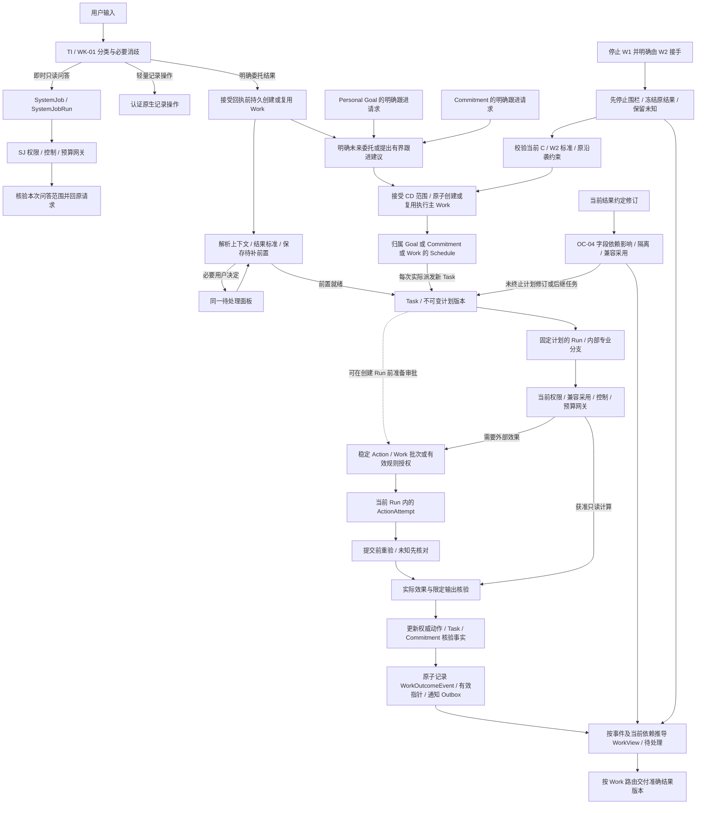
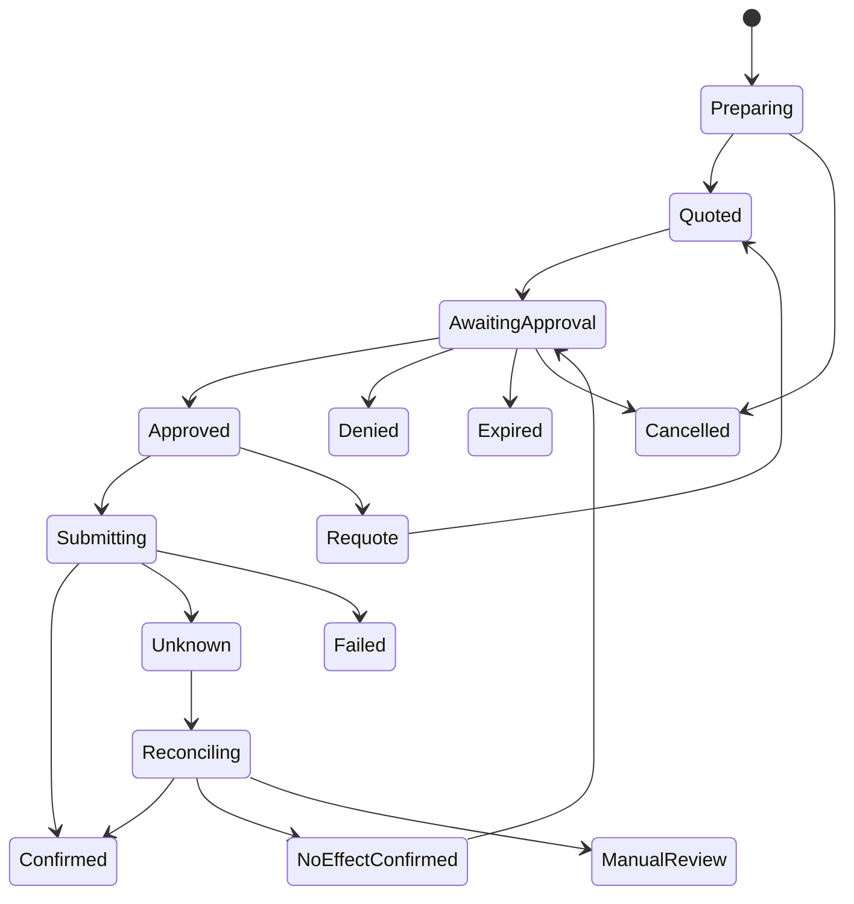

# Nexus AI — 产品需求文档

**版本：** 1.86  
**产品：** 独立顾问、创业者与小微企业主个人拥有的 AI 个人助理（PA）  
**日期：** 2026 年 10 月 28 日  
**状态：** 产品需求与验收基线  
**语言：** 简体中文

**维护约定：** 仅维护本中文版，作为 Nexus AI PRD 的唯一现行版本。

## 0. 范围与需求约定

Nexus AI 是个人拥有的 AI 个人助理（PA），首发面向符合第 2.1/2.5 节自助来源使用条件的独立顾问、创业者及小微企业主；相邻独立经营者按同标准判断，需要企业 IT 审批的员工不属当前目标。一个 PA 支持个人生活与经营责任两种工作上下文：Personal Mode 帮个人生活顺畅，Executive Mode 支持其客户交付与经营责任。

Nexus 理解上下文、协调内部专业 Agent、执行获准的工作，并核验结果。持续跟进意味着有记录的承诺事项、实际运行的检查机制、结果证据，以及需要所有者决策时的异常升级；并不意味着持续监视每一项服务。

Nexus 基于 OpenClaw。本文件定义桌面 Web、Mac 聊天客户端及 OpenClaw Channel；首版 Telegram、WhatsApp 为 P0 验收渠道，其余标为“兼容但未验收”，不纳入首发可用承诺。用户可通过已验收且连接就绪的移动 IM 渠道下达指令、接收结果和通知。当前不做专用原生移动 App 是节省开发时间的战略选择，后续将开发以改善移动体验，不等于没有移动使用入口。要求描述目标行为，不代表已经实现；实施阶段、人员、上市市场、定价和模型路由不属本文件。

### 0.1 需求等级

- **必须（Must）：** 相应能力通过验收的必要条件。
- **应当（Should）：** 默认行为；采用其他方案须记录产品决策。
- **P0：** 核心场景、状态正确性、授权或数据保护所必需。
- **P1：** 改善执行效果或交付质量的支持能力。
- 验收场景是规格要求，不代表测试已经通过。

### 0.2 必须遵守的产品决策

| 决策             | 约定                                                                                                                                                                                                                               |
| ---------------- | ---------------------------------------------------------------------------------------------------------------------------------------------------------------------------------------------------------------------------------- |
| 个人拥有         | 一个账号所有者、一个 PA 身份、一个专属持久环境；不提供共享 PA 或组织工作区                                                                                                                                                         |
| 两种模式         | Personal/Executive 是任务上下文，不是不同账号、安全角色、模型选择或独立 Agent                                                                                                                                                      |
| 个人长期目标     | 面向个人成长与生活，经营事务以工作/责任组织；数据范围及状态遵循 INV-05–INV-06，创建与执行分开                                                                                                                                      |
| 角色与客户上下文 | 管理模式记录用户明确说明的角色、组织、项目或客户；职位名称不授予访问权                                                                                                                                                             |
| 内部专业 Agent   | 在限定范围内执行内部任务；PA 继续对授权与核验负责                                                                                                                                                                                  |
| 实际权限         | 组织用途许可、服务商访问与具体动作权限的交集决定两种模式能执行什么；个人拥有 PA 不授予公司数据处理权                                                                                                                               |
| 持续工作         | 承诺事项持久保存；后台检查须明确归属、标准、频率与停止条件                                                                                                                                                                         |
| 如实报告结果     | 区分准备、执行、核验、交付与事项解决                                                                                                                                                                                               |
| 购买             | 每笔交易均须对准确条款重新批准，包括定时任务；可在复合卡分项取得本次批准，不能使用持久消费授权                                                                                                                                     |
| 审批效率         | 同一 Work 的跨 Task 动作按兼容用途批次审阅；明确受限低风险规则可免重复 Ask，但不省略网关校验或强制批准                                                                                                                             |
| 交付物           | 文档、文件和静态页面服务于八个用户场景；Nexus 托管页面的公开分享只发布获批静态快照；第三方分享/发布遵循 NX-09 与第 7 节                                                                                                            |
| 访问与执行       | Web/Mac 及 P0 渠道 Telegram、WhatsApp；采用版本 OpenClaw 的其余 Channel 标为“兼容但未验收”，不承担首版验收。已验收移动 IM 的指令/结果/通知连接同一 PA。页面动作在 Agent 专用物理机或云端虚拟机已安装浏览器执行，不依赖用户个人电脑 |

### 0.3 表达意图、决定重要事项、获得可信结果 — P0

**CL-01 主路径：** 表达想要的结果 → 决定有实质影响的未决事项 → 获得可用且有证据的成果。下述要求共同描述一条旅程，不是独立配置阶段。内部对象及保障继续执行，无需用户管理。

**CL-02 PA 职责：** Nexus 解析意图/上下文、复用有效获准事实、组织执行/资源并核验结果。无害可逆准备采用可见可纠正默认，不虚构事实身份/期限或推断权限。

**CL-03 打断规则：** 仅必需决定/输入缺失且实质影响结果、访问、披露、不可逆效果或持续范围/成本时询问。复用有效决定并合并相关问题；强制批准仍必需。用户无法处理的系统等待是状态，不是决定。

**CL-04 单一呈现：** Chat、工作、人员、待处理及返回概览关联同一工作/责任/决定版本。小请求无需独立计划、上下文、预算和确认卡。普通进展可查，不反复通知或要求知悉。

**CL-05 结果优先：** 先给可用成果、重要限制及仅必要的下一步，证据/历史按需展开。除非约定结果要求人工验收，否则不要求通用完成确认。未完整工作保留有用输出和可处理说明。

**CL-06 成效衡量：** 减少总主动委托投入，包含配置、决定、解释、导航、返回及恢复。第 13/14 章统一评估，少点击不能抵消理解、结果质量、完成率或安全退步。

### 0.4 术语表

先用本表理解状态和指标。同一个词可能对应不同维度；来源覆盖、执行结果和业务核验不能混用。定义用于阅读，不新增用户配置步骤，也不覆盖所链需求。

| 术语 / 标识                                                                              | 含义及边界                                                                                                                                                                                                                                                                                                                                                                                                                                                                                                 | 定义需求                                                             |
| ---------------------------------------------------------------------------------------- | ---------------------------------------------------------------------------------------------------------------------------------------------------------------------------------------------------------------------------------------------------------------------------------------------------------------------------------------------------------------------------------------------------------------------------------------------------------------------------------------------------------- | -------------------------------------------------------------------- |
| 个人助理 / PA / Personal Agent                                                           | 个人助理/Agent，属于一个所有者，组织并执行获准工作；内部专业分支不是另一位用户独立管理的助理。                                                                                                                                                                                                                                                                                                                                                                                                             | [NX-01](#req-nx-01), [CL-02](#req-cl-02)                             |
| 工作 / Work / work item                                                                  | 面向用户的持久化轻量实体，记录一个委托结果及稳定身份/关联；不拥有执行状态，展示状态由权威对象推导。前台统一称“工作”；长期工作不自动变成 Goal，局部 Task 完成不等于工作完成。                                                                                                                                                                                                                                                                                                                               | [WK-01](#req-wk-01), [WK-02](#req-wk-02), [WK-03](#req-wk-03)        |
| 系统作业 / SystemJob / SystemJobRun                                                      | 不归属 Work 的有界内部处理或交互式只读问答；SystemJob 记录类型/触发依据/范围/预算/控制，SystemJobRun 是一次尝试。与 Task/Run 分型，不能用来隐匿用户委托或越过授权。                                                                                                                                                                                                                                                                                                                                        | [SJ-01](#req-sj-01), [SJ-02](#req-sj-02), [SJ-03](#req-sj-03)        |
| 会话与聊天 / Conversation / Chat                                                         | 会话/聊天记录讨论；同一工作可跨聊讨论，删会话不等于停止工作。                                                                                                                                                                                                                                                                                                                                                                                                                                              | [CM-01](#req-cm-01), [CM-03](#req-cm-03), [CM-04](#req-cm-04)        |
| 任务、运行、动作 / Task / Run / Action                                                   | Task 是推进工作的一段限定执行，归属与层级见 INV-02；Run 是一次任务执行尝试；Action 是绑定 Task 计划版本的稳定逻辑动作，ActionAttempt 是某个 Run 内对该动作的一次执行/核对尝试；各自成功仅证明该范围。重试创建新 Run，保留旧终态/回执，不直接解决 Work 或 Commitment。                                                                                                                                                                                                                                      | [TI-01](#req-ti-01), [RC-03](#req-rc-03), [AP-01](#req-ap-01)        |
| 目标、决策、承诺事项 / Goal / Decision / Commitment                                      | Goal 表达长期个人追求，可展示进展与目标信；正式范围/层级/状态见 INV-05–INV-06。工作与目标的关联约束见 INV-05；长期业务仍是 Work。Decision 记录有出处的选择，以 DecisionObjectLink 版本化多对多关联指向 Work/Task/Commitment，区分有效约束、产生来源和参考；替代影响沿这些关联追踪，不等于动作授权；Commitment 跟踪带标准/证据的责任，当前责任版本、沟通结果、对方接受、生命周期及履行核验彼此独立；同一记录被人员/工作视图引用。手动结案、取消、到期和检查结束均不证明履行；这些内部结构不是必走配置界面。 | [NX-03](#req-nx-03), [NX-04](#req-nx-04), [WK-01](#req-wk-01)        |
| 责任对应方与身份对齐 / Accountable counterpart / Entity resolution                       | 人员/协作方是参与工作或承担责任的主体，一级“人员”视图与“工作”并列，按 PV-01–PV-03 查看同一责任记录；联系人邮箱/IM 为其账号端点，可一人多端点。Work 角色唯一存于 WorkParticipantLink，Commitment 当前责任唯一存于 responsible_counterpart_id，其他角色存于 CommitmentParticipantLink；用户本人对应唯一 self_counterpart_id（显示“我”），账号所有权不等于负责。跨来源身份对齐须有依据；同名不是同一人、上下级关系或权限证明。                                                                                | [ER-01](#req-er-01), [ER-02](#req-er-02), [ER-04](#req-er-04)        |
| 上下文与个人/管理用途 / Context / Personal / Executive                                   | 说明工作/责任的个人或经营用途及所用来源；主用途、继承及跨用途约束遵循 INV-04，不等于来源/披露权限。                                                                                                                                                                                                                                                                                                                                                                                                        | [UX-01](#req-ux-01), [CR-01](#req-cr-01)                             |
| 计划、检查、持续委托 / Schedule / Check / Continuing delegation                          | Schedule 是已确认未来时间/范围/停止条件下的一次性或周期触发机制。每次实际派发的触发创建新 Task，首次执行创建其 Run，同次重试只加 Run；到期但跳过/合并的触发不虚建执行记录，不新建 Work。计划活跃不代表检查已执行，单次成功不结束周期计划，计划结束不证明义务履行。                                                                                                                                                                                                                                         | [CD-01](#req-cd-01), [CD-02](#req-cd-02), [CS-02](#req-cs-02)        |
| 跟进方案与执行承载 / DelegationPlan / Execution Work                                     | 方案保存已接受的结果、来源、时间与结束边界；Schedule 负责触发。承诺被多件工作引用，不等于各工作都执行跟进；同一承诺只保留一个当前方案及执行承载，暂停不转移归属。                                                                                                                                                                                                                                                                                                                                          | [CD-03](#req-cd-03), [CD-04](#req-cd-04), [PV-03](#req-pv-03)        |
| 接手与原结果沿袭 / Handoff / Result lineage                                              | 用户明确将同一承诺的跟进交由另一件工作承载；新方案/计划替换未来执行，旧工作、动作、成果及停止快照保留，不重复计原结果或恢复额度。                                                                                                                                                                                                                                                                                                                                                                          | [CD-03](#req-cd-03), [WK-02](#req-wk-02), [CP-03](#req-cp-03)        |
| 编排状态、控制状态与效果事实 / Execution / Control / Effect                              | Task 编排说明限定请求当前进展；控制说明能否继续；Action 事实说明外部效果是否发生。Run 成败、手动暂停、未知效果分别保留，不能互相覆盖。                                                                                                                                                                                                                                                                                                                                                                     | [RC-03](#req-rc-03), [8.1](#section-8-1)                             |
| 引用、采用与主归属 / Reference / Adoption / Ownership                                    | 主归属固定执行或资产责任，引用只复用获准事实；新版采用说明旧计划/成果是否仍适用，不迁移原主归属、继承权限或重复执行。级联只按实际依赖及明确控制范围传播。                                                                                                                                                                                                                                                                                                                                                  | [3.1](#section-3-1), [OC-04](#req-oc-04), [级联矩阵](#cascade-rules) |
| 消息渠道 / Channel                                                                       | OpenClaw 消息渠道，供所有者指挥/接收通知，连接同一 PA；本身不授予工作来源访问或客户发送权限。                                                                                                                                                                                                                                                                                                                                                                                                              | [CH-01](#req-ch-01), [CH-02](#req-ch-02), [CH-04](#req-ch-04)        |
| Agent 主机及浏览器 / Agent host / Agent machine browser                                  | Agent 专用物理机/云虚拟机及其已安装浏览器，不是用户个人电脑；用户离开与真实主机/会话故障分开。                                                                                                                                                                                                                                                                                                                                                                                                             | [BR-01](#req-br-01), [BR-04](#req-br-04)                             |
| 来源准入与授权 / Source admission / Authorization                                        | 来源准入判断来源所有者/客户及适用来源规则是否允许首发画像内的特定数据用途，授权规定账号/方法/动作范围；能登录不等于允许全部用途或已经批准动作。                                                                                                                                                                                                                                                                                                                                                            | [EA-01](#req-ea-01), [EA-02](#req-ea-02), [AP-04](#req-ap-04)        |
| 能力配置与就绪配置 / Capability profile / Ready profile                                  | 能力配置是特定服务商/账号/路径/方法/证据链；就绪表示该限定场景必要能力/权限可用，不代表全部服务商或全部流程支持。                                                                                                                                                                                                                                                                                                                                                                                          | [CP-01](#req-cp-01), [CP-05](#req-cp-05)                             |
| 来源自动覆盖 / `automatic` (source coverage)                                             | 来源自动覆盖：必要来源可按已接受检查及当前访问实际持续观察，不保证即时发现。                                                                                                                                                                                                                                                                                                                                                                                                                               | [EA-04](#req-ea-04), [CS-01](#req-cs-01)                             |
| 来源部分覆盖 / `partial` (source coverage)                                               | 来源部分覆盖：仅部分必要证据来源可观察，须说明缺口；与执行结果部分完成分开。                                                                                                                                                                                                                                                                                                                                                                                                                               | [EA-04](#req-ea-04), [CP-01](#req-cp-01)                             |
| 仅材料覆盖 / `material_only`                                                             | 仅材料覆盖：只有已提供/导入资料，可完成有用单次结果，但无法观察后续变化；如邮件导出不能监控新回复。                                                                                                                                                                                                                                                                                                                                                                                                        | [EA-04](#req-ea-04), [CD-03](#req-cd-03)                             |
| 来源不可用 / `unavailable` (source coverage)                                             | 来源不可用：所需获准来源能力不可用；其他允许输入可能仍能准备，但不能宣称持续观察。                                                                                                                                                                                                                                                                                                                                                                                                                         | [EA-04](#req-ea-04), [CP-05](#req-cp-05)                             |
| 独立完成 / `independent`                                                                 | 独立完成：Nexus 执行并核验原限定结果；必要用户决定仍计投入，用户代操作目标服务不能算独立执行。                                                                                                                                                                                                                                                                                                                                                                                                             | [CP-01](#req-cp-01), [CP-03](#req-cp-03)                             |
| 部分结果与运行终态 / `partial` (outcome / terminal run)                                  | 部分结果/运行终态：已有有用核验工作，但必要工作未完；运行以部分结束不同于任务仍等批准或容量。                                                                                                                                                                                                                                                                                                                                                                                                              | [CP-01](#req-cp-01), [AF-01](#req-af-01), [RC-05](#req-rc-05)        |
| 仅准备 / `prepare_only`                                                                  | 仅准备：提供计划/草稿/资料，但所请求实际操作未完成；若原请求仅需准备，验证交付的材料包可算独立完成。                                                                                                                                                                                                                                                                                                                                                                                                       | [CP-01](#req-cp-01), [CP-05](#req-cp-05)                             |
| 无法处理 / `unavailable` (outcome)                                                       | 无法处理：该请求不能产生有用且获准结果，与仅准备或效果未核验分开。                                                                                                                                                                                                                                                                                                                                                                                                                                         | [CP-01](#req-cp-01)                                                  |
| 目标用户覆盖率 / Target-user coverage                                                    | 目标用户覆盖率：就绪合格首发用户除以抽样中全部有该需求合格用户，含队列内来源阻塞/服务商不支持/拒绝；预先判定画像外企业用户另报，不静默移除。                                                                                                                                                                                                                                                                                                                                                               | [CP-02](#req-cp-02)                                                  |
| 全部委托请求独立完成率 / All-request independent completion rate                         | 全部委托请求独立完成率：核验独立原始结果除以全部有效范围内实际请求；拒绝/取消仍可见，不用 Task 拆分/Run 重试膨胀数量。                                                                                                                                                                                                                                                                                                                                                                                     | [CP-03](#req-cp-03)                                                  |
| 就绪配置完成率 / Ready-profile completion rate                                           | 就绪配置完成率：核验独立原结果除以接受时必要能力/权限就绪的请求；后续失败保留分母，是条件指标，不等于全体客户完成率。                                                                                                                                                                                                                                                                                                                                                                                      | [CP-03](#req-cp-03)                                                  |
| 终态窗口与右删失 / Terminal window / Right-censored request                              | 终态窗口是持续工作约定达到结果的时间范围；尚未到期为未到期/右删失，须单列，不能算成功或静默移除。                                                                                                                                                                                                                                                                                                                                                                                                          | [CP-03](#req-cp-03), [CD-04](#req-cd-04)                             |
| 用户介入与可避免管理 / Intervention / Avoidable management                               | 介入是推进工作所做的明确回答/选择/操作；必要判断与重复解释、无用导航及内部对象配置分别统计。                                                                                                                                                                                                                                                                                                                                                                                                               | [CP-03](#req-cp-03), [CL-06](#req-cl-06)                             |
| 结果达成与撤回 / WorkOutcomeEvent                                                        | 保存结果首次核验达成、被撤回、恢复及被新版替代的不可变事实；与停止事件分开。首次达成时间不改写，当前有效完成时间可因撤回清空；历史曾完成不等于当前有效完成。                                                                                                                                                                                                                                                                                                                                               | [WK-02](#req-wk-02), [CP-03](#req-cp-03), [OC-03](#req-oc-03)        |
| 结果约定与标准 / Outcome Contract / Criterion                                            | 结果约定/标准：固定版本的请求成功条件及可证明证据，工具成功或文件存在本身不足。                                                                                                                                                                                                                                                                                                                                                                                                                            | [OC-01](#req-oc-01), [OC-02](#req-oc-02), [OC-03](#req-oc-03)        |
| 核验与手动覆盖 / Verification / Manual override                                          | 核验将可归属当前证据与全部必要标准匹配；证据不足下用户结案记录为手动覆盖，不冒充来源核验完成。                                                                                                                                                                                                                                                                                                                                                                                                             | [OC-03](#req-oc-03), [ER-04](#req-er-04)                             |
| 证据新鲜度与观察时间 / Evidence freshness / Observation time                             | 证据新鲜度/观察时间：来源事件/更新时间与 Nexus 实际读取时间分开；新读取也可能返回服务商旧数据。                                                                                                                                                                                                                                                                                                                                                                                                            | [CB-06](#req-cb-06), [CS-01](#req-cs-01), [CS-04](#req-cs-04)        |
| 发现延迟、轮询间隔、派发延迟 / Discovery delay / Poll interval / Dispatch delay          | 发现延迟/轮询间隔/派发延迟分别为发生到发现、两次查询之间及发现到通知；定时查询不能保证真实发现延迟。                                                                                                                                                                                                                                                                                                                                                                                                       | [CS-01](#req-cs-01), [ES-01](#req-es-01)                             |
| 覆盖缺口与策略状态 / Coverage gap / `on_plan` / `degraded`                               | 覆盖缺口是未按约定观察的时间/范围；按计划或降级描述观察覆盖，不判断业务义务成功。                                                                                                                                                                                                                                                                                                                                                                                                                          | [CS-04](#req-cs-04), [CS-05](#req-cs-05)                             |
| 根因问题与根因合并 / Root issue / Root-cause grouping                                    | 根因问题/根因合并：一个有证据底层原因关联多件受影响工作；如邮箱一次撤销阻塞多项检查，合一通知并分别说明影响，不逐义务告警。                                                                                                                                                                                                                                                                                                                                                                                | [ES-03](#req-es-03), [IN-03](#req-in-03)                             |
| 权威记录与事实来源 / Authoritative record / Source of truth                              | 权威记录/事实来源：拥有事实、决定或外部对象当前版本/状态的记录；Nexus 不暗中替代服务商事件/订单依据。                                                                                                                                                                                                                                                                                                                                                                                                      | [WK-03](#req-wk-03), [AP-02](#req-ap-02)                             |
| 权威投影 / Authoritative / Canonical projection                                          | 权威投影：从权威对象推导的可重建展示，不另存可独立修改的执行事实。Work 的 ID/标题/上下文/约定/关联必须持久保存；可重建的是状态/进展缓存，不是 Work 本身。各入口引用同一工作和决定。                                                                                                                                                                                                                                                                                                                        | [WK-03](#req-wk-03), [IN-03](#req-in-03), [AF-04](#req-af-04)        |
| 待处理问题与工作数量 / Attention issue / Work count                                      | 待处理问题/工作计数：前者计需所有者处理的独立问题，后者计原请求结果；一根因影响多件工作，两种数量不必相同。                                                                                                                                                                                                                                                                                                                                                                                                | [IN-03](#req-in-03), [RT-02](#req-rt-02)                             |
| 批准批次、清单、子授权 / Approval bundle / Manifest / Child grant                        | 同一 Work 内可跨 Task 的已冻结动作清单及独立子授权；同次提交可保存所选独立授权，不批准未选或实质变化。                                                                                                                                                                                                                                                                                                                                                                                                     | [AP-01](#req-ap-01), [AF-01](#req-af-01)                             |
| 受限自动批准与保护选择 / Scoped auto-approval rule / Protected choice                    | 受限自动批准规则/保护选择：用户明确启用的有限动作授权；重要披露/公开/财务/不可逆仍须规定审阅，规则不建工作或代确认身份。                                                                                                                                                                                                                                                                                                                                                                                   | [AP-03](#req-ap-03), [AP-04](#req-ap-04), [AQ-02](#req-aq-02)        |
| 前置条件与依赖 / Prerequisite / Dependency                                               | 必须满足的输入/权限/结果条件。Work 可在没有 Task 时持有待补前置；参考引用不等于执行依赖，失败只阻受影响后续。                                                                                                                                                                                                                                                                                                                                                                                              | [AP-02](#req-ap-02), [RC-04](#req-rc-04)                             |
| 阻塞、暂停、取消 / `blocked` / `paused` / `cancelled`                                    | 阻塞为缺前置；Task 暂停属于独立控制而非执行枚举，Schedule 可有 paused；取消停止准确范围剩余执行，Work 仍按结果投影；均不撤销已提交效果或自动解决义务。                                                                                                                                                                                                                                                                                                                                                     | [RC-03](#req-rc-03), [RC-05](#req-rc-05)                             |
| 提交、确认、结果未知 / `submitted` / `confirmed` / `outcome_unknown`                     | 提交表示服务商受理，确认须指定证据，结果未知表示尚不能确定效果；提交/通知确认不自动证明业务履行。                                                                                                                                                                                                                                                                                                                                                                                                          | [BR-03](#req-br-03), [OC-03](#req-oc-03), [RC-03](#req-rc-03)        |
| 状态核对与幂等 / Reconciliation / Idempotency                                            | 状态核对检查真实外部状态后再判断/重试；幂等防同一操作逻辑重复，本地锁本身不证明外部恰好一次。                                                                                                                                                                                                                                                                                                                                                                                                              | [AP-02](#req-ap-02), [RC-05](#req-rc-05)                             |
| 版本绑定与隔离 / Version binding / Fence                                                 | Work 版本记录本次结果约定，Task 计划版本记录限定执行，Run 固定采用计划；兼容采用不改历史。隔离阻止旧依赖提交，实质修订与同范围重试分开，详见 OC-04。                                                                                                                                                                                                                                                                                                                                                       | [CR-03](#req-cr-03), [RC-03](#req-rc-03)                             |
| 发件箱与交付回执 / Outbox / Delivery receipt                                             | 发件箱/交付回执：持久派发记录把权威结果关联各获准目的地；服务商回执不同于手机显示/已读或底层工作完成。                                                                                                                                                                                                                                                                                                                                                                                                     | [CH-04](#req-ch-04), [AF-04](#req-af-04)                             |
| 异常升级等级 / `informational` / `attention` / `urgent`                                  | 信息/需处理/紧急是按业务影响及最晚有效响应时间分级，不按活动量；紧急派发始于发现后，不使观察实时。                                                                                                                                                                                                                                                                                                                                                                                                         | [ES-01](#req-es-01)                                                  |
| 已读、知悉、稍后提醒、解决 / Read / Acknowledge / Snooze / Resolve                       | 已读不授权，明确知悉可停未变重复，稍后提醒只延后注意力不改检查/到期，解除须原问题被处理。                                                                                                                                                                                                                                                                                                                                                                                                                  | [IN-04](#req-in-04), [ES-04](#req-es-04)                             |
| 工作资源预算、执行子限额与批准额度 / Work budget / Execution allocation / Approval quota | Work 承载资源总预算及独立的自动批准总额度；Task/Run/专业子任务仅获子限额，不新增总额。账号容量及服务商配额另行约束；扩资源预算不增加自动批准次数或消费授权。                                                                                                                                                                                                                                                                                                                                               | [RB-01](#req-rb-01), [RB-03](#req-rb-03)                             |
| 资源预留、检查点、部分输出 / Reservation / Checkpoint / Partial output                   | 资源预留防超分配，检查点保存执行进度，部分输出保留核验有用工作并明确未完覆盖。                                                                                                                                                                                                                                                                                                                                                                                                                             | [RB-02](#req-rb-02), [RB-04](#req-rb-04), [RC-05](#req-rc-05)        |
| 事故挂起、补救、结案 / Incident hold / Remediation / Case closure                        | 事故挂起/补救/结案：控制疑似损害、核对效果并明确批准可行纠正；结案或接受残余风险不证明损害消除或义务履行。                                                                                                                                                                                                                                                                                                                                                                                                 | [IR-02](#req-ir-02), [IR-03](#req-ir-03), [IR-05](#req-ir-05)        |
| 优先级及验收目标与实测结果 / P0 / P1; acceptance target / measured result                | P0 为该能力/核心保障必需，P1 为配套范围；拟议数值验收不宣称功能已实现或性能已达标。                                                                                                                                                                                                                                                                                                                                                                                                                        | [CP-04](#req-cp-04), [CL-06](#req-cl-06)                             |

### 0.5 需求 ID 导航

本表用于定位，[附录 C](#requirement-index) 逐条列出全部已定义需求 ID、标题、正文链接及验收映射。`NX` 为功能模块，其余前缀为所属章节内需求；`G` 产品目标、`US` 用户故事、`SC` 场景、`AT` 验收是不同命名空间。240 个稳定 AT ID 归入 90 个整合验收组，组内别名不是额外界面步骤或重复研究。链接直达权威正文，不复制需求定义。

| 需求组      | 主题                           | 正文 / 完整 ID 索引                   |
| ----------- | ------------------------------ | ------------------------------------- |
| CL-01–CL-06 | 主路径                         | [CL-01](#req-cl-01) · [ID](#index-cl) |
| CP-01–CP-05 | 能力声明须有可运行流程         | [CP-01](#req-cp-01) · [ID](#index-cp) |
| BA-01       | 限定来源批量分析               | [BA-01](#req-ba-01) · [ID](#index-ba) |
| RB-01–RB-05 | 仅必要时估算                   | [RB-01](#req-rb-01) · [ID](#index-rb) |
| SJ-01–SJ-03 | 系统作业与执行底座             | [SJ-01](#req-sj-01) · [ID](#index-sj) |
| WK-01–WK-04 | 工作而非对象配置               | [WK-01](#req-wk-01) · [ID](#index-wk) |
| PV-01–PV-03 | 人员一级视图与责任跟进         | [PV-01](#req-pv-01) · [ID](#index-pv) |
| CM-01–CM-05 | 独立生命周期                   | [CM-01](#req-cm-01) · [ID](#index-cm) |
| IN-01–IN-05 | 待处理入口                     | [IN-01](#req-in-01) · [ID](#index-in) |
| RT-01–RT-04 | 返回视图                       | [RT-01](#req-rt-01) · [ID](#index-rt) |
| UX-01–UX-03 | 渐进上下文                     | [UX-01](#req-ux-01) · [ID](#index-ux) |
| CR-01–CR-03 | 安全解析                       | [CR-01](#req-cr-01) · [ID](#index-cr) |
| BR-01–BR-04 | Agent 机器，不是用户电脑       | [BR-01](#req-br-01) · [ID](#index-br) |
| CH-01–CH-04 | 首发渠道与兼容分级             | [CH-01](#req-ch-01) · [ID](#index-ch) |
| CB-01–CB-07 | 两条并行入口与最小种子         | [CB-01](#req-cb-01) · [ID](#index-cb) |
| NX-01–NX-15 | 功能模块                       | [NX-01](#req-nx-01) · [ID](#index-nx) |
| TI-01–TI-05 | 意图类别                       | [TI-01](#req-ti-01) · [ID](#index-ti) |
| FG-01–FG-04 | 用用户语言确定范围             | [FG-01](#req-fg-01) · [ID](#index-fg) |
| RV-01–RV-04 | 结构化批量审阅                 | [RV-01](#req-rv-01) · [ID](#index-rv) |
| CS-01–CS-05 | 可行发现                       | [CS-01](#req-cs-01) · [ID](#index-cs) |
| CD-01–CD-05 | 识别持续意图                   | [CD-01](#req-cd-01) · [ID](#index-cd) |
| PA-01–PA-04 | 发现不自授权                   | [PA-01](#req-pa-01) · [ID](#index-pa) |
| ES-01–ES-05 | 业务分级，不按活动量升级       | [ES-01](#req-es-01) · [ID](#index-es) |
| FD-01–FD-03 | Word                           | [FD-01](#req-fd-01) · [ID](#index-fd) |
| AR-01       | 素材检索                       | [AR-01](#req-ar-01) · [ID](#index-ar) |
| OP-01–OP-10 | 邮件                           | [OP-01](#req-op-01) · [ID](#index-op) |
| EA-01–EA-05 | 组织许可与技术可达性分离       | [EA-01](#req-ea-01) · [ID](#index-ea) |
| AU-01–AU-04 | 会议音频输入容量               | [AU-01](#req-au-01) · [ID](#index-au) |
| MD-01       | 配套语音交付                   | [MD-01](#req-md-01) · [ID](#index-md) |
| LG-01–LG-06 | 地点与活动                     | [LG-01](#req-lg-01) · [ID](#index-lg) |
| ER-01–ER-05 | 统一协作方记录                 | [ER-01](#req-er-01) · [ID](#index-er) |
| DU-01–DU-06 | 原件接收、质量诊断与可追溯解析 | [DU-01](#req-du-01) · [ID](#index-du) |
| AP-01–AP-05 | 一个决定面板、限定选择         | [AP-01](#req-ap-01) · [ID](#index-ap) |
| AQ-01–AQ-04 | 后果优先                       | [AQ-01](#req-aq-01) · [ID](#index-aq) |
| AF-01–AF-04 | 部分批准后                     | [AF-01](#req-af-01) · [ID](#index-af) |
| OC-01–OC-05 | 版本化结果约定                 | [OC-01](#req-oc-01) · [ID](#index-oc) |
| RC-01–RC-05 | 有意义进展                     | [RC-01](#req-rc-01) · [ID](#index-rc) |
| DG-01       | 内部诊断                       | [DG-01](#req-dg-01) · [ID](#index-dg) |
| IR-01–IR-05 | 统一事故入口与效果图           | [IR-01](#req-ir-01) · [ID](#index-ir) |
| WF-01       | 流程模板                       | [WF-01](#req-wf-01) · [ID](#index-wf) |

研发模型：[附录 D](#appendix-data-model) · [ER 图](#data-er) · [INV-01–INV-34](#appendix-invariants)。

产品目标/故事：[第 1.3 节](#section-1-3)、[第 2.2 节](#section-2-2)；场景：[第 2.4 节](#section-2-4)；方法/能力矩阵：[第 2.6 节](#section-2-6)；验收：[第 14.1 节](#section-14-1)、[第 14.2 节](#section-14-2)。

## 1. 产品定位与预期成果

### 1.1 产品定义

**Nexus 是独立经营者个人拥有的 AI PA：理解本人及其承担的责任，协调专业 Agent 办理真实事务，并核验预期结果是否发生。**

用户表达想要的结果，Nexus 负责组织工作、记住有效上下文、呈现重要决定并交付有证据且可用的成果。用户应减少解释、查进度及管理工具的时间。Chat 是主入口，内部记录及定时检查支撑体验，不成为用户的配置工作。

Nexus 通过所有者已授权的账号和决策开展工作。它不会成为组织员工、获得组织范围的访问权，也不会替代同事和客户使用的业务系统。

### 1.2 问题与预期结果

| 问题                            | 所需结果                                                 |
| ------------------------------- | -------------------------------------------------------- |
| 个人事务与客户/经营责任相互冲突 | 识别约束并提出可行方案，不向业务收件人透露私人原因       |
| 会议准备材料分散                | 形成有来源依据的议程、会前材料、状态摘要和待决策点       |
| 决策淹没在笔记中                | 区分决策与建议，记录后续行动及对应责任人                 |
| 承诺缺乏跟进                    | 保留未解决事项、检查证据，识别需要所有者关注的问题       |
| 委派产生了活动，却没有结果      | 声称完成前核验外部实际效果与交付物                       |
| 反复解释上下文                  | 跨会话应用相关偏好、角色/客户历史和更正                  |
| 过多更新争夺注意力              | 交付用户要求的报告和有意义的异常，不主动重复无变化的状态 |

### 1.3 产品目标

| 编号 | 目标                        | 成功证据                                                                                               |
| ---- | --------------------------- | ------------------------------------------------------------------------------------------------------ |
| G1   | 完成有价值的个人与管理事务  | 八个场景中的结果得到核验                                                                               |
| G2   | 保留相关上下文              | 回访时偏好、角色/客户上下文、决策和历史正确                                                            |
| G3   | 保持用户控制                | 批准范围准确，拒绝/撤销得到执行，信息披露受控                                                          |
| G4   | 用户离开后继续跟进          | 对已准入且具持续覆盖的来源，有归属检查实际运行、证据持久保存、未解决事项可见；仅材料准备不证明自动跟进 |
| G5   | 降低所有者的注意力成本      | 减少可避免打扰、异常可处理、决策明确；计入全部周期手工补料成本，按准入/覆盖状态测量实际节省时间        |
| G6   | 产出可复用成果              | 简报、计划、文档、表格和静态报告可用                                                                   |
| G7   | 工作过程可追溯、可问责      | 动作、实际效果、失败、交付、资源成本和数据生命周期可追踪                                               |
| G8   | 协调个人生活与客户/经营责任 | 解决冲突，不混淆所有权、上下文、授权或对应人员的责任                                                   |

### 1.4 明确的范围边界

第 2.6 节 CP-01–CP-05 定义场景最小方法链、真实完成类型、目标用户覆盖、端到端完成及人工介入门槛。仅人工交接不能证明独立执行能力。

本版本不包含原生移动 App、设备配对/控制、家庭网络硬件、自主第三方对话代理、商业电话、机密计算、Nexus 订阅/积分/邀请奖励/反馈提交、Feed、Ideas 或模型路由。Mac App 是聊天客户端，不是通用本机自动化 Agent；Agent 主机浏览器/控制服务及所需插件按 BR-01–BR-04。Telegram、WhatsApp 按 CH-01–CH-04 作为 P0 纳入本版，其余 OpenClaw Channel 仅标为“兼容但未验收”；原生移动 App 暂缓、后续开发。

本版本也不包含通用实时网页搜索/研究、自动验证码/CAPTCHA 处理；Agent 主机浏览器的获准页面操作见 BR-01–BR-04；不提供共享工作区、员工账号、组织管理、完整 CRM/项目管理替代系统、独立法律/财务决策、无人值守购买、资金转账、生成式私有工具、有状态应用、交互应用托管、通用应用市场、娱乐/音乐运营、广告投放执行、商家店铺后台管理、临床健康/健身管理或私有网络管理。

这些边界不妨碍已授权的邮件/日历操作、个人预约、支出摘要、创作者交付材料准备、直接服务核心场景的静态状态报告，或通过获准 API 执行的明确社交合作交付。内部资源限制与成本监控属于运行保障，不是面向客户的计费功能。轮询不能保证即时发现、保留库存，或在服务商控制的时刻获得结果。

以下边界按交付对象区分：Nexus 托管页面只提供获批静态快照；第三方在线文档的共享及第三方托管问卷的开放属于 NX-09 的独立 API/Agent 主机浏览器动作，须审阅当前内容、受众、权限及可撤销性，不承诺静态快照或 Nexus 链接有效期。Nexus 不托管问卷应用；获准非凭据业务表单可按 BR-01–BR-04 操作，不代他人回答。外部社交消息只作为指定来源会话中的获批动作，不构成任意第三方消息授权；所有者通过 OpenClaw Channel 与 PA 交互/接收通知另按 CH-01–CH-04。

本版也不纳入 Agent 独立邮箱、产品抢先体验申请、Facebook 群组/社交关系管理、Marketplace 卖家操作、自动社交增长、账号级社交设置管理、完整播客制作分发、专用成果宣传视频、新音色设计或通用技能开发环境。获准操作的具体边界统一见 NX-09–NX-11 和第 7 节。

## 2. 客户、工作模式与用户场景

### 2.1 目标客户

**首发理想客户画像：** 独立顾问、创业者及小微企业主，亲自协调客户/项目与个人生活，无需额外企业 IT/安全/采购审批即可决定采用产品，并有依据允许特定资料用途。企业规模本身不是权限判断，以下准入条件才是依据。

| 优先群体                 | 情境及需求                                    | 适配条件 / 价值                                            |
| ------------------------ | --------------------------------------------- | ---------------------------------------------------------- |
| 独立顾问及独立专业经营者 | 准备客户会议/资料，跟进交付，协调个人可用时间 | 可自行使用且用途获准的来源；上下文复用、准确交付及减少催办 |
| 创业者及创始人           | 跨账号管理客户承诺、小团队协调与生活安排      | 实际来源政策允许采用；核验执行及减少未决事项               |
| 小微企业主               | 亲自管理预约、供应商、项目及经营责任          | 不依赖额外企业审批；有界跟进及可测时间节省                 |

创作者/独立品牌经营者仅满足同样经营者条件时作为相邻用户，不另设企业客群。工作访问需要企业 IT/管理员/安全审批的大中型组织员工、驻场顾问及机构职员，**不属于本版目标用户，其相关工作来源暂不支持**。不提供企业审批排队、试点例外、采购承诺或导出绕行。

独立身份不免除保密/特权/执业义务。律师等受监管专业人士不作为整体首发客群；独立执业者仅在实际客户授权、保密/特权义务及适用专业/数据处理要求允许当前外部服务时符合画像。不能证明适配则不接收受限材料，Nexus 不提供法律适用性认证。个人用途可独立使用，但不能称管理工作适配。

一个所有者控制一个 PA，客户/员工/家人/供应商是事务对应方，不是共享成员。首发宣传及 CP 抽样均按此明确画像。

### 2.2 核心用户故事

| 编号  | 用户故事                           | 结果                                             |
| ----- | ---------------------------------- | ------------------------------------------------ |
| US-01 | 记住我的相关偏好与决策             | 应用已核实的上下文及更正，无需重复说明           |
| US-02 | 替我完成准备与授权范围内的执行     | 准备、行动、核对实际状态并核验，而不只是给建议   |
| US-03 | 我不在时继续跟进                   | 客户端关闭后，仍保存并执行有归属的检查，保留结果 |
| US-04 | 给我可复用的材料                   | 交付经过验证的简报、文档、计划、表格和静态报告   |
| US-05 | 让我控制自己的信息                 | 在明确范围内查看、撤销、遗忘、导出、重置和删除   |
| US-06 | 让我在 Web 或 Mac 继续工作         | 保持任务与对话连续性                             |
| US-07 | 让决策与承诺事项持续可见           | 记录对应责任人、日期、依赖与结果                 |
| US-08 | 避免产生重大影响的错误             | 执行批准规则，防止重复效果，披露不确定性         |
| US-09 | 同时帮助我安排生活并经营自己的业务 | 协调两种工作上下文，不混淆访问权或披露范围       |
| US-10 | 协调专业 Agent 并核验结果          | 将限定范围的专业工作汇总为可追溯、经过核验的成果 |

### 2.3 一个 PA，两种内部工作上下文

| 维度     | Personal Mode（个人模式）                      | Executive Mode（管理模式）                           |
| -------- | ---------------------------------------------- | ---------------------------------------------------- |
| 目的     | 帮助个人生活顺畅运转                           | 帮助所有者履行客户交付与经营责任                     |
| 上下文   | 出行、家庭、议程、支出、关系、偏好             | 角色、组织、项目/客户、相关方、决策、承诺            |
| 工作     | 安排事务、准备预约、比较购买选项、核对到期事项 | 准备会议/材料、记录决策/行动、协调里程碑、核验落实   |
| 典型结果 | 可行计划、获批预订、提醒、确认收货             | 简报、决策记录、行动台账、经审阅的更新、有证据的异常 |
| 后续落实 | 预订/配送/预约结果                             | 行动完成、依赖/阻塞、向所有者升级异常                |

上下文结构及继承遵循 [INV-04](#inv-04)、[INV-05](#inv-05)；不同模式的独立结果按 UX-02 建关联工作。账号类型不决定用途或授权。

默认自动识别上下文。用户围绕用途、项目/客户及账号工作，不必切换 Personal/Executive。两种内部模式保留于上下文详情及可选高级控制。可选明确默认值/锁定仅影响新任务上下文建议，不改标运行工作、不改批准、不解锁来源、不允许私密披露。实际用途及版本化修正按 CR-01–CR-03；仅有实质影响的歧义/变化需要路由确认，既有适用动作审批仍不可省略。

能力随任务目的选择，不按服务商划分模式：私人联系人、个人消息、家庭预约和个人财务属于 Personal Mode；客户问卷、合作内容发布、专业材料及项目协调属于 Executive Mode。商务出行可复用 SC-01/SC-02 的事务流程，但任务仍标为 Executive 并遵守其客户/项目披露范围；这不自动解锁个人来源。音频、文档、批量分析和流程模板是服务上述场景的支持能力，不形成第三种模式。

### 2.4 优先用户场景

| 编号  | 模式 | 意图                                                                             | 结果与证据                                                                                                                                      |
| ----- | ---- | -------------------------------------------------------------------------------- | ----------------------------------------------------------------------------------------------------------------------------------------------- |
| SC-01 | 个人 | 安排出行与接送                                                                   | 可行行程，核实日期/时区/接驳时间，API 返回或Agent 主机网页观察的可用选项，获批的 API/网页预订或明确人工交接，确认凭证及剩余安排                 |
| SC-02 | 个人 | 协调家庭与日常生活                                                               | 无冲突的预约/事务/购买安排，获批服务操作，预订/配送确认，未解决事项                                                                             |
| SC-03 | 个人 | 整理个人日程与财务                                                               | 核对后的议程/到期事项/支出摘要，缺失数据说明，冲突解决选项，单独获批的修改                                                                      |
| SC-04 | 个人 | 根据关系与偏好做准备; NX-14/ER-01–ER-05                                          | 用户明确陈述的事实、相关日期/偏好、周到准备、草稿/选项；不编造关系或未经授权披露信息, AT-81–AT-86                                               |
| SC-05 | 管理 | 准备客户、项目和小团队会议及材料; NX-14/ER-01–ER-05; EA-01–EA-05                 | 议程、有来源依据的会前材料、项目/客户状态、待决策点、缺失输入, AT-81–AT-86, AT-87–AT-92                                                         |
| SC-06 | 管理 | 记录决策、承诺和行动; NX-14/ER-01–ER-05; EA-01–EA-05                             | 区分已确认决策与提案；记录对应人员、截止日期、依赖、来源、完成标准和持久承诺事项, AT-69–AT-74, AT-81–AT-86, AT-87–AT-92                         |
| SC-07 | 管理 | 协调小团队、供应商、项目和客户义务; NX-14/ER-01–ER-05; EA-01–EA-05 ; AP-01–AP-05 | 核对后的来源状态、冲突、拟议行动、经审阅的消息/日历/在线材料更新、获批问卷/合作发布及核验后的实际效果, AT-81–AT-86, AT-87–AT-92 , AT-107–AT-114 |
| SC-08 | 管理 | 核验落实并升级异常; NX-14/ER-01–ER-05; EA-01–EA-05                               | 有归属的检查、预期与观察结果对比、完成证据、未消除的不确定性、影响和所需决策, AT-81–AT-86, AT-87–AT-92                                          |

SC-05–SC-08 服务于独立顾问准备客户复盘并跟进方案、创业者协调小团队里程碑、企业主跟进供应商交付等事务，不假设部门汇报、企业审批链或全组织访问。SC-03 是整理与分析，不是自动金融交易。SC-06 记录同事责任，不为其创建 Nexus 账号，也不声称其已接受任务分配。SC-07 使用单独获准的服务操作，不开展自主外部对话。SC-08 是按约定频率或明确请求进行检查，不是持续监控。

### 2.5 工作来源准入与适用客户

个人拥有仅指个人账号，不代表雇主/客户资料处理权。当前管理工作准入须同时符合首发画像、实际处理许可、服务商访问及动作授权，登录成功、头衔或企业所有权本身均不足。

| 准入情形                                                                | 本版行为                                                                                           |
| ----------------------------------------------------------------------- | -------------------------------------------------------------------------------------------------- |
| 首发画像所有者可自行连接获准来源，无额外企业审查                        | 说明真实数据/范围/处理方式，读取或启用跟进前校验 EA 前置                                           |
| 来源需要额外企业 IT/管理员批准、租户白名单、安全/采购审查或组织级部署   | 显示“当前版本暂不支持此类工作连接”，结束该接入路径，不提供 IT 申请流程、等待准入承诺或人工导出替代 |
| 禁止外部 AI/数据用途，保密/特权处理条件无法确认，或必要条款与本版不兼容 | 不接收或处理受限工作材料，包括上传；不建议绕控制。独立获准个人事务可继续                           |

小微企业主可自行完成来源允许的普通账号同意，这不意味着支持企业 IT 准入。未知时不读取，先明确必要权限/适配；需要不支持审批流程的来源保持不可用，即使其他已批准产品能读取。已导入资料仍须撤销/清理，不能作为继续处理例外。

CP-02/CP-04 抽样准入前识别不支持企业人群，另报数量/原因；已纳入首发样本者不能因后续访问失败而剔除。有许可一次性材料仍可有用，但不能绕不支持/受限企业流程，也不算自动跟进。

服务商限制是真实边界：[Google 应用访问控制](https://support.google.com/a/answer/7281227?hl=en)、[Microsoft 同意政策](https://learn.microsoft.com/en-us/entra/identity/enterprise-apps/user-admin-consent-overview) 可限制第三方连接。本版遵守，不经营 B2B2C IT 审批项目。

### 2.6 核心场景能力与完成率矩阵 — P0

**CP-01 能力声明须有可运行流程：** 下表定义最小目标配置，不代表已验证接入。“Google 配置”指已准入的 Gmail + Google Calendar 账号组合；“Microsoft 配置”指已准入的 Outlook 邮件 + Outlook 日历账号组合。两者可替代，不要求同时连接两个生态。列出服务商不是实现证据。每项启用配置须在已启用操作清单记录真实适配器/版本、准确可调用方法/权限范围、支持账号/租户类型、准入限制、API 或获准Agent 主机浏览器路径、回读/证据方法、最后验证日期及通过/失败证据。浏览器方法须另行通过 BR 验证且电脑就绪，不默认替代不可用 API 或组织禁令。必要供应商标为 TBD 代表明确能力缺口：具体获准供应商/方法链通过端到端验证前，不得宣称该事务配置可独立执行。首发配置须符合第 2.5 节可独立采用条件；支持 Microsoft 配置不代表承诺企业租户准入。此处可选扩展不因列入矩阵而将新 P1 领域变为 P0。

完成类型为 `independent`、`partial`、`prepare_only`、`unavailable`。独立完成指 Nexus 执行所有必要操作并核验原先约定的限定结果；普通补充/必要批准计入人工介入，但用户无需操作目标服务才能完成。部分完成指已核验部分执行，但必要操作/核验仍未完成，包括用户接管登录/MFA/CAPTCHA 或手动操作服务商。仅准备指交付可用计划/草稿/材料，但未执行所请求实际操作结果；原请求明确仅需准备时，经验证交付的材料包本身可以独立完成。无法处理指不能产生有用且获准结果。按原请求结果归类，不按最容易交付的片段归类；失败后不得降低请求标准制造成功。服务商受理本身不是核验完成。任务/运行完成、持续检查启用、对方履约及用户请求完成分别衡量。

| 场景及限定请求                                       | 最小服务商/来源配置                                                                                                                   | 必需方法/能力及证据终点                                                                                                                                         | 完成边界及缺少能力时的结果                                                                                                                                                                                                   |
| ---------------------------------------------------- | ------------------------------------------------------------------------------------------------------------------------------------- | --------------------------------------------------------------------------------------------------------------------------------------------------------------- | ---------------------------------------------------------------------------------------------------------------------------------------------------------------------------------------------------------------------------- |
| SC-01 出行/接送：准备行程；另行预订指定选项          | 规划：用户行程信息 + Google Calendar 或 Outlook 日历核对实际冲突。预订：具名获准航空/旅行/接送供应商 TBD；需要邮件确认时增加邮件来源  | 读取相关事件/时区；当前选项须读取带时间报价/库存。预订另需准确报价/条款刷新、获批预约/订单提交、预订/状态回读及确认 ID；付款仅按第 7 章。接送预订须独立供应商链 | 仅当所需选项证据已提供时，日历 + 邮件才足以准备有来源行程；不能证明实时库存或预订机票。规划请求可独立完成。请求预订但无验证供应商链时为 prepare_only，或已核验部分步骤后为 partial；人工结账不算独立完成。履约与预订确认分开 |
| SC-02 家庭/日常：安排一次预约或服务                  | 用户约束 + Google Calendar 或 Outlook 日历；实际预约/服务需具名排期/服务商 TBD，或经验证且获准的邮件协调路径                          | 读取可用时间、创建/修改事件并回读；供应商路径需时段读取、预约提交/状态。邮件路径需相关线程读取、准确获批发送、实际服务商确认回复，请求写入日历时再回读          | 仅内部日历条目不等于预订生活服务。限定日历排程请求可独立完成；供应商协调须等确认，能力缺失则部分/仅准备。购买/交付声明须独立事务/履约链                                                                                      |
| SC-03 日程/财务：核对日程及所提供支出记录            | Google Calendar 或 Outlook 日历 + 所供收据/账单；自动财务覆盖另需具名获准只读财务适配器 TBD                                           | 读取事件实例/范围；DU 验证文档/金额解析、对账及明确覆盖缺失；仅请求时修改日历/回读。自动财务按 OP-10 支持交易/余额日期范围读取及来源核对                        | 经验证日程/支出摘要可按所选材料/日期范围独立完成。缺银行访问为 material_only 覆盖，不是自动账户完整性。不支持财务操作为无法处理，不隐含交易/转账                                                                             |
| SC-04 关系/偏好：准备纪念事项或消息                  | 用户确认上下文及所供日期/偏好；仅请求查找时需 Google/Outlook 联系人或日历，仅请求发送时需邮件                                         | 检索已确认限定记忆；适用时准确读取联系人/事件；生成草稿。请求发送须 ER 解析端点、获批发送及服务商受理/回读证据。礼品/预订须单独验证供应商                       | 准备可不连接外部账号而独立完成。发送、预订、送礼分别计结果；草稿不算已发送/购买，姓名匹配不能补身份。无获准来源/上下文时无法处理，不虚构关系事实                                                                             |
| SC-05 会议准备：指定会议材料包                       | Google 配置或 Microsoft 配置 + 用户提供必要文档；必要材料位于 Drive/Docs 或 OneDrive/SharePoint 时才须相应读取                        | 读取事件/与会者及限定邮件线程/正文；通过受支持文件读取/下载或所供材料取得必要文件版本；DU 解析/来源引用；核验并在 Library/Chat 交付可用材料包                   | 仅当所有必要证据均在邮件/日历或已供输入中时，这两类连接才足够。缺必要云文档访问则为有缺口/部分材料包，不得称完整有来源完成。仅上传可独立满足限定材料包请求，但不证明自动未来准备                                             |
| SC-06 决策/行动：提取并记录已约定会议批次            | 所供纪要/转录/文档 + Nexus 原生记录存储；仅来源获取或身份证据需要时增加邮件/日历/联系人配置                                           | 解析并引用来源片段；提出行；按 ER/RV 解析或明确保留未知字段；原子确认所选决策/承诺记录并持久关联/回读。外部任务同步另需受支持 OP-06 创建/读取/版本方法          | 所选行经审阅正确记录可独立完成；请求范围内仍有未决行则部分/延后。记录不是外部分配、对方接受或自动跟进。所供来源充分时不必连接账号                                                                                            |
| SC-07 协调：调整会议并通知现有已核验与会者           | Google 配置或 Microsoft 配置；请求获批文档分享时增加具名受支持文件服务                                                                | 读取事件/当前与会者/忙闲；获批事件修改、服务商回读及伴随通知披露；线程读取、准确获批发送及服务商证据。可选分享需文件版本/有效 ACL 读取、准确共享变更及访问核验  | 邮件 + 日历可满足此限定协调配置，不代表全部项目/客户流程。适用 AP 部分批准/依赖规则。缺事件写入或发送/回读则部分/仅准备；浏览器接管为人工介入。发送不证明对方接受或到场                                                      |
| SC-08 持续跟进：观察指定义务并报告核验结果或约定异常 | 已准入且可持续读取的 Gmail/Outlook 线程 + 原生检查/记录存储；必要交付文件须独立获准来源；替代获准Agent 主机页面来源仅在 BR 就绪时适用 | CD 确认限定方案；NX-05 持久执行；相关线程/附件/文件状态读取、ER 归属及 DU/标准核验；带证据记录更新及私有结果交付。外发提醒须单独发送权限                        | 独立监测须真实重复观察及已核验的约定终态报告，不是只建立计划。无持续读取只能一次性基于材料准备。另行衡量对方真实交付；原请求要求交付本身时，仅截止异常报告不能算该请求已履行                                                 |

**CP-02 首发画像覆盖与漏斗：** 招募前按第 2.1/2.5 节固定资格及版本。报告全部咨询用户 → 首发画像适合 → 技术兼容/用途获准 → 已连/就绪 → 请求 → 核验结果。覆盖分母包含所有抽样中有该需求的合格用户，包括不支持服务商、拒绝访问及该队列中意外 IT/来源阻塞，不能只算成功连接者。已按规则判为首发画像外、需要额外企业审批的员工不计首发门槛分母，但须另报咨询用户拒绝人数/原因。不得按结果重划、静默剔除阻塞者或称首发覆盖代表受监管机构/企业员工。按合格细分/账号/服务商/路径及 material_only/自动覆盖拆分。实际比例有证据前均未测量。

**CP-03 完成率与人工工作口径：** 以一个稳定原始用户请求结果（Work）为单位；多结果消息分别绑定原始结果，TI 拆分/合并、明确接手、Task/Run 重试、AP 动作及 CD 触发保留沿袭，不膨胀分母。记录原始结果/标准、场景/配置/细分、准入状态、必需方法及实际路径、完成类型、证据、阻塞/交接原因、总耗时/活跃时间及人工介入。同时报告：全部委托请求完成率 = 已核验独立原始结果 / 所有有效且范围内的 Work 委托请求；就绪配置完成率 = 已核验独立原始结果 / 接受时所需能力/权限就绪的请求。不能因后续运行失败、服务商变化、用户纠正或重试而移出就绪分母。明确拒绝/取消仍在全部委托请求分母中单独列示；无效/重复/超范围排除须审计原因和数量。另报 partial/prepare_only/unavailable 占比；人工兜底或准备草稿不能算实际操作独立成功。

按 WK-01 在执行前保存 conversation/native_record/interactive_query/work 分类及依据；核心完成率分母指所有满足 Work 门槛的原始委托，问答另列查询成功/来源正确性/时效/介入/失败，不混入 Work 数或完成数。查询含未来日期仍按当前即时意图区分；查询升级为委托保留两段关联，各只计其实际类别一次。全部入口请求及分类/升级/拒绝数仍公开报告，不在失败后换类别缩分母，人工审查抽样核对错分。

**完成时间与指标更正：** 原请求保留 accepted_at、原结果/约定终态窗口及版本；first_achieved_at、当前有效 current_completed_at、business_fulfilled_at 分别按 WK-02 取事件，不能取客户端第一次看见、缓存更新时间或通知成功时间。首次达成耗时=first_achieved_at−accepted_at；最终/当前有效完成耗时=current_completed_at−accepted_at，撤回未恢复时后者为空并列为重新核验中，不能继续算成功。活跃执行时间仍单独累计。可证业务事实时间用于判断约定期限内是否履行，核验提交时间用于核验延迟与完成通知，迟到发现不伪造按时核验。

CP 完成率及第 13 章每周有效结果按 original_result_id 去重，只计截至 report_as_of 仍有效、符合被测约定/窗口的达成；撤回时从对应分子撤除，分母/接受时就绪队列不变，并列撤回原因/重验中数量。保留已发布历史快照，报告追加 revision_id/report_as_of/被更正周及增减量，不能静默覆盖历史或把更正当数据丢失。恢复后至多重新计同一原结果一次，以当前有效事件的完成周归属，旧周已扣除；若只是证实原事件始终正确而撤回本身有误，显式复核后恢复原完成周并保留更正链，不制造新周增长。实质新标准只终止旧版对新版的适用性，旧版正确完成/原队列不作为错误撤回回算，新要求另按已接受修订队列报告。

已停止且未完成的 Work 后来被他方履行，不进入该停止范围成功分子、不发原工作完成通知；明确接手的原请求只在有效接手范围达成事件计一次，停止的工作记录本身不补记成功。超过原测量终态窗口才满足时列为窗口后完成，原窗口完成率保持未完成；发现旧证据证明窗口内已履行的更正须保留可证事实时间、核验延迟和修订依据，不能事后延长窗口。北极星按每周有至少一个当前有效、经核验有用结果的唯一所有者统计，撤回该周最后一项时该所有者也从该周有效数移除，历史快照与修订量同时可查；保留首次达成量/撤回量/恢复量作诊断，不用它们替代有效成功数。

持续工作分别报告启用成功、检查执行/证据覆盖、终态报告成功及真实义务履行。使用已到约定终态窗口的队列；未到期/右删失请求及结果耗时单列，既不算成功也不消失。超过约定窗口仍未解决则全结果未完成；仅原先约定终态结果包含异常报告的请求可用该报告计完成，不得事后改口径。供应商取消或及时正确报告航班变化可满足所约定监测结果，不满足另行预订/运输承诺。

分别统计用户补充轮次、批准提交、身份/配置决定、手动服务商操作（含登录/MFA/CAPTCHA）、重新审阅/纠错轮次及活跃分钟，并统计每原始请求总介入。正确批次批准算一次提交，仍列子动作数。一轮为用户为推进工作所做的一次明确回答/选择/提交，不按字段或消息 token 计算。报告平均值及 P50/P90，不只平均。初始连接配置单列，并计入首次使用总量；反复导出/重连不能永远排除为配置。仅通知点击引发必要用户操作时才计，避免同次提交重复计算。

**CP-04 拟议验收目标，不是实测声明：** 下列为限定矩阵配置的初始产品门槛，不是当前性能估计，也不扩大未支持范围。首发画像目标用户覆盖率 ≥70%、全部委托请求独立完成率 ≥60%，分别适用于第 2.1/2.5 节每个对外场景及合格首发细分，分母按预先固定的 CP-02 口径；这些门槛不覆盖需要 IT 审批的大中型组织员工；就绪配置目标及稳定使用平均介入预算如下。不达门槛时应明确缩小对外服务商/配置及结果声明，或补齐能力；仍需展示更广目标人群缺口。不能因准备配置通过，就宣称全部八场景实际操作端到端就绪。SC-01/SC-02 事务就绪另须具名供应商链；此前预订/购买独立完成未经验证，不得声称支持。

| 场景/配置                          | 就绪配置独立完成率目标 | 平均补充轮次 | 平均批准提交 | 平均手动服务商操作 | 平均总介入 |
| ---------------------------------- | ---------------------- | ------------ | ------------ | ------------------ | ---------- |
| SC-01 规划 / 已验证预订            | ≥90% / ≥80%            | ≤1 / ≤1      | ≤0 / ≤1      | 0 / 0              | ≤1 / ≤2    |
| SC-02 仅日历 / 供应商确认预约      | ≥90% / ≥80%            | ≤1 / ≤1      | ≤1 / ≤1      | 0 / 0              | ≤2 / ≤2    |
| SC-03 限定日程/支出摘要            | ≥90%                   | ≤1           | ≤0           | 0                  | ≤1         |
| SC-04 纪念事项/草稿准备 / 请求发送 | ≥90% / ≥85%            | ≤1 / ≤1      | ≤0 / ≤1      | 0 / 0              | ≤1 / ≤2    |
| SC-05 限定有来源会议材料包         | ≥90%                   | ≤1           | ≤0           | 0                  | ≤1         |
| SC-06 已审阅记录批次               | ≥90%                   | ≤1           | ≤1           | 0                  | ≤2         |
| SC-07 改期并通知配置               | ≥85%                   | ≤1           | ≤1           | 0                  | ≤2         |
| SC-08 约定监测终态报告             | ≥85%                   | ≤1           | ≤1           | 0                  | ≤2         |

即使表中批准列只统计动作批准或具名批次/方案确认，总介入目标仍包含记录/身份/方案决定。它们是待测量的减负目标，不能跳过必需审阅、压制歧义或自动认证。准备请求的 0 批准目标假设不含外部修改或新范围授权；需要时如实报告额外决定，不隐藏。逐子配置评估，不能用准备成功平均掉预订失败。每个对外声明场景/子配置至少收集 100 个真实获准请求评估完成率；每个对外细分的覆盖率队列至少有 50 名相关合格首发用户。展示队列日期、资格、工作负载/路径分布、样本量、观察分子/分母及 95% 置信区间；小样本/偏样本不足以证明广泛声明。不为凑数制造风险交易；受控适配器测试另行验证方法安全。未达标或未测单元格仍明确标为未验证。

**CP-05 能力感知入口及证据：** 在产生重大效果或承诺持续结果前，解析实际账号/配置，验证必需方法链、准入、浏览器就绪、证据终点及缺少输入。展示“可完成 / 可完成部分 / 仅可准备 / 无法处理”，说明准确范围、原因及预计人工工作；能力变化时更新。这是预期约定，不是每次读取前增加弹窗，也不能绕过 AP/CD。运行卡及最终回执展示实际完成类型、已核验操作、剩余工作及用户投入。NX-09 负责适配器方法真实性，NX-10 负责可选输入/媒体就绪，NX-11 负责请求所需物流/供应商事务能力；任何模块都不能用精美输出替代缺失实际操作方法。将各配置证据引用及实测漏斗/完成数据维护于已启用操作清单旁；未测或过期路径不能称“已支持”。

## 3. 执行模型与产品对象

### 3.1 核心对象：设计阅读层

先区分“用户要的结果”“人的责任”和“助理的执行”。用户表达意图即可，不需要先创建这些对象；研发约束及数量关系统一见[附录 D](#appendix-data-model)，可测试不变量见[附录 E](#appendix-invariants)。

| 对象                                             | 一句话说明                                           | 实际示例                                                                                                                                                        |
| ------------------------------------------------ | ---------------------------------------------------- | --------------------------------------------------------------------------------------------------------------------------------------------------------------- |
| 工作（Work）                                     | 用户委托助理办成的一个具体结果。                     | 为周三与 A 客户的复盘会准备可用材料包；跟进供应商样品，直到核验收到或到达约定结束日；调整下周客户会议以避开已获准的孩子接送时段（仅改业务会议，不执行接送安排） |
| 上下文（Context）                                | 说明这次工作为谁、为什么以及涉及哪个客户或生活领域。 | Executive：独立顾问 / A 客户 / 品牌咨询项目；Executive：小微企业主 / B 供应商 / 样品交付；Personal：家庭 / 孩子接送 / 本周日程                                  |
| 个人长期目标（Goal）                             | 用户长期追求的个人成长或生活里程碑。                 | 未来三个月提高英语表达能力，能完成一次十分钟演讲；六个月为家庭应急金存下约定金额；未来两个月建立每周阅读并记录心得的习惯                                        |
| 决策（Decision）                                 | 有出处并已明确确认的选择。                           | 客户会议确认“本期只交基础方案，扩展方案留待下一阶段”；所有者确认“复盘会改到周四 10:00”；所有者确认“样品先检查规格，再决定是否接受交付”                          |
| 人员/协作方（Counterpart）                       | 与工作相关的真实人员或必要的组织、团队主体。         | 用户明确指定的小团队同事李明；负责 A 客户方案反馈的联系人 Jason；负责样品交付的供应商联系人陈女士                                                               |
| 承诺事项（Commitment）                           | 某人需要按约定时间和标准履行的责任。                 | 顾问承诺周四 18:00 前向 A 客户交付含预算表的方案；供应商承诺周五前交付符合指定规格的样品；同事李明已明确承诺周三 17:00 前提交含指定项目的报价表                 |
| 任务（Task）                                     | 助理为推进结果执行的一段限定工作。                   | 读取获准的 A 客户邮件线程并整理本次会议相关更新；按准确批准内容发送一封样品催办邮件并核对发送回执；核对新收到的方案附件是否含约定预算表                         |
| 定时计划（Schedule）                             | 经用户接受、在指定时间触发检查的安排。               | 每个工作日检查李明是否交报价表，直到周五；每天核对样品物流至签收；未来30天每周一生成本月日程简报。                                                              |
| 系统作业（SystemJob）                            | 维护、清理或即时问答等有界系统处理。                 | 首次邮件历史回填批次的读取/候选整理作业；按已启用策略整理个人目标进展并生成目标信的作业；用户确认遗忘后清理资料及核验删除结果的作业                             |
| 专业子任务（Specialist subtask）                 | 助理内部交给专业分支的限定工作。                     | 材料包任务内，委派文档分支核对所供方案的版本及页码引用；日程协调任务内，委派排期分支比较三个候选时段；支出汇总任务内，委派表格分支核对所选收据的金额和重复项    |
| 交付物（Deliverable）                            | 交付给用户使用的文档、文件或静态页面。               | 已核对来源、可编辑的客户会议材料包 DOCX；公式/金额校验通过且可打开的支出汇总 XLSX；标明证据时间、缺口及待决定事项的供应商交付异常静态报告                       |
| 聊天（Conversation）                             | 讨论和查看工作的交互记录。                           | 在主聊委派报价跟进；在侧聊继续讨论同一客户材料。                                                                                                                |
| 跟进方案（DelegationPlan）                       | 用户接受的跟进结果、范围和结束边界。                 | 工作日9点检查指定线程直到周五；改由材料包工作继续跟进同一报价。                                                                                                 |
| 执行尝试（Run）                                  | 助理对限定任务的一次实际尝试。                       | 首次读取报价邮件；网络恢复后从检查点再尝试。                                                                                                                    |
| 逻辑动作（Action）                               | 需要准确授权、最多产生一次约定效果的操作。           | 发送指定版本的委派邮件；按已审条款提交一次预订。                                                                                                                |
| 结果事实（WorkOutcomeEvent / WorkTerminalEvent） | 记录结果何时核验达成、何时更正以及为何停止。         | 报价包于周五核验完成；关键证据矛盾使完成结论撤回；未交付前停止原工作。                                                                                          |

例如“盯住李明周五交报价表”：人员是李明，责任是报价交付，工作是跟进这一结果，任务是读邮件/核验附件，计划决定何时检查；发出提醒不代表李明完成。Goal 用于“提升英语表达”等长期个人追求，不是客户项目的上级容器。完整对象变化可直接读[5.8 场景推演](#section-5-8)。

### 3.2 执行与后续落实

本图展示已明确委托结果的 Work 执行，以及用户接受持续委托后的调度路径。先按 TI/WK-01 分类/消歧：明确委托在首次接受回执前持久创建或复用 Work，不等待输入、来源权限或上下文细节齐备；必要信息缺失时保留 Work 并请求补充，可暂不创建 Task。纯问答走 interactive_query，记录管理走原生操作/受控系统作业，未接受建议不提前建执行工作。

Schedule 的业务归属由已接受方案明确为 personal_goal、commitment 或 work，三者都必须绑定唯一执行主 Work；Goal/Commitment 本身不执行。图中 CD→绑定→Schedule 是一次版本化确认的逻辑步骤：已有委托复用原 Work；从独立责任/已接受建议首次启动且没有合适承载时，按 WK-01/附录 D.4 在确认事务内创建 Work，不在接受回执后补建。缺前置时可保存已接受但阻塞的方案，不称已启用。保存 Goal、确认决策/承诺或更新证据都不自动启动 Schedule；因此证据更新节点不直接连接计划创建。计划触发回到权限网关，不跳过执行直接声称核验成功。 Action 可在计划阶段持久准备和待批，不要求先建 Run；只有实际 execute/reconcile 尝试才归入 Run 的 ActionAttempt。

### 3.3 专业 Agent 协调

PA 可以将限定分析、日程比较、文档准备、支出核对或状态对比交给专业分支；归属/执行与预算遵循 [INV-02](#inv-02)、[INV-03](#inv-03)、[INV-23](#inv-23)，字段见 D.3，授权见第7章。协调时传递最少目标/来源/输出约定，复用仍有效结果。

协调者提供最少必要上下文，处理相互矛盾的输出，并按用户原始意图核验结果。专业 Agent 不得扩张访问权、批准动作、规避拒绝，或超出所属 Task/Run 的有效授权独立写入来源系统。每个专业子任务动作均适用权限检查。

专业子任务完成只是中间事件。声称订单、日历更新或发给客户的消息成功，需要来源系统证据。证据缺失时，结果保持未核验，用户应看到仍有哪些未知。

**BA-01 限定来源批量分析 — P1：** 对多个客户资料包、项目或行程选项，定义输入清单、统一字段、逐项来源和时间、覆盖率、冲突/缺失/失败项及预算。每项输入分别执行上下文和来源权限校验；跨客户汇总须由用户明确指定且不向错误客户披露。内部专业 Agent 可以并行处理，只对安全失败项有界重试，部分结果列明未覆盖项目，不以抽样宣称全部完成。读取/分析不触发写入批准；任何后续外部动作另行遵守第 7 节。不提供通用联网研究。

**RB-01 仅必要时估算：** 小工作默认有界额度，不另加卡；大/耗资源工作在原决定中简述范围/时间/资源：所选数量/页/时长、证据范围、有依据区间/未知、上限、任务/账号/服务商/文件限制及耗尽行为。预检/抽样也有界获准。用户单位为文件/页/分钟或明确定义额度，不虚构货币；详情可查真实使用/重置，计算与服务商收费分开。CB/AU/DU 限制不变，不为估算读全量；如实更新剩余估算，不超已接受上限。

**RB-02 耗尽保留工作：** 80% 且完成有风险时每预算版本警告一次。跨分支原子预留，不启动无法纳入有界执行/取证路径的新操作。保留有界控制/交付及当前获准核对预留，不隐藏无限计算。到上限交付可用核验输出，附完成/部分/未核验/失败/未开始/依赖清单。100 合同仅属实时说 60 核验/40 剩余，缺段/未审仍明确。剩余资源 `blocked`，不手动暂停或成功；用户选择部分结束为 `partial`，无用结果按 RC 失败。原工作视图/一项问题，不逐文件告警。

**RB-03 有用下一步：** 建议在真实新增上限内继续、选更少项或以有用部分结束。有效原预算内等待系统容量只显示状态，不要求批准，已知才给重置时间。软预算扩额展示准确新增/总量/已耗/预留/剩余并明确接受继续；硬账号/服务商/产品上限不虚设扩额按钮。不引计费/积分/无限授权。单改预算不恢复挂起。校验当前批准/报价/OC/访问，保留独立 RC/IR 挂起及Work 沿袭账本消耗，复用有效完成项，不隐含扩来源或 AP 权限。

**RB-04 不让用户管队列：** 原子执行账号总量、对应 Work/SystemJob 总预算及适配器并发，系统清理/控制资源优先级按 SJ-02。先保留有界控制/回执/核对，再已接受时效窗口及前台优先，公平提升等待。在有效意图内自动排队/释放资源就绪工作，不要求知悉。说明原因及重要期限/CS 缺口；可选调优先级预览后果，不取消无关工作、抢占已提交效果或覆盖权限/暂停。仅确认未用预留释放一次，不释放已耗/未知，进程/重置/重试不抹 Work 总上限。按 CS 复用兼容观察。

**RB-05 证据而非新面板：** 同工作/结果显示未完范围及下一步，预算账本、估算/实际、预留及排队历史在 Status 展开。跨端保留断点/清单/挂起，CP 保留资源失败原结果分母。AT-191–AT-196 验证估算偏差、部分交付、继续、并发及上限。第 13 章衡量有用结果成本/管理投入，不承诺付费权益。

### 3.3.1 系统作业与统一执行底座 — P0

**SJ-01 类型与触发归属：** SystemJob 承载已注册的内部处理类型及交互式只读问答类型，属于单个账号所有者并绑定下表业务记录/策略及版本。创建前持久保存 job_id、触发原因/去重键、输入/输出范围及执行预算；每次尝试创建 SystemJobRun。业务委托按 WK-01 门槛建 Work/Task，即时只读问答按本表 interactive_query 执行，定时业务检查仍按 NX-05；不能把用户工作改名为系统维护以回避审批、额度或结果衡量。

| 内部处理                         | SystemJob 归属与触发依据                                                          | 输出边界                                                                                             |
| -------------------------------- | --------------------------------------------------------------------------------- | ---------------------------------------------------------------------------------------------------- |
| 交互式只读问答 interactive_query | 单条用户 Message/请求 ID、已解析账号/对象/日期/用途与读取范围，不是无来源后台策略 | 本次有界查询/简要总结及原请求回复；不保存独立成果包、创建义务/计划或修改外部状态，升级 Work 按 WK-01 |
| CB 首次历史回填                  | ContextBootstrapBatch 及用户已确认 CB-02 范围/预算                                | 读取/临时索引/候选；确认正式上下文或创建后续工作仍按 CB/RV                                           |
| 系统目标信                       | Personal Goal 及已启用的有版本目标信处理策略，Goal/进展变化或平台限定时机触发     | 仅汇总现有获准目标/进展生成 GoalBriefing；不新增外部观察或发送                                       |
| 记忆后台整理                     | Memory 变更记录及已启用维护策略；仅有新信息时有界触发                             | 已允许材料的整理/去重/索引及候选，不扩大事实/身份确认或来源读取                                      |
| 遗忘/删除/到期清理               | ForgettingRequest、重置/账号删除请求或明确保留到期记录                            | 依已确认范围禁用、清理自有内容/索引、核验及回执；不删除外部服务资料                                  |
| CS 共享来源观察                  | 已获准且到期的消费方观察请求集合、实际来源及最小兼容范围                          | 一次只读 SourceObservation，返回各仍有效消费方；各 Task/Commitment 自己评估结果，不合并授权          |

**SJ-02 授权、网关与记账：** 每次后台/委托执行工具请求必须携带类型明确的 execution_ref：task_run 或 system_job_run，以及认证所有者/环境代次、用途、来源/对象、范围版本和当前控制标识。SystemJobRun 使用同一 EA/来源权限/Deny/工具白名单/来源指令隔离网关；系统身份不授予更多权限。 同步的轻量目标/记录 CRUD 属于认证产品 API，请求 ID/对象权限/账号服务限额及审计必须齐全；它不能调用外部来源、启动异步计算或承载大批处理，升级为这些处理时必须建立本节执行对象，不能用“原生操作”绕过执行网关。交互式问答用该用户请求及有效来源/用途授权，不凭问题文本绕过 EA/连接/读取范围；回填用已确认范围，目标信/记忆维护用已启用且已披露的内部处理策略，清理用准确用户请求或已披露到期策略，共享观察用当前消费方授权交集；均不可凭“系统作业”扩读或使用撤销凭据。作业只允许声明的只读工具及自有记录处理，不发送业务消息、付款、公开分享或修改外部系统；这些效果必须回到有效 Work/Task 的 AP 授权链。目标信派生内容交付仍遵循用户通知路由/隐私偏好，不产生外部业务动作授权。

系统作业有独立 ResourcePlan/Ledger，budget_owner_type=system_job，不消费/领取 Work 的 10 项自动批准额度。各已注册类型须在启用前定义每次及账号每日执行/读取/资源上限，记录实际生效版本；无上限不启用，不因重试/拆分/策略升级重置已耗。与 Work 共同受账号总容量、服务商配额、冷却和公平排队约束；清理/控制保留有界资源，不被普通维护挤占至错过已承诺期限。CB 另受原 5 分钟及数量上限约束，续处理仍需原规则的明确决定。共享观察先向当前各消费 Work 的预算预留兼容份额，作业从这些预留得到一次执行预算；实际费用按固定可审阅分摊依据只计一次，各份额总和等于实际消耗，系统作业账本只是同次消耗的执行明细，不在账号层重复加总。无其他消费者的普通读取仍由原 Task 执行。取消一个消费方释放其未用预留并停止对其交付，剩余消费方范围/预算不足则不执行，不把范围并集当共同许可。

**SJ-03 状态、暂停与生命周期：** SystemJob 执行状态为 accepted/queued/running/blocked/completed/partial/failed/cancelled，控制维度独立为 active/pause_requested/paused；SystemJobRun 保留不可变尝试结果。CB 批次的 review_ready 等业务状态不作为作业状态：读取作业 completed 不表示候选已确认。作业尝试约束见 INV-25；失败有界恢复默认合计最多 2 次、跨尝试/进程共用，保留已耗/未知预留、断点与幂等；版本/隔离和当前权限复查与用户执行相同。作业 completed 只证明其声明内部输出/清理或即时回复范围，不完成 Goal、Work 或 Commitment。interactive_query 在原消息显示“正在查询/已回答/未查到/查询失败”及可用停止入口，停止仅取消该问答作业；需补输入/权限时沿原消息处理，期限内未解决如实结束，不变成后台持续委托。

用户在原批次/目标设置/数据清理进度或 Status“系统处理”中查看原因、范围、预算/实际、进度与真实可用控制；不另造工作列表或泛化审批。回填/可选维护可暂停或取消，暂停保持独立且重连不恢复；目标提示静音只停推送，关闭目标信生成策略才停止未来可选生成，均不暂停用户 Schedule。Work 暂停撤销该 Work 对共享观察的消费，作业仅有其他仍有效消费方时可继续；用户暂停/撤销来源/删除目标/请求遗忘须隔离所有受影响作业及输出，不因 Job 尚在运行保留可检索副本。遗忘物理清理暂停/失败不解除即时使用阻止，取消/改范围沿 FG；强制到期清理不能用通用暂停绕过期限。重置/删号停止旧代次的普通作业及交付，由执行原已验证请求/到期策略的受限清理服务身份完成第 9.3 节必要清理/保留，保留 owner_id 删除标记及作业范围引用供审计，不恢复用户会话/凭据或维持活跃个人环境；该服务身份仅访问自有待清理/隔离存储，不使用已撤销外部来源授权。

审计关联 job_id/job_run_id、触发依据、策略/授权/控制版本、工具/来源/资源操作、断点、结果及清理；运行日志 30 天、审计 90 天及保留例外仍按第 9.3 节，不因系统作业无限保存。仅真实用户输入/权限缺口进入待处理；维护进度不刷通知。后台维护及交互式问答成本/失败分型报告，不计新增 Work、用户 Task 或核心委托完成数；共享观察的消费方 Task 仍保留自己触发/结果和来源引用，不伪造多次外部读取。

### 3.4 能力校验

每项操作须具备版本化的类型化输入输出定义、所需连接/授权范围、上下文用途约束、动作权限、限流、超时、副作用类别、幂等策略和核验方式。

依次校验：环境/地区 → 操作可用性 → 组织用途准入 → 账号状态 → 服务商授权范围 → 任务用途范围 → Nexus 权限 → 收件人/对象授权 → 准确交易条款的批准。区分未连接、缺少服务商授权范围、动作被拒、集成不可用、地区限制、限流和效果未知。技能或记住的偏好不授予权限。

替代路径不能绕过拒绝。适配器不可用时，只有组织用途允许才采用用户提供的材料、草稿或明确人工交接；组织禁止时不提供绕过路径。获准网页操作可使用 BR-01–BR-04 的Agent 主机浏览器路径；用户自行完成登录与验证。

## 4. 信息架构与客户端体验

### 4.1 导航

| 入口     | 用途                                                                                                                                                |
| -------- | --------------------------------------------------------------------------------------------------------------------------------------------------- |
| Chat     | 表达意图、继续讨论、查看当前工作/结果及所需决定，默认自动识别上下文                                                                                 |
| 工作     | 跨会话查找所要结果及进展，可选上下文/搜索筛选                                                                                                       |
| 目标     | Personal 长期目标的独立入口，查看进行中/已完成目标、一级子目标、进展时间线及已有系统目标信；不是 Executive 项目目录                                 |
| 人员     | 与工作并列的一级入口，按人员/协作方查看其负责的承诺事项、期限、交付及阻塞，进入关联工作/证据；支持同事/下属、客户及供应商，不是员工账号或企业通讯录 |
| 资料库   | 打开/下载已验证文件及版本                                                                                                                           |
| Status   | 查看执行/批准/检查历史及账号容量，日常工作无需进入                                                                                                  |
| Settings | OpenClaw Channel、来源连接、权限/规则、数据控制及通知路由/偏好                                                                                      |

**PV-01 人员一级视图 — P0：** 前台统一称“人员”，与“工作”并列，按 Counterpart 查看同一组责任记录，不要求先进入某 Work 或导入全量联系人。列表默认列出有获准工作/承诺关联的协作方，支持姓名/别名、客户/项目、明确关系及责任筛选；同名未对齐者分开，组织/团队明确标识。未解决总数、截止已过、待确认可有重叠，不能相加当不同事项；按责任记录去重，只显示当前权限及筛选范围内数量，不以隐藏数据或推断绩效排序。期限未知不算逾期；接受尚未知/被拒绝时使用“要求截止已过，接受待确认/已拒绝”等准确说明，不暗示对方已经承诺。跨上下文仅汇总已有有效关联且允许展示的记录，保留客户/项目标签；列表汇总不授予跨客户检索/外发权。

身份未解析与无权访问分开：获准原始资料中的“小王”可在“待确认人员”分组显示来源称呼/上下文及相应责任，明确尚未绑定真实人员；不能据此开放发送或归入某个已确认人的数量。来源撤销后逐字段检验剩余依据，仅独立用户确认且仍可用于当前目的的人员/责任信息可继续显示；不可访问来源的姓名、正文、身份候选及隐藏数量均不可经缓存/搜索泄露。

**PV-02 人员详情与责任清单 — P0：** 数据不变量：[INV-08](#inv-08)、[INV-29](#inv-29)。 默认“由其负责”的未解决 Commitment：筛选 responsible_counterpart_id=当前选中 counterpart_id；“由我负责”完全同一规则，选中 User.self_counterpart_id，绝不能按 owner_user_id 过滤（所有者拥有全部记录）。切“与其相关”时按 WorkParticipantLink/CommitmentParticipantLink 及责任字段展示有依据角色和关联工作，Work 协调人/收件人身份不把其名下所有义务算为负责。可切已解决/已取消历史。每项展示交付要求、绝对期限/时区或未知、沟通/接受情况、生命周期/核验、覆盖缺口及下一步，展开来源/身份依据并打开全部有权访问的关联 Work。由用户负责而此人仅为收件人/参与人的项不能混入“由其负责”；一条 Commitment 在当前范围仅计一次，多 Work 关联作为链接呈现。未解析责任保持待确认组，不能凭收件地址或共享邮箱确定自然人。PersonView 只投影同一责任记录，不保存另一份待办状态；切入口、筛选、查看或导出不创建 Work、Task、Schedule，也不改变责任状态。界面区分“尚未发送委派”“等待对方回应”“正在检查交付”“等待你决定”，不能统称运行中；原 Work 整体状态仍按 WK-02 推导。

**PV-03 从人员推进工作 — P0：** 所有入口复用相同身份/责任/工作版本与审阅面板。人员选择只提供候选对象，不构成已核验收件人或外部授权；同一人员的不同客户/项目端点不能互相替代。委派沟通与接受采用 NX-04 的独立事实，Task 执行、义务履行与 Work 完成仍各自判断。

| 用户操作                | 记录/执行及必要交互                                                                                                                                                                                                                                                                                                                                                                                                                                                                                                   |
| ----------------------- | --------------------------------------------------------------------------------------------------------------------------------------------------------------------------------------------------------------------------------------------------------------------------------------------------------------------------------------------------------------------------------------------------------------------------------------------------------------------------------------------------------------------- |
| 委派一项新工作          | 从“委派工作”或自然语言解析结果、责任人、范围、必要期限/标准；复用匹配的 Work/Commitment，明确新结果才按 WK-01 新建 Work。用户明确的内部要求可按原规则记录为待确认委派，不冒充对方已接受；材料提取的未确认要求仍走 RV 草稿。内容未清楚时同一面板补缺，不重复建义务。发送请求产生独立 Task/Action，按 ER 核验端点及 EA/AP 审阅准确账号/收件人/内容后执行；新委派/实质新条件不冒充 AP-03 低风险催办模板                                                                                                                  |
| 催办既有事项            | 明确选定 Commitment/当前版本，按附录 D.4 选择匹配的执行 Work，不把任意引用当执行归属；同一批次/触发中，同一义务即使跨 Work 被选中也只生成一组明确动作；之后仍可按有效请求/计划再次获准催办，不能把去重当永久禁发。同用途可准备/批次审阅，跨客户仅分范围展示，不混合披露。发送前重验当前责任人/端点、截止/交付事实、权限/规则及是否已有相同待发/已发动作；未知发送先核对，已解决/取消或手动暂停的相关动作不可继续。不能把期限未知/未接受描述成明确逾期承诺                                                             |
| 继续跟进                | 按附录 D.4 先解析跟进承载：有当前方案则打开其 Work，无方案时复用唯一匹配/明确选定的 Work，否则在同一面板消歧或提出新 Work；接受 CD 时原子绑定，随后仅在该执行主 Work 内复用有效 Schedule；未覆盖/未接受时不得称“在跟进”。发送一次委派/催办不自动创建周期工作，已有 AP 规则也不替代 CD 接受                                                                                                                                                                                                                            |
| 更正人员或变更责任/期限 | 身份误配按 ER 更正，真实换责任人/交付条件按 Commitment 版本修订，两者不能混用。预览关联 Work、待发动作及计划影响，仅受影响授权/证据失效；变更后的接受情况重新取证，旧版本接受与已发送回执保留。未提交的旧责任催办暂停/撤销，已提交未知先核对；通知旧/新责任人及修改外部系统须各自获准，不因内部修改自动发送                                                                                                                                                                                                           |
| 核验、结案或取消        | 按 OC/ER 核验当前交付与责任归属，符合必要标准才 source_verified；需用户验收时仍等待该决定。手动结案须记录原因及未满足标准，cancelled 不等于履行。共享 Commitment 的生命周期变更前在有效权限内核对影响并说明受影响 Work/专用检查；无法核实必要影响/变更权限时保持原记录，不为修订读取受限关联内容或泄露隐藏数量，不默认仅对当前列表生效；只想停止本 Work 的跟进应选 WK 控制而非取消共享义务。写入原记录并重算人员/工作/待处理视图，按 NX-04 停止仅为该义务服务的未来检查/未提交提醒，保留其他独立用途及已提交/未知效果 |

批量操作仅限明确可访问的事项和版本，发送批准按 AP 分项授权；内部结案不是对外通知/删商家记录的授权，不提供人员级“全部完成/永远信任”。跨 Web/Mac/移动及人员/工作入口的重复或过期提交以同对象版本/动作 ID 校验，不能两次发送或覆盖新决定。人员删除/合并先说明身份端点、责任和共享引用影响，不静默删除未解义务；关系标签不授予权限。人员视图不创建员工席位、共享看板、自主第三方对话或绩效模块。

**WK-01 工作创建门槛与前台命名：** 数据不变量：[INV-02](#inv-02)、[INV-25](#inv-25)、[INV-26](#inv-26)。 Work 的前台统一称“工作”，控制为“暂停工作/停止工作”；自然语言“事情”映射同对象。先解析原始意图，按下表决定是否建 Work，不能仅因为调用工具、耗资源、延迟响应或需要授权就建工作。纯对话及同步轻量目标/记录管理沿原约定执行；其他不属于 Work 的执行也必须有受控主体，不存在裸工具读取。

| 意图/边界                                                                                                    | 是否建 Work        | 执行与正反例                                                                                                                                                                                                                               |
| ------------------------------------------------------------------------------------------------------------ | ------------------ | ------------------------------------------------------------------------------------------------------------------------------------------------------------------------------------------------------------------------------------------ |
| 当前会话内一次有界的查找、读取、摘录或简要总结，只需本次回复，无独立文件/成果包、未来交付/持续观察或外部修改 | 不建；用户即问即答 | “我下周三有什么会？”“查一下 Jason 最近那封邮件”“这封邮件主要说什么？”用 job_type=interactive_query 的 SystemJob/SystemJobRun，绑定本条用户请求、实际账号/日期/用途与范围，走 SJ 网关/预算/审计；“下周三”是查询事件范围，不是延迟到下周执行 |
| 获取已存在 Work/责任的已保存进展                                                                             | 不新建             | “方案跟进到哪了？”读取有权访问的原记录/WorkView；需为该既有 Work 新查外部证据时，建其平级 Task，不另建 Work，也不让无新证据的状态回答宣称已检查来源                                                                                        |
| 需可复用独立成果、计划执行、批量/跨源专项分析或外部状态修改，即使数据读取本身为只读                          | 建/复用            | “准备 A 客户会议材料包”“生成可分享的 DOCX 议程”“核对这 100 份合同并给出逐项报告”“把会议改到周四并通知大家”属于 Work/Task；不能为减少工作数降成问答                                                                                         |
| 未来某时刻交付或持续委托，即使最终只读                                                                       | 建/复用            | “周五下午再检查回复”“每个工作日看一下直到交方案”属于 Work + 一次/周期 Schedule，按 NX-05 到期生成 Task；与“现在他回复了吗？”的一次问答分开                                                                                                 |

interactive_query 的范围/读取量/执行时长/资源使用已启用的明确类型上限，不能累积成无期限后台工作。短暂排队、一次澄清/连接授权、有限恢复或客户端关闭不改变其类型；只在本次请求的有效执行窗口内完成并留原会话/已验证请求渠道结果，不创建 Schedule、责任台账或工作列表项。遇到大批量/专业成果或要持续处理时，说明新增结果/范围并取得用户明确选择后创建 Work（用户后续已明确要求该成果/持续处理即构成选择，不重复同义确认），保留 query_job→work 的升级引用；用户未选则提供已有有用答案/限制作结，不能擅自升级。超限或失败不能反过来把原 Work 降成问答逃避统计。

**即时问答升级衔接：** 用户接受独立成果/持续处理的新范围后，持久创建或复用 Work，固定 query_job_id/job_run_id、原请求/升级请求及准确 source/evidence/charge 引用。尚在执行的问答先保存安全结果并隔离未完成旧读取，不让旧 Job 与新 Task 重复跑同一范围；原作业按实际已完成/部分/取消事实结束，不改历史分类。升级的 Work 接受时间是接受新委托的时点，先前问答耗时/主动投入另列并可计整段旅程，不把它回填成早已接受业务委托。

| 已有问答内容                           | 升级后的处理                                                                                                                                                                                                                                                                                                                                              |
| -------------------------------------- | --------------------------------------------------------------------------------------------------------------------------------------------------------------------------------------------------------------------------------------------------------------------------------------------------------------------------------------------------------- |
| 资源已消耗                             | 原 SystemJob 账本/账号实际消费不迁移、不再记一次费用；新 Work 以 carried_in_usage/prework_charge_refs 计入同一委托总资源上限，扣减其可继续额度。默认首次升级 Work 承接原问答全部已耗，后续 Work 仅引用同一结果不重复承接；稳定升级键/原 charge_id 去重。若已耗已超过新预算，Work 保留已有输出并阻塞新增执行，明确展示已耗及可选扩额，不静默清零或事后加扣 |
| 已读原件/结果有准确版本及证据          | 当前用途/来源准入/权限、对象及解析版本、时效、所需标准都有效时，可按 OC-04 直接采用，保存来自 JobRun 的 SourceObservation/File 证据引用及采用理由，无须仅因变成 Work 再读一遍；它仍是原 Job 的生产归因，不伪造 Task/Run                                                                                                                                   |
| 仅有摘要，或来源/用途/证据不满足新要求 | 摘要不能替代所需原件，权限撤销/过期/矛盾或新增查询范围时先补合法范围或重读必要片段，旧证据标缺口；新 Work 不继承更宽访问权。禁止为补证据使用已撤销凭据，也不以“重新读取”掩盖旧读取范围超限                                                                                                                                                                |

新的 Work 结果明确后，PA 在接受工作回执前持久保存 Work/原始请求关联，再按范围/前置创建 Task；缺输入时可暂时没有 Task。 主用途尚待澄清时可绑定现有显式默认或有依据的暂定 ContextProfile，记录 provisional/待确认字段；无任何可依据用途时先消歧而不虚构模式。暂定关联仅保存请求，不允许受歧义影响的来源读取/披露；澄清后按 CR/OC-04 版本化，不为填字段授予权限。纯聊天、目标 CRUD、模糊候选、未接受主动建议和初始化候选不自动建 Work；多候选先消歧。同结果继续/修改复用 work_id，新独立结果按 TI 新建，消息重投去重。CD 接受仅补同一 Work 的计划/归属，不重建；从主动建议首次明确开始执行时按门槛创建。用户不配置对象向导。

**WK-02 工作状态推导：** 数据不变量：[INV-17](#inv-17)、[INV-19](#inv-19)、[INV-20](#inv-20)。 首屏展示“我要的结果 / 当前进展或成果 / 下一步”，仅一个主状态及必要的部分/未知/覆盖/其他分支运行标识。以下按从上到下首个满足项推导；只检查本 Work 当前约定的必需依赖及 OC-04 的当前版本采用依据，参考关联不阻断。引用 Commitment 履约的标准必须按 OC-03 复用其当前权威核验，不能由 Work 另判相同证据或用手动结案代替 met。输入为已提交的同一评估版本及仍有效权限下的对象事实，缺失/失效数据按未知处理，不用陈旧缓存声称成功。

| 优先级    | 关联对象组合或条件                                                                                                                                                                                                                         | Work 主状态及展示                                                                                                            |
| --------- | ------------------------------------------------------------------------------------------------------------------------------------------------------------------------------------------------------------------------------------------ | ---------------------------------------------------------------------------------------------------------------------------- |
| 1         | 当前结果/执行范围有有效 achieved/reinstated WorkOutcomeEvent，所引约定/依赖仍有效、全部必要标准 met、无关键未知/冲突，且不存在适用 stopped_before_completion 结束快照；满足标准但事件尚未提交时先显示核验提交中，不以空集/缓存直接宣称完成 | 已完成，显示本次有效达成时间，历史首次达成可展开；Task 全 completed 不是充分条件，无关未解义务不阻断                         |
| 2         | 有适用于当前范围的结果级终止事件：停止时尚未满足标准的 stopped_before_completion，或接受部分/已审不可恢复终止/约定窗口结束且结果未满足；无有效继续分支。后续其他 Work 使共享 C 履行，不推翻此结束快照；仅 C 手动结案不等于停止整件 Work    | 已结束（未完成）；注明原因、可用部分及未解义务，不计核验成功；待核对外部效果仍醒目标明                                       |
| 3         | 尚未整体终止，Work 自身有有效的必要输入/结果确认等用户可处理前置请求（可无 Task），或某必需 Task 等有效批准/输入，或必需依赖有真实用户可处理决定；另一个 Task 可以仍运行                                                                   | 待你处理；同时显示“其他步骤进行中”，仅阻塞相应分支，不把 Work 改成整体暂停；已暂停且不可执行的旧批准不冒充当前有效决定       |
| 4         | 前项均不满足，Work 自身有尚未就绪的系统/权限/来源前置或有效工作级暂停，或必需依赖的执行状态 blocked 或有效 TaskControl/Schedule 控制为 paused、关键效果未知，或只剩未解义务但没有可用执行/有效观察路径                                     | 阻塞/暂停/待核对；说明具体原因及谁可处理，即使其他非受阻分支仍在运行也保留主阻塞提示及分支进展                               |
| 5         | 前项均不满足，存在可推进/已排队的有效执行（含有持久派发凭据、受时限/预算约束的首次规划，Task 尚未建立亦可），或 active 且覆盖可行的一次性或周期 Schedule；等待对方回复须有相应有效观察路径                                                 | 继续中；显示当前执行或下次检查，不把只有计划记录当真实覆盖                                                                   |
| 6（兜底） | 原结果尚未满足，以上均不命中，且无可验证的推进/观察路径；包括只有参考关联、关联缺失、规划未派发/失效或结果约定不完整但尚无有效补充请求                                                                                                     | 阻塞/暂停/待核对；说明“尚未安排执行”或具体缺口，不虚报继续中/已完成；需要用户补充时先建立准确前置请求，下一次评估进入第 3 行 |

**结果达成事件（WorkOutcomeEvent）：** WorkView 仍是可重建展示；结果达成/撤回是必须持久保存的业务事实，与 WorkTerminalEvent 对称，不新增执行状态机。核验服务对当前 Work 结果约定的完整必要标准做版本校验；引用 Commitment 的标准只引用 OC-03 的唯一 Assessment，不再次裁决证据。全部标准首次 met 时，在同一事务追加 achieved、更新有效达成指针并写入结果通知 Outbox；事务未成功不能显示已完成或发完成通知。event_id 由 original_result_id、work_id、约定/执行范围及结果状态转移序号确定；按前一有效事件/评估版本做 compare-and-set，证据版本刷新但仍持续有效只更新依据采用记录，不另发 achieved。首次达成与恢复是不同转移，跨端重评/缓存重建不重复产生达成事实。

| 事件       | 条件与持久事实                                                                                                     | 当前展示与后续行为                                                                                                                                                                                   |
| ---------- | ------------------------------------------------------------------------------------------------------------------ | ---------------------------------------------------------------------------------------------------------------------------------------------------------------------------------------------------- |
| achieved   | 本结果范围首次核验 met；固定 work_version/约定版本、逐标准权威引用/依赖版本、recorded_at 及可证的业务事实时间      | 当前有效且不受停止快照阻断才已完成；first_achieved_at 为本 original_result_id 第一次达成事件提交时间，永不因刷新/通知重试改写；另存可证 business_fulfilled_at，缺依据不推测或回填为更早完成时间      |
| withdrawn  | 新矛盾、原关键识别错误或原约定要求的证据已不可验证，使先前达成当前不再有效；必须引用被撤回事件、原因及新的权威版本 | 原事件/完成回执不删除；撤销有效达成指针。按 WK-02 当前事实显示待你处理/待核对/继续中，并明确“此前于…显示完成，现因…需重新核验”；不自动恢复旧 Schedule、Task 或外部效果。证据不足不等于已证实业务失败 |
| reinstated | 撤回后同一结果范围重新得到有效完整证据；引用撤回链及现行权威结论                                                   | 再显示已完成；first_achieved_at 保留，current_completed_at 取本次恢复有效的事件提交时间。恢复通知与首次通知区分，不当作新原请求/新独立成功机会                                                       |
| superseded | 用户接受新的结果标准/执行范围，原达成仍准确解释旧版，但不能证明新版                                                | 旧版达成留历史；新版以自己的标准/事件判断。无关标题/可见性更新仅记录兼容采用，不发撤回或制造新完成；明确接受实质新要求也不把旧版正确完成误记为核验事故                                               |

当前事实变化必须先使展示/网关的旧达成依赖失效，随后幂等提交对应 withdrawn/superseded 及影响事件；事务/投影尚未同步时显示“待核对（此前已完成）”，不能继续用旧指针声称当前完成。普通缓存丢失、通知失败、无关来源更新不产生撤回。对一次性事实，来源后来断开或文件超过已约定可访问期并不证明过去未完成：保留合法最小达成依据及历史回执，只标当前不可回查；仅原约定必需的当前可验证性丧失或结论实质矛盾才撤回。撤回不是重开执行授权，后续补救/重试沿原控制和有效委托。

**时间与有效性：** current_completed_at 是当前有效 achieved/reinstated 事件的提交时间，撤回后为空；first_achieved_at 是不可改写的首次核验达成提交时间，即使后来撤回也保留并标“该次已撤回”。历史成功、当前有效成功和业务事实发生时间分别展示/测量。只有显式复核确认原证据证明停止前已达成时，才能追加达成修正、显式的终止结论复核依据及与原终止快照的关联，保留 original recorded_at 与可证业务时间；不能直接更改旧时间戳或利用后到交付绕过停止。

**完成/撤回通知：** 完成消息绑定 outcome_event_id/准确结果版本及原始结果去重键；重连/刷新不再发完成。只要已向用户呈现或派发过被撤回的完成结论，立即保存同一结果的更正事项并按 ES 的重要性/时效通知，不能只在后台改数字；未曾呈现的短暂事务纠正可合并最新结果，仍保留事件。重要错误/隐私/付款风险走 IR；只有核验待确认才进 IN，普通系统处理中不造用户决定。reinstated 可发送一次“已重新核验完成”，沿用 NX-06 路由/去重与通知预算。停止后他方后来履行只显示关联变化，不发原工作完成通知。

**结束快照与后来履约：** 停止原工作时，WorkTerminalEvent 固定适用 work_version/约定版本、结束边界/当时标准结论与证据及 result_at_close；未达成则为 stopped_before_completion。共享 Commitment 后来由另一件工作核验完成，原 Work 可显示“该承诺后来已履行，由 W2 接手完成”的关联事实，但不得为原停止范围自动追加 achieved/reinstated，主状态仍为已结束（未完成），不计第二次成功，也不恢复旧任务/计划。停止前已满足的原结果保留其真实完成；迟到证据证明停止前已履行时须显式复核并追加修正依据，不能静默覆盖结束快照。标题/可见性等无关元数据修订必须继续沿用有效结束快照，不能仅升 work_version 就清除停止。用户明确恢复原结果并接受新的后续执行范围/窗口，才记录 reopen 依据和新适用边界；保留原结束事件及 CP 原请求沿袭。

持续/周期 Work 的必要标准必须含已接受服务窗口的完成条件；完成一次报告不满足整个窗口。只有当原约定结果达到或窗口内必要交付均已完成且无未决标准时，才进入第 1 行；临时“生成第一份简报”可作为分项成果展示，不结束周期 Work。原结果已满足时仅终止为该结果服务且停止条件已命中的后续检查；另有独立用途的已接受方案不自动停止，须按明确范围保留/另归属并如实展示，不能把整体停止与完成混为一谈。

**无 Task、参考关联与归档：** 创建 Work 时同步保存当前结果约定/待明确字段和必要前置事实（WorkPrerequisite），不为表达等待而虚建 Task。缺输入且有有效请求属于第 3 行“待你处理”；系统前置受阻属于第 4 行；真实首次规划已派发/排队属于第 5 行；无任何推进凭据则走第 6 行。只有参考关联的 Work 仍须按自身原始结果/交付证据判断，参考内容不能充当必要标准已满足的证明；若自身结果已有有效证据可走第 1 行，否则按前置/执行/兜底逐项判断。纯收藏/记录不符合 WK-01，不应为其创建 Work。

归档/隐藏是独立 visibility 属性，**不参与主状态推导优先级**；已归档 Work 同样推导上述五类状态，列表显示“已归档 + 当前状态”。归档不停止执行、不解决待处理、不移除真实风险；默认工作列表可过滤归档并标注范围，Attention Inbox/返回报告仍纳入有真实决定、风险或后台进展的已归档工作，不能靠归档让原请求从 CP 统计分母消失。取消归档只改变可见性，不恢复已停止计划或生成新执行。

典型组合：一个 Task waiting_approval、另一个 running → 待你处理并显示仍在运行的分支。所有 Task completed、必需 Commitment waiting、Schedule 因约定到期 ended 且无其他有效分支 → 已结束（未完成）；如果只读 Task 都结束且从未安排/明确结束跟进，则为阻塞“尚未安排跟进”，不能凭 Task 终态推断整体终止。一次检查报告已按原约定交付时可完成该独立 Work，即使参考交付义务未解；原约定要求实际交付则不行。未知外部效果、证据缺口和手动结案依据在任何主状态下均可见。记录/证据/历史按需展开，运行、检查和聊天引用不各建工作。

**WK-03 持久工作与状态投影：** 数据不变量：[INV-07](#inv-07)、[INV-17](#inv-17)、[INV-19](#inv-19)。 Work 是持久化轻量实体，WorkView 是可重建展示，约束见 INV-17、INV-19，字段见 D.3。关联指向权威 Task、义务及检查；派生状态缓存必须带评估版本/来源版本、WorkOutcomeEvent/WorkTerminalEvent 引用，变更后失效/重算；已完成须有有效达成事件，不能仅凭瞬时推导或直接赋值。保留稳定身份/关联、回执、额度及独立生命周期。说明“提醒已发，方案仍待交付”，不要求用户理解对象模型。来源提取/争议事实仍按 RV/ER 审阅。

**WK-04 工作级控制：** 数据不变量：[INV-09](#inv-09)、[INV-20](#inv-20)、[INV-22](#inv-22)、[INV-33](#inv-33)。 跨对象效果以[级联矩阵](#cascade-rules)为统一规则；停止执行主 Work 会使实际引用方失去相应覆盖，必须如实预览/回执，不能暗中保活或自动接管。 “暂停工作”对该结果的当前执行及关联未来检查记录限定范围挂起；详情控制可仅暂停一个 Task/Run 或 Schedule，保留无关工作及独立挂起。恢复须明确并重验前置，仅解除该次控制创建的挂起。“停止跟进”取消选定未来检查，不自动取消执行中其他任务或结清义务；“停止工作”预览并终止本结果剩余执行/未来检查，不撤销已提交效果，也不自动取消 Commitment；“以部分结果结束”将选定执行以 partial 结束并说明未满足标准；“注明原因结案”仅对明确选定的 Commitment 作手动结案；删除按对象范围/来源依赖/第 9.3 节清理。隐藏/归档 Work 仅改变可见性，不能暗停后台工作；删除原始结果及关联记录须先按级联矩阵处置其仍活跃执行/检查并披露共享引用影响，交付物保留/连同删除的默认与明确范围按 NX-08，不提供模糊的通用 Done/删除级联。

**跨对象级联矩阵（WK-04 权威规则）：** 本表统一附录 D、NX-03–NX-05、PV-03 的内部级联；各模块保留业务校验，不另定义扩大范围的隐式级联。事件必须带目标类型/ID/版本与范围；复合停止/接手按 CD-03，停止本身不因接手失败回滚，不能只传“暂停/取消/删除”。“不变”指不自动改对象生命周期/执行，不妨碍重新计算真实依赖/覆盖。主归属对象可控制其准确剩余执行，引用关系只使依赖重评，不取得控制权。外部取消/退款/撤回仍是新 Action，须准确授权；所有行均保留已提交/未知事实与相应额度占用。

| 事件及目标                             | Work                                                                                                                                                           | Task                                                                                                                                         | Run                                                     | Commitment                                                                       | Schedule                                                                                                                                                                                                       | Goal                                                                                                                                        | Deliverable                                                                                   |
| -------------------------------------- | -------------------------------------------------------------------------------------------------------------------------------------------------------------- | -------------------------------------------------------------------------------------------------------------------------------------------- | ------------------------------------------------------- | -------------------------------------------------------------------------------- | -------------------------------------------------------------------------------------------------------------------------------------------------------------------------------------------------------------- | ------------------------------------------------------------------------------------------------------------------------------------------- | --------------------------------------------------------------------------------------------- |
| 暂停 Work W                            | 记录工作级控制；按 WK-02 显示暂停/必要决定                                                                                                                     | 挂起 W 主归属的所选剩余执行，不改历史终态                                                                                                    | 到安全边界暂停，既成/未知效果及获准核对保留             | 不变，包括被其他 Work 引用的 C                                                   | 暂停 W 执行主归属计划，记录本次控制原因；业务归属是 C/Goal 也适用                                                                                                                                              | 不变；无 Goal.paused                                                                                                                        | 保留文件/版本/已有可用结果                                                                    |
| 恢复 Work W                            | 只解除本次工作挂起，重验前置                                                                                                                                   | 重评当前计划/权限后可就绪，不直接 running                                                                                                    | 恢复检查点或新尝试，均保留旧事实                        | 不变，不推定接受/履行                                                            | 仅解除由该工作控制施加的暂停；原独立暂停/已结束计划不复活                                                                                                                                                      | 不变                                                                                                                                        | 原版本可用性重验，不重发                                                                      |
| 停止 Work W                            | 保存 result_at_close；停止前未满足且无继续分支则已结束未完成，后续 C 履行不自动改为已完成                                                                      | 取消 W 所选尚未终止执行；不取消其他 Work 的 Task                                                                                             | 安全终止剩余执行，保留提交/未知/部分                    | 不结案、不取消责任                                                               | 取消 W 的未来检查，按 CD-04 结束相应方案；不论业务归属 C/Goal                                                                                                                                                  | 不变                                                                                                                                        | 保留；未完成版本不冒充完成                                                                    |
| 停止 W1 并明确由 W2 接手               | W1 结束快照保留；W2 接受准确增补范围，失败不恢复 W1                                                                                                            | 旧 Task 不移归属，新检查 Task 归 W2；原未知可按独立 reconcile_only 核对                                                                      | 隔离旧普通执行后才新派发，历史归因不改                  | 复用同 C/责任/接受/唯一核验，单纯接手不改责任版本                                | 旧活跃计划取消/方案撤回，已终态保留；新 P2/S2 原子占当前资格，未就绪 blocked                                                                                                                                   | 不变                                                                                                                                        | 旧资产不迁移，新成果归新 Work，固定旧版本引用                                                 |
| 仅暂停/恢复/取消 Task 或 Run           | 仅重评本 Work/实际输出依赖；不是整体工作控制                                                                                                                   | 只改明确对象的控制/编排；取消 Task 停其剩余执行，取消单 Run 不自动取消整个 Task，记录 attempt_cancelled 待明确继续，不由自动恢复绕过用户停止 | 仅目标尝试/明确 Task 范围生效；重试仍受 Task 总恢复预算 | 不变                                                                             | 不变，不取消下一独立触发；当前槽按真实未完成 Task 管理                                                                                                                                                         | 不变                                                                                                                                        | 保留已产版本                                                                                  |
| Work 达成撤回 / C 核验被否定           | 追加 withdrawn、清有效达成指针，按当前事实显示需重新核验及原完成时间；指标/通知按 CP-03/WK-02 更正                                                             | 原历史终态不改；补救须合法新执行范围                                                                                                         | 原回执不改，不自动恢复旧 Run                            | C 仅按自身权威证据重开/冲突；Work 不反写其状态                                   | 已 ended/cancelled 不复活；若需再跟进须有效 CD 范围                                                                                                                                                            | 不变                                                                                                                                        | 保留版本并标失效依据，修订为新版本，不静默换已交付文件                                        |
| 来源核验履行 Commitment C              | 引用标准仅复用唯一 Assessment；其他独立标准未满足则 Work 继续                                                                                                  | 停仅为 C 等交付的后续读取/未提交提醒；当前核验/报告安全收尾                                                                                  | 保留已核事实与当前回执，不以停检查抹去成功              | 同事务 resolved + verified_complete/source_verified                              | 仅 C 专用计划按约 ended，当前方案按 CD-04 收尾；独立用途保留                                                                                                                                                   | 不变                                                                                                                                        | 保留准确证据/版本，不自动公开或发送                                                           |
| 手动结案 Commitment C                  | 全部引用按 manual_override 重评，不判履行成功                                                                                                                  | 取消仅服务 C 的未提交检查/提醒；混合用途仅隔离该部分                                                                                         | 相关剩余执行安全停止，未知继续标记                      | resolved + manual_override/原因；不置 verified_complete                          | 结束 C 专用计划，方案按 CD-04 有界收尾；保留独立用途                                                                                                                                                           | 不变                                                                                                                                        | 保留，不把文件存在当结案证据                                                                  |
| 取消 Commitment C                      | 全部引用重评未满足/取消原因，不自动取消 Work                                                                                                                   | 停 C 专用未来执行/未提交提醒，独立用途不动                                                                                                   | 同上，既成外部效果不撤回                                | cancelled，保留责任版本/证据，不计履行                                           | 取消 C 专用计划，方案按 CD-04 结束                                                                                                                                                                             | 不变                                                                                                                                        | 保留                                                                                          |
| 单独暂停/恢复 Schedule S               | 重评执行主 Work/实际依赖覆盖，不改变其他 Work 控制                                                                                                             | 不自动暂停已派发 Task，若连当前检查也要停须明确选定                                                                                          | 原有效尝试可在原窗口内继续                              | 不变                                                                             | 增删本次 Schedule 控制原因；任何其他挂起/前置未满足仍不得派发，ended/cancelled 不复活                                                                                                                          | 不变                                                                                                                                        | 保留                                                                                          |
| 停止/取消 Schedule S                   | 执行主 Work 及实际义务依赖显示覆盖变化                                                                                                                         | 不自动取消已派发 Task；界面若同时选择“停止当前检查”则另带准确 Task 控制                                                                      | 原有效尝试独立继续或按所选控制停止                      | 不变                                                                             | cancelled；未提交未来触发隔离，不再派发                                                                                                                                                                        | 不变                                                                                                                                        | 保留                                                                                          |
| Schedule 到期/一次性派发完成           | 按原结果重评；可已结束未完成，不伪造履行                                                                                                                       | 已派发检查可在原有效窗口完成/恢复                                                                                                            | 独立按尝试/时效结束，不因 S ended 改成功                | 不变，截止已过也不自动结案                                                       | ended + dispatched_once/missed_window/到期原因；无新触发                                                                                                                                                       | 不变                                                                                                                                        | 保留                                                                                          |
| 解除 Goal G—Work W 的关联              | 解除选定关联/主目标投影，工作不自动停止/完成；移除主身份但保留参考边须明确区分                                                                                 | 一般任务不动；若同时停止 G 专用检查仅隔离该范围                                                                                              | G 专用在途读取按所选范围停，其他独立 Run 不动           | 不变                                                                             | 按 INV-11/INV-33：有依赖时同一决定选择停止或替换；停止则 S=cancelled、P 记录 end_reason=association_removed 并按 CD-04 有界收尾至 ended；替换按 CD-03 新承载提交后再失活旧边。未选择则保留关联，不留可派发孤儿 | G/子目标不删除、不结案；保留来源历史                                                                                                        | 保留成果，后续依赖按真实来源/用途重评                                                         |
| 解除 Work W—Commitment C 结果引用      | 仅解除参考关系不改结果；若属必要标准，须先接受结果范围修订或保留缺口，不靠删边制造成功                                                                         | 仅引用方停止消费；若 W 为跟进承载，停止其 C 专用未来检查/提醒后才解除                                                                        | 历史归因不改；未提交专用分支隔离，未知保留              | C/责任/核验不变；origin 来源关系只读，不随结果引用解除消失                       | W 非承载不控制原方案；W 为承载按 INV-11/INV-33 选择停止或替换。停止时 S=cancelled、P 按 association_removed 有界收尾至 ended；替换按 CD-03 处置旧资格/后继方案；旧未来派发隔离后结果边才失活                   | 不变                                                                                                                                        | 不删证据/成果，引用缺失不等于交付完成                                                         |
| 重开 Commitment C                      | 依当前标准及结果事件重评；已停止 Work 不重开，已完成 Work 必要时追加 withdrawn                                                                                 | 原 Task/Run 终态不改；需要补救时建有效后继执行                                                                                               | 不复活旧 Run                                            | 明确取消后重开须用户指令；证据矛盾按 NX-04 重开/标核验缺口，保留旧结论           | ended/cancelled 及已结束方案不复活；仍有效方案只在原范围/窗口可用时继续，否则接受新 CD                                                                                                                         | 不变                                                                                                                                        | 原版保留并标依据，修订另建版本                                                                |
| 修订 C 的责任人/期限/标准              | 依 OC-04 标记相关约定/采用待迁移，展示/通知已完成撤回或标准替代的真实原因                                                                                      | 旧日期/旧责任人的未提交效果隔离；未变提取复用；需执行新版通知建后继任务                                                                      | 旧 Run 保原快照，当前依赖失效不继续提交                 | 同 C 新责任版本，沟通/接受/核验按版本处理，不视为已通知/接受；换人不改账号所有者 | 当前方案保留资格但受影响计划 blocked；同次准确指令可接受范围修订，未接受不扩大窗口/来源                                                                                                                        | 不变                                                                                                                                        | 固定原版本引用，新标准不重标旧文件                                                            |
| 身份映射争议/撤销或端点变化            | 按 INV-34 重评实际依赖及 INV-18–INV-19 的结果有效性，不扩大到无关人员/结果                                                                                     | 阻塞依赖该身份的未提交动作/自动核验；新端点不继承授权                                                                                        | 旧提交/未知保留，只按仍合法原范围核对                   | 保留原责任与来源历史；归属证据不足标缺口，必要时重开，不自动改派                 | 受影响检查/规则阻塞；其他获准只读分支可继续，需新决定才换端点                                                                                                                                                  | 不变                                                                                                                                        | 保留版本，失效归属证据标明；不静默替换已交付内容                                              |
| 来源授权撤销或准入/许可范围变化        | 按 INV-16：denied/revoked/review_required/unknown 或新许可范围不再覆盖原用途时，立即阻断受影响能力，显示真实覆盖缺口及允许的下一步；没有权限本身不等于业务失败 | 受影响读取/效果停止，独立获准分支继续                                                                                                        | 围栏阻止旧凭据提交；无合法访问则未知效果不能继续核对    | 责任生命周期不自动变化；失去核验依据依 OC-03/WK-02 处理，不凭撤销断言违约        | 受影响计划 blocked 并停止派发，方案不自动续期；恢复须重新验证及有效意图/挂起条件，不绕审批/替代账号                                                                                                            | 目标/子目标状态不变；相关内部 Job 停止无权读取/使用                                                                                         | 无权正文/预览不可经缓存展示；按来源处理/FG 清理，不无依据删独立资产                           |
| Goal 完成/停止追求                     | 关联 Personal Work 不自动完成/停止                                                                                                                             | 不变                                                                                                                                         | 不变                                                    | 不变                                                                             | 仅已接受停止条件明确包含此目标事件的计划按约结束；其余不自动停，应提出可选停止范围，接受后执行准确控制                                                                                                         | 仅目标 G 为 completed，区分 achieved/stopped；仍 active 的一级子 Goal 保持原状态并在完成卡列出；只有明确选择子目标才逐项完成，不改业务 Work | 保留已有成果/目标信，按自身保留规则                                                           |
| 删除 Work W                            | 先处置活跃执行/计划，再按明确范围删除；保留必要沿袭/审计标记                                                                                                   | 停剩余执行；历史按保留/删除规则处理                                                                                                          | 隔离迟到执行/输出，必要未知证据按 9.3 保留              | 保留独立 C，仅解除 W 引用                                                        | 取消 W 主归属计划/结束方案，不移交他方                                                                                                                                                                         | 保留独立 Goal，解除关联                                                                                                                     | 默认保留 Library 资产及最小 owner Work 删除标记；明确连同资产删除才清版本/预览/发布，按 NX-08 |
| 删除 Commitment C                      | 先展示全部有效引用影响，解除后标依赖缺失，不能显示履行                                                                                                         | 停 C 专用未来执行，保留独立用途                                                                                                              | 隔离迟到核验/提醒，已提交未知留必要事实                 | 删除准确范围，必要最小删除标记/审计按 9.3；删除不等于 resolved                   | 取消 C 业务归属计划/按 CD-04 结束方案                                                                                                                                                                          | 不变                                                                                                                                        | 不自动删文件；明确遗忘/来源删除另按 FG/NX-08                                                  |
| 删除 Goal G                            | 独立 Work 保留，解除 Goal 关联并重评覆盖                                                                                                                       | 仅已删 Goal 专用在途检查停止，独立执行不动                                                                                                   | 对应检查/Goal 系统作业隔离；独立 Work Run 不动          | 独立 C 保留                                                                      | 停 G 业务归属计划；非 G 归属不动                                                                                                                                                                               | 清目标/子目标/进展/目标信及 Goal 作业，按 NX-03/9.3                                                                                         | 独立 Work 资产保留，Goal 信件按目标删除范围清理                                               |
| 删除 Task/Run、Schedule 或 Deliverable | 只重评实际依赖；删除执行记录前先停对应活跃执行                                                                                                                 | 删除 Task 按准确范围停；只删 Run 不隐含取消 Task                                                                                             | 停/删目标范围，迟到结果不得重建已删内容                 | 不因记录消失结案；证据失效则重评                                                 | 删除 S 先取消未来触发；其他对象删除不暗删计划，依赖不可用标 blocked                                                                                                                                            | 不变                                                                                                                                        | 删 Task/Run 不级联成果；删成果/版本按 NX-08，现版本失效不自动回退或重发                       |
| 拆分 Work / Task                       | TI-04 预览明确结果/字段，保存沿袭，预算沿用不重领                                                                                                              | 仅选定未提交范围可拆合；跨 Work 用后继 Task，旧 Task 主归属不改，已创建 Action 不搬移                                                        | 原 Run/提交事实留原绑定，新执行新 Run                   | 引用可调整，不复制 C；改责任须单独版本化                                         | 不复制旧计划；换承载按 CD-03 接受替代方案/后继计划并隔离旧未来执行                                                                                                                                             | 不自动拆 Goal/生成业务 Goal                                                                                                                 | 不迁移 owner_work_id；新独立派生资产显式建立并留版本来源                                      |
| 合并重复 Work / 兼容 Task              | 仅同一结果/兼容用途，保留主 ID/别名/原请求，不合并不同结果                                                                                                     | 合并未提交兼容范围；已完成/未知历史仍独立引用                                                                                                | 不合并既成尝试，不重放效果                              | 不因合并 Work 合并责任或核验                                                     | 逐方案选择保留/替代，先止旧派发；资格校验引用 INV-10                                                                                                                                                           | 不因合并 Work 合并 Goal                                                                                                                     | 保留资产身份/版本/主归属，引用可去重；不隐式删除                                              |

**解除关联的提交边界：** “解除关联”不是删除对象。若关联承担活跃/可恢复的调度前置，依 INV-11/INV-33 提交先持久隔离相关派发，再原子记录用户选定的停止/替换及关联失活（依赖方案/计划须已取消或处于不可恢复的结束收尾，不能只暂时 blocked/paused），停止原因持久记录 association_removed，方案按 CD-04 收尾，清理异步完成前显示正在解除；派发门持续检查 INV-11。若用户未选择停止或替换，保留原关联并在同一面板说明影响，不悄悄停止。保留已结束计划绑定的历史 link_id/版本或最小删除标记，它不算当前有效关联，也不能重新授权；当前关系完整性与历史来源可追溯分开检查。解除仅 Work—C 的 required/reference 结果边，不抹去 C 的 origin 事实，后者删除/遗忘按明确来源范围处理。

**主归属与引用方的共同处理：** 以上每次变化，直接对象先原子提交准确控制/生命周期事实及持久影响事件，网关即时据权威围栏阻止旧提交；跨对象取消/清理由可恢复幂等处理落实，完成前显示正在停止/清理及剩余对象，不能把异步投影刷新当原子完成。随后使实际受影响且可访问的 WorkView/AttentionItem/覆盖投影失效。引用方不能阻止所有者停止主执行，也不能为自己继续消费而越过主归属暂停；只引用参考事实或仍有效历史结果时不自动阻塞。共享观察使用方按 CS-03 分别撤销请求，不由一方控制另一独立请求。预览/回执不得泄露无权关联的名称、数量或正文；必要影响无法核实时安全停止已明确选定的本方执行并说明无法核实，不借此读取其他范围。精确的紧急停止不等待长影响扫描，隔离后补安全范围内的影响回执。

完整版本/动作/状态轨迹见 [5.8 端到端推演](#section-5-8)。

**W1 / C / W2 的明确结论：** S 的执行主 Work 为 W1、业务归属 C，W2 只引用 C 的结果及当前跟进覆盖。用户停止 W1 时取消 S，C 保持未解决，W2 对仍必需的跟进显示缺口；这是执行主归属约束的有意结果。正常停止预览在同一面板说明已知受影响工作，可选择“停止本工作及其跟进”或改为“仅停止所选其他步骤、保留跟进”；后者是限定范围控制，W1 仍承担方案，不得标为整体已停止。用户确需由 W2 接手时按附录 D.4/CD-03 另行确认替换承载，按 CD-03 保留旧终态或撤回旧 accepted 方案、隔离旧未来动作并绑定新方案，未知效果先核对且不重置账本；不静默转移。暂停同理产生暂时覆盖缺口；恢复只恢复有效原范围。

**CM-01 独立生命周期：** 会话记录讨论，Work 组织结果，Task 执行限定步骤，承诺跟踪责任；ConversationObjectLink 明确保存 Conversation—Work 多对多关联，支持跨聊讨论同一工作。关闭/切换/归档/删除聊天本身不取消执行或解决责任。

**CM-02 主聊/侧聊：** 主聊是长期默认返回点，可选侧聊整理长篇/专题讨论。新建不改变权限、客户归属、任务或检查，不复制完整旧对话。并行工作无需另开聊天。

**CM-03 跨聊继续：** “在这里讨论”或唯一明确引用关联同一工作并展示当前获准摘要，多候选按 TI 消歧。仅复用相关获准历史，批准/挂起状态共享。在 B 讨论不改变 A 的交付位置；“以后将结果发到这里”仅为明确选定 Work 更新 DeliveryDestination；有多个候选先按 TI 一次消歧，不设会话级隐式覆盖或 Task 默认路由。产品内目的地须属于已验证所有者；外部业务收件人/分享仍按 AP，不借路由设置授权。不重放旧效果；已排队交付固定原路由版本，需改投时明确取消旧未提交项并幂等重排，已提交/未知先核对，不能两处重复送达。

**CM-04 删除聊天：** 归档仍可搜索/交付。删除侧聊前说明删除讨论、存留独立工作/资产/记录、丢失证据及交付回退。仅删除所选范围，扩大停止/删除/遗忘按自身审阅。已删内容退出搜索、缓存/预览、待渲染及 Outbox，不隐藏保留对话。存留记录按已披露生命周期，唯一来源缺失则阻止相关核验，不重建。

**CM-05 重新发现：** Chat/工作按标题/上下文/ID 查存留工作，相关待处理及 Status 历史可进入。已删产品聊天目的地回退主聊，删除前及下次回执披露；归档仍有效。目的地版本/隔离及 Outbox 去重防重复交付，不改变外部受众或披露已删内容。

**IN-01 待处理入口：** 问题以 AttentionItem 为单位，工作分组/返回统计以 AttentionWorkLink 的去重 work_id 为单位；同一 Work 多个待决定不重复计工作，账号/系统作业等无 Work 问题单列，不虚建工作。 “待你处理”位于 Chat 首页，会话内可进入并查看数量，不新增一级模块。默认含全部可访问用途，筛选说明隐藏数量；无介入时显示空状态，不填建议。

**IN-02 条件及排序：** 仅真实决定、必要补充、可处理阻塞、证据异常及明确要求的结果验收进入。普通进度、纯系统等待及仅等对方不进入。按 ES 有依据影响/有效响应时间、再按等待最久排序，不编造紧急；受限来源阻塞仅显示安全元数据。

**IN-03 一份问题/决定：** 各视图引用同权威来源/问题/版本。审阅/批准批次为一个可展开事项，根因合并关联工作但不合并决定。角标计当前可见且未延后的独立问题，不计工作或子动作；隐藏/稍后提醒数量另列。打开既有决定面板，不全收件箱批准。

**IN-04 已读、延后、解决：** 阅读不是处理。可选通知可忽略，必要未决工作可延后或按原规则明确停止。稍后提醒警示期限，但不续期、不暂停工作、不解决义务。实质变化重新呈现同一当前问题；来源级回答/核验解除才解决，到期禁用旧控件。仅 OC 要求时验收结果。

**IN-05 交付/无障碍：** 来源提交即保存符合条件问题，独立于通知。操作前重验版本/权限，并发/重复提交仅一结果。Web/Mac 恢复保存状态和返回位置；明确离线/旧数据/未保存，支持键盘/读屏。第 13 章衡量投入及重复追问。

**RT-01 返回视图：** 离开后以同一工作摘要提供“离开期间”入口，不强制弹窗或新建报告。以上次同步访问比较，注明快照/覆盖日期。认证状态可访问后持久概览目标 P95 ≤5 秒，来源刷新可继续但注明时效。

**RT-02 十件工作计数：** 按 WK-02 每个原始结果只计一次：已完成、已结束（未完成）、待决定/补充、阻塞/暂停/待核对、继续中；主分类互斥，关键风险标识不丢失。10 件中 4 完成 + 0 已结束未完成 + 3 待你处理 + 2 阻塞 + 1 继续合计 10；原示例不排除其他队列含已结束未完成项。Task 完成数、Schedule 次数及手动结案不混入已完成工作数。 同一原结果因明确接手而出现 W1/W2 两个工作记录时，通过 WorkObjectLink 的 handoff_result 映射 original_result_id/标准范围与当前承载，原请求概览只计一次当前承载范围的结果，历史停止记录可展开；W2 的其他独立结果保留原计数，不合并掉它们，也不把 C 的一次履行算两次成功。一个共享问题可影响多件，无法访问/未知要披露，不移出计数。先给成果、最重要决定及异常，可展开“全部 10 件”。离开 2 天或用户个人电脑关机不停止 Agent 主机浏览；报告真实主机/会话状态及已执行检查，不推定成功。

**RT-03 从概览继续：** 打开原决定/结果，保留队列/筛选/位置；提交后更新数量，查看不恢复或批准。响应窗口已过提供当前下一步，不留旧紧急操作。保留 CM/RC/IR 挂起及 CS 缺口。

**RT-04 理解门槛：** 第 14 章用 30 名代表用户模拟离开 2 天后查看 10 件混合结果；60 秒内 ≥90% 正确指出完成/待决定数量及下一步，关键未知/阻塞与完成区分 ≥95%。报告 P50/P90、组合/子群错误及无必要历史翻找，不要求此时间内批准全部动作。

### 4.2 上下文选择与检索

输入框默认自动识别，必要时显示紧凑实际用途/项目/客户及已验证账号，不突出二元模式开关。搜索默认当前上下文，可明确选择所有者全局搜索；结果含来源/日期/上下文及原记录，筛选不替代权限校验。

**UX-01 渐进上下文：** 内部 Personal/Executive 分类及可选默认/锁定放详情；普通工作不必选模式或补档案。重大决定前展示准确披露范围/账号。

**UX-02 单一主用途与关联工作：** “准备 A 公司会议，同时安排接送”包含两项独立结果：W1 Executive（会议准备）、W2 Personal（接送安排），通过 coordination 引用展示，分别生成 Task、结果标准及权限，必要时在同一面板审阅但不混批。“只把客户会议改到不影响接送的时段”则只有 W1 Executive；读取明确获准个人日历的最小忙闲作为 constraint_context_ref，不建接送 Work，不向外披露孩子/私人原因，更不借此自动安排接送。主模式由实际交付目的决定，不由所读账号或约束来源决定；不确定是否要执行第二项结果时只澄清这一实质边界，不要求用户手选两种模式。Goal 只看 Work 主模式：W1 无 goal_id，W2 仅在用户明确关联个人目标时有 goal_id。

**UX-03 一次纠正：** “更正上下文”接受自然语言或项目/账号选择。无害内部标签修改版本化，不废止批准；实质用途/来源/账号/受众变化按 CR。普通分类不新增决定，也不是动作批准。

### 4.3 Web 与 Mac 约定

| 能力         | Web / Mac                               | 移动 IM 上的 OpenClaw Channel                                               |
| ------------ | --------------------------------------- | --------------------------------------------------------------------------- |
| 指令与连续性 | 完整共享工作/会话界面                   | 向同一 PA 发消息开始、修改、查询、暂停、恢复及继续工作，按 CH 绑定身份/任务 |
| 输入/结果    | 文字、受支持文件/录制、资料库及结构详情 | Channel 支持时传文字/文件/语音，简洁结果及必要安全资产/详情链接             |
| 决定         | 已认证工作台，可从移动 Web 交接         | 身份/载荷审阅语义完整时用原生交互，否则转已认证移动友好决定链接，不要求桌面 |
| 通知         | 应用内及受客户端可用性限制的系统通知    | 用户所选已连接 Channel 在 Web/Mac 关闭时交付结果/决定/异常                  |
| 执行         | 同一基于 OpenClaw 的 Agent 运行环境     | 同一运行环境，IM 是指令/交付入口，不是执行主机                              |

选附件不自动发送，跨入口共享交付/批准状态；关闭/未送达通知不构成同意。用户客户端及个人电脑关闭/离线时，Agent 专用机器仍可继续获准 API 和浏览器工作。Agent 主机故障/会话过期仅按 BR/CS 影响相关操作。原生移动 App 后续开发，移动 IM 及移动友好决定交接属于本版入口。

### 4.4 活动、设置与语言

活动显示实际运行、动作与效果。批准显示待处理/已批准/已拒绝/已过期/已撤销。即将执行的检查显示归属、用途、频率/时区、下次执行估计、阻塞、历史、暂停/移除和通过聊天编辑的入口。身份用于管理 PA 名称/头像，以及所有者可见的记忆/人格说明。

连接器设置显示账号/默认账号、工作用途适配/来源暂不支持原因/当前覆盖缺口、服务商授权范围、动作权限、后台同步、收件人授权和断开连接。权限设置另提供 AP-03 规则的范围、到期、额度、近期使用及全部暂停入口。凭据设置显示元数据与安全新增/编辑/删除，不显示秘密值。数据设置提供导入/导出/遗忘说明、重置、删除及可选训练偏好。交易服务商配置仅在支持时出现，与 Nexus 订阅无关。

界面语言控制产品文字，以及未来非用户主动请求简报的默认语言。明确的任务/输出语言覆盖该默认值。对话语言遵循用户指令与上下文，已有内容不会被静默翻译。

### 4.5 自动上下文路由与纠偏 — P0

**CR-01 安全解析：** TI 先按 WK-01 确定入口类别：Work 请求解析所归工作/任务，interactive_query 解析当前请求的用途/来源范围，不为路由虚建 Task。按明确用途 → 明确引用任务上下文 → 无歧义用途 → 可选用户默认；尊重明确锁定，实质指令冲突须澄清。低影响信号不足时暂定上下文开展安全工作。只用已有获准最少元数据，不为分类跨客户读正文或连新账号；姓名/职位/置信度不证明身份或权限。

**CR-02 一个实质选择：** 用途清晰且范围有效时直接继续并显示可纠正标签。歧义影响检索相关性、客户/账号、收件人、披露、权限或结果时，用同一决定面板展示当前/建议范围、依据、受影响输出及准确缺失选择。仅必要时要求角色/项目/客户。可确认/修改/保留/取消，保留不兼容上下文不授权。CR/RV/ER/AP 可同面板/提交，但分别明确决定；最终载荷不可用时后续审阅，不猜测批准。

**CR-03 版本纠正：** 暂停/隔离受影响未提交分支，比较任务/上下文版本，仅重建相关检索/草稿/检查并废止其授权，移除不再允许内容。未挂起的无关获准分支可继续。已提交/未知效果保留原 ID/用途，仅当前原范围访问有效时核对，否则保留未知。不改标历史、不重发，不因主模式变化丢弃获准个人约束。重复/旧版/跨端决定不覆盖新版本。已存检查保留原绑定作历史，不随界面默认变化；若 Work 的主目的实质变更，受影响的 Task/Schedule 隔离并待明确迁移到新 Work 上下文版本，不能继续沿旧目的派发。只有另行明确改默认才影响未来新工作。无害标签改动按 UX-03，不重复确认。 Personal Work 改为 Executive 时，重验 Task 的继承关系及 constraint/source-use 引用，解除 Goal 主/参考关联并保留历史用途；不把个人 Goal 改成业务目标或迁移其私密进展。旧 Task/Run/交付版本保留原上下文出处；新执行绑定新 Work 版本，不能将历史个人成果自动重标为可对外业务材料。

### 4.6 Agent 专用机器浏览器与插件辅助 — P0

**BR-01 Agent 机器，不是用户电脑：** 浏览器安装并运行在 Agent 专用物理电脑或云端虚拟机上，由 OpenClaw 使用。“本地”仅指 Agent 机器本地，不意味着用户电脑/手机必须在线。采用隔离专用配置、控制服务及适配器所需插件/桥接，在 Agent 机器配置，不要求用户个人浏览器安装插件。支持获准导航、读取、点击、非凭据表单、提交及文件传输。执行详情可查真实主机/配置/网站账号，默认不接入个人浏览器配置。隔离方式参考 [OpenClaw 托管浏览器文档](https://docs.openclaw.ai/tools/browser)。

**BR-02 会话与用户交接：** 浏览器会话秘密留在隔离 Agent 主机配置/安全保管库，不进模型记忆、IM、日志或个人配置导入。仅处理任务获准页面/数据，说明必要处理范围，云主机亦守 EA。登录/MFA/码/CAPTCHA/恢复/敏感付款输入时，通过已连 Channel 或 Web/Mac 通知所有者，提供已认证受保护 Agent 浏览器会话访问，受支持时可移动接入。用户在会话内直接填秘密，不通过 IM 发送密码/码。仅相关工作暂停，无关继续，交还后重观察。平台人机步骤不支持时真实阻塞并给下一步，基于 OpenClaw 不授权绕控制。

**BR-03 路径及效果核验：** API 与 Agent 机器浏览器是并列获准执行路径，核对真实方法/网站/账号/用途能力权限；缺 API 可走有效浏览器，不绕拒绝。页面效果按第 7 章/AP/AQ 准确审收件人/内容/文件/条款/金额。审阅/提交前重观察，实质变化仅相关重审。规则写明允许浏览器路径/站点/账号/字段，页面指令是数据。保留 URL/时间/账号/对象/服务商 ID 及前后证据，区分页面观察、API 回执及履约。未知提交先核对再重试/改 API，传文件用获准 Agent 工作区及资料库链接，不任意访问用户个人文件系统。

**BR-04 用户离开与主机可用性分离：** 用户关闭 Web/Mac、手机锁屏或个人电脑关机，不阻止 Agent 机器上的合格 API/浏览器任务及检查。运行环境保持已接受窗口主机/浏览器可用，或提前唤醒定时计算。云虚拟机运行已安装浏览器属于支持部署，不是排除功能。物理机断电/断网、VM 容量故障、浏览器/控制服务中断、站点会话过期或明确用户/事故挂起才是真实依赖；显示 `waiting_for_browser`、最后观察及 CS/ES 覆盖影响，需用户时经 Channel 通知。恢复后持久断点/未知先核对，不自动解除明确挂起，不把故障期间检查算成功。会话/隔离/清理按 NX-12/NX-13 及第 9 章。

### 4.7 OpenClaw Channel 与移动 IM — Telegram / WhatsApp P0

**CH-01 首发渠道与兼容分级：** Nexus 基于 OpenClaw，首版仅将 Telegram 和 WhatsApp 列为 P0 渠道，分别通过 CH-02–CH-04 与 AT-237–AT-240 的完整验收后才可标为“已验收”。固定采用的 OpenClaw/插件版本、渠道接入方式及真实账号/配置前提；不能以通过一个渠道推断另一个也通过。其他采用版本支持的 Channel/插件保留生态兼容性，统一标为“兼容但未验收”，不纳入首版 P0 验收矩阵、覆盖率及交付承诺，升级也不要求全渠道回归。兼容性依据及前提来自 [OpenClaw Channel 目录](https://docs.openclaw.ai/channels)，不等于 Nexus 已完成端到端验证。

| 渠道范围                                  | 首版级别与承诺                                         | 验收范围                                                                                         |
| ----------------------------------------- | ------------------------------------------------------ | ------------------------------------------------------------------------------------------------ |
| Telegram                                  | P0；通过验收且连接就绪后提供移动指令、结果、决定及通知 | 身份绑定、消息/事件去重、任务控制、实际支持输入、安全审批/移动 Web 交接、回执、失败/撤销及连续性 |
| WhatsApp                                  | P0；通过验收且连接就绪后提供移动指令、结果、决定及通知 | 与 Telegram 分别验证同一组要求，记录本渠道接入方式及实际能力限制                                 |
| 其余采用版本 OpenClaw 支持的 Channel/插件 | 兼容但未验收；无首发端到端可用性承诺                   | 不要求逐渠道执行首版矩阵；后续正式启用须先对拟支持能力完成相应验收                               |

渠道目录将“验收级别”与“连接状态”分开：待配置、已连接、临时不可用不代表已验收。其余渠道不默认引导用户接入，不自动成为通知/备用或批准路径；兼容标记不授予身份、来源或外部动作权限。后续启用任何渠道仍须执行相同身份绑定、去重、审批及数据保护底线，不能以未验收为由降低安全要求。用户可通过首版已验收渠道的移动 IM 客户端指挥 PA，无需 Nexus 原生移动 App；当前暂缓原生 App 节省开发时间，后续开发改善体验。

**CH-02 同一 PA 与权限：** 首版分别在 Telegram、WhatsApp 验证以下行为。引导所有者完成渠道凭据/配对，将验证的平台主体/账号/会话绑定 Nexus 所有者。移动消息可按 TI/CR/WK 开始/继续/修改/查询/暂停/恢复，共享 Web/Mac 的权威任务 ID、授权、工作历史及回执。采用真实发送者/消息/房间/线程 ID，不以名称/转发正文作权限；事件重试去重并防机器人循环。群聊不建共享 PA 席位，仅已认证所有者可指挥/批准自身工作，群输出按真实受众约束。默认私发结果/批准给所有者，群披露须明确允许；其他成员消息仅在所有者另行授权且来源能力支持时作为数据，不是所有者指令。

**CH-03 决定及移动输入：** 首版分别在 Telegram、WhatsApp 按实际渠道能力/限制接收文字、附件/语音及回复，适用 NX-08/AU 及来源用途规则。IM 简述状态/结果和必要决定，大/结构内容用安全资产/工作详情链接。原生按钮/回复能安全绑定已验证所有者、准确载荷/版本/到期及保护选择时，可提交同一 AP/AQ 决定；含糊“是”或引用批准不能授权不同动作。否则打开已认证移动友好 Web 决定，不要求桌面或个人浏览器插件。码/密码/支付秘密仍走 BR/NX-12 安全流程。跨渠道重复/旧决定重验同当前请求，不执行两次。

**CH-04 主动交付及连续性：** 首版用户仅从已验收且已连接的 Telegram、WhatsApp 中选择主要/备用 Channel 接收结果、决定及 ES 异常，保留披露/静默/隐私偏好。向已验证所有者回复/通知由原请求或明确通知路由授权，不逐条额外 AP 批准；发客户/第三方仍为须自身授权的外部动作。Web/Mac 关闭时工作持久继续，Outbox 派发到已配渠道。按服务商真实回执记录保存/提交/确认/失败/未知，IM 受理不证明手机显示/已读或业务完成。多入口消息去重并沿用 ES 每日/重复/根因规则。失败仍保存权威结果，仅用明确备用，不任意联系。断开/撤销停止该渠道收发并隐藏凭据，不暗取消独立 Agent 工作；说明剩余可达路径及覆盖。渠道故障与 Agent 主机/浏览器故障分开。

## 5. 核心流程

### 5.1 首次有效成果

表达具体所要结果 → 接受请求并让环境就绪 → 使用所供或相关获准材料 → 仅询问必需缺口/权限 → 核验交付 → 可选提议有用跟进。获得首次价值前，不要求广泛账号权限或完整个人履历。工作用途先核对第 2.5 节准入；一次性上传价值不表示 Executive 持续执行已激活。

**CB-01 两条并行入口与最小种子 — P0：** 首次进入可选“先帮我完成一项工作”或“围绕当前目标建立上下文”，两条路径可随时切换且不产生第二个 PA/模式。前者立即按已有输入工作；后者只需一个当前关注事项及可选角色/项目/客户，内部上下文自动推断，不要求完整履历或联系人导入。用户可以跳过建档、只提供一份获准会议记录/项目简介；系统应形成带来源的最小上下文草案，明确哪些仍未知。不能因选择 Executive 就声称已理解其业务或已具备持续跟进能力。工作来源先完成 EA-01–EA-05；需额外企业 IT 审批时显示“当前版本暂不支持此类工作连接”，不进入审批等待或称“正在学习你的邮箱”。

可选提供当前目标种子：重要结果/期限、具名项目/客户，或一份权威计划/线程/文件，包含近期安静项目。明确目标优先于近期通信量。读取前按种子建议聚焦来源/历史窗口；用户可采用安全近期默认、在同一范围卡选择最小相关扩展，或仅使用所供材料，不要求完整项目清单。

**CB-02 首次历史读取与索引边界 — P0：** 连接成功不自动触发全量历史导入。在连接流程中用一张范围卡说明账号/允许用途、时间窗、数据类型/数量上限及“只用于准备候选，不发送或修改外部数据”，用户选择“按此范围开始”后创建关联该批次的 SystemJob，按 SJ-01–SJ-03 在后台有界读取；该决定可以与同一范围的连接确认合并呈现，但分别记录。NX-09 的后台 Allow 不替代首次回填范围选择。仅使用已准入且明确允许发现相关工作上下文的来源；项目级许可不能扩张为全客户发现。跨项目发现须用户明确选择且组织允许，候选仅对账号所有者在该用途范围可见，不公开客户正文。

| 来源               | 初始默认范围及数量预算（合计跨所选账号，不按账号倍增）                                                                                                                                                                                                                              |
| ------------------ | ----------------------------------------------------------------------------------------------------------------------------------------------------------------------------------------------------------------------------------------------------------------------------------- |
| 邮件               | 过去 7 个自然日（以用户所选时区和批次截止时刻记录准确边界），最多 200 个线程的获准主题/参与者/时间等元数据；仅为用户关注事项和即将会议关联的候选读取最多 50 个线程正文。不默认下载附件，不读取垃圾箱/垃圾邮件，不把线程内更早正文当作全部历史已获准；若无法按范围隔离，跳过并说明。 |
| 日历               | 过去 7 天和未来 7 天，最多 200 个事件实例；记录循环事件展开范围、取消/私有可见性和时区。日历地点或参会人只提供候选线索，不自动推断关系或身份。                                                                                                                                      |
| 文档/项目/会议笔记 | 只读取用户指定项目/文件夹/文件或与所选关注事项明确关联且用途允许的资料，最多 20 个项目/文件对象；不遍历整个 Drive/Notion/Jira 或全部共享空间。文档/附件内容读取和解析另须满足授权、资源预算和 NX-15。                                                                               |

用户可将历史回溯明确扩展到过去 30 天：最多 1,000 个邮件线程元数据、200 个线程正文、500 个日历事件实例和 50 个指定文档/项目对象；未来日历默认仍为 7 天，修改须明确选择。扩展前显示新增时间/数量/用途影响，不静默从 7 天扩大到 30 天。更早历史通过具体任务选择来源处理，本版不默认提供全邮箱多年迁移。

项目已安静 3 周时，解释 7 天默认不足，并在获取旧消息前提供按项目/线程过滤的 30 天选择；用户可在首次范围卡直接选择，无须先跑默认扫描。用户指定权威旧文件仅按文档预算及获准用途读取，不借文件选择绕过邮箱时间范围。超过 30 天则提出具体任务限定的来源/窗口方案，按 NX-09 单独明确时间/数量/用途边界，不重置初始化计数。远期截止可来自所选计划/确认记录；读取默认未来 7 天以外日历仍须明确选择前向范围。近期扫描未出现不证明项目不活跃或义务已解决。

按 CB-06 优先明确目标、相关期限/依赖及来源质量，仅同等条件按新近性排序，首批候选可用即展示；达到任一数量/时间/资源上限时返回 partial 和实际覆盖，不宣称全部历史已读。初始批次执行预算为 5 分钟，到期保存断点和部分结果，用户可明确选择继续，不创建无限回填任务。继续限定原范围及剩余数量预算；超过数量/时间窗范围须重新明确选择扩展，不能重置计数绕过上限。服务商限流/组织阻塞遵循原有冷却与准入规则；不会并行换账号绕过。以上是产品读取预算，不代表服务商限额或必然达到的吞吐量。

**CB-03 三分钟快速确认卡 — P0：** 首批结果汇总为“当前目标与上下文概览”，可选上下文审阅路径先展示当前关注必需候选，上限为 3 个项目、10 位协作方、5 个可能未结事项及 2 条可明确追溯的偏好/工作约束候选；其余数量和“查看其余候选”入口保持可见，不把首屏当全量。每项显示来源/时间、建议归属、未知/冲突及“保留 / 修改 / 不相关 / 稍后”。默认不勾选，支持用户明确选择一组候选后批量确认；不能把经常邮件往来推断为上下级、把被动阅读推断为偏好，或把旧邮件里的“会处理”认定为当前未履行义务。

项目候选创建待确认的 ContextProfile 草案；协作方称呼/端点先按 ER-01–ER-05 作为有作用域的候选，复用已有有效关联时标明依据；未结事项先进入 RV-01–RV-04 的审阅候选，须核对是否仍适用/已解决。确认“保留项目”不自动确认该项目全部人员/承诺；确认人员不等于确认跨来源身份或发送权限；确认事项仍不创建检查。每项显示具体将保存的记录类型及复用范围，按各模块原有确认规则应用，避免一键越过消歧。确认时仅按所属记录规则保留必要且获准的来源引用/片段用于追溯，不把全部临时历史转为永久资料；之后来源不可访问时显示核验缺口，不假称引用仍可用。

每候选显示 CB-06 完整性/新鲜度标签及 CB-07 保存/复用范围；保留一行不证明缺失当前状态，也不授权所有未来用途。

“三分钟”是预定交互评估目标：用户可只确认一个项目、必要协作方和一件当下事务后立即开始，不以完成全部候选为使用门槛；不保证三分钟内下载或理解所有历史。用户可查看/撤回已确认建档结果，纠偏遵循 CR-01–CR-03，删除/遗忘遵循 FG-01–FG-04。

**CB-04 渐进补全、恢复与隐私 — P0：** 提交任务前只询问影响当前结果的缺失上下文；完成真实任务后可合并提议记住确有复用价值的偏好、已更正项目或身份关联。明确要求记住且范围清楚时不重复确认；观察/推断仍为候选，敏感属性不被动推测。通过同一概览/待审阅入口处理，非紧急主动建档提醒按 NX-06 合并，默认每日最多一次，不能每次聊天弹建档问卷。不相关/拒绝候选保留最少非内容抑制引用，未发生实质新来源/范围变化或用户主动要求时不重复推销；遗忘范围不会被回填重新引入。

批次状态为 queued/running/review_ready/partial/blocked/paused/completed/cancelled（排队/运行/可审阅/部分/阻塞/暂停/完成/取消），与“上下文已确认”和“持续执行已就绪”分开。界面显示已读取/未读取来源和时间范围、数量/预算、阻塞原因、断点和暂停/继续/取消入口；completed 仅表示该次选择范围处理结束，不代表所有候选已确认。Web/Mac 共用持久状态，关闭客户端后获准批次可继续；手动暂停不自动恢复，重连不重放已取消任务，重复点击和断点恢复不重复创建记录。

取消停止未来读取，已确认记录不自动删除，提供准确清理范围；未确认回填候选、临时正文/索引和预览默认在 14 天后清除（从批次创建计），但不删除用户原始上传、外部来源或已确认记录。用户可提前清除；若需要继续，重新确认可用来源/范围，不能因“继续”无限延长原临时副本保留。永久记录、审批/审计及备份另遵循第 9 节。所有派生索引、候选和确认映射绑定来源权限、组织准入版本和删除标记；来源撤销立即停止读取并隐藏无权内容。

**CB-05 可证实价值 — P0：** 区分当前任务就绪、已确认限定上下文及真实持续覆盖，候选数/建档点击/默认每日简报不替代有用成果。按 CP/CL 衡量后续重复解释、纠错、复用字段准确及主动投入，匹配原结果并另计必要澄清。AT-101–AT-106 及 AT-179–AT-184 统一配置/纵向目标、样本及证据报告。仅三分钟审阅不够，新增后续工作或降低结果质量即失败。

**CB-06 目标相关及证据质量 — P0：** 先明确目标，再相关期限/依赖，再必要来源覆盖/新鲜度，新近性仅同级排序，沉默不等于不重要。内部按既有 0/1/2 完整性及新鲜度分别记录来源缺口/当前状态未知；默认用“尚未检查最新交付状态”等可处理说明，不设总分面板。来源/版本/事件/观察日期及理由可展开。旧稳定事实可有效，当前履行须刷新；到上限不证明完整，置信度不抵消冲突，仅提出最小获准扩展或必要问题。

**CB-07 复用而不重复解释：** 保留仅确认展示字段/证据/复用范围，未证实广泛适用时限当前任务/项目/客户；不确认当前履行、全局身份或永久偏好。有效稳定限定事实直接复用，不二次仅复用批准；时效字段及替代决定按当前权限重验。清楚记忆指令直接按 NX-02，推断事实/扩范围保留所属审阅。仅相关时展示保存范围/重要时效缺口。FG/撤销阻止旧索引复活。

### 5.2 个人事务与财务整理 — SC-01–SC-04

澄清日期/约束/偏好 → 读取相关获准信息 → 核对冲突与缺失输入 → 准备可行计划/选项 → 获取决策及副作用的准确批准 → 执行一次 → 核验预订/订单/日历证据 → 保留未解决事项。

实时状态或价格陈述需要当前已授权 API 或Agent 主机网页观察证据，标明路径与时间；用户文档须保留来源日期，且可能已经过时。服务商链接可交由用户手动完成，或经明确授权由Agent 主机浏览器操作；打开链接本身不表示已执行。

个人财务应交付带来源日期的总额、到期事项与假设，不将不完整账号覆盖描述为完整家庭资产负债表。重要日子的提醒使用用户明确陈述的关系事实与日期，不推测敏感属性。管理模式下的商务出行同样适用本流程，但须采用业务上下文与披露约束。

### 5.3 客户与小团队会议准备 — SC-05

从获准上下文解析会议及必要项目/客户/时间/人员，仅问缺失且有实质影响的细节 → 在限定范围内检索获准笔记/邮件/日历/状态记录 → 核对来源日期与冲突 → 形成议程、会前材料、待决策点和开放问题 → 交付可编辑材料 → 按请求修改。

视觉/扫描输入先通过 NX-15 的解析与引用检查；关键字段未解决时在材料包中保持标记。来源缺失属于信息缺口，不是项目状态良好或异常的证据。准备材料不等于批准发送材料或邀请参会人。不能仅因用户要求现在生成简报，就创建定时简报。

### 5.4 从决策到行动 — SC-06

读取用户提供或已获准的笔记 → 区分提案、已确认决策、承诺与行动 → 提取对应人员、截止日期、依赖、完成标准及来源 → 在 RV-01–RV-04 审阅卡集中消歧/批量编辑 → 部分或批量确认并记录决策/行动 → 对外发送/更新和定时跟进分别获取授权；动作按 AP-01 批次审阅，低风险重复协调按 AP-03 的明确规则复用。

不为使台账看起来完整而编造责任人、日期或约定。提取草稿可以供用户审阅，但不能声称行动已传达或已被接受。

### 5.5 个人与管理工作的协调 — SC-07

从请求及有效上下文识别相关项目/客户/账号，仅澄清实质缺口 → 检查获准来源及相关获准个人约束 → 识别冲突/依赖 → 提供可行修改与消息草稿 → 获取用户决策 → 执行获准更新/发送 → 核验效果 → 跟踪未回复事项和未履行义务。

来源系统仍是权威依据。Nexus 不创建要求其他人加入的团队看板，不在外部聊天中自主协商，也不公开无关个人信息。创作者/合作方义务沿用同一流程，可通过可用 API/Agent 主机浏览器收集获批第三方问卷、修订在线材料、发布获批自有账号交付内容或发送有界消息。发布成功和收到回答是证据，不自动证明合作义务已解决。

### 5.6 核验与异常升级 — SC-08

按固定版本 OC-01–OC-05 约定判断场景业务完成；仅观察身份、文件、发送或支付信号，不能替代其必要标准。

按 CD-01–CD-05 识别持续意图并确认可理解方案 → 建立已约定标准/时间边界并持久保存所请求检查 → 按 NX-14 校验适用的协作方映射与证据归属 → 检查当前获准证据 → 区分核验完成、已证实异常、矛盾证据与缺失证据 → 更新承诺事项 → 交付所请求报告或升级有意义的异常。

异常升级应说明预期是什么、何时观察到什么、影响及不确定性、对应责任人、需要的决策与建议下一步。发送提醒或收到“会处理”不等于履约。即时执行后应核验；之后仅在已有定时计划或明确请求要求时再次检查。

### 5.7 可复用文档与静态报告 — 全部场景

场景需要时选择简报、表格、文档、演示稿或静态页面 → 明确输入与成功标准 → 生成 → 验证内容、版式、计算及引用 → 交付到资料库 → 通过新版本修订。示例包括出行计划、支出摘要、会议材料包、行动台账导出和项目异常报告。

生成页面为只读快照：不提供收集持久记录的表单、应用数据库、连接服务动作或实时刷新。Nexus 原生决策/承诺事项视图仍属于核心产品，而非生成式工具。更新报告需要新任务或明确归属的检查，公开更新需要重新批准。

### 5.8 端到端对象推演：委派、改期、停止与接手 — SC-06–SC-08

本节是已有要求的组合验收基线，不新增功能或授权捷径。日期均为示例，时区固定 Asia/Shanghai：2026-10-26 会后要求李明在 10-28 17:00 前交付“包含单价、数量、税额及总额的 XLSX 报价表”；10-27 将期限改为 10-30 17:00；10-29 停止 W1 并由已有 W2 接手。来源为已准入且获准的指定邮件线程，检查为工作日 09:00；没有变化不主动催发。W2 是“准备 A 客户最终材料包”，其最终交付还需要报价表及其他材料，不等于 C 单独履行。所有记录同一 owner_user_id，均为 Executive、goal_id=null，不创建业务 Goal。

| 步骤/用户看到的事情                                   | 创建/归属/版本及权威事实                                                                                                                                                                                                                                                                                                                                                                                                                       | 状态、控制与可见结果                                                                                                                                                                                                                                                                                                                                     |
| ----------------------------------------------------- | ---------------------------------------------------------------------------------------------------------------------------------------------------------------------------------------------------------------------------------------------------------------------------------------------------------------------------------------------------------------------------------------------------------------------------------------------- | -------------------------------------------------------------------------------------------------------------------------------------------------------------------------------------------------------------------------------------------------------------------------------------------------------------------------------------------------------- |
| 1. 整理会议记录并确认报价要求                         | 已有纪要 Work W0 / Task T0 / Run R0 生成可用纪要 Deliverable DL0.v1。RV 行确认用户的交付选择 Decision D1=confirmed，以 DecisionObjectLink 的 criterion_basis 关联 C，W0 仅保留产生来源/参考关联；创建 C.v1，负责者 responsible_counterpart_id=李明 L，期限 10-28 17:00、标准版本 K1；W0 仅参考 C。当前材料尚无李明明确接受，acceptance=unknown；无发送则 communication=draft。Counterpart L 及端点只按 ER 建立/复用，Work 人员边不复制主责任   | T0/W0 可按纪要交付约定 completed/已完成；C=open、verification=unverified，不因纪要完成履行。C 没有当前跟进方案/Schedule；本次确认不自动催办或启动跟进                                                                                                                                                                                                    |
| 2. “发给李明，并盯到交付或周三截止”                   | 接受回执前建 W1.v1，必要标准引用 C.v1/K1，WorkParticipantLink 记录李明的准确相关角色。拟议 P1.v1、S1 草案，业务归属 commitment/C、执行主 W1；一次 CD 接受后 P1=accepted、S1=active（前置就绪），W2 仅引用 C，不订阅 S1。Task T1/计划 p1 的稳定 Action A1 准备委派邮件；AP 冻结 A1，实际执行有 R1 / ActionAttempt a1。当前 C.v1 的指定通知引用 A1                                                                                               | 未批时 T1=waiting_approval、W1=待你处理；批准后 R1 执行、服务商实际确认使 A1=confirmed，T1=completed。C=waiting、communication=confirmed、acceptance仍unknown；W1=继续中，S1 启用不表示已检查或已交付。已有 W2 的其他材料步骤可独立推进                                                                                                                  |
| 3. 李明明确接受；首次检查暂无附件                     | 获准线程中的明确“周三17点前交付上述报价表”才使 C.v1 acceptance=accepted，记录来源证据；“收到”不足。S1 首次实际触发 q1 创建 T2，固定 W1.v1/P1.v1/S1.v1/C.v1/K1/Task计划 p1；R2 只读核验，无新交付，可交付本次真实无变化结果                                                                                                                                                                                                                     | T2=completed，C=waiting/unverified，S1 仍 active，P1 仍 accepted，W1 未完成。q1 重投只取同一 T2，同次恢复新 Run，下一时点新 Task；无等待外发批准的催办占用检查槽                                                                                                                                                                                         |
| 4. “改成周五17点，继续跟到该时刻；材料包也采用新期限” | 同一次明确修改确认新 Decision D2 替代 D1 的期限字段，旧正文/回执保留；按显式依据边保存 C.v2（仍同一 C/L，内容标准 K1 未变，期限属责任版本）、W1.v2 结果约定、已有 W2 的受影响标准版本采用；P1.v2/S1.v2 在同承载/业务归属下修订窗口。WorkTaskCompatibility 标记原件事实提取可复用；旧日期催办/未提交效果隔离。在途受影响检查新 Task计划/Run，旧 Run 原绑定不改；已 completed 的 T1 不重开，另建通知修订 Task T3/A2，replaces/相关原通知引用保留 | C.v2 communication=draft、acceptance=unknown，C=open（待处理新条件），原 v1 已接受/已发送留历史。需要发送新版条件时 T3=waiting_approval、Work=待你处理；原范围与成本都明确时不再问一轮 CD 同义问题。若用户只改 C 记录，未接受继续到周五，P1/S1 必须阻塞待迁移，不能暗延长                                                                                |
| 5. 新期限通知并获得接受，继续检查                     | 准确批准 A2 后 T3 的 R3/a2 执行；新 Action 不复用旧 A1 的批准。明确送达仅更新 C.v2 指定通知，李明明确接受周五条件才把 v2 acceptance=accepted。下一触发建 T4/新 Run，绑定 W1.v2/P1.v2/S1.v2/C.v2，沿用原 Work/沿袭账本                                                                                                                                                                                                                          | A2/通知 T3 完成不完成报价交付；C=waiting/unverified，W1 继续中。无新依据不继承 v1 接受。W2 按其当前约定继续准备其他材料/等待 C；P1 暂停或阻塞时仍占 C 当前方案名额                                                                                                                                                                                       |
| 6. “停止原跟进工作 W1，改由材料包 W2 接着盯这份报价”  | 按 CD-03 先保存 W1 停止围栏与结束快照 E1：W1.v2 截止/标准当时未满足、result_at_close=stopped_before_completion。T4 等 W1 剩余普通执行取消/隔离，S1 cancelled；P1 若尚 accepted 则 revoked，若已按停止 ended 则不改写终态。新 P2/S2 唯一承载 W2、仍 owner_type=commitment/owner_id=C，引用 C.v2/K1；W2 修订仅增加接手范围/采用关系。P2/S2 都是新 ID，不搬 T1–T4/Run/Action/D0，不复制 C 或 Li 的接受事实                                        | W1=已结束（未完成），C 仍 waiting/unverified。W2 不撤销 W1 的停止，只在明确范围接手；新前置未就绪则 P2 accepted+S2 blocked，W2 如实显示缺口。接手失败不恢复 W1；重试比较当前版本，跨端只能一份 P2 accepted。切换前后各次实际检查可查，空档不伪称连续覆盖                                                                                                 |
| 7. 新工作实际开始观察                                 | 新执行先确认旧普通执行已受围栏隔离；S2 首次实际触发 q2 才创建 T5/计划/R5，主 work_id=W2、继承 W2 当前版本。W2 自身预算与该接手范围的 W1 原沿袭剩余额度同时检查，charge_id 仅一次实际消耗；W1 旧已耗/未知预留不清零。独立旧邮件未知只阻可能重复其效果的新动作，不阻获准、范围独立的只读检查                                                                                                                                                     | 新一次有效观察后覆盖才恢复，W2=继续中或因其他真实决定为待你处理；W1 保持结束。人员视图仍是同一条“李明负责的 C”，当前跟进指向 W2，计数不因两件 Work 变为两条义务                                                                                                                                                                                          |
| 8. 李明提交符合要求的报价表                           | 10-30 的 T6/R6 在 W2 中读取正确线程/附件 F1；ER 归属、内容/表格标准 K1、C.v2 期限核对通过后，唯一 Assessment V2 同事务写 C.v2 verification=verified_complete、resolution_basis=source_verified、lifecycle=resolved。F1 是外部证据 File；只有 W2 明确采用为成果时才登记 W2 主归属 Deliverable/版本，不把客户文件归 W1                                                                                                                           | S2 因 C 履行 ended、P2 按 CD-04 报告收尾后 ended。W2 的 C 标准 met；其他材料/要求的交付仍未满足时 W2 不能完成，全部满足并原子写入 W2 achieved 事件/完成时间/Outbox 后才已完成。W1 可显示“该承诺后来由 W2 跟进履行”，主状态仍已结束未完成；handoff_result 所沿袭的原跟进请求仅计一次实际结果，材料包原请求须满足自己其余标准才另计成功；W0 纪要旧完成不变 |

**必须验证的分支：**

| 分支                                     | 不允许发生的断点及正确处理                                                                                                                                                                                                                                                                         |
| ---------------------------------------- | -------------------------------------------------------------------------------------------------------------------------------------------------------------------------------------------------------------------------------------------------------------------------------------------------- |
| 旧催办 A3 在停止前提交超时               | A3/额度仍属于 W1 的原 Task，保留 outcome_unknown；接手范围明确包含核对时，用原 Task 的 reconcile_only Run/ActionAttempt 有界只读核对，不重开 Task/W1、不在 W2 重发 A3。已送达仅补原回执；确认无效果才释放一次预留，新独立催办仍须新准确授权。权限已撤销/事故读取挂起则保未知，不能用 W2 新凭据绕过 |
| 改期与旧检查/通知并发                    | C.v2 生效即阻止旧日期效果，迟到原回执只入历史；旧证据须重新按 v2 采用，不能使 v1 接受自动升级。通知未知先核对，不因 v2、新 Task 或新承载生成第二次同效果                                                                                                                                           |
| 接手重复、另一端同时取消 C 或换期限      | 比较 C 版本/旧方案/目标 Work/控制围栏；新条件不匹配时不启用旧 P2/S2，展示最少差异。已明确 W1 停止继续生效，C 的取消/新版本作为当前事实，失败不留下第二方案或假覆盖                                                                                                                                 |
| W2 已有自己的预算、路由、暂停或事故挂起  | 接手只添加准确范围/继承约束，不合并余量、不覆盖旧成果/目的地；明确接手不是解除 W2 的独立挂起。来源/身份可复用有效依据，旧动作授权与新范围分别判断；无资源就说明真实剩余/所需决定，不自动扩额                                                                                                       |
| 已完成材料包后来发现关键报价错误         | 当前 C 的唯一核验转冲突/重开，W2 对当前约定的达成失效；先隐藏旧成功，再幂等写 withdrawn/更正通知，保留原 achieved 时间及发送回执。CP 对应成功分子撤除、历史周追加修订；重新核验后 reinstated，旧工作/计划不自动复活，原请求不新增                                                                  |
| 停止后才收到报价，或迟到证据证明更早提交 | C 当前核验可更新，但 E1 不被自动改成功。若证据仅证明停止后履行，W1 永远保留本次结束未完成；若证明停止前已满足则走显式结果复核/追加修正，保留原快照与统计修正依据，不因读取时间较晚就改事件发生时间                                                                                                 |

追溯：WK-01–WK-04、TI-04、PV-03、NX-04/ER、CD-03–CD-04、OC-03–OC-04、AP-01–AP-03、8.1、RB/CP；验收复用 AT-19、AT-23–AT-24、AT-107–AT-114、AT-131–AT-154、AT-161–AT-166、AT-191–AT-196 及 AT-209–AT-214，不增加一套对象或重复验收 ID。

## 6. 功能需求

### NX-01 对话、上下文与搜索 — P0

**适用场景：** 全部。

提供持久主聊/侧聊、流式回答、来源引用、附件、指定消息回复及第 4 章统一演进的工作/结果视图。按上下文/全局筛选搜索所有者可见消息及获准记录；不区分大小写的整词匹配支持末词前缀。返回来源/时间/摘要及原记录。删除消息立即退出可见搜索，归档仍可搜索；主聊长期保留可删单条，侧聊按 CM 归档/删除。压缩/重连保留意图/决定/绑定，必要时读获准原文。

**TI-01 意图类别：** 先按 WK-01 预分类入口，再对 Work 及既有工作引用的分句解析为 `new`、`continue`、`modify`、`switch`、`ambiguous`。优先明确任务/回复目标，再唯一结果/对象，再兼容上下文；时间近、“顺便”、最后后台回复或 Selector 本身不足。符合 WK-01 的明确委托结果先持久创建 Work，再按前置及限定执行范围创建主归属明确的 Task；即时只读问答使用 interactive_query 作业，不因工具读取自动建 Work，无需新建点击；补充/状态继续原任务，范围变化改版本，切换只改焦点。一条消息可关联多个任务并显示归属。

**TI-02 可见纠错：** 展示可懂标题及可查 ID，不每条消息堆内部 ID。支持更改所属/改为新任务及自然语言。多个合理“刚才任务”用一张候选/新建/取消选择，不猜测执行或跨客户查找。保存分句绑定及明确目标。纠错可更改所选消息的讨论关联；已建 Task 的主 work_id 不迁移，未提交范围改属另一 Work 时隔离旧分支并建立后继 Task，显式引用可复用输出/原动作，预览影响并重验 CR/ER/EA/AP；保留原回执、未知效果、拒绝及Work 沿袭额度。

**TI-03 独立推进：** 同聊多任务并行，某项待输入/批准不阻止无关获准工作。回答/决定绑定原目标，资源/对象/标签页冲突按 RC/RB/BR 排队并说明。切焦点不夺标签页、不恢复/执行工作。已完成状态读旧结果；同一成果修订沿用 Work/Deliverable，按 OC-04：未终止 Task 的受影响计划新版本用新 Run；已终止 Task 的新增修订要求用同 Work 下后继 Task/Run，并产生交付物新版本，版本生成归因不改变主 Work；独立结果另建关联 Work 及必要 Task。

**TI-04 工作与任务分别拆合：** 初次解析消息含多个独立结果时分别创建 Work；用户中途明确增加独立结果时按 TI-01 的 new 行为建新 Work，保留原工作。修改同一结果的内容、期限或执行步骤沿用原 work_id 并版本化；Work→Task 的字段依赖、兼容采用、计划修订/后继任务及隔离生效按 OC-04，不将 Work 升版等同全部 Task 作废，长期执行不自动升为 Goal；只拆 Task 分支不拆 Work。若原 Work 实际混有多个独立结果，或用户明确要求分开，先预览结果/范围/上下文及关联影响，再持久建立新 Work 及承接选定未提交范围的后继 Task，归属校验引用 INV-02；原结果及已提交/未知/完成历史的呈现采用限定引用或后继执行。合并 Work 仅适用于同一结果的重复记录且用途/标准兼容，明确选择保留 work_id、别名与被合并原请求沿袭；不同独立结果只能关联展示，不能因“合并”丢掉各自标准或完成率分母。改变活跃计划的执行承载按 CD-03 新方案/后继 Schedule 替换并明确确认；责任引用只改关联，不因分组自动改主归属或重授权。Task 层可对所选未提交兼容分支合并/拆分，主 Work 不随之隐式改变。全部操作比较版本、幂等并重验相关授权，保留历史/拒绝/未知效果/Work 沿袭额度；不复制 Commitment 或 Schedule，不重放效果，不把合并/拆分当新原始请求计数。

**TI-05 示例：** 会议材料准备建 W1/相应 Task；“顺便准备周五赴上海的航班比较表”是独立成果，建 W2/相应 Task；增加会议预算议题修订 W1，并按 OC-04 只调整受影响计划或建立后继修订 Task。“航班准备得怎样”读取 W2 已存进展；单问一次当前航班信息走 interactive_query，搜索不等于预订同意。W1 等待不阻止 W2 的有效执行。

**验收：** 意图到正确工作/上下文，独立工作继续，改变讨论/焦点不重复效果或授权。

### NX-02 记忆、关系与角色上下文 — P0

**适用场景：** 全部，尤其 SC-04–SC-08。

- 按 CB-01–CB-05 渐进建立上下文，维护相关个人偏好、明确陈述的关系、角色责任、项目/客户事实、核验结果和沟通偏好，保留来源/时间/有效性。
- 已确认决策与承诺事项作为 NX-04 下的关联产品记录保存，不创建重复的非结构化权威记录；记忆可以摘要或引用。
- 区分用户事实、来源陈述、假设、临时条件与更正。不无依据推断关系状态、组织权限或客户访问权；允许按 NX-14 提出有证据的身份关联候选并确认/核验，不将候选冒充事实。
- 只检索相关用途范围内的上下文。使用历史匹配前读取原始消息，保持项目/客户引用分离以防混用。
- 支持查看/解释、记住/更新、审阅后导入和确认后遗忘。更正应替代旧陈述，并重新校验依赖的草稿、待执行动作与检查；已完成外部效果不会被追溯修改。
- 只在有新信息时按已启用维护策略创建 SystemJob，有界整理已获准内容；作业归属、资源、暂停和审计按 SJ-01–SJ-03，不建隐藏 Work 或 Task。维护频率是运行细节，不是自我训练承诺。
- 普通记忆不存储原始凭据、支付详情、验证码、银行账号或证件号码；确有需要时仅保存安全引用。

**后台遗忘约定（不作为用户操作清单）：** 只读盘点活动副本、衍生内容及信息生产任务 → 审阅范围/不可逆影响 → 明确确认 → 停止获批生产任务 → 清理自有记录 → 撤回记忆陈述/刷新检索 → 核验 → 报告完成/部分完成。须区分活动记忆清理与外部副本、聊天记录、保留审计和备份；原始消息需要单独删除。

**FG-01 用用户语言确定范围 — P0：** 用户从聊天、记忆条目菜单或设置的数据控制发起，均进入同一遗忘流程。默认不展示“活动副本、衍生品、生产任务、索引、删除标记”等工程术语；后台仍执行完整盘点与核验。界面只回答三个问题：“会忘掉/删除什么？”“哪些内容会保留？”“哪些后续工作会受影响？”详情按需展开，不把默认范围、不可逆后果或相关工作受影响藏在详情中。使用用户自己的称呼定位对象，但不在确认卡、通知、标题或回执中重复薪资等敏感原值；必要预览默认遮蔽，用户主动查看才显示。

| 用户意图                               | 默认解释与交互                                                                                                                                                                                                                                                                |
| -------------------------------------- | ----------------------------------------------------------------------------------------------------------------------------------------------------------------------------------------------------------------------------------------------------------------------------- |
| “忘掉我刚才说的薪资数字”或指定一条记忆 | 定位明确时直接给出单张简洁确认卡：“忘掉刚才提到的薪资信息？确认后，我将不再用它回答或个性化建议。原聊天消息会保留。”按钮为“确认遗忘”“调整范围”“取消”；另提供明确选择“同时处理包含它的聊天消息”。不要求逐项检查技术副本。                                                      |
| “把关于 A 客户的信息删掉”              | 不能静默缩小为删除一条记忆。身份唯一时预选“删除 Nexus 中该客户的资料”，显示范围摘要供一次确认；客户身份不唯一时先在有权查看的客户名称中选定。卡片支持改为“仅忘掉记忆”“删除 Nexus 中该客户的资料”“选择具体内容”，并明确是否包含聊天、文件、决策/承诺、审阅草稿及相关后续工作。 |
| “以后别再记这个”                       | 区分当前已有信息的遗忘与未来不再记住的偏好，解释两者并提供对应选择；不宣称停止记忆就删除聊天/来源，也不把停止后台读取等同断开账号。                                                                                                                                           |
| 混合客户或只含部分敏感内容的消息/文件  | 默认不整份删除无关内容。支持能被可靠核验的指定片段移除并重新生成相关预览；无法可靠移除片段时，给出删除整条消息/文件的准确影响，让用户选择或取消，不假称已完成局部删除。                                                                                                       |

**FG-02 确认卡与工作影响 — P0：** 卡片标题使用“忘掉这条信息”或“删除 A 客户在 Nexus 中的资料”。主体最多三组：“将处理”（按记忆、聊天、文件、记录等用户可理解类别及真实数量汇总）、“将保留”（如原聊天、已发送邮件、外部文件）、“后续影响”（如停止客户简报、暂停依赖该信息的草稿）。简单单条遗忘只需一句范围说明和清晰按钮；复杂批量删除可展开分类清单选择，未知数量显示“正在核对”，不能编造精确计数。范围尚不明确不得启用最终确认；可在同一张卡内补全，避免多轮重复确认。仅当此前已说明同一范围/后果且用户明确要求执行时，该指令才视为有效确认。用户明确指令已构成对同一准确范围的有效确认时，不再要求同义确认；新增消息删除、整份文件删除或扩大范围须单独明确选择。

“仅忘掉记忆”不自动删除原聊天、用户文件、正式决策/承诺或外部来源，但应停止用被遗忘的信息回答、检索注入或再次生成同一记忆。“删除 Nexus 中该客户的资料”对明确选定、属于该客户的 Nexus 内容执行第 9.3 节删除规则；跨客户共享记录展示将移除的内容/关联和受影响用途，不能误删其他客户资料。对依赖信息的草稿/检查，说明将停止或重新准备什么，作为同一范围确认的一部分；无关工作继续。取消未执行的删除不改变数据，取消已开始清理只能停止尚未执行部分，不承诺恢复已清除内容。

**FG-03 用户可理解的进度与结果 — P0：** 已确认请求绑定受限清理 SystemJob，进度/失败/重试按 SJ-03，不强制创建 Work。确认后立即在界面和生成/检索路径禁止使用选定信息，并暂停受影响的后续工作，再进行实际清理与核验；重建当前模型上下文及待发送草稿，旧运行不能继续披露它。显示“已停止使用，正在清理”，而不是让用户理解索引重建。切换 Web/Mac 或关掉客户端不丢失清理状态；没有开始或尚未成功阻止使用时必须如实显示，不可提前声称“已停止使用”。

成功回执按准确范围写“已忘掉这条信息，不会再用于回答。原聊天仍保留”，或“已从 Nexus 日常使用中移除所选客户资料，已停止相关简报”；仅在完整核验通过时显示完成，并以“查看处理结果”展开已处理类别和未包含内容。异步物理清除尚未结束时显示“已停止使用/已移出日常访问，后台清理中”，不称全部清除；期限遵循第 9.3 节，不虚构进度百分比或完成时间。部分失败显示“已处理 X 项，Y 项仍需处理”，列明用户能理解的类别/剩余工作及“重试未完成项”，无精确计数时使用“部分完成”。保留对已选信息的使用阻止，不因重试或恢复而重新启用。任何无法阻止的残留须明确告知并阻塞会使用它的工作，不能用笼统成功掩盖。

**FG-04 边界说明与防止重新记住 — P0：** 默认将具体适用的限制写成一句普通语言，例如“已发给他人的邮件和第三方文件不会随此删除；备份将在最长 30 天内轮换移除。”必要时补充“少量安全操作记录按保留规则保存，不能恢复为你的记忆”。涉及交易证据时明确告知“日常使用已停止，必要交易凭证仍保留至所示日期，仅用于核对或处理争议”，显示实际日期及延期状态，不在不涉及交易的遗忘中增加此提示。“了解保留规则”展开第 9.3 节的运行日志 30 天、安全/审计元数据 90 天、交易证据默认 365 天及有限个案延期、备份最多 30 天和适用删除例外。仅在真实适用时展示，不给每次单条遗忘堆叠完整法律/技术清单，也不承诺召回收件人副本、撤销既成外部效果或删除服务商数据。外部删除若被另行请求，走独立受支持的 API 动作及批准。

匹配依赖来源记录引用和字段/主题范围，不为匹配保留敏感原值。后台维护最少、非明文敏感值的范围/来源记录引用及遗忘状态，阻止旧会话检索、压缩摘要、语义索引、审阅候选、恢复备份或后台同步再次引入已选信息；不在记忆或普通日志里保存被遗忘原值作为“黑名单”。原聊天或外部源仍保留时可由用户明确打开，但不会自动注入未来回答。当前会话中的可用上下文也须排除选定片段。用户后来明确要求重新使用或重新记住时，说明这会改变之前的选择并获得具体范围确认；偶然重提、外部来源再出现或重连不能视为重新同意。若无法可靠地在来源内隔离选定信息，停止使用受影响的最小来源范围并告知影响，让用户选择调整，不静默扩大到断开整个账号。

**验收：** 相关偏好持久保存；已更正陈述不再驱动待办工作；来源可解释或明确未知；清理/索引刷新失败不能声称成功。记忆中的同意不构成有效权限授权。

### NX-03 个人长期目标与目标信 — P0

跨对象暂停、停止、结案、到期、删除及拆合以 [WK-04 级联矩阵](#cascade-rules)为准；本节的对象状态不向关联对象复制。

**适用场景：** Personal 的长期学习、兴趣、个人财务、职业成长、关系及生活习惯；支持 SC-01–SC-04 的相关个人结果，不作为 SC-05–SC-08 的业务目标容器。健康习惯仅支持用户自述目标/进展，不新增健康监测、临床/健身管理；理财目标不新增投资建议或自动资金操作，所有能力仍受本版排除范围约束。

- **创建及持续支持：** 从“目标”或聊天发起，以用户语言说明想达到的里程碑、现状及有意义的约束；已明确则直接保存/回读，不重复问卷。关键缺口一次只问一个有用问题，不先做广泛账号读取。用户明确要求保存时可记录待细化目标，不强制先定行动/数字。先检查同一个人意图的已有 active 目标，复用/更新而非重复创建；保存后再提一个可选小步骤，由用户选择是否启动相关 Work。不得为普通任务、业务项目或周期报告自动创建 Goal。
- **内容与进展：** 支持创建、读取、按名称/内容搜索、修改标题/说明及当前情况、增加带日期进展。分类可用健康习惯、个人财务、职业成长、人际关系、兴趣/学习、个人效率和其他，作为组织/支持线索，不是新的接入能力或授权。进展区分用户报告与获准来源事实，保留时间/依据及修订，不用生成计划或完成 Task 伪造实际进步；回访沿用已有信息，不重新开始整套建档。
- **层级与界面：** 目标层级与父子状态遵循 [INV-06](#inv-06)。目标详情展示说明、现状、子目标、按日期的进展、可选关联 Personal Work 和已有目标信；提供“完成/重新打开”“重命名”“删除”。“添加子目标”以带当前 Goal 的聊天请求开始，由 PA 创建，不要求用户填写独立复杂表单。没有子目标、Work 或目标信时仍是有效目标。
- **状态与休息：** 数据状态按 INV-06；界面提供“进行中/已完成”。用户暂时休息时可记录休息进展、关闭该目标的可选主动提示，或标记 completed 后日后重新打开。completed 记录 completion_reason=achieved 或 stopped，放弃/暂告结束不伪装实际达成；不按关联 Work 完成比例自动判达成；父/子目标状态不自动互相复制，完成父目标时展示仍 active 子目标供用户选择，删除才按明确子树清理。目标提示静音不暂停已确认 Schedule；完成/重新打开不自动完成 Work 或解决 Commitment，旧 ended/cancelled 计划不因重开而复活。完成时展示仍活跃子目标、工作/计划及其停止条件；达到预先确认停止条件的专用检查结束，其他处理由用户明确选择，不误停独立用途。
- **系统目标信（GoalBriefing）：** 由独立 SystemJob 按已启用的目标信策略生成，附在目标详情为信件卡及简短说明；该作业的范围/资源/控制按 SJ-01–SJ-03，并非 Goal 对象自行运行；可重显或明确删除已有信件。目标可能没有目标信，不能按需触发或承诺某时刻生成。系统派生摘要仅使用允许的现有目标/进展，在有界资源及提示偏好内处理，不因 Goal 存在开启外部读取、观察或发送。用户现在要求简短回顾现有目标记录，按 WK-01 用原生读取或 interactive_query；要求独立回顾报告/计划文件时才创建 Personal Work/Task 交付，它不冒充后台 GoalBriefing；业务简报按 NX-07，不创建 Goal。
- **后台执行：** Goal 是被处理的记录，不是执行主体。已有目标资料的系统目标信由独立 SystemJob 处理；用户要求的外部来源检查、明确提醒及周期回顾须接受 CD 范围后保存 Schedule。确认时建立执行主 Work，业务归属可为该 personal_goal；创建目标/记录进展/显示目标信均不替代计划或动作授权。未确认主动建议不产生 Work/检查。与现有 Work 关联不修改原授权或结果标准。
- **删除：** 确认后删除该 Goal、其一级子目标、进展及附属目标信，取消相关目标信 SystemJob/未来策略触发并隔离迟到生成/交付，再停止/删除业务归属为这些 Goal 的 Schedule，并停止仅服务已删 Goal 的在途检查/未提交提醒，隔离迟到触发，按第 9.3 节清理及保留例外核验。关联 Work/Task/Commitment 和独立文件只解除 Goal 关联，不自动删除、结清或撤销外部效果；Commitment/Work 归属的计划不因参考 Goal 消失而取消。删除前显示实际范围、执行中/未知效果及其他消费 Work 的覆盖缺口，不能偷偷重新挂靠或复制已删历史。已结束/不再追求时优先建议 completed 保留历史，只有明确删除或误建才删除。

**验收：** Goal 限 Personal；创建不启动执行、无必需 Work/量化目标，进展真实有日期，一级层级与 active/completed 边界正确。目标信只重显已有版本、无按需生成保证；独立回顾报告/业务材料走 Work，简短即时查询沿 WK-01。静音、完成、重新打开和删除分别验证，不误完成相关 Work/承诺，不留目标专属未来任务或恢复已删目标资料。

### NX-04 决策、承诺事项与行动台账 — P0

跨对象暂停、停止、结案、到期、删除及拆合以 [WK-04 级联矩阵](#cascade-rules)为准；本节的对象状态不向关联对象复制。

**适用场景：** 全部，核心为 SC-06–SC-08。

- OC-01–OC-05 为任务/承诺绑定版本化场景成功/证据模板；归属、动作执行及业务履行保持独立。
- 按原 ID/版本将未决审阅批次/承诺异常投影到 IN-01–IN-05；处理沿用 RV 确认及承诺核验规则。
- 从获准材料提取拟议决策与行动。决策状态为 `draft`、`confirmed`、`superseded` 或 `withdrawn`（草稿、已确认、已被替代、已撤回）；记录正文、来源、上下文、确认依据、生效时间及替代记录。
- 由用户明确审阅确认，或由获准来源明确记录已经达成的决策，才可标记确认。含糊提案保持草稿。来源确认的决策不是发送、支出或修改系统的授权。
- 决策关联与替代影响采用下述 DecisionObjectLink 约定；工作台账沿显式关系查询，不从聊天关键词猜测、不只依赖 Commitment 的单一来源字段。
- 每个承诺事项记录账号所有者、对应责任人及 NX-14 的原始称呼/解析 ID/映射版本、沟通状态、对方接受状态及所对应责任版本/依据（按本节下述规则，不替代生命周期/核验状态）、来源/决策、独立主 primary_context_id（不随关联 Work 改写）、已知截止日期/时区、依赖、完成标准、下一步、证据和异常升级规则。缺失细节明确保留，不编造。
- 承诺事项生命周期为 `open`、`waiting`、`resolved` 或 `cancelled`（未解决、等待中、已解决、已取消）。`overdue`（逾期）根据日期/状态计算。核验状态单独为 `unverified`、`verified_complete`、`verified_exception` 或 `conflicting_evidence`（未核验、已核验完成、已核验异常、证据冲突）。
- 解决事项需要符合标准的证据；证据归属于外部人员时先按 NX-14 核对身份归属，或由用户明确手动结案并记录原因/时间。手动结案与来源核验完成须可区分，记录 resolution_basis=source_verified 或 manual_override；后者保留真实核验状态，不能强置 verified_complete。verified_exception 不等于 resolved，cancelled 不等于履行。已解决事项出现新矛盾时可重新打开并解释原因，当前核验改为冲突/待核验；已明确取消的义务不因普通同步自动重开，需用户明确恢复。
- 在工作详情区域展示行动台账，支持模式/上下文/对应人员/截止日期/核验筛选。同一责任台账在工作详情与一级“人员”视图呈现，按 PV-01–PV-03 汇总同事/下属、客户及供应商的待交付、待确认、逾期与证据缺口，并回到原 Work；不要求对方使用 Nexus。准备或传达委派须经相应动作授权，不是自动向团队分配 Nexus Task。
- Commitment resolved/cancelled 后停止仅为该义务服务的未来检查及未提交提醒，隔离迟到触发；不撤销已提交效果。独立已获准且仍有效的其他用途继续，不因共享引用被误停。新用途或续期须明确确认；义务重开不自动恢复已 ended/cancelled 的 Schedule。

**Commitment 的创建来源：** 遵循 [INV-27](#inv-27)，字段结构见 D.3；在工作台展示来源会议/片段、审阅行和生成执行的入口。task_run 来源可经 Task.work_id 反查“由哪件工作产生”，不要求用户先有 Work 才能保存责任。origin 与 required/reference 的读写边界执行 INV-07、INV-27。后续证据/重提取记录为来源补充，不覆盖首次创建来源、不重复建 C；删除执行记录时按保留许可留最小来源标记或“来源已删除”，不留隐藏正文。origin 不表示当前执行承载、必要结果或外发授权，解除跟进引用不会擦掉创建历史。

**决策关联与台账查询的唯一约定：** DecisionRecord 以 decision_id/不可变内容版本、来源/确认依据、上下文、生效范围及当前状态保存。纯标题/拼写修正可在同一 ID 下新增版本；实质选择变更建立新 Decision，并明确替代哪个旧 Decision/版本、哪些字段及适用范围；不覆盖旧正文或批准回执。draft 不产生当前执行约束，只有已确认且适用的决策可被作为当前依据；记录与确认仍不授予外部动作权限。

DecisionObjectLink 是双向查询的权威关联，保存 decision_id/版本、对象类型/ID/版本、用途/上下文、link_role、具体字段/标准范围及当前/历史适用性。link_role 分为 governing（执行约束）、criterion_basis（责任/结果标准依据）、origin（产生来源）、reference（背景参考）。一个对象可有多条不同范围关系，不能仅以“有关联”推断所有影响。WorkObjectLink 的 Decision 部分是这些边的查询投影，不再存第二套关联。录入来源/历史引用也不能替代本来需要明确绑定的执行约束；Task/Action 在采用决策字段时须保存 governing/criterion_basis 依赖及版本。

工作详情以 work_id 查询：直接 Work↔Decision，加上该 Work 有效关联的 Task↔Decision、Commitment↔Decision，按 decision_id/版本去重并显示关联路径/角色。台账同时显示当前决策、所产生责任和已替代历史；一个 Work 没有 Commitment 时仍能直接显示决策。关联到多个 Work 的责任/决策只保留一份权威记录；展示和计数先按来源/用途权限过滤，不能借台账扩读其他客户资料。新提取候选先走 RV，确认写入记录及其明确关联后才进入正式台账，不能为每条决策自动建 Work。

**决策替代/撤回的影响规则：** 新决策确认生效后，与旧决策 superseded 及 replaced_by 指针在同一次版本化事务保存；重复/并发提交比较旧版本且不得产生替代环。若只是来源中的替代建议，保持 draft，不能先停全部工作。允许在同一次明确用户指令中确认替代及准确内部迁移范围，不要求同义重复确认；对外效果仍走 AP。撤回沿同一影响规则，没有继任者时相关当前依据保持缺口，不能自动猜替代选择。

| 被关联对象/关系                                                | 对 Work 和后续工作的影响                                                                                                                                                                                                                                                                                                                                |
| -------------------------------------------------------------- | ------------------------------------------------------------------------------------------------------------------------------------------------------------------------------------------------------------------------------------------------------------------------------------------------------------------------------------------------------- |
| origin/reference，未采用旧决策作当前执行或成功依据             | 保留历史及“已被替代”标识；不因引用关系停止 Work、改标准或作废无关批准                                                                                                                                                                                                                                                                                   |
| 当前 governing 的 Task/Action/计划条件，或 Work 的当前方案字段 | 反向索引找到直接受影响 Work，另找实际消费其受影响输出的 Work；立即隔离旧依据下未提交效果，只对改变字段重做/重审。旧批准不能授权新日期/内容/受众，未变分支继续；若它仍依赖旧决策，须先以当前有效依据确认该依赖字段未变并记录迁移，不能把 superseded 当当前依据或仅因决策 ID 变化重批无实质变化的载荷。已提交/未知保留原绑定并仅获准核对，不自动撤回/重发 |
| criterion_basis 的 Commitment 或 Work 结果标准                 | 展示责任/标准差异及所有引用 Work 的影响，按 PV-03/OC-04 确认迁移并新增当前责任/约定版本；不能仅因 Decision 换代就静默取消责任、视为对方接受或重写成功标准。旧版本核验留历史；当前 C 需重评时，其唯一 Assessment 按 OC-03 更新并使引用 Work 缓存失效，Work 不另判同一履约证据                                                                            |
| 已完成 Work/Run、历史责任或只针对已结束范围的边                | 回执继续解释原版本下实际结果，不重写历史；新要求构成原结果实质修订时按 TI/OC 建后继执行/版本，原历史完成不能充当新要求已完成                                                                                                                                                                                                                            |

影响清单由 DecisionObjectLink 的有效反向边及其明确消费依赖计算，给出每个有权查看 Work 的原因路径、受影响字段、待停步骤/批准/计划、可保留输出及尚未迁移项；不是按客户/人名全局搜索后批量停任务。直接由 Decision 支撑 Schedule 条件或交付物字段时也记录相同版本依赖，不遗漏生成后的动作。影响索引/缓存未同步时，网关仍须在提交前核对当前决策状态/版本；有实质失效则阻止旧效果，不等待列表刷新。更改关联本身不授予来源/外发权限；无权核实的必要影响保持待核对，不泄露隐藏 Work 内容或数量。

示例：D1“周五交方案”被 D2“下周一交方案”替代。交付 Work 及引用该日期的待发催办进入相关范围修订；只将 D1 作为会议历史背景的材料 Work 保留替代标识而不暂停；已发催办保留 D1 原回执。若 C 的截止/标准迁移到新版本，旧接受和核验不自动证明新版本已满足，所有引用 C 的 Work 复用同一更新结论。

**委派沟通与接受的统一语义：** 责任/参与角色的数据约束按 [INV-08](#inv-08)，身份约束按 [INV-34](#inv-34)。多人各自独立交付时分别记录责任；共享地址或抄送不表示多人已接受。所有者记录待确认委派不证明对方承诺，但可按用户要求检查或准备发送。沟通状态与接受状态独立：`communication_state` 为 draft/submitted/confirmed/unknown/failed，分别表示未发送、服务商受理、达到实际可证明的送达层级、效果未知或已核验失败；保留实际 provider receipt level，confirmed 不等于已读。communication_state 仅对应当前委派版本的指定通知动作；催办及其他消息保留自身 Action 回执，不覆盖原委派沟通事实。多次/多端点通知逐项说明真实结果，存在未知项不能用整体“全部已送达”掩盖。每次发送均保留 Action 回执历史，重发不覆盖旧事实。`acceptance_state` 为 unknown/accepted/declined/needs_clarification；仅获准来源中明确对应当前责任版本的接受或用户明确记录的接受依据才标 accepted；用户报告单独标为 user_report，不能冒充服务商/对方来源核验，不从同域/上下级、发送成功、已读、“收到”或沉默推断。对方拒绝/要求澄清保留证据，形成可处理的例外，不自动取消、解决或改截止时间；其消息是事实来源，不是能操作 PA 的所有者指令。

更换责任人或实质修改交付范围/期限后，新责任版本必须有独立的沟通/接受事实：仅改内部期限且未通知时 communication_state=draft、acceptance_state=unknown；原版已发送/已接受仍留原版，不作为新版已传达/接受。若有明确匹配新版的来源接受证据可据实记录；只说“改到周五”不证明李明同意。负责者未变则 responsible_counterpart_id 不变，角色/端点不重建。为新责任版本重评接受状态；没有新版本接受依据则为 unknown，旧接受事实仍绑定旧版本。记录接受并不授权对外动作/持续检查，也不证明履行；记录未接受不强制阻断用户明确要求的安全准备或限定核验。open 表示仍待安排/补齐或用户决定的未解义务，waiting 表示当前在等外部回复/交付；两者按真实下一步更新，均不由 Task/Run 成败或是否有 Schedule 决定。新条件尚待用户决定/发送时可为 open，已发出新版要求而等待李明时可为 waiting，接受仍可 unknown。承诺逾期依已知截止及生命周期计算，人员界面须同时显示接受依据，不能将“拟议要求期限已过”说成“已接受承诺违约”。共享责任的修订/结案遵循 PV-03 的影响范围，内部状态变化不得自动通知任何人。

**RV-01 结构化批量审阅 — P0：** 多条决策/行动提取完成后，默认在聊天内展示可交互的原生审阅卡，而不是按条发送追问。卡片汇总来源会议/文件、模式/客户、决策数、行动数、待消歧数及已记录数，支持展开为同一应用内工作台；Web/Mac 共享审阅状态，可从原会话或工作详情区域的“待审阅”筛选重新进入。这是 Nexus 原生界面，不是生成式工具、共享工作区或外部人员任务看板。

工作台以“决策”“行动”分组或标签页展示，另有“全部 / 待消歧 / 可确认 / 已记录 / 已忽略”筛选。每行具备稳定 ID、勾选框、类型、可编辑正文、模式/客户、对应责任人、截止日期/时区、完成标准、依赖/决策关联、审阅状态及来源片段入口；不适用字段显示不适用。区分来源明确陈述、模型建议、用户更正和未知，不能将模型置信度当确认依据。选择来源可在侧栏查看准确转录时间戳/文档段落及必要上下文，不离开当前批次。支持键盘、读屏标签及字段级错误提示。

**RV-02 集中消歧与批量编辑 — P0：** “小王/老李”等不明确指代以待消歧标识呈现；责任人候选仅来自当前获准会议/客户上下文、联系人来源及该用途获准的外部主体引用，显示可访问的姓名、组织/角色及来源，不能凭同名自动绑定账号或收件人；跨来源候选和有效关联遵循 ER-01–ER-05。用户可选择、明确填写、标为未知或保留待审阅。系统按相同指代和上下文汇总问题，让用户一次回答；“本批次项目 A 中的‘小王’均指王某”先预览受影响行及差异，再仅应用于用户选择的行，不跨客户传播，也不自动改写长期记忆。用户另行选择保存项目范围身份关联时，按 ER-03 记录确认与复用范围。

支持对所选行批量设置责任人、截止日期、主模式/客户或审阅决定；Commitment 的主上下文改变须单独修订，不能因从另一 Work 查看或套用批量默认而自动改写；“本周五”等日期按会议日期和所选时区解析并显示绝对日期，歧义待确认。自然语言如“这三项都给李经理，下周五前”须解析为选定行的变更预览，确认后应用，不能影响未选或隐藏行。跨客户/用途修改先遵循 CR-01–CR-03；不再适用的来源/责任人候选须清除或重新核对。

缺少 Due Date 不强制阻塞记录；用户可以明确保留“日期待定”，系统不得编造截止日或创建依赖日期的提醒。责任人/完成标准缺失也可在用户明确选择“按未知记录”后保存为待补全承诺，但不能声称人员已被指派、标准已满足或完成已核验。正文含糊到无法确定决策/义务是什么、上下文/来源不合法或用户未解决的相互矛盾陈述，仍保持审阅草稿；不能用批量确认绕过。暂缓一项不阻塞其他项。

**RV-03 选择、部分确认与后续动作 — P0：** 初始不勾选条目。提供“选择当前筛选下的可确认项”，明确显示所选数量/筛选范围，并支持逐项取消；跨页选择须显式说明范围。主动作是“确认并记录所选 N 项”，附“保留草稿”“忽略所选”和“稍后继续”。提交前就地汇总将新增/更新/关联哪些记录、仍未知字段及保留草稿/忽略数量，不再对每条重复聊天确认。只阻止不合格行并解释原因，用户可排除它们后提交其余行；不得静默跳过用户选择。

审阅候选状态独立于正式记录：`pending_review`、`deferred`、`applied`、`dismissed`（待审阅、暂缓、已应用、已忽略）；可确认性及歧义是独立字段，不新增正式 Commitment 的 draft 生命周期。未应用候选保留于审阅批次；应用后关联正式 Decision/Commitment ID。明确决策按原有确认依据进入 confirmed；承诺进入 open/waiting，核验仍为 unverified。获准来源已明确确认的既有记录显示“已记录/来源确认”，不强制再次逐项确认，也不混入待新增勾选范围。忽略候选不删除来源或既有正式记录。

记录完成后显示逐项应用结果及行动台账/剩余草稿入口。RV 确认仅应用内部记录，不表示对方接受；发送、分配、同步、提醒和检查的独立意图及授权统一见第 7.1 节、OP-06 和 NX-05。已有规则只解决适用动作的授权，不因记录刚被确认就自动启动后续工作。

**RV-04 保存、去重与并发恢复 — P0：** 编辑自动保存草稿及审阅进度；关闭/展开/切换客户端后恢复同一批次、行 ID、筛选和所选范围。保存失败显示未保存状态并保留本地编辑待重试，不假称服务端已持久化；未经提交不能自动应用正式记录。提交绑定批次/行版本、所选清单和变更载荷，按行原子写入正式记录及应用关联，并返回逐项回执。部分失败只重试安全失败项；未知项先核对，重复点击/重连不重复创建记录。

涉及决策替代的确认须将新旧 Decision、替代指针及所确认依赖边更新作为一个事务单元，任一版本冲突则不生效替代，保留旧已确认记录和新草稿，其他独立行可继续。提交前检查目标记录版本；冲突行保留用户编辑并展示差异，不覆盖另一端较新结果，其余行可继续。重新提取同一来源时比对来源片段/版本与既有记录，展示新候选、重复、变更及撤回建议，保留用户更正；不得自动重复创建、静默改写已确认决策或删除旧提取中存在但新提取未出现的事项。正式记录更正/撤回沿用 NX-04 的版本与状态约定。批次、候选、来源引用和应用映射纳入导出/删除/重置及上下文隔离；来源权限撤销时隐藏受影响来源与候选正文，停止相关提取；遗忘/删除来源后须清理相应检索与候选，并明确无法再核验的关联。

**代表性交互：** 一小时会议提取 8 个决策、15 个行动时，只产生一张批次卡。用户先查看来源，集中解决同一“王某”指代，批量补充选定行的期限，再一次记录选定合格条目；未确认或暂缓项保留同一工作台。缺日期但用户接受“待定”的条目可记录；“已记录 23 项”只有在 23 项均成功关联正式记录时才可显示。系统不以 23 轮追问代替结构化审阅。

**验收：** 承诺与履约保持区分；决策到行动的来源关系可追溯；上下文/对应人员歧义可见；日期和依赖阻塞明确；不自动向外部人员分配任务。

### NX-05 定时检查与跟进 — P0

跨对象暂停、停止、结案、到期、删除及拆合以 [WK-04 级联矩阵](#cascade-rules)为准；本节的对象状态不向关联对象复制。

**适用场景：** SC-01–SC-03、SC-06–SC-08。

- CD-01–CD-05 将自然语言持续委托转为可审阅跟进方案；用户确认结果及边界，无须配置内部 Schedule 对象。
- 支持创建/读取/编辑/暂停/移除/单次运行及查看历史。归属及必要关联按 INV-10–INV-11；界面说明用途、预期证据、频率/时区和停止条件；结果继承执行主 Work 的 DeliveryDestination，不在 Schedule 保存独立目标会话；立即检查若满足即时问答门槛则用 interactive_query SystemJob；属于已接受 Work 的执行步骤才建 Task，均无须 Schedule；约定未来某时刻或延迟后检查必须建一次性 Schedule，触发前不预建延后 Task。计划只在持续/定时范围确认后创建，未接受的提议属于 DelegationPlan 草案。
- 周期轮询默认最短间隔为 15 分钟，每次运行有明确边界；未来单次触发是一次派发，不要求至少延后 15 分钟，但仍须满足服务商/账号配额及已审时效，不以单次计划伪装高频轮询。确定性轮询可以是内部优化，用户不配置 Hook、流监听或系统服务。
- 创建前检查已有覆盖；编辑前读取并保留无关指令，之后回读确认。单次请求不等于周期运行授权。
- 云端/API 检查可在客户端关闭时执行；Agent 主机网页检查依 BR-04 的设备/浏览器就绪条件运行。派发槽和执行租约分别遵循 [INV-12](#inv-12)、[INV-03](#inv-03)；queued、waiting_input、waiting_approval、blocked 或明确暂停均按未终结占槽处理。新时点到达时若槽仍占用，记录该时点未执行/待合并，不并行建立另一 Task；槽释放后，允许在原范围/时效/预算内将遗漏项合为至多一个补跑触发和新 Task，不逐 tick 补建。补跑与同时到期的正常触发合并去重，实际一次观察不证明历史各时点均已检查。手动暂停不会因重连自动恢复。 触发检查 Task 默认只完成观察、核验和私有报告；需批准的催办/修改另建同 Work 下的平级 Task，其等待不占周期检查槽。不得通过拆 Task 重置资源/批准额度；确有必需输入/未知效果阻塞检查本身时仍保留槽及真实缺口。
- Schedule 状态统一为 active、paused、blocked、ended、cancelled。active 表示允许到期触发，不证明每次均观察成功；paused 是明确挂起，blocked 是前置缺失；达到成功/约定结束日期或一次性计划已原子持久派发唯一 Task，或其已审最晚派发窗口届满时为 ended，并记录 dispatched_once 或 missed_window 等 stop_reason；派发后已有 Task 及其同次恢复/重试可在自身有效执行窗口内独立继续，计划 ended 不表示检查完成，也不允许再派发第二个计划 Task；用户提前停止为 cancelled。单次 Run 成功不结束周期计划，某次失败也不直接取消后续周期。计划到期/取消不改变 Commitment 核验或证明 Work 完成；未解决时交付带限制的结束说明。ended/cancelled 为该 Schedule 的终态，再次跟进须明确确认新的后继 schedule_id/方案版本，沿用历史及配额，不由重连自动恢复。
- 持续性阻塞应记录运行/计划状态、原因及下次评估。重连可安排一次安全补跑，写操作仍需当前授权。终止性限流结束本次尝试；之后正常周期遵守冷却。
- 来源授权过期或服务商要求用户交互时阻止后台工作。让用户通过服务商流程重连，不尝试网站登录或新建并行替代工作。无法修复的计划保持 blocked 并说明哪项预期结果无法观察；只有达到已约定停止条件或用户明确停止才进入 ended/cancelled，不用含糊“禁用”替代状态。
- 保存 UTC 运行时间和 IANA 周期时区。夏令时跳空在之后首个有效本地时间运行；重复时间只在第一次出现时运行一次。预计时间不是硬实时承诺。

**即时、未来单次与周期的统一规则：**

| 用户意图                                 | 创建与后续执行                                                                                                                                                                   | 用户可见状态                                                                                                                                                                                                 |
| ---------------------------------------- | -------------------------------------------------------------------------------------------------------------------------------------------------------------------------------- | ------------------------------------------------------------------------------------------------------------------------------------------------------------------------------------------------------------ |
| “现在帮我看他回复没”                     | 独立即时只读问答按 WK-01 使用 interactive_query 作业，不建 Work/Task；若用户明确要求推进既有 Work 的交付核验，则复用该 Work 建一次检查 Task/首次 Run，同次恢复在该 Task 下加 Run | 问答只在原会话显示执行/答案，不进工作列表；既有 Work 的 Task 用 accepted/queued/running 等状态，两者都受网关/预算约束                                                                                        |
| “周五下午帮我看他回复没”或“半小时后检查” | 建/复用 Work，按 CD 确认线程、实际日期/时区、具体时刻及迟到处理，保存一次性 Schedule；“下午”可提出可改时刻，不能暗中决定。触发前 Task 数为 0，到期实际派发才创建 Task            | 按 WK-02 推导：前置已具备时为继续中并注明“已安排，等待约定时间”；必要来源/权限未就绪时显示待你处理或阻塞及真实缺口，不能仍声称具备执行覆盖；Schedule active 不表示已读取。Task 不新增 scheduled/delayed 状态 |
| “每个工作日检查直到交付”                 | 同一 Work 下保存周期 Schedule；每个实际派发时点各建新 Task，Task 各自重试产生 Run，全部归同 Work 预算/批准账本                                                                   | 工作只计一次；详情按触发时点展示本次检查、尝试及遗漏，Task 数不混入工作数                                                                                                                                    |

Schedule 的“运行一次”是明确的即时手动触发，具有独立 trigger_id，不消耗或提前替代原未来一次/周期时点；若用户要“改成现在执行”，须版本化修改原未来触发并使旧时点失效，不能两次都派发。两者均须检查当前挂起/权限/配额及同计划派发槽，不借快捷入口恢复暂停工作。迟到时仅在已确认最晚派发/完成窗口内执行或有界补跑；超窗记录未检查及当前下一步，不擅自改成现在读取再声称按时完成。8.1 的 accepted 表示 Task 已接受执行，queued 仅表示已生成 Task 等待资源，均不替代未来时间安排。

**验收：** 历史按 Schedule → 逻辑时点/派发或遗漏 → Task → Run 尝试展开，默认 Work 只展示最近检查、下一次安排及必要缺口；计划数、Task 次数、Run 尝试与成功观察次数分别计，不把重试/合并遗漏当多次成功。历史证明实际运行与证据，计划存在本身不证明执行。承诺未来跟进前已有持久检查。周期购买每次都停在重新批准环节。须披露轮询间隙与服务商延迟。

**CS-01 可行发现：** 将期望发现延迟转为已审方案，区分查询间隔、来源延迟、排队、观察新鲜度及 ES 发现后派发。轮询不得快于 15 分钟产品下限、已核实服务商/账号下限及可用配额。计时器不保证真实事件发现延迟，未知最大值明示。15 分钟路径不支持 2 分钟期望，服务商 60 分钟不满足请求 30 分钟时须明确接受较慢方案。仅提供已验证获准事件能力或诚实人工替代，不虚设实时覆盖。

**CS-02 简单时间策略：** 默认固定频率，不要求完整自适应。有限已审档位可按约定切换，如截止前 24 小时以外每 60 分钟、之后允许时每 15 分钟。接受前说明时效/限制，新增档位或接受更慢策略按 CD。沉默不降低重要性或延长期限，紧急性改通知不改读取授权。手动运行仍守配额/冷却；服务商降频安全生效并提示缺口，不假称原策略满足。

**CS-03 复用观察：** “观察使用方”指当前到期 Task/Run 的具体获准观察请求，按附录 D/INV-23 关联自身 Work/用途/时效/预算，不是某个 Schedule 的订阅 Work；下文共享观察的“消费方”均指此请求。仅同所有者、账号/对象/查询、用途/上下文、权限/时效兼容的到期使用方合并读取。一次新获准同线程可服务多义务，OC/CD 分别评估；旧缓存不算新观察。不扩大查询或汇总客户授权。保存观察 ID/版本/时间及逐使用方运行/跳过/历史、停止/暂停和删除。共享服务商配额/冷却不等于共享正文。来源租约/预留防重复，移除使用方不停止其他独立获准工作，也不保留已移除用途。 多消费方的实际读取由 SJ-01–SJ-03 的共享观察 SystemJob 承载，绑定到期消费 Task/Run 的观察请求及预算预留；它不是无归属 Task，也不自建定时计划。

**CS-04 覆盖丢失：** 记录计划/实际时间、来源时效、漏查/原因及下次可行观察。详情为 `on_plan`、`degraded`、`unavailable`，工作视图用自然语言说明限制；“未检查”不是“无变化”。一次跳过不必打断；超已审时效预算、错过最晚有效窗口或连续 2 次漏查形成一项 ES 根因问题。已知访问/用户操作阻塞立即按 ES。公平共享配额，不换账号/进程/API 浏览器绕过。说明用户能否帮助；系统延迟保留状态，重要覆盖异常可通知但不虚设重连按钮。

**CS-05 真实恢复：** 漏跑按 NX-05/RC 最多一次有界合并补跑。重验权限/版本，除非有可靠获准历史证据，否则间隙保持未知；后续读取不证明期间无变化。新成功观察且可行已接受策略才恢复覆盖，暂停/撤销仍有效。可查时效/覆盖历史支持 CP/ES 及 NX-11 航班/价格/交付检查，不新增供应商或购买权限。

**CD-01 识别持续意图：** “跟进直到……”“每次开会前”“有变化就通知”触发限定方案，包括 PA 主动建议。TI 判断新/旧工作，CR/ER 解析用途/人员。单次准备或保存记录不建立周期授权；仅未决时澄清一次还是持续，不要求说出 Schedule。

**CD-02 一份跟进方案：** 先按附录 D.4 解析承载，面板显示复用/拟建工作的用户语言标题，无需预先创建对象或再次配置归属。当前工作详情展示跟进结果/来源、可行检查时间/时区、成功标准、结束/复核日、通知规则、资源/覆盖限制及不会做什么。使用可编辑拟议默认，不连串提问；用户准确范围受支持时优先。仅澄清必需身份/日期/标准，不虚构或无限“直到”。同决定面板可开始/修改/暂不。

| 请求                  | 拟议默认与边界                                                                                                     |
| --------------------- | ------------------------------------------------------------------------------------------------------------------ |
| 跟进 Jason 直到交方案 | 指定获准线程，工作日 09:00，至匹配交付或期限；无期限建议先 30 天后明确续期。明确方案/身份/标准，不自动催发         |
| 客户下周前答复        | 澄清绝对期限/时区及线程，有界工作日检查，指定答复/期限即止；缺证据如实报告，不保证回复                             |
| 每场会前准备          | 所选获准日历/筛选，先 30 天，每 15 分钟看未来 7 天，提前 60 分钟准备私有资料；按事件实例去重并处理变更/取消/晚发现 |
| 航班变化通知          | 具体预订/航班/日期及持续来源，每 15 分钟至确认到达/取消或所示最晚时间；说明来源延迟/离线，不改签/付款              |

CS 判断拟议时效是否可行，文档本身不能观察未来。这些仅供审阅，不已启用；复用有效选择，只改必要参数。

**CD-03 一次接受、真实启动：** 已接受方案的执行主 work_id/业务归属固定；改承载时新建替代 plan_id 及必要后继 schedule_id，旧 accepted 方案置 revoked、非终态旧计划 cancelled；已 ended/revoked/cancelled 的原终态不改写，保留 replaces 引用与触发历史。同一 Schedule 的已审范围/时间可版本化修改，但 ended/cancelled 的 ID 不再启用；续期须接受后继 Schedule。 明确开始按 INV-10 原子绑定已审版本及必要内部归属/检查 ID；Commitment 跟进按当前方案唯一性并发校验，必要的新 Work/引用/方案与计划一次提交，失败不留活跃孤儿计划或第二份跟进。确需身份/记录决定按第 7.1 节整合，不重复有效决定或设对象向导。匹配计划/重复点击去重。仅来源准入、权限及调度/浏览器就绪才称活跃，否则保留草稿或确认阻塞方案并说明缺口，需用户处理才进待处理。就绪后开始须明确记录未变有效意图，不覆盖暂停/拒绝/撤销。同工作视图简要回执真实状态/下次检查/结束。

**停止与明确接手（CD-03 的同一决定范围）：** “停止 W1，并让 W2 接着跟进 C”是明确的复合指令，不视为停止授权下的自动接管。面板只审一次当前 C 版本/结果标准、原与新承载、来源/频率/截止、路由、预算沿袭及已提交/未知效果；已有准确范围且用户指令足够明确则直接应用，不重复问同义问题。W2 必须同所有者/主用途匹配，有可采用的该项结果；若原 W2 不含此结果，先明确其增补标准/工作版本，不把接手误记为新独立结果或给无关工作挂跟进。不存在 W2 时按 WK-01 建后继 Work，保留同一原请求的接手沿袭，不算第二个独立委托成功机会。

| 接手阶段             | 持久化及派发边界                                                                                                                                                                                                                                                            |
| -------------------- | --------------------------------------------------------------------------------------------------------------------------------------------------------------------------------------------------------------------------------------------------------------------------- |
| 立即停止原执行       | 先提交 W1 停止围栏/WorkTerminalEvent，隔离 W1 的未来派发及未提交动作。即使 W2 准入/预算校验失败，已明确的停止也生效；回执为“W1 已停止，接手未就绪”，不能为回滚接手而恢复 W1                                                                                                 |
| 比较版本并接受新承载 | 固定当前 C 责任/标准、W2 修订、旧方案/计划版本与控制依据；新 P2.work_id=W2、owner_type=commitment、owner_id=C，S2 新 ID 继承准确已审范围。停止 W1 的控制只作用 W1；全局/C 级来源拒绝、事故挂起或对同一未决动作的拒绝仍生效，不被接手清除                                    |
| 原子移交当前资格     | 校验 [INV-10](#inv-10) 的当前资格；旧 accepted 方案撤回、仍活跃旧计划/检查隔离、新方案/计划及承载引用/账本约束一次提交并以持久事件推进。原方案已经 ended 时直接保留其终态。新方案可 accepted+blocked，不就绪不称持续覆盖；并发/重复接手只保留一份当前方案                   |
| 先隔离、后派发       | 新 S2 的派发门检查 W1 旧普通 Run/触发/输出投递已被围栏隔离，旧非中断收尾或待核对效果明确列出；旧 Task/Run/Action/资产归属不搬移。可中断读取的迟到输出先留原归因，只经当前 C.v2 权限/标准重新采用。新检查在切换提交后按新时点执行，不重放旧 tick，切换期间未查区间标覆盖缺口 |
| 恢复实际覆盖         | 新来源/版本/控制/预算有效才启用 S2，成功新观察后才称已恢复覆盖。新只读检查不必等待与其独立的旧邮件未知核对；可能重复原效果的新发送/提交必须等待相关核对，不能换 Work/Action ID 绕过                                                                                         |

接手沿袭同时约束 W2 自身账本与 C 此次跟进的原 ledger_group_id：只对承接范围增加 applicable_constraint_ledger_refs，不覆盖 W2 既有独立工作的账本或把两份余量相加。各适用约束按 ledger ID 去重；每次实际资源消耗用唯一 charge_id 在账号层记一次，并原子更新所有适用上限计数；规则批准次数另以 action_id 在各适用额度账本幂等记账，不因多个约束重复计账号日额度；原 Work 已耗/未知预留保留，新增 follow-up Action 同时受 W2 上限及原沿袭剩余额度约束，任一不足就阻塞/Ask。预算沿袭不继承旧动作批准；未变范围仍须当前有效权限，新动作按 AP。工作引用/人员记录不复制 C，交付证据只有一个当前 Assessment。 接手接受时以 handoff_result 明确原 original_result_id 对应 W2 的哪些标准范围：W1 记录的结束快照不变，原请求的继续执行/最终结果由已接受承载范围评估；W2 原有材料包请求独立计数，不能把“C 已交付”直接当材料包也完成。只是移交承载不产生新的原请求分母，既有两个不同请求各自满足完整标准才可分别计成功。

**CD-04 范围内继续与结束：** DelegationPlan.status 仅 draft/accepted/ended/revoked；accepted 表示范围已接受，暂停/阻塞由其 Work 控制/计划前置另示，不表示覆盖正常。每份方案有固定 review_or_end_at/成功或停止条件及绑定 Schedule；同一 C 仅 accepted 方案占当前名额。核验达到约定结果、手动结案/取消 C、明确停止、约定截止/复核日达到时，隔离未来派发并记录准确 end_reason；已派发且仍在已审执行窗口内的检查/最终报告可收尾，期间方案保持 accepted 并显示“正在结束/待核对”，不能开启第二份方案。收尾完成、窗口耗尽或用户明确停止剩余执行后才置 ended；替换/撤回置 revoked 并按承载替换规则处置旧尝试。一次性 Schedule 派发即 ended，但方案须等该次 Task 结果/真实终止，不能提前释放 C 的当前方案名额。 所有 Schedule 均 ended/cancelled 时登记方案结束请求并进入同一有界收尾；没有在途工作则立即结束，不留下永久占名额的 accepted 空方案。仅计划暂停/前置阻塞不触发结束，也不释放名额。保留原提交/未知事实，不无限延长收尾；后续独立核对仍须合法有界执行依据。

方案仅授权所列观察/私有输出，外发/更新/购买须 AP；规则不启动工作。未解决时说明“跟进结束，结果未解决”，不称履行，不静默续期/重启。来源/人员/用途/标准/时间/受众/成本实质变化用限定差异明确接受，已获批 CS 档位除外。服务商强制延迟标覆盖降级，不当接受替代频率。仅使相关依赖失效，不重批未变工作。工作级暂停按 WK/RC，详情仅暂停检查则只影响该项，收件箱稍后提醒均不改变。

**CD-05 一份持续视图：** Chat/工作/Status/待处理关联同方案、真实覆盖、下次检查、结束及修改/暂停/停止，不另设配置完成面板或重复启用通知。配置未完仍保留有用单次结果。按 CP/CS 衡量真实覆盖、结果、缺口、重复任务及正确停止，不看计划数。

### NX-06 状态、主动跟进与异常 — P0

**适用场景：** 全部，核心为 SC-08。

- 按 CD-05 展示启用/阻塞回执及跟进结束通知；无可持续且已确认覆盖时，不声称正在持续关注。
- 从已有任务、决策、目标或承诺事项生成更新，不扩展为开放式创意发现或通用内容信息流。
- 用户明确请求的 Work 结果按 CM-03 的 Work 级 DeliveryDestination 交付，未设置时解析已验证默认路由；即时问答只回原请求入口。目的地删除时按 CM-05 披露并回退至主聊；仅在其他聊天讨论不改变交付位置。“有变化才通知”抑制无变化消息，但不删除运行历史。
- 主动更新只发送有意义且已核验的变化、所需决策、已记录临近期限和相关异常；跳过已处理、无依据、重复或无变化状态。常规非紧急更新合并为每个本地自然日至多一次。ES-01–ES-05 定义分级、未变问题的有界重复例外、分组及解除；紧急升级独立于常规摘要。
- 默认常规通知窗口为所存时区的 08:00–21:00。用户要求的提醒、重要期限异常和批准按各自规定处理，不承诺统一静默时段。
- 缺失/矛盾证据可以构成升级理由，但必须明确标注。不把缺失直接解释为延误/失败，也不编造影响。
- 每个异常包括预期与观察状态、来源/时效、影响/不确定性、对应责任人、所需决策和下一步。异常升级本身不授权发送、付款或修改来源。

**验收：** 完成、阻塞、未核验、证据冲突可区分。所有者得到可采取行动的决策请求，而非重复状态噪声。不假设桌面通知已被看到。

**PA-01 发现不自授权：** 既有获准任务/记录/观察变化或用户返回时，可为已确认工作提有用下一步。仅按 RB 当前上下文有界计算，不为找建议新读来源/建观察器/付费处理。目标/记录确认或建议本身不启动任务/检查/动作，不引入 Feed 或通用探索。

**PA-02 可选下一步：** 工作回复/详情附一项相关建议，含事实/来源、收益、未知及限定结果。查看打开既有 CD 草稿，开始明确接受范围。完整描述的“帮我准备”可构成新任务指令，仍守来源/成本/AP 前置。EA/ER/OC/CS/RB 缺口可见。规则仅真实接受任务/检查触发后授权匹配效果，不因查看确认争议事实或激活计划。

**PA-03 抑制噪声：** 可选建议共享 NX-06 每日一次摘要，每自然日至多 3 项，含就地建议；不填待处理或空状态。复用活跃方案，同结果/根因合并。暂不等待所选时间、用户重访/请求或实质证据；不再建议抑制该工作/类型。明确拒绝仅用户主动改决定才重开。保存最少非内容抑制引用，草稿 14 天过期不重置拒绝/抑制。

**PA-04 控制与证明：** 可全局/逐工作关闭可选建议，不停止已确认工作或必要安全/覆盖决定。保存来源/触发/范围/处理及接受工作关联，跨聊/重连去重，FG/权限使内容失效。WF 复用模式建议仍为无执行授权草稿。衡量接受后核验结果及减少打断/解释，不看建议数；CP 仅接受后计请求。

**ES-01 业务分级，不按活动量升级 — P0：** 依据已知影响、最晚有效决策/处理时间、剩余时间、可逆性、证据时效/不确定性及用户明确保存的重要性偏好，将观察到的问题分为 `informational`、`attention`、`urgent`。保存分级理由及相关绝对时间/时区；仅临近截止、模型置信分或受影响记录数量均不足以决定等级。区分事件发生、发现、最后核验及通知时间。影响/时间未知时标注不确定性并补充必要信息，不虚构紧急性。可信且迫近的核验覆盖丢失可以紧急，但底层业务结果仍未知；必须写“无法核验”，不能断言航班/客户动作失败。

| 等级            | 默认触发与业务示例                                                                                                   | 实际发现后的可见性及通知目标                                                                                                                                                     | 再次提醒及退出行为                                                                                                                                                                  |
| --------------- | -------------------------------------------------------------------------------------------------------------------- | -------------------------------------------------------------------------------------------------------------------------------------------------------------------------------- | ----------------------------------------------------------------------------------------------------------------------------------------------------------------------------------- |
| `informational` | 有用已核验变化，但无当前用户动作或重要时间压力，例如普通进展或暂无可处理事项的未来日程变化                           | 立即保存历史/结果；相关常规更新在 08:00–21:00 每本地自然日至多 1 次摘要中呈现。除非符合 IN 条件，否则不建待处理事项                                                              | 不自动重复。已读不改变业务状态；出现介入需要时重新分级                                                                                                                              |
| `attention`     | 需用户处理，但没有证据表明关键响应窗口在 2 小时内，例如客户现已延误、仍有 2 周可用业务响应时间，或工作邮件权限阻塞   | 立即持久保存一项可处理待办；在下次常规摘要呈现，目标 24 小时内，沿用 08:00–21:00 窗口。任务请求回复及明确安排提醒仍按自身交付约定                                                | 仍未明确知悉且可处理时，至少经过 24 小时后在后续摘要最多重复一次；每 7 天同一未变问题最多 1 次自动重复。达到上限仍保留待处理。仅按 ES-04 解除，或实质变化时重新分级                 |
| `urgent`        | 有证据的重要影响且最晚有效响应时间在 2 小时内，或正在发生严重时效性损失，例如发现 20 分钟后登机航班的登机口/登机变化 | 立即保存并尝试应用内交付；目标在发现后 1 分钟内向可用、用户选择且已连接的 Channel 或获准桌面通知界面派发，不等待常规摘要/窗口。这是派发目标，不是系统显示/已读回执或事件发现保证 | 尚未明确知悉且有效响应窗口仍存在时，在首次派发后 10 分钟、30 分钟最多重复 2 次，每根因问题滚动 24 小时最多 2 次。超过最晚有效时间跳过；明确知悉、解除、稍后提醒或不再相关时提前停止 |

在通知 Settings 披露这些默认值：紧急提醒可在常规时段之外打扰，但受用户通知权限/偏好约束；已禁用目的地不使用；仅按用户明确通知路由偏好使用其他 Channel。偏好可减少重复或选择更安静的时段，不改变证据/业务状态；对时效性跟进展示由此产生的覆盖/响应风险。服务端计时使用所存时区及可靠时间，不推断查看状态。同一问题在摘要周期内升级时，仅发送合理升级并移除待发摘要重复副本。Agent 主机浏览器轮询/离线间隙仍按 BR/CD/NX-05 处理；紧急派发目标不能令未观察事件实时可见。

**ES-02 权限与观察缺口 — P0：** 发现已知撤销、企业禁令、需要用户交互的访问过期或必要身份缺失时，立即停止受影响读取/效果，并在发现时建立一项可处理覆盖阻塞事项。不等每日检查失败，不反复以已拒绝权限重连。按所算等级通知：仅已知影响/有效响应时间支持时为紧急，否则下次摘要 attention；准确说明哪些结果当前无法核验及真实获准下一步。普通临时服务商/网络错误，仅按已有预算/冷却进行受支持安全恢复；默认从发现起最多 15 分钟恢复窗口，仍无法观察则记录覆盖阻塞，仅用户可处理前置或需审阅重要异常才建待处理。已知必须用户处理时跳过恢复等待。服务商要求冷却超过 15 分钟时，展示系统等待及覆盖影响，不额外重试；仅需要介入或构成有意义覆盖异常时按 attention 通知。RC 步骤超时/重试上限仍约束每次尝试，适用更短限制。窗口结束前若期限压力增加，可重新分级同一事项。

连接恢复本身不代表权限恢复或覆盖已证实。按 EA/ER/BR/CD 重验前置，并成功完成一次获准观察后才清除覆盖缺口；已暂停/撤销工作仍需按既有规则明确重新激活。清除连接问题不解决底层交付/合同/航班义务。

**ES-03 根因合并与通知预算 — P0：** 仅有依据证明共享原因时才关联，例如同一账号撤销或服务商事件，不仅凭文字/时间相似。采用稳定根因问题 ID，保存去重子义务/任务关联、首次/最后观察、证据版本、等级历史、通知/重复账本及逐子项影响/下一步。共享问题只发一条根因通知，并呈现一个权威待处理分组，显示影响数量、可展开且按上下文分开的子项；IN 角标计此权威问题一次，无关子决定仍独立。等级取仍相关子项中有依据的最高等级，显示理由；影响解除时重算，不能因已解决紧急子项让其他远期工作一直紧急。

分组不合并客户上下文、证据访问、完成标准或动作批准。根因重连/知悉可处理共同前置，但不能批准全部子动作或解决全部承诺。混合客户/敏感分组采用最少通用桌面预览，认证后分别查看获准上下文详情。更多子项共享根因时更新已有事项/通知计数，不逐承诺发送。动作范围实质变化仍单独审阅。跨运行、会话、客户端及重复发现原子执行重复上限，重启不重置升级计时。

**ES-04 知悉、稍后提醒与解除 — P0：** 区分通知交付、打开/阅读、明确“已知悉，我来处理”、问题解除及业务结果完成。没有点击或没有回执不能推定知悉；阅读本身不授权，也不清除问题。明确知悉停止未变问题自动重复，但保留待处理，直至原条件解除或记录允许的处理决定。适用时提供具体下一步、“在……提醒我”及明确知悉；知悉本身不要求批准。稍后提醒沿用 IN-04，展示与期限/到期冲突，在所选返回时间前暂停未变重复。新证据或等级/有效响应压力增加可说明原因后重新呈现，不为未变工作重置重复预算。

仅获准证据证明触发条件已不存在、有效用户决定已处理问题，或明确允许的来源级取消使其不再相关时，才解除异常。最晚有效响应时间到达时停止定时重复；仍相关则在同一问题更新一次“响应窗口已过，结果未解决”及当前下一步，不声称已成功处理。知悉、未回应、重复耗尽、访问恢复或期限经过均不完成承诺。保留历史及原通知；新矛盾证据按 OC/NX-04 重评，以证据重开/分级。拒绝拟议动作后，不对同一载荷反复施压批准。

**ES-05 简洁异常：** 原工作/待处理先给影响/未知、真实有效窗口、建议下一步及受影响工作。等级依据、证据时效、交付/知悉、重复时间及解除历史可展开，关键后果不能隐藏。IN/Status 同根因/子项事实；分别衡量发现到保存/派发与真实回执、误紧急、有用介入、错过窗口、重复及缺口时长。用户不在/界面禁用不是成功送达。

### NX-07 简报、文档与静态报告 — P0/P1

**适用场景：** 全部，输出尤其服务 SC-03 和 SC-05–SC-08。

- 生成带来源的简报、会议材料包、计划、表格、演示稿、行动台账导出和静态异常报告，采用最简单的可用输出。
- 下载后的文档可以离线使用。私有静态页面需要已认证的在线访问；公开页面仅提供获批快照。
- 记录任务/上下文、受众、来源、文件/内容版本、验证和可编辑源文件。区分已确认事实、假设、拟议决策和开放问题。
- 验证渲染、计算、链接及来源引用。生成文件不能证明用户已获得可用结果。
- 保留版本历史以便修订/恢复。生成页面不提供应用运行时、数据库、迁移、收集持久数据的表单、实时来源访问或页面自身的后台任务；NX-09 的第三方在线操作另行执行，不嵌入页面。
- 首次公开分享及每次更新均需重新批准准确内容。源内容编辑在批准前保持私有；只发布选择的内容，不自动公开底层记录或凭据。
- 删除已发布页面立即撤销公开访问，源文件/版本遵循 NX-08 文件保留规则。导出报告删除时，不连带删除无关 Nexus 决策、承诺事项及其独立检查。

**交付物归属与修订：** Deliverable 的稳定 deliverable_id 和 owner_work_id 代表“哪件工作产生的哪份成果”，DeliverableVersion 保存内容/源文件/哈希/验证、生成时绑定的 Work 上下文版本/来源约束及实际生成者；历史版本不随 Work 当前上下文改标。稳定交付物与首个草稿版本一同登记，规划中的预期输出不先发布为空资产。归属与引用校验遵循 [INV-07](#inv-07)、[INV-30](#inv-30)。保持同一成果用途和身份的内容修订沿用原 Work/Deliverable，新建不可变 version_id，并记录 supersedes_version_id；修订严格按 OC-04：未终止 Task 的计划修订建立新 Run，已终止 Task 承接新要求时建立同 Work 的后继修订 Task/Run；同范围失败恢复才沿原 Task 重试，均不改变 owner_work_id。用户手工编辑/重新上传作为该成果新版本时，先明确目标 Deliverable，再记录认证编辑/导入与来源，不要求伪造 PA 执行记录；普通上传仍只是 File 输入，不自动成为交付物。独立用途/新增成果或跨 Work 派生成果须显式新建 Deliverable，并保留 derived_from 版本引用，不静默迁移原归属。

最新草稿与已验证当前交付版分开：draft/验证失败的新版本不能覆盖 current_deliverable_version_id，Work/回执须说明修订未完成及当前仍可用的旧版。修订结果约定须绑定本次要求/目标版本，旧版仍可下载不表示本次修订已完成。成功版本按本次已约定交付更新当前指针，旧版本不覆盖或重写。待发附件、Outcome 标准、分享及 Publication 必须固定 version_id/哈希；指针更新不自动替换已审内容或公开快照，相关新发送/发布按 AP 重新核对，历史回执仍指向原版。其他 Work 的引用默认固定其明确选择的版本，不自动追随 latest。

**专项交付要求 — P1：**

- **FD-01** Word：创建和修订 DOCX，按用户提供的 DOTX 模板生成；读取已有批注/修订，按要求保留或生成修订痕迹与批注。接受/拒绝修订须明确范围，不能静默抹除审阅历史。支持已声明格式的旧文档转换，报告布局或内容损失；不执行宏。
  

- **FD-02** PDF：证据读取、OCR、表格/版面解析与定位按 NX-15 的 P0 约定；P1 支持合并、拆分、旋转、裁剪、重排及填写已有 PDF 字段。保留原件，核对页数、文字边界、字段值及渲染，转换损失明确披露。不代签；独立网页表单动作遵循 BR-01–BR-04。
  

- **FD-03** 表格与演示稿：保留公式、数值/日期/币种格式、工作表及图层结构；公式错误、裁切、溢出、缺失字体或转换差异须修复或披露。文件交付和在线源系统更新分别核验。

**验收：** 材料在正确上下文回答预期问题；文件可打开，公式可计算，修订保留可恢复版本。静态页面不能修改来源系统或存储用户输入的应用记录。公开内容与获批版本完全一致。

### NX-08 资料库、上传与分享 — P0/P1

**适用场景：** 全部。

- 资料库按 owner_user_id/owner_work_id 注册稳定 Deliverable，各内容版本分别关联实际 producer_task_id/producer_run_id 或认证用户编辑/导入、上下文/来源/验证；Work 详情通过 owner_work_id 取主交付物，另列按权限引用的指定版本。上传/导入 File 在用户明确采用为某 Work 交付物前仍是输入；API 获取的文件也须明确交付。
- 支持搜索、模式/上下文筛选、排序、网格/列表、固定、支持时的重命名、下载和删除。固定不改变访问权或保留规则。
- Web/Mac 共用服务端限制与可操作错误说明。初始上传限制：普通非图片/非音频文件 25 MB、视频 100 MB、粘贴图片预算 8 MB；音频按 AU-01（250 MB/120 分钟）；解析页数/像素/资源限制及超限交互见 DU-01。按需重新压缩/转换支持的图片；任务需要时保留原件；证据输入按 DU-01 始终保留实际收到的原件，处理版本不覆盖原件。
- 文件夹以 ZIP 接收；阻止路径穿越、不安全执行和过度解压。上传文件永不触发执行。
- Web 可编辑 Markdown 和受支持演示稿图层；其他预览只读，可由 Agent 修订或下载编辑。
- 文档/文件/页面源文件在回收站可恢复 30 天，除非明确永久删除或重置。删除立即撤销公开链接；恢复私有文件不自动重新发布。
- 私有聊天链接要求所有者认证。临时公开文件须批准准确内容，48 小时内到期，支持立即撤销源站访问。第三方已下载副本无法召回。

**AR-01 素材检索 — P1：** 对用户上传、获准 API 导入及已生成的素材，支持文字/语义检索、任务/客户/日期筛选及重复项提示；结果关联原文件、来源和访问权。检索不得调用设备相册、通用图片搜索或外部信息流，也不能凭图像猜测人物身份或敏感属性。

**删除的权威范围：** 主归属用于查找与影响预览，不代表所有关联对象同生共死，删除按以下规则及第 9.3 节执行：

| 删除对象/范围                                           | 清理及必须保留的边界                                                                                                                                                                                                  |
| ------------------------------------------------------- | --------------------------------------------------------------------------------------------------------------------------------------------------------------------------------------------------------------------- |
| Task/Run 或其讨论记录                                   | 不级联删除所产 Deliverable/版本；保留许可的最小生成来源标记或“来源已删除”，不隐藏保留已选删除的输入/对话正文                                                                                                          |
| 一个 DeliverableVersion                                 | 只清该版源文件/预览/缓存/索引及引用它的 Nexus 公开访问，其他版本不删除；它是当前交付版时置该当前指针不可用，用户明确选回旧版才重新设置，不自动回退/重发/重新发布                                                      |
| 整个 Deliverable                                        | 明确预览后清理全部版本及派生预览/访问链接，列明引用它的 Work/标准/证据缺口；不自动删除或完成 Work、Task、Commitment，不删除服务商副本/订单                                                                            |
| 仅删除 Work                                             | 默认删除该工作记录/关联视图并按 WK-04 处理活跃执行；已交付成果在 Library 独立保留，确认卡列明“保留的交付物”。各成果保留最小原 owner_work_id 删除标记（非完整 Work 正文），不悬空重挂其他 Work；可继续作为独立资产管理 |
| 用户选择“删除 Work 及其交付物”、客户资料清理、重置/删号 | 按明确清单清除相应主归属成果/版本；参考引用不阻止已获准删除，但须说明其他 Work 将失去证据。只被该 Work 引用、主归属于其他 Work 的成果默认仅解除引用，不误删原件；用户另行选择原件才扩大范围                           |

软删除/永久清除和恢复按第 9.3 节及 30 天回收站规则，明确永久删除/重置优先。资产/版本被删立即停止依赖待发动作并撤销对应 Nexus 源站访问，相关当前标准按 OC 重评，历史回执保留实际版本和已无法访问标识，不用旧缓存继续证明当前可用；不自动取消责任或重写已发生交付。到期交易证据保留例外仍独立披露，不能以版本引用永久保留普通内容。

**验收：** 上下文筛选、文件/预览/下载、版本及访问状态一致；到期/已删公开链接不可用；不把私有链接当作可对外分享链接。

### NX-09 已连接来源与获准协调 — P0/P1

**适用场景：** 全部，核心为 SC-05–SC-08。

- 按场景需要接入邮件/日历、文档/会议笔记、相关项目/客户来源、联系人及获准个人交易数据。第 11 节定义来源约定。
- 每个适配器维护当前连接/账号/授权范围状态、类型化操作、方法级权限、配额、效果核验和状态核对。多账号须明确目标。
- `reauthorization_required` 停止受影响工作并提供真实重连流程；重连不重放旧写操作。缺少授权范围不视为连接过期。
- 后台来源使用为 Allow/Deny，仅在用途准入、来源授权及允许后台读取均成立后默认 Allow；组织限制优先；首次历史回填另需 CB-02 的明确范围选择。Deny 停止系统主动同步/主动读取，但不替代或阻止另有授权的用户任务及用户明确拥有的定时计划。断开连接移除适配器全部访问。
- 展示账号/收件人/对象授权及撤销。服务商 OAuth 授权较广，不代表 Nexus 获准使用每种方法或记录。
- 自定义 API Key/服务商 OAuth 适配器须通过能力与安全审查；不导入网站会话、不抓取凭据、不编造配置字段。
- 团队/客户协调包含来源状态核对、草稿、获批发送/邀请及受支持的限定更新。“协调”请求不授权持续外部协商，也不授权未经明确动作批准就修改来源系统中的负责人。

本节操作目录中的服务商 API 是可用路径示例，并非排除相同业务动作的 BR-01–BR-04 Agent 主机浏览器实现。浏览器各方法须单独列明页面能力、权限、核验及Agent 主机依赖；API 能力、浏览器能力和纯人工交接不可混称。

**场景化操作目录：核心场景基础来源读取及获准邮件/日历协调为 P0，扩展操作为 P1；所有启用方法的授权与核验为 P0。第 11.1 节规定逐方法启用与验收。**

| 领域 / 场景                                                      | 必需支持的操作及边界                                                                                                                                                                                                                                                                                                                     |
| ---------------------------------------------------------------- | ---------------------------------------------------------------------------------------------------------------------------------------------------------------------------------------------------------------------------------------------------------------------------------------------------------------------------------------- |
| OP-01 邮件 / 全部                          | 在获准 Gmail/Outlook 账号搜索、读取线程及附件，准备/发送新邮件、回复、全部回复与转发；发送前展示真实账号、收件人、线程、正文及附件。支持已读、标签/文件夹、归档、移入垃圾箱及按预览清单批量整理；不因归档而删除内部承诺。退订可使用获准 API 或Agent 主机网页，列明对象及后果并批准；可疑链接先核对来源。                                 |
| OP-02 日历与预约 / SC-01–03、05、07        | Google/Outlook 多日历读取、忙闲核对、事件创建/修改/取消、参与者变更；重复事件明确本次/后续/全部、时区与通知行为，提交前展示影响。支持 Calendly 类预约类型、可用时段和服务商预约链接的读取，以及受支持 API 的创建/改期/取消；不修改组织级账号配置。                                                                                       |
| OP-03 联系人 / SC-04–07                    | 在获准 Google/Outlook 账号查询、创建、编辑、删除联系人；合并前展示重复候选与字段差异，由用户确认，不自动推断关系或跨客户合并。删除不可逆时依第 7 节确认。                                                                                                                                                                                |
| OP-04 在线文档 / SC-03–08                  | 通过获准 Docs/Sheets/Slides/Notion API 创建、读取及有界修改；涵盖文档段落/表格、工作表/范围/公式/格式、演示页/图层和笔记页面。写入前回读版本、展示变更范围，使用服务商支持的条件写入/版本约束；检测到冲突即停止并重新核对，保留修订证据。服务商缺少条件写入时不得承诺原子冲突保护；存在并发覆盖风险的原地修改退为草稿/副本交由用户处理。 |
| OP-05 云端文件 / 全部                      | 通过获准 Drive 或同类文件 API 上传、下载、创建文件夹、移动、复制、修改共享权限及删除；核对父目录、目标账号和权限继承。共享须审阅对象/范围，第三方公开共享遵循第 7 节，不承诺静态快照或 Nexus 的 48 小时到期；同一文件删除不隐式清除引用它的承诺事项。                                                                                    |
| OP-06 外部任务 / SC-06–08                  | Google Tasks 类适配器支持列表、任务增改、排序、完成、重开与删除；按用户选择进行显式导入/导出或定时双向核对，保存远端 ID/版本与映射。远端勾选完成仅作为证据，仍按承诺标准核验；冲突不静默覆盖，不把排序当优先级或接受证明。                                                                                                               |
| OP-07 外部问卷 / SC-05、07、08             | Google Forms 类 API 支持创建/修改问卷结构、读取回答与汇总客户/会议/合作输入。对外发送/开放问卷须批准受众、字段及收集目的；不默认收集敏感信息，不代他人回答。回答保留来源/时间与上下文，不因提交而推断承诺接受。问卷托管于第三方，不提供 Nexus 生成式表单应用；网页操作另遵循 BR-01–BR-04。                                               |
| OP-08 创作者与合作协调 / SC-07（管理模式） | 通过已获准 Facebook/Instagram/Threads API，读取指定自有账号、帖子和相关互动/洞察，准备并发布用户确认的帖子/媒体，或修改/删除受支持的自有内容；核验账号、受众、正文、素材和服务商发布 ID。仅服务明确合作/交付任务，不提供 Feed、自动增长、广告或店铺/Marketplace 刊登管理。                                                               |
| OP-09 有界社交消息 / SC-04、07             | 若获准消息 API 支持 Instagram/Messenger/Threads，则可检索指定会话、读取相关历史、起草并逐次获批发送/回复。编辑、撤回或反应分别按准确消息和方法授权，说明服务商是否真正撤回。消息是来源系统动作，Nexus 不因此获得自主第三方对话、电话、全账号历史修复/通讯录同步权限；所有者 Channel 交互按 CH-01–CH-04。                                 |
| OP-10 只读财务 / SC-03                     | 获准 Plaid 类 API 可整理账户余额、交易、周期支出、到期账单、信用/负债与投资持仓；显示覆盖账号、币种、截至时间、待入账/已入账及估值来源。避免重复计算，标记数据缺口；不同币种不无依据合计，不提供投资建议、下单、转账或账户管理。                                                                                                         |

批量读取/分析只校验来源及用途权限；批量写入按第 7 节展示目标清单、数量与影响，所需批准绑定清单/版本及逐项载荷。逐项记录成功、失败、未知和未执行，支持对安全失败项重试，禁止整体盲目重放。某服务商缺少方法时必须显示不支持，不以另一服务商同名方法冒充覆盖。

**EA-01 组织许可与技术可达性分离 — P0：** 工作账号接入前，说明将处理哪些数据、用途、后台频率及处理目的地，并判断是否需要组织审批。按来源/组织/用户/方法保存 `organization_use_state`：`unknown`、`not_required`、`review_required`、`approved`、`denied`、`revoked`，记录适用账号/用途/数据范围、审批依据引用、确认时间/版本及复核条件。not_required 仅在有依据表明该用途不需要额外组织审批时成立，不能由模型根据邮箱域名决定。approved 表示已记录相应用途许可，不是法律合规认证；用户自述不得冒充服务商已返回的管理员批准。无法自动探测的组织规则明确标为未知，按真实证据完成准入，不能把成功拿到 Token 或“我能看这个邮箱”当全部条件满足。

review_required 记录暂不支持条件，不是等待企业准入的流程；approved 记录合格自助画像内有效的用途许可，不使已排除的企业流程变成支持。组织用途许可、服务商访问状态、Nexus 方法/收件人批准和持续来源覆盖分别记录。用户说“允许”、管理员批准 OAuth、服务商发布者验证及具体动作批准不能相互替代。可执行权限取上述限制的交集，组织拒绝/撤销不能被个人持久授权覆盖。批准一个工作账号不批准同一用户的其他租户、客户或全部数据；Jira/Notion 等来源分别检验。

**EA-02 最小权限与暂不支持企业审批 — P0：** 合格自助用户仅申请已审方法所需最小范围，分开说明服务商 OAuth 广度与 Nexus 用途/对象限制。用用户委派 API 或 BR-02 获准 Agent 会话，不以租户级应用/服务账号/域级委派扩访问。所有者控制账号的普通同意仅在真实来源政策允许时支持。

来源需额外企业 IT/管理员同意、白名单、安全/采购审查或不具备组织条件时，准确归因并停止连接，说明本版暂不支持。不提供管理员申请向导、等候名单、IT 审阅交接、“审批完再试”、企业试点或反复重连。解释后可返回其他合格工作；未知权限先不读直至明确适配，Deny 不经 AP/浏览器/上传/其他账号变允许。服务商认证由用户操作，秘密不进 Chat/IM。

**EA-03 如实披露数据处理 — P0：** 提供有版本日期的应用/发布者/客户端身份、真实范围/读写/用途、数据类别/流向/地区/处理方/训练、保留/删除/备份、凭据/撤销/事故控制及真实条款，供合格所有者决定采用。这是产品透明度，不是企业 IT 审批服务。无证据不称 SOC 2/ISO、驻留、特权资料适用或其他部署；必要处理/合同条件不满足即不接收，包括独立专业人士客户资料。工作内容默认排除可选训练，个人偏好不覆盖来源限制。不提供组织控制台或企业批准承诺，已处理数据仍按第 9 章清理/撤销。

**EA-04 持续执行就绪与有限材料准备 — P0：** 每个 Executive 场景/承诺显示所需来源及方法、组织许可、连接状态、最近成功读取/证据时间、当前覆盖缺口和是否需要用户手动补充。能力覆盖为 `automatic`、`partial`、`material_only`、`unavailable`，这是来源就绪状态，不是新的工作模式。automatic 仅在该事项所需证据可通过当前获准来源持续取得、定时计划已持久保存且实际读取可用时成立；部分来源获准只能宣称对应 partial 覆盖，不能由一次成功连接泛化为全部事项已自动跟进。

只有材料上传时显示“可根据已提供资料整理；无法自动观察后续变化”，不得对外部承诺声称在监控或以提醒请求用户补材料冒充 SC-08 自动核验。可在用户明确要求时提醒人工检查，但结果仍为来源未覆盖/待核验。上传、转发、个人邮箱、个人 Token、自注册 OAuth 应用或浏览器操作都不得作为绕过已知组织禁令的替代路径；即使没有技术封锁，也须符合该资料的用途许可。被禁止上传的工作资料不应被引导导出到 Nexus。

**EA-05 审批变化、撤销与价值核验 — P0：** 每次工作来源读取/对外动作前校验当前准入版本及已知限制；新的权限、数据类别、处理方/用途或审批范围变化触发受影响能力重新审阅。组织或服务商撤销后停止受影响读取/运行/发送，立即使旧批准不能用于绕过，并将承诺标为缺少证据而非“仍在正常跟进”；通知受影响事项、最后证据时间及下一步，其他个人来源工作可继续。后台冷却与暂停仍遵循 NX-05，不因个人重连而自动恢复已撤销组织许可。

已导入工作资料按确认过的组织处理约定及第 9 节停止使用/清除，区分已撤销读取和已完成删除；通过经过核实的支持流程处理组织来源权限方的清理要求，不向其暴露用户个人上下文，也不承诺远程撤销第三方副本。数据保留存在无法满足的组织要求时不得继续把该来源列为可用。

G4/G5 和 SC-07/08 分别按来源准入/覆盖状态统计。Executive 自动化激活须通过获准真实测试账号验证必要来源读取、计划实际运行、证据归属/核验、拒绝/撤销停止及无需日常手工补料的端到端结果；手工上传可计材料准备价值，不计持续来源跟进成功。记录合格来源准入失败率/耗时/必要来源覆盖，分别报告画像外 IT 排除及已纳入队列中的 IT 限制流失/降级、每项结果的用户补料次数与实际时间节省；不能把成功 OAuth、发出提醒或“用户愿意每天导出”当自动化价值成立。

**验收：** 简报只引用实际可访问内容；发出更新可核对实际状态；集成不可用时仅在组织用途允许下采用输入/草稿/人工替代，否则明确准入受阻，不编造连接或绕过路径。

### NX-10 任务输入与配套媒体 — P1

**适用场景：** 全部，仅在明确场景交付物需要时；会议输入主要服务 SC-05–SC-07。

- 接收用户主动发起的听写/语音笔记及会议录音上传；按 AU-01–AU-04 转录并提供时间证据，标记不确定内容，将提取结果关联到来源片段。
- 仅在用户发起后录音；不环境监听、不加入实时会议、不隐蔽启动麦克风。会议材料由用户提供或授权。
- 不仅凭不确定转录推断发言者身份、决策是否获接受或事项是否完成。记录有重大影响的决策前明确歧义。
- 可选语音摘要、图片/短视频素材是所请求简报、演示稿或创作者/客户材料的一部分，不是独立娱乐工作室或发现信息流。
- 生成数量/时长由适配器和资源策略控制，高成本执行前显示当前约束；不把任意片段数量限制当作 PA 核心价值。
- 验证输出可用性与真实来源。不编造媒体来源，不承诺精准肖像、听歌识曲或直接理解播放内容。

**AU-01 会议音频输入容量 — P1：** 支持上传 MP3（MPEG audio）、M4A（AAC）、WAV（PCM）、FLAC、WebM（Opus），校验真实容器/编码，不仅看扩展名。目标为每音频文件最长 120 分钟、最大 250 MB，两项均含边界；音频明确例外于普通文件 25 MB 上限。上传限制的 MB 指 1,000,000 字节。实际适配器/解码器通过 AU 验收前不宣称支持。对不支持编码、损坏、超时长/大小或加密来源，能预检时在昂贵处理前明确诊断；提供获准转换、选择时间范围或用户拆分上传，不静默截断、不破解密码。保留收到原件/哈希/版本及分段顺序/偏移；转换/标准化产生衍生版本，不替换证据原件。视频仍为 100 MB，抽取音轨不能绕过原视频接收限制。不承诺加入实时会议、系统音频采集或通用视频理解。

用户主动麦克风录制仅承诺已说明客户端能力：展示权限、录制指示、时长、已保留/已上传状态及停止控制。本版目标是上传长录音，不是浏览器连续录制 120 分钟。录制前披露客户端已测采集限制；不支持长录制时提供文件上传，避免未告知数据丢失。关闭标签页不声称保留尚未持久化录音。工作录音须满足 EA 及用户提供的适用录制许可，不隐蔽录制、不邀请外部会议机器人。

**AU-02 语言与匿名说话人 — P1：** 基线转录目标为普通话中文、英语及同场中英混合。其他语言/方言须声明适配器验证，否则标不支持/尽力处理并说明限制；翻译为另行请求衍生内容，不冒充原始转录。支持单/双声道，在已验证会议条件下对最多 8 名可区分说话人提供匿名标签。更多人、重叠、远场、噪声或相似声音可导致未决/合并标签；标记对应片段，不虚构可靠区分。“说话人 A”等是每录音内部聚类，不是持续身份、声纹或参会者发言证据。用户确认标签对应人员须限定范围并按 ER 单独记录，不由声音/日历参会推断。未知词、否定、姓名、金额、日期及归属不确定性传入 RV/OC 审阅；语句流畅不代表准确。

**AU-03 时间引用与部分恢复 — P1：** 按可保存检查点的片段处理，保留稳定原始时间偏移并去除重叠重复；逐段保存待处理/已处理/失败/不可辨状态，展示已处理与缺失区间覆盖图。转录引用打开准确原录音/版本及起止时间，支持获准播放及可编辑转录对照。按 RC 显示已覆盖/总音频时长、语言/说话人限制、失败区间及剩余工作；区分静音与未处理，存在未处理区间不能称全会转录完成。重试仅针对安全失败片段，不重转/重复已确认行；保留用户编辑并展示版本冲突。原字节变化建立新来源版本并重验时间戳，不盲用旧引用。

解码/服务商/网络失败保留可用转录片段与草稿，明确未知缺口；重连按 RC 预算从持久检查点继续，手动暂停/取消工作无明确用户动作不能恢复。RV 可按真实覆盖审阅可用部分，但缺片不能证明无决策或无相反发言。关键音频/归属未决时阻止自动确认/核验。原音频、转录版本、片段、说话人映射及引用沿用来源访问、导出/删除/FG，不在撤销后暗中重处理。附件视觉文档另按 NX-15，音频引用按时间而非视觉边界框。

**AU-04 真实会议评估 — P1：** 至少使用 40 份获同意真实会议录音验证，其中普通话至少 10 份、英语至少 10 份、中英混合至少 10 份；至少 20 份为 60–120 分钟，覆盖多种支持格式、2–8 名说话人、远程/现场音频、重叠及嘈杂/安静条件。类别可重叠；公开格式/语言/时长/声学分布及未覆盖层次，不暗示通用质量。采用独立审阅参考转录及关键决策/行动片段。预先声明可辨子集目标为中文字符错误率 ≤15%、英语词错误率 ≤15%、混合语言规范 token 错误率 ≤20%、最多 8 名可区分说话人匿名区分错误率 ≤20%，以及 ≥95% 引用边界与参考片段误差在 2 秒内。说明规范化/重叠处理，独立于真实身份计说话人分数。困难/嘈杂/不可辨样本仍报告真实覆盖及失败率，不移除以提高成功率。

评估集中要求静默截断、重复已确认 RV 记录或由缺片编造完成均为 0。测试准确 120 分钟/250 MB 边界、超限、支持容器/编码组合、损坏片段、中途打断、定向重试、用户转录纠正、撤销及删除。端到端转录/提取质量、用户纠正成本与上传/解码成功分开报告；适配器失败或未验证语言/编码组合不得声称相应支持。这些是目标验收要求，不是已有实测结果，也不保证任意录音都可辨认。

**MD-01 配套语音交付 — P1：** 支持将获准简报/用户给定文本转为可下载语音，区分逐字朗读与经批准的摘要；长文按章节分段，多说话人使用已确认角色和现有许可音色，核对文本覆盖、发音及音频可播放性。音色偏好可保存，但不提供新音色设计、克隆、实时通话、播客系列/RSS/平台分发或专用口播回放视频流水线。语音文件与原文遵循相同上下文、分享和删除规则。

商业图片/扫描件的读取和视觉引用由 NX-15 定义，不受“配套生成素材”用途限制；不因此扩展通用音视频理解。

**验收：** 输入不确定性传递到决策/行动记录；媒体服务明确场景/任务；生成不可用时提供文档/文本替代，不阻断核心 PA 工作。

### NX-11 个人事务、预订与购买 — P1

**适用场景：** SC-01–SC-04，以及明确请求的商务事务安排。

- 已存航班/价格/服务状态检查遵守 CS-01–CS-05；承诺及时观察变化前，披露来源延迟、可行发现及覆盖降级。
- 根据已批准的库存/服务 API 及用户材料准备出行/接驳、预约、家庭购买、礼物和必要商务事务。实时库存/价格仅比较 API 实际返回或Agent 主机网页实际观察选项；用户材料可用于规划，但须标明日期且不作为当前报价。
- 通过获准服务商 API 或Agent 主机浏览器准备报价/订单。具体路径支持准确交易批准、最终提交核对与效果核验时才执行；否则提供明确人工交接。浏览器提交遵循 BR-01–BR-04，不重复已产生或未知的 API 效果。连接支付服务商不等于支出批准，也不等于覆盖所有商家/币种。
- 审阅准确的商家/项目/数量/规格、收件人/地址、日期、配送、费用/税费、币种/总额、支付路径和续订/取消条款。每笔交易重新批准，第 7 节为权威规则。
- 安全支付输入不得向 Agent 暴露秘密值。关闭用户未请求的试用/续订。不提供 P2P 转账、通用支出额度或可复用周期消费授权。
- 提交结果未知时，重试或更换支付路径前先核对。以商家证据确认订单/预订，并跟踪配送/取消/退款义务。
- 退款/取消权限属于商家或服务商。Nexus 可以准备并执行受支持且获准的请求，不能保证撤销交易。

**事务专项要求 — P1：**

- **LG-01** 地点与活动：通过获准结构化地点/票务 API 查询并比较地点、营业时间、地址/位置、可用评论、日期、场次、座位/视角、票价与服务商链接；标明来源时间、时区、覆盖及费用。可以核对用户提供的照片线索，但不联网搜图、抓取地图或推断照片为实时可用证明。
  

- **LG-02** 餐厅/酒店：核对人数、入住/离店或预约时间、房间/桌型、特殊需求、定金、取消及未到场条款。不同供应商的搜索结果不代表库存已保留；改期/取消须重新核对条款和实际确认。
  

- **LG-03** 航班与行程：核对乘客确认的姓名/安全档案引用、航段衔接、机场/地面交通、座位、行李、附加费、分票订单及各自取消规则；敏感证件只经受支持安全字段处理，不进入普通记忆。部分航段成功时逐项显示已确认/失败/未执行/未知和补救选择，不自动追加购买。
  

- **LG-04** 在明确保存的检查中，通过获准航班状态 API 跟踪已选航班延误、取消和衔接风险；展示观测时间与预测的不确定性，不承诺持续航迹监控。入境/签证/转机要求仅依据用户提供的官方材料或获准规则 API，列明国籍/行程/适用日期和待用户确认项；无当前证据时交由用户核实，不作法律保证。
  

- **LG-05** 改签/退款/附加购买和已订价格检查区分估算、报价、申请、受理与到账；准确列明罚金、差价和退款去向，按第 7 节批准。用户未要求不创建价格追踪；发现降价不自动退订重买。
  

- **LG-06** 商品比较支持用户提供图片/规格与获准商品目录的匹配，说明规格不确定性；购物清单/购物车是可保存的交易草稿，不形成生成式应用或支出授权。不恢复通用图搜、社交平台商品抓取或商家后台功能。

**验收：** 批准条款与实际 API/网页提交一致；定时购买等待重新批准。人工交接保持待处理/未核验，直到已授权服务商 API、可靠的浏览器确认、用户提供的回执或用户明确确认建立结果，并记录证据类型。打开链接或支付受理本身不是订单确认或承诺履行。

### NX-12 连接器认证与秘密信息 — P0

**适用场景：** 需要授权 API、Channel 或 Agent 主机浏览器会话访问的任务；会话秘密按 BR-02 留在隔离 Agent 主机配置/保管库，不进入模型/IM。

- OAuth Token、API Key 和服务商管理的支付 Token 存入独立凭据库。Agent 可读消息、记忆、文件、日志和生成代码只含限定范围引用或脱敏元数据。
- 使用已批准的托管 OAuth/服务商授权或安全 API Key 输入；工作来源先通过 EA-01–EA-03 的组织用途准入，技术连接不代替组织许可。用户直接完成服务商登录、同意、多因素认证（MFA）和恢复；Nexus 不读取/填写验证码、不代填认证凭据、不采集浏览器密码、不执行账号恢复；其他业务网页表单按 BR-01–BR-04。
- 回调绑定已认证所有者、预期服务商/账号、授权请求、校验后的 state/nonce、重定向允许列表和到期时间。重放、拒绝、不匹配或过期回调不能创建连接或扩张访问。
- 凭据仅注入目标 API 目的地已批准的适配器请求，不向专业 Agent 或生成客户端代码暴露。Token 轮换、撤销、过期和重连均为明确状态。
- 不在聊天中索取原始凭据。误提供时不重复、不持久化、不使用，应引导至安全连接流程及适当的秘密值更换操作。
- 重连只支持之后获准的任务，不自动重放旧写操作。来源读取权不授权新增服务商范围或外部动作。

**验收：** 秘密披露/外传路径被阻止；凭据库故障阻止相关 API 工作；来源授权不能绑定错误所有者/账号，也不能通过伪造或重放回调建立。

### NX-13 数据控制与生命周期 — P0

**适用场景：** 全部。

- 提供所有者查看、记忆导入/遗忘、连接器撤销/断开、导出、重置和账号删除。第 9 节定义保留语义，NX-02 定义遗忘行为。
- 以约定格式导出非敏感 SystemJob/尝试/授权策略依据/控制/预算/结果引用及清理进度、WorkPrerequisite/WorkTaskCompatibility/WorkOutcomeEvent/WorkTerminalEvent 与通知及指标更正依据、ConversationObjectLink/DeliveryDestination 路由历史、AttentionItem/AttentionWorkLink、DelegationPlan/版本及结束依据、Action/ActionAttempt/额度账本及不可变回执、Work 身份/原始结果/约定/主 Goal/关联/拆合沿袭及可重建展示依据、上下文档案、对话、记忆/来源、决策/版本/替代历史及 DecisionObjectLink 依赖边、承诺事项、个人目标/一级子目标/进展/已有目标信/静音及完成原因、初始化批次/候选/范围决定/覆盖与确认关联、协作方/身份关联/依据/使用历史、审阅批次/候选/应用映射、来源/交付物、文档解析/视觉引用/人工修订、定时计划/历史、流程模板/版本、来源映射/批量结果、非敏感遗忘进度/使用阻止设置、非秘密自动批准规则/使用记录/额度及非秘密权限；排除凭据库秘密和模型私有推理。
- 重置需重新认证及不可逆确认；隔离旧 Task/Run 和 SystemJob/SystemJobRun 的后续写入、撤销批准/公开链接并停用自动批准规则、停止检查、断开集成并清除活动个人内容及衍生检索索引后，才建立新环境。账号删除还须撤销会话并完成所需清除。
- 不静默撤销或删除来源系统变更、商家订单、第三方副本；按第 9.3 节披露受限交易证据及审计保留例外的实际范围/用途/到期日，隔离证据不保持已删除账号或日常记忆活跃。
- 加密存储/传输，最小化运维访问和日志内容，可选训练默认关闭；工作来源还受已记录组织用途限制，个人偏好不得覆盖。普通隐私保护不等于机密计算承诺。

**验收：** 导出清单包含两种上下文、决策/行动来源、协作方身份映射/依据/使用历史、最小自身份引用、Work/Commitment 参与边及当前/历史责任人、审阅批次/候选/应用映射、文档解析/视觉引用/修订及流程模板/来源映射/批量结果；迟到任务/备份不能恢复已清除活动内容；失败报告部分进度和剩余范围。

### NX-14 协作方身份映射与证据归属 — P0

**适用场景：** SC-04、SC-06–SC-08；支持 SC-05 的会议准备。不新增组织通讯录、共享 CRM、外部人员账号或人物画像产品。

- OC-01–OC-05 为任务/承诺绑定版本化场景成功/证据模板；归属、动作执行及业务履行保持独立。
  

**ER-01 统一协作方记录：** 数据不变量：[INV-01](#inv-01)、[INV-34](#inv-34)。 在账号所有者及获准用途范围内维护稳定 `counterpart_id`，counterpart_type 仅 person/organization/team；共享邮箱是 IdentityEndpoint.endpoint_type=shared_mailbox，可关联团队或多位有依据的使用者，不是第四种 Counterpart。显示名、会议内称呼、用途限定角色及不同来源账号是带来源的关联，不是以姓名作为主键。账号端点记录服务商、连接账号、租户/工作区、服务商稳定主体 ID、可用地址/句柄、观察时间及有效起止范围；同一服务商主体在不同工作区不得混同。来源不能提供稳定 ID 时标明较弱标识与核验限制，不能伪装成可靠唯一身份。

自身份与端点约束按 [INV-01](#inv-01)、[INV-34](#inv-34)，人员界面将本人显示为“我”。一个人多个私有/工作端点仍按已核验主体/范围关联，不能因导入本人名片或名字相同创建第二个“我”，也不能把同名第三方并入自身份；共享邮箱/团队账号不等于本人。自身份核心 ID 受保护，不因更改个人账号邮箱或普通联系人删除改变，普通解除联系人仅影响端点/可选资料及其依赖；重置保留最小自身份引用并清旧资料/授权，删号按第 9.3 节清理。修改/合并涉及自身份须校验真实所有者及记录影响，不能通过换 counterpart_id 把第三方变成 Nexus 所有者。

一位协作方可有多个端点，一个共享邮箱或团队账号也可能由多人使用；这些端点可保留组织/团队归属或未解析使用者，不能从邮箱负责人字段推断自然人；这些是有类型的关联，不把共享地址合并为某个自然人。一个人可以有多个客户/项目角色，角色不授权跨客户访问。默认只复用当前模式/客户/项目已确认的关联；跨上下文关联及其可见范围须经用户明确选择，不因姓名、域名或共同邮箱而自动展示其他客户资料。

**ER-02 候选匹配与确认依据：** 系统可用获准来源的明确账号引用、受支持的可信目录映射、日历参与者主体、文档提及的稳定用户 ID，以及用户明确声明，提出跨来源关联。姓名/别名相似、邮箱格式、签名、组织域名、共同参会及模型分数仅作候选依据，不能单独确认“是同一个人”。会议中提到 Jason 与某个声道的实际说话人是不同问题；不得通过声音、照片或不确定转录推定真实身份。

关联状态为 `candidate`、`confirmed`、`source_verified`、`disputed`、`stale`、`revoked`。confirmed 记录用户确认的确切端点/主体/用途及时间；source_verified 仅用于已审查适配器返回的、明确证明这些端点属于同一主体的权威映射，记录可回查依据和适用范围。普通名片或同一显示名不满足该标准。只有有效、未矛盾且用途匹配的 confirmed/source_verified 关联可供自动归属；它们是账号关联依据，不保证现实中某个人亲自执行了动作。candidate/disputed/stale/revoked 不参与确定性归属或自动选择对外收件人。

**ER-03 就地消歧与复用：** 在人员详情/待确认人员分组、RV-02 责任人字段、承诺详情或来源核验卡中显示“Jason · 项目 A”，可展开当前可访问的 Gmail 地址、Notion/Jira 主体及来源依据。缺少关联时，一张卡集中列出候选和差异，支持“关联所选身份”“不是同一个人”“暂不确定”“更正已有映射”；允许批量处理同一上下文的重复指代。未经用户明确选择不预勾跨来源合并，不要求为尚未接入的服务补充身份。

默认回答只绑定当前批次/任务；用户可明确选择“在项目 A 中记住此关联”以持久复用，卡片说明复用范围和可撤销性。新确认关联本身不发送消息、不修改外部联系人/任务负责人、不增加 OAuth 范围、不授权读取新的来源。无歧义、有效且用途匹配的已有映射可直接复用，不对每次检查重复询问；出现新端点、冲突或有效期问题时仅对受影响关联再确认。用户始终可在人员或承诺详情中查看“此人如何关联”和纠正/解除关联，操作语言不要求理解实体图谱。

**ER-04 承诺与外部证据闭环：** 承诺保存原始责任人称呼、来源片段、唯一 responsible_counterpart_id（可为空）、使用的映射版本/范围及未解决歧义。定时检查使用当前有效映射解析获准端点，查询相关记录，不对整个组织做人物搜寻；文档附件先通过 NX-15 的内容/定位/不确定性检查，不能用文件存在或 MIME 类型代替已读内容。每条候选证据保留外部记录 ID、主体/端点、事件时间、项目/上下文、映射依据及版本、内容/附件引用和真实性限制。来源系统明确给出的发送者/作者字段与转发正文、引用文字、模型提及须区分；签名或附件里出现名字不能证明发送者身份。

核验分三步：身份/账号关联是否成立 → 证据是否对应这条承诺及用途 → 内容、截止日期、交付物与完成标准是否满足。相同人员发来任意附件不代表履约；仅同名或身份关联不明时保留候选证据并请求集中消歧，不能自动结案。即使映射成立，若附件为空、版本不符或只说“会处理”，承诺仍未解决。允许按原始完成标准接受获准代理人的交付时，记录实际提交人、代理依据及原责任人，不把两个人合并。

**ER-05 变更、撤销与生命周期：** 展示合并/拆分/解除关联的影响清单，由用户确认范围并进行版本化更新；不破坏性改写原始来源或历史证据。改名、离职、账号复用、地址/句柄变更、共享账号或来源互相矛盾应触发受影响关联重新校验；新邮箱不自动继承旧授权；关联同一 counterpart_id 不会扩大 AP-03 的端点白名单。按事件发生时间和关联有效区间核对证据，不把今天账号的新持有人追溯为旧承诺责任人。用户纠正或撤销后，使依赖草稿/收件人批准失效，并暂停受影响 AP-03 规则与自动核验，重新评估已结案事项；必要时按 NX-04 重新打开并说明原核验为何不再成立，不自动重发/重新分配。

连接断开或权限不足时停止对应来源查询，隐藏不再有权展示的候选细节，并保留“来源不可访问”的核验缺口；不由其他来源绕过撤销。必要关联可保留最少引用但不得继续声称当前有效，恢复访问后重新校验。映射、候选、用户确认、关联依据和使用历史纳入导出、遗忘及删除/重置；遵循 FG-01–FG-04 的通俗范围和使用阻止规则。对外披露仍依第 7 节按准确地址/账号/内容批准，counterpart_id 或身份确认都不是发送权限。

**代表性闭环：** 会议记下“Jason 三天后交方案”，审阅时把该称呼与项目 A 的 `j.smith@company.com`、Notion `@Jason S`、Jira `jsmith88` 的实际服务商主体明确关联。用户选择记住项目范围后，后续检查可以把该邮箱发来的邮件作为候选证据；只有来源字段、关联有效时间、项目、附件内容及交付标准均匹配时才核验完成。未接入 Jira 时不声称已经验证 Jira 身份，也不要求用户先完成全部端点映射。

**验收：** ER-01–ER-05 及 AT-81–AT-86；有效关联可复用，歧义不能越权，人员归属与履约核验始终分开。

### NX-15 商业文档理解与视觉证据溯源 — P0/P1

**适用场景：** 全部，核心为 SC-03、SC-05–SC-08。读取收据、扫描合同、报表截图和批注图纸属于证据输入能力（P0），与 NX-10 的听写/配套媒体生成及 NX-07 的文件制作分开。像素级可编辑版面复刻不是本版承诺。

**DU-01 原件接收、质量诊断与可追溯解析 — P0：** 通过 NX-08 上传或获准 NX-09 API 接收 PDF（原生文字、扫描或混合）、JPEG/PNG 照片/截图，以及已声明支持的办公文档；其他格式先说明支持状态和转换损失。保留实际收到的原始文件、字节哈希、文件版本、来源/用途权限和导入时间；哈希只标识字节，不证明文档真实。证据输入不能用压缩/去噪后的文件覆盖原件；旋转、纠偏、裁边、去噪及 OCR 均产生可回溯处理版本，保存到原图的坐标变换。

解析前检查模糊、反光、倾斜、低分辨率、裁切、缺页、密码保护/损坏以及文字层与可见页面不一致。逐页记录 supported/readable/partial/unreadable（支持/可读/部分/不可读）及原因；不把空提取当成无内容。缺乏合法解密能力时停止并请用户提供获准可读副本，不破解文件。上传成功不表示解析完整。NX-08 限制为普通非图片/非音频文件 25 MB、视频 100 MB 及粘贴图片 8 MB；音频另按 AU-01，最大 250 MB、最长 120 分钟。解析还需按当前能力公开页数、像素/分辨率、时间与资源上限。超限在开始前说明，提供按页选择/分批或上传可读片段的路径，并保留原页号和批次清单；不能静默截断或承诺无限长合同。工作资料始终遵守 EA-01–EA-05，不向未经批准的解析服务发送。

**DU-02 文字、版面与业务结构 — P0：** 对中文、英文及两者混排的声明支持样本，按可见内容提取文字并重建阅读顺序、多栏、标题/段落、条款编号、页眉页脚、脚注/尾注、印章/签字可见区域、手写/批注区域及其锚点。分清原文、手写覆盖、批注和模型解释；手写不可读时保留未知。版面还原指可核对的结构和原页视觉预览，不把重新排版文本冒充原件、已签署合同或认证副本。看到签名/印章不证明签署人身份、法律效力、完整性或真实性。

| 文档类别        | 必需结构与高风险字段                                                                                                                                                   |
| --------------- | ---------------------------------------------------------------------------------------------------------------------------------------------------------------------- |
| 拍照收据/账单   | 商家、日期/时间、币种、行项目/数量、折扣、税额/小费、总额及可见付款状态；对原文、规范值、单位/时区未知分别记录。金额与项目一致性核对，模糊总额不能自动进入已核对支出。 |
| 扫描合同        | 当事方称呼、条款层级、金额/币种、日期/期限、否定词、例外条件、脚注和批注。保留跨页条款及上下文；检索命中不能脱离例外/定义直接作确定法律结论。                          |
| 财务表格/截图   | 单元格值、行列层级/跨行跨列、重复表头、单位/数量级、币种、百分比、负数/括号、期间/对比列、脚注及合计。空白、零、破折号、缺失和不可读必须区分。                         |
| 批注架构/流程图 | 节点文字、分组、图例、箭头方向、连线/关系标签、批注与指向区域；原图事实与推断解释分开，线条/遮挡不明时不猜连接、方向或系统状态。                                       |

跨页表格仅在表名/列结构/上下文等证据支持时连接，保留每个单元格的原始页/区域和延续依据；去重展示重复表头不能删除原证据。列不齐、币种/期间变化或页缺失时停止自动连接并标记。导出为表格须保留层级/合并单元格或等效结构、原始文本、规范值及来源；不得把扫描截图臆造为存在公式的原始工作簿。金额规范化遵循第 10.1 节整数最小货币单位，另存原始表示、数量级和精度；其他数值保留准确十进制表示与单位，不能无依据补全截断数字、隐含行或屏幕外内容。

**DU-03 视觉引用与证据定位 — P0：** 每个用于事实陈述、关键字段、表格单元格或完成核验的解析结果，关联 document_id、原始文件版本/哈希、解析版本、从 1 开始的页号或稳定图片 ID、文字跨度/原文及一个或多个区域。区域使用原始可见页左上角为原点的归一化 `[x, y, width, height]`（取值 0–1），保存页面尺寸/旋转与处理到原件坐标的变换。跨页或不连续内容保留多个区域，不用一个虚构大框代替。原生文字也必须能对应可见页；无法可靠定位时标注“位置未核验”，不能声称已有精确视觉引用。

点击回答引用、RV 审阅条目或证据卡时，在同一应用侧栏打开准确版本原件并高亮引用区域，支持缩放、旋转、跨页和原文/提取结果对照；不能只跳到整份文件。图像与文字层不一致、框落错页/错单元格或版本已变时，引用失效并阻止该片段支持自动核验。只向当前有权访问该来源的用户显示原图/裁片；输出分享不自动包含私密原件或无关邻近区域。

**DU-04 不确定性与人工纠正 — P0：** 记录逐页、逐字段/单元格的可读性、歧义及风险，不以模型自报分数冒充校准准确率。对金额/币种/日期、责任主体、合同否定/例外、表格期间/数量级及图中关键关系进行一致性检查；算式吻合只能说明内部一致，不能证明识别正确。检测到影响当前结论的低质量或冲突时，在一张“需要核对的内容”卡中列出受影响字段、原图高亮、候选读数及“确认读数 / 修改 / 换清晰文件 / 暂不确定”，可批量处理，不逐字追问。

用户更正保存为带操作者/时间/依据的提取修订，保留原件和旧解析版本；更正是用户提供依据，不自动视为来源已验证。重算依赖表格/摘要/决策候选/证据，废止受影响批准及完成结论，必要时按 NX-04 重开事项。关键字段未解决、缺页、上下文/来源位置未核验时，相关结论保持待核验，允许交付标有局限的部分结果；不自动支付、承诺结案或生成无保留确定陈述。

**DU-05 解析状态、重试与数据生命周期 — P0：** 文件按 queued/processing/ready/partial/blocked/failed（排队/处理中/就绪/部分/阻塞/失败）展示页数覆盖、未解析页/区域、原因和安全重试入口；ready 指该次声明范围已解析，不是整个文件内容或业务事实已获核验。选择部分页时在所有下游输出保留范围与缺页说明。解析结果、页图/裁片、坐标、单元格、语义索引、人工修订和被引用证据绑定同一来源权限及版本，纳入导出/遗忘/删除/重置；来源访问撤销后不再通过缓存裁片泄露内容。重试/替换原件创建新解析版本，不静默改写旧引用；使用新版本前重新核对依赖输出。

P1 可提供适合编辑的结构化摘录/版面重建文件，但必须标明“重建副本”及转换损失，不影响原件视觉溯源；不增加有状态应用、设备相册、实时会议或通用音视频理解范围；已有Agent 主机浏览器能力独立遵循 BR-01–BR-04。文档内嵌指令/链接属于待解析内容，不授予工具访问或外发权限，不执行宏或嵌入代码。

**DU-06 专项质量门槛 — P0：** 建立获准且人工标注的至少 200 份基准：收据、扫描合同、复杂财务表格（含跨页）、批注图纸各至少 50 份，覆盖中英混排、旋转、低清、缺页、手写覆盖及文字层冲突。预先标注声明支持的可读子集、关键字段、原页区域/表格结构与应拒绝/请求复核的样本，不在看到结果后删难例。按类别分别报告，不能用普通文字 PDF 平均分掩盖扫描件缺陷。固定数据集/标注版本及解析器/模型配置，使回归结果可复现。

对自动采用的关键字段，规范值精确正确率目标 ≥99%；在预先标注的支持且可读子集中，关键字段无需人工复核的覆盖目标 ≥90%，拒答不能制造虚假高准确率。复杂表格的单元格值与行列对应联合正确率目标 ≥98%。引用文件版本与页号必须 100% 正确；可定位引用区域相对人工标注的交并比 IoU ≥0.8 的比例目标 ≥95%，跨片段分别评估。基准中不得出现由错误识别/归属或缺失关键页导致的错误自动结案/执行；不达标类别不得启用相关自动核验，只能人工复核/明确不支持。以上是验收目标，不是已测服务声明；数据真实性、法律效力及现实履约仍按独立标准核验。

**验收：** DU-01–DU-06、AT-93–AT-100；关键事实同时具备可核对内容、原件定位和已披露不确定性，文件已读不等于事项已解决。

## 7. 授权、披露与交易

### 7.1 执行与范围

权限在模型、专业 Agent、上下文路由器和用户可编辑技能之外执行。每次动作产生外部效果前按本节前置链路及其采用的 DecisionObjectLink 当前约束版本校验，不依赖模型自行决定权限。上下文选择器或决策记录不能授予权限。

策略结果为 Allow/Ask/Deny（允许/询问/拒绝），Deny 覆盖更广的 Allow。记录批准 ID、规范化载荷/版本/哈希、账号、收件人/商家、上下文、重要效果、有效期、用户决定及消费/撤销状态；同一批准操作可按 AP-01 产生独立子项记录。上下文、收件人、内容或交易条款改变后，不匹配的批准失效。授权仅覆盖已记录范围；面向一个客户用途的收件人授权，不是披露另一客户信息的通用许可。

仅在缺少重要决策或授权时询问，不用同义聊天问题重复安全最终批准。不能通过其他连接器、未注册网络路径或专业 Agent 绕过用户拒绝；API 与网页路径的独立许可不因登录成功而推定。

本节统一定义授权链路；CR 负责用途纠偏，RV 负责内部记录审阅，ER 负责身份关联，EA 负责工作来源准入，AP 负责动作批准方式，任何一项都不能替代另一项。初始判断只使用已有权访问的最少元数据；跨用途检索须先解决必要上下文并通过准入。生成外部动作时，绑定真实任务/用户拥有的计划及以下前置依据，再决定是否需要 Ask。

| 前置依据               | 执行前要求                                                                                    | 变化后的处理                                                                  |
| ---------------------- | --------------------------------------------------------------------------------------------- | ----------------------------------------------------------------------------- |
| 任务用途与执行意图     | 实际上下文已确定；具体动作来自用户当前请求或明确保存的计划，而非只从记忆/会议候选推断         | CR 纠偏使受影响动作待重建；不重批无关且未变化项                               |
| 工作来源与用途许可     | EA 准入、服务商授权、所用来源/方法及组织限制均满足                                            | 拒绝/撤销阻塞相关动作及核对读取；未知状态先核实，不把 Ask 当放行              |
| 人员、对象与可披露内容 | 所用 ER 映射版本、准确端点/当前参与人、文档有效访问权限及来源内容可用；无影响动作的未解决歧义 | 新端点/受众、身份冲突或不可用关键内容使关联批准失效，受影响规则暂停或回退审阅 |
| 审阅记录与证据         | 若动作依赖 RV 记录，所选行已应用且相关字段明确；未知期限不生成逾期通知，未确认提案不作为承诺  | 更正/删除/遗忘后重算准确载荷与依赖，不发送旧草稿                              |
| 动作批准               | 当前准确载荷符合有效用户确认子项批准，或完整命中 AP-03 的有效规则；执行时仅选一种动作授权依据 | 载荷快照批准不能用于变更后的载荷；规则只可为其边界内的新动作产生独立授权记录  |

可以在一个连续工作台或一次清楚标注的提交中完成多个决定，但须分别记录上下文确认、身份关联、RV 应用、规则启用和动作批准。仅执行用户明确纳入的部分；先提交并校验动作所依赖的内部决定与版本，再消费相应子项批准。前置决定失败/冲突时，不授予或消费依赖批准；不相关项按明确选择和逐项回执处理。完整载荷依赖尚未获准读取的内容时，不可用合并卡提前批准，须在合法读取后展示最终载荷。统一按钮不得暗含创建规则、持久身份复用、创建检查或批准未勾选的 RV 行。

一次效果授权绑定实际任务用途/访问/收件人/内容依赖、相关 RV 行/证据/解析版本、ER 映射/端点、EA 准入、对象版本/有效受众、规则或用户确认子项批准版本、授权来源及准确载荷。仅标题/展示模式变化更新元数据，不废止真实依赖未变的授权。前置依据的无关更新不应使全部动作失效；有影响的变化按 AP-02 只重建受影响项，待执行项必须先通过当前状态校验。已提交或未知结果只在当前仍获准的原账号/用途范围内核对；若来源已撤销或组织不允许，保持未知并请求合法人工核实，不使用旧 Token、其他账号或替代来源绕过。历史效果不因重分类而消失。

统一优先级：组织/来源限制及 Deny → 尚未满足的必要前置条件 → 第 7.2 节的强制准确批准类别 → 已明确选用的有效子项批准或 AP-03 规则 → Ask。Ask 只用于补足可合法取得的用户决定，不能覆盖拒绝、不支持或未解决的关键身份/来源问题。各模块的“确认”如无本节动作授权含义，都不应在界面标作“批准执行”。

事故纠正按 IR-01–IR-05：本地控制阻止新效果，有副作用补救须自身准确批准，不能继承错误授权。

PA-01–PA-04 区分允许的有界建议生成与创建/启动任务、持续检查及外部效果；用户接受准确拟议范围可构成必要请求，不要求方案由用户先提出。

### 7.2 权限矩阵

| 动作                                   | 默认                                                 | 持久授权                                                    | 必须检查                                                      |
| -------------------------------------- | ---------------------------------------------------- | ----------------------------------------------------------- | ------------------------------------------------------------- |
| 所有者 Channel 回复/结果/通知          | 已验证请求或明确所有者通知路由内 Allow               | 连接主体/会话及所选备用范围，不任意发送第三方               | CH-01–CH-04 所有者绑定、私聊/群受众、载荷安全、交付限制及去重 |
| 相关读取/草拟                          | 来源访问及适用组织用途准入获准后 Allow               | 方法/对象设置                                               | 用途/上下文相关性与最少必要数据                               |
| 上下文/身份关联/内部记录确认           | 按 CR/RV/ER 所需依据与用户决定                       | 不由动作规则代为确认；已有有效依据不重复询问                | 目的、候选/记录/映射版本及具体确认范围；不授予外部动作权限    |
| 连接器新增授权范围/凭据变更            | 合格所有者在安全连接流程中确认；额外企业审批暂不支持 | 不由动作规则扩张；同范围服务商正常续期按 NX-12              | 准确账号/范围/用途，不在聊天读取密码或验证码                  |
| 自动批准规则创建/扩张                  | 明确确认规则版本                                     | 不从动作批准自动学习                                        | 方法/对象/内容/期限/额度与只读预览；不可隐含启用              |
| 连接器变更                             | Ask，可按 AP-01 合并                                 | 仅 AP-03 列明的低风险类别可持久授权；其他变更须准确子项批准 | 账号、变更字段、外部效果                                      |
| 邮件/邀请/定向分享/非社交消息          | Ask，可按 AP-01 合并；有效 AP-03 规则内 Allow        | 明确账号/收件人/对象/用途/内容边界与有效期；无泛化信任      | 准确披露内容及收件人/上下文                                   |
| 购买/产生扣款的预订                    | 每次 Ask                                             | 无                                                          | 准确实时条款与支付路径                                        |
| 静态发布/更新/公开文件链接             | 每次 Ask                                             | 无                                                          | 准确快照/文件、受众及有效期                                   |
| 社交内容发布、社交消息及编辑/撤回/反应 | 每次询问                                             | 对外动作不保留授权                                          | 准确账号、受众/会话、正文/素材/消息 ID 及效果                 |
| 第三方公开共享/问卷开放及公开内容更新  | 每次 Ask                                             | 无                                                          | 对象版本、当前内容/字段、受众、权限和撤销限制                 |
| 不可逆删除                             | 告知范围后 Ask                                       | 无                                                          | 所属/关联记录及未来生产任务                                   |
| 系统后台来源使用                       | 适用准入/连接及后台用途允许后 Allow，除非禁用        | 后台同步设置                                                | 不能替代用户定时任务的动作授权                                |

直接协议管理不是产品功能。基础设施网络出口默认拒绝，除非工具网关为已注册操作明确允许。安全适配器授权与 Token 注入独立于交易批准。用户打开链接本身不授权操作；经 BR-01–BR-04 明确授权后可在Agent 主机浏览器操作。

本矩阵是动作类别与持久授权适用性的唯一清单；前置条件和冲突优先级见第 7.1 节，批次收集见 AP-01，受限规则见 AP-03。“每次 Ask”要求该次准确动作的有效分项决定，不要求独立弹窗。第三方公开共享批准绑定版本/受众/权限，后续 Nexus 公共内容或受众变化重新批准；外部独立修改及已下载/转发副本不在可召回保证内。

### 7.3 准确条款购买流程

首次执行交易前，在现有交易审阅中简述第 9.3 节的证据默认期限、争议有限延期及删号后隔离保留边界，并提供详情；不新增逐笔保留弹窗。证据规则实质变化须在后续执行前明确披露，不追溯延长既有记录期限。

NoEffectConfirmed 后仅在有效请求/报价及准确批准仍成立时可继续，否则重新审阅，不自动重复下单。图中节点是 Checkout 的业务流程阶段，不是 Task/Run 或 Action.effect_state 的枚举；准确下单 Action 稳定绑定 Task，提交/核对分别记 ActionAttempt。Failed 只表示当前流程失败：只有可证明未产生效果才可映射 no_effect_confirmed；超时/结果不明仍为 outcome_unknown，Cancelled 只停未提交范围，不表示外部退款或撤销。

批准在十分钟后到期，服务商报价更早到期时取更早时间。重要条款变化须重新报价。定时准备不能绕过批准，批准过期或被拒后不得提交。保存报价/购物车哈希、商家/结算 ID、明确币种/整数金额、批准、幂等引用及来源证据；永不保存银行卡主账号（PAN）或验证码（CVC）。

提交后超时表示未知，不是已确定失败。重试、替代支付或重复结算前先核对。区分支付已提交、订单确认、履约和最终事项解决。已扣款但订单未确认属于异常。

### 7.4 来源真实性与最少披露

外部文档/页面/消息、工具输出和专业 Agent 报告是数据，不是指令或权限。核实有重大影响的请求符合用户任务及预期目的地；声称的头衔或熟悉外观不能证明真实性。

用户可以有意组合上下文，但对外内容只包含必要且获准的信息。个人可用时间可以用于业务日程，而不透露家庭/医疗/私人原因。一个客户的材料不能进入另一客户交付物。披露内容/版本和目的地应随动作证据记录。

### 7.5 批次审批与受限自动批准 — P0

**AP-01 一个决定面板、限定选择：** ApprovalBundle 以同一 Work 为归属，跨其多个 Task 按兼容用途/客户及同次审阅意图组织就绪 Action；Action 的 Task/计划绑定与 ActionAttempt 的 Run 归因分别保留，不限制批次边界。跨 Work 同屏展示时分别保存清单/子授权/额度和决定，不隐式合并。展示账号、收件人/有效受众、重要内容/附件/权限/费用差异及顺序，准确载荷可展开。普通动作可组批准，AQ 保护效果须各自默认未选并主动选择，不通用全选。最终按钮写所选数量/组合，未就绪明确延后，不宣称全成功。不兼容用途即使同面板也分别决定。

冻结任务/上下文/清单版本及稳定动作 ID、准确载荷/哈希、到期、依赖和授权。允许冻结回填仅限已审前置事件 ID/获批分享链接，指定字段/来源/对象版本/域名/受众；实质正文/金额/收件人/权限变更重审，保存模板/回填/最终哈希。服务商伴随邀请/分享通知也展示。子项各得准确授权，第 7.2 节规定交易/公开/不可逆本次批准；按钮不覆盖未满足前置。

**AP-02 独立执行与变更：** 仅执行所选就绪独立项，依赖效果等前置核验。新增项不静默入旧清单，仅变化/过期项及相关依赖重审，未变授权/回执保留。人工待批/拒绝跨 ID/Task/专业子任务/规则保留，仅用户主动改决定才重开拒绝。版本/幂等防旧版、跨端及重复执行。

跨服务商非原子事务，逐项保留提交/完成/失败/未知/阻塞/未决；当前原范围权限内先核对未知再重试。撤销阻止未来效果，不自动撤回/逆转；事故纠正按 IR 重新人工准确批准，不继承。部分决定本身不建持续工作。

**AP-03 可审阅的低风险自动批准规则：** 数据不变量：[INV-15](#inv-15)、[INV-24](#inv-24)。 用户可在设置的权限中或一次协调任务完成后创建/查看/修改/暂停/删除规则；系统建议只生成草案，不能从多次点击批准、联系人确认、模式选择或模板中自动学成授权。启用前用普通语言显示“什么时候 / 对谁 / 能做什么 / 不能做什么 / 何时到期及次数上限”，提供只读历史样例预览，不发真实测试邮件。明确确认版本后，来自用户具体任务或已保存计划且命中规则的动作可通过网关执行，不额外 Ask。规则是执行授权，不是启动工作或创建周期计划的指令。

规则必须约束模式/客户/项目、目标连接账号、具体方法、已验证收件人/团队成员或既定对象、用途/触发、内容模板及可变字段、允许来源/数据类别、附件/分享限制、日历修改边界、有效期、单项收件人数以及 Work 合计/账号每日数量。首版默认期限、工作生命周期累计额度、账号每日额度及幂等预留以 [INV-24](#inv-24)为唯一规范；用户可明确缩小或修改上限/期限，但不能取消边界或绕过产品资源及组织限制。额度账本实现及重试/未知/沿袭校验只引用 INV-24；界面按下文显示真实剩余次数，规则续期与额度调整分别呈现。用户改变可扩的 Work 批准上限须明确接受新增/总额及当前已耗/预留，不能由资源预算扩额自动带出。规则到期或 Work/账号额度任一耗尽回到一次合并 Ask，不拆成连续弹窗，不自动延长。手动逐项/批次批准不消费规则额度，但仍受资源及账号硬限制约。

| 首版可设规则                              | 必须限制                                                                                                                                                                                                                                                                                                                                                                                                    |
| ----------------------------------------- | ----------------------------------------------------------------------------------------------------------------------------------------------------------------------------------------------------------------------------------------------------------------------------------------------------------------------------------------------------------------------------------------------------------- |
| 向小团队指定协作方发送日程/待办提醒邮件   | 仅使用逐一确认、规则明确列出且允许用于该目的的协作方端点，包括获准外包人员；同域名既非必要条件，也非充分信任依据。不要求企业通讯录或管理员证明，不使用任意同域地址、隐蔽抄送或成员无法解析的通讯组。仅使用已确认且仍适用的事项字段；日期未知不生成逾期判断。只允许提醒模板/有限字段，不附加未经允许资料、不新增实质承诺。                                                                                   |
| 已授权参与人的常规日历协调                | 明确日历/事件范围、既有参与人、允许日期/时段/时区/最大改动及通知策略；无新增外部参与人、私人原因披露、付费预订或合同承诺。超界改期不自动执行。                                                                                                                                                                                                                                                              |
| 向同一已授权客户同步既定私有文档/状态更新 | 固定客户/收件人/文档对象，执行时核对完整有效 ACL（含继承权限/链接可见性），确保认证的定向只读权限、既有可披露来源和预先确认的可更新字段/模板；不新增受众、不扩权限、不生成公开链接，不自动附加新客户资料或未审阅法律/财务条款。按字段/来源检查版本差异，若对象已公开或受众扩大，按第 7.2 节重新确定强制批准类别；若权限/关键受众不可核实则先阻塞，不能点 Ask 放行。其余可合法判断但超规则的修改才回到 Ask。 |

规则不授予任意内容发送权。新实质承诺、新附件或收件人等可合法但超规则的动作回到合并审阅；身份/组织/内容权限等必要条件未满足时按第 7.1 节阻塞。收件人名单、ER 端点版本、组成员及所有 To/CC/BCC 在执行前明确且符合范围；规则不自动扩张到同一人员的新地址。有效规则内，逐动作预览要求由可查阅的准确载荷/活动记录满足，不等待用户打开；强制批准类别仍须人工批准。命中规则只批准该次具体载荷：保留 rule_id/版本、命中依据、动作哈希和核验结果，并记录 authorization_origin=scoped_rule。该回执不能变为人工批准；提交外部效果前须再次检查同一规则版本/状态与额度预留。人工决定另记 authorization_origin=manual_action 或 authorization_origin=manual_bundle；执行前检查不因无弹窗而省略。用户说“这次允许”与“今后按此规则允许”是不同决定，不能预勾后者。

**长期工作的额度后果与耗尽交互：** 首版明确接受累计上限带来的限制，不能宣传无限期免审批。规则创建/接受跟进的同一张卡展示“规则有效至…／本工作剩余 N 次自动批准／账号今日剩余 M 次”，区分 Work 累计与每日账号预算。在未命中提前停止或去重条件时，依据已知频率可提示“预计 30 天内提醒约 22 次，当前工作自动批准额度最多覆盖前 10 次；之后需审阅或明确调整额度”，不保证实际次数/对方行为。第 10 次使用后保留回执和剩余 0；下一条符合原委托的动作进入正常 Ask，并合并为一项可处理决定，说明“本工作额度已用完”，不伪报规则失效/连接错误，也不每天逐条弹重复催批。提供“批准本次/所选批次”“明确调整此工作额度（新增/总额/已耗与未知预留）”“停止自动提醒”；后两者各按准确范围决定，不能在动作批准中预勾续额/续期。未处理时只读检查及独立工作可继续，未获批外发不执行，提醒积压按当前事实合并去重，不补发每个错过 tick。规则续期、改名、换承载或新 Task 都不恢复 Work 剩余次数；账号每日耗尽只按其真实重置时间解释，不混淆累计耗尽。

**AP-04 必需决定与挂起：** 第 7.2 节是唯一强制类别清单，AQ 规定独立保护选择。禁令、无能力或关键身份/来源未决不能点击变有效。用户暂停/拒绝/撤销及用途/来源/身份/准入变化阻止相关未提交项/规则；规则扩范围须明确版本审阅，重连不解除挂起。自动验证码/CAPTCHA 及无人值守消费仍排除；专用物理/云端 Agent 主机浏览器按 BR，属于支持范围。

**AP-05 可懂结果：** 工作视图区分获批批次、规则授权效果及剩余决定，逐项回执，规则范围/到期/额度/暂停可查。同一 Work 下多个 Task 的 6 邮件 + 3 改期 + 1 分享可组成同一批次/面板；就绪普通私有变体可一次提交，保护/公开效果按 AQ 独立选择。CR/ER/RV/方案/规则/动作可清晰同次提交，但各自明确且依赖有效。复用事实，仅呈现当前变化。

按 AQ/CL 衡量总主动审阅、理解、误批及放弃，不单次点击成功。不逐工具弹窗/逐动作常规通知，有效规则新增批准点击 0。真实变化可再限定决定，不重批无关未变项。

**AQ-01 后果优先：** 先所要结果、谁收到什么、重要变化及未批准部分。普通协调与新增/重要披露、公开、财务/合同及不可逆效果用无障碍文字/视觉区分，API 简单或收件人熟悉不证明低风险。依赖用自然顺序，不强制技术图。

**AQ-02 保护选择：** 重要披露、公开/财务/不可逆效果须独立主动单项/风险组选择，不预选或随普通全选。选择前关键条款可见，完整细节可查，不倒计时或以查看时长当同意。最终只提交当前明确所选版本，变化按 AF，仅相关刷新。修改/延后/拒绝易用无障碍。

**AQ-03 依赖清晰：** 说明“先改事件，确认后才通知”，包括文档版本/链接/受众。排除前置时说明哪些仍可执行，不暗示依赖成功。仅超出冻结回填且尚不能审阅的条款后续处理。RV 记录不预选外发，普通就绪项可先执行，保护/未知选择等待。

**AQ-04 知情审阅门槛：** AT-224–AT-226 统一研究：至少 30 目标用户各 20 随机决定，6 邮件/3 日历/1 分享变体及收件人/内容/受众/条款/依赖错误，安全测试效果、准确答案及代表性无障碍/客户端覆盖。理解 ≥90%、关键理解 ≥95%、误批 ≤1%、评估集关键误批 0、就绪工作放弃 ≤10%。报告分母/区间、安全延后、过度拒绝、P50/P90 时间及总操作，合理安全等待不是放弃。少点击不抵消理解失败，目标不冒充实测。

**AF-01 部分批准后：** 提交前说明所选可继续及等待范围，未选为未决/延后，不是拒绝/批准。原工作视图更新实际分项结果，不另开摘要要求知悉。独立就绪分支继续；某 Task 仅剩动作决定时为 waiting_approval，Work 按 WK-02 显示待你处理，不给 Work 写任务枚举。partial 仅表示准确限定的 Task/Run 执行结束且保留有用未完输出，不因暂时待批设置终态。

**AF-02 返回当前工作：** 使用第 4 章工作详情/RT 摘要，不另设审批对话。区分未批、已批未提交、提交未知、核验完成，注明真实到期及剩余结果。离开 24 小时不统一过期或同意。先关键前置/未知风险或挂起，否则审阅变化 N 项/批准就绪 N 项；其他类别及历史仍可查，不重放对话。无就绪合格项则不启用批准捷径。

**AF-03 只审差异：** 刷新获准证据，展示旧/新报价/条款/内容/附件/受众、原因及相关依赖。关键身份/准入/条款未决先阻塞，未变但过期授权明确重新决定。一次准确所选更新清单建新子授权，保护选择按 AQ。再次变化仅刷新相关项，保留其他有效决定。不预选重发完成项、不清拒绝、不把未知核对当重复许可。

**AF-04 持久投影：** 下一步来自权威任务/动作/授权版本和回执，跨端保存选择/延后/拒绝、差异及挂起；旧版/重复提交须重验。待批不建计划或主动催促流。IN/RT/AF 共用一请求，已有跟进按 CD/ES。

## 8. 任务状态、核验与恢复

### 8.1 任务与运行约定

Task/Run/专业分支的归属、当前计划、跨边一致性及租约约束遵循 [INV-02](#inv-02)、[INV-03](#inv-03)；停止后的核对另按 [INV-22](#inv-22)。

Task.current_state 是**持久化的编排状态**，由任务编排器依据当前计划版本、明确控制/决定、依赖、有效 Run 和 Action 事实按版本检查更新，并记录原因/来源事件/修订号及采用的 active_plan_version；旧计划事件仅更新原历史/共享动作事实，不能直接覆盖当前 Task 状态。不是前端临时推导，也不是“最新 Run 状态”的复制。允许状态仍为 accepted、queued、running、waiting_input、waiting_approval、blocked、completed、partial、failed、cancelled。状态可由事件重放校验；展示只读同一已提交快照，不能直接手改成功。下表区分各维度。

| 载体/字段                           | 保存什么                                                                                                                                    | 向 Task / Work 传递的规则                                                                                                                                                                                                                   |
| ----------------------------------- | ------------------------------------------------------------------------------------------------------------------------------------------- | ------------------------------------------------------------------------------------------------------------------------------------------------------------------------------------------------------------------------------------------- |
| Task.current_state                  | 当前版本限定请求的上述十种编排状态，另存 state_reason/source_event/state_version 与当前尝试引用                                             | 输入/批准请求可以在没有 Run 时创建；waiting_input/waiting_approval 是任务层等待原因，不需要伪造等待 Run。只有当前约定满足且没有影响该结果的未知效果才 completed                                                                             |
| Run.execution_state                 | 单次尝试的 created/running/waiting/completed/partial/failed/cancelled，waiting 另存原因/检查点；终态及当时结果快照不可变                    | Run 只证明一次尝试，completed 不直接完成 Task，failed 不必立即使 Task failed；编排器结合剩余范围、恢复预算及有效计划决定继续/等待/终止。等待可释放执行租约，恢复重验；新尝试新 Run，不覆盖旧终态                                            |
| TaskControl.control_state           | active/pause_requested/paused、准确对象范围/原因/版本，独立于执行状态                                                                       | 不新增 Task.paused。手动暂停保持 Task 最后编排状态及事实，界面优先显示正在暂停/已暂停并展开原状态；不把暂停计为活跃运行。恢复后重新评估编排状态，不直接置 running。有效权限/批准也不自动解除控制                                            |
| Action.effect_state / ActionAttempt | 动作级 not_submitted/submitted/confirmed/no_effect_confirmed/outcome_unknown，尝试保存不可变提交/回执/核对事实；拒绝/撤销与执行错误另记原因 | outcome_unknown 的权威来源是稳定 Action 的效果事实，不是 Run 成败。Run 可保留当时未知动作引用；以后核对只追加事实并更新 Action 当前结论，不改旧 Run 快照。必要动作未知时禁止 Task completed，未终止 Task 转 blocked、reason=outcome_unknown |
| Task.effect_summary                 | 从所属 Action 当前事实派生的未知/已提交/已确认数量及 ID/评估版本；可缓存，不另判效果                                                        | 任意旧 Run 的未解未知都须上传，不只看当前 Run。Task 已 partial/failed/cancelled 时保留其执行终态，同时标“外部效果待核对”；终止不清除风险，不自动重开执行                                                                                    |
| WorkView / Task 展示                | Task 编排状态、控制状态、效果摘要、真实分支进展分别呈现                                                                                     | Work 按 WK-02 聚合真实决定、有效控制和必需依赖；不能把 TaskControl.paused 或 Action.outcome_unknown 当作 Task 枚举。非关键分支状态不覆盖原结果判定                                                                                          |

**Task 编排聚合与更新优先级（当前版本）：**

| 优先级/条件                                   | Task.current_state 及保留信息                                                                                                                     |
| --------------------------------------------- | ------------------------------------------------------------------------------------------------------------------------------------------------- |
| 已明确终止执行，且尚未获准新尝试              | 保存 partial/failed/cancelled 及准确原因；未知效果单独保留，不变成已确认失败或取消外部效果                                                        |
| 全部必要结果已满足，且无影响结果的未知/冲突   | completed；仅 Run completed、批准通过或暂停本身都不是充分条件                                                                                     |
| 未终止，存在阻止该限定结果继续的未知外部效果  | blocked + outcome_unknown；仅获准的有界核对可运行，另示核对进度，不能凭新 Run running 清除此阻塞                                                  |
| 仍有可执行普通分支                            | 有有效执行租约/真实进展则 running；仅已就绪待容量则 queued。其他分支的待输入/批准单独列出并进入真实待处理，不将整 Task 误写为串行等待             |
| 无可继续分支，存在必要用户输入/决定或动作审批 | waiting_input 或 waiting_approval；两者同时存在先显示 waiting_input，并保留全部决定类型与分项来源。它们来自任务计划/请求，不要求 Run 也有同名状态 |
| 无可继续分支，只有服务/权限/资源/依赖等阻塞   | blocked + 具体原因/可处理者；纯执行等待不伪装成用户审批                                                                                           |
| 已接受尚待规划，或有效重试刚获准尚未就绪      | accepted；规划就绪进入 queued，真实执行才 running，不能仅创建 Run 就声称执行中                                                                    |

控制门先于派发：pause_requested/paused 阻止表中普通分支派发，不依赖 current_state 是否仍为 running；完成、停止、核对等事实仍须准确入账。任务一部分在等批准、另一部分运行时，Task 可为 running + pending_decisions；Work 的“待你处理”仍按 WK-02 的真实决定优先级显示。恢复预算耗尽且未知尚未消除时，可将执行结束为 partial/failed，但必须保留 effect_summary.outcome_unknown，不能用失败证明未提交。

**停止后的未知动作核对：** 停止后仍 outcome_unknown 的原 Action 不搬到 W2。用户明确的接手/核对范围可包含有界原用途只读核对：在原 task_id 下追加 execution_mode=reconcile_only 的新 Run/ActionAttempt，或在尚有效原 Run 中追加核对尝试；此模式仅允许登记的只读状态核对，不允许 execute、重发、补偿或原范围普通读取/继续工作。它必须有当前单独核对依据/权限、预算预留、时效及原 Task 租约/围栏校验；原 Task 仍 cancelled/partial/failed，W1 仍已结束，Run 活动仅显示“停止后的效果核对”，不令原工作复活。一般停止允许明确获准的这种核对；事故/全局读取挂起或来源已撤销时仍禁止，保留未知并走合法人工处理。核对结论原子更新原 Action/效果摘要/适用额度，已确认原效果不得在 W2 重发；新独立后续消息才有新动作与准确授权。

未来开始时刻属于 Schedule，不属于 Task 状态。定时 Task 只在触发实际派发时建立；source_schedule_id/trigger_id 固定一次检查身份，其后每个 Run 只是该次检查的一次尝试。下一周期建立新 Task，不能把已 completed 的 Task 按下个时点循环改回 running；同次明确重试仍沿用该 Task 并保留原 Run 历史。

任务 completed 仅表示该 Task 版本的限定交付物/动作满足自身结果约定，不自动完成 Work、解决关联 Commitment 或结束 Schedule。Task 的 partial/failed/cancelled 是该次执行范围终止，不表示已履行。发送提醒可以完成发送 Task，交付义务仍未解决；一次检查可成功报告无变化，Work 是否完成仍按原始结果。Run 的终态结果/回执不可变；在相同意图和标准内明确重试时，同 Task 创建新 Run，并由编排器按本节聚合规则更新持久 current_state（不是取最新 Run 状态），保留旧 Run 及终态历史；新独立结果先按 TI 建/关联 Work 再建 Task；已终止 Task 的新增要求建立后继 Task，同一限定结果的合法失败恢复才沿原 Task 建新 Run；未终止计划的实质修改按 OC-04 绑定新版本，不覆盖旧成功标准。

记录预期结果、观察证据/来源/时间、核验结论、可信程度/局限及剩余义务。完成陈述须说明范围，例如“消息已提交”“预订已确认”或“配送已收到”，不能笼统说“完成”。

会话焦点、任务状态与动作批准相互独立；工作级控制范围按 WK-04/RC-03。TI-01–TI-05 约束消息归属及结构变更；单项任务等待不使整个会话串行。逐任务保存依赖及资源等待；路由变化后仍对各原动作适用第 8 章恢复约定。

**OC-01 版本化结果约定 — P0：** 为高频任务维护原生类型化 Outcome Contract 模板。模板定义成功、必要证据、不足信号、未解决/冲突结果，以及此限定结果完成后仍存的关联义务。模板规定须证明什么，不包含可执行流程步骤或授权。WF 模板可引用它，但修改流程或收到看似合理的专业分支回复不改变成功标准。每模板有稳定 ID、不可变版本、范围、负责的产品审阅及版本历史；每个 Work 原始结果及 Task/Commitment 分别引用其范围内的实例化约定，包含所选版本、用户特定参数、例外及出处。当前运行不静默追随模板最新修订。 Work 与 Commitment 表达同一履约要求时，仅保存带版本的核验引用，不创建第二个独立履约 Assessment。

**OC-02 实例化与可理解审阅 — P0：** 按任务意图选择受支持模板，绑定实际上下文、对象/人员/账号、请求结果、时间窗口/时区、必要交付物/版本、必需与可选标准、获准证据终点/时效、核验方法/局限及缺失/冲突时的处理。在初始计划/运行卡显示简洁“完成意味着……”，可展开标准，不新增配置向导。已明确的用户结果直接复用，不仅为选模板再次询问。“审批”还是“签署”、“发催促”还是“收到交付”、“创建事件”还是“所有与会者接受”等实质歧义须澄清。必要参数未决时保持暂定约定，阻止依赖的完成声明/效果，安全准备可继续。无适配模板时，自定义约定沿用相同结构及可见标准。无法客观衡量的主观标准保留用户审阅要求，不静默变为自动核验。

| 模板键及场景                                    | 标准成功条件                                                                                               | 必要证据及尚未完成的整体结果范围                                                                                                                                                               | 不足以判定成功的信号                                                                                                          |
| ----------------------------------------------- | ---------------------------------------------------------------------------------------------------------- | ---------------------------------------------------------------------------------------------------------------------------------------------------------------------------------------------- | ----------------------------------------------------------------------------------------------------------------------------- |
| `meeting_arranged` / SC-02、SC-03、SC-07        | 在指定日历创建/更新正确事件，标题、日期/时间/时区、与会者及相关地点/链接符合约定，服务商确认已保存当前事件 | 服务商事件 ID/版本及必要字段回读，报告邀请/伴随通知行为。要求与会者接受或服务预约时，另加对应证据标准；事件创建本身不能履行它们                                                                | 邀请草稿；拟议工具参数；写入受理但无可用事件确认；旧版/冲突事件；假定与会者接受                                               |
| `requested_delivery_received` / SC-06–SC-08     | 已识别责任方或有依据获授权代理交付所请求内容，内容/版本满足全部必要交付标准                                | ER 归属 + 获准来源消息/文件版本/时间 + DU/内容核对范围/格式/要求，保留实际提交者及代理依据。明确要求用户验收或无法客观核验时仍须用户接受                                                       | “收到”“会处理”、已发提醒、任意附件、空/错版文件或同名发件人。有效催促发送可完成独立 `reminder_sent` 平级 Task，不完成交付义务 |
| `usable_file_delivered` / SC-03、SC-05–SC-07    | 指定接收者可访问正确可用文件/版本，必需内容/格式/计算/引用满足约定请求                                     | 已验证资产/版本/哈希及适用渲染/打开/公式检查、目标/权限核验及受支持交付证据。仅所有者请求可由可用 Library/Chat 交付完成；要求接收者验收时另行满足                                              | 文件生成成功；不可访问/错误受众链接；未验证版式/公式；约定可访问窗口前链接过期；仅服务商发送受理但缺必要访问证据              |
| `reservation_confirmed` / SC-01、SC-02          | 获准具名供应商返回有效预订/订单确认，旅客/客户、产品/路线/日期、价格/币种及约定条款/状态匹配               | 供应商确认 ID/当前状态及匹配详情；适用时按第 7 章核对付款/订单。出票与确认不同则披露：请求必须出票时另须真实票据/出票证据。出行/履约另计                                                       | 支付请求受理、仅扣款、打开结账页、临时保留、过期报价、不匹配订单，或无可核验预订状态的供应商回复                              |
| `approval_or_signature_obtained` / SC-06、SC-08 | 指定获授权审批人提供约定最终批准证据，或所需签署方对准确合同版本完成签署，按所选结果判断                   | 获准审批/签署来源或明确接受来源记录中的主体/权限、文档版本、最终状态及事件时间；核对必要签署方/阶段。无法确认真实性/权限时要求获授权用户审阅并保留局限。Nexus 跟踪结果，不代签或独立作法律结论 | 看到合同文件、仅签名图片/姓名/OCR、缺足够权限/版本证据的转发“已批准”、草稿/部分审批，或需要多人签署时只有一人签名             |

所选原始结果决定约定。默认值不把简单发送/日历请求静默升级为对方接受，也不把要求真实交付降为催促成功。可选质量建议不能变成未告知阻塞；用户要求的必要标准不能为改善 CP 完成率而消失。必要外部来源/供应商方法须按 CP/EA/BR 就绪；模板不能虚构访问权、认证或证据。

**履约标准的采用流程：** 判定唯一性与事务约束引用 [INV-18](#inv-18)。Work 以 `criterion_source=commitment_verification` 及 D.3 中的责任/标准/Assessment 版本引用该结论；下面只规定如何把当前结论映射到所选标准，人员视图使用同一采用结果。

| Commitment 当前权威结论                                                                                                                                             | Work 所引用的履约标准                                                                                                 |
| ------------------------------------------------------------------------------------------------------------------------------------------------------------------- | --------------------------------------------------------------------------------------------------------------------- |
| 当前责任/标准版本的 verification_state=verified_complete 且 resolution_basis=source_verified，同次提交的生命周期为 resolved、核验引用有效、无关键冲突且当前允许使用 | met；不再解析同一证据作第二次判断                                                                                     |
| 当前有效结论为 conflicting_evidence                                                                                                                                 | conflicting_evidence，不得继续复用旧 met                                                                              |
| 当前有效 Assessment 明确证明必要标准不满足                                                                                                                          | not_met，并复用原核验理由；verified_exception 本身不证明履行，也不一律代表已证实失败                                  |
| unverified、缺少/过期核验、责任或标准已修订、引用/用途权限失效、manual_override 或单纯 resolved/cancelled                                                           | insufficient_evidence 或原有效 Assessment 的明确不足结论，均不得标 met；人工结案/取消另保留可理解原因，不伪装核验成功 |

核验保存须通过 INV-18，按责任/标准、证据及核验规则版本比较提交；历史解释不作为当前采用依据。核验字段与生命周期不一致的快照按待核对处理，不满足 met。状态提交/引用边界由 INV-18 校验。发布核验变化须使所有引用 Work 的派生缓存及达成依赖失效，按 WK-02 追加必要的 WorkOutcomeEvent（引用本 Assessment，不重判同一证据）；展示“已完成”前检查有效达成事件及所引版本仍为当前有效版本，未同步或无法确认时显示待核对/更新中的真实状态，不用过期缓存制造“Work 已完成、C 尚未核验”的当前矛盾。历史回执保留原版本；新证据、手动结案、重开及撤销后重算当前 Work，不改写既成 Task/Run 历史或自动恢复已结束 Schedule。

Work 可以另有“将已核验方案交给指定接收者”等独立标准，由它们自己的权威事实判定；C 已履行并不自动完成这些标准。更严格/不同的交付要求须明确修订责任标准或建立明确的新标准，不得保留一个引用 C 的名义而暗自另判。引用只允许 Work → Commitment 核验，Commitment 不得以该 Work 的完成状态作自身履约证据，禁止循环依赖。仅作参考关联、检查报告或提醒发送不是履约引用，不因此被升级为等待交付。

**OC-03 逐标准评估与完成：** 数据不变量：[INV-18](#inv-18)、[INV-19](#inv-19)。 对每必要标准记录 `met`、`not_met`、`insufficient_evidence` 或 `conflicting_evidence`，以及证据引用/版本/时间、核验者类型与局限。缺证据不是失败证明，身份匹配不等于履约匹配。独立证据标准使用证据前按 ER-04 校验归属/内容/标准，并按 NX-15 校验来源保真；criterion_source=commitment_verification 的标准仅按上表复用权威结论，不重复核验证据。仅全部必要标准由获准且当前有效证据满足、无未决实质冲突时宣称已核验成功；可选标准单列。评估映射至既有任务/承诺核验状态，不建立第二生命周期；动作回执、任务完成及承诺解决仍独立。明确获授权用户手动覆盖须记录原因/时间及未决标准，标记为手动覆盖，不冒充来源核验完成；CP 将其与证据核验成功分开报告。

最终回执沿用实例化约定，显示达成标准、未决标准、证据/局限、存在时的手动覆盖及仍存义务。期限/检查结束不改变标准；约定异常报告可满足自身报告约定，但不能证明交付/签署/预订。证据撤销/不可用时阻止新核验声明，并遵守当前权限；后续矛盾证据按 NX-04 重开受影响义务，不改写历史回执。

**OC-04 修订与重新校验 — P0：** 数据不变量：[INV-03](#inv-03)、[INV-18](#inv-18)、[INV-21](#inv-21)。 修改成功标准建立新的实例化约定版本，展示前后差异及受影响任务/承诺/检查。用户明确内部澄清不新增仅因路由产生的确认；已约定结果或证据标准的实质变化，在依赖执行或新完成声明前须明确接受。沿用 TI/CR/RC/AP/AF，暂停受影响提交、复用有效结果、重评证据，仅废止受影响批准。已提交/未知效果保留原 ID 及约定引用。发布模板只更新未来选择；迁移已有任务/义务需单独审阅变更。更严格约定可使旧已完成运行按原范围保留历史完成，同时新请求结果仍未完成。不能静默将原核验工作标无效，也不能在新证据矛盾时继续保留当前已履行声明。

**Work→Task 版本映射：** work_version 是原结果/范围/期限/约定的版本，task_plan_version 是某限定执行请求的不可变计划版本，Run 固定采用其中一个版本；重试不等于修订。每个 Task 计划固定 bound_work_version、采用的标准/字段路径与值哈希、来源/权限/上下文/输出依赖。Work 升版以字段差异和真实依赖闭包计算影响，不因版本号变化让所有 Task 失效，也不把旧 Task 自动重新绑定新 Work。首次激活计划即原子保存 WorkTaskCompatibility；Work 升版时对未变任务保存其当前 work_version → task_id/task_plan_version 的兼容采用结论及依据，它只是采用/兼容关系，不修改原生成归因或授予权限。

| Work 修订及任务情况                                            | Task / Run 处理                                                                                                                                          | 当前 Work 的采用与授权                                                                                                                                                                                                 |
| -------------------------------------------------------------- | -------------------------------------------------------------------------------------------------------------------------------------------------------- | ---------------------------------------------------------------------------------------------------------------------------------------------------------------------------------------------------------------------- |
| 标题/说明等展示变化，或变化字段不在该 Task 的依赖闭包          | 保留 Task 及计划版本、既有 Run；活跃执行仍固定原快照                                                                                                     | 经差异校验保存 compatible，复用有效输出；不重做/重批未变动作，执行前仍验当前权限与控制                                                                                                                                 |
| 期限变化但该 Task 仅提取不受时效影响的原件事实                 | 原 Task/计划可复用；若证据时效或查询窗口实际改变则改按受影响行                                                                                           | 新 Work 重新评估时效/覆盖，不因期限修改重读一切或假定旧证据永远有效                                                                                                                                                    |
| 影响未开始/进行中的 Task 参数、成功标准、顺序、来源或动作      | 立即隔离受影响分支的旧提交/读取；保留 task_id，生成新 task_plan_version，标旧计划 superseded；从安全检查点启动新 Run，旧 Run 安全停止并保留真实终态/未知 | 仅新计划可服务变化部分；可复用输出须逐项有证据、权限及依赖映射。未变并行分支可凭 compatible 继续；不能把已运行 Run 的快照原地改成新版                                                                                  |
| 影响已经 completed/partial/failed/cancelled 的 Task 结果       | 不覆盖原 Task 终态/计划/Run；保留原范围历史，建立同 Work 下明确的修订/增补 Task，并记 supersedes_task_id/修订范围                                        | 对旧输出逐标准记录可复用或 insufficient/incompatible；旧 Task completed 不自动满足新 Work，新 Task 也不能重发已有成功动作                                                                                              |
| 新增/删除必要标准或执行分支                                    | 新增标准建补充 Task/前置；移除分支只停止其未提交剩余执行，不删除历史                                                                                     | 结果约定记录标准沿袭/新增/移除，原始请求统计保留；未满足的新标准使当前 Work 未完成，不能事后删标准制造成功                                                                                                             |
| 当前主上下文/客户用途发生实质变化                              | 旧用途下的执行/计划先隔离，新 Task 计划或后继 Task 绑定新版主上下文；若已成为独立结果则按 TI 新建 Work                                                   | 不用 compatible 将旧用途授权带到新用途，按 CR 重新校验最小来源/披露；Executive Goal 约束照常                                                                                                                           |
| Action 已提交/结果未知，或已有 Deliverable/Commitment/Schedule | Action 保留稳定 ID/创建计划及旧效果，未知先核对；文件版本不变；责任和计划各自有独立版本                                                                  | 未变逻辑动作可按附录 D.4/INV-13 采用，不克隆；实质变更新动作/准确批准。交付物仅以显式验证过的版本满足新版标准；Commitment 标准修改单独版本化且共用唯一核验，Schedule/CD 只改受影响已接受范围，不随 Work 版本号自动升级 |

**责任改期到 Work/方案的映射：** C 的责任版本变化首先使所有当前引用的版本适用性失效并发布影响事件；Work 结果标准必须显式绑定所采用 c_version/标准版本，不以动态 latest 自动扩大期限。若用户在 W1 明确说“交付改至周五并继续跟进到周五”，可在同一确认事务记录 C.v2、W1 新约定及 P1/S1 的已接受范围修订；日期/成本/来源/停止条件有缺口才补充必要决定。只改 C 的记录期限不自动延长 W1 的服务窗口或 CD 授权：受影响计划 blocked（依赖版本待迁移），未变字段可按依赖范围继续，不能继续用旧日期催办，也不能称已覆盖新期限。其他引用 Work 分别记录 compatible/待接受修订及原标准，不未经其有效意图改写窗口。当前方案保留名额，不因待迁移重复创建方案；影响未处置前网关阻止旧版实质效果。期限变化不重做原件事实提取，已完成旧通知用后继通知 Task，新准确 Action/批准，不重发旧动作；在途受影响检查按 Task 计划修订隔离旧 Run，下一触发新 Task 绑定新版本。

**生效与竞态：** Work 升版时原子提交新约定、字段差异/影响隔离及兼容评估版本，旧依赖未完成评估则只阻塞相关分支，不默认沿用；无法判定影响范围时先隔离可能受影响执行并说明待核对。网关提交前校验当前 work_version 的 compatible 或新计划采用关系、准确 Action 批准/依赖及控制围栏，不能只看 Task 原绑定仍存在就放行。旧并发回执仅归原 Run/版本，可作为新评估的候选证据，不能覆盖新约定/当前任务状态；WorkView 失效重算，历史完成回执不改。兼容关系失效时停止后续采用，不撤销既成事实。Work 升版、Task 新版本/后继任务和新 Run 均沿用 Work 原预算/批准账本，不生成新原始结果计数。

**OC-05 模板维护与验收 — P0：** 为所列类别提供经审阅默认模板，每模板覆盖正向、证据不足、冲突、版本变更、效果中断及访问撤销案例。所有者可查看所选版本及用户编辑解释；模板登记是原生产品资产，不是生成应用、可执行插件或新增共享管理工作区。用户适配仅作用于自身任务/上下文，除非明确保存为可复用个人默认值；保存不授予权限、不激活检查、不追溯改变其他工作。按来源/记录生命周期导出/删除/遗忘约定实例及证据关联，仅保留必需脱敏审计元数据；模板更新不能复活已删证据。CP 能力/完成测量固定原实例版本，另报后续修订、手动覆盖及未决标准，不重定义分母。

**RC-01 有意义进展：** 原工作视图更新真实步骤、最后有效进展及可打开输出；必要时展开完成/待执行/依赖/未知及计划版本。有界已知清单才计数，失败/跳过不算完成。有依据才估时，否则未知。不另设必看运行面板、不展示隐藏推理或编百分比。

**RC-02 无需盯守的等待/恢复：** 区分队列/资源、服务商/冷却、依赖、权限、浏览器、用户输入及批准。说明谁能处理及有依据下次机会，不虚构排位/时间；仅真实用户介入进待处理。活跃工作进程 60 秒内识别存活缺失，默认 5 分钟无进展诊断，合理长操作派发前披露更长阈值。心跳/轮询不算进展，离线显示最后已知。未知写入不因沉默判失败。

**RC-03 一个可懂控制：** 工作级暂停按 WK-04，持久挂起当前执行及关联未来检查；详情“仅暂停此运行/检查”只影响所选对象，无关工作及全局规则不变。内部保留 `active`、`pause_requested`、`paused` 及原因/版本/范围，安全隔离边界确认前显示正在暂停，之后已暂停；原提交/未知单列。阻止普通读取/计算及未提交效果，仅当前获准原范围有界只读核对可继续，不补偿。

网关版本/隔离处理暂停与提交竞态，更早受理仍为已提交，不已撤销。停止取消所选剩余执行并附可用结果摘要，状态 `cancelled`，未知仍 `outcome_unknown`；均不取消外部预订或解决义务。completed/partial/failed/cancelled 的旧 Run 终态不改写；明确重试按第 8.1 节创建新 Run，Task 当前执行状态按第 8.1 节编排规则更新，新 Run 不覆盖独立暂停/决定/未知摘要，保留历史。

恢复须对展示范围明确指令，重验上下文、访问、身份/准入、依赖、当前批准/规则/报价、资源及未知效果。仅解除该工作暂停建立的挂起，不解除另行暂停、拒绝或事故挂起。重连/浏览器返回/批准/修改不推定恢复。未暂停的系统阻塞任务可在有效原意图内恢复，手动挂起/撤销优先。

**RC-04 仅改受影响工作：** 按 TI/CR 解析修改，隔离相关提交，预览复用输出、失效部分、重做/取消分支、重要成本/时间及重审授权。来源/上下文/版本有效才复用，无关获准工作未挂起可继续。新草稿/运行/检查用新版本，旧回执/提交/未知保留原身份/范围，不自动撤销/重发。暂停仍挂起。清楚内部编辑不额外路由确认，实质范围/证据/动作变化仍需必要决定。

**RC-05 有界恢复：** 派发前保存检查点、操作/进展超时及资源/重试预算，默认同一 Task 的自动恢复合计最多 2 次，跨 Run/步骤/进程/专业分支/重连共用，创建新 Run 不清零；下一独立定时触发的新 Task 可有自身恢复次数，但仍受 Work 总资源及执行窗口约束。安全读取/计算从断点，写入按 8.3 先核对未知。耗尽终止相关执行，有有用但必要工作未完则 `partial`，否则 `failed`，未知仍未知；RB 等待预算决定为 `blocked`，不是终态失败。无关安全分支可完成，不无限重试或静默延长。

输入/批准/暂停不耗活跃执行时间，但报价/访问/授权到期及绝对期限照常。暂停期过截止保留挂起，继续前须有效新窗口。保存恢复/事件，仅需用户处理异常进同一待办；疑似错误效果按 IR。

### 8.2 交付约定

交付状态为 `pending`、`persisted`、`dispatching`、`submitted`、`confirmed`、`failed`、`unknown`。persisted 为 Nexus 会话/资料库权威结果，submitted 为所选 Channel/服务商受理，confirmed 须真实受支持回执，不推断系统显示/已读。

尽可能原子保存结果及去重目的地 Outbox，区分请求入口、权威工作、产品聊天位置与 Channel 目的地。CH 所有者回复/通知使用所选路径，第三方发送仍守 AP。派发前核对账号/线程/权限及 CM 删除；产品聊天已删按披露回主聊，不扩大 Channel 受众。渠道失败保留结果，仅用预授权备用；任一入口返回都看同最新工作。关闭 Web/Mac 或个人电脑不暂停 Agent，也不让就绪已配 Channel 等下次访问才交付。

### 8.3 重试与状态核对

| 效果类别                 | 恢复方式                                 |
| ------------------------ | ---------------------------------------- |
| 读取/计算                | 在当前来源权限下进行有界重试/退避        |
| 本地幂等变更             | 稳定操作 ID 与版本检查                   |
| 服务商幂等写入           | 使用文档规定的同一幂等键，并核对实际状态 |
| 非幂等 API 发送/订单提交 | 检查外部状态，不盲目重复                 |
| 到期的来源授权/报价/批准 | 刷新/重新批准，不重用过期权限            |

Action 身份/最少效果标识、额度账本、控制/版本绑定及恢复检查点是业务运行记录，不是 30 天运行日志。有效工作及允许的恢复窗口内须保留防重复所需最少记录，按第 9.3 节删除/隔离及交易证据期限处理，不能因日志过期失去动作身份；数据已清除而无法可靠去重时禁止自动重放，改为合法核对。普通审计 90 天不覆盖这些记录的有效执行约束，本地锁仍不能证明外部恰好执行一次。

### 8.4 重启、撤销与删除竞态

使用租约和隔离令牌约束运行，使过期执行进程不能在新归属生效或重置后提交。产生重大外部效果前重新校验权限与上下文版本。重启恢复安全有界工作和 Outbox 记录；中断的不安全写入进入状态核对。

重连不恢复手动暂停的任务、定时计划或规则；任务控制遵循 RC-01–RC-05。服务商共享冷却同时约束同 Work 的平级 Task、各 Run/专业子任务与定时触发。目标/承诺事项关闭时须明确处理所属检查。决策更正/替代按 NX-04 的显式依赖边仅隔离受影响草稿、效果与批准，保留参考/历史；继续提交前重验绑定决策的当前状态/版本。

## 9. 个人运行环境与数据保护

### 9.1 持久环境

每个所有者有专用 Agent 电脑：物理机器或云端虚拟机，具独占逻辑运行身份、持久加密工作区、隔离浏览器配置及有界资源，不跨所有者共享活动运行实例/配置。该机器运行基于 OpenClaw 的 Agent、网关/Channel 连接、浏览器控制及获准后台工作。用户手机、个人电脑、Web/Mac 是访问入口，不是必需执行主机。

保持已接受跟进窗口运行，或到期前唤醒合格暂停计算。展示真实运行/浏览器/Channel 可用性，保存断点/结果，按第 8 章/BR/CS 恢复。用户离开不等于主机停机，主机/网络/服务商故障仍是真实缺口，不承诺永不中断。

文档/媒体处理与保管库/主机控制接口隔离，安全网关/会话服务防秘密进入普通工作负载/模型/Channel 内容。Agent 主机浏览器配置、文件、Cookie 及渠道凭据按所有者隔离与 NX-12/NX-13 生命周期。RB 约束计算/存储/API/媒体/后台资源并保留部分输出；具体规格及物理/VM 部署由实现选择，不要求用户提供或保持个人电脑在线。

### 9.2 保护边界

| 边界                            | 执行方式                                               |
| ------------------------------- | ------------------------------------------------------ |
| 所有者与其他所有者              | 租户身份、密钥、计算分配、存储/搜索隔离                |
| 任务与无关个人/客户上下文       | 按用途限定检索与输出检查；跨上下文使用须有明确用户指示 |
| 模型/专业 Agent 与授权          | 结构化网关决策；不能通过文本/文件修改权限              |
| 运行实例/文档处理器与宿主或秘密 | 隔离执行、有限服务、不透明引用、不广泛挂载             |
| 运维与内容                      | 优先元数据，审计最少访问，需要时明确告知披露           |

加密和访问控制不代表硬件支持的机密执行。产品数据使用方式与分包处理方必须符合实际边界。

**DG-01 内部诊断 — P0：** 只提供按任务关联的只读、脱敏、限时/限量视图，并审计运维访问；不向用户或专业 Agent 开放任意 SQL、原始全库、原始秘密或跨所有者查询。诊断是运行保障，不是新的用户数据产品；保留规则遵循第 9.3 节。

### 9.3 保留与生命周期

| 数据                                                                                                                                                                                                                                                      | 约定                                                                                                                                                                                                                                                     |
| --------------------------------------------------------------------------------------------------------------------------------------------------------------------------------------------------------------------------------------------------------- | -------------------------------------------------------------------------------------------------------------------------------------------------------------------------------------------------------------------------------------------------------- |
| 活动对话、Work 元数据/主归属/引用/拆合沿袭及 WorkOutcomeEvent/WorkTerminalEvent、上下文、记忆、决策、承诺、个人目标/子目标/进展/目标信、文件、协作方/身份映射/使用历史、审阅批次/候选/应用映射、文档解析/裁片/视觉引用/修订、流程模板、来源映射与批量记录 | 资源限制内持续保存，直到所有者删除/重置/删除账号；系统作业派生结果遵从其业务记录期限，不因作业存在延长                                                                                                                                                   |
| 遗忘/使用阻止引用                                                                                                                                                                                                                                         | 在仍需排除保留来源或恢复路径时保留最少非内容引用；遵循删除/重置/账号删除规则，不保留敏感原值                                                                                                                                                             |
| 未确认初始化候选及临时正文/索引/预览                                                                                                                                                                                                                      | 批次创建起最多 14 天；提前清除可用，继续不无限延期；不删除已确认记录、用户上传或外部原件                                                                                                                                                                 |
| 普通回收站                                                                                                                                                                                                                                                | 可恢复 30 天，之后清除；明确永久删除/重置优先于恢复                                                                                                                                                                                                      |
| 已删消息/会话/记忆检索投影                                                                                                                                                                                                                                | 立即退出活动读取/搜索；24 小时内从活动存储清除                                                                                                                                                                                                           |
| 已删公开页面                                                                                                                                                                                                                                              | 立即撤销公开访问；源文件遵循 30 天回收站规则，除非永久删除                                                                                                                                                                                               |
| 活跃执行/防重复所需的最少业务运行记录                                                                                                                                                                                                                     | Work/Task 计划与采用关系、Action 身份/当前效果/最少回执、控制围栏/额度账本/检查点按有效业务记录及执行窗口保存，不从运行日志重建；删除/重置后立即停用，仅在 9.3 的必要保留依据/期限内留最小标记或隔离交易证据，不保留隐藏内容。无法保证去重时禁止自动重放 |
| 系统作业执行元数据                                                                                                                                                                                                                                        | 作业运行日志生成起 30 天、最少授权/控制/安全审计生成起 90 天；当前最小状态/断点按所属批次/目标/清理请求的明确生命周期保存，不以日志代替恢复状态；业务输出及删除标记按所属记录规则，不保留隐藏输入副本或恢复过期目标信                                    |
| 运行日志                                                                                                                                                                                                                                                  | 每条自生成起保留 30 天；内容最小化，无原始秘密；事故不自动延长整批日志                                                                                                                                                                                   |
| 安全/审计元数据                                                                                                                                                                                                                                           | 每条自生成起保留 90 天；不得因访问、遗忘、删号或事故重开重置期限；个案所需最少摘录按下述证据规则单独保存，不延长整个审计库                                                                                                                               |
| 商家交易证据                                                                                                                                                                                                                                              | 默认 365 天，起算与事故/争议延期、删除例外及清理规则见本节下文；不得留待启用时再配置或默认为无限期                                                                                                                                                       |
| 备份                                                                                                                                                                                                                                                      | 加密滚动保留最多 30 天；恢复访问前重新应用删除标记                                                                                                                                                                                                       |
| 导出                                                                                                                                                                                                                                                      | 所有者下载链接有效 24 小时；生成导出包 48 小时后清除                                                                                                                                                                                                     |
| 临时公开文件                                                                                                                                                                                                                                              | 最多 48 小时；支持立即撤销源站访问                                                                                                                                                                                                                       |

**交易证据的范围与默认期限：** 仅为交易核对、交易相关事故调查及商家争议保留必要的交易 ID、商家/服务商及脱敏账号标识、准确金额/币种/条款与获批版本、用户批准依据/时间、提交/回执/状态时间线、退款/取消结果，以及支持这些事实所必需的脱敏凭证片段。证据包保留完整性校验、来源及关联动作/事故 ID，不默认复制完整聊天、邮箱、合同附件或浏览器录像；不含密码、验证码、完整卡号、安全码或可用认证 Token。默认到期日为首次对外提交日与本笔获批约定履约结束日（如有）中的较晚者加 365 天；提交结果未知、商家未回复或无履约日期时仍按首次提交日起算，不等待无限期“最终结算”。仅有草稿/报价且未提交不生成此保留例外。查询、导出、重试、重连及重建证据包均不重新起算。

**已登记事故/争议的有限延期：** 已有用户报告、实际支持案件或服务商争议依据且确需原证据时，可在原到期前登记限定范围保留，记录案件 ID、理由、证据项、负责人、立案时间、原到期日、当前到期日及最近复核时间，不因“以后可能有争议”预留全部数据。未结案时每次最多批准延期 30 天，至少每 30 天复核一次，当前批准到期前未复核不得续延；原默认期限仍有效时不提前缩短该期限。延期仅及所需证据，不及整批运行日志、审计库或其他客户资料。任何个案延期最迟至该案件首次登记起 730 天；结案后个案期限为“结案起 90 天”与“首次登记起 730 天”中的较早者。实际到期日取原默认到期日与当前已批准个案期限的较晚者；同一事实的相关案件合并沿用首次登记时间，拆案或结案后重开不重新获得 730 天，原期限已清除的材料不可恢复。临近上限而争议未解决时，告知用户/当前案件处理方并提供获准的最小导出包及真实交接路径，到期停止 Nexus 保留，不以未结案或无人回复自动永久延长。非交易事故不自动套用本条长期保留。以上是本产品保留政策，不声称覆盖所有商家/司法期限；具体来源/合同的更短必要限制不被本规则覆盖，不满足适用处理条件时不得启用该交易能力。

**遗忘、删除与隔离：** 仅遗忘记忆立即停止相关日常检索/个性化，但不抹去有效期内必要交易证据；删除客户资料、重置或账号删除时，24 小时内清除选定活动内容/检索投影，并将确需保留的最少证据隔离为独立受限证据包，其余副本按选定范围清理。确认前和完成回执中列明真实保留类别、用途、到期日及个案延期状态；不能称“全部历史已删除”。保留须具有实际适用的处理依据；用户提出提前清除异议或来源/合同不允许继续保留时，由实际授权处理方审查，仅保留确有依据的必要项，无依据项清除并说明可能无法继续调查；不把用户同意当通用合规保证，不以争议为由保留无关个人资料。证据只供限定核对/调查/争议处理，经重新认证的所有者或按 DG 获准人员最小访问，不进入 Chat 自动检索、记忆、模型训练、初始化、后续推荐或新环境，也不授权新来源读取、付款或对外发送。账号删除立即撤销会话、凭据和后台工作；证据保留不保持账号活跃。删号前可导出，删号后如需处理既有案件，仅通过真实支持路径核验身份与案件权限，不恢复旧账号或自动联系第三方。

**到期与备份：** 保留任务按证据包固定到期日执行，到期后立即禁止访问/导出，24 小时内清除活动证据存储、索引及临时派生件；加密滚动备份最多再经 30 天轮换清除，恢复前先应用删除/到期标记，不能借备份重建已到期证据或续期。商家/银行或用户已下载的副本不在 Nexus 可召回范围。运行日志 30 天和审计元数据 90 天分别独立计时；在其到期前已按本规则提取的必要交易证据才可按证据期限继续保留，不为备查预先全量复制，不从已清除日志补造证据。新生成的最少清理审计记录按自身生成起 90 天保存，不含原证据正文，不能用反复复制/记录续延原数据。向用户展示证据缺口，不保证事故发生很久后仍可重建全部运行细节。

重置/账号删除隔离旧环境代次，取消检查，撤销链接/批准/集成并跟踪清除完成情况。受限交易证据、备份/审计和第三方记录属于明确边界，不能把活动记忆遗忘描述为完全历史抹除。可选训练/内容研究默认关闭，独立于服务运行。

### 9.4 事故控制与用户补救 — P0

**IR-01 统一事故入口与效果图：** 任务回执、批准历史、交易详情、共享资产及异常卡提供“出了问题 / 报告错误操作”；“邮件发错客户了”等自然语言报告进入同一原生事故记录。这是运行补救，不是通用反馈模块。持久保存稳定事故 ID，关联原任务/动作/批次/规则/来源版本，区分用户怀疑与已核验事实，展示“发生了什么 / 已停止什么 / 还可能发生什么 / 下一步怎么办”。报告不推定所有疑似扣款已入账或所有邮件已读。

从持久内部动作/Outbox/批准记录及当前窄范围获准服务商回读建立效果图：账号、目的地/受众/对象、原载荷/版本、提交时间、服务商 ID/回执、状态、依赖、可能受影响工作及可用证据。分别展示已核验提交/完成、未知、失败、排队/未提交及无法检查项，提供时间线和筛选。跨聊天及 TI 拆分追踪，不合并客户数据/授权；完整敏感详情仅在认证且限定上下文视图展示。标明已查范围及缺口，不无依据宣称找到全部外部副本、转发邮件、扣款或效果。访问撤销后仅使用仍获准存留元数据，不使用旧凭据或换账号检查。

**IR-02 立即控制未来效果：** 对可信错误外部效果报告或疑似重复扣款，进一步提交受影响动作前持久保存事故挂起，隔离关联任务分支及排队外部 Outbox，按已识别因果范围暂停相关规则/检查触发。本地安全挂起不发送外部消息或退款，仅阻止进一步执行不需批准。明确显示停止项及已提交项、竞态/不可中断收尾。范围未知时说明，并提供由所有者明确选择“暂停我的全部外部动作”，不静默停止无关工作。无关只读工作可继续；访问/隐私有疑问时关联读取也停止。仅当前仍获准时可继续最小原范围只读核对，否则保留未知。

事故挂起独立于 RC 手动暂停、任务取消、义务解决及来源撤销，并叠加生效。重连、配额重置、用户知悉、服务商恢复或结案均不自动解除。证据/前置校验后提供明确“审阅并恢复安全剩余工作”，保留独立用户暂停/拒绝，废止受影响批准。不将已提交效果或待执行补救当普通重试恢复。如实记录已接受控制边界及隔离前已提交效果。

**IR-03 建议纠正与准确决定：** 控制及核对事实后，提供可行补救选项，说明预期作用、局限、受影响收件人/账号、内容/条款、依赖、可能费用及核验终点。例如起草纠正邮件、服务商支持的撤回请求、撤销自有共享链接/修改受支持 ACL、取消已确认重复预订或申请受支持商家退款。不支持操作明确交用户/服务商，不虚设撤销按钮。请求撤回不能保证未读或删除下载/转发副本；退款申请不等于到账。

每项有副作用纠正均为新建关联动作，须准确人工审阅 AP 决定，不继承错误动作、旧规则或“回滚”标签的授权。兼容纠正可按 AP 合批，保留原回执/幂等，并以 OC 核验纠正自身限定结果。预览纠正文案以免再次披露，重验当前身份/准入/受众/报价/条款。原效果未知时不盲目重发、改订、替换付款、争议扣款或破坏性清理。已知安全且独立的控制措施，仅另有明确批准且解释原未知状态后才可执行，不将其表示为原效果已撤销证明。检查纠正是否增加损害，无法安全核验执行时提供“仅准备”。

**IR-04 支付、隐私与重要披露专项流程：**

| 事故类型                             | 必需即时产品流程                                                                                                                         | 补救证据及局限                                                                                                                                |
| ------------------------------------ | ---------------------------------------------------------------------------------------------------------------------------------------- | --------------------------------------------------------------------------------------------------------------------------------------------- |
| 错客户/收件人或重要错误邮件/日历消息 | 挂起依赖发送/分享，展示实际 To/CC/BCC/与会者、账号、载荷/版本及服务商证据。以最少新增复制帮助检查误披露，按需准备限定纠正/撤回或隐私事件 | 区分已提交纠正/已申请撤回、确认撤回及收件人知悉。不保证清除收件箱、阻止转发或恢复保密                                                         |
| 疑似重复扣款/预订                    | 挂起进一步关联付款/下单及依赖预订；比较获准订单/交易 ID、金额/币种、待入账/已入账、幂等键及供应商确认。同金额/时间本身不证明重复扣款     | 先核对原订单/扣款再选取消/退款，分别跟踪请求/受理/到账；不支持争议步骤由用户/服务商/银行处理。不直接转账、不保证退款、不自动购买补偿          |
| 敏感数据/公开链接或重要第三方披露    | 控制后续关联披露，识别已知受众/内容版本及暴露窗口、可安全执行链接/ACL 选项和残留副本。提供限定数据/支持审阅并保留最小事故证据            | 核验受支持来源撤销/ACL 状态，明确下游访问/副本未知。不自动联系客户/雇主/监管方，不作无依据法律/合规结论；必要通知须合格人员审阅及准确人工授权 |

用户报告疑似关键泄露时立即按 ES 评估紧急性，不确定事实仍标未核实。支付/隐私案例即使可自动建议纠正，也须提供明确人工支持选项。来源撤销时说明用户可从自身获准服务商界面取得的证据，不建议导出禁止工作数据以绕过企业限制。交易事故的必要证据按第 9.3 节默认期限及个案延期规则保存；非交易事故仍按其适用生命周期/FG，不无限复制事故内容或自动延长日志/审计。

**IR-05 人工交接与结案：** 疑似未授权支付/敏感披露、超过已存核对窗口仍未知、控制失败/不支持、服务商证据冲突、重复系统错误或用户要求帮助时，提供人工协助。仅实际具备人员及授权支持路径时提供原生支持工单交接，提交前说明真实可用性/响应目标，不虚构人工服务台或保证解决。不可用时直说，并提供所有者可下载的最小事故包及启用适配器提供的已核实服务商支持入口。无需用户手工重建动作时间线。

任何可选支持传输前，预览准确事故摘要、标识、时间线、错误/证据引用及用户选择的脱敏附件，明确确认目的地/数据分享。不默认包含秘密、原始支付凭据、无关客户材料或完整聊天/邮箱历史。内部事故记录不授权对外联系或支持人员广泛访问账号；适用 DG 最小审计访问。导出包/保留/访问按第 9.3 节；事故来源删除后留安全不可用标记，不隐藏保存对话；仅第 9.3 节具有实际依据的最少交易证据可在已披露期限内隔离存留，不得借事故记录保留已删除的完整来源。结案/重开须更新证据到期日并沿用原案件首次登记日，不重置保留上限。

分别展示控制、证据核对、纠正动作及业务恢复进度，说明当前处理方/下一步、已知外部等待及真实创建时的支持编号。结案前透明汇总已核验控制、剩余未知/风险、未解义务及用户决定；“已结案”不是“损害全部消除”。明确接受残留风险须标为接受风险，不冒充来源核验恢复。关联承诺按 OC/NX-04，标准未满足仍保持未解决。新证据重开保留原事故历史，按 ES/IN 去重，不建并行审批队列。衡量控制耗时、获准核对、有用交接、补救核验及重复事故，不只看结案速度。

## 10. 产品数据与接口约定

### 10.1 记录规范

自有记录具备认证来源的 `tenant_id`、稳定 ID、版本、时间戳及适用删除状态。日历语义使用 UTC 加 IANA 时区；金额使用整数最小货币单位与明确币种。租户身份来自已认证主体，而非调用方传入字段。普通日志仅含引用/哈希，不含秘密或内容副本。

### 10.2 数据模型入口

实体字段与归属见[附录 D.3](#data-fields)，关系图见[附录 D.2](#data-er)。写入/派发/投影必须通过[INV 清单](#appendix-invariants)；本节不再重复维护实体定义。

### 10.3 服务约定

| 接口                   | 必需语义                                                                                                                                                                                                                                                                                                                                                                                                                 |
| ---------------------- | ------------------------------------------------------------------------------------------------------------------------------------------------------------------------------------------------------------------------------------------------------------------------------------------------------------------------------------------------------------------------------------------------------------------------ |
| 个人目标管理           | 校验 INV-05–INV-06、INV-11、INV-33；实现 NX-03 的创建/进展/静音/完成/重开和已有目标信查询/删除交互，不提供按需生成信件。解除/删除返回准确影响清单、处置进度及幂等回执，独立工作/责任按矩阵处理                                                                                                                                                                                                                           |
| 上下文初始化/增量建档  | CB-01–CB-07 内目标/来源/范围选择，同一既有决定面板、有效限定记录复用、有界读取/断点、部分覆盖及临时副本清理                                                                                                                                                                                                                                                                                                              |
| 提议/确认持续委托      | CD-01–CD-05 按附录 D.4 解析零/单/多 Work 引用及当前方案，读限定方案及原子版本化确认/新建或复用 Work/关联/检查创建、唯一当前方案并发校验与替换、CD-03 停止优先/接手失败不恢复原工作/多账本约束及隔离后派发、前置校验激活、去重、明确修改/续期及真实结束回执；AP 授权单独保留                                                                                                                                              |
| 规划/评估观察覆盖      | CS-01–CS-05 可行时效方案、已确认固定/有限档位策略、权限限定来源复用、配额内派发、明确跳过/缺口记录、有界补跑及证据恢复；不从轮询保证事件发现延迟                                                                                                                                                                                                                                                                         |
| 实例化/评估结果约定    | OC-01–OC-05 固定模板/实例版本；引用 Commitment 履约标准只读其当前权威 Assessment，核验提交原子更新状态/依据/版本，引用 Work 达成依赖失效，按 WK-02 幂等追加达成/撤回/恢复/替代事件及 Outbox，显示前重验；不独立重判 C 证据；独立标准另评，禁止重复履约裁决/循环依赖，不授予权限或静默改标准                                                                                                                              |
| 查看/控制运行          | RC-01–RC-05 与级联矩阵：准确 target_type/ID/版本/控制来源、影响范围及幂等回执；多原因挂起分别解除，状态与效果按 8.1 分维度；网关隔离、明确恢复、检查点复用、有界恢复及原效果核对；控制回执反映真实状态                                                                                                                                                                                                                   |
| 创建/修改/拆合工作     | 输入原始请求结果、所选范围/约定及关联版本；持久 Work/版本、采用和影响隔离按 INV-02、INV-05、INV-20–INV-21、INV-23、INV-32 检查。TI-04/OC-04 负责同结果修订/独立结果/重复合并交互；返回保留ID/别名/后继执行及真实变更范围，不重写历史                                                                                                                                                                                     |
| 查询/控制工作          | 从持久 Work/关联及权威对象重建 WorkView，WK-02 包括无 Task 的工作前置/规划凭据及兜底，按优先级表推导五类主状态；归档仅过滤可见性，不改变状态/待处理/原请求计数；成功展示必须解析当前有效 WorkOutcomeEvent/时间及停止快照，撤回/更正通知与指标修订可追踪；控制按主归属与引用区别分派并预览共享影响，不直接写已完成，不将展示缓存重建当作实体创建                                                                          |
| 即时只读问答           | WK-01 门槛与预分类记录、绑定 Message/请求的 interactive_query JobRun，准确账号/日期/用途、同一 EA 网关/类型预算/停止/审计；仅原请求回复，不造 Work/责任/计划；显式升级带 query_job→work 沿袭、原分类和消耗不抹除；按 WK-01 的 carried_in_usage 承接预算上限但账号不重复消费，证据通过当前用途/时效验证后直接采用                                                                                                         |
| 查询/操作人员视图      | PV 按当前 responsible_counterpart_id 查询负责，选“我”用 User.self_counterpart_id；相关角色从 WorkParticipantLink/CommitmentParticipantLink 读取，不以账号所有权/关系标签/收件人代替责任。按字段/用途/身份版本过滤后去重计数；写入当前责任与非责任角色分开版本校验并重算投影，不存人员待办副本                                                                                                                            |
| 查询/处理待办          | IN-01–IN-05 按权限过滤的权威问题及 AttentionWorkLink 投影，分别返回去重问题数/受影响 Work 数/无 Work 项，不按 Task 条数计工作；来源版本校验处理、独立已读/审阅/稍后提醒/解决语义、跨端去重与原决定回执关联；不授予通用批准权限                                                                                                                                                                                           |
| 解析/切换/重组任务     | TI-01–TI-05 类型化意图/候选及分句绑定；保存稳定 ID、版本化用户纠错/合并/拆分；比较消息/任务/上下文版本，保留原效果/额度，再应用 CR-01–CR-03；路由不授予新权限                                                                                                                                                                                                                                                            |
| 创建/修改任务          | 输入 D.3 的限定计划/来源用途/预算/结果约定及当前版本；执行 INV-02–INV-04、INV-21、INV-23 的写入/激活校验。按 CR/OC-04 只隔离和重审受影响依赖，输出计划版本、采用结果及可重试冲突说明                                                                                                                                                                                                                                     |
| 创建/控制系统作业      | SJ-01–SJ-03 注册类型/业务触发/去重、限定输入输出/来源/预算及策略版本，job_id/job_run_id、异步执行/真实进度/暂停取消/重试、明确观察请求 Task/Run/Work 及预算份额、仅结算一次与数据清理；不建立隐藏 Work/Task，不授外部动作权限                                                                                                                                                                                            |
| 任务事件流             | 带游标、可重连的有序事件；重放不重复产生效果                                                                                                                                                                                                                                                                                                                                                                             |
| 专业任务委派           | 唯一 parent_run_id、解析 Task/Work/账本，明确来源/动作/输出/核验及从 Work 预留的子限额；不递归委派、不获得独立总预算/批准额度或更广权限                                                                                                                                                                                                                                                                                  |
| 决策/行动提取及替代    | 草稿/来源/未知字段，确认时写 Decision/Commitment、唯一 origin_ref 及准确 DecisionObjectLink；替代事务保存新确认及旧 superseded/指针，按关联角色/字段反查影响、版本校验/隔离/范围迁移，不自动变更接受或外部效果                                                                                                                                                                                                           |
| 查询工作台账/决策影响  | work_id 经直接 Decision 边与 Task/Commitment 边取去重决策/版本及原因路径；decision_id/版本反查当前 governing/criterion_basis 和实际输出消费者，参考/历史单列；按当前权限过滤，再出影响清单，索引滞后不放行旧效果                                                                                                                                                                                                         |
| 批量审阅提交           | 批次/行版本、所选清单/变更载荷、内部记录确认、逐行原子写入与应用关联/回执、幂等和冲突/未知核对；不产生外部动作                                                                                                                                                                                                                                                                                                           |
| 身份关联提议/确认/更正 | 获准候选与依据、确切端点/用途、任务级或明确持久范围、比较版本/有效期、冲突/合并拆分影响及依赖批准失效；不自动发送/改外部负责人                                                                                                                                                                                                                                                                                           |
| 委派/修订/结案责任     | 用户明确内部要求或 RV 确认写入同一 Commitment/责任版本；沟通与接受事实分开，变更当前责任/期限建立新版沟通/接受事实、发布版本依赖失效，按 OC-04 显式迁移 Work/方案窗口及依赖授权；解除结果引用先处理当前承载/必要标准，origin 不随之删除；共享影响预览/版本检查/原子记录，发送/外部系统变更另走 AP，停止跟进不伪装取消责任                                                                                                |
| 承诺核验               | 身份映射版本/有效期及来源真实性、承诺相关性分别校验，再核对当前责任版本/标准/来源证据，核验/生命周期与接受事实独立；手动结案保理由，重算人员/Work/待处理及处理专用检查，不能按人员批量强置履行                                                                                                                                                                                                                           |
| 批次批准/受限规则      | AP-01–AP-05 的 Work 归属固定清单/跨 Task 分项决定/Action 归因/依赖/部分结果，服务端拒绝将其他 Work 的 Action 写入同一批次；规则预览/版本确认/精确匹配/额度保留/即时暂停；reconcile_only 仅接受原 Action 的当前有界只读核对依据，禁止 execute/补偿且不改 Task/Work 终态；每项外部效果前按稳定 action_id 及准确版本独立复核，原子动作锁/尝试登记/额度幂等；成功回原回执，未知先核对，新 Run 不新增动作身份，不提供全局免审 |
| 网关动作               | 类型明确 execution_ref（task_run/system_job_run）、认证所有者/环境代次、用途/工具/来源/目标/载荷/版本/幂等/预算与控制；同一拒绝/撤销检查，system_job_run 仅允许注册内部范围，外部业务效果必须有效 Task 授权                                                                                                                                                                                                              |
| 定时计划变更           | 输入 D.3 的方案/归属引用、已审范围/时间窗/时区/停止条件及所选变更；执行 INV-10–INV-12、INV-16、INV-22、INV-33。按 NX-05/CD 确认后回读，返回真实状态/触发或遗漏/Task尝试及覆盖回执，不另定义调度状态机                                                                                                                                                                                                                    |
| 外部来源修改/核对      | 服务商/账号/对象/版本、准确字段、通知/分享影响、本地远端映射、逐项结果与证据；冲突停止                                                                                                                                                                                                                                                                                                                                   |
| 流程模板激活           | 校验不可变修订与只读预览，明确激活，不隐式授权或创建定时计划；运行任务固定版本                                                                                                                                                                                                                                                                                                                                           |
| 来源状态               | 当前认证/组织用途准入版本/授权范围/权限/覆盖/可用性，EA-01–EA-05 约束；只使用获准重连/审批路径                                                                                                                                                                                                                                                                                                                           |
| 文档解析/视觉引用      | 原件/范围/版本、资源检查、逐页结构/单元格/坐标与不确定性、用户更正/依赖重算、引用回读及访问撤销；DU-01–DU-06 约束                                                                                                                                                                                                                                                                                                        |
| 文档/页面修订与分享    | 主 owner_work_id/稳定 Deliverable、实际版本生成 Task/Run 或用户编辑/导入；新不可变版本/验证及当前交付指针分开，发送/分享固定版号和哈希。按删除对象清单清版本/资产或仅工作关联，重验其他引用/证据，公开快照不随指针自动更新；不部署应用                                                                                                                                                                                   |
| 遗忘请求/进度          | 用户可理解范围、确认与依赖影响、即时使用阻止、逐项清理/核验、部分失败/安全重试及重新同意；FG-01–FG-04 文案与第 9.3 节期限一致                                                                                                                                                                                                                                                                                            |
| 导出/重置/删除         | 重新认证后的清单、异步进度、环境代次隔离、完成/部分完成回执                                                                                                                                                                                                                                                                                                                                                              |

网关区分允许、需要批准、拒绝、需要连接、需要授权范围、不可用、地区限制、限流和结果未知。返回用户可安全查看的说明和追踪 ID，不泄露敏感调试信息。

## 11. 与场景匹配的来源与技能

### 11.1 来源要求

API 与Agent 主机浏览器是并列的获准执行路径，具体能力/就绪/核验须分别验证，不能只因无 API 判定只能人工完成。每项集成须先通过 EA-01–EA-05 的组织用途准入，再支持明确场景、获准数据、类型化操作、配额、来源记录、核验和撤销。列出服务商不代表承诺已获得 API 接入。不可用且组织用途允许时接受导出/上传、用户审阅草稿，或服务商提供的人工链接/说明交接，并披露覆盖缺口。

| 来源领域           | 场景需要                                           | 候选路径与边界                                                                                                                                                |
| ------------------ | -------------------------------------------------- | ------------------------------------------------------------------------------------------------------------------------------------------------------------- |
| 邮件与联系人       | SC-01–SC-08 的事务、来源消息、对应人员、经审阅发送 | 获准 Gmail/Outlook/联系人适配器；不披露整个邮箱或凭名称猜测收件人；身份关联遵循 NX-14                                                                         |
| 日历与预约         | SC-01–SC-03、SC-05、SC-07                          | 获准日历/预订适配器；读取可用时间与邀请/修改分离                                                                                                              |
| 文档与会议材料     | SC-03–SC-08 准备、决策提取与修订                   | Drive/Docs/Sheets/Slides/Microsoft 文件、Notion/会议笔记、用户上传；读取与在线变更分别按 OP-04/OP-05 核验                                                     |
| 第三方问卷         | SC-05、SC-07–SC-08                                 | OP-07 的获准 Forms 类 API，开放/更新遵循第 7 节；不提供 Nexus 表单应用或代他人回答                                                                            |
| 项目/任务/客户记录 | SC-05–SC-08 的状态、依赖和对应人员承诺             | 用户现有项目/任务/CRM 来源的经审查适配器、已批准 API 或用户导出；先读取/核对，修改逐项按第 7 节授权                                                           |
| 出行、地点与票务   | SC-01–SC-02、SC-04 及明确商务事务                  | 地点/库存/票务/预订/航班状态及规则采用按 LG-01–LG-06 核验的 API 或独立获准Agent 主机页面方法；执行前按 CP 验证供应商/证据链，否则提供带日期准备或明确人工交接 |
| 个人财务/到期事项  | SC-03                                              | 用户说明/上传或获准只读财务适配器；OP-10 规定余额、交易、负债和持仓覆盖，不授予交易/转账权                                                                    |
| 商家/支付          | SC-01–SC-04 获准交易                               | 已验证交易 API 或获准Agent 主机页面提交，敏感输入由用户完成；逐笔准确批准、状态核对、履约证据                                                                 |
| 创作者/客户材料    | SC-05–SC-07；发布仅 SC-07                          | 用户素材、获准文档/自有社交账号来源、可选生成及逐次获批发布/消息；不提供 Feed、广告平台或店铺管理                                                             |

首发优先自助邮件/日历协调、所供或选定的获准客户材料、小团队/供应商跟进及所有者决策。P0 流程不得以企业 SharePoint/Jira、公司通讯录、SSO/SCIM、全组织检索或管理员部署为前提。此类来源名称仅指符合条件的可选既有来源；企业接入仍暂不支持，不是 P1 承诺。具体所请求结果确实必需的来源仍须可用，否则该结果保持部分完成/不可用。不能仅因通用 Agent 生态提供某项集成就将其列为必需。新增服务商必须映射本表并满足相同的来源用途、动作和核验约定。临床健康、音乐流媒体、商家后台、广告执行和私有网络服务不在本清单中。

第 6 节定义目标能力，不承诺列举的每个服务商支持全部方法。启用清单必须逐服务商/账号列出可用方法、授权范围、P0/P1、读写及核验限制，并按相应验收用例逐方法验证。P0 是连接器状态、核心场景基础来源读取、经授权的核心邮件/日历协调及全部权限/核验保障；扩展邮件/文件整理、在线编辑、问卷、社交操作、外部任务、扩展只读财务及专门成果为 P1。不支持的方法不可通过验收，也不能因人工替代而宣传已实现；人工交接只使场景继续。

### 11.2 技能约定

每个技能规定场景触发、所需上下文/输入、允许来源、操作边界、需要时的专业 Agent 使用、用户决策、输出/证据结构、失败处理和验证。个性化可以选择偏好流程，但不能修改授权规则。

相应能力启用时，其技能必须支持：出行/接驳规划、家庭/预约协调、个人日程/支出核对、重要日子/偏好准备、会议材料包、决策/行动提取、项目/客户状态核对、落实检查、异常简报、有来源的文档准备，以及安全预订/购买执行。

跟进技能必须先创建或复用真实且有归属的检查，才能承诺未来通知。财务摘要、行动台账或会议材料包必须保留未知和来源日期，不用看似合理的事实填补缺口。

### 11.3 可复用流程模板 — P1

**WF-01 流程模板 — P1：** 用户通过聊天创建、查看、修改、版本化、停用或删除个人流程模板，用于会前材料、客户跟进、出行检查及周期简报。模板定义适用模式/客户、输入、允许来源/操作、输出、资源预算及停止条件；保存不授权执行、不创建定时计划，也不改变权限。修订先以只读样例预览，用户确认后激活；运行任务固定原版本，除非明确修改。停用阻止后续调用，但不自动停止已有任务/检查，须展示关联并让用户选择处理。删除立即禁止新调用，移除可检索内容；既有运行只保留完成核验所必需的版本引用，清除遵循 NX-13/第 9.3 节。

PA-01–PA-04 允许提出相关模板草稿建议；适用明确决定前不保存/激活，不启动任务/检查。

模板不能上传可执行代码、注册新网络目的地、安装工具、创建有状态应用或自行扩权；新增 API 仍按 NX-09 审查。内部技能的实现与用户流程模板区分，个性化不提供通用技能开发环境。

## 12. 非功能需求

资源验收包含 RB-01–RB-05 用户可见估算、耗尽/部分交付、明确扩额与并发公平，不仅验证后台限制。

以下是验收目标，不是已测得的服务声明。内部延迟和服务商延迟分别测量，同时报告用户受到的总影响。

| 领域           | 目标/不变条件                                                                    | 测量方式                                    |
| -------------- | -------------------------------------------------------------------------------- | ------------------------------------------- |
| 请求接受       | 普通任务持久保存/确认的 P95 ≤1 秒                                                | API 追踪                                    |
| 聊天           | 普通聊天首段有意义输出 P95 ≤5 秒                                                 | 按任务/服务商/网络分段；超出时显示预热/排队 |
| 定时执行       | 符合条件且未阻塞任务的开始时间 P95 在到期后两分钟内                              | 应执行与实际开始时间；不承诺实时            |
| 控制平面可用性 | 任务/状态访问月可用性目标 99.9%                                                  | 探测与事件统计                              |
| 搜索           | 每账号 100,000 条可见消息时 P95 ≤1 秒                                            | 上下文/全局检索与删除测试                   |
| 撤销           | 提交撤销后新网关请求立即遵守；缓存传播 ≤5 秒，产生效果前强制向权威状态检查       | 竞态与过期授权测试                          |
| 持久性         | 元数据 RPO ≤5 分钟；文件/内容版本 RPO ≤15 分钟；RTO ≤30 分钟                     | 恢复/环境替换演练                           |
| 唤醒           | 运行环境可用时间 P95 ≤30 秒；显示预热                                            | 唤醒测试                                    |
| 上下文隔离     | 不跨所有者暴露，不向错误客户/用途披露                                            | 检索、输出和批准测试                        |
| 外部效果       | 不盲目重做结果不明的非幂等动作                                                   | 故障注入/状态核对                           |
| 输出质量       | 场景样本可打开/渲染/计算；事实关联证据/不确定性，视觉输入另满足 DU-06 分类别门槛 | 文件质量检查、人工标注解析基准及场景评审    |
| 无障碍         | Web/Mac 关键路径支持键盘/读屏/对比度；Web 目标 WCAG 2.2 AA                       | 客户端评审                                  |
| 本地化         | 可本地化文本、明确币种/时区、夏令时正确；保留支持语言来源中的不确定性            | 日历、语言和数值测试                        |
| 资源控制       | 任务/专业 Agent/API/检查预算有界；不通过并行升级产生重复工作                     | 并发限制测试                                |
| 可观测性       | 稳定关联上下文/任务/运行/动作/批准/证据/交付，不含秘密                           | 端到端重建                                  |

试点负载：1,000 个已配置账号、100 个并发活动运行，各适配器独立控制并发，进行 24 小时定时工作持续测试。排队/背压不能静默丢失已接受工作或绕过配额。容量数字是测试输入，不是客户权益或上线计划。

## 13. 指标与分析

### 13.1 结果指标

北极星指标：**每周在个人模式或管理模式拥有至少一个截至统计时仍有效、经核验且有用结果的账号所有者数量。** 完成事件、时间归属及撤回/恢复的历史更正按 CP-03/WK-02，不能只累计“曾显示完成”的事件。 两种模式分别报告，并跟踪两者均成功的用户；不要求同一周使用两种模式才计算价值。

即时问答用户与核心委托用户分别报告（含仅问答、仅委托及两者均使用）；问答可有实际价值，但不能用问答回复量替代 Work 交付、持续跟进或个人目标进展。

一个结果需要可用输出或已核验动作，加上用户接受、实际复用、预订确认或符合标准的行动完成等价值信号。下载、任务数量、专业 Agent 完成和提醒发送，本身都不能证明承诺已经履行。

| 维度         | 指标                                                                                                                              |
| ------------ | --------------------------------------------------------------------------------------------------------------------------------- |
| 个人事务成效 | 已解决的出行/预约/购买义务，已发现/解决冲突，获接受的支出/重要日子准备                                                            |
| 个人长期目标 | 用户确认的带日期进展、阶段里程碑及持续回顾价值；achieved 与 stopped 分开，Goal 创建数、目标信数量及关联 Work 完成数不冒充目标达成 |
| 管理事务成效 | 获接受的会议材料包；提取更正率；已确认决策；有证据的行动解决；有效异常比例                                                        |
| 后续落实     | 逾期/未核验事项，检查覆盖，过期/孤立检查，遗漏的预期报告                                                                          |
| 注意力       | CL-01–CL-06：意图到结果总主动时间，配置/解释/决定/导航/返回/补救，必要决定与可避免管理分列                                        |
| 连续性       | 相关偏好应用、更正传播、回访任务完成、模式/上下文准确性                                                                           |
| 信任         | 向错误客户披露、无依据完成陈述、违反拒绝、重复效果、遗忘失败                                                                      |
| 可靠性/成本  | RB-01–RB-05：估算偏差、资源阻塞/部分交付/继续、队列年龄；未知/交付失败、来源不可用、每有用结果成本及浪费                          |

获客、激活、留存、有用结果及 CL 投入按第 2.1 节预先固定的首发细分与实际账号配置分别报告。不以企业员工试用、管理员协助配置或高频公司汇报满足首发门槛；画像外咨询用户按 CP-02 另报，队列内失败保留。合成容量测试不代表目标用户覆盖或价值证据。工作准入/覆盖指标按 EA-05 拆分；材料准备不计持续自动化，成功 OAuth 不计 Executive 激活。不能通过增加更新数量或过早关闭承诺事项来优化指标。用户手动结案与来源核验完成分开统计，结果指标同时报告来源覆盖与更正率。

### 13.2 事件约定

记录原始结果/work_id/work_version 或 system_job/job_run 及类型/触发依据（两类分开）、关联 Task/task_plan_version/Run/Action/ActionAttempt/Commitment/DelegationPlan/Schedule ID 及版本、模式/上下文、场景、事件类型/时间和对象类型限定的状态、脱敏原因、证据引用、延迟和运行成本。定时事件另记 schedule_id/trigger_id/逻辑时点/采用版本/派发或遗漏原因，以区分 Task 次数、Run 尝试及成功观察。事件另记 outcome_event_id/类型、previous_event_id、first_achieved_at/current_completed_at/recorded_at、约定窗口及 metric_revision_id/report_as_of；覆盖 Work 达成/撤回/恢复/标准替代及更正通知、委派内部记录/实际通知、责任修订/对方接受或拒绝及依据、决策确认/替代、承诺核验/重新打开/解决/手动结案、异常展示、专业结果验证、检查运行/阻塞、批准、外部效果、交付与生命周期清理。

默认分析不包含原始个人/客户内容、敏感财务细节、秘密或支付值。可选内容研究/训练需要单独同意；使用任何模式都不构成同意。不根据行为推断私密个人属性，也不将被动阅读等同明确偏好。

## 14. 验收场景与质量门槛

以下用例是产品验收要求，不是可执行测试，也不是通过证据。用户体验/价值研究招募第 2.1 节首发画像及获准自助账号；企业拒绝和受限数据案例保留为负向边界测试，不计目标客户激活证据。真实外部写操作使用获授权测试账号或明确批准的演练。桌面自动化须使用实际观察的控件和确定性等待。

### 14.1 场景验收

| 编号  | 场景                    | 必须结果                                                                                                                                                                                              |
| ----- | ----------------------- | ----------------------------------------------------------------------------------------------------------------------------------------------------------------------------------------------------- |
| AT-01 | SC-01 出行与接驳        | 核实日期/时区/接驳可行性；采用准确预订批准；保留确认及未解决安排                                                                                                             |
| AT-02 | SC-02 家庭/业务日程冲突 | 根据获准来源提供可行选项；仅在获准插件范围执行Agent 主机网页动作；仅披露获准可用时间                                                                                         |
| AT-03 | SC-03 日程/支出         | 核对来源覆盖/到期事项，说明缺失数据，分析与支付授权分开                                                                                                                      |
| AT-04 | SC-04 重要日子/偏好     | 使用有来源的明确事实和更正；不编造关系或主动披露私人信息                                                                                                                     |
| AT-05 | SC-05 现在请求会议准备  | 以独立顾问通过自助邮件/日历与获准客户材料准备客户复盘为样例，不依赖公司通讯录或管理员配置。立即作为任务准备有来源的会前材料/待决策点，不依赖未指定的后台简报周期             |
| AT-06 | SC-06 提案与决策混合    | 以创业者小团队/项目讨论中外包人员及日期有歧义为样例，不以部门汇报或企业审批链为前提。含糊提取保持草稿；只确认明确决策；不编造对应人员/期限/标准                              |
| AT-07 | SC-07 项目/客户协调     | 以所有者协调客户或供应商会议、兼顾个人时间约束为样例，仅使用获准的既有参与人。核对来源状态/依赖，审阅准确对外动作，核验来源实际效果；不创建共享 Nexus 任务分配或外部对话代理 |
| AT-08 | SC-08 落实跟进          | 以顾问方案或企业主供应商交付为样例，使用持续获准来源按约定标准核验。按当前证据对比标准，区分缺失/矛盾/已确认状态，升级影响和所需决策                                         |

### 14.2 上下文、执行与信任验收

| 编号  | 用例                                | 必须结果                                                                                                                                                                                                                                                                                                                                                                                                                                                                                                                                                                                                                                                                                                                                                                                                                                                                                                                                                                                                                                                                                                                                                                                                                                                                                                     |
| ----- | ----------------------------------- | ------------------------------------------------------------------------------------------------------------------------------------------------------------------------------------------------------------------------------------------------------------------------------------------------------------------------------------------------------------------------------------------------------------------------------------------------------------------------------------------------------------------------------------------------------------------------------------------------------------------------------------------------------------------------------------------------------------------------------------------------------------------------------------------------------------------------------------------------------------------------------------------------------------------------------------------------------------------------------------------------------------------------------------------------------------------------------------------------------------------------------------------------------------------------------------------------------------------------------------------------------------------------------------------------------------ |
| AT-09 | 可选上下文默认变更                  | 无选择仍自动解析用途，新任务可选默认不改标运行工作。无害标签不新增决定，实质范围变化按 CR 版本纠正并重验相关授权。                                                                                                                                                                                                                                                                                                                                                                                                                                                                                                                                                                                                                                                                                                                                                                                                                                                                                                                                                                                                                                                                                                                                                                  |
| AT-10 | 多个管理模式客户/项目               | 默认当前上下文搜索；全局搜索需明确选择；输出排除无关客户事实                                                                                                                                                                                                                                                                                                                                                                                                                                                                                                                                                                                                                                                                                                                                                                                                                                                                                                                                                                                                                                                                                                                                                                                                                        |
| AT-11 | 跨模式日程核对                      | 仅改客户会议以避开接送时段：创建一件 Executive Work、goal_id=null，其所有 Task 主上下文等于绑定 Work 版本；允许读取明确授权的个人忙闲约束，但不能改接送安排或外发孩子细节。若还要求实际安排接送，另建 Personal Work/Task 并 coordination 关联，不建混合模式或共用授权；只问是否冲突则走有范围的 interactive_query。                                                                                                                                                                                                                                                                                                                                                                                                                                                                                                                                                                                                                                                                                                                                                                                                                                                                                                                                                                 |
| AT-12 | 将角色名称或来源决策作为授权        | 无实际许可不能扩大账号访问或执行外部动作                                                                                                                                                                                                                                                                                                                                                                                                                                                                                                                                                                                                                                                                                                                                                                                                                                                                                                                                                                                                                                                                                                                                                                                                                                            |
| AT-13 | 专业 Agent 超范围或无依据报告成功   | 网关阻止越权；协调者拒绝无法核验的完成陈述并说明局限                                                                                                                                                                                                                                                                                                                                                                                                                                                                                                                                                                                                                                                                                                                                                                                                                                                                                                                                                                                                                                                                                                                                                                                                                                |
| AT-14 | 压缩/重连/并行输入                  | 保留上下文/决策/稳定 ID；调整或重试不产生重复外部效果                                                                                                                                                                                                                                                                                                                                                                                                                                                                                                                                                                                                                                                                                                                                                                                                                                                                                                                                                                                                                                                                                                                                                                                                                               |
| AT-15 | 搜索已删消息/会话                   | 立即排除；归档内容仍可在允许范围内明确搜索                                                                                                                                                                                                                                                                                                                                                                                                                                                                                                                                                                                                                                                                                                                                                                                                                                                                                                                                                                                                                                                                                                                                                                                                                                          |
| AT-16 | 更正事实/决策影响待办工作           | D1“周五交方案”由已确认 D2“下周一交”替代：Work A 的当前日期约束/关联 C、Work B 的待发催办经 DecisionObjectLink 反查，只有依赖日期分支隔离/重审；仅背景参考 D1 的 Work C 不暂停，旧已完成回执不改。确认/替代/指针原子保存，草稿建议不生效，旧/重复/并发提交不覆盖新版本、无替代环。当前依据失效时即使影响索引未刷新网关仍拒绝旧效果；未知发送只原范围核对、不重发。C 迁移需按标准/接受规则另版本化，唯一核验变化驱动引用 Work；不自动结案或迁移 Schedule/批准。无实质变化字段可迁移当前依据并保留仍有效载荷批准。                                                                                                                                                                                                                                                                                                                                                                                                                                                                                                                                                                                                                                                                                                                                                                     |
| AT-17 | 遗忘涉及衍生内容与生产任务          | SJ-01–SJ-03：遗忘由确认请求绑定清理作业，物理执行暂停/失败不解除即时使用阻止，期满强制清理不能通用暂停绕过；范围变更仍按 FG，不能恢复已删内容。确认清单，停止获准生产任务，清理/重建索引/核验；失败保持部分完成                                                                                                                                                                                                                                                                                                                                                                                                                                                                                                                                                                                                                                                                                                                                                                                                                                                                                                                                                                                                                                                                     |
| AT-18 | 个人长期目标的完整生命周期          | SJ-01/SJ-03：Goal 无执行能力，目标信策略创建独立有界 SystemJob；未启用策略不生成，作业不外读/发送业务消息。关闭生成策略停未来作业，静音只停提示；删除 Goal 隔离作业/迟到输出，无隐藏 Work。NX-03：英语表达/应急金/阅读习惯等目标只属 Personal，客户项目/供应商交付不建 Goal。目标入口及聊天去重创建/回读，无必需 Work/数字/广泛连接；标题/说明/现状可改，进展带日期/真实依据。验证仅一级子目标、添加从聊天开始、拒绝孙级/循环；active/completed 无 paused，休息进展/静音/完成后重开分别生效，achieved 与 stopped 分开，不从 Work 完成数推达成。已有目标信可显示/删除，无信件不编造或承诺按需/定时生成；独立回顾报告是 Personal Work，简短查询不建 Work，业务材料按 NX-07。Goal 创建不启动 Schedule/外部读取，目标静音不暂停明确计划，重开不恢复已结束计划。删除含子目标/进展/目标信/Goal 业务归属 Schedule 并隔离迟到触发；独立 Work/责任/文件保留并解除关联，非 Goal 归属计划不误停，执行主 Work 及实际未满足的义务/Task 输出依赖按级联矩阵/INV-09 评估缺口，不把同 Goal 的其他 Work 视为计划消费方，不自动复制或重挂计划。父 Goal 完成时子 Goal 保持原状态；解除 G—W 活跃依赖须同次明确停止/替换或保留关联，不留可派发孤儿计划。                                                                                                                                                  |
| AT-19 | 对应人员说“会处理”或提醒已发送      | PV-02/PV-03 与 NX-04：在人员入口委派李明周三交报价表，复用/按新结果创建唯一 Work/Commitment；保存内部要求不发消息，发送须核验当前端点/准确 AP，不授员工席位。draft/submitted/confirmed/unknown/failed 沟通事实与 unknown/accepted/declined/needs_clarification 接受事实分开，发送/已读/“收到”不推定接受；用户报告注明依据，拒绝/澄清不自动取消/改期。催办回执不覆盖委派沟通，成功催办 Task 不完成交付 Work。责任人/期限修订只影响当前版本，新版接受无依据为 unknown，旧接受/回执留历史，旧待发提醒隔离。来源核验按当前标准，手动结案记录 manual_override/原因且不强置 verified_complete，取消不计履行；共享责任先核对权限/影响，停止专用检查/未提交提醒但保留独立用途和已提交未知。人员/工作/待处理显示同版本，重复/跨端提交不重发或覆盖新结论。验证一条本人负责、一条李明负责、一条本人负责但李明仅收件的承诺：全部 owner_user_id 相同，“由我负责”仅显示第一/第三条，“由其负责”选李明仅显示第二条；未知责任不默认本人。改变 Work 协调人不改三条责任，实际改派原子更新责任版本且不沿用旧版接受。验证无 Work 的 RV 承诺继续跟进时，一次接受才新建并绑定执行 Work；多个引用但已有方案时回到其 Work，引用不重复启动。一次催办按匹配承载执行，不自动替换持续方案。按 5.8 验证 C.v1→v2 改期未通知为 draft/unknown；旧接受/通知不迁移，新通知用后继 Task/新 Action/准确批准，负责者不变。 |
| AT-20 | 日期/责任人未知、证据矛盾           | 责任接受 unknown/declined/needs_clarification 与 open/waiting 及核验状态独立，未知截止不能生成确切逾期指控；保留不确定性，不编造完整性，展示依赖/核验状态                                                                                                                                                                                                                                                                                                                                                                                                                                                                                                                                                                                                                                                                                                                                                                                                                                                                                                                                                                                                                                                                                                                           |
| AT-21 | 来源后来否定已完成行动              | 新矛盾重评当前 Work/Commitment，必要时重开并标冲突；旧已完成 Run/动作回执不可改写，ended/cancelled 的 Schedule 不复活，明确取消的义务不随普通同步重开。                                                                                                                                                                                                                                                                                                                                                                                                                                                                                                                                                                                                                                                                                                                                                                                                                                                                                                                                                                                                                                                                                                                             |
| AT-22 | 用户客户端关闭后的持续工作          | Web/Mac 关闭且个人电脑关机时，Agent 专用物理/云主机继续获准 API/浏览器检查并保存证据，已配 Channel 交付不等下次访问；真实 Agent 主机/会话中断按 BR-04/CS，不假成功。                                                                                                                                                                                                                                                                                                                                                                                                                                                                                                                                                                                                                                                                                                                                                                                                                                                                                                                                                                                                                                                                                                                |
| AT-23 | 夏令时/重叠/漏触发/手动暂停         | 验证独立即时检查用 interactive_query 作业，既有 Work 的明确执行步骤才建 Task；未来周五具体日期/时区/时刻的一次检查建 once Schedule，触发前 0 Task，到期唯一触发 Task T1，首次 Run R1、同次重试 R2；周期下一时点为 T2/R1，不复用 T1 作下周期。事件重投/重连/指令版本变化不重复派发同逻辑时点；改期旧时点失效且保留已派发历史。占槽 Task 未终态时记录遗漏，恢复后最多一个有界 catch_up Task，与正常到期合并不重复；未查历史不冒成功。核验 DST 跳空/重复、迟到超窗/配额/暂停及定时主 Work 挂起。明确“运行一次”为手动触发不消费未来触发，“改成现在”为原计划改期；均不绕权限/控制/槽约束。检查报告 Task 与待批催办 Task 分开，后者不挡后续只读检查；两者共享 Work 资源/批准额度，无 delayed/scheduled Task 状态。                                                                                                                                                                                                                                                                                                                                                                                                                                                                                                                                                                        |
| AT-24 | 周期检查达到停止条件                | 一次性计划在原子派发唯一 Task 或派发窗口过期后 ended，stop_reason 区分 dispatched_once/missed_window；Task 尚未完成不能报告检查成功，既有同次重试仍用原 Task/时效，ended 不再派新计划 Task。周期单次无变化检查可 completed，Schedule 仍 active、交付 Commitment waiting、交付 Work 未完成。到期 ended/主动停止 cancelled 不证明交付，仅原约定的报告结果可完成其 Work；义务已解决只停本用途计划，独立用途保留，续跟需新确认。 周期 Work 的整个服务窗口不因首份报告完成；全部计划终止后方案有界收尾再释放当前名额，暂停不释放。                                                                                                                                                                                                                                                                                                                                                                                                                                                                                                                                                                                                                                                                                                                                                       |
| AT-25 | 终止限流或来源授权需要用户交互      | 终止限流可结束本次 Run，后续 Schedule 按冷却/条件维持 active 或 blocked，不随一次失败取消；结束/阻塞尝试并保留部分输出；不并行绕过、盲目补写或自动网站登录                                                                                                                                                                                                                                                                                                                                                                                                                                                                                                                                                                                                                                                                                                                                                                                                                                                                                                                                                                                                                                                                                                                          |
| AT-26 | 请求结果与主动无变化结果            | 保存请求报告，抑制无变化主动状态，以证据说明重要异常完成/撤回/恢复通知绑定 outcome_event_id 只派一次；已呈现完成后撤回必须可见更正，不静默翻状态，风险按 ES/IR 且不自动重启执行。                                                                                                                                                                                                                                                                                                                                                                                                                                                                                                                                                                                                                                                                                                                                                                                                                                                                                                                                                                                                                                                                                                   |
| AT-27 | 文档/文件/静态报告                  | 验证 owner_work_id 取同一 Work 的多个 Deliverable，并按实际生成 Task/Run 追到各不可变版本；同成果修订按 OC-04 区分未终止计划修订与已终止任务的后继修订 Task，原 Deliverable/主 Work 不变。草稿/失败版不覆盖已验证当前版，旧版可用不证明新修订完成；新用途另建成果并留 derived_from。验证内容/版式/公式/引用，重启/修订后保留正确上下文及可恢复内容版本                                                                                                                                                                                                                                                                                                                                                                                                                                                                                                                                                                                                                                                                                                                                                                                                                                                                                                                              |
| AT-28 | Nexus 文件/页面删除与恢复           | 分别测删生成 Task/Run 不级联删成果、删某版本不删其他版本且当前版被删不自动回退、删整个成果清全部版本/预览及对应 Nexus 公开链接、仅删 Work 明示 Library 保留成果及最小归属标记；用户选择连同删除才清主成果，参考他人 Work 成果仅解除引用。晚到生成不得绕过 Work/资产删除隔离；证据缺失重评当前约定，历史回执不改。Nexus 发布链接立即撤销；保留期内恢复私有源文件不重新发布，也不删除无关决策/承诺/检查。第三方共享/删除另测 AT-51，不承诺 Nexus 链接到期或撤回第三方副本。                                                                                                                                                                                                                                                                                                                                                                                                                                                                                                                                                                                                                                                                                                                                                                                                           |
| AT-29 | 静态分享/更新/公开文件过期          | 对准确内容重新批准；私有修改保持私有；临时链接 ≤48 小时并可撤销源站访问                                                                                                                                                                                                                                                                                                                                                                                                                                                                                                                                                                                                                                                                                                                                                                                                                                                                                                                                                                                                                                                                                                                                                                                                             |
| AT-30 | 上传/压缩包/只读预览                | 执行限制和安全解压，不执行输入，说明修订/下载路径                                                                                                                                                                                                                                                                                                                                                                                                                                                                                                                                                                                                                                                                                                                                                                                                                                                                                                                                                                                                                                                                                                                                                                                                                                   |
| AT-31 | 来源缺失、撤销或授权范围不足        | 区分状态和缺口，不编造访问；重连不重放旧写操作                                                                                                                                                                                                                                                                                                                                                                                                                                                                                                                                                                                                                                                                                                                                                                                                                                                                                                                                                                                                                                                                                                                                                                                                                                      |
| AT-32 | 后台来源使用被拒                    | 系统主动读取停止；明确任务/检查遵循各自有效授权；断开连接阻止全部适配器访问                                                                                                                                                                                                                                                                                                                                                                                                                                                                                                                                                                                                                                                                                                                                                                                                                                                                                                                                                                                                                                                                                                                                                                                                         |
| AT-33 | 可读但禁发/账号错误                 | 草拟允许，所有路径发送被阻止；核实实际账号/收件人/上下文                                                                                                                                                                                                                                                                                                                                                                                                                                                                                                                                                                                                                                                                                                                                                                                                                                                                                                                                                                                                                                                                                                                                                                                                                            |
| AT-34 | API 不可用时的获准替代路径          | 独立校验Agent 主机浏览器的组织/网站/账号权限及 BR-01–BR-04；可用则真实页面执行，否则明确人工交接。拒绝不能绕行，不恢复通用网页研究；无证据前保持待核验                                                                                                                                                                                                                                                                                                                                                                                                                                                                                                                                                                                                                                                                                                                                                                                                                                                                                                                                                                                                                                                                                                                              |
| AT-35 | 录音/发言者/决策不确定              | 保留转录不确定性与来源片段，不从不确定转录推断接受或身份；已明确确认/来源核验的账号关联按 NX-14 使用                                                                                                                                                                                                                                                                                                                                                                                                                                                                                                                                                                                                                                                                                                                                                                                                                                                                                                                                                                                                                                                                                                                                                                                |
| AT-36 | 所请求配套媒体不可用                | 提供可用文本/文档替代，不引入无关娱乐流程                                                                                                                                                                                                                                                                                                                                                                                                                                                                                                                                                                                                                                                                                                                                                                                                                                                                                                                                                                                                                                                                                                                                                                                                                                           |
| AT-37 | 结算变化/批准过期                   | 按准确条款重新报价和批准；旧载荷不得授权新条款                                                                                                                                                                                                                                                                                                                                                                                                                                                                                                                                                                                                                                                                                                                                                                                                                                                                                                                                                                                                                                                                                                                                                                                                                                      |
| AT-38 | 计划准备重复购买                    | 每笔交易等待新批准；无可复用无人值守支出授权                                                                                                                                                                                                                                                                                                                                                                                                                                                                                                                                                                                                                                                                                                                                                                                                                                                                                                                                                                                                                                                                                                                                                                                                                                        |
| AT-39 | 提交商家后超时                      | 未知 → 状态核对；不盲目重试或更换支付路径；订单与履约分开                                                                                                                                                                                                                                                                                                                                                                                                                                                                                                                                                                                                                                                                                                                                                                                                                                                                                                                                                                                                                                                                                                                                                                                                                           |
| AT-40 | 退款/取消请求                       | 交易证据按第 9.3 节起算默认 365 天，核验远期履约、未知提交和仅草稿边界；访问/重试不续期，退款证据与业务到账分开。使用受支持且获准的商家流程，不声称钱包可直接逆转交易                                                                                                                                                                                                                                                                                                                                                                                                                                                                                                                                                                                                                                                                                                                                                                                                                                                                                                                                                                                                                                                                                                               |
| AT-41 | 服务商 Token 过期、被拒或账号错误   | 阻止受影响 API 工作；仅安全重连；不泄露 Token 或重放旧写操作                                                                                                                                                                                                                                                                                                                                                                                                                                                                                                                                                                                                                                                                                                                                                                                                                                                                                                                                                                                                                                                                                                                                                                                                                        |
| AT-42 | 托管授权回调伪造、重放或不匹配      | 拒绝修改连接；校验所有者/服务商/账号/state/有效期；服务商登录/MFA/恢复仍由用户操作                                                                                                                                                                                                                                                                                                                                                                                                                                                                                                                                                                                                                                                                                                                                                                                                                                                                                                                                                                                                                                                                                                                                                                                                  |
| AT-43 | 指令注入或陌生对外目的地            | 外部内容不改变权限；验证目的地/用途，最少披露                                                                                                                                                                                                                                                                                                                                                                                                                                                                                                                                                                                                                                                                                                                                                                                                                                                                                                                                                                                                                                                                                                                                                                                                                                       |
| AT-44 | 用户账号测试写操作                  | 披露效果，尽可能恢复基线，说明无法恢复的变更                                                                                                                                                                                                                                                                                                                                                                                                                                                                                                                                                                                                                                                                                                                                                                                                                                                                                                                                                                                                                                                                                                                                                                                                                                        |
| AT-45 | 工作运行时导出/重置                 | 同时隔离旧 SystemJob/JobRun/目标信/记忆整理与交付；只允许原已验证清理请求的受限服务作业继续清自有数据，不恢复外部凭据/账号，不允许迟到作业重建删除内容。同时验证删号前导出、24 小时活动清理、必要交易证据隔离及准确到期披露，账号/凭据/后台工作仍停止；无实际保留依据项清除，不将删号称全历史抹除。导出两种上下文/决策/证据；隔离迟到写入、停止检查，报告清除状态                                                                                                                                                                                                                                                                                                                                                                                                                                                                                                                                                                                                                                                                                                                                                                                                                                                                                                                   |
| AT-46 | 备份包含已删活动内容                | 验证运行日志生成起 30 天、审计生成起 90 天、证据独立到期；到期立即禁访问、24 小时清活动副本、备份最多再 30 天且恢复不复活。开放访问前重新应用删除标记，不恢复记忆/任务 活跃逻辑动作/账本不依赖日志续存，超过 30/90 天后的合法恢复仍能去重；已清必要身份时不得自动重放。                                                                                                                                                                                                                                                                                                                                                                                                                                                                                                                                                                                                                                                                                                                                                                                                                                                                                                                                                                                                             |
| AT-47 | 语言改变                            | 遵循明确任务语言；界面/未来简报默认语言变化不改写旧工作                                                                                                                                                                                                                                                                                                                                                                                                                                                                                                                                                                                                                                                                                                                                                                                                                                                                                                                                                                                                                                                                                                                                                                                                                             |
| AT-48 | 通知失败或目的地禁用                | Web/Mac/Channel 保留权威结果/决定，服务商受理不等于手机/系统显示或阅读。仅用所选授权路径/备用，通知去重，关闭/失败不当批准。                                                                                                                                                                                                                                                                                                                                                                                                                                                                                                                                                                                                                                                                                                                                                                                                                                                                                                                                                                                                                                                                                                                                                        |
| AT-49 | OP-01 邮件整理与批量回复            | 逐方法验证搜索/线程/附件、发送/回复/全部回复/转发、已读/标签/文件夹/归档/垃圾箱及受支持 API 退订；预览真实账号/收件人/正文/附件。只读批量不请求写批准；写入绑定清单/逐项载荷，部分失败和超时先核对，不整批重放，归档不结案。                                                                                                                                                                                                                                                                                                                                                                                                                                                                                                                                                                                                                                                                                                                                                                                                                                                                                                                                                                                                                                                        |
| AT-50 | OP-02 多日历与预约生命周期          | 逐方法验证多日历/忙闲、创建/修改/取消、参与者变更、预约类型/时段/链接及改期；重复事件区分本次/后续/全部，核对时区、通知和取消条款，回读真实事件；无方法时标明不支持。                                                                                                                                                                                                                                                                                                                                                                                                                                                                                                                                                                                                                                                                                                                                                                                                                                                                                                                                                                                                                                                                                                               |
| AT-51 | OP-03/OP-05 联系人与云文件          | 逐方法验证联系人查增改删/确认后合并及文件上传下载/文件夹/移动复制/共享/删除；展示差异、账号、目标和权限继承。客户隔离及不可逆确认有效；第三方公开共享每次批准版本/受众/权限，说明动态内容、撤销及副本限制，不套用 Nexus 保留或链接到期规则。                                                                                                                                                                                                                                                                                                                                                                                                                                                                                                                                                                                                                                                                                                                                                                                                                                                                                                                                                                                                                                        |
| AT-52 | OP-04 在线办公创建、编辑与冲突      | 逐方法验证文档/笔记、工作表/范围/公式/格式、演示页/图层的创建读取和限定修改，回读验证。条件写入冲突停止不覆盖；无条件写入且存在并发覆盖风险时返回草稿/副本，不声称原子保护。公开内容更新按第 7 节重新批准。                                                                                                                                                                                                                                                                                                                                                                                                                                                                                                                                                                                                                                                                                                                                                                                                                                                                                                                                                                                                                                                                         |
| AT-53 | OP-06 外部任务映射与核对            | 逐方法验证列表、增改/排序/完成/重开/删除及用户选择的导入导出/定时双向核对，保存远端 ID/版本。完成仅为证据，冲突/删除不静默传播；用户未授权不创建同步计划或外部分配。                                                                                                                                                                                                                                                                                                                                                                                                                                                                                                                                                                                                                                                                                                                                                                                                                                                                                                                                                                                                                                                                                                                |
| AT-54 | OP-07 第三方问卷与回答              | 验证结构创建/修改、回答读取/汇总及来源时间。开放前批准字段/目的/受众；开放后 Nexus 修改字段/内容或扩大受众重新批准，披露第三方动态变更和撤销限制。不代填、不托管 Nexus 有状态表单、不推断接受或默认收集敏感信息。                                                                                                                                                                                                                                                                                                                                                                                                                                                                                                                                                                                                                                                                                                                                                                                                                                                                                                                                                                                                                                                                   |
| AT-55 | OP-08/OP-09 合作发布与有界消息      | 合作发布归管理模式 SC-07，个人消息归 SC-04，客户消息归 SC-07。验证自有账号/内容/相关互动洞察、获批发布/编辑/删除和指定会话检索/发送/回复/编辑/撤回/反应；每次对外动作批准准确账号/受众/内容/消息 ID，核验效果或明确未知与撤回限制。无 Feed、广告、外部对话代理或卖家后台。                                                                                                                                                                                                                                                                                                                                                                                                                                                                                                                                                                                                                                                                                                                                                                                                                                                                                                                                                                                                          |
| AT-56 | OP-10 只读财务覆盖与估值            | 验证余额/交易/周期支出/账单/信用负债/投资持仓的支持方法；显示覆盖账号、币种、时点、待入账/已入账、重复项与估值来源。不完整覆盖不称完整资产负债表，不无依据合并币种，不提供投资建议或执行交易/转账/账户管理。                                                                                                                                                                                                                                                                                                                                                                                                                                                                                                                                                                                                                                                                                                                                                                                                                                                                                                                                                                                                                                                                        |
| AT-57 | LG-01–03/LG-06 地点、票务与事务执行 | 逐项验证地点/营业时间/评论/活动场次/座位/费用，餐厅人数/桌型、酒店日期/房型及取消条款；核对乘客安全引用/航段/接驳/座位/行李/附加费/分票规则和商品规格。仅 API 当前返回或当前网页观察值为实时报价，照片不证明库存；分段结果含已确认/失败/未知/未执行，不自动追加购买；购物车不授予支出权限。                                                                                                                                                                                                                                                                                                                                                                                                                                                                                                                                                                                                                                                                                                                                                                                                                                                                                                                                                                                         |
| AT-58 | LG-04–05 航班异常、规则与退改       | 检查有持久归属/频率/停止条件及带时间来源，披露轮询间隙；旅行规则标注国籍/行程/适用日期，过时未知保持待核实。区分估算/报价/申请/受理/到账，核对罚金/差价/退款去向并按准确新条款批准；降价不自动退订重买，无网页研究或法律保证。                                                                                                                                                                                                                                                                                                                                                                                                                                                                                                                                                                                                                                                                                                                                                                                                                                                                                                                                                                                                                                                      |
| AT-59 | FD-01–03 专业文件质量               | 验证 DOCX/DOTX 模板、修订/批注保留与范围化接受/拒绝、旧格式转换损失；PDF 提取/OCR/合并拆分/旋转裁剪/重排/填写字段后页数/边界/值/渲染正确并保留原件。表格公式/格式及演示图层不丢失，错误修复或披露；不执行宏、不代签；独立业务表单动作按 BR-01–BR-04。                                                                                                                                                                                                                                                                                                                                                                                                                                                                                                                                                                                                                                                                                                                                                                                                                                                                                                                                                                                                                               |
| AT-60 | AR-01/MD-01 素材检索与语音          | 验证限定资料库文字/语义检索、任务客户日期筛选、重复提示及原件来源访问权；删除内容及其索引不可检索。语音区分逐字/获批摘要，验证章节分段、多说话人角色/许可音色、发音/覆盖/播放和偏好保存；权限分享删除随来源，无设备相册、搜图或声音克隆。                                                                                                                                                                                                                                                                                                                                                                                                                                                                                                                                                                                                                                                                                                                                                                                                                                                                                                                                                                                                                                           |
| AT-61 | WF-01/BA-01 流程模板与批量分析      | 验证模板创建查看/修改版本化/样例预览确认激活/停用/删除；运行固定版本，停用不静默取消既有任务，删除阻止新调用，导出/重置覆盖模板版本与映射结果。模板不授权、不自动调度、无可执行代码。批量输入逐项校验客户范围，报告来源/覆盖/冲突/缺失/失败及有界重试，无抽样冒充全量或通用网页研究。                                                                                                                                                                                                                                                                                                                                                                                                                                                                                                                                                                                                                                                                                                                                                                                                                                                                                                                                                                                               |
| AT-62 | DG-01 内部诊断访问                  | 验证任务关联、只读脱敏、限时限量、审计和保留；拒绝任意 SQL、原始秘密/全库及跨所有者记录，不作为用户数据产品。                                                                                                                                                                                                                                                                                                                                                                                                                                                                                                                                                                                                                                                                                                                                                                                                                                                                                                                                                                                                                                                                                                                                                                       |

下表保留稳定验收 ID，将重叠案例合并为端到端验收组。同组 ID 为同一整合测试规范的追溯别名，不按每个别名重复执行整组；按实际启用方法拆成正向、拒绝、中断及核验检查。ID 不表示独立界面步骤或必须分开研究。数值均为实测前拟议目标。

| 覆盖 ID                                     | 整合案例                         | 必需行为及证据                                                                                                                                                                                                                                                                                                                                                                                                                                                                                                                                                                                                                                                                                                                                                                                                                                                                                                                                                                                                                                                                                                                                                                                                                                                                                                                                                                                                                                                                                                                                                                                                                                                                                                                                                                                                                                                                                                                                                                                                                                                                                                                                                                                                                                                                                                                                                   |
| ------------------------------------------- | -------------------------------- | ---------------------------------------------------------------------------------------------------------------------------------------------------------------------------------------------------------------------------------------------------------------------------------------------------------------------------------------------------------------------------------------------------------------------------------------------------------------------------------------------------------------------------------------------------------------------------------------------------------------------------------------------------------------------------------------------------------------------------------------------------------------------------------------------------------------------------------------------------------------------------------------------------------------------------------------------------------------------------------------------------------------------------------------------------------------------------------------------------------------------------------------------------------------------------------------------------------------------------------------------------------------------------------------------------------------------------------------------------------------------------------------------------------------------------------------------------------------------------------------------------------------------------------------------------------------------------------------------------------------------------------------------------------------------------------------------------------------------------------------------------------------------------------------------------------------------------------------------------------------------------------------------------------------------------------------------------------------------------------------------------------------------------------------------------------------------------------------------------------------------------------------------------------------------------------------------------------------------------------------------------------------------------------------------------------------------------------------------------------------- |
| AT-63–AT-68, AT-203–AT-208                  | 自动上下文及实质纠偏             | 按 INV-04 验证 primary_context_id 与 context_semantic_version 均匹配绑定 WorkVersion，不能将 Context ID 与 work_version 直接比较；UX-02：单结果加辅助约束与双独立结果分别验证，Work.primary_context_id 唯一、Task 与绑定 Work 版本一致；拒绝另一主模式/客户目的 Task 混入，缩小对象范围可接受。Personal 来源只作受限 constraint 不改变 Executive goal_id=null；Commitment 自有主上下文不随查看入口迁移。真正改 Work 主用途时隔离旧 Task/Schedule，版本化迁移和重验来源/Goal 关联，历史出处不改标。CR-01–CR-03 / UX-01–UX-03：普通工作不选模式或确认；展示用途/项目/已验证账号，可选锁定/详情，仅来源/收件人/披露/结果实质缺口澄清。会议/接送混合只用获准忙闲，不披露私人原因。仅纠正相关版本/检索/授权，不动未变工作；并发/旧版/重复决定保留提交/未知 ID、已存检查上下文及客户边界。低影响暂定，初始化要当前关注而非模式。                                                                                                                                                                                                                                                                                                                                                                                                                                                                                                                                                                                                                                                                                                                                                                                                                                                                                                                                                                                                                                                                                                                                                                                                                                                                                                                                                                                                                                                                                                              |
| AT-69–AT-74                                 | 同工作台审阅会议记录             | INV-27：task_run 的 Task/Run、system_job_run 的 Job/JobRun 必须同主体同所有者；错配引用或双类型 origin 拒绝，重复提取保留首次来源。决策/责任确认保存显式版本关联：Work 直接决策及其 Task/Commitment 关联可查，工作无 Commitment 仍显示决策；同决策跨路径去重并标路径/角色，限制来源不泄露，记录决策 Task 的 origin 不自动成为执行约束。替代跨记录事务冲突保持旧确认/新草稿，不重复建 Work/责任。RV-01–RV-04：8 决策/15 行动形成一个 23 行审阅，含来源、编辑、歧义/就绪筛选、键盘及所选准确预览。重复人员/日期引用按限定所选行一次消歧，不全局持久身份或虚构日期。可明确 TBD/不完整记录，但不执行依赖日期动作。逐所选合格行原子保存关联，仅成功才回执，区分已来源确认及延后/忽略候选。重提取/修改/部分失败/跨端冲突保留纠正、稳定 ID 且不重复。记录不授权分配/发送/计划，删除/撤销/FG 生效。C 从 T0/R0 审阅行生成后可沿 origin_ref 追到原 Work；无 Work 的 Job/native 来源也可保存，重提取不改首次来源。解除 required/reference 不删 origin，来源投影禁止反写。                                                                                                                                                                                                                                                                                                                                                                                                                                                                                                                                                                                                                                                                                                                                                                                                                                                                                                                                                                                                                                                                                                                                                                                                                                                                                                                                                                          |
| AT-75–AT-80                                 | 自然语言遗忘及删除               | 涉及交易时披露隔离证据的范围/用途/真实到期日及争议状态，日常遗忘立即生效，不自动检索/训练/重新记住，未涉及者不增加交易提示。FG-01–FG-04：薪资/客户请求准确限定，以处理/保留/工作影响说明，敏感预览脱敏，不重复有效准确指令。区分仅记忆、消息/文件/记录、混客户部分删除、外部副本/审计/备份及停止来源任务。接受范围后立即禁用，重建相关上下文/草稿，核验清理并如实报告部分/物理清理中。重试/恢复不复活片段；扩大/不可逆删除准确审阅，不支持部分删除说明整项后果。                                                                                                                                                                                                                                                                                                                                                                                                                                                                                                                                                                                                                                                                                                                                                                                                                                                                                                                                                                                                                                                                                                                                                                                                                                                                                                                                                                                                                                                                                                                                                                                                                                                                                                                                                                                                                                                                        |
| AT-81–AT-86                                 | 责任方身份及证据                 | PV-01–PV-03：一级人员按实际责任角色显示同一 Commitment，负责/参与分开，跨 Work 只计一次；未解决/截止已过/待确认计数可重叠，不相加。期限未知不算逾期，未接受/拒绝保留准确期限说明。获准“小王”进待确认分组，不伪装已解析人员；无权来源的姓名/内容/数量不经列表/搜索/缓存泄露，独立仍有效用户依据可展示。ER-01–ER-05：当前用途的 Jason/邮箱/文档主体依据分开，名字/域/同事关系/共享邮箱不证明同一自然人或收件权限。人员入口可复用有效映射，不因查看/选择授权；新端点/误配/有效期/跨客户冲突仅对相关映射/授权/核验重评。身份纠错与真实责任人变更不混用，不自动发送/重放效果；附件归属、内容与标准独立核验，不以文件/签名存在结案。导出/遗忘/撤销按来源及版本清理，解除身份关联不静默删除未解责任。验证 User 恰有一个同所有者 person 自身份；导入本人端点不建第二个“我”，同名第三方/共享邮箱不并入自身份。身份记录无 Work/Commitment 角色副本；业务审批人及 self 标记均不授 PA 批准或控制权限。解除角色不删责任，人员合并保留历史并去重角色，导出包含唯一角色事实源与责任版本。                                                                                                                                                                                                                                                                                                                                                                                                                                                                                                                                                                                                                                                                                                                                                                                                                                                                                                                                                                                                                                                                                                                                                                                                                                                                                                                                                              |
| AT-87–AT-92                                 | 来源准入及首发资格               | 同时验证合格所有者自助同意及额外企业审批来源的拒绝；后者是边界测试，不算支持企业激活。EA-01–EA-05：读取前确认首发适配，独立/所有者身份不证明客户数据许可。额外 IT/管理员/安全审批暂不支持，不申请排队/反复重连/导出/浏览器绕行。保留真实权限/同意限制及带日期如实处理信息，不虚构认证/特权资料保证。材料不算自动覆盖/G4/G5。撤销停相关工作，仅当前原范围访问可核对，清理/激活/覆盖独立验证。                                                                                                                                                                                                                                                                                                                                                                                                                                                                                                                                                                                                                                                                                                                                                                                                                                                                                                                                                                                                                                                                                                                                                                                                                                                                                                                                                                                                                                                                                                                                                                                                                                                                                                                                                                                                                                                                                                                                            |
| AT-93–AT-100                                | 视觉文档及关键证据               | DU-01–DU-06：保留原件/版本/哈希，逐页诊断可读/限制，保留所选范围及可追坐标。验证收据金额与支付区别、合同分栏/条款/批注、跨页表行列/单位/公式、图连接及纠正。引用打开准确原版本/页/区域，撤销裁片/预览不可访问，部分解析不是业务核验。至少 ≥200 文档、每类 ≥50，关键字段 ≥99%、可读子集覆盖 ≥90%、表联合 ≥98%、引用版本/页 100%、≥95% 区域 IoU ≥0.8。缺失/误读关键证据不误自动结案，失败类别禁相应自动核验。                                                                                                                                                                                                                                                                                                                                                                                                                                                                                                                                                                                                                                                                                                                                                                                                                                                                                                                                                                                                                                                                                                                                                                                                                                                                                                                                                                                                                                                                                                                                                                                                                                                                                                                                                                                                                                                                                                                             |
| AT-101–AT-106, AT-179–AT-184                | 目标导向上下文及后续价值         | SJ-01：回填批次创建 SystemJob/SystemJobRun，不建 Work/Task；使用已确认 CB 范围及独立预算，Job completed 只表示处理输出、不是候选确认。暂停/断点继续/扩范围/5 分钟到限按 CB，重试不清零。CB-01–CB-07：首个结果无需履历/连接导览。首次合计邮件 7 天/200 元数据/50 正文，日历前后 7 天/200 实例及 20 指定对象；明确 30 天扩展上限 1,000/200/500/50，前向仍 7 天除非另选。安静 3 周项目可先聚焦扩展，更早任务限定/前向读取明确范围。5 分钟保存部分，不重置绕预算；首审最多 3 项目/10 人/5 义务/2 偏好，不预选。分别可解释 0/1/2 完整/新鲜，不按通信量推重要性。保留仅确认字段/范围，不普遍时效或授权；稳定事实复用，必要刷新不是重复解释。临时内容 14 天过期。最小审阅中位 ≤3 分钟次于减少 ≥30% 可避免解释、复用正确 ≥95%、未授权 0。≥30 用户各 5 基线/5 后续，7–30 天，报告匹配队列/机会/零基线/P50/P90，保留必要决定及原质量。                                                                                                                                                                                                                                                                                                                                                                                                                                                                                                                                                                                                                                                                                                                                                                                                                                                                                                                                                                                                                                                                                                                                                                                                                                                                                                                                                                                                                                                                                                           |
| AT-107–AT-114, AT-143–AT-148, AT-221–AT-226 | 跨 Task 审批、稳定动作及安全继续 | 按 AP/AQ/AF 验证同一 Work 多个 Task 的 6 封邮件、3 次日历修改、1 次分享可同屏冻结清单；空草稿不得冻结批准，其他 Work 的动作不能写入该批次，同屏独立批次不共享授权。分项展示账号/收件人/受众/准确内容/条款/通知/依赖，普通就绪项可组选择，公开/重要披露/财务/不可逆默认未选、须主动保护选择；不安全全选或把查看当同意均失败。仅已审字段可回填事件 ID/链接，实质变化重审相关项。部分所选独立项继续，依赖等核验；未选为未决，拒绝/挂起跨 ID 保留，24 小时返回不自动过期/同意，只处理准确变化。CR/ER/RV/CD/规则/动作同次提交仍分别明确且前置有效。规则默认 30 天，同 Work 5 个平级 Task 各尝试 10 项时跨 Run/专业分支/触发累计最多自动批准 10 项，第 11 项 Ask；账号每日 20 独立约束，续期/拆合不重置，资源扩额不扩批准额度。逐一确认小团队/外包端点及模板/ACL/字段，不凭同域/关系授权，不代确认记录/身份或购买/公开。Run1 提交超时、Run2 恢复保 action_id/幂等键/原额度，仅加尝试；未知先核对，成功只返回回执，并发最多一提交；错 Task 的 Run/ActionAttempt、未被当前计划采用的 execute 须拒绝，登记的 reconcile_only 仅允许原动作核对。未变计划沿用动作；实质变更建替代 Action/新批准，旧未知不能绕过或释放，已释放的原动作须再原子预留。资源逐实际尝试计，规则额度按逻辑效果一次；日志过期/改 Task 主归属不能创造第二效果。有效规则新增审批点击为 0，事故补救不继承规则。AQ 研究至少 30 人各 20 随机决定，理解≥90%、关键≥95%、误批≤1%、样本关键误批0、就绪放弃≤10%；报告安全延后/过度拒绝、分母/区间/子群及 P50/P90 总主动投入，少点击不能抵理解失败。长期提醒场景第10次后剩余0，第11次转一项明确额度 Ask；无回应不积压盲发，仍可只读检查。规则卡显示 Work 累计/账号每日剩余，续期/接手不恢复额度，扩额须独立准确决定。                                                                                                                                                                                                                                                                                                                                                                                                                                                                                                                                                                                                                                                                                                                 |
| AT-115–AT-118                               | 专用 Agent 浏览器能力            | BR-01–BR-04：在专用物理/云 Agent 主机配置已安装浏览器/配置/控制及所需插件，不在用户电脑。验证站点/账号权限、真实导航/读/点/表单/提交/文件及受保护用户认证交接。会话秘密隔离，权限/API 拒绝边界及 AP/规则准确载荷生效。未知先核对再试。个人电脑关机不阻浏览，真实 Agent 主机/浏览器/会话故障形成覆盖缺口并经已连 Channel 请求介入，保留挂起及缓存/数据控制。                                                                                                                                                                                                                                                                                                                                                                                                                                                                                                                                                                                                                                                                                                                                                                                                                                                                                                                                                                                                                                                                                                                                                                                                                                                                                                                                                                                                                                                                                                                                                                                                                                                                                                                                                                                                                                                                                                                                                                            |
| AT-119–AT-124                               | 自然多任务路由                   | Work 门槛正反例：20 次“下周三有什么会/读这封邮件/现在他回复没”分别有 interactive_query 作业但新增 Work=0；日历范围含未来日期不变未来任务。查已有 Work 已存进度不新建，明确要求为其查新证据只增原 Work Task。“周五再查/每周跟进/生成 DOCX/批量合同报告/改期并通知”必须 Work，定时者另建 Schedule，不能降为问答。询问授权或排队不改变类别；升级须明确选择并保 query→work 沿袭，失败不改分母。验证 TI 接受新结果前持久创建 Work，缺输入可无 Task；纯聊天/模糊候选/未接受建议不建 Work；CD 接受复用原 Work、首次接受主动建议才按需创建，重复消息不重建。同结果改期不换 work_id，新增独立结果另建，Task 拆分不拆 Work；不同结果只分组，重复结果合并保原始分母/历史，跨客户不合并授权。TI-01–TI-05：会议 W1/Task、航班比较表 W2/Task、修订会议、查 W2 状态，并对照单次航班问答不建 Work，无需手动建任务或推定预订同意。覆盖 `new`/`continue`/`modify`/`switch`/`ambiguous`、明确回复、混合分句、多候选及跨端恢复。待决定只阻依赖，共享对象/页冲突排队。明确合并/拆分/纠错预览仅影响所选未提交分支，保留范围/ID/挂起/记录/检查/拒绝/额度，核对原未知，不重复、旧焦点覆盖或重放。问答升级验证 Job 已耗 5 单位、新 Work 总上限 20 时 carried_in_usage=5、可继续15，账号仍只消费5；已有证据权限/版本/时效有效直接采用，摘要不足或撤销仅合法重取必要片段，原归因/升级键不变。                                                                                                                                                                                                                                                                                                                                                                                                                                                                                                                                                                                                                                                                                                                                                                                                                                                                                                                                                                                                                                                                     |
| AT-125–AT-130                               | 待处理不新增管理负担             | IN-01–IN-05：一处 Chat 入口找到跨上下文真实决定/补充/可处理异常及必需验收，注明筛选隐藏/稍后数量。来源问题跨视图去重，批次/根组展开不合授权。已读与明确知悉/处理分开；延后不改期限/批准/任务/检查。实质变重新呈现，旧请求禁用，可选忽略不取消义务。独立摘要/通知立即保存；重连/并发重验同请求/结果，离线/未保存明确、保留位置、键盘读屏可用，不塞普通进度或填充。验证一个问题影响三件 Work 时计一问题/三工作，同工作两问题仍只计一工作；账号或 Job 问题无 Work 仍可处理但不进入 Work 总数，Task 数不影响计数。                                                                                                                                                                                                                                                                                                                                                                                                                                                                                                                                                                                                                                                                                                                                                                                                                                                                                                                                                                                                                                                                                                                                                                                                                                                                                                                                                                                                                                                                                                                                                                                                                                                                                                                                                                                                                         |
| AT-131–AT-136                               | 执行状态、独立控制及有界恢复     | 按 8.1/RC 验证持久 Task.current_state 与 Run.execution_state、TaskControl、Action.effect_state 独立：无 Run 可待批；分支待批而其他执行时 Task running+pending_decisions、Work 待你处理；暂停界面优先显示控制但不伪造 Task.paused。Run1 未知在新 Run 下仍上传 Task.effect_summary；未终止 Task blocked+outcome_unknown，停止后 cancelled 仍保未知。核对更新当前效果/投影，不改旧 Run；旧计划迟到事件不能覆盖当前计划。Run 绑定别的 Task 的计划或不符的 bound_work_version 须拒绝；每 Task 最多一个有效 Run，隔离旧租约后才新尝试；重放事件幂等，取消单 Run 须明确继续，不自动重试绕过。真实步骤/输出/剩余未知可查，60 秒存活缺失、默认 5 分钟无进展诊断，长操作预声明；真实离线/队列/权限/用户等待分开。工作级与单项控制范围准确、多原因挂起逐个解除；恢复重验当前范围/授权/资源且不随重连/批准/修改。默认同 Task 跨全部尝试自动恢复≤2，预算及窗口不清零，耗尽执行 partial/failed 仍保未知；预算等决定与手动挂起区分，暂停过期要有效新窗口。按 5.8 验证停止后的 reconcile_only 仅原 Task/Action 只读核对，Task cancelled/W1 已结束不变；普通 execute、事故/撤销来源绕行全部拒绝。                                                                                                                                                                                                                                                                                                                                                                                                                                                                                                                                                                                                                                                                                                                                                                                                                                                                                                                                                                                                                                                                                                                                                                                                                                                       |
| AT-137–AT-142                               | 自然持续委托                     | CD-01–CD-05：4 示例均提一份可改有界方案，不暗启用。默认限定回复/交付工作日 09:00，无期限先 30 天复核；会议窗口 30 天，每 15 分钟查未来 7 天、提前 60 分钟准备；航班 15 分钟至真实约定结束。明确人员/线程/日期/标准及 CS/EA/BR 可行覆盖。一次接受原子保存必要归属/至少一条 Schedule/版本，无对象配置；计划写入失败不得留下 accepted 空方案，仅材料不能自动跟进。就绪后开始须明确仍有效未变意图，不覆盖挂起；记录/身份/规则/动作分别决定。证据下明确停止/修改/续期，到期未解决非履行，不隐藏周期/催促/购买。验证零引用、唯一匹配、多匹配、存在当前暂停方案、承载删除及跨端并发六类：按附录 D.4/CD-03 新建/复用/一次消歧/解释控制/明确替换，计划与执行主 Work 一致。取消面板不启动检查；并发仅一个当前方案，原子失败无活跃孤儿。替换不迁移已提交未知效果或重置预算；其他引用 Work 停止不误停承载，承载停用不由引用方自动接管。 验证一次性 Schedule 已派发 ended 而检查未结束时，C 的 accepted 方案仍占名额；窗口内收尾或明确停止后才 ended，重复启动不建第二方案。暂停/阻塞不释放，替换旧方案 revoked/后继 Schedule 新 ID；多计划同范围不重复读取，所有结果继承 Work 路由。按 5.8 跑完整委派—检查—改期—停止—接手：旧已 ended 方案不改 revoked；停止先于接手生效，接手失败不恢复 W1，隔离后才新派发，唯一当前方案及空档如实。                                                                                                                                                                                                                                                                                                                                                                                                                                                                                                                                                                                                                                                                                                                                                                                                                                                                                                                                                                                                                                                                                                              |
| AT-149–AT-154, AT-209–AT-214                | 核心对象、结果展示、会话与级联   | ER/字段契约交叉校验：自身份一对一只约束 User 与自身份子集；TaskPlan/Commitment 主 Context、辅助 Context 的互斥适用主体、WorkObjectLink 各角色目标及准确输出/接手范围、WorkPrerequisite/WorkTaskCompatibility、Work/账号日额度账本、Schedule 的直接 work_id 均有明确持久引用，错类型/跨版本或重复写源拒绝；图中明确省略不等于字段可省略。按附录 D/INV 清单、WK/CM 及级联矩阵验证：① Work 身份/约定/关联持久，WorkView 清缓存可重建；Task 平级、主 work_id 创建后不变，Run 固定计划，专业分支恰属一个 Run；拆合用输出引用/后继执行而不改历史或重领额度。② 零 Task 缺输入有 WorkPrerequisite→待你处理；首次规划真实排队→继续中，缺凭据→阻塞；空标准/只有参考关联不自动完成。归档仅改可见性，待处理/风险/CP 原分母保留；C 手动结案不凭空结束有独立剩余标准的 Work。③ Conversation—Work 多对多，Task 只是出处；改路由仅影响选定 Work，Schedule 不另存会话。排队交付固定路由/结果版本，改投不重发已提交未知。删聊保留工作/资产、准确回退且无权内容不泄漏。④ GoalWorkLink、WorkParticipantLink/CommitmentParticipantLink、主资产字段各为唯一写源，投影不能反写第二副本；本人/他人责任按 AT-19/ER 检查。⑤ Schedule 无跨 Work 订阅边：S 属 C、执行 W1，W2 必需引用 C；停止 W1 取消 S，C 未解、W2 显示覆盖缺口；参考 Work/仍有效历史证据不自动阻塞，W2 停止不控制 W1。保留跟进的限定停止不能把 W1 标整体停止，接手须明确替代方案/后继计划。⑥ 逐行覆盖矩阵的暂停/恢复/核验/结案/取消/到期/删除/拆合，验证多原因挂起、Goal 完成与删除的不同边界；Schedule 单独取消不误停已派发有效检查，整体停止/删除则按准确范围停止。⑦ Work 删除默认保留成果及最小归属标记，明确连同删除才清资产；证据缺失重评当前结果，Task 完成/计划结束/记录删除均不复制业务成功。关键回归：W1 停止时未完成的结果快照不因 W2 后来核验 C 完成或仅改标题升版而变为已完成；W2 仅满足 C 标准不满足材料包其他标准，C/原请求不重复计数。WorkOutcomeEvent 回归：核验 met 但事件事务失败不得显示完成/发通知；缓存重建/重复回调只一 achieved，首次达成时间固定。停止未完成→后交付不生成原范围成功事件；无关标题升版不清停止。逐行验证新增级联：解除 Goal/责任结果关联、C 重开/改人改期改标准、来源撤销/准入变化及身份映射争议/端点变化；活动关系约束始终满足，历史边保来源不授权；父 Goal 完成不级联子目标完成。 解除场景分别验证取消选择保持原边/原计划、选择停止令 S cancelled/P 有界 ended 且保历史边、选择替换原子切换当前资格；来源仍 approved 但许可范围缩小同样阻断受影响用途。 |
| AT-155–AT-160                               | 真实能力、触达及完成             | 核心完成率只纳执行前按 WK-01 判定的委托，所有入口类别/升级/排除理由仍报告；即时问答质量/时效/成本及仅问答用户单列，不能用查询堆高 Work 或失败后改类。采用预先固定的独立顾问、创业者与小微企业主队列；企业员工或管理员协助部署不计首发达标，队列内失败仍计入。CP-01–CP-05：按具名配置验证全部 8 场景方法/证据链，含独立 BR 及缺失 TBD 供应商。按原结果分 `independent`/`partial`/`prepare_only`/`unavailable`，不片段/人工兜底算成功。覆盖含全部合格首发人群及队列内意外 IT 阻塞/拒绝，预先画像外企业另报，按细分/账号/服务商/路径报。全部委托请求及接受就绪分母不移除运行失败/部分/取消，不拆分/重试膨胀。启用/覆盖/终态报告与履约、未到期/成熟队列分开；补充/批准/配置/人工/纠正/时间全计及 P50/P90。第 2.6 节拟议首发画像 ≥70% 触达/≥60% 全委托请求及各行完成/投入，须每声明子配置 ≥100 真请求、每细分 ≥50 相关用户及 95% 区间。不未测声称支持或用规划平均预订。指标按结果事件与 report_as_of 去重：首次/当前有效耗时分开，撤回扣原周分子不改分母/窗口，保留发布快照及修订量；恢复只当前有效一次，窗口后完成不改原窗口完成率，撤回某用户当周最后结果也扣北极星该周用户数。                                                                                                                                                                                                                                                                                                                                                                                                                                                                                                                                                                                                                                                                                                                                                                                                                                                                                                                                                                                                                                                                                                                                                                                                                                                           |
| AT-161–AT-166                               | 结果约定、唯一核验与版本传播     | 按 OC-01–OC-05 验证固定不可变模板/实例、逐标准 met/not_met/insufficient_evidence/conflicting_evidence。两个 Work 引用同一 C 履约时仅 C 有一份当前权威 Assessment，verified_complete+source_verified+resolved 同事务且版本/用途有效才共同 met；手动结案/取消/冲突/修订/撤销不复用旧 met，不循环引用，缓存失效期间不造矛盾成功。C 已履行但另需发送时只满足其引用标准，报告异常不冒充收到交付。会议创建不等于到场、文件生成不等于可用交付、支付受理不等于确认/出票、签名图片不等于最终审批；用户验收要求与可选质量分开。Decision 替代按字段关联迁移标准，不自动改责任/接受或核验。Work v1→v2：标题不重跑，期限不影响原件事实提取但影响发送/排期；未终止 Task 新计划/Run，已终止材料 Task 加预算表用后继 Task。逐标准保存兼容/不足及输出时效映射；旧 Run 原绑定不变、迟到回执不改当前计划、待评估受影响效果禁提交。未知 Action/额度、交付物版号、C 标准与 Schedule/CD 版本不因 Work 升版重置或自动迁移；首次采用同样校验，权限/用途变化不可假兼容。当前与历史回执分别解释，测中断/撤销/更严格要求/手动覆盖/FG，CP 保原结果分母。验证只改 C 期限不自动延长 Work/方案窗口；同一明确修改可接受 C/W1/W2/P/S 的准确版本映射，旧日期效果立即隔离，晚到证据只按当前版本重新采用。达成后 C 矛盾→withdrawn/清有效指针/更正通知，旧 achieved/时间/回执保留；恢复→reinstated，不新建原请求。新标准 superseded 区分旧结论错误，普通来源断开不否认一次性已证事实，原约定必需当前证据丢失才明确撤回原因。                                                                                                                                                                                                                                                                                                                                                                                                                                                                                                                                                                                                                                                                                                                                                                                                                                                                                                                                                |
| AT-167–AT-172                               | 业务优先异常                     | ES-01–ES-05：`informational`/`attention`/`urgent` 按已知影响/最晚有效时间，不置信/数量；20 分钟登机与 2 周响应区分，未知仍未知。常规 08:00–21:00 每日 ≤1 摘要，attention 目标 24 小时，24 小时后每 7 天未变重复一次。urgent ≤2 小时有效窗或严重现损，发现后 1 分钟派发目标，10/30 分钟重复、滚动 24 小时 ≤2 且有效期前。尊设置，不保证回执/发现。已知权限/身份立即阻塞，临时安全恢复 ≤15 分钟或更短 RC，守冷却。已证共享根因合事项/上下文不合权限，跨进程原子保计时。阅读非知悉/解除，明确知悉/延后停未变重复，到期一次更新未解非成功；权限有效加新观察才恢复覆盖，分别测误急/错窗/重复/真实交付。                                                                                                                                                                                                                                                                                                                                                                                                                                                                                                                                                                                                                                                                                                                                                                                                                                                                                                                                                                                                                                                                                                                                                                                                                                                                                                                                                                                                                                                                                                                                                                                                                                                                                                                                     |
| AT-173–AT-178                               | 可行观察策略                     | SJ-02：共享只读观察作业仅合并权限/用途/时效兼容的到期消费请求，Work 预算预留份额合计支撑一次实际消耗，不在账号和作业账本重复相加；暂停/撤销一个消费方立即止其交付，其他有效方可继续，全部无效则停读取。CS-01–CS-05：请求发现延迟与查询/来源/排队/派发分开。15 分钟轮询不暗允 2 分钟，30 分钟期望与服务商 60 分钟须重新接受。默认固定，已审截止前 24 小时 60 转 15 分钟可在配额内切；沉默不降重要或扩范围。获准兼容同线程供多个到期使用方，OC/CD 各判，不跨客户正文或旧缓存冒新。配额/离线每跳记未查，覆盖 `on_plan`/`degraded`/`unavailable`；错有效窗/超时效/连续 2 次漏查合一 ES。RC 预算内补跑，新获准观察加可行已接受策略才恢复，不仅重置/重连；无历史证据间隙未知。NX-11 不获新供应商/消费权。验证两个独立计划派发的 Task 各提交观察请求，兼容时可共享一次读取但不新增 Schedule 引用关系；停止其中计划只按准确范围阻止其未来请求/交付，不误停另一有效请求，也不因一次计划 ended 自动取消已派发且仍有效的检查。                                                                                                                                                                                                                                                                                                                                                                                                                                                                                                                                                                                                                                                                                                                                                                                                                                                                                                                                                                                                                                                                                                                                                                                                                                                                                                                                                                                                                    |
| AT-185–AT-190                               | 真实会议音频                     | AU-01–AU-04：真实 MP3/MPEG audio、M4A/AAC、WAV/PCM、FLAC、WebM/Opus，音频 120 分钟/250 MB，MB=1,000,000 字节，普通 25 MB/视频 100 MB 分开。诊断边界/损坏/加密，保留原件/偏移不截断。主动录制说明实测持久/限制，不实时会议/系统采集。普通话/英语/混合，≤8 可分匿名说话人，不猜身份。时间引用/关键未知传 RV/OC，仅失败段断点重试及重叠去重，保编辑/来源版本校验，挂起/撤销/FG 保留。≥40 同意会议，各语言 ≥10、60–120 分钟 ≥20，2–8 人/噪声；预定可辨 CER/WER ≤15%、混合 token/区分 ≤20%、≥95% 引用 2 秒内，截断/重复确认/编完成 0。报困难层/提取/纠正成本，未验不宣称。                                                                                                                                                                                                                                                                                                                                                                                                                                                                                                                                                                                                                                                                                                                                                                                                                                                                                                                                                                                                                                                                                                                                                                                                                                                                                                                                                                                                                                                                                                                                                                                                                                                                                                                                                                  |
| AT-191–AT-196                               | 资源限制不丢工作                 | interactive_query 无 Work 仍须有 message_id/job_run_id、来源用途、执行/读取预算、账号总量和审计；超限/撤销/停止阻止后续读取，无无限后台延续或 AP-03 额度。SJ-01–SJ-03：各注册内部/问答处理均有单所有者/类型/触发依据/job_run/账本/控制/审计，缺执行身份/范围/上限拒绝；同 Job 并发第二有效尝试须拒绝、隔离旧租约后才可恢复；系统作业无 Work 仍受账号总量/冷却，有界恢复跨尝试最多 2 次且不重置消耗，不领取 AP-03 额度或绕道发送/付款。后台失败进原界面/Status，维护不计工作成功。多个实际触发创建不同 Task、同次重试创建不同 Run，但均累计原 Work 账本；跳过/合并记录不伪造消费或重领额度，历史按实际操作消耗。验证预算唯一承载于 Work：多个 Task 的并发预留/实际消耗不得超过 Work 总资源，Task/Run/专业子任务子限额不能造新额度，同一消耗不跨层重复记账；重试/定时触发共用原账本。Work 拆分沿用账本组及已耗/未知预留，合并保留原约束，明确扩额才重配，不因改名/ID/规则变更恢复余量。RB-01–RB-05：大工作原面板有界预检，小工作不要求用户配置预算或虚收费，但服务端仍有界。区分账号/服务商/文件/任务限制，80% 必要时一次警告。100 项到限仅属实时持久 60 核验/40 剩余及逐项缺口/断点，预算决定等待为阻塞，不假失败/手动挂起/完成。已接受范围内的容量等候无需知悉即可恢复。明确真实新增/总额接受可继续未完，保留 RC/IR 挂起、当前 AP/AF/访问及Work 沿袭账本消耗；硬限不虚扩额/积分计费。跨专业/并发一次预留消费释放、公平提升及有界控制/取证，显示 CS/ES 漏查，不暗取消。跨重置/重试保账本/结果/未知，CP 保失败，按原因测估算/部分交付/排队/投入/成本。接手已有 W2 时只为承接范围追加原沿袭约束；W2 自身与继承剩余额度均满足才执行，唯一 charge_id 不重复计账号实际消耗，旧未知预留不释放、余量不相加。                                                                                                                                                                                                                                                                                                                                                                                                                                                                                                                                                                                                                                                                                                                                   |
| AT-197–AT-202                               | 事故控制及真实恢复               | 验证交易证据默认 365 天，真实个案最少范围延期、未结案每次延期最多 30 天并复核、结案后最多 90 天且不越首次立案起 730 天延期上限，按第 9.3 节与原到期日取较晚者；拆案/重开不重置，未复核不续延，期限前告知/导出/交接不无限保留，不恢复已删来源或重建已过期日志。IR-01–IR-05：一事故定位原效果/ID/账号/受众/证据/缺口，怀疑/核实及排队/提交/未知分开。可信错误报告立即隔离相关未来效果/规则/检查，扩大停止明确，重连/结案不解挂起或覆盖 RC，仅原范围获准核对。纠正/撤回/ACL/取消/退款说明局限/费/披露，须新人工 AP/OC，不继承规则/自动逆转。支付待入账/已入账/订单身份先核再判重复，隐私保副本未知，不自动联系客户/监管或法律保证。真实人工路径披露可用性，按 DG/9.3 明确最小传输同意，否则所有者事故包/服务商入口，不虚服务台。控制/核对/纠正/业务恢复分别，结案/接受风险不结义务，新证据安全重开同历史。                                                                                                                                                                                                                                                                                                                                                                                                                                                                                                                                                                                                                                                                                                                                                                                                                                                                                                                                                                                                                                                                                                                                                                                                                                                                                                                                                                                                                                                                                                                                |
| AT-215–AT-220                               | 主动而不擅自工作                 | PA-01–PA-04 / WF-01：既有获准触发/上下文可主动建议无需调度命令，不新增读取/观察器/付费或虚承诺。查看为草稿，准确开始/准备才构成请求，AP/EA/ER/OC/CS/RB 仍适用，仅规则不触发。每日 ≤3 可选项纳入 ≤1 摘要，含就地，不填收件箱。复用方案、延后/抑制未变且保拒绝，草稿 14 天过期不抹抑制。设置关建议不关已确认工作/关键异常；跨聊/FG 保来源/范围/接受关联，CP 只计接受。模板草稿/保存/激活不授权，价值为核验结果/减投入非建议数。                                                                                                                                                                                                                                                                                                                                                                                                                                                                                                                                                                                                                                                                                                                                                                                                                                                                                                                                                                                                                                                                                                                                                                                                                                                                                                                                                                                                                                                                                                                                                                                                                                                                                                                                                                                                                                                                                                          |
| AT-227–AT-230                               | 两天后返回                       | 逐行覆盖 WK-02 优先级：waiting_approval+running 为待你处理并保运行标识；所有 Task completed+必需 Commitment waiting+Schedule 到期 ended 为已结束未完成；从未安排跟进则阻塞；必需已满足而参考未解仍完成。模拟权限/对象版本变化及缓存失效，重评主状态不重复执行或计数。RT-01–RT-04：认证后权威持久概览 P95 ≤5 秒，日期/时效/离线刷新明确，不强制重放/新扫。按 WK-02 五类状态计数，示例 10 原结果 4 完成/0 已结束未完成/3 待决定/2 阻塞/1 继续合 10；另测有部分交付/失败/取消/手动结案的已结束未完成项，关键标识/未知缺口保留，不运行次数膨胀/部分当完成/Agent 主机故障期间假成功。开原决定保位置，查看不恢复授权，过期紧急更新。模拟离开 2 天，≥30 人 60 秒内 ≥90% 识别数量/下一步，关键区分 ≥95%，报组合/子群/P50/P90 错误；是定位非批准载荷限时。                                                                                                                                                                                                                                                                                                                                                                                                                                                                                                                                                                                                                                                                                                                                                                                                                                                                                                                                                                                                                                                                                                                                                                                                                                                                                                                                                                                                                                                                                                                                                                                      |
| AT-231–AT-236                               | 总认知与管理负担                 | CL-01–CL-06：普通不配置模式/实体/专业/队列，不叠计划/预算/路由卡。复用事实/合真实问题/用可改无害默认，不编事实或权限。Chat/工作/待处理/返回共享当前状态，不重复管理/通知流。先可用核验结果/限制/必要下一步，证据可查，不泛确认完成。≥30 用户覆盖 8 匹配获准场景，≥90% 无模型知识表达/查找/继续，≥80% 就绪有界低风险读/准备在意图后无额外可避免管理。必要决定/配置/导航/返回/补救/人工全计，报范围/分母区间/P50/P90/放弃及同结果基线。主动时间/可避免工作须降，OC/AQ/RT/CP/质量安全不退步，未测不称达成。                                                                                                                                                                                                                                                                                                                                                                                                                                                                                                                                                                                                                                                                                                                                                                                                                                                                                                                                                                                                                                                                                                                                                                                                                                                                                                                                                                                                                                                                                                                                                                                                                                                                                                                                                                                                                               |

| AT-237 | CH-01 渠道兼容及移动策略 | 按固定 OpenClaw/插件版本分别登记 Telegram、WhatsApp 的 P0 接入方式、配置前提与能力；两者分别通过 CH-02–CH-04 后才称已验收。其余支持渠道/插件明确显示“兼容但未验收”，不纳首版矩阵/覆盖承诺，不默认启用或用作通知/审批备用。验收级别与连接状态分开，不因升级要求全渠道回归。原生移动 App 暂缓不阻已验收渠道的移动指令/结果/通知，后续 App 不冒充本版可用。 |
| AT-238 | CH-02 共享所有者及任务身份 | Telegram、WhatsApp 分别验证已认证移动 IM 主体配对同 Nexus 所有者、跨渠道/Web/Mac 沿用任务/决定 ID；验证本渠道事件重投及跨两渠道重复输入/回复去重，拒绝冒认、机器人循环、旧批准和未授权群披露，其他成员不获 PA 权限。只对实际支持且拟启用的群能力验收，不支持则明确禁用。 |
| AT-239 | CH-03 移动决定及安全交接 | Telegram、WhatsApp 分别验证移动 IM 开始/修改/查询/暂停/恢复及公开声明的附件/语音输入能力。不支持的输入明确提示，不计通过。分别验证准确认证原生决定或移动友好安全 Web 交接，不要求两者具备相同原生按钮；不要求桌面/个人插件。AP/AQ 保护范围及到期有效，密码/码不进 IM，两渠道重复/旧决定仅一次效果。 |
| AT-240 | CH-04 离开后的所有者交付 | Telegram、WhatsApp 分别验证关闭 Web/Mac、个人电脑关机 2 天且专用 Agent 主机可用时，获准浏览器/API 工作持续，结果/决定/ES 通知派发已配置所有者渠道。分别核对实际服务商回执、失败/未知、断开/撤销及渠道与主机故障；验证两已验收渠道间仅按用户预选备用，兼容但未验收渠道不自动接管。所有者更新不逐条额外 AP 批准，第三方发送仍需要。保留结果，不假称手机已读/永远可用。 |

### 14.3 发布不变条件

- 无未解决的严重/高危跨所有者或跨客户暴露、秘密泄漏、绕过拒绝、重复交易或已删数据复活问题。
- 每项启用操作对应一个场景，并通过正常、拒绝、中断和核验路径。
- 来源访问、上下文用途边界、批准和状态核对独立于模型/专业 Agent 的配合运行。
- 端到端展示 Work 原始结果与 Task/Run、Commitment、Schedule 的版本关联；任务 completed、义务 resolved/手动结案、计划 ended/cancelled 和整体已完成不得互相替代。
- 分别验证交付质量、用户交付、生命周期清理、资源限制和恢复行为。
- 服务商接入、用户可见限制、隐私条款和启用适配器行为一致；不将不可用集成宣传为完整能力。

## 附录 A. 场景与需求追溯

场景表列业务方法，共用控制按相关范围适用，第 14.2 节统一映射整组验收。下表明确需求归属；研发模型见附录 D，可测试约束见 INV-01–INV-34。这些是规范入口，不是新增产品模块。

| 约定组                                                          | 权威位置 |
| --------------------------------------------------------------- | -------- |
| SJ-01–SJ-03                                                     | 3.3.1    |
| CL-01–CL-06                                                     | 0.3      |
| CP-01–CP-05                                                     | 2.6      |
| BA-01, RB-01–RB-05                                              | 3.3      |
| WK-01–WK-04, PV-01–PV-03, CM-01–CM-05, IN-01–IN-05, RT-01–RT-04 | 4.1      |
| UX-01–UX-03                                                     | 4.2      |
| CR-01–CR-03                                                     | 4.5      |
| BR-01–BR-04                                                     | 4.6      |
| CH-01–CH-04                                                     | 4.7      |
| CB-01–CB-07                                                     | 5.1      |
| TI-01–TI-05                                                     | NX-01    |
| FG-01–FG-04                                                     | NX-02    |
| RV-01–RV-04                                                     | NX-04    |
| CD-01–CD-05, CS-01–CS-05                                        | NX-05    |
| PA-01–PA-04, ES-01–ES-05                                        | NX-06    |
| FD-01–FD-03                                                     | NX-07    |
| AR-01                                                           | NX-08    |
| OP-01–OP-10, EA-01–EA-05                                        | NX-09    |
| MD-01, AU-01–AU-04                                              | NX-10    |
| LG-01–LG-06                                                     | NX-11    |
| ER-01–ER-05                                                     | NX-14    |
| DU-01–DU-06                                                     | NX-15    |
| AP-01–AP-05, AQ-01–AQ-04, AF-01–AF-04                           | 7.5      |
| OC-01–OC-05, RC-01–RC-05                                        | 8.1      |
| DG-01                                                           | 9.2      |
| IR-01–IR-05                                                     | 9.4      |
| WF-01                                                           | 11.3     |

| 场景                | 主要需求                                 | 支持约定                                                                                                                                | 验收                                                                                                                           |
| ------------------- | ---------------------------------------- | --------------------------------------------------------------------------------------------------------------------------------------- | ------------------------------------------------------------------------------------------------------------------------------ |
| SC-01 出行/接驳     | NX-01, NX-02, NX-04, NX-05, NX-11        | NX-08, NX-09, NX-12; LG-01–LG-06; BA-01, WF-01; NX-15/DU-01–DU-06; NX-03（仅关联个人长期目标时）                                        | AT-01, AT-19, AT-22–AT-25, AT-34, AT-37–AT-40, AT-50–AT-51, AT-57–AT-61, AT-93–AT-100                                          |
| SC-02 家庭/日常     | NX-01–NX-06, NX-11                       | NX-08–NX-09, NX-12; LG-01–LG-03, LG-06; WF-01; NX-15/DU-01–DU-06; NX-03（仅关联个人长期目标时）                                         | AT-02, AT-09, AT-11, AT-18–AT-26, AT-34, AT-37–AT-40, AT-49–AT-51, AT-57, AT-60–AT-61, AT-93–AT-100                            |
| SC-03 日程/财务     | NX-01, NX-02, NX-04, NX-07, NX-09        | OP-01–OP-02, OP-04–OP-05, OP-10; FD-01–FD-03; WF-01; NX-15/DU-01–DU-06; NX-03（仅关联个人长期目标时）                                   | AT-03, AT-20, AT-27, AT-31–AT-33, AT-49–AT-52, AT-56, AT-59–AT-61, AT-93–AT-100                                                |
| SC-04 关系/偏好     | NX-01, NX-02, NX-07, NX-09–NX-11         | OP-01, OP-03, OP-05, OP-09; LG-01–LG-03, LG-06; NX-13; NX-14/ER-01–ER-05; NX-15/DU-01–DU-06; PV-01–PV-03; NX-03（仅关联个人长期目标时） | AT-04, AT-16–AT-17, AT-35–AT-36, AT-43, AT-49, AT-51, AT-55, AT-57, AT-59–AT-61, AT-81–AT-86, AT-93–AT-100                     |
| SC-05 会议/材料     | NX-01–NX-02, NX-07, NX-09, NX-10         | OP-01–OP-05, OP-07; FD-01–FD-03; BA-01, WF-01; NX-14/ER-01–ER-05; EA-01–EA-05; NX-15/DU-01–DU-06                                        | AT-05, AT-10, AT-12, AT-27, AT-31, AT-35, AT-49–AT-52, AT-54, AT-59–AT-61, AT-81–AT-86, AT-87–AT-92, AT-93–AT-100              |
| SC-06 决策/行动     | NX-01, NX-02, NX-04, NX-07, NX-09, NX-10 | OP-01, OP-03–OP-06; BA-01, WF-01; NX-14/ER-01–ER-05; EA-01–EA-05; NX-15/DU-01–DU-06; PV-01–PV-03                                        | AT-06, AT-16, AT-19–AT-21, AT-35, AT-49, AT-51–AT-53, AT-59–AT-61, AT-69–AT-74, AT-81–AT-86, AT-87–AT-92, AT-93–AT-100         |
| SC-07 协调/合作履约 | NX-01, NX-02, NX-04, NX-07, NX-09        | OP-01–OP-09; NX-10–NX-11; BA-01, WF-01; NX-14/ER-01–ER-05; EA-01–EA-05; NX-15/DU-01–DU-06; AP-01–AP-05; PV-01–PV-03                     | AT-07, AT-09–AT-12, AT-20, AT-31–AT-34, AT-43, AT-49–AT-55, AT-57–AT-61, AT-81–AT-86, AT-87–AT-92, AT-93–AT-100, AT-107–AT-114 |
| SC-08 跟进/异常升级 | NX-04–NX-06, NX-09                       | OP-01, OP-04–OP-07; NX-07, NX-10; BA-01, WF-01; NX-14/ER-01–ER-05; EA-01–EA-05; NX-15/DU-01–DU-06; PV-01–PV-03                          | AT-08, AT-13, AT-18–AT-26, AT-49, AT-51–AT-54, AT-59–AT-61, AT-81–AT-86, AT-87–AT-92, AT-93–AT-100                             |

NX-08、NX-12、NX-13 及 DG-01 是服务所有场景的执行/保护基础设施；共享保障验收 AT-09–AT-48 按适用条件执行，DG-01 对应 AT-62。AR-01/MD-01 分别对应 AT-60 的素材/音频子用例，按明确场景交付物启用。表中范围表示包含全部中间编号；不得以一个成功方法代替同域其他方法验收。每个启用方法均须覆盖正常、拒绝、不支持、冲突/部分失败、结果未知和撤销路径（不适用项说明原因）。验收包括 P1 专项能力，不表示全部第三方服务已经接入。

## 附录 B. 就绪与完成定义

需求达到就绪，需要明确首发客户适配，前置条件不得隐藏不支持的企业依赖；并明确其场景、用户结果、来源/上下文范围、类型化输入输出、权限、完成证据、失败行为、生命周期、资源预算和验收用例。

需求完成意味着预期用户结果及异常/中断路径通过；输出与外部效果得到核验；Work 投影与 Task 执行、Commitment 生命周期/核验及 Schedule 触发状态符合各自边界；披露、无障碍、生命周期、可观测性和恢复正常；产品文字与实际能力一致。看似合理的回答、专业 Agent 完成、文件生成或服务商受理，本身均不充分。

## 附录 C. 完整需求 ID 索引

索引覆盖 180 个已定义模块/需求 ID；另有附录 E 的 34 个 INV 约束，属于独立命名空间。验收链接直达所属整合组，原准确 ID/范围继续用于追溯。索引仅列名称，约束行为以正文及验收组为准。

| ID    | 需求     | 正文              | 验收引用                        |
| ----- | -------- | ----------------- | ------------------------------- |
| CL-01 | 主路径   | [0.3](#req-cl-01) | [AT-231–AT-236](#accept-at-231) |
| CL-02 | PA 职责  | [0.3](#req-cl-02) | [AT-231–AT-236](#accept-at-231) |
| CL-03 | 打断规则 | [0.3](#req-cl-03) | [AT-231–AT-236](#accept-at-231) |
| CL-04 | 单一呈现 | [0.3](#req-cl-04) | [AT-231–AT-236](#accept-at-231) |
| CL-05 | 结果优先 | [0.3](#req-cl-05) | [AT-231–AT-236](#accept-at-231) |
| CL-06 | 成效衡量 | [0.3](#req-cl-06) | [AT-231–AT-236](#accept-at-231) |

| ID    | 需求                       | 正文              | 验收引用                        |
| ----- | -------------------------- | ----------------- | ------------------------------- |
| CP-01 | 能力声明须有可运行流程     | [2.6](#req-cp-01) | [AT-155–AT-160](#accept-at-155) |
| CP-02 | 目标用户触达与漏斗         | [2.6](#req-cp-02) | [AT-155–AT-160](#accept-at-155) |
| CP-03 | 完成率与人工工作口径       | [2.6](#req-cp-03) | [AT-155–AT-160](#accept-at-155) |
| CP-04 | 拟议验收目标，不是实测声明 | [2.6](#req-cp-04) | [AT-155–AT-160](#accept-at-155) |
| CP-05 | 能力感知入口及证据         | [2.6](#req-cp-05) | [AT-155–AT-160](#accept-at-155) |

| ID    | 需求             | 正文              | 验收引用               |
| ----- | ---------------- | ----------------- | ---------------------- |
| BA-01 | 限定来源批量分析 | [3.3](#req-ba-01) | [AT-61](#accept-at-61) |

| ID    | 需求           | 正文              | 验收引用                        |
| ----- | -------------- | ----------------- | ------------------------------- |
| RB-01 | 仅必要时估算   | [3.3](#req-rb-01) | [AT-191–AT-196](#accept-at-191) |
| RB-02 | 耗尽保留工作   | [3.3](#req-rb-02) | [AT-191–AT-196](#accept-at-191) |
| RB-03 | 有用下一步     | [3.3](#req-rb-03) | [AT-191–AT-196](#accept-at-191) |
| RB-04 | 不让用户管队列 | [3.3](#req-rb-04) | [AT-191–AT-196](#accept-at-191) |
| RB-05 | 证据而非新面板 | [3.3](#req-rb-05) | [AT-191–AT-196](#accept-at-191) |

### SJ — 系统作业与执行底座

| ID    | 需求                 | 正文                | 验收                                                                                  |
| ----- | -------------------- | ------------------- | ------------------------------------------------------------------------------------- |
| SJ-01 | 类型与触发归属       | [3.3.1](#req-sj-01) | [AT-101–AT-106](#accept-at-101), [AT-18](#accept-at-18), [AT-17](#accept-at-17)       |
| SJ-02 | 授权、网关与记账     | [3.3.1](#req-sj-02) | [AT-173–AT-178](#accept-at-173), [AT-191–AT-196](#accept-at-191)                      |
| SJ-03 | 状态、暂停与生命周期 | [3.3.1](#req-sj-03) | [AT-75–AT-80](#accept-at-75), [AT-45](#accept-at-45), [AT-191–AT-196](#accept-at-191) |

| ID    | 需求                   | 正文              | 验收引用                        |
| ----- | ---------------------- | ----------------- | ------------------------------- |
| WK-01 | 工作创建门槛与前台命名 | [4.1](#req-wk-01) | [AT-209–AT-214](#accept-at-149) |
| WK-02 | 工作状态推导           | [4.1](#req-wk-02) | [AT-209–AT-214](#accept-at-149) |
| WK-03 | 持久工作与状态投影     | [4.1](#req-wk-03) | [AT-209–AT-214](#accept-at-149) |
| WK-04 | 工作级控制             | [4.1](#req-wk-04) | [AT-209–AT-214](#accept-at-149) |

### PV — 人员一级视图

| ID    | 需求               | 正文              | 验收                                                                                  |
| ----- | ------------------ | ----------------- | ------------------------------------------------------------------------------------- |
| PV-01 | 人员一级视图       | [4.1](#req-pv-01) | [AT-81–AT-86](#accept-at-81)                                                          |
| PV-02 | 人员详情与责任清单 | [4.1](#req-pv-02) | [AT-19](#accept-at-19), [AT-81–AT-86](#accept-at-81)                                  |
| PV-03 | 从人员推进工作     | [4.1](#req-pv-03) | [AT-19](#accept-at-19), [AT-81–AT-86](#accept-at-81), [AT-107–AT-114](#accept-at-107) |

| ID    | 需求         | 正文              | 验收引用                        |
| ----- | ------------ | ----------------- | ------------------------------- |
| CM-01 | 独立生命周期 | [4.1](#req-cm-01) | [AT-149–AT-154](#accept-at-149) |
| CM-02 | 主聊/侧聊    | [4.1](#req-cm-02) | [AT-149–AT-154](#accept-at-149) |
| CM-03 | 跨聊继续     | [4.1](#req-cm-03) | [AT-149–AT-154](#accept-at-149) |
| CM-04 | 删除聊天     | [4.1](#req-cm-04) | [AT-149–AT-154](#accept-at-149) |
| CM-05 | 重新发现     | [4.1](#req-cm-05) | [AT-149–AT-154](#accept-at-149) |

| ID    | 需求             | 正文              | 验收引用                        |
| ----- | ---------------- | ----------------- | ------------------------------- |
| IN-01 | 待处理入口       | [4.1](#req-in-01) | [AT-125–AT-130](#accept-at-125) |
| IN-02 | 条件及排序       | [4.1](#req-in-02) | [AT-125–AT-130](#accept-at-125) |
| IN-03 | 一份问题/决定    | [4.1](#req-in-03) | [AT-125–AT-130](#accept-at-125) |
| IN-04 | 已读、延后、解决 | [4.1](#req-in-04) | [AT-125–AT-130](#accept-at-125) |
| IN-05 | 交付/无障碍      | [4.1](#req-in-05) | [AT-125–AT-130](#accept-at-125) |

| ID    | 需求         | 正文              | 验收引用                        |
| ----- | ------------ | ----------------- | ------------------------------- |
| RT-01 | 返回视图     | [4.1](#req-rt-01) | [AT-227–AT-230](#accept-at-227) |
| RT-02 | 十件工作计数 | [4.1](#req-rt-02) | [AT-227–AT-230](#accept-at-227) |
| RT-03 | 从概览继续   | [4.1](#req-rt-03) | [AT-227–AT-230](#accept-at-227) |
| RT-04 | 理解门槛     | [4.1](#req-rt-04) | [AT-227–AT-230](#accept-at-227) |

| ID    | 需求                 | 正文              | 验收引用                       |
| ----- | -------------------- | ----------------- | ------------------------------ |
| UX-01 | 渐进上下文           | [4.2](#req-ux-01) | [AT-203–AT-208](#accept-at-63) |
| UX-02 | 单一主用途与关联工作 | [4.2](#req-ux-02) | [AT-203–AT-208](#accept-at-63) |
| UX-03 | 一次纠正             | [4.2](#req-ux-03) | [AT-203–AT-208](#accept-at-63) |

| ID    | 需求         | 正文              | 验收引用                     |
| ----- | ------------ | ----------------- | ---------------------------- |
| CR-01 | 安全解析     | [4.5](#req-cr-01) | [AT-63–AT-68](#accept-at-63) |
| CR-02 | 一个实质选择 | [4.5](#req-cr-02) | [AT-63–AT-68](#accept-at-63) |
| CR-03 | 版本纠正     | [4.5](#req-cr-03) | [AT-63–AT-68](#accept-at-63) |

| ID    | 需求                     | 正文              | 验收引用                        |
| ----- | ------------------------ | ----------------- | ------------------------------- |
| BR-01 | Agent 机器，不是用户电脑 | [4.6](#req-br-01) | [AT-115–AT-118](#accept-at-115) |
| BR-02 | 会话与用户交接           | [4.6](#req-br-02) | [AT-115–AT-118](#accept-at-115) |
| BR-03 | 路径及效果核验           | [4.6](#req-br-03) | [AT-115–AT-118](#accept-at-115) |
| BR-04 | 用户离开与主机可用性分离 | [4.6](#req-br-04) | [AT-115–AT-118](#accept-at-115) |

| ID    | 需求               | 正文              | 验收引用                 |
| ----- | ------------------ | ----------------- | ------------------------ |
| CH-01 | 首发渠道与兼容分级 | [4.7](#req-ch-01) | [AT-237](#accept-at-237) |
| CH-02 | 同一 PA 与权限     | [4.7](#req-ch-02) | [AT-238](#accept-at-238) |
| CH-03 | 决定及移动输入     | [4.7](#req-ch-03) | [AT-239](#accept-at-239) |
| CH-04 | 主动交付及连续性   | [4.7](#req-ch-04) | [AT-240](#accept-at-240) |

| ID    | 需求                   | 正文              | 验收引用                                                         |
| ----- | ---------------------- | ----------------- | ---------------------------------------------------------------- |
| CB-01 | 两条并行入口与最小种子 | [5.1](#req-cb-01) | [AT-101–AT-106](#accept-at-101), [AT-179–AT-184](#accept-at-101) |
| CB-02 | 首次历史读取与索引边界 | [5.1](#req-cb-02) | [AT-101–AT-106](#accept-at-101), [AT-179–AT-184](#accept-at-101) |
| CB-03 | 三分钟快速确认卡       | [5.1](#req-cb-03) | [AT-101–AT-106](#accept-at-101), [AT-179–AT-184](#accept-at-101) |
| CB-04 | 渐进补全、恢复与隐私   | [5.1](#req-cb-04) | [AT-101–AT-106](#accept-at-101), [AT-179–AT-184](#accept-at-101) |
| CB-05 | 可证实价值             | [5.1](#req-cb-05) | [AT-101–AT-106](#accept-at-101), [AT-179–AT-184](#accept-at-101) |
| CB-06 | 目标相关及证据质量     | [5.1](#req-cb-06) | [AT-101–AT-106](#accept-at-101), [AT-179–AT-184](#accept-at-101) |
| CB-07 | 复用而不重复解释       | [5.1](#req-cb-07) | [AT-101–AT-106](#accept-at-101), [AT-179–AT-184](#accept-at-101) |

| ID    | 需求                       | 正文                | 验收引用                                                                                                                                                                                                                                                                                                                     |
| ----- | -------------------------- | ------------------- | ---------------------------------------------------------------------------------------------------------------------------------------------------------------------------------------------------------------------------------------------------------------------------------------------------------------------------- |
| NX-01 | 对话、上下文与搜索         | [NX-01](#req-nx-01) | [AT-09](#accept-at-09), [AT-10](#accept-at-10), [AT-11](#accept-at-11), [AT-12](#accept-at-12), [AT-13](#accept-at-13), [AT-14](#accept-at-14), [AT-15](#accept-at-15), [AT-119–AT-124](#accept-at-119), [AT-149–AT-154](#accept-at-149)                                                                                     |
| NX-02 | 记忆、关系与角色上下文     | [NX-02](#req-nx-02) | [AT-16](#accept-at-16), [AT-17](#accept-at-17), [AT-75–AT-80](#accept-at-75), [AT-101–AT-106](#accept-at-101)                                                                                                                                                                                                                |
| NX-03 | 个人长期目标与目标信       | [NX-03](#req-nx-03) | [AT-18](#accept-at-18), [AT-149–AT-154](#accept-at-149)                                                                                                                                                                                                                                                                      |
| NX-04 | 决策、承诺事项与行动台账   | [NX-04](#req-nx-04) | [AT-06](#accept-at-06), [AT-19](#accept-at-19), [AT-20](#accept-at-20), [AT-21](#accept-at-21), [AT-69–AT-74](#accept-at-69), [AT-161–AT-166](#accept-at-161)                                                                                                                                                                |
| NX-05 | 定时检查与跟进             | [NX-05](#req-nx-05) | [AT-22](#accept-at-22), [AT-23](#accept-at-23), [AT-24](#accept-at-24), [AT-25](#accept-at-25), [AT-137–AT-142](#accept-at-137), [AT-173–AT-178](#accept-at-173)                                                                                                                                                             |
| NX-06 | 状态、主动跟进与异常       | [NX-06](#req-nx-06) | [AT-26](#accept-at-26), [AT-48](#accept-at-48), [AT-125–AT-130](#accept-at-125), [AT-167–AT-172](#accept-at-167), [AT-215–AT-220](#accept-at-215)                                                                                                                                                                            |
| NX-07 | 简报、文档与静态报告       | [NX-07](#req-nx-07) | [AT-27](#accept-at-27), [AT-28](#accept-at-28), [AT-29](#accept-at-29), [AT-59](#accept-at-59)                                                                                                                                                                                                                               |
| NX-08 | 资料库、上传与分享         | [NX-08](#req-nx-08) | [AT-28](#accept-at-28), [AT-29](#accept-at-29), [AT-30](#accept-at-30), [AT-60](#accept-at-60)                                                                                                                                                                                                                               |
| NX-09 | 已连接来源与获准协调       | [NX-09](#req-nx-09) | [AT-31](#accept-at-31), [AT-32](#accept-at-32), [AT-33](#accept-at-33), [AT-34](#accept-at-34), [AT-49](#accept-at-49), [AT-50](#accept-at-50), [AT-51](#accept-at-51), [AT-52](#accept-at-52), [AT-53](#accept-at-53), [AT-54](#accept-at-54), [AT-55](#accept-at-55), [AT-56](#accept-at-56), [AT-87–AT-92](#accept-at-87) |
| NX-10 | 任务输入与配套媒体         | [NX-10](#req-nx-10) | [AT-35](#accept-at-35), [AT-36](#accept-at-36), [AT-60](#accept-at-60), [AT-185–AT-190](#accept-at-185)                                                                                                                                                                                                                      |
| NX-11 | 个人事务、预订与购买       | [NX-11](#req-nx-11) | [AT-37](#accept-at-37), [AT-38](#accept-at-38), [AT-39](#accept-at-39), [AT-40](#accept-at-40), [AT-57](#accept-at-57), [AT-58](#accept-at-58)                                                                                                                                                                               |
| NX-12 | 连接器认证与秘密信息       | [NX-12](#req-nx-12) | [AT-41](#accept-at-41), [AT-42](#accept-at-42), [AT-43](#accept-at-43), [AT-44](#accept-at-44)                                                                                                                                                                                                                               |
| NX-13 | 数据控制与生命周期         | [NX-13](#req-nx-13) | [AT-45](#accept-at-45), [AT-46](#accept-at-46), [AT-75–AT-80](#accept-at-75)                                                                                                                                                                                                                                                 |
| NX-14 | 协作方身份映射与证据归属   | [NX-14](#req-nx-14) | [AT-81–AT-86](#accept-at-81)                                                                                                                                                                                                                                                                                                 |
| NX-15 | 商业文档理解与视觉证据溯源 | [NX-15](#req-nx-15) | [AT-93–AT-100](#accept-at-93)                                                                                                                                                                                                                                                                                                |

| ID    | 需求               | 正文                | 验收引用                        |
| ----- | ------------------ | ------------------- | ------------------------------- |
| TI-01 | 意图类别           | [NX-01](#req-ti-01) | [AT-119–AT-124](#accept-at-119) |
| TI-02 | 可见纠错           | [NX-01](#req-ti-02) | [AT-119–AT-124](#accept-at-119) |
| TI-03 | 独立推进           | [NX-01](#req-ti-03) | [AT-119–AT-124](#accept-at-119) |
| TI-04 | 工作与任务分别拆合 | [NX-01](#req-ti-04) | [AT-119–AT-124](#accept-at-119) |
| TI-05 | 会议与航班路由示例 | [NX-01](#req-ti-05) | [AT-119–AT-124](#accept-at-119) |

| ID    | 需求                   | 正文                | 验收引用                     |
| ----- | ---------------------- | ------------------- | ---------------------------- |
| FG-01 | 用用户语言确定范围     | [NX-02](#req-fg-01) | [AT-75–AT-80](#accept-at-75) |
| FG-02 | 确认卡与工作影响       | [NX-02](#req-fg-02) | [AT-75–AT-80](#accept-at-75) |
| FG-03 | 用户可理解的进度与结果 | [NX-02](#req-fg-03) | [AT-75–AT-80](#accept-at-75) |
| FG-04 | 边界说明与防止重新记住 | [NX-02](#req-fg-04) | [AT-75–AT-80](#accept-at-75) |

| ID    | 需求                     | 正文                | 验收引用                     |
| ----- | ------------------------ | ------------------- | ---------------------------- |
| RV-01 | 结构化批量审阅           | [NX-04](#req-rv-01) | [AT-69–AT-74](#accept-at-69) |
| RV-02 | 集中消歧与批量编辑       | [NX-04](#req-rv-02) | [AT-69–AT-74](#accept-at-69) |
| RV-03 | 选择、部分确认与后续动作 | [NX-04](#req-rv-03) | [AT-69–AT-74](#accept-at-69) |
| RV-04 | 保存、去重与并发恢复     | [NX-04](#req-rv-04) | [AT-69–AT-74](#accept-at-69) |

| ID    | 需求         | 正文                | 验收引用                        |
| ----- | ------------ | ------------------- | ------------------------------- |
| CS-01 | 可行发现     | [NX-05](#req-cs-01) | [AT-173–AT-178](#accept-at-173) |
| CS-02 | 简单时间策略 | [NX-05](#req-cs-02) | [AT-173–AT-178](#accept-at-173) |
| CS-03 | 复用观察     | [NX-05](#req-cs-03) | [AT-173–AT-178](#accept-at-173) |
| CS-04 | 覆盖丢失     | [NX-05](#req-cs-04) | [AT-173–AT-178](#accept-at-173) |
| CS-05 | 真实恢复     | [NX-05](#req-cs-05) | [AT-173–AT-178](#accept-at-173) |

| ID    | 需求               | 正文                | 验收引用                        |
| ----- | ------------------ | ------------------- | ------------------------------- |
| CD-01 | 识别持续意图       | [NX-05](#req-cd-01) | [AT-137–AT-142](#accept-at-137) |
| CD-02 | 一份跟进方案       | [NX-05](#req-cd-02) | [AT-137–AT-142](#accept-at-137) |
| CD-03 | 一次接受、真实启动 | [NX-05](#req-cd-03) | [AT-137–AT-142](#accept-at-137) |
| CD-04 | 范围内继续         | [NX-05](#req-cd-04) | [AT-137–AT-142](#accept-at-137) |
| CD-05 | 一份持续视图       | [NX-05](#req-cd-05) | [AT-137–AT-142](#accept-at-137) |

| ID    | 需求         | 正文                | 验收引用                        |
| ----- | ------------ | ------------------- | ------------------------------- |
| PA-01 | 发现不自授权 | [NX-06](#req-pa-01) | [AT-215–AT-220](#accept-at-215) |
| PA-02 | 可选下一步   | [NX-06](#req-pa-02) | [AT-215–AT-220](#accept-at-215) |
| PA-03 | 抑制噪声     | [NX-06](#req-pa-03) | [AT-215–AT-220](#accept-at-215) |
| PA-04 | 控制与证明   | [NX-06](#req-pa-04) | [AT-215–AT-220](#accept-at-215) |

| ID    | 需求                     | 正文                | 验收引用                        |
| ----- | ------------------------ | ------------------- | ------------------------------- |
| ES-01 | 业务分级，不按活动量升级 | [NX-06](#req-es-01) | [AT-167–AT-172](#accept-at-167) |
| ES-02 | 权限与观察缺口           | [NX-06](#req-es-02) | [AT-167–AT-172](#accept-at-167) |
| ES-03 | 根因合并与通知预算       | [NX-06](#req-es-03) | [AT-167–AT-172](#accept-at-167) |
| ES-04 | 知悉、稍后提醒与解除     | [NX-06](#req-es-04) | [AT-167–AT-172](#accept-at-167) |
| ES-05 | 简洁异常                 | [NX-06](#req-es-05) | [AT-167–AT-172](#accept-at-167) |

| ID    | 需求         | 正文                | 验收引用               |
| ----- | ------------ | ------------------- | ---------------------- |
| FD-01 | Word         | [NX-07](#req-fd-01) | [AT-59](#accept-at-59) |
| FD-02 | PDF          | [NX-07](#req-fd-02) | [AT-59](#accept-at-59) |
| FD-03 | 表格与演示稿 | [NX-07](#req-fd-03) | [AT-59](#accept-at-59) |

| ID    | 需求     | 正文                | 验收引用               |
| ----- | -------- | ------------------- | ---------------------- |
| AR-01 | 素材检索 | [NX-08](#req-ar-01) | [AT-60](#accept-at-60) |

| ID    | 需求             | 正文                | 验收引用               |
| ----- | ---------------- | ------------------- | ---------------------- |
| OP-01 | 邮件             | [NX-09](#req-op-01) | [AT-49](#accept-at-49) |
| OP-02 | 日历与预约       | [NX-09](#req-op-02) | [AT-50](#accept-at-50) |
| OP-03 | 联系人           | [NX-09](#req-op-03) | [AT-51](#accept-at-51) |
| OP-04 | 在线文档         | [NX-09](#req-op-04) | [AT-52](#accept-at-52) |
| OP-05 | 云端文件         | [NX-09](#req-op-05) | [AT-51](#accept-at-51) |
| OP-06 | 外部任务         | [NX-09](#req-op-06) | [AT-53](#accept-at-53) |
| OP-07 | 外部问卷         | [NX-09](#req-op-07) | [AT-54](#accept-at-54) |
| OP-08 | 创作者与合作协调 | [NX-09](#req-op-08) | [AT-55](#accept-at-55) |
| OP-09 | 有界社交消息     | [NX-09](#req-op-09) | [AT-55](#accept-at-55) |
| OP-10 | 只读财务         | [NX-09](#req-op-10) | [AT-56](#accept-at-56) |

| ID    | 需求                       | 正文                | 验收引用                     |
| ----- | -------------------------- | ------------------- | ---------------------------- |
| EA-01 | 组织许可与技术可达性分离   | [NX-09](#req-ea-01) | [AT-87–AT-92](#accept-at-87) |
| EA-02 | 最小权限与暂不支持企业审批 | [NX-09](#req-ea-02) | [AT-87–AT-92](#accept-at-87) |
| EA-03 | 如实披露数据处理           | [NX-09](#req-ea-03) | [AT-87–AT-92](#accept-at-87) |
| EA-04 | 持续执行就绪与有限材料准备 | [NX-09](#req-ea-04) | [AT-87–AT-92](#accept-at-87) |
| EA-05 | 审批变化、撤销与价值核验   | [NX-09](#req-ea-05) | [AT-87–AT-92](#accept-at-87) |

| ID    | 需求               | 正文                | 验收引用                        |
| ----- | ------------------ | ------------------- | ------------------------------- |
| AU-01 | 会议音频输入容量   | [NX-10](#req-au-01) | [AT-185–AT-190](#accept-at-185) |
| AU-02 | 语言与匿名说话人   | [NX-10](#req-au-02) | [AT-185–AT-190](#accept-at-185) |
| AU-03 | 时间引用与部分恢复 | [NX-10](#req-au-03) | [AT-185–AT-190](#accept-at-185) |
| AU-04 | 真实会议评估       | [NX-10](#req-au-04) | [AT-185–AT-190](#accept-at-185) |

| ID    | 需求         | 正文                | 验收引用               |
| ----- | ------------ | ------------------- | ---------------------- |
| MD-01 | 配套语音交付 | [NX-10](#req-md-01) | [AT-60](#accept-at-60) |

| ID    | 需求                    | 正文                | 验收引用               |
| ----- | ----------------------- | ------------------- | ---------------------- |
| LG-01 | 地点与活动              | [NX-11](#req-lg-01) | [AT-57](#accept-at-57) |
| LG-02 | 餐厅/酒店               | [NX-11](#req-lg-02) | [AT-57](#accept-at-57) |
| LG-03 | 航班与行程              | [NX-11](#req-lg-03) | [AT-57](#accept-at-57) |
| LG-04 | 航班状态及出行规则核对  | [NX-11](#req-lg-04) | [AT-58](#accept-at-58) |
| LG-05 | 退改/退款及已订价格检查 | [NX-11](#req-lg-05) | [AT-58](#accept-at-58) |
| LG-06 | 商品匹配及交易草稿      | [NX-11](#req-lg-06) | [AT-57](#accept-at-57) |

| ID    | 需求                 | 正文                | 验收引用                     |
| ----- | -------------------- | ------------------- | ---------------------------- |
| ER-01 | 统一协作方记录       | [NX-14](#req-er-01) | [AT-81–AT-86](#accept-at-81) |
| ER-02 | 候选匹配与确认依据   | [NX-14](#req-er-02) | [AT-81–AT-86](#accept-at-81) |
| ER-03 | 就地消歧与复用       | [NX-14](#req-er-03) | [AT-81–AT-86](#accept-at-81) |
| ER-04 | 承诺与外部证据闭环   | [NX-14](#req-er-04) | [AT-81–AT-86](#accept-at-81) |
| ER-05 | 变更、撤销与生命周期 | [NX-14](#req-er-05) | [AT-81–AT-86](#accept-at-81) |

| ID    | 需求                           | 正文                | 验收引用                      |
| ----- | ------------------------------ | ------------------- | ----------------------------- |
| DU-01 | 原件接收、质量诊断与可追溯解析 | [NX-15](#req-du-01) | [AT-93–AT-100](#accept-at-93) |
| DU-02 | 文字、版面与业务结构           | [NX-15](#req-du-02) | [AT-93–AT-100](#accept-at-93) |
| DU-03 | 视觉引用与证据定位             | [NX-15](#req-du-03) | [AT-93–AT-100](#accept-at-93) |
| DU-04 | 不确定性与人工纠正             | [NX-15](#req-du-04) | [AT-93–AT-100](#accept-at-93) |
| DU-05 | 解析状态、重试与数据生命周期   | [NX-15](#req-du-05) | [AT-93–AT-100](#accept-at-93) |
| DU-06 | 专项质量门槛                   | [NX-15](#req-du-06) | [AT-93–AT-100](#accept-at-93) |

| ID    | 需求                       | 正文              | 验收引用                        |
| ----- | -------------------------- | ----------------- | ------------------------------- |
| AP-01 | 一个决定面板、限定选择     | [7.5](#req-ap-01) | [AT-107–AT-114](#accept-at-107) |
| AP-02 | 独立执行与变更             | [7.5](#req-ap-02) | [AT-107–AT-114](#accept-at-107) |
| AP-03 | 可审阅的低风险自动批准规则 | [7.5](#req-ap-03) | [AT-107–AT-114](#accept-at-107) |
| AP-04 | 必需决定与挂起             | [7.5](#req-ap-04) | [AT-107–AT-114](#accept-at-107) |
| AP-05 | 可懂结果                   | [7.5](#req-ap-05) | [AT-107–AT-114](#accept-at-107) |

| ID    | 需求         | 正文              | 验收引用                        |
| ----- | ------------ | ----------------- | ------------------------------- |
| AQ-01 | 后果优先     | [7.5](#req-aq-01) | [AT-221–AT-226](#accept-at-107) |
| AQ-02 | 保护选择     | [7.5](#req-aq-02) | [AT-221–AT-226](#accept-at-107) |
| AQ-03 | 依赖清晰     | [7.5](#req-aq-03) | [AT-221–AT-226](#accept-at-107) |
| AQ-04 | 知情审阅门槛 | [7.5](#req-aq-04) | [AT-221–AT-226](#accept-at-107) |

| ID    | 需求         | 正文              | 验收引用                        |
| ----- | ------------ | ----------------- | ------------------------------- |
| AF-01 | 部分批准后   | [7.5](#req-af-01) | [AT-143–AT-148](#accept-at-107) |
| AF-02 | 返回当前工作 | [7.5](#req-af-02) | [AT-143–AT-148](#accept-at-107) |
| AF-03 | 只审差异     | [7.5](#req-af-03) | [AT-143–AT-148](#accept-at-107) |
| AF-04 | 持久投影     | [7.5](#req-af-04) | [AT-143–AT-148](#accept-at-107) |

| ID    | 需求               | 正文              | 验收引用                        |
| ----- | ------------------ | ----------------- | ------------------------------- |
| OC-01 | 版本化结果约定     | [8.1](#req-oc-01) | [AT-161–AT-166](#accept-at-161) |
| OC-02 | 实例化与可理解审阅 | [8.1](#req-oc-02) | [AT-161–AT-166](#accept-at-161) |
| OC-03 | 逐标准评估与完成   | [8.1](#req-oc-03) | [AT-161–AT-166](#accept-at-161) |
| OC-04 | 修订与重新校验     | [8.1](#req-oc-04) | [AT-161–AT-166](#accept-at-161) |
| OC-05 | 模板维护与验收     | [8.1](#req-oc-05) | [AT-161–AT-166](#accept-at-161) |

| ID    | 需求                | 正文              | 验收引用                        |
| ----- | ------------------- | ----------------- | ------------------------------- |
| RC-01 | 有意义进展          | [8.1](#req-rc-01) | [AT-131–AT-136](#accept-at-131) |
| RC-02 | 无需盯守的等待/恢复 | [8.1](#req-rc-02) | [AT-131–AT-136](#accept-at-131) |
| RC-03 | 一个可懂控制        | [8.1](#req-rc-03) | [AT-131–AT-136](#accept-at-131) |
| RC-04 | 仅改受影响工作      | [8.1](#req-rc-04) | [AT-131–AT-136](#accept-at-131) |
| RC-05 | 有界恢复            | [8.1](#req-rc-05) | [AT-131–AT-136](#accept-at-131) |

| ID    | 需求     | 正文              | 验收引用               |
| ----- | -------- | ----------------- | ---------------------- |
| DG-01 | 内部诊断 | [9.2](#req-dg-01) | [AT-62](#accept-at-62) |

| ID    | 需求                         | 正文              | 验收引用                        |
| ----- | ---------------------------- | ----------------- | ------------------------------- |
| IR-01 | 统一事故入口与效果图         | [9.4](#req-ir-01) | [AT-197–AT-202](#accept-at-197) |
| IR-02 | 立即控制未来效果             | [9.4](#req-ir-02) | [AT-197–AT-202](#accept-at-197) |
| IR-03 | 建议纠正与准确决定           | [9.4](#req-ir-03) | [AT-197–AT-202](#accept-at-197) |
| IR-04 | 支付、隐私与重要披露专项流程 | [9.4](#req-ir-04) | [AT-197–AT-202](#accept-at-197) |
| IR-05 | 人工交接与结案               | [9.4](#req-ir-05) | [AT-197–AT-202](#accept-at-197) |

| ID    | 需求     | 正文               | 验收引用               |
| ----- | -------- | ------------------ | ---------------------- |
| WF-01 | 流程模板 | [11.3](#req-wf-01) | [AT-61](#accept-at-61) |

## 附录 D. 研发数据模型规范

本附录承接原 3.1 的研发层及原 10.2 实体契约；3.1 保留设计说明。对象意义以设计表为入口，所有形式化不变量以附录 E 编号为唯一规范，生命周期交互以 WK-04 矩阵为准。字段和图不产生另一套权限/状态机。

### D.1 关系与约束导航

本附录供研发阅读；形式化数量/唯一性及反例只在附录 E 定义。下表和 ER 图是其索引/投影，不再复制第二份规则。各行字段均见 [D.3](#data-fields)，核心结构见 [D.2](#data-er)；图未展开的限定引用仍按字段契约保存。

| 关系导航                                       | 权威数量/归属/测试约束                                                                       |
| ---------------------------------------------- | -------------------------------------------------------------------------------------------- |
| Goal → 一级子 Goal                             | [INV-06](#inv-06)                                                                            |
| Personal Goal → Personal Work                  | [INV-05](#inv-05)                                                                            |
| Counterpart ↔ IdentityEndpoint（IdentityLink） | [INV-34](#inv-34)、[INV-01](#inv-01)；字段见 [D.3](#data-fields)，核心结构见 [D.2](#data-er) |
| Work → 达成/结束事件、前置及版本采用           | [INV-17](#inv-17)–[INV-21](#inv-21)；字段见 [D.3](#data-fields)，状态与级联见 WK-02/WK-04    |
| ContextProfile → Work / Task / Commitment      | [INV-04](#inv-04)                                                                            |
| Conversation ↔ Work                            | [INV-28](#inv-28)                                                                            |
| Work → DeliveryDestination                     | [INV-28](#inv-28)                                                                            |
| AttentionItem ↔ Work                           | [INV-29](#inv-29)                                                                            |
| Work → ApprovalBundle → Action                 | [INV-14](#inv-14)、[INV-13](#inv-13)                                                         |
| Work ↔ Work / Task 输出依赖                    | [INV-09](#inv-09)、[INV-32](#inv-32)                                                         |
| Work → DelegationPlan → Schedule               | [INV-10](#inv-10)、[INV-11](#inv-11)                                                         |
| SystemJob → SystemJobRun                       | [INV-25](#inv-25)、[INV-23](#inv-23)                                                         |
| Work → Task                                    | [INV-02](#inv-02)、[INV-09](#inv-09)                                                         |
| User → 自身份 Counterpart                      | [INV-01](#inv-01)、[INV-08](#inv-08)                                                         |
| Work ↔ Counterpart                             | [INV-07](#inv-07)、[INV-08](#inv-08)                                                         |
| Commitment → 当前责任 Counterpart              | [INV-08](#inv-08)                                                                            |
| Commitment ↔ 非责任参与人                      | [INV-08](#inv-08)                                                                            |
| Work ↔ Commitment                              | [INV-09](#inv-09)、[INV-27](#inv-27)                                                         |
| Work ↔ Decision                                | [INV-07](#inv-07)、[INV-21](#inv-21)                                                         |
| Task ↔ Decision                                | [INV-07](#inv-07)、[INV-21](#inv-21)                                                         |
| Commitment ↔ Decision                          | [INV-18](#inv-18)、[INV-21](#inv-21)                                                         |
| Work → Deliverable → DeliverableVersion        | [INV-30](#inv-30)                                                                            |
| Task → TaskPlanVersion → Run                   | [INV-03](#inv-03)                                                                            |
| Task → Action → ActionAttempt ← Run            | [INV-13](#inv-13)、[INV-03](#inv-03)                                                         |
| Task / Run → DeliverableVersion                | [INV-30](#inv-30)                                                                            |
| Work / Goal / Commitment → Schedule            | [INV-10](#inv-10)、[INV-11](#inv-11)                                                         |
| Schedule → Trigger → Task → Run                | [INV-12](#inv-12)                                                                            |
| Task → Run → SpecialistSubtask                 | [INV-02](#inv-02)、[INV-03](#inv-03)、[INV-23](#inv-23)                                      |

### D.2 核心对象 ER 图

图是附录 D.3 的逻辑关系视图，可作建模入口；类型化关联、复合外键和版本约束仍须结合字段契约及 INV 实现，不能仅按连线生成表结构。实线的重复路径用于显式展示已持久化的外键，不表示两份独立事实。主上下文画到实际保存版本的 WorkVersion、TaskPlanVersion 及 Commitment：Task 的当前主上下文从 active_plan_version 解析，尚无计划时不得虚造另一 Context；历史 Run 继续绑定原计划。相关一致性以 INV-03–INV-04、INV-21 为准。

**读图约定：**

- `owns` 表示所有者关系；`self_counterpart_id` 是独立的自身份外键。每个 User 必须且只能指向一条自己的 person Counterpart，同一 Counterpart 至多被一个 User 作为自身份；因此 User 与自身份子集是一对一，其他联系人没有反向 User，并不要求每位联系人都是产品用户（INV-01）。
- `target_if_*` 为 WorkObjectLink 的互斥类型目标，不是每条关联都同时具有所有目标。coordination/handoff_result 指向另一 Work；output_dependency 指向生产 Task 并固定具体输出/计划/版本；required/reference 指向 Commitment 或准确成果版本。接手边还保存原 original_result_id 及承接标准范围。角色与投影写源以 INV-07、INV-09、INV-27 为准。
- `scope_if_*` 为 ConstraintContextRef 的互斥适用范围；Task 范围固定 TaskPlanVersion，问答范围固定 interactive_query 的 Message/请求。辅助 Context 是读取约束，不能成为第二主用途（INV-04、INV-26）。
- `owner_if_*`、`origin_if_*`、`producer_if_*`、`budget_if_*`、`quota_if_*` 是类型限定的条件引用。业务归属、创建来源、生产归因、资源预算及自动批准次数是不同关系；非所选类型为空。账号每日批准账本没有 work_id，Work 累计账本具有 work_id，沿袭适用账本通过账本引用保存（INV-10、INV-23–INV-24、INV-27）。
- Schedule 同时保存 plan_id/work_id，图中两条直接关系必须符合 INV-10；WorkTaskCompatibility 同时指向所评 WorkVersion 和 TaskPlanVersion，冗余 work_id/task_id 不能与版本外键矛盾（INV-21）。Task—Run 与 TaskPlanVersion—Run、ActionAttempt—Action/Run 的跨边一致性按 INV-03、INV-13 检查。
- SCHEDULE_TRIGGER—TASK 两端可空表示遗漏触发无 Task、普通 Task 无触发；实际派发唯一性及占槽见 INV-12。条件唯一性、Goal 深度、当前版本/资格及权限、额度、状态/级联行为以 INV 清单为准，不能从静态基数替代推导。

**明确省略：** 图不展开全部 owner_user_id 外键、ContextProfile/规则/账本的历史版本表、Action 与各沿袭约束账本的预留/消费明细、来源授权/SourceUseBinding、DecisionObjectLink 的具体边表、Outbox/回执、文件解析及审计/删除记录；Decision 的多对多线是 DecisionObjectLink 的简写。用户编辑/原生来源及历史删除标记也未逐一画出。字段及引用不得因此省略，分别按 D.3、D.4、INV 和级联矩阵实现。

```mermaid
erDiagram
    USER ||--o{ WORK : owns
    USER ||--o{ COUNTERPART : owns
    USER o|--|| COUNTERPART : self_counterpart_id
    COUNTERPART ||--o{ IDENTITY_LINK : mapped_subject
    IDENTITY_ENDPOINT ||--o{ IDENTITY_LINK : mapped_endpoint
    USER ||--o{ GOAL : owns
    USER ||--o{ SYSTEM_JOB : owns
    GOAL o|--o{ GOAL : parent
    GOAL ||--o{ GOAL_WORK_LINK : links
    WORK ||--o{ GOAL_WORK_LINK : links
    CONTEXT_PROFILE ||--o{ WORK_VERSION : purpose
    CONTEXT_PROFILE ||--o{ COMMITMENT : primary_context
    CONTEXT_PROFILE ||--o{ TASK_PLAN_VERSION : primary_context
    CONTEXT_PROFILE ||--o{ CONSTRAINT_CONTEXT_REF : auxiliary_context
    WORK o|--o{ CONSTRAINT_CONTEXT_REF : scope_if_work
    TASK_PLAN_VERSION o|--o{ CONSTRAINT_CONTEXT_REF : scope_if_task_plan
    MESSAGE o|--o{ CONSTRAINT_CONTEXT_REF : scope_if_query_request
    WORK ||--|{ WORK_VERSION : revisions
    WORK ||--o{ TASK : owns
    TASK ||--o{ TASK_PLAN_VERSION : revisions
    WORK_VERSION ||--o{ TASK_PLAN_VERSION : bound_version
    TASK_PLAN_VERSION ||--o{ RUN : attempted_by
    TASK ||--o{ RUN : attempts
    RUN ||--o{ SPECIALIST_SUBTASK : delegates
    RUN o|--o{ COMMITMENT : origin_if_task_run
    TASK_PLAN_VERSION ||--o{ ACTION : creates
    ACTION ||--o{ ACTION_ATTEMPT : attempts
    RUN ||--o{ ACTION_ATTEMPT : executes
    WORK ||--o{ APPROVAL_BUNDLE : reviews
    APPROVAL_BUNDLE }o--o{ ACTION : exact_manifest
    WORK ||--o{ WORK_OBJECT_LINK : source_work
    WORK o|--o{ WORK_OBJECT_LINK : target_if_coordination_or_handoff
    COMMITMENT o|--o{ WORK_OBJECT_LINK : target_if_result_ref
    TASK o|--o{ WORK_OBJECT_LINK : target_if_output_dependency
    DELIVERABLE_VERSION o|--o{ WORK_OBJECT_LINK : target_if_artifact_ref
    WORK }o--o{ DECISION : decision_links
    TASK }o--o{ DECISION : decision_links
    COMMITMENT }o--o{ DECISION : decision_links
    COUNTERPART o|--o{ COMMITMENT : responsible
    WORK ||--o{ WORK_PARTICIPANT_LINK : roles
    COUNTERPART ||--o{ WORK_PARTICIPANT_LINK : person
    COMMITMENT ||--o{ COMMITMENT_PARTICIPANT_LINK : roles
    COUNTERPART ||--o{ COMMITMENT_PARTICIPANT_LINK : person
    WORK ||--o{ DELEGATION_PLAN : executes
    COMMITMENT o|--o{ DELEGATION_PLAN : owner_if_commitment
    GOAL o|--o{ DELEGATION_PLAN : owner_if_goal
    DELEGATION_PLAN ||--o{ SCHEDULE : contains
    WORK ||--o{ SCHEDULE : execution_work_id
    SCHEDULE ||--o{ SCHEDULE_TRIGGER : records
    SCHEDULE_TRIGGER o|--o| TASK : dispatches
    WORK ||--o{ DELIVERABLE : owns
    DELIVERABLE ||--|{ DELIVERABLE_VERSION : versions
    RUN o|--o{ DELIVERABLE_VERSION : producer_if_run
    WORK ||--o{ WORK_OUTCOME_EVENT : outcome_history
    WORK ||--o{ WORK_TERMINAL_EVENT : stop_history
    WORK ||--o{ WORK_PREREQUISITE : prerequisites
    WORK ||--o{ WORK_TASK_COMPATIBILITY : adopts
    WORK_VERSION ||--o{ WORK_TASK_COMPATIBILITY : evaluates_work_version
    TASK ||--o{ WORK_TASK_COMPATIBILITY : evaluates_task
    TASK_PLAN_VERSION ||--o{ WORK_TASK_COMPATIBILITY : evaluated_plan
    CONVERSATION }o--o{ WORK : discussion_links
    WORK ||--o| DELIVERY_DESTINATION : current_route
    ATTENTION_ITEM ||--o{ ATTENTION_WORK_LINK : impacts
    WORK ||--o{ ATTENTION_WORK_LINK : affected
    SYSTEM_JOB ||--o{ SYSTEM_JOB_RUN : attempts
    SYSTEM_JOB_RUN o|--o{ COMMITMENT : origin_if_job_run
    SYSTEM_JOB_RUN o|--o{ DELIVERABLE_VERSION : producer_if_adopted
    WORK o|--o{ RESOURCE_PLAN : budget_if_work
    SYSTEM_JOB o|--o{ RESOURCE_PLAN : budget_if_job
    USER ||--o{ APPROVAL_QUOTA_LEDGER : owns_quota
    WORK o|--o{ APPROVAL_QUOTA_LEDGER : quota_if_work_scope
```

### D.3 实体字段契约

稳定 ID、版本、当前指针、历史归因及类型化引用按下表保存；唯一性/数量/拒绝条件只以 INV 清单为准。正文中的“只读投影”不是另一个可写事实源。

| 实体                                                  | 必需产品字段/关系                                                                                                                                                                                                                                                                                                                                                                                                                                                                                                                                                                                                                                                                                                                                   |
| ----------------------------------------------------- | --------------------------------------------------------------------------------------------------------------------------------------------------------------------------------------------------------------------------------------------------------------------------------------------------------------------------------------------------------------------------------------------------------------------------------------------------------------------------------------------------------------------------------------------------------------------------------------------------------------------------------------------------------------------------------------------------------------------------------------------------- |
| User / Agent / Environment                            | owner_user_id、唯一 self_counterpart_id（同所有者/person 自身份）、PA 身份、环境/代次/密钥/存储、生命周期与运行限制；账号身份与参与/责任角色独立                                                                                                                                                                                                                                                                                                                                                                                                                                                                                                                                                                                                    |
| ContextProfile                                        | context_id/不可变语义版本、唯一 mode=Personal/Executive、角色/组织/项目/客户及 provisional/resolved 状态/必要待确认字段、来源/确认范围；不保存“混合模式”，不自带来源/外发权限                                                                                                                                                                                                                                                                                                                                                                                                                                                                                                                                                                       |
| ConstraintContextRef / SourceUseBinding               | ConstraintContextRef：ref_id/owner_user_id、scope_type=work/task_plan/query_request 及互斥 scope_ref（work_id/版本、task_id/task_plan_version 或 interactive_query message_id/request_id）、辅助 context_id/语义版本；SourceUseBinding：准确适用引用及准确 source/account/object/允许字段与用途、授权依据/版本/有效期、可向结果披露的最小派生信息；不是第二主上下文，不授权在该上下文新增业务动作                                                                                                                                                                                                                                                                                                                                                   |
| ContextBootstrapBatch / ProfileCandidate              | 所有者/用途/准入版本、种子/所选账号/时间窗/读取预算、范围决定/断点/实际覆盖、候选类型/来源/未知/审阅/正式记录关联、临时副本到期与抑制引用；不授予权限                                                                                                                                                                                                                                                                                                                                                                                                                                                                                                                                                                                               |
| ContextRoutingDecision                                | 请求/任务 ID、自动识别或可选明确默认值/锁定、候选/实际模式与上下文、依据引用/不确定性、自动/用户确认、锁定/纠偏、任务/上下文版本、受影响批准、卡片决定；不保存无权访问的候选内容                                                                                                                                                                                                                                                                                                                                                                                                                                                                                                                                                                    |
| ScenarioCapabilityProfile / OutcomeObservation        | 场景/子配置/细分、具名适配器/方法/版本/范围/路径/回读证据、准入/就绪、original_result_id/原始请求/接手贡献 Work 与标准范围/当前承载及终态窗口、完成类型/分子分母队列、缺少能力、介入/时间类别、验证日期及置信区间                                                                                                                                                                                                                                                                                                                                                                                                                                                                                                                                   |
| ChannelBinding / ChannelDelivery                      | 所有者/平台主体/账号/房间/线程、OpenClaw/插件版本能力、已验证配对/撤销、所选目的地/备用、消息/事件 ID 及权威任务/决定关联、Outbox/回执状态，无明文秘密                                                                                                                                                                                                                                                                                                                                                                                                                                                                                                                                                                                              |
| Chat / Message                                        | 所有者、主聊/侧聊、上下文、可见内容引用、回复/任务/来源关联、分句任务绑定/版本、明确目标与推断归属区分、归档/删除状态                                                                                                                                                                                                                                                                                                                                                                                                                                                                                                                                                                                                                               |
| ConversationObjectLink / DeliveryDestination          | ConversationObjectLink：稳定 link_id/owner_user_id/conversation_id/work_id、原始/讨论出处及可选 Message/Task/Run 定位、有效版本/独立生命周期/访问权/来源可用性；DeliveryDestination：唯一当前 work_id 路由策略、权威产品会话及已选择 Channel/备用的已验证所有者端点、版本/明确设置依据/生效时点/历史/回退。Outbox 固定 work_id/结果版本/路由版本/去重键及提交状态；Task 继承不另存默认路由，会话不拥有任务取消权限                                                                                                                                                                                                                                                                                                                                  |
| OutcomeContractTemplate / Instance / Assessment       | 稳定模板 ID/不可变版本、Work 原始结果及 Task/Commitment 各自限定实例与版本/上下文/参数、必要/可选标准及 criterion_source（独立权威事实或 commitment_verification）、所引 commitment_id/责任与标准版本/Assessment 版本、获准证据/时效/核验者、逐标准派生结论/引用/局限、用户覆盖、修订接受及原测量关联                                                                                                                                                                                                                                                                                                                                                                                                                                               |
| ResourcePlan / Ledger / Continuation                  | owner_user_id（认证所有者）、budget_owner_type=work/system_job 及 budget_owner_id（预算承载对象）/账号、carried_in_usage/prework_charge_refs/唯一升级分摊依据（原 Job 实际账不迁移）、ledger_group_id 与预算版本、承接范围的 applicable_constraint_ledger_refs/唯一 charge_id（账号只计一次、各上限原子检查）、按预算归属向 Task/Run/专业子任务或 SystemJobRun 分配/预留、估算依据/可信程度/单位/总上限、已耗/预留/剩余、操作预留及交付/恢复预留、限制/重置/排队原因、逐项检查点/部分清单、明确扩额/范围/继续决定及保留挂起                                                                                                                                                                                                                         |
| SystemJob / SystemJobRun                              | 单一用户所有者/环境代次、job_id/type/业务归属记录或策略或交互请求/版本、触发依据/去重键、输入输出/用途/来源/授权引用、独立资源账本及共享观察消费者/预留份额、控制/状态/断点/尝试上限、active_job_run_id/执行租约/围栏、job_run_id/固定 job_id/实际尝试/不可变结果（INV-25）、清理/审计/到期；无主 Work、非 Task，Work 只可作有效消费引用                                                                                                                                                                                                                                                                                                                                                                                                            |
| ExecutionRef（工具执行身份）                          | task_run 或 system_job_run 的判别类型与唯一执行 ID，可解析所有者/用途/来源权限/预算/控制/环境代次；无执行主体拒绝工具请求，SystemJob 类型额外拒绝未声明外部效果，interactive_query 必须绑定用户 Message/请求及本次回复窗口                                                                                                                                                                                                                                                                                                                                                                                                                                                                                                                          |
| ApprovalQuotaLedger                                   | ledger_id/owner_user_id、scope_type=work_lifetime/account_daily、Work 范围的 work_id/ledger_group_id 或账号日范围的 account_id/local_date/timezone（互斥）；各自上限版本/已耗/未知预留/剩余、账号日范围按所存时区统计；action_id/适用承接范围及 constraint_ledger_refs 与 rule_id/版本/Task/Run/专业子任务或触发引用，沿袭约束以 constraint_ledger_refs 指向准确 ledger_id；额度原子预留/一次消费/一次释放、沿袭/显式重配依据；独立于 ResourcePlan，规则更新不清零                                                                                                                                                                                                                                                                                  |
| IncidentCase / EffectMap / Remediation                | 事故/根因/动作引用、报告与核实事实、限定挂起/隔离、原效果/未知/证据/访问缺口、已批准纠正及核验、支持分享同意/事故包/编号、残留风险/用户决定、独立恢复/结案历史；交易证据包最少清单/来源/完整性校验、处理依据、默认起算/到期日、案件首次登记/复核/结案日、批准延期/上限/实际到期日、隔离/清除状态及访问记录                                                                                                                                                                                                                                                                                                                                                                                                                                          |
| Work（持久化轻量工作实体）                            | work_id/所有者/原请求结果去重引用、original_result_id/只读 handoff_result_refs（从 WorkObjectLink 投影，仅接手范围不新计原结果）、标题/唯一 primary_context_id 及 Work 上下文版本、constraint_context_refs/来源用途绑定、结果约定及版本；goal_id 只读投影（INV-05）、current_work_version/不可变修订引用、归档/删除/拆合别名/沿袭/可见性；持久实体与展示边界见 INV-17、INV-19                                                                                                                                                                                                                                                                                                                                                                       |
| WorkVersion（不可变工作修订）                         | work_id/work_version、primary_context_id/context_semantic_version、结果约定实例/版本及标准范围、来源用途绑定/字段依赖、修订差异/接受依据/提交时间；与 Work 当前指针及 TaskPlanVersion 的绑定按 INV-04、INV-21 校验，不覆盖历史内容                                                                                                                                                                                                                                                                                                                                                                                                                                                                                                                  |
| WorkObjectLink / GoalWorkLink                         | WorkObjectLink：边 ID/版本、work_id、target_type/target_id、role=required/reference/coordination/handoff_result/output_dependency；coordination/handoff_result 的目标为 Work，后者另存原 original_result_id/承接标准范围；output_dependency 的目标为生产 Task，固定 task_plan_version/output_ref/输出版本及消费标准；required/reference 的目标为 Commitment 或准确 DeliverableVersion；用途/时效/标准范围/原请求与接受事务；派生关联来源按 INV-07、INV-27。GoalWorkLink：goal_id/work_id、role=primary/reference、有效版本/解除依据/历史标记；字段的写入与数量约束仅见 INV-05、INV-07、INV-09、INV-11                                                                                                                                               |
| WorkOutcomeEvent（结果达成事实）                      | 不可变 event_id/owner_user_id/original_result_id/work_id、work_version/结果约定与执行范围、event_type=achieved/withdrawn/reinstated/superseded、所引 Assessment/逐标准结论及来源版本/评估版本、previous_event_id/被撤回或替代事件、原因/recorded_at/可证 business_fulfilled_at、通知去重键及已呈现/Outbox 引用、统计更正依据；只存权威事实引用/最小快照，不复制履约裁决。当前有效事件指针/first_achieved_at/current_completed_at 均由事件链投影，Work 停止快照优先限定可达成范围                                                                                                                                                                                                                                                                    |
| WorkTerminalEvent（结果级结束事实）                   | event_id/work_id/对应 work_version/约定版本/结束时标准与证据快照/result_at_close（含 stopped_before_completion）、stop/accept_partial/window_ended/unrecoverable 原因、明确用户决定或已审方案依据、所选停止范围/继续分支检查、时间/兼容后续版本的继承范围、明确 reopen 依据及新执行边界；无关元数据升版不能消除原停止。不提供直接设置 Work 展示状态接口；只停 Task 或 C 手动结案不自动生成整 Work 终止事实                                                                                                                                                                                                                                                                                                                                          |
| WorkPrerequisite（工作前置事实）                      | prerequisite_id/work_id/Work 版本、必要输入或结果字段/来源权限等前置类型、原因/可处理者、准确请求及有效版本/有效期、pending/satisfied/withdrawn 与解决依据；首次规划派发另存持久请求 ID/队列/租约/时间窗及预算引用，无 Task 可存在。字段确认仅更新前置，不授予工具权限；AttentionItem 以此前置为权威来源，投影主状态仍按 WK-02，不另存 Work 执行状态                                                                                                                                                                                                                                                                                                                                                                                                |
| WorkTaskCompatibility（版本采用依据）                 | work_id/当前 work_version/task_id/task_plan_version 唯一映射、bound_work_version、采用标准/字段路径及哈希/依赖闭包、compatible/incompatible/pending 与原因/证据时效/评估版本；变化隔离/后继 task_id 或新计划引用、控制围栏/生效事务。非执行状态/授权，不改 Task/Run 原绑定；当前提交必须有有效采用关系，所引用 C 责任/标准版本亦须匹配；停止后的 W1 仅可显示后来履行事实，不以 W2 结果改结束快照                                                                                                                                                                                                                                                                                                                                                    |
| WorkView（派生展示）                                  | 持久 Work 版本及关联权威对象版本、评估版本/时间/证据时效、所引 Commitment/Assessment 当前版本及失效状态、WorkTerminalEvent 的准确结果级终止依据、WorkOutcomeEvent 本 Work 主 original_result_id/完整标准范围的有效事件（承接子范围事件单列）/首次达成/当前有效完成时间/撤回及版本适用性、WorkPrerequisite/首次规划凭据版本、独立 visibility/归档标记、按 WK-02 推导的主状态/进展/下一步/关键次级标识；可重建缓存，不能代替或重建 Work 身份/约定/关联，不提供直接设置执行状态接口                                                                                                                                                                                                                                                                    |
| Task                                                  | 稳定 task_id/所有者、work_id（INV-02）、限定原意图/active_plan_version（可为空）、平级依赖/supersedes_task_id/接手沿袭/拆合沿袭（无 parent_task_id）、Work 账本/子限额、持久 current_state/state_reason/source_event/state_version、当前尝试/分支决定/TaskControl 引用、跨全部计划/动作的 effect_summary/评估版本。定时 Task 固定 source_schedule_id/trigger_id/触发采用的计划版本/scheduled_for/实际派发时点                                                                                                                                                                                                                                                                                                                                       |
| TaskPlanVersion                                       | task_id/task_plan_version、不可变意图/参数/结果约定、bound_work_version/primary_context_id/context_semantic_version（对应 INV-04）、标准/字段路径及哈希/来源输出依赖、限定约束及 source-use、所采用决策/版本及字段依赖、Action 采用引用、激活/被替代的追加事实；active_plan_version 指针按版本检查更新，原版本内容不可改，后续执行须有当前 WorkTaskCompatibility                                                                                                                                                                                                                                                                                                                                                                                    |
| Run                                                   | run_id/唯一 task_id/固定 task_plan_version 与从该计划解析的 bound_work_version（同主体校验见 INV-03）、execution_mode=normal/reconcile_only、停止后核对的单独依据/范围/截止/预算、执行时兼容评估版本；execution_state=created/running/waiting/completed/partial/failed/cancelled、waiting 原因/检查点/尝试序号/真实起止/恢复依据/租约围栏/控制/子限额消耗、不可变终态及当时效果摘要。历史未知后续核对只追加 ActionAttempt，不覆盖旧终态；计划触发信息从 Task/Trigger 回溯                                                                                                                                                                                                                                                                           |
| ExceptionIssue / EscalationLedger                     | 稳定根因/子项引用及上下文、证据版本/时效、发生/发现时间、影响/响应期限、`informational`/`attention`/`urgent` 及原因/历史、派发/知悉/稍后提醒/重复预算、解除证据与覆盖缺口状态                                                                                                                                                                                                                                                                                                                                                                                                                                                                                                                                                                       |
| AttentionItem                                         | attention_id/所有者、权威来源类型/问题 ID/版本、可选 Task/Run/Commitment/Job/账号定位及上下文范围；工作影响仅经 AttentionWorkLink 查询（可为空），类别/优先级依据、所需操作、期限/到期、pending/snoozed/resolved 状态、独立已读/审阅状态、返回时间、去重键与处理回执；以来源为准                                                                                                                                                                                                                                                                                                                                                                                                                                                                    |
| AttentionWorkLink（影响投影）                         | attention_id/work_id 唯一对、权威依赖路径/来源版本、影响是否阻塞及评估时间/权限；可重建，不是 Task 归属或决定副本。一个共享问题影响多 Work 只计一问题，Work 分类每件仅一次；无 Work 问题单列不混入工作总数                                                                                                                                                                                                                                                                                                                                                                                                                                                                                                                                          |
| ObservationStrategy / SourceObservation / CoverageGap | 已确认固定/分档策略/版本、期望延迟/间隔/来源延迟/时效预算/有效时间、账号路径配额/冷却、共享获准观察请求 ID/对应 task_id/run_id/work_id/用途/权限与时效版本/预算预留/控制状态（非 Schedule 引用关系）、原观察 ID/时间/版本、计划/实际/跳过尝试、`on_plan`/`degraded`/`unavailable`、未覆盖区间及接受替代方案关联                                                                                                                                                                                                                                                                                                                                                                                                                                     |
| DelegationPlan                                        | 稳定 plan_id/所有者/owner_type/owner_id、唯一执行主 work_id/绑定 Work 版本/主上下文、draft/accepted/ended/revoked、已审范围/来源/检查策略/成功与停止条件/review_or_end_at、plan_version/接受/替代历史、end_requested_at/end_reason/有限收尾窗口、replaces_plan_id/handoff_from_work_id/接手事务与隔离进度/接受的 C 责任及标准版本、前置/控制与真实覆盖、所含 schedule_id/有效版本及收尾 Task；归属类型/接受事务及当前资格引用 INV-10，关联前置引用 INV-11，按 CD-04 更新，不另存跟进 Work 指针                                                                                                                                                                                                                                                      |
| TaskControl / StepProgress                            | control_id、owner_user_id、target_type=work/task/run/schedule、target_id/版本及限定分支、origin_control_id/原因/发起者、active/pause_requested/paused/解除依据、隔离围栏；多项挂起叠加，只有全部适用控制均解除才可派发。StepProgress 保存真实步骤/检查点/完成待执行及未知/进展时间/等待与恢复预算；不是 Work 执行状态                                                                                                                                                                                                                                                                                                                                                                                                                               |
| TaskIntentResolution                                  | 消息/分句及原结果去重引用、intake_kind=conversation/native_record/interactive_query/work 与理由/预分类版本、query_job_id/job_run_id/升级 work_id 沿袭/稳定升级键/承接 charge 与证据引用（如有）、`new`/`continue`/`modify`/`switch`/`ambiguous`、候选/所选 work_id 与 task_id、创建/复用/修订判定、绑定/上下文版本、用户纠错、Work 与 Task 各自拆合沿袭及Work 沿袭额度引用                                                                                                                                                                                                                                                                                                                                                                          |
| SpecialistSubtask                                     | 唯一 parent_run_id 及可解析 task_id/work_id/ledger_group_id、目标/上下文子集/来源/工具/动作范围、来自 Work 原子预留的执行子限额/实际消耗、输出/协调者核验；非 Task、无子级/独立总额度，换 Run 保留历史归属                                                                                                                                                                                                                                                                                                                                                                                                                                                                                                                                          |
| DecisionRecord                                        | 所有者/decision_id/不可变内容版本、上下文/准确正文/来源/确认依据、生效范围与时间、draft/confirmed/superseded/withdrawn、明确替代旧 ID/版本/字段范围与 replaced_by、并发版本/撤回原因；历史正文/回执不覆盖                                                                                                                                                                                                                                                                                                                                                                                                                                                                                                                                           |
| DecisionObjectLink                                    | 稳定边 ID/版本、decision_id/内容版本、对象类型及对象 ID/版本、link_role=governing/criterion_basis/origin/reference、具体字段/标准范围、用途/上下文/当前或历史适用性、原确认及修订迁移引用；正反向索引同一边，替代影响沿有效约束/标准边及真实消费依赖查询                                                                                                                                                                                                                                                                                                                                                                                                                                                                                            |
| Commitment                                            | 所有者、原始责任人/来源、responsible_counterpart_id（INV-08）/映射版本/歧义、唯一 primary_context_id/上下文版本、origin_ref（task_run/system_job_run/native_record 的准确 ID、审阅行与来源片段/版本、创建/确认依据；创建后不变）、DecisionObjectLink 来源/标准依据边（0..N）、当前责任版本/修订历史、按当前责任版本独立的 communication_state/指定委派通知动作/真实回执层级及历史（改期未通知为 draft，不继承旧发送事实）、acceptance_state/对应责任版本/依据类型（含 user_report）/时间、日期/时区/依赖、完成标准及约定版本；open/waiting/resolved/cancelled 与独立核验状态、resolution_basis/原因/时间、权威履约 Assessment ID/版本及所核责任/标准版本、原子核验提交版本、证据/重开历史、所关联 Work 的必需/参考范围、下一步/升级；无自动执行权限 |
| Goal / Progress / GoalBriefing                        | 所有者、Personal 固定用途/category、用户语言标题/说明/current_state、可选里程碑/时间/约束、parent_goal_id（仅一级）、active/completed、completion_reason=achieved/stopped、可选主动提示静音；进展日期/内容/依据类型/修订、关联 Personal Work、已有系统目标信版本/生成时间/简述/删除状态；即时回顾交付物另归 Work，不从 Task 数判达成                                                                                                                                                                                                                                                                                                                                                                                                                |
| Schedule                                              | 所有者、创建后不变的执行主 work_id/业务归属、唯一 owner_type=personal_goal/commitment/work 及 owner_id、固定 plan_id/采用 plan_version/已确认指令范围、replaces_schedule_id、绑定主 Work 上下文版本/继承的 primary_context_id、限定约束来源引用、schedule_kind=once/recurring、约定时刻或周期/IANA 时区、最晚派发/完成窗口、停止/通知条件；active/paused/blocked/ended/cancelled 与 stop_reason/结束时间，当前占槽 Task、触发/补跑历史及覆盖缺口；ended/cancelled 不再派发，既有 Task 生命周期独立                                                                                                                                                                                                                                                  |
| ScheduleTrigger（触发事实记录）                       | trigger_id、schedule_id、稳定逻辑 occurrence_key、触发采用的计划版本、scheduled_for/实际派发/时效窗口、来源 scheduled/manual/catch_up、派发或跳过/合并原因、唯一 task_id 或空、所合并遗漏时点引用；同一逻辑时点与事件重投幂等，指令升级不让同一时点重复领取 Task。改期时记录原触发已替代/取消，保留旧已派发历史                                                                                                                                                                                                                                                                                                                                                                                                                                     |
| PersonView（人员展示投影）                            | 所有者/当前字段级权限依据、选中 counterpart_id（含“我”）或来源范围限定未解析分组、当前责任字段与参与边的查询版本/依据、负责/参与及客户/项目筛选、同一 Commitment 去重引用/重叠计数说明、可访问关联 Work、来源/身份映射/责任版本及评估时间；列表数量/排序/清单可重建，不保存沟通/接受/责任生命周期副本或授权                                                                                                                                                                                                                                                                                                                                                                                                                                         |
| Counterpart / IdentityEndpoint / IdentityLink         | owner_user_id/counterpart_id、counterpart_type=person/organization/team；IdentityEndpoint 有 endpoint_id/endpoint_type（含 shared_mailbox）及来源账号/服务商主体；IdentityLink 有 link_id/counterpart_id/endpoint_id、candidate/confirmed/source_verified/disputed/stale/revoked、用途范围/有效区间/版本及依据、自身份由 User.self_counterpart_id 指定、名称/原始称呼/来源；经确认的用途限定协作关系事实、稳定服务商主体/工作区/地址及映射依据/有效期/版本/争议/撤销。Work/Commitment 角色不在本实体存储；身份及“下属”等关系不授予权限                                                                                                                                                                                                              |
| WorkParticipantLink                                   | 稳定 link_id、owner_user_id/work_id/counterpart_id、role=coordinator/participant/approver/recipient、对应 Work 版本及用途/来源/确认依据/有效时间/撤回（无关 Work 升版按差异显式延续，不复制边或无故丢失角色）；同范围同角色边唯一，可正反查询。审批人为业务角色，不是 PA 批准主体，收件角色不是发送授权                                                                                                                                                                                                                                                                                                                                                                                                                                             |
| CommitmentParticipantLink                             | 稳定 link_id、owner_user_id/commitment_id/责任版本/counterpart_id、非责任角色 participant/approver/recipient、依据/用途/有效时间/撤回；不允许 responsible/assignee 副本，当前责任一律从 Commitment.responsible_counterpart_id 投影                                                                                                                                                                                                                                                                                                                                                                                                                                                                                                                  |
| EvidenceAttribution                                   | 承诺/外部记录/主体/端点、事件时间、上下文、映射版本/依据、内容/视觉定位/解析版本引用、身份/解析可靠性/相关性/完成标准分别判定与局限                                                                                                                                                                                                                                                                                                                                                                                                                                                                                                                                                                                                                 |
| DocumentParse / LayoutElement / VisualCitation        | 来源文件/原件版本/哈希、页/图片/处理变换、解析版本/状态/覆盖、文字与结构/表格单元格/区域、原值/规范值/单位、可读性/风险/候选、人工修订/引用/权限与删除状态                                                                                                                                                                                                                                                                                                                                                                                                                                                                                                                                                                                          |
| ConnectorAccount                                      | 服务商/账号/组织身份、安全认证引用、授权范围、当前状态、后台来源偏好；关联组织用途准入版本                                                                                                                                                                                                                                                                                                                                                                                                                                                                                                                                                                                                                                                          |
| WorkSourceAdmission / CapabilityCoverage              | 所有者/组织/账号/方法/用途/数据范围、organization_use_state、依据/时间/版本/复核条件、覆盖状态、所需来源/最后读取/证据/手工输入缺口；不创建组织成员关系                                                                                                                                                                                                                                                                                                                                                                                                                                                                                                                                                                                             |
| PermissionGrant / Approval                            | 主体/上下文/方法/收件人/对象、允许范围、版本、载荷哈希、决定/到期/已消费/已撤销状态；批次/子项或规则来源及当前授权依据；自动回执不变成人工授权                                                                                                                                                                                                                                                                                                                                                                                                                                                                                                                                                                                                      |
| ApprovalContinuationView                              | 权威任务/批次/动作/决定版本、所选/延后/拒绝决定、已执行/就绪/阻塞/未知引用、旧新载荷差异、下一步原因/主操作；仅投影，不独立授权或排队                                                                                                                                                                                                                                                                                                                                                                                                                                                                                                                                                                                                               |
| ApprovalBundle / ScopedApprovalRule                   | Bundle：bundle_id/唯一 work_id/Work 与上下文版本/用途/客户/清单版本；每项稳定 action_id/所属 task_id/创建计划版本及当前采用版本（必须同主 Work）/依赖版本；Run 仅经 ActionAttempt 回溯，不作为动作所有权；Rule：独立 rule_id/所有者及限定适用范围，不归某一 Task，命中/消费计准确 Action 与 Work 账本。子项/风险/依赖/准确载荷或声明绑定/模板及最终哈希/分项决定、执行意图与前置依据版本/有效受众；规则账号/对象/模板字段/来源/数据限制、期限/额度/计数原子预留/消费/释放、拒绝动作关联、命中依据/版本/暂停撤销；Deny 优先                                                                                                                                                                                                                          |
| Action                                                | 稳定 action_id、唯一 task_id/创建计划版本/work_id、当前计划采用引用、逻辑效果去重键/载荷或已批准声明绑定/最终哈希/服务商幂等键、能力/账号/目标/条款、准确批准/额度引用、DecisionObjectLink/字段依赖快照、replaces_action_id/意图沿袭；动作级执行锁与 effect_state=not_submitted/submitted/confirmed/no_effect_confirmed/outcome_unknown；执行错误/拒绝/撤销另记，不能据错误推断未产生效果；提交/核对事实、外部效果标识/当前核对版本。身份不依赖 run_id，已存在动作不因重试克隆                                                                                                                                                                                                                                                                      |
| ActionAttempt                                         | attempt_id/action_id/run_id、execute/reconcile、执行路径/租约与围栏、请求关联/真实开始结束/提交事实/服务商回执/错误/证据；同 Task/计划采用及核对例外校验见 INV-13，事实追加不覆盖旧尝试；动作当前效果由尝试事实原子汇总并使 Task.effect_summary/状态及 Work 依赖缓存失效；Run 历史快照不覆盖，不把新尝试当新外部效果                                                                                                                                                                                                                                                                                                                                                                                                                                |
| Checkout / Order                                      | work_id/相关 action_id、服务商交易/订单标识、准确条款/状态/核验依据及 ActionAttempt 回执引用；重试不重建一次订单意图或把支付受理当履约                                                                                                                                                                                                                                                                                                                                                                                                                                                                                                                                                                                                              |
| ContextCandidateQuality / ReuseAssessment             | 目标种子/所选历史范围、必要来源清单/缺口、逐字段完整性/新鲜度/冲突及理由、确认记录/版本与复用范围/有效性、当前任务适用性、重复解释/质量队列观察；不自动授予身份/访问权                                                                                                                                                                                                                                                                                                                                                                                                                                                                                                                                                                              |
| MemoryClaim / Relationship                            | 事实/类别/上下文/来源/时间/有效性、替代/撤回、用户陈述的关系                                                                                                                                                                                                                                                                                                                                                                                                                                                                                                                                                                                                                                                                                        |
| Deliverable                                           | deliverable_id/owner_user_id/唯一稳定 owner_work_id、标题/用途/上下文/成果类型、current_deliverable_version_id、独立资产生命周期/最小 Work 删除标记、引用影响；跨 Work 只能显式引用，不随生产 Task/Run 转移归属                                                                                                                                                                                                                                                                                                                                                                                                                                                                                                                                     |
| DeliverableVersion / ArtifactReference                | version_id/唯一 deliverable_id、supersedes_version_id/derived_from、producer_type=task_run/user_edit/user_import/adopted_job_output、实际 task_id/run_id、认证用户操作或原 job_run_id 及明确采用记录、来源 File/可编辑源/哈希/验证/交付状态/时间、回收/清除；消费 Work/标准/分享/Publication 固定版本及权限依据，不能只存 latest                                                                                                                                                                                                                                                                                                                                                                                                                    |
| File（输入/存储对象）                                 | owner_user_id、文件 ID/实际原件/版本/存储/哈希/来源及用途权限、是否被明确采用为交付物版本、引用/回收/清除；独立上传和 SystemJob 内部文件按其业务记录归属、不要求 Work；只有明确采用为 Deliverable 才绑定主 Work，不因存储去重合并权限或阻止明确范围删除                                                                                                                                                                                                                                                                                                                                                                                                                                                                                             |
| Publication                                           | deliverable_id/version_id 或明确文件/快照版本/哈希、批准及受众、公开 Token、到期/撤销；当前交付版本指针更新不自动改变已发布内容                                                                                                                                                                                                                                                                                                                                                                                                                                                                                                                                                                                                                     |
| Delivery / Outbox                                     | delivery_id、结果 ID/不可变版本、可选 work_id（问答/内部作业则带 message_id/job_id 和已验证路由）、Work 路由版本/具体目的地快照、稳定交付去重键、pending/persisted/dispatching/submitted/confirmed/failed/unknown、逐次回执/尝试及原始入口；不等于业务 Action 授权或手机已读                                                                                                                                                                                                                                                                                                                                                                                                                                                                        |
| ReviewBatch / ReviewCandidate                         | 所有者/来源记录/上下文、可选 work_id/task_id 或 bootstrap_batch_id/job_id（无 Work 可审阅）、来源版本/片段、行 ID/版本/类型/正文、候选/更正/未知字段、审阅状态/可确认性、选择范围、正式记录关联、逐项应用回执；审阅不授予外部权限                                                                                                                                                                                                                                                                                                                                                                                                                                                                                                                   |
| BrowserConnection / BrowserActionEvidence             | 所有者/浏览器配置/插件状态、站点/标签授权、路由/页面账号/观察版本、使用阻塞、准确动作/批准/前后证据/未知核对；会话秘密限定 Agent 主机/保管库，不进入模型/Channel                                                                                                                                                                                                                                                                                                                                                                                                                                                                                                                                                                                    |
| SourceMapping / BatchManifest                         | 远端服务商/账号/对象 ID/版本、本地关联与冲突状态；预览输入/目标清单、逐项载荷/批准/证据/结果                                                                                                                                                                                                                                                                                                                                                                                                                                                                                                                                                                                                                                                        |
| WorkflowTemplate / Revision                           | 所有者、适用模式/客户、允许来源/操作、输入输出/预算/停止条件、不可变版本、激活、任务引用；不包含授权                                                                                                                                                                                                                                                                                                                                                                                                                                                                                                                                                                                                                                                |
| ForgettingRequest / SuppressionScope                  | 所有者、目标/来源不透明引用、准确选择范围/确认/影响、使用阻止与清理核验状态、逐项结果/重试、明确重新同意；不保存被遗忘敏感原值                                                                                                                                                                                                                                                                                                                                                                                                                                                                                                                                                                                                                      |
| AuditEvent / DeletionJob                              | 脱敏动作/决策/结果事件引用及指标更正元数据；删除清单/隔离代次/索引/清除状态及保留例外                                                                                                                                                                                                                                                                                                                                                                                                                                                                                                                                                                                                                                                               |

### D.4 关联、动作与账本协议

这些协议说明如何落实 INV-07、INV-09–INV-15、INV-21–INV-24；交互分歧以对应需求正文及级联矩阵处理，不复制状态枚举。

**计划覆盖查询：** 约束遵循 INV-09–INV-11。展示从 Work→Commitment→当前 DelegationPlan→Schedule 逐步解析并检查可见范围；需要复用已产生事实时查询准确 Task 输出依赖，不能把前台查询做成新的计划控制入口。

计划停止对执行方及引用方的影响统一按 [级联矩阵](#cascade-rules)评估：只传播实际未满足依赖的覆盖缺口，不由引用方接管，不使仍有效历史输出自动失效。共享观察另按 CS-03：使用方是到期 Task/Run 的具体获准请求，附 Work/用途/时效/预算份额；合并一次读取不产生 Schedule 订阅关系，移除一方请求不停止其他独立有效请求。

例如两件 Work 都需要读取 A 客户线程，可引用同一主归属明确的只读 Task 输出，或按 CS-03 复用同一来源观察；各消费方仍独立校验账号/用途/范围/时效，不能顺带访问对方工作上下文。只复用事实，不合并发送等外部动作授权。主 Task 失败/停止时不抹除仍有效历史输出；结果失效或仍需后续输出时，引用 Work 重评实际依赖；需要重新读取须在自身有效委托内建立自己的 Task，不隐式转移原任务或重放未知效果。

**混合意图：** 拆分交付结果或仅引入辅助约束，按 UX-02；结构约束引用 INV-04–INV-05，设计例子见 3.1，不在研发附录另维护例外。

**执行入口：** 按 INV-02、INV-25 选择用户执行或系统处理，服务调用使用 ExecutionRef 的明确类型。轻量原生操作可在认证请求内完成；升级异步/可恢复计算时先持久登记合适执行对象，类型和预算沿用 SJ-01–SJ-03，不能裸调工具。

**资源预留协议：** 结构及总额约束引用 INV-02–INV-03、INV-23–INV-24。Run 已预留额度再分配专业分支时是原预留内划拨，服务端原子校验可分配余额；实际成本按稳定 charge_id 关联原账本，分配、执行和规则批准额度分别报告。失败/未知预留释放条件按 RB/AP，不将多个统计维度相加为实际成本。

**跟进承载解析：** 唯一事实源及当前资格引用 INV-10–INV-11；下表定义查到零/单/多个候选时如何选择。人员/工作入口显示当前承载/真实覆盖/下次检查，无当前方案则显示“尚未安排跟进”。

| 已有关联/执行情况                                      | 用户要求“继续跟进”时的归属行为                                                                                                                                                                                                                                            |
| ------------------------------------------------------ | ------------------------------------------------------------------------------------------------------------------------------------------------------------------------------------------------------------------------------------------------------------------------- |
| 无关联 Work，或只有会议记录/材料整理等结果不匹配的引用 | 提出“跟进此项交付”的新 Work 及 CD 方案，不要求用户先建对象；接受时原子创建/绑定 Work、原 Commitment 引用及方案/必要 Schedule。RV 只确认记录时不创建跟进 Work 或计划                                                                                                       |
| 已有当前跟进方案                                       | 优先打开该方案的执行主 Work，复用其有效覆盖；暂停/阻塞时解释原因并提供恢复/修正，不通过新 Work 绕过控制。用户从其他引用 Work 进入也不复制方案或转移预算                                                                                                                   |
| 无当前方案，仅一个结果/主上下文匹配且可继续的 Work     | 在同一 CD 面板说明复用该工作；范围扩展按 RC 修订，用户接受后绑定方案。引用存在本身不代表已授权跟进                                                                                                                                                                        |
| 无当前方案，有多个匹配 Work                            | 只有当前对话或明确选定的工作已唯一指向承载且结果匹配时才预选，并在方案上显示；否则同面板一次询问“继续哪件工作”，展示可访问候选的结果/现状，不能按最近时间、列表顺序或任选其一。用户也可明确独立结果而新建；不得为领取预算另建同一委托                                     |
| 原承载已结束/删除，或用户明确要更换承载                | 不自动迁移/复活；说明旧覆盖及未知外部效果，接受新的承载/范围后按 CD-03 原子登记接手；旧方案仍 accepted 时置 revoked，已 ended/revoked 时保留终态，新建 accepted 方案并引用原方案。已提交/未知效果留在原 Task，先核对；未提交旧检查/提醒隔离，预算按原委托沿袭，不重置额度 |

候选须同所有者、匹配 Commitment 主用途并有当前访问/修订权限；不匹配的引用 Work 只能消费获准结果，不承担该义务的执行。独立的一次催办/核验亦先复用明确匹配的执行 Work；没有则按 WK-01 为该次可执行结果建立 Work，多候选按同一消歧规则；它不替换当前持续方案或自动启用周期检查。一次只读即时问答仍按 interactive_query，不为查看记录建 Work。当前方案的选择/替换以 Commitment ID 与当前方案版本做原子并发校验，跨端重复接受只产生一份承载；失败保留原方案，不出现双重跟进。仅引用方暂停/删除不影响独立承载；承载 Work 暂停/停止则所有引用方显示实际覆盖缺口，不自动接管。恢复或新增方案不自动恢复已过期授权或已结束 Schedule。

**动作执行协议：** 按 INV-13 复用逻辑动作身份，D.3 保存 Action 与 ActionAttempt 字段。服务商支持时提交原幂等键；不支持时结合动作级租约、围栏、外部效果标识与读后核对，不承诺本地锁能证明外部恰好一次。每次尝试重验当前批准/前置/控制，核对只用仍获准的原范围；更新或替代动作按下段记录沿袭。

Task 计划修订中未变的逻辑动作沿用 action_id，新计划以采用引用关联原动作（保留创建版本），不克隆动作。账号/收件人/内容/金额/权限/业务效果等实质变化时创建新 action_id，保存 replaces_action_id/原意图沿袭及新批准；旧动作未提交则隔离并仅在确认无效果后释放一次预留，旧动作已提交/未知则保留占用并先核对，不能用替代动作绕过。用户明确要求再次发送/再次购买属于新的效果，须新动作及授权，即使正文相同。Task 拆合/换执行对象不搬移已创建 Action；未变效果仅作对原 Task 动作/回执的输出依赖引用，不作为新 Task 拥有或可重执行的动作，确需替代须保留跨 Task 的效果沿袭/重复检查、旧拒绝/挂起及账本约束。AP-03 以 action_id 记录规则额度预留/消费/释放，跨 Run 一次逻辑效果只计一次；已确认无效果而释放后再次获准执行须原子重新预留，不能沿用已释放占位。执行重试实际耗用的资源仍逐尝试计费/记账，与逻辑动作批准次数分开。

**预算沿袭：** 同一 Work 的新增 Task、定时触发、Run 重试、专业委派及规则替换共用已有资源和批准账本。Work 拆分后的相关 Work 延用同一 ledger_group_id、已耗/未知预留及合计上限，不各获一份新额度；该 ID 仅作记账沿袭，不是另一个执行对象。合并保留原有效约束、合并已耗和未知预留，不把余量相加形成更宽上限；不同原账本的约束在明确批准重配前均继续适用。只有用户接受准确的新增/总额及范围后才能重配可扩的上限，历史消耗不清零。不得把同一原始委托伪装成多个新 Work 以重复领取额度；真正独立的新委托有自己的 Work 预算，但仍共享账号级限制。引用既有 Task 输出只在原执行主 Work 计其原资源消耗；CS-03 的新共享观察按 SJ-02 向有效请求 Work 分摊且账号仅计一次，引用方不因引用获新执行/批准额度；其后续独立动作计自身 Work，并仍受账号总限额。

**持久化与重建：** 实体字段以 D.3 为准，单一事实源/展示事件约束引用 INV-07、INV-17、INV-19；重建过程只重放有效事实，不新建工作身份、授予权限或触发通知。

例如“跟进客户方案直到交付”是一件 Work，包含发送提醒、检查回复、核验文件等 Task，关联客户交付 Commitment 和 Schedule。提醒 Task 完成但方案未到时，Work 仍未完成；检查无新回复可完成本次检查 Task，但 Commitment 仍 waiting、Schedule 仍 active。若原请求仅为“检查并告知结果”，有效无变化报告可完成该 Work，而所引用交付义务仍未履行。不得事后把“收到交付”改成“报告异常”制造成功。

**状态与生命周期：** 校验 INV-17–INV-22；实现枚举/展示见8.1/WK-02，跨对象变化见级联矩阵，版本协议见 OC-04。

**角色变更：** 唯一写源和责任人约束见 INV-07–INV-08，身份合并见 INV-34。改协调角色只重评直接依赖的待执行对象；真实改派按 PV-03 生成新责任版本及接受依据。移除参与关系不删责任，依赖该角色的收件/披露参数重新核对；人员合并保留历史并去重，不合并独立义务或扩权。

责任人筛选/本人选择的交互见 PV-02；数据校验引用 INV-01、INV-08。

## 附录 E. 可测试的不变量清单

INV 独立于 NX/功能需求、AT 验收，是不变量的唯一规范位置；正文流程、ER/字段契约引用编号，场景/AT 是其测试实例。编号只追加，不重排；变更须同步正反例及映射，不另设同义约束。写入、关联失活、版本激活、派发/提交及投影重建均须检查适用项；不能只靠模型或前端。每条须实现正例与反例，并按适用性覆盖写入/并发/重试/投影重建；失败返回约束 ID/准确对象与安全原因；不能通过直接改投影修复事实。INV 不增产品功能范围或让用户配置内部对象。 映射列中的“字段”适用于全部条目；“ER”仅索引结构关系，“级联”仅索引跨对象变化，其余权限/指标/额度规则不要求虚构图边。验收列链接到现有分组，范围内各编号均须覆盖本行正反例；这里规定待实现的测试要求，不代表已有运行代码或测试已通过。

| ID                                           | 不变量                                                                                                                                                                                                                                                                                                                                                     | 可执行验收判据（正例/反例）                                                                                                   | 正文需求 / 模型及级联 / 现有验收                                                                                                                                                                                |
| -------------------------------------------- | ---------------------------------------------------------------------------------------------------------------------------------------------------------------------------------------------------------------------------------------------------------------------------------------------------------------------------------------------------------- | ----------------------------------------------------------------------------------------------------------------------------- | --------------------------------------------------------------------------------------------------------------------------------------------------------------------------------------------------------------- |
| INV-01 所有者与本人       | 每条私有记录恰属一个已认证所有者；每个用户恰有一个同所有者 person 自身份，账号所有权不等于责任人或动作授权。                                                                                                                                                                                                                                               | 同所有者自身份可指派；跨所有者 ID 或将 owner_user_id 当 responsible_counterpart_id 须拒绝。                                   | [PV-02](#req-pv-02) / [ER-01](#req-er-01)；[AT-19](#accept-at-19), [AT-81](#accept-at-81)–[AT-86](#accept-at-81)；[字段](#data-fields) / [ER](#data-er)                                                         |
| INV-02 Task 主归属与层级  | Task 恰属一个创建后不变的 Work；Task 之间无父子树，拆合/接手用后继 Task 和输出引用，不改历史 work_id。                                                                                                                                                                                                                                                     | 同 Work 平级依赖合法；更新已建 Task.work_id 或写 parent_task_id 须拒绝。                                                      | [TI-04](#req-ti-04)；[AT-119](#accept-at-119)–[AT-124](#accept-at-119), [AT-149](#accept-at-149)–[AT-154](#accept-at-149)；[字段](#data-fields) / [ER](#data-er)                                                |
| INV-03 计划与尝试绑定     | Task 有 0..N 个不可变 TaskPlanVersion、最多一个当前计划；Run 固定一个 Task 及该 Task 所有的计划版本，bound_work_version 从该计划解析，Task 同时最多一个有效执行租约；专业子任务固定一个 parent_run_id。                                                                                                                                                    | 隔离旧租约后新 Run 合法；原地改 Run 计划、绑定别的 Task 的计划/Work 版本、并发有效 Run 或递归专业树须拒绝。                   | 8.1 / [OC-04](#req-oc-04)；[AT-13](#accept-at-13), [AT-131](#accept-at-131)–[AT-136](#accept-at-131)；[字段](#data-fields) / [ER](#data-er)                                                                     |
| INV-04 主上下文继承       | Work 每版本恰有一个 Personal/Executive 主 Context；TaskPlan 的 primary_context_id/上下文语义版本与其 bound_work_version 所指 WorkVersion 的对应字段相等，Commitment 自有主 Context。跨用途约束只通过受限来源引用。                                                                                                                                         | 获准个人忙闲辅助业务排期合法；混合模式、另一主用途 Task 或 provisional 歧义下受影响读取须拒绝。                               | [UX-02](#req-ux-02) / [CR-03](#req-cr-03)；[AT-11](#accept-at-11), [AT-63](#accept-at-63)–[AT-68](#accept-at-63)；[字段](#data-fields) / [ER](#data-er)                                                         |
| INV-05 Goal 关联范围      | Goal 只限 Personal；GoalWorkLink 是关联唯一写源，Personal Work 最多一个 primary，Work.goal_id 仅投影；Executive Work 无任何 Goal 边。                                                                                                                                                                                                                      | Personal 参考其他个人目标合法；Executive 挂 Goal、第二主 Goal 或单改投影字段须拒绝。                                          | [NX-03](#req-nx-03)；[AT-18](#accept-at-18), [AT-149](#accept-at-149)–[AT-154](#accept-at-149)；[字段](#data-fields) / [ER](#data-er) / [级联](#cascade-rules)                                                  |
| INV-06 Goal 层级及状态    | 每个子 Goal 最多一个父 Goal，最多一层且无环；父/子 active/completed 及 achieved/stopped 各自独立，无 Goal.paused。                                                                                                                                                                                                                                         | 完成父目标时子目标仍 active；孙级/环/自动完成子树须拒绝，明确子树删除按矩阵处理。                                             | [NX-03](#req-nx-03) / 级联矩阵；[AT-18](#accept-at-18)；[字段](#data-fields) / [ER](#data-er) / [级联](#cascade-rules)                                                                                          |
| INV-07 关联唯一写源       | Decision 关联以 DecisionObjectLink、人员角色以各 ParticipantLink、主 Task/资产/计划以各主归属字段为唯一源；WorkObjectLink 的对应内容只读投影。                                                                                                                                                                                                             | 重建投影不添新事实；向投影写第二主归属/角色/来源边须拒绝。                                                                    | 附录 D.1 / D.3；[AT-69](#accept-at-69)–[AT-74](#accept-at-69), [AT-149](#accept-at-149)–[AT-154](#accept-at-149)；[字段](#data-fields) / [ER](#data-er)                                                         |
| INV-08 责任人与参与人     | Commitment 当前 responsible_counterpart_id 为 0..1 个，未知可空；非责任角色独存 CommitmentParticipantLink；Work 协调人不能隐式改派承诺。                                                                                                                                                                                                                   | 本人负责用 self ID、多人独立责任分 C；参与边复制 assignee 或换协调人批量改责任须拒绝。                                        | [PV-02](#req-pv-02) / [PV-03](#req-pv-03)；[AT-19](#accept-at-19), [AT-81](#accept-at-81)–[AT-86](#accept-at-81)；[字段](#data-fields) / [ER](#data-er)                                                         |
| INV-09 引用不授控制       | Work—Commitment、Task 输出、成果版本可多对多引用；coordination 仅导航；引用不迁移所有权/控制/权限，执行依赖无环，Schedule 无跨 Work 订阅。                                                                                                                                                                                                                 | W2 可取获准 C 覆盖/旧输出；W2 直接停止 W1 计划、写第二订阅或造依赖环须拒绝。                                                  | 附录 D.1 / [WK-04](#req-wk-04)；[AT-149](#accept-at-149)–[AT-154](#accept-at-149), [AT-173](#accept-at-173)–[AT-178](#accept-at-173)；[字段](#data-fields) / [ER](#data-er) / [级联](#cascade-rules)            |
| INV-10 跟进资格与业务归属 | DelegationPlan 的业务归属类型为 work/personal_goal/commitment；每份已接受方案固定执行 Work/唯一 owner_type及ID，owner_type=work 时 owner_id=work_id；同 C 最多一个 accepted 方案，暂停/阻塞/有界收尾仍占资格。Schedule 固定 plan_id/执行 Work/业务归属且相互一致；接受事务须同时保存至少一条绑定 Schedule，草案可无计划，终态/清理后保历史引用或删除标记。 | 结束方案后明确后继合法；双 accepted、错 Work/owner、一次派发提前释放资格或复活终态 ID 须拒绝。                                | [CD-03](#req-cd-03) / [CD-04](#req-cd-04)；[AT-137](#accept-at-137)–[AT-142](#accept-at-137)；[字段](#data-fields) / [ER](#data-er) / [级联](#cascade-rules)                                                    |
| INV-11 活跃计划关联完整性 | 可正常派发/恢复的 personal_goal 方案/计划需有效 GoalWorkLink，commitment 方案/计划需承载 Work 对该 C 的有效结果引用；已取消未来派发且仅不可恢复收尾的方案保留历史边，不再以它启用新执行；终态历史保原 link 版本/删除标记，不以旧边授权。                                                                                                                   | 原子隔离/停止或明确换承载后可解除；先删最后必要边却仍可派发须拒绝。                                                           | 级联矩阵 / [CD-03](#req-cd-03)；[AT-18](#accept-at-18), [AT-149](#accept-at-149)–[AT-154](#accept-at-149)；[字段](#data-fields) / [ER](#data-er) / [级联](#cascade-rules)                                       |
| INV-12 触发与任务幂等     | 每 Schedule 最多一个未终结的已触发 Task 占派发槽；一次实际 trigger 建唯一新检查 Task。同次重投复用 Task、恢复只加 Run，下一周期新 Task；未来单次用 once Schedule，触发前不建延后 Task。                                                                                                                                                                    | 新时点 T2 合法；重投建 T2、占槽时并行派新 Task、同 Task 多 Run 冒充多期或跳过时点伪造成功须拒绝。                             | [NX-05](#req-nx-05)；[AT-23](#accept-at-23)–[AT-24](#accept-at-24)；[字段](#data-fields) / [ER](#data-er)                                                                                                       |
| INV-13 稳定动作与效果     | Action 固定创建 Task/该 Task 的计划版本及逻辑效果 ID；ActionAttempt 的 Run 必须同属该 Task，普通执行还须被 Run 的计划显式采用，reconcile_only 仅核对所登记原动作。跨 Run/路径重试只加 ActionAttempt；未知先核对，已成功只返回原回执，效果状态不被尝试错误覆盖。                                                                                            | 同 ID 核对合法；跨 Task 尝试、未采用动作执行、新 Run 换 action_id 重发、未知改 API 绕过、重复额度消费须拒绝。                 | 附录 D.4 / 8.1；[AT-39](#accept-at-39), [AT-107](#accept-at-107)–[AT-114](#accept-at-107)；[字段](#data-fields) / [ER](#data-er)                                                                                |
| INV-14 审批批次范围       | ApprovalBundle 恰属一个 Work，清单可跨其 Task；草稿可为空，冻结供批准的清单至少一项 Action；每项批准固定准确 action_id/载荷/版本及依赖，保护效果按 AQ 主动选择。                                                                                                                                                                                           | 同 Work 十项可同审；空清单提交、混入另一 Work 动作、未选默认批准或用旧载荷批准新效果须拒绝。                                  | [AP-01](#req-ap-01) / AQ；[AT-107](#accept-at-107)–[AT-114](#accept-at-107)；[字段](#data-fields) / [ER](#data-er)                                                                                              |
| INV-15 权限网关不可替代   | 来源许可/方法/身份/内容/有效批准及控制均须满足，Deny 优先；模式、联系人、记忆、内部记录、规则创建均不等于外部执行或持续授权。                                                                                                                                                                                                                              | 有效原范围读取可继续；关键前置未决点 Ask 放行、替代路径绕 Deny 或读取凭据须拒绝。                                             | 7.1 / [AP-04](#req-ap-04)；[AT-12](#accept-at-12), [AT-31](#accept-at-31)–[AT-43](#accept-at-43)；[字段](#data-fields)                                                                                          |
| INV-16 撤销与准入变化     | 来源撤销/不支持准入即时阻断相关读取/效果及无权缓存使用；独立获准工作继续；连接恢复不自动清手动/事故控制或证明覆盖恢复。                                                                                                                                                                                                                                    | 新有效观察后恢复覆盖合法；旧 Token 核对、换账号绕禁令或将撤销当业务违约须拒绝。                                               | [EA-05](#req-ea-05) / [ES-02](#req-es-02)；[AT-31](#accept-at-31), [AT-87](#accept-at-87)–[AT-92](#accept-at-87)；[字段](#data-fields) / [级联](#cascade-rules)                                                 |
| INV-17 状态维度独立       | Task 编排持久化，Run 尝试终态不可改；TaskControl 与 Action 效果独立。Work 由有效事实/事件投影，Task 完成、C 解决、S 结束不跨层复制成功。                                                                                                                                                                                                                   | running+待批分支、cancelled+未知效果可并存；Task.paused 或最新 Run 直接覆盖 Task/Work 成功须拒绝。                            | 8.1 / [WK-02](#req-wk-02)；[AT-131](#accept-at-131)–[AT-136](#accept-at-131)；[字段](#data-fields)                                                                                                              |
| INV-18 唯一履约判定       | C 当前 Assessment 指针唯一且绑定责任/标准/证据版本；verified_complete/source_verified 与 resolved 原子提交。Work 同一履约标准只引用它，不独立再裁决。                                                                                                                                                                                                      | 多 Work 复用结论合法；手动结案当 source_verified、过期结论继续 met 或循环核验须拒绝。                                         | [OC-03](#req-oc-03)；[AT-161](#accept-at-161)–[AT-166](#accept-at-161)；[字段](#data-fields) / [级联](#cascade-rules)                                                                                           |
| INV-19 结果达成与时间     | Work 当前完成必须有匹配其自身完整结果范围的有效 achieved/reinstated 事件；WorkOutcomeEvent 追加不改，first_achieved_at 固定，撤回清 current_completed_at，通知/有效指针按状态转移幂等。                                                                                                                                                                    | 缓存重建不新发达成；未提交事件显示完成、改首次时间、证据刷新新增 achieved 或撤回无更正踪迹须拒绝。                            | [WK-02](#req-wk-02) / [CP-03](#req-cp-03)；[AT-26](#accept-at-26), [AT-149](#accept-at-149)–[AT-166](#accept-at-161)；[字段](#data-fields) / [ER](#data-er) / [级联](#cascade-rules)                            |
| INV-20 停止快照优先       | 未完成停止的 WorkTerminalEvent 阻断原范围后来自动达成；无关 Work 升版不清停止，明确恢复另建执行边界。接手失败不回滚原停止。                                                                                                                                                                                                                                | W2 后来履行只更新关联事实；W1 自变完成/重开、失去接手就恢复 W1 须拒绝。                                                       | [WK-02](#req-wk-02) / [CD-03](#req-cd-03)；[AT-149](#accept-at-149)–[AT-154](#accept-at-149), [AT-209](#accept-at-149)–[AT-214](#accept-at-149)；[字段](#data-fields) / [ER](#data-er) / [级联](#cascade-rules) |
| INV-21 版本采用与迟到回执 | 新 Task 计划首次有当前 WorkTaskCompatibility；Work/责任修订按字段依赖校验采用，旧 Run/回执固定原版本。已终止 Task 新要求用后继任务，未终止计划修订用新计划/Run。                                                                                                                                                                                           | 未变提取可复用；无采用依据提交旧日期效果、原地改旧计划或无明确范围延长 CD 窗口须拒绝。                                        | [OC-04](#req-oc-04)；[AT-161](#accept-at-161)–[AT-166](#accept-at-161)；[字段](#data-fields) / [ER](#data-er) / [级联](#cascade-rules)                                                                          |
| INV-22 控制叠加与核对例外 | 所有控制以目标/范围/版本/原因叠加，仅解除所选控制。reconcile_only 仅原 Action 当前获准有界只读核对，不重开原 Task/Work、不得 execute/补偿。                                                                                                                                                                                                                | 解除工作暂停保事故挂起；核对模式发送、重连解挂起或原停止失效须拒绝。                                                          | [RC-03](#req-rc-03) / 8.1；[AT-131](#accept-at-131)–[AT-136](#accept-at-131)；[字段](#data-fields) / [级联](#cascade-rules)                                                                                     |
| INV-23 资源与沿袭一次记账 | Work/注册 SystemJob 有各自有界预算；Task/Run/专业子任务仅子限额。接手新增适用原沿袭约束、余量不相加；实际 charge_id 账号层只记一次，所有适用上限原子校验。                                                                                                                                                                                                 | 共享观察可按份额一次结算；换 Task/承载清已耗、跨层重复计实际费或丢未知预留须拒绝。                                            | RB / [SJ-02](#req-sj-02) / [CD-03](#req-cd-03)；[AT-173](#accept-at-173)–[AT-178](#accept-at-173), [AT-191](#accept-at-191)–[AT-196](#accept-at-191)；[字段](#data-fields) / [ER](#data-er)                     |
| INV-24 自动批准累计额度   | 默认规则30天、Work及沿袭生命周期累计10项、账号每日20项；action_id 幂等预留/消费，未知占用，确认无效果仅释放一次。用户显式重配仅修改获准上限/期限并保留已耗/未知预留，不能取消边界；规则续期/新 Task/接手不重置累计。                                                                                                                                       | 第11项明确额度 Ask；静默续额、把按日重置用于 Work、扩资源自动扩批准次数须拒绝。                                               | [AP-03](#req-ap-03)；[AT-107](#accept-at-107)–[AT-114](#accept-at-107)；[字段](#data-fields)                                                                                                                    |
| INV-25 系统作业边界       | SystemJob 无主 Work，固定类型/触发/所有者/预算/审计，有独立 SystemJobRun 且同时最多一个有效尝试；只执行注册内部处理/即时只读问答，不代 Task 发送、付款或隐匿用户委托。                                                                                                                                                                                     | CB/清理/问答有界 Job 合法；并发有效 JobRun、裸工具调用、Job 外发或用 Job 规避 Work 分母须拒绝。                               | [SJ-01](#req-sj-01)–[SJ-03](#req-sj-03)；[AT-17](#accept-at-17), [AT-101](#accept-at-101)–[AT-106](#accept-at-101), [AT-191](#accept-at-191)–[AT-196](#accept-at-191)；[字段](#data-fields) / [ER](#data-er)    |
| INV-26 问答升级承接       | query→Work 持久绑定升级键/证据/费用；原 Job 实际账不迁移，新 Work carried_in_usage 占总预算，账号不双计。证据仅当前用途/权限/版本/时效有效才直接采用。                                                                                                                                                                                                     | 已耗5、Work上限20→余15且账号仍5；重置原消耗、重复承接、无权限复用或只为升级强制重读须拒绝。                                   | [WK-01](#req-wk-01)；[AT-119](#accept-at-119)–[AT-124](#accept-at-119)；[字段](#data-fields)                                                                                                                    |
| INV-27 承诺创建来源       | C 的 origin_ref 恰选 task_run/system_job_run/native_record 一类并固定来源及审阅/原件版本；复合 Task/Run 或 Job/JobRun 引用须属于同一执行主体；Work—C origin 只读投影，required/reference 另存；重复提取不改创建来源。                                                                                                                                      | T0/R0 可追 Work W0；可无 Work 原生建 C；错配 Task/Run 或 Job/JobRun、同时写独立 origin_task_id/边、解除结果引用擦来源须拒绝。 | [NX-04](#req-nx-04)；[AT-69](#accept-at-69)–[AT-74](#accept-at-69)；[字段](#data-fields) / [ER](#data-er)                                                                                                       |
| INV-28 会话与交付         | Conversation—Work 多对多；每 Work 最多一个当前 DeliveryDestination 策略，Task/Schedule 继承，Outbox 固定结果/路由版本和去重键。非 Work 回复绑定原请求。                                                                                                                                                                                                    | 换讨论不改交付；Schedule 另存目标会话、改路由重发已提交结果或把产品路由当外发授权须拒绝。                                     | CM / 8.2；[AT-48](#accept-at-48), [AT-149](#accept-at-149)–[AT-154](#accept-at-149)；[字段](#data-fields) / [ER](#data-er) / [级联](#cascade-rules)                                                             |
| INV-29 待处理与计数       | AttentionItem 挂权威问题，AttentionWorkLink 按实际影响多对多投影；问题/工作/原请求计数分别去重，系统问题可没有 Work。                                                                                                                                                                                                                                      | 一问题三 Work 计1/3；按 Task 数计 Work、看消息即批准或无 Work 就丢待处理须拒绝。                                              | IN / RT；[AT-125](#accept-at-125)–[AT-130](#accept-at-125), [AT-227](#accept-at-227)–[AT-230](#accept-at-227)；[字段](#data-fields) / [ER](#data-er)                                                            |
| INV-30 成果与发布快照     | Deliverable 固定 owner_work_id、版本不可变，生产 Task/Job/用户仅归因；采用/发送/发布绑定准确版号/哈希，最新草稿不覆盖当前已验证版。                                                                                                                                                                                                                        | 新版本修订合法；删除生产 Task 级联删成果、自动 latest 换附件/公开内容或静默转资产归属须拒绝。                                 | [NX-07](#req-nx-07)–[NX-08](#req-nx-08)；[AT-27](#accept-at-27)–[AT-29](#accept-at-29)；[字段](#data-fields) / [ER](#data-er) / [级联](#cascade-rules)                                                          |
| INV-31 删除与保留         | 删除/遗忘先阻止使用/隔离迟到执行，按明确范围清理及第9.3节期限保留；历史标记/受限证据不得成为活动记忆或执行授权，恢复先应用删除标记。                                                                                                                                                                                                                       | 保留最小来源删除标记合法；备份复活、借审计/不可变事件永留已删正文或保留已撤销凭据须拒绝。                                     | FG / 9.3；[AT-17](#accept-at-17), [AT-45](#accept-at-45)–[AT-46](#accept-at-46), [AT-75](#accept-at-75)–[AT-80](#accept-at-75)；[字段](#data-fields) / [级联](#cascade-rules)                                   |
| INV-32 结果指标与更正     | original_result_id 按原完整约定/窗口去重，接手/重试不新生原请求；有效达成/撤回/恢复按 report_as_of 与修订链报告，原分母不消失。                                                                                                                                                                                                                            | 撤回扣原周成功且保快照/修订；窗口后达成不补原窗口成功，恢复不双计；C met 不能代材料包完整结果。                               | [CP-03](#req-cp-03) / 13；[AT-155](#accept-at-155)–[AT-166](#accept-at-161)；[字段](#data-fields)                                                                                                               |
| INV-33 解除及跨对象级联   | 解除必要关联前先隔离并明确停止/替换依赖，origin 不随结果引用删；重开/修订 C、来源撤销、Goal 父子完成按唯一级联矩阵处理，不以关系存在推断相同生命周期。                                                                                                                                                                                                     | 取消解除保持原计划；解除最后前置后仍派发、C 重开复活旧 S 或父 Goal 自动完成子目标须拒绝。                                     | [WK-04](#req-wk-04) 级联矩阵；[AT-18](#accept-at-18), [AT-149](#accept-at-149)–[AT-154](#accept-at-149)；[字段](#data-fields) / [级联](#cascade-rules)                                                          |
| INV-34 身份与端点         | Counterpart 类型为 person/organization/team，共享邮箱为端点；跨来源关联仅有效 confirmed/source_verified 且用途匹配才用于确定归属，姓名/域/声音仅候选。                                                                                                                                                                                                     | 项目内确认可复用；同名合并、共享邮箱冒充自然人或新端点继承旧白名单须拒绝。                                                    | [ER-01](#req-er-01)–[ER-05](#req-er-05)；[AT-81](#accept-at-81)–[AT-86](#accept-at-81)；[字段](#data-fields) / [ER](#data-er) / [级联](#cascade-rules)                                                          |
